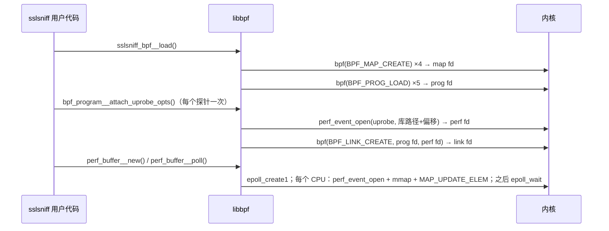
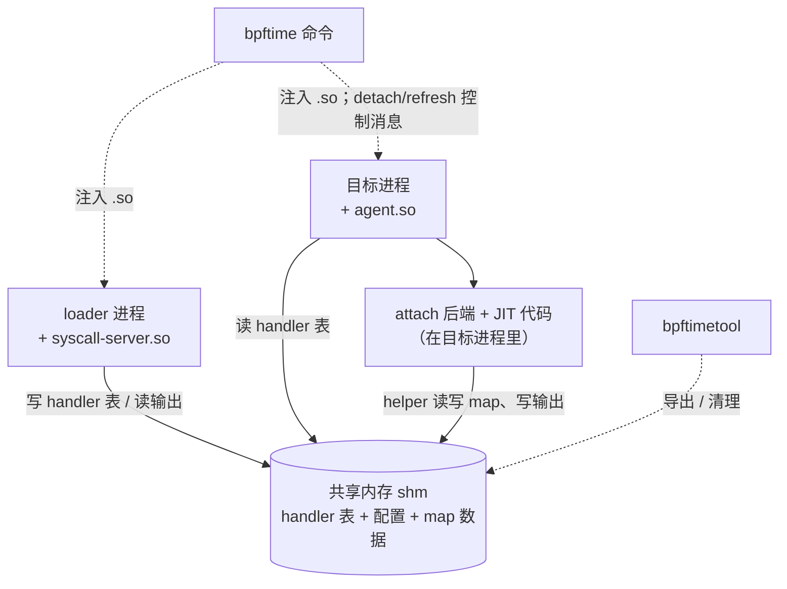
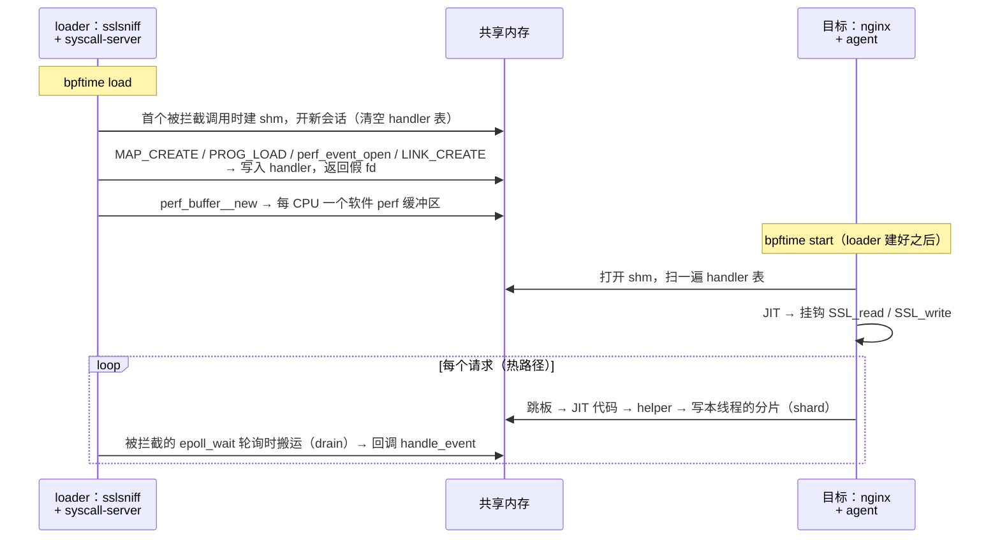

# 0. 全景架构

> 一句话：这是全书的"地图页"。先补齐读 bpftime 需要的最少 eBPF 概念，再讲 bpftime 的核心思路、
> 由哪几块拼成、仓库里每个目录管什么。读完能回答"bpftime 为什么能让 sslsniff 不改一行代码
> 就在用户态跑起来，又为什么比内核 uprobe 快"。后续各章都在这张地图上放大某一块。
>
> 前置：无，本章是起点。预计用时：60–90 分钟（0.1 节熟悉 libbpf 的读者可以跳读）。

## 本章要回答的问题

- 一个 eBPF 工具（比如 sslsniff）从启动到打印出数据，要和内核打哪些交道？
- bpftime 用什么办法让同一个工具"以为"自己在和内核说话，其实全在用户态？
- 为什么 bpftime 处理一个 uprobe 事件比内核快？它为此放弃了什么？
- bpftime 由哪几个部件组成？仓库里哪个目录对应哪个部件、在本书哪一章讲？
- 读源码时遇到"假 fd""handler""shard"这类词，去哪里查？

## 0.1 预备知识：读 bpftime 前需要的 eBPF 最小概念

这一节只讲"能看懂后续章节"所需的最少概念，全部以 bpftime 自带的 sslsniff 为例
（源码在 `example/tracing/sslsniff/`：内核态程序 `sslsniff.bpf.c`，用户态加载器 `sslsniff.c`）。
sslsniff 的作用是：在 `SSL_read`/`SSL_write` 返回时，把明文缓冲区抓出来打印。

### 0.1.1 prog、map、helper：eBPF 的三种基本对象

eBPF 程序由三样东西配合工作。下表先给一句话定义，再给 sslsniff 里的实例。

| 概念 | 是什么 | sslsniff 里的例子 |
|---|---|---|
| **prog**（程序） | 一段 eBPF 字节码，挂在某个事件上，事件发生时被执行。加载后用一个 fd 引用。 | `probe_SSL_rw_enter`（函数入口）、`probe_SSL_read_exit`（函数返回）等 5 个程序 |
| **map**（映射表） | 键值存储，用来在多次执行之间、或程序与用户态之间传数据。也用 fd 引用。 | `bufs`、`start_ns`（hash，按线程 id 暂存参数和时间戳）、`ssl_data`（per-CPU 数组，当大缓冲区用）、`perf_SSL_events`（perf 事件数组，往用户态送数据） |
| **helper**（辅助函数） | eBPF 程序不能随便调函数，只能调一组**编号固定**的"helper"。 | `bpf_map_lookup_elem`、`bpf_get_current_pid_tgid`、`bpf_probe_read_user`（安全地读用户内存）、`bpf_perf_event_output`（发事件给用户态） |

记住一点：**prog 和 map 在内核里都是"对象"，用户态只拿到一个整数 fd**。bpftime 要做的，
就是在用户态把这套"对象 + fd"重新实现一遍。

### 0.1.2 uprobe 与 uretprobe：在用户函数上设"观察点"

**uprobe** 让 eBPF 程序在某个用户态函数**被调用时**执行；**uretprobe** 让它在函数**返回时**执行。
内核的实现方式是：把目标函数第一条指令换成断点指令，CPU 执行到这里就陷入内核，内核跑完 eBPF 程序
再让原函数继续。uretprobe 则是在函数入口偷偷改掉返回地址，让函数返回时再陷入一次内核。

sslsniff 正好两种都用：入口记下缓冲区指针 `buf`，返回时才知道实际读到多少字节，
再去 `buf` 里拷数据。

### 0.1.3 pt_regs 与 PT_REGS_PARM1：程序怎么拿到函数参数

uprobe 程序被调用时，唯一的参数 `ctx` 指向一个 `struct pt_regs`——**事件发生那一刻 CPU 寄存器的快照**。
按调用约定，函数参数和返回值都在寄存器里，所以 libbpf 提供宏来按名字取：
`PT_REGS_PARM1(ctx)` 是第一个参数，`PT_REGS_RC(ctx)` 是返回值。
`BPF_UPROBE`/`BPF_URETPROBE` 宏会把这些展开成具名参数。

`example/tracing/sslsniff/sslsniff.bpf.c` 的 `probe_SSL_rw_enter()` 和 `SSL_exit()`（节选）：

```c
// SEC 名只决定程序类型（uprobe 程序在内核里的类型是 BPF_PROG_TYPE_KPROBE），
// 真正挂到哪个函数由用户态的 attach 调用决定
SEC("uprobe/do_handshake")
int BPF_UPROBE(probe_SSL_rw_enter, void *ssl, void *buf, int num) {
    // 宏展开后：buf = PT_REGS_PARM2(ctx)，即 SSL_read(ssl, buf, num) 的第二个参数
    u64 pid_tgid = bpf_get_current_pid_tgid();        // helper：高 32 位 pid，低 32 位 tid
    u32 tid = pid_tgid;
    u64 ts = bpf_ktime_get_ns();                       // helper：当前时间
    bpf_map_update_elem(&bufs, &tid, &buf, BPF_ANY);  // 按线程暂存 buf 指针
    bpf_map_update_elem(&start_ns, &tid, &ts, BPF_ANY);
    return 0;
}

static __always_inline int SSL_exit(struct pt_regs *ctx, int rw) {
    /* ... 取回 bufp、tsp ... */
    int len = PT_REGS_RC(ctx);                         // 返回值 = 实际读写的字节数
    /* ... 填 data 的 pid/tid/len 等字段 ... */
    ret = bpf_probe_read_user(&data->buf, buf_copy_size, (char *)*bufp);  // 安全拷用户内存
    /* ... 删除 bufs/start_ns 里的条目 ... */
    bpf_perf_event_output(ctx, &perf_SSL_events, BPF_F_CURRENT_CPU, data,
                          EVENT_SIZE(buf_copy_size));  // 发给用户态
    return 0;
}
```

这一点对 bpftime 很关键：**eBPF 程序是照着内核的 `pt_regs` 布局编译的**。bpftime 在用户态触发 uprobe 时，
必须先造一个同样布局的 `pt_regs` 再交给程序（见[第 4 章](04-attach-uprobe.md)）。

### 0.1.4 libbpf 加载一个程序时，依次发哪些系统调用

sslsniff 的 `main()` 只调了几个 libbpf 函数，但每个函数背后都是一串系统调用。
下面这张图要看的是：**用户态和内核之间的全部交互，就是这几类系统调用**——bpftime 只要把它们全部接住，
就能骗过 libbpf。



逐步说明（libbpf 源码在 `third_party/libbpf/src/libbpf.c`）：

| 步骤 | 系统调用 | 做了什么 |
|---|---|---|
| 建 map | `bpf(BPF_MAP_CREATE)` | 按 `SEC(".maps")` 里的定义逐个创建 map，拿到 fd。sslsniff 有 4 个 map。 |
| 加载程序 | `bpf(BPF_PROG_LOAD)` | 把字节码交给内核，内核校验（verifier）、JIT，返回 prog fd。字节码里引用 map 的地方，libbpf 已经填上了 map fd。sslsniff 有 5 个程序。 |
| 建探针 | `perf_event_open` | 以 "uprobe" 这种 perf 事件类型、目标库路径和函数偏移为参数，创建一个探针事件，返回 perf fd。uprobe 的类型号要先读 `/sys/bus/event_source/devices/uprobe/type` 得到。 |
| 连线 | `bpf(BPF_LINK_CREATE)` | 把 prog fd 和 perf fd 连起来，返回 link fd。不支持 perf link 的内核上，libbpf 改用 `ioctl(PERF_EVENT_IOC_SET_BPF)` 完成同一件事；两种情况最后都会 `ioctl(PERF_EVENT_IOC_ENABLE)`。 |
| 收数据 | `epoll_create1` / `perf_event_open` / `mmap` / `bpf(BPF_MAP_UPDATE_ELEM)` / `epoll_*` | 见下一小节 perf buffer。 |

另外，libbpf 在需要时还会发几次"试探性"的 `bpf()` 调用，探测内核支持哪些功能。
sslsniff 默认给 OpenSSL、GnuTLS、NSS 三个库都挂探针；以 OpenSSL 为例是 4 个：
`SSL_write`、`SSL_read` 各一个 uprobe + 一个 uretprobe。

### 0.1.5 perf buffer：内核往用户态送数据的管道

**perf buffer** 是一组 per-CPU 的环形缓冲区。

- **建立**（`perf_buffer__new`）：先 `epoll_create1` 建一个 epoll；然后对每个 CPU 调一次 `perf_event_open`
  （软件事件 `PERF_COUNT_SW_BPF_OUTPUT`），把得到的 fd 用 `mmap` 映射成一块环形内存；再用 `BPF_MAP_UPDATE_ELEM`
  把"CPU 号 → 这个 perf fd"写进 `PERF_EVENT_ARRAY` 类型的 map（sslsniff 的 `perf_SSL_events`）；最后把 fd 加进 epoll。
- **写**：eBPF 程序调 `bpf_perf_event_output(ctx, &perf_SSL_events, BPF_F_CURRENT_CPU, data, size)`，
  helper 用当前 CPU 号去 map 里找到那个 CPU 的环，把一条记录（头 + 数据）写进去。
- **读**：用户态 `perf_buffer__poll` 调 `epoll_wait` 等待有数据的环，然后直接在 mmap 出来的内存里读记录，
  逐条回调 `handle_event`。环的开头一页是控制页，里面两个游标：`data_head`（写到哪）、`data_tail`（读到哪）。

### 0.1.6 要点

- eBPF 对象（prog、map、link、perf 事件）都活在内核里，用户态只持有 fd。
- libbpf 和内核之间只走几种系统调用：`bpf()`、`perf_event_open`、`ioctl`、`mmap`、`epoll_*`，外加读几个 `/sys` 文件。
- uprobe 程序通过 `pt_regs` 拿参数和返回值，这个布局是写死在程序里的。
- perf buffer = per-CPU 环形内存 + epoll 通知；生产者是 helper，消费者是用户态。

## 0.2 bpftime 是什么：把内核的 eBPF 搬进用户态

### 0.2.1 核心思想

打个比方：内核 eBPF 像一家银行，用户（libbpf）递上申请单（系统调用），银行在内部金库（内核内存）里
建账户（prog/map），给你一张号码牌（fd）。bpftime 则是在**用户态开了一家"仿真银行"**：
柜台、账本格式、号码牌都和真银行一模一样，但金库是一段**共享内存**。

具体来说，bpftime 用两个注入的动态库，各管一侧：

- **`libbpftime-syscall-server.so`** 用 `LD_PRELOAD` 注入 **loader**（加载 eBPF 程序的一方，如 sslsniff）。
  它定义了和 glibc 同名的 `syscall()`、`mmap`、`epoll_wait` 等函数，抢先接住 libbpf 的调用，
  把"创建 map / 加载 prog / 建 link"变成"往共享内存里写一条记录"，然后返回一个**假 fd**。
- **`libbpftime-agent.so`** 注入**目标进程**（被追踪的程序，如 nginx），方式是 `LD_PRELOAD` 或 Frida 注入（Frida 是一个动态插桩库，能把代码注入运行中的进程、改写运行中函数的开头）。
  它从共享内存读出这些记录，在本进程里把字节码 JIT 成本机码，再把目标函数（如 `SSL_read`）的开头
  改写成跳转，跳到这段代码。

两边之间的数据全部经过一段名为 `bpftime_maps_shm` 的共享内存（下文简称 shm）。
于是 sslsniff 不改一行代码，就"以为"自己在和内核打交道。

下表对比两种部署形态：

| | 内核 eBPF | bpftime |
|---|---|---|
| prog/map/link 存在哪 | 内核内存，用 fd 引用 | 共享内存 `bpftime_maps_shm` 里的 **handler 表**（表里一格叫一个 handler，代表一个对象，见[术语表](#glossary)），用**假 fd**（表的下标）引用 |
| 加载入口 | 真的 `bpf(2)` 系统调用 | `LD_PRELOAD` 的 syscall-server 用同名函数覆盖 glibc 的 `syscall()` 等，不需要 seccomp 或 ptrace |
| uprobe 怎么触发 | 断点指令 → 陷入内核 → 内核执行程序 | 默认（Frida 后端）：目标函数开头被改写成跳转 → 同进程内跳板（trampoline）→ JIT 好的本机码 |
| 谁执行字节码 | 内核 verifier + 内核 JIT | 可选的用户态 verifier（PREVAIL）+ LLVM JIT（默认）或 ubpf |

"假 fd"值得多说一句：在 loader 里，syscall-server 真的 `open("/dev/null")` 向内核要一个 fd 号，
用这个号当 handler 表的下标。号码被内核占住，就不会和 loader 自己打开的文件撞号；但它的**含义**
由 shm 里同号的格子决定。到了目标进程里，这个数字只是表下标，和目标进程自己的 fd 毫无关系。
详见[第 2 章](02-runtime-shm.md)。

### 0.2.2 为什么快：uprobe 不进内核

内核 uprobe 每命中一次，都要从用户态陷入内核（断点异常），执行完再返回；被替换掉的原指令有时还要再陷入一次去单步执行；
uretprobe 在函数返回时又要陷入一次。像 sslsniff 这样一入一出都挂探针，每次 `SSL_read` 至少两次进出内核。
这类开销是**固定的**：哪怕 eBPF 程序本身只有几十条指令，每个事件也要先付这笔"过路费"。

bpftime 的 Frida 后端把这一切变成了**同一进程内的普通函数调用**：跳板保存寄存器 → 调 JIT 出来的本机码 →
helper 也是普通 C++ 函数。没有特权级切换，开销只和实际执行的指令数有关。

但要注意一个前提：**只有热路径上真的不进内核，这个优势才成立**。如果某个 helper 内部调了真正的系统调用，
每个事件就又要付一次进出内核的钱。官方代码里确实有这样的点（例如 `bpf_perf_event_output` 每次都改、再恢复线程的
CPU 亲和性），见本章深入参考的"热路径上的兼容层代价"和[第 7 章](07-helpers.md)。

> 上面说的是 Frida 后端（x86_64、aarch64 的默认）；riscv64 上用断点 + 信号的 trap 后端，见[第 4 章](04-attach-uprobe.md) 4.8 节。

### 0.2.3 代价：安全模型变了

内核 eBPF 的程序跑在内核里，内核/用户态边界天然把它和被观测的进程隔开。bpftime 的程序直接跑在
**目标进程的地址空间**里，隔离只能靠 verifier 加（可选的）MPK 内存保护键。由此带来两个后果：

1. **内核顺手提供的保护要自己模拟**。例如内核的 `bpf_probe_read` 遇到坏指针会返回错误而不是崩溃。
   bpftime 在编译选项 `ENABLE_PROBE_READ_CHECK=ON`（CMake 默认）时，对**本进程**调用 `process_vm_readv`
   来拷贝，坏地址就返回 `-EFAULT`；关掉这个选项则退化为直接 `memcpy`，坏指针会让宿主崩溃。
2. **agent 是住在别人家里的客人**。上游在根目录 `CLAUDE.md` 里写了一份"宿主进程契约"：初始化、分配、执行
   失败都**不得**让宿主退出，只关掉受影响的 bpftime 功能（这叫 fail-open：出错时自己失效，宿主照常运行）；
   默认不碰宿主的 stdin/stdout/stderr；替换信号处理函数时必须恢复或转发原来的。读 agent 和 syscall-server
   的错误处理代码时，以它为准。实际代码有几处没做到（例如 `bpf_trace_printk` 直接 `vprintf` 到宿主的 stdout），见[附录 B](B-known-issues.md#b-entry)。

### 0.2.4 要点

- bpftime = 用户态共享内存里的一套"仿内核"eBPF 对象模型 + 两个注入库。
- syscall-server 冒充内核接收 libbpf 的调用；agent 在目标进程里执行程序。
- 快的原因：Frida 后端的 uprobe 是进程内跳转，不进内核；前提是 helper 也不进内核。
- 代价：程序和宿主同处一个地址空间，故障隔离要靠自己模拟，注入代码必须"不伤宿主"。

## 0.3 组件图：两个 .so、一段 shm、若干工具

bpftime 运行时的主体是**两个动态库 + 一段共享内存**，其余是工具和可选组件。
这张图要看的是：**loader 和目标进程之间的数据全部经过中间那段 shm**；
`bpftime` 命令只负责把 .so 注入进去，外加少量控制消息。



逐个说明：

- **syscall-server 是"假内核"**。`BPF_MAP_CREATE`、`BPF_PROG_LOAD`、`BPF_LINK_CREATE` 最终都只是在 shm 的 handler 表里
  加一条记录。prog 记录里**只存字节码**，不存 agent 用的任何执行状态（`bpftime-aot` 可以往里另存 AOT 本机码，但 agent 不读）。
- **shm 是懒创建的**。syscall-server 加载时什么都不建；直到**第一个**被拦截的函数调用进来（不一定是 `bpf()`，
  一次普通的 `close` 也算），才创建 shm。如果 shm 已存在，它会打开旧的；无论哪种情况都会开启一个"新会话"，
  清空 handler 表。所以两个 loader 不能共用一个 shm 名（[附录 B](B-known-issues.md#b-shm)）。
- **agent 是"假内核的执行侧"**。它启动时打开同一段 shm（打不开就重试，最多约 3 秒），
  扫一遍 handler 表，在**本进程**为每个 prog 构造执行体、JIT，再交给对应的 attach 后端去挂钩。
  **默认只扫这一次**：之后 loader 再建的对象它看不到，除非用 `bpftime trace` 带的自动刷新，或者发 IPC 刷新命令。
- **执行状态不进 shm**，这是关键设计。JIT 出来的机器码里有本进程的绝对地址（helper 函数地址等），换个进程就没意义；
  而字节码是纯数据。所以每个 agent 各自 JIT。
- **uprobe 后端在编译期定死**：Frida 或 trap，二选一。两者对外提供同一组 attach 类型
  （uprobe、uretprobe，以及让 eBPF 改返回值或整个替换函数的 override、ureplace，[第 4 章](04-attach-uprobe.md)）。
- **热路径上两边不直接通信**；控制面上 agent 另有一个本地 IPC socket 和 `SIGUSR1` 信号，给 `bpftime detach/trace`
  做卸载和刷新（[第 3 章](03-entrypoints.md)）。
- **可选组件**（图里没画）：daemon 不用 `LD_PRELOAD` loader，而是在内核里监视别人的 `bpf()` 调用并镜像进 shm；
  CUDA 构建下 agent 还能把 eBPF 编成 GPU 代码插进 CUDA kernel。见 0.6 节的仓库地图。

宿主进程契约在代码里的落点：syscall-server 的每个拦截函数都包了一层"出异常就改走原函数"
（`handle_exceptions`）；agent 初始化失败走 `init_fail()` 撤销已做的部分然后 `return`；
日志默认写 `~/.bpftime/runtime.log` 而不是宿主的 stderr。

## 0.4 一次追踪会话：三方分工

以 ssl-nginx 为例：一个终端 `bpftime load ./sslsniff`，另一个终端 `bpftime start nginx`
（或对已经在跑的进程 `bpftime attach <pid>`）。`bpftime` 命令本身不做追踪，它只负责"把哪个 .so、
用什么方式注入哪个进程"：`load`/`start` 是 fork 子进程、设好 `LD_PRELOAD` 再 exec；`attach` 是用
Frida 的注入器把 agent 塞进已运行的进程。

**顺序很重要：先 load，等 loader 把对象建好，再 start**。agent 只在启动时扫一次表，
先起的 agent 要么等不到 shm（最多等约 3 秒）就放弃，要么扫到一张空表，之后什么都不挂（[第 1 章](01-lifecycle.md)第 7 步）。

这张图要看的是：**控制面（loader）开头写、循环里读；数据面（目标进程）读 handler 表、写结果**。



一句话：**控制面写 handler 表、拉取结果；数据面读 handler 表、跑代码、产生结果；shm 是数据的唯一交汇点**。
完整的逐步时间线见[第 1 章](01-lifecycle.md)。

两个和 0.1 对照着看的细节：

- loader 侧的 `mmap` 被 syscall-server 接住，返回的不是内核的 perf 环，而是 shm 里 bpftime 自己实现的环形缓冲区，
  布局与内核一致，所以 libbpf 照常读。
- bpftime 的 perf 缓冲区写入侧不是按 CPU 分，而是按**写入线程**分片（每个 (pid, tid) 一个 shard），
  消费者读之前先把各分片的数据"搬运"（drain）到 libbpf 看到的那块缓冲区。这样多个业务线程同时写也不用抢同一把锁。

## 0.5 三段关键代码

这三段代码合起来，基本就是 bpftime 的"骨架"：一段负责截胡、一段负责抢先初始化、一段是 handler 表本身。

### 选段一：拦截 = 同名符号覆盖

**直觉**：动态链接器查找函数时，`LD_PRELOAD` 的库排在最前面。只要 syscall-server 导出一个也叫 `syscall`
的函数，libbpf 调 `syscall(__NR_bpf, ...)` 时就会进到这里，而不是 glibc。

`runtime/syscall-server/syscall_server_main.cpp` 的 `syscall()`：

```c
extern "C" long syscall(long sysno, ...)
{
	// 不管实际几个参数，一律读 6 个（注释说 glibc 也是这么干的）
	va_list args;
	va_start(args, sysno);
	long arg1 = va_arg(args, long);
	/* ... arg2..arg6 同理 ... */
	va_end(args);
	if (!initialize_ctx())             // bpftime 自己没准备好 → 直接走真系统调用
		return fallback_syscall(sysno, arg1, /* ... */ arg6);
	auto call_original = [&]() {       // "原样交给内核"的兜底
		return context->orig_syscall_fn(sysno, arg1, /* ... */ arg6);
	};
	if (sysno == __NR_bpf) {
		int cmd = (int)arg1;
		auto attr = (union bpf_attr *)(uintptr_t)arg2;
		// 交给假内核处理；抛异常就退回真系统调用
		return handle_exceptions(
			[&]() { return context->handle_sysbpf(cmd, attr, (size_t)arg3); },
			call_original);
	} else if (sysno == __NR_perf_event_open) {
		/* ... handle_perfevent(...)，同样以 call_original 兜底 ... */
	} /* ... dup3 / memfd_create 分支 ... */
	return call_original();            // 其他系统调用原样放行
}
```

- **为什么这样写**：不需要内核模块、不需要 ptrace，对 libbpf 完全透明。同文件还用同样手法覆盖了
  `mmap`、`epoll_*`、`ioctl`、`close`、`open`/`openat`、`read`、`fopen` 等一整族函数（比如读
  `/sys/.../uprobe/type` 时返回一个伪造的文件）。
- **坑**：只能拦住**经过 glibc 动态符号**的调用。静态链接、或者直接内联 `syscall` 指令的程序（典型如 Go）
  会漏网。另外这些覆盖对 loader 自己的普通调用也生效，有副作用（比如 loader 自己的 epoll 会坏），
  见[附录 B](B-known-issues.md#b-entry)。

### 选段二：agent 劫持 `__libc_start_main`，抢在 `main` 之前初始化

**直觉**：uprobe 必须在业务代码跑起来之前就挂好（nginx 一启动就会调 `SSL_read`）。
glibc 启动程序时会调 `__libc_start_main(main, ...)`，agent 就把它也覆盖掉，偷偷把 `main` 换成自己的包装函数。

`runtime/agent/agent.cpp` 的 `__libc_start_main()`：

```c
extern "C" int __libc_start_main(int (*main)(int, char **, char **), int argc,
				 char **argv, /* ... init, fini, rtld_fini, stack_end ... */)
{
	orig_main_func = main;                     // 记住真正的 main
	using this_func_t = decltype(&__libc_start_main);
	this_func_t orig = (this_func_t)dlsym(RTLD_NEXT, "__libc_start_main");
	// 让 glibc 启动 bpftime_hooked_main：它先调 bpftime_agent_main 初始化，再调原 main
	return orig(bpftime_hooked_main, argc, argv, /* ... */);
}
```

- `bpftime_agent_main` 做的事：打开 shm、注册各类 attach 后端（syscall trace、uprobe、可选 CUDA）、
  扫 handler 表、为每个 prog 构造执行体并挂钩。
- `bpftime attach <pid>` 场景没有"启动时机"可抢：Frida 注入 agent 后**直接调用**同一个导出函数
  `bpftime_agent_main`。同一个初始化函数，两条触发路径。
- **坑**：初始化发生在 `main` 之前，不能假设宿主的运行时已就绪；同一进程可能被注入多次，
  入口会先检查有没有已加载的 agent 副本、有就转交给它；初始化失败只撤销自己、不终止宿主。

### 选段三：整个"内核对象模型"就是 shm 里的一个数组

**直觉**：内核里有一张"fd → 对象"的表。bpftime 把它换成 shm 里的一个定长数组：下标就是假 fd，
每个元素是"七种 handler 之一"。

`runtime/src/handler/handler_manager.hpp` 的 `handler_variant` 与 `handler_manager`（节选）：

```cpp
// 一个格子可能是：空、map、link、prog、perf 事件、epoll、memfd
using handler_variant =
	std::variant<unused_handler, bpf_map_handler, bpf_link_handler,
		     bpf_prog_handler, bpf_perf_event_handler, epoll_handler,
		     memfd_handler>;

// 用 boost::interprocess（跨进程共享内存库，见第 2 章 2.1）的分配器，让这个 vector 本身也住在共享内存里
using handler_variant_vector = boost::interprocess::vector<
	handler_variant,
	allocator<handler_variant, managed_shared_memory::segment_manager>>;

class handler_manager {   // 这个对象整体放在 shm 里，构造时一次分配 max_fd_count 个格子
	/* set_handler(fd, handler)：把 handler 放进下标为 fd 的格子 */
	/* get_handler / is_allocated / clear_id_at / clear_all ... */
    private:
	handler_variant_vector handlers;
};
```

- **为什么这样写**：一张表装下所有对象类型；整表可以被多个进程寻址；还能整体导出成 JSON。
  agent 遍历时用 `std::holds_alternative` / `std::get` 按类型分派。
- **下标从哪来**：handler 表自己不决定号码。syscall-server 路径上，号码是 loader 里 `open("/dev/null")`
  得到的真 fd 号；daemon 则用"表里最小的空格"或直接用内核对象 id。两套分配器的细节见[第 2 章](02-runtime-shm.md)。
- **坑**：异常退出后 shm 可能残留，只起 agent 不起 loader 时 agent 会把残留对象照单挂上——
  所以做实验前先 `bpftimetool remove`，或者给每次实验设一个独立的 `BPFTIME_GLOBAL_SHM_NAME`。

## 0.6 仓库地图

下面按"运行时主干 → 事件源 → 执行引擎 → 可选组件 → 工具与材料"的顺序，把官方仓库每个目录对上它负责的部件和本书章节。
第一次读不必全看懂，知道"有这么个东西、在哪章讲"就够了。

**运行时主干（`runtime/`）**

| 目录 / 文件 | 一句话 | 详见 |
|---|---|---|
| `runtime/syscall-server/` | 注入 loader 的 `libbpftime-syscall-server.so`：覆盖 `syscall`/`mmap`/`ioctl`/`epoll_*`/`open`/`close` 等，把 bpf 相关调用变成 shm 操作 | [第 3 章](03-entrypoints.md) |
| `runtime/agent/` | 注入目标进程的 `libbpftime-agent.so`：入口 `bpftime_agent_main`，打开 shm、注册 attach 后端、扫表、IPC 与 `SIGUSR1` 卸载 | [第 3 章](03-entrypoints.md) |
| `runtime/src/handler/` | handler 表本身和 6 种 handler（map、prog、link、perf 事件、epoll、memfd），加上"空格子"共 7 种取值 | [第 2 章](02-runtime-shm.md) |
| `runtime/src/bpftime_shm*.cpp` | shm 的创建/打开/删除、假 fd 分配、会话、对外 C API；`bpftime_shm_json.cpp` 是 JSON 导出导入 | [第 2 章](02-runtime-shm.md) |
| `runtime/src/attach/` | `bpf_attach_ctx`：agent 侧"按 handler 表实例化 prog/perf/link 并交给 attach 后端"的核心类（含 CUDA 部分） | [第 3 章](03-entrypoints.md) |
| `runtime/src/bpftime_prog.cpp` | `bpftime_prog`：一个程序在本进程里的执行体（字节码 + VM 实例） | [第 6 章](06-vm-jit.md) |
| `runtime/src/bpf_helper.cpp`、`ufunc.cpp`、`runtime/extension/` | 全部 helper 的实现与分组注册；ufunc（让程序调宿主函数）；扩展 helper | [第 7 章](07-helpers.md) |
| `runtime/src/bpf_map/` | 各类 map 实现：`userspace/`（纯用户态）、`shared/`（转发给真内核 map）、`gpu/`（CUDA） | [第 8 章](08-maps.md) |
| `runtime/include/` | 公共头：`bpftime_shm.hpp`（C API 与类型枚举）、`bpftime_config.hpp`（`runtime_config`）等 | [第 2 章](02-runtime-shm.md) |
| `runtime/object/` | 用 libbpf 解析 `.bpf.o` 的小工具层，单测和工具用 | [第 11 章](11-build-test.md) |
| `runtime/unit-test/` | Catch2 单测，编成一个 `bpftime_runtime_tests`；`runtime/test/` 已废弃 | [第 11 章](11-build-test.md) |

**事件源（`attach/`）**：所有后端都实现同一个接口 `base_attach_impl`——"给我一个地址和一个回调，事件发生时调它"。

| 目录 | 一句话 | 详见 |
|---|---|---|
| `attach/base_attach_impl/` | 后端接口、`pt_regs` 定义、attach 私有数据基类 | [第 4 章](04-attach-uprobe.md) |
| `attach/frida_uprobe_attach_impl/` | 用 frida-gum inline hook 实现 uprobe/uretprobe/override/ureplace；x86_64、aarch64 等架构的默认后端 | [第 4 章](04-attach-uprobe.md) |
| `attach/trap_uprobe_attach_impl/` | 断点 + `SIGTRAP` 的 uprobe 后端，只在 riscv64 上编进来 | [第 4 章](04-attach-uprobe.md) |
| `attach/simple_attach_impl/` | 给宿主程序自定义事件源用的最小后端（`example/attach_implementation` 的 nginx 插件用它） | [第 4 章](04-attach-uprobe.md) |
| `attach/syscall_trace_attach_impl/` | 系统调用追踪：把 tracepoint 类型的 link 变成"系统调用进/出时的回调" | [第 5 章](05-syscall-trace.md) |
| `attach/text_segment_transformer/` | 启动时把进程里每条 `syscall` 指令改写成 `call *%rax`（zpoline 思路），给 syscall trace 供事件；`bpftime start -s` 时启用，仅 x86_64 | [第 5 章](05-syscall-trace.md) |
| `attach/nv_attach_impl/` | CUDA 探针：拦截 CUDA 运行时、把 eBPF 编成 PTX 插进 kernel、重编模块 | [第 9 章](09-gpu.md) |

**执行引擎（`vm/`）**

| 目录 | 一句话 | 详见 |
|---|---|---|
| `vm/vm-core/` | C 接口 `ebpf-vm.h`（`ebpf_create/load/compile/exec`），bpftime_prog 只调这一层 | [第 6 章](06-vm-jit.md) |
| `vm/compat/` | 多后端抽象 `bpftime_vm_impl` + 按名字创建的工厂；`llvm-vm/`、`ubpf-vm/` 两个适配器 | [第 6 章](06-vm-jit.md) |
| `vm/llvm-jit/` | git 子模块 llvmbpf：eBPF → LLVM IR → JIT / AOT（`.o`）/ PTX；默认后端 | [第 6 章](06-vm-jit.md) |
| `third_party/ubpf/` | 另一个后端 ubpf（解释器，也能 JIT），`BPFTIME_VM_NAME=ubpf` 时使用 | [第 6 章](06-vm-jit.md) |

**可选组件**

| 目录 | 一句话 | 详见 |
|---|---|---|
| GPU / CUDA（`attach/nv_attach_impl/`、`runtime/src/bpf_map/gpu*/`、`runtime/src/attach/bpf_attach_ctx_cuda.cpp`、`example/gpu/`） | `BPFTIME_ENABLE_CUDA_ATTACH` 构建才有。注意：bpftime 里的 "kprobe" 就是 **CUDA kernel 探针**，CPU 侧没有 kprobe 实现 | [第 9 章](09-gpu.md) |
| `daemon/` | 不注入 loader：用内核 eBPF 监视别的进程的 `bpf()`/`perf_event_open()`，把 uprobe 程序镜像进 shm；需要 root，目标进程仍要 agent | [第 10 章](10-periphery.md) |
| `bpftime-verifier/` | PREVAIL 用户态 verifier 的薄封装，`ENABLE_EBPF_VERIFIER=ON` 时 runtime 和 syscall-server 都链接它，但只在 loader 侧 `BPF_PROG_LOAD` 时执行校验；只验证 TRACEPOINT 和 SOCKET_FILTER 类型，所以 uprobe 程序其实不被验证 | [第 10 章](10-periphery.md) |

**工具与材料**

| 目录 | 一句话 | 详见 |
|---|---|---|
| `tools/cli/` | `bpftime` 命令：`load`/`start`/`attach`/`detach`/`trace`，本质是拼环境变量 + fork/exec 或 Frida 注入 + IPC | [第 3 章](03-entrypoints.md) |
| `tools/bpftimetool/` | 直接读写 shm：`export`/`import`/`load`/`remove`/`run` | [第 10 章](10-periphery.md) |
| `tools/aot/` | `bpftime-aot`：把字节码 AOT 编成本机 `.o`，可单独运行或回填进 shm | [第 10 章](10-periphery.md) |
| `example/` | 示例；sslsniff 在 `example/tracing/sslsniff/`，最小的两进程示例是 `example/malloc/` | [第 11 章](11-build-test.md)、[第 12 章](12-practice.md) |
| `benchmark/` | 性能测试；本书锚点场景是 `ssl-nginx/` | [第 11 章](11-build-test.md) |
| `cmake/`、`CMakeLists.txt`、`Makefile` | 构建选项与产物；uprobe 后端由 `cmake/StandardSettings.cmake` 按架构强制选择 | [第 11 章](11-build-test.md) |
| `third_party/` | libbpf、bpftool、frida、spdlog、ubpf、Catch2 等子模块或依赖 | — |

根目录的 `CLAUDE.md`（与 `AGENTS.md` 内容相同）有组件速览和宿主进程契约，`usage.md` 是用法说明。
仓库里不少 README 已经和代码对不上，读的时候以代码为准（[第 11 章](11-build-test.md)有一张清单）。

## 0.7 术语表

<a id="glossary"></a>

按"从外到内"排列。具体代码位置见本章末尾「代码位置速查」。

| 术语 | 含义 |
|---|---|
| **loader / 控制面** | 加载 eBPF 程序的进程（如 sslsniff），里面注入了 syscall-server。负责写 handler 表、读结果。 |
| **目标进程 / 数据面** | 被追踪的进程（如 nginx），里面注入了 agent。负责执行 eBPF 程序、产生结果。 |
| **syscall-server** | `libbpftime-syscall-server.so`。用同名函数覆盖 `syscall()`/`mmap`/`ioctl`/`epoll_*`/`open*`/`close` 等，把 eBPF 相关调用变成 shm 操作；出错就退回原函数。 |
| **agent** | `libbpftime-agent.so`。以 `LD_PRELOAD` 或 Frida 注入目标进程，读 handler 表、JIT、挂钩。入口是 `bpftime_agent_main`。 |
| **宿主进程契约 / fail-open** | `CLAUDE.md` 对注入代码的约束：不终止宿主、默认不碰宿主 stdio、替换信号处理函数须恢复或转发。fail-open 指出错时自己失效、宿主照常运行。 |
| **shm（全局共享内存）** | boost::interprocess 管理的共享内存段，默认名 `bpftime_maps_shm`（`BPFTIME_GLOBAL_SHM_NAME` 可改）、默认 50MB，所有跨进程状态的载体。由 syscall-server 在第一个被拦截调用时创建；只有创建它的那个 loader（owner）在退出、且没有其他活着的 loader 或 agent 时才删除。 |
| **handler** | shm 里 handler 表的一个格子里放的记录，代表一个 eBPF 对象：map、prog、link、perf 事件、epoll、memfd 之一（再加"空"共 7 种）。 |
| **handler 表 / handler_manager** | shm 中的定长 handler 数组（默认 6144 格，`BPFTIME_MAX_FD_COUNT` 可改），相当于内核 fd 表的替身。syscall-server 路径上表不分配号码（号码来自 `open_fake_fd`）；表自带的"最小空格"分配器只有 daemon 和单测用。 |
| **假 fd** | handler 表的下标。syscall-server 路径上，它**同时是** loader 进程里一个指向 `/dev/null` 的真 fd（借内核 fd 表来分配号码、防撞号）；daemon 路径上，它是"表里最小的空格"或内核对象 id。在目标进程里它只是个表下标。两套分配器见[第 2 章](02-runtime-shm.md)。 |
| **会话 / epoch** | 每个 syscall-server 启动时都"开新会话"：清空整张 handler 表，并把 shm 里的 epoch 计数器加 2（中间为奇数表示"正在换"）。agent 扫表前后比较 epoch，发现换了会话就重扫。它只标记"换会话"，不保护会话内的普通增删。 |
| **runtime_config** | shm 中的全局配置块：helper group 开关、JIT 开关、verifier 模式、日志路径、VM 名等。loader 用自己的环境变量写入，agent 读它——所以 agent 的 JIT、日志路径等都跟 loader 走。 |
| **link handler** | 记录"哪个 prog 挂到哪个事件"：两个假 fd 之间的一条连线（`prog_id`、`attach_target_id`）。 |
| **perf buffer** | 往用户态送事件的环形缓冲区。内核里是 per-CPU 的；bpftime 里是 shm 中自实现的环，布局与内核兼容，libbpf 可以直接读。 |
| **shard（分片）** | bpftime perf buffer 写入侧按 (pid, tid) 分的子缓冲区，每个写入线程一个，避免多线程抢锁。 |
| **drain（搬运）** | 消费者读之前，把各 shard 的记录搬进 libbpf 看到的那块缓冲区的动作，在被拦截的 `epoll_wait` 轮询里触发，由 loader 执行。 |
| **attach 后端 / attach impl** | 一种事件源的挂载实现（Frida uprobe、trap uprobe、syscall trace、CUDA、simple），都继承 `base_attach_impl`。 |
| **attach_private_data** | 每种 attach 类型的参数载体（如"哪个库、哪个偏移"），由 agent 从字符串解析而来。 |
| **跳板（trampoline）** | Frida 把目标函数开头改写成跳转，跳到一小段保存寄存器的代码，再回调 eBPF 程序。 |
| **trap uprobe** | 不依赖 Frida 的断点后端：首条指令换成断点，在 `SIGTRAP` 处理函数里执行程序。只在 riscv64 上编进来，只接受审计过的几个信号安全 helper。 |
| **syscall trace / text segment transformer** | 系统调用追踪：transformer 在启动时把每条 `syscall` 指令改写成 `call *%rax`，跳进 bpftime 的分发函数；`bpftime start -s` 时启用，仅 x86_64，需要 `vm.mmap_min_addr=0`。普通 `LD_PRELOAD` 注入时这类 link 能建但永不触发。 |
| **kprobe（在 bpftime 里）** | perf 事件类型 8/9。CPU 侧**没有** kprobe 实现；CUDA 构建里 agent 把 8/9 交给 `nv_attach_impl`，即"CUDA kernel 入口/出口探针"（程序名以 `cuda__` 开头）。 |
| **helper** | eBPF 程序能调用的辅助函数。bpftime 里就是普通 C/C++ 函数，JIT 时按编号绑定到函数地址。 |
| **helper group** | 一组 helper 的注册单元：`kernel_utils`（probe_read、时间等）、`shm_maps`（map 操作）、`ufunc`。没设 `BPFTIME_HELPER_GROUPS` 时三组**全开**。 |
| **ufunc** | 经 helper 1000/1001 的二级分发，让 BPF 程序调用宿主进程里的原生函数（可用于热补丁）。 |
| **bpftime_prog** | 一个 prog 的进程本地执行体（字节码 + VM 实例 + helper 绑定），由 shm 里的字节码构造，**不在 shm 中**。 |
| **VM 后端 / compat 层** | 执行引擎的统一抽象（加载、编译、执行、注册外部函数、AOT），按名字创建，后端有 `llvm`（默认）与 `ubpf`。 |
| **JIT / llvmbpf** | 运行时把字节码编译成本机码。默认后端 llvmbpf 用 LLVM OrcJIT，helper 地址在编译时直接写进代码，运行时不查表；map 引用编进代码的是 map 的假 fd，不是地址。 |
| **AOT** | 提前编译：把字节码编成本机可重定位 ELF（`.o`），可以存回 prog handler 或用 `bpftime-aot run` 单独跑。 |
| **verifier** | 用户态的 PREVAIL 校验器封装，仅在 `ENABLE_EBPF_VERIFIER=ON` 构建、loader 侧 `BPF_PROG_LOAD` 时运行，默认校验失败只告警。 |
| **auto-refresh / IPC 刷新** | agent 重新扫表的两种方式：`bpftime trace` 注入时带 `auto_refresh_ms` 启动周期性增量扫表；或通过 agent 的本地 socket 发 `refresh` 命令全拆重扫。没有这两者时 agent 只扫一次。 |
| **kernel-user map** | `shared/` 下的 map 类型（类型号 +1000），操作直接转发给真内核 map；daemon 和 `BPFTIME_RUN_WITH_KERNEL` 模式用到。 |
| **daemon** | 内核协同模式：内核 eBPF tracer 监听其他进程的 `bpf(2)` 等调用，把 uprobe 程序重定向到 bpftime 的 shm，loader 无需 `LD_PRELOAD`。 |
| **MPK** | Intel 内存保护键。`BPFTIME_ENABLE_MPK` 构建下，eBPF 执行期间之外 shm 是只读的，防宿主误写；默认不启用。 |
| **bpftimetool** | shm 检修工具：`export`（导出 JSON）、`import`、`load`、`remove`（删除 shm）、`run`。清理残留 shm 的标准动作。 |
| **bpftime 命令（cli）** | `bpftime load/start/attach/detach/trace`，本质只是"选择注入哪个 .so、怎么注入"，外加 detach/refresh 的控制消息。 |

## 小结

- eBPF 的用户态和内核之间只走几类系统调用（`bpf`、`perf_event_open`、`ioctl`、`mmap`、`epoll_*`）；接住它们就能冒充内核。
- bpftime 把 prog/map/link/perf 这些"内核对象"放进共享内存 `bpftime_maps_shm` 的 handler 表，用表下标充当假 fd；在 loader 里这个号码由一个 `/dev/null` 真 fd 占住。
- syscall-server 注入 loader，负责"写 handler 表、读结果"；agent 注入目标进程，负责"读 handler 表、JIT、挂钩、执行"。
- 数据只经过 shm；JIT 结果不进 shm，每个进程各自编译。agent 默认只在启动时扫一次表，所以先起 loader。
- 快的原因是 Frida 后端的 uprobe 只是进程内跳转，不进内核；热路径上调真系统调用的 helper 会削弱这个优势。
- 代价是程序和宿主同处一个地址空间：内核的保护要自己模拟，注入代码必须遵守"不伤宿主"的契约。
- 仓库按"runtime 主干 / attach 事件源 / vm 执行引擎 / 可选组件（GPU、daemon、verifier）/ 工具与材料"分块，0.6 节的表就是全书的目录索引。

## 动手验证

下面的命令只用官方树里现成的 `build-jit/`，非 root 可跑（本书写作时在 x86_64 Debian 上实跑过）。
设一个独立的 shm 名，避免碰到别人的 `bpftime_maps_shm`。更多实验见[第 12 章](12-practice.md#exp-0)。

**实验 1：看两个 .so 各自覆盖了哪些符号**

```sh
B=/path/to/bpftime/build-jit
nm -D --defined-only $B/runtime/syscall-server/libbpftime-syscall-server.so | grep ' T '
nm -D --defined-only $B/runtime/agent/libbpftime-agent.so | grep -E ' [TD] '
```

预期：syscall-server 导出 `close epoll_create1 epoll_ctl epoll_wait fopen fopen64 ioctl _IO_new_fopen mmap mmap64 munmap open openat read syscall`
这一族与 libc 同名的函数；agent 导出 `__libc_start_main`、`bpftime_agent_main`、`bpftime_hooked_main`、`bpftime_agent_control`、
`_bpftime__setup_syscall_trace_callback`、`syscall_callback`、`injected_with_frida` 七个（CUDA 构建另有 `__cudaRegisterFatBinary`）。

**实验 2：sslsniff + openssl 客户端，看假 fd 和 handler 表**

需要 `openssl` 命令行和一张自签证书。sslsniff 用 `ldconfig -p` 找库，Debian 非 root 要把 `/usr/sbin` 加进 `PATH`。

```sh
SS=$PWD/example/tracing/sslsniff/sslsniff        # 先 make -C example/tracing/sslsniff
export BPFTIME_GLOBAL_SHM_NAME=demo_$RANDOM
openssl req -x509 -newkey rsa:2048 -nodes -keyout key.pem -out cert.pem -days 1 -subj /CN=localhost
openssl s_server -accept 127.0.0.1:44330 -cert cert.pem -key key.pem -quiet </dev/null &
# 终端 1：loader
PATH=$PATH:/usr/sbin BPFTIME_LOG_OUTPUT=$PWD/loader.log \
  LD_PRELOAD=$B/runtime/syscall-server/libbpftime-syscall-server.so $SS &
sleep 2
ls -l /proc/$!/fd | grep -c /dev/null           # 一串指向 /dev/null 的假 fd
$B/tools/bpftimetool/bpftimetool export $PWD/shm.json
python3 -c "import json,collections;d=json.load(open('shm.json'));print(collections.Counter(v['type'] for v in d.values()))"
# 终端 2：目标进程（loader 建好之后再起）
(echo hello; sleep 1) | LD_PRELOAD=$B/runtime/agent/libbpftime-agent.so openssl s_client -connect 127.0.0.1:44330 -quiet
# 清理
kill %1 %2; rm -f /dev/shm/$BPFTIME_GLOBAL_SHM_NAME /tmp/bpftime-shm-$BPFTIME_GLOBAL_SHM_NAME.lock
```

预期（本机实测，16 核）：handler 表里共 58 项——4 个 map、5 个 prog、16 个 link、1 个 epoll，
以及 32 个 `bpf_perf_event_handler`：其中 16 个是 uprobe/uretprobe（OpenSSL 4 个、GnuTLS 4 个、NSS 8 个，三个库的探针都登记了），
另外 16 个是软件 perf 事件（每 CPU 一个）。键（假 fd）从 4 开始连续编号（fd 3 是 loader 的日志文件；日志打不开时编号从 3 开始）。
NSS 那 8 个探针只有装了 `libnspr4` 才会登记；没装 NSS 的机器（比如[第 12 章](12-practice.md)用的容器）是 24 个 perf 事件、8 个 link。sslsniff 打印出 `WRITE/SEND ... openssl ... hello`。
顺手看一眼 `s_client` 的 `/proc/<pid>/maps`：里面多了本来不用的 `libgnutls` 和 `libnspr4`——
Frida 后端解析"模块:偏移"时会先把模块加载进目标进程，再挂钩子（[第 1 章](01-lifecycle.md)第 10 步）。

## 自测题

1. **`bpftime load` 之后、`bpftime start` 之前，loader 进程退出了。shm 里的 prog/map 还在吗？想事后用 `bpftimetool export` 检查需要什么前提？**

   <details><summary>答案</summary>

   看怎么退出。创建 shm 的 loader（owner）注册了一个退出钩子：正常退出时，如果已经没有其他活着的
   loader 或 agent 进程，就删除 shm，prog/map 随之消失。如果 loader 被 `kill -9`，退出钩子不会执行，
   而 POSIX 共享内存独立于进程存在，`bpftimetool export` 仍能读到。所以事后检查要么趁 loader 还活着做，
   要么接受"非正常退出留下的残留"。残留的副作用是：之后只起 agent 不起 loader，agent 会把残留对象照单挂上；
   而且打开旧段时沿用旧段大小。所以实验前要清理或换一个 shm 名。
   </details>

2. **为什么 JIT 出来的执行状态不放进共享内存，而是每个 agent 进程各自从字节码重建？map 的引用会不会也是"本进程地址"？**

   <details><summary>答案</summary>

   JIT 产物里写死了本进程的地址：helper 函数的地址直接编进机器码，代码页地址还受 ASLR 影响，换一个进程就无效。
   而字节码是纯数据。于是 shm 只存"对象描述"，执行体 `bpftime_prog` 在每个 agent 里本地构造。
   map 引用则不同：程序里引用 map 的 `lddw` 指令，JIT 后编进代码的是 map 的**假 fd**（一个整数），
   helper 运行时再按这个号去 shm 的 handler 表里找 map。正因为号码在 loader 和 agent 里指向同一个格子，
   map 才能跨进程共享。只有引用 `.data/.rodata` 这类"map 值"的指令才会编进 shm 映射在本进程的地址。
   </details>

3. **`bpftime attach <pid>` 没有 `LD_PRELOAD` 的机会，agent 是怎么进去并完成初始化的？和 `bpftime start` 有什么区别？**

   <details><summary>答案</summary>

   `bpftime` 命令用 Frida 的注入器把 agent 库塞进目标进程，然后直接调用它导出的 `bpftime_agent_main`。
   `start` 路径则是劫持 `__libc_start_main`，在 `main` 之前调用同一个函数。区别：attach 时初始化发生在程序
   运行中的任意时刻，之前错过的事件不会补；如果进程里已经有 agent，入口会把请求转交给已有的那份（发一个 refresh），
   而不是再初始化一份。两者都只扫一次表，都不自动刷新。
   </details>

4. **按设计，每处理一个 SSL 事件，bpftime 在目标进程里应该进几次内核？如果某个 helper 里调了一次系统调用，会怎样？**

   <details><summary>答案</summary>

   按设计是 0 次：Frida 跳板、JIT 代码、写 shm 里的 perf 分片全在用户态。一旦 helper 里出现真系统调用，
   每个事件就要多付一次（或几次）进出内核的固定开销，bpftime 相对内核 uprobe 的优势就被部分抵消。
   官方代码里确实有这样的点：`bpf_perf_event_output` 每次都要读、改、恢复线程的 CPU 亲和性（3 个绑核相关调用），成功写入时再加 `getpid`/`gettid`，共 5 次系统调用；
   `ENABLE_PROBE_READ_CHECK=ON` 时的 `bpf_probe_read_user` 每次一次 `process_vm_readv`。具体分析见本章深入参考和
   [第 7 章](07-helpers.md)。
   </details>

5. **sslsniff 里写的是 `SEC("uprobe/...")`。如果有人写了一个 `SEC("kprobe/do_sys_open")` 的程序交给 bpftime，会发生什么？**

   <details><summary>答案</summary>

   loader 侧照样成功：syscall-server 把 kprobe 类型的 `perf_event_open` 登记成一个类型为 8 的 perf handler。
   但 agent 侧 CPU 上没有 kprobe 后端：类型 8/9 只在 CUDA 构建里注册给 `nv_attach_impl`，含义是"CUDA kernel 探针"。
   非 CUDA 构建里，agent 找不到负责类型 8 的后端，日志里留一条 "Unable to lookup attach implementation of attach type 8"，
   这个 link 被跳过，其余照常；CUDA 构建里，程序名不以 `cuda__` 开头会在实例化时报错，就算改了名，也只会被当成
   "名叫 do_sys_open 的 CUDA kernel"去找。想追踪内核函数，bpftime 不是合适的工具（[第 9 章](09-gpu.md)）。
   </details>

## 深入参考

<details>
<summary>代码位置速查（按 177a1dc465ff 行号）</summary>

| 概念 / 函数 | 位置 |
|---|---|
| sslsniff 内核态程序 / 用户态加载器 | `example/tracing/sslsniff/sslsniff.bpf.c:60`（`probe_SSL_rw_enter`），`sslsniff.c:420`（`main`），`:242`（`attach_openssl`），`:482`（`perf_buffer__new`） |
| libbpf：perf link 还是 ioctl 二选一 | `third_party/libbpf/src/libbpf.c:11290`（`FEAT_PERF_LINK`），`:11309`（`SET_BPF`），`:11322`（`ENABLE`）；功能探测 `features.c:332`（`probe_perf_link`） |
| libbpf：perf buffer 建立 | `libbpf.c:13716`（`perf_buffer__open_cpu_buf`），`:13876`（`epoll_create1`），`:13936`（`bpf_map_update_elem`），`:13948`（`epoll_ctl`） |
| shm 默认名 / `BPFTIME_GLOBAL_SHM_NAME` | `runtime/src/handler/handler_manager.hpp:51` / `:60-67` |
| `handler_variant` / `handler_manager` | `handler_manager.hpp:87-90` / `:100-132` |
| `find_minimal_unused_idx`（daemon 用的分配器） | `runtime/src/handler/handler_manager.cpp:150-158`；调用者 `daemon/user/bpftime_driver.cpp:26` |
| `open_fake_fd`（syscall-server 用的分配器） | `runtime/src/bpftime_shm_internal.cpp:674-688` |
| `begin_new_session` / `reset_server_state` | `bpftime_shm_internal.cpp:1017-1031` / `:1381-1397` |
| 覆盖 glibc `syscall()` / 导出表 | `runtime/syscall-server/syscall_server_main.cpp:468`；`runtime/syscall-server/syscall-server.version` |
| `initialize_ctx` / `handle_exceptions` | `syscall_server_main.cpp:206-236` / `:238-257` |
| `handle_sysbpf` / `handle_perfevent` / `handle_mmap64` / `handle_ioctl` | `runtime/syscall-server/syscall_context.cpp:482` / `:806` / `:949` / `:1010` |
| `try_startup` | `syscall_context.cpp:237-254` |
| `start_up` / shm 所有权 / 退出删除 | `runtime/syscall-server/syscall_server_utils.cpp:147-228` / `:126-145` / `:56-124` |
| agent：`bpftime_hooked_main` / `__libc_start_main` / `bpftime_agent_main` | `runtime/agent/agent.cpp:535-542` / `:544-556` / `:830` |
| agent：打开 shm 重试（60 × 50ms） / 切换到 loader 配置的日志 | `agent.cpp:932-948` / `:956-957` |
| agent：uprobe 后端二选一 / CUDA 后端 | `agent.cpp:991-1035` / `:1037-1057` |
| agent 导出符号 | `runtime/agent/agent.version` |
| `bpf_attach_ctx::init_attach_ctx_from_handlers` / `load_prog_and_helpers` | `runtime/src/attach/bpf_attach_ctx.cpp:73-162` / `:43-60` |
| `map_ptr_by_fd`（lddw 回调，返回 fd 本身） | `runtime/src/bpftime_shm.cpp:635-648` |
| 默认日志路径 / 默认 VM 名 / `DEFAULT_MAX_FD_COUNT` | `runtime/include/bpftime_config.hpp:13` / `:17` / `:23` |
| `struct runtime_config` / ufunc 结构体默认 false / 默认 shm 50MB | `bpftime_config.hpp:52` / `:59` / `:79` |
| 环境变量构造配置（三组 helper 默认全开） | `runtime/src/bpftime_config.cpp:88-104`（`construct_runtime_config_from_env`） |
| perf 事件类型枚举（6/7 uprobe，8/9 kprobe，1008/1009） | `runtime/include/bpftime_shm.hpp:48-64` |
| CUDA 探针类型号 8/9 | `attach/nv_attach_impl/nv_attach_impl.hpp:43-44` |
| uprobe 后端按架构强制选择 / `ENABLE_PROBE_READ_CHECK` 默认 ON | `cmake/StandardSettings.cmake:76-82` / `:110` |
| 各 attach 子目录的编译条件 | `attach/CMakeLists.txt` |
| `bpf_perf_event_output`（绑核序列） | `runtime/src/bpf_helper.cpp:487-553` |
| trap 后端信号安全 helper 白名单 | `bpf_helper.cpp:895-910` |
| `software_perf_event_buffer` / `_shard` / `_data` | `runtime/src/handler/perf_event_handler.hpp:71` / `:101` / `:122` |
| `bpftime_epoll_wait` | `runtime/src/bpftime_shm.cpp:418-539` |
| `base_attach_impl` | `attach/base_attach_impl/base_attach_impl.hpp` |
| `bpftime_vm_impl` / `create_vm_instance` | `vm/compat/include/bpftime_vm_compat.hpp` / `:228-244` |
| text segment transformer：`setup_syscall_tracer` / transformer 入口 | `attach/text_segment_transformer/text_segment_transformer.cpp:233-328` / `agent-transformer.cpp:48-102` |
| cli：`run_command` / `inject_by_frida` / `main` | `tools/cli/main.cpp:107` / `:276` / `:877` |
| cli 子命令：`start` / `attach` / `trace` / `detach` | `tools/cli/main.cpp:1004-1028` / `:1029-1047` / `:1048-1259` / `:1260-1288` |
| bpftimetool 子命令 | `tools/bpftimetool/main.cpp:179-301` |
| daemon 以 `SHM_REMOVE_AND_CREATE` 建 shm | `daemon/user/bpftime_driver.cpp:402` |
| verifier 封装入口 | `bpftime-verifier/src/bpftime-verifier.cpp:64-103` |
| 宿主进程契约 | `CLAUDE.md:147-163` |

</details>

<details>
<summary>细节与坑</summary>

**syscall-server 与 shm 生命周期**

- syscall-server 的构造函数只解析原函数指针、配置日志。第一个通过开关检查的被拦截调用经 `try_startup` 走到
  `start_up`（`std::call_once`）：先以 `SHM_CREATE_ONLY` 抢"所有权"，段已存在就退回 `SHM_CREATE_OR_OPEN`；
  然后注册 atexit 钩子、把自己加入存活 syscall-server pid 集合，再 `begin_new_session()`：epoch 先变奇数、
  `clear_all` 清空 handler 表和 syscall pid 集合、epoch 再变偶数；最后用本进程环境变量覆盖 shm 里的 `runtime_config`。
- 每个新 syscall-server 进程都会开新会话，哪怕它只是打开了已存在的段、不是 owner。两个 loader 用同一个 shm 名会互相清表。
- shm 删除条件：只有 owner 在正常退出时才会尝试删除，且要求存活 syscall-server 集合和存活 agent 集合里都没有活进程。
  `kill -9` 时 atexit 不跑，段会残留；agent 比 loader 活得久时，之后也没人删。
- `open_or_create` 打开旧段时沿用旧段大小和旧 `max_fd_count`，此时 `BPFTIME_SHM_MEMORY_MB`/`BPFTIME_MAX_FD_COUNT` 不生效。
- `/tmp/bpftime-shm-<名>.lock` 是 syscall-server 与 agent 协调 shm 生命周期的 flock 文件，从不删除。
- "零内核依赖"要打折扣：`handle_sysbpf` 只接管 map 的增删查改、`PROG_LOAD`、`LINK_CREATE`、`MAP_FREEZE`、`OBJ_GET_INFO_BY_FD`、
  `PROG_ATTACH`；其余命令（如 `BPF_BTF_LOAD`）走 `default` 分支原样发给内核（非 root 得 `EPERM`，libbpf 会忍住继续）。
- 设置 `BPFTIME_RUN_WITH_KERNEL` 时，syscall-server 会把大部分调用转回真内核（kernel 混合模式），map 用 kernel-user 类型。
- `syscall()` 里无条件读 6 个可变参数，依赖"glibc 也这么干"的约定。

**agent**

- 打开 shm 用 `SHM_OPEN_ONLY`，最多重试 60 次、每次间隔 50ms；每次尝试前先拿 `shm_lifecycle_lock`，一直持有到扫表、JIT、挂钩全部结束。
- 日志：agent 启动最初按自己的 `BPFTIME_LOG_OUTPUT` 写；一打开 shm 就切到 shm 里 `runtime_config` 记的路径，也就是 loader 的配置。
- 入口先探测进程内是否已有 agent 的 IPC 服务或另一份已加载的 agent，有则转交；
  再用 CAS 把状态从 UNINITIALIZED 改成 INITIALIZING 抢初始化权；已经 READY 时，除非 `force_reinit` 否则跳过。
- 失败走 `init_fail()`：重置 syscall trace、停自动刷新线程、关 detach 管道、销毁 ctx、从存活 agent 集合移除自己、把状态改回 UNINITIALIZED，然后 `return`。
  例外：attach 后端抛 C++ 异常会让整个初始化回滚（同表里其他本可成功的 link 也不挂），IPC 刷新路径上抛异常会终止宿主，见[附录 B](B-known-issues.md#b-entry)。
- uprobe 后端是 `#if BPFTIME_HAVE_TRAP_UPROBE_ATTACH / #elif BPFTIME_HAVE_FRIDA_ATTACH / #else` 三选一。
  `cmake/StandardSettings.cmake` 用 `FORCE` 按 CPU 架构设置这两个开关（riscv 上 trap=ON、Frida=OFF；其余相反），所以 `-D` 改不了。
- Frida 后端可以用环境变量 `BPFTIME_FRIDA_FUZZY_BACKTRACER` 切到模糊栈回溯（经 loader 写进 `runtime_config`）。

**handler 表与假 fd**

- `open_fake_fd` 拿到 0–2 时最多 `dup` 4 次往上挪；号码 ≥ 表长则关掉 fd、返回 `ENOSPC`。
- `set_handler_at_empty_slot`（取最小空格）只有单测用；`find_minimal_unused_idx` 的唯一生产调用者是 daemon。
  两套分配器混用时可能撞号，见[附录 B](B-known-issues.md#b-shm)。
- `bpftimetool export` 的 JSON 以假 fd 为键，但不含 map 内容，也不能被 `import` 完整还原（epoll、软件 perf、cookie、prog type 会丢或错），不能当备份用。
- `bpf_prog_handler` 的 `type` 字段没被初始化，导出 JSON 里是随机值（[附录 B](B-known-issues.md#b-shm)）。

**内核 uprobe 的陷入次数**

- 入口 uprobe：断点陷入一次；被替换的原指令若不能被内核模拟，还要单步执行，再陷入一次。uretprobe：返回时再陷入一次。
  所以"每事件 ≥2 次"严格说只对 sslsniff 这种"入口 + 返回"成对挂的情况成立。

**热路径上的兼容层代价**

这三处恰好落在不同组件，可以当全书的坐标锚点：

1. **perf 记录 8 字节对齐 → runtime/handler 层**。shm 里的 perf 环是自实现的，perf ABI 的对齐规则得自己守：
   `output_data` 把记录长度向上取整到 8 字节。不对齐时 libbpf 会读到横跨环尾的记录头，原地空转——
   **兼容层的 bug 往往表现为对端（libbpf）行为异常**。
2. **每事件绑核 → helper 层**（`bpf_perf_event_output`）。每个事件都执行 `my_sched_getcpu` → `sched_getaffinity` →
   `sched_setaffinity` 绑到当前 CPU → 用当前 CPU 号查 perf 数组、输出 → 恢复原掩码（出错路径也恢复）。
   CPU 号在绑核之前已经快照，真正的写入走每线程 shard，这串绑核不保护任何不变量，但每事件付 3 个绑核相关调用（成功写入时再加取 shard 用的 `getpid`/`gettid`，共 5 次）。
3. **probe_read 的 fault-safe 拷贝 → helper 层**。`ENABLE_PROBE_READ_CHECK=ON` 时 `probe_read_memory` 对本进程调
   `process_vm_readv`，每次 `bpf_probe_read` 一次系统调用；关掉则是裸 `memcpy`。注意官方树里现成的 `build-jit/` 把它关了。

**其他**

- 用户态 verifier 默认模式是 WARNING（失败只告警），可用 `BPFTIME_VERIFIER_LEVEL=STRICT/NO_VERIFY` 修改；
  CMake 选项 `ENABLE_EBPF_VERIFIER` 会同时定义宏 `ENABLE_BPFTIME_VERIFIER`。libbpf 把 `SEC("uprobe")` 设成 KPROBE 类型，不在被验证之列。
- LLVM JIT 通过 `absoluteSymbols` 把 helper 绑定为符号 `_bpf_helper_ext_00NN` 的绝对地址，运行期零查表；
  attach 后端自带的 helper（Frida 的 `bpf_get_func_arg` 等）是 JIT 之后才补注册的，见[第 6 章](06-vm-jit.md)。
- 日志：默认写 `~/.bpftime/runtime.log`，`BPFTIME_LOG_OUTPUT=console` 才写 stderr；logger 建不起来时换成 null sink，写日志出错时把自己关掉（level=off）。
- `text_segment_transformer` 产物是 `libbpftime-agent-transformer.so`，只在 `BPFTIME_ENABLE_FRIDA` 时构建；它先改写进程里现有的代码段，再用 `dlmopen` 把 agent 加载到独立的链接命名空间，所以 agent 自带的那份 libc 不会被改写（[第 5 章](05-syscall-trace.md)）。
- `third_party/libbpf` 是指向 `third_party/bpftool/libbpf/` 的符号链接；frida devkit 由 `cmake/frida.cmake` 构建时下载；boost 用系统包。
- `benchmark/ssl-nginx/README.md` 和 sslsniff 自带 README 仍写旧路径 `example/sslsniff`，实际在 `example/tracing/sslsniff/`。
- 上游根目录没有 `docs/`（`CLAUDE.md` 明确要求不要建）；`scripts/`、`.agents/` 是 AI agent 技能同步脚本与对应子模块，与运行时无关。

</details>

<details>
<summary>上游变更与我们的工作</summary>

**自七月快照 `6bd5319d` 到 `177a1dc465ff` 的 58 个上游提交中，与本章相关的：**

- #634：`CLAUDE.md` 加入宿主进程契约。
- #640：syscall-server `initialize_ctx()` 失败也直接走原函数（兜底路径完善）。
- #632：日志器出错时不再影响宿主（null sink / 关闭自身），preload 日志从宿主 stdio 挪走。
- #665：新增 riscv64 的 trap uprobe 后端。
- #633：Frida 模糊栈回溯开关。
- #562：`agent_config` 改名为 `runtime_config`。
- #597：shm 耗尽时的处理；#598：同名 map 隔离；#671：handler fd 越界检查；#672：关 link 时级联释放 perf handler 格子；
  #639：syscall 会话资源清理与 shm 所有权；#685：fork 后刷新缓存的 pid/tid；#689：epoll 就绪去重。
- #601：`bpf_get_func_ip`；#609：`bpf_ktime_get_boot_ns`；#631、#663：`get_stack` 语义修正；#650、#658：hash map 修复；一批 CUDA/GPU 工作。
- #612（`417f7c61`）：perf record 8 字节对齐。
- #642 "use no-fault probe memory copies"：probe_read 从 SIGSEGV 处理器方案改为 `process_vm_readv`。
- #678：`bpf_perf_event_output` 出错路径也恢复 CPU 亲和性。

**我们的工作（七月，`ead56c9` = 上游 `6bd5319d` + 三个修复）：**

- perf record 对齐修复 `0fcdb0e`：已由上游 #612 以同一形式合入。
- `ead56c9` 修的是旧 SIGSEGV 版 probe_read 里"已安装"标志的问题；该实现已被 #642 整体取代。
- 每事件绑核：dev 分支删除了这段绑核；上游未采纳，官方 177a1dc 仍保留。
- 七月在 Jetson（aarch64，走 Frida 后端）上对旧代码的测量：数据面每事件 6 次真系统调用（4 次绑核 + 2 次 `rt_sigaction`），
  在每请求预算约 60µs 的场景里足以反转 bpftime 与内核 eBPF 的胜负。详见[附录 A](A-research-notes.md)。

**本版相对上一版本章的更正**

- 术语表"假 fd 就是数组下标、不是内核 fd"不准确：syscall-server 路径上它同时是一个 `/dev/null` 真 fd。
- "handler 表总是取最小空格（`find_minimal_unused_idx`）"不对：那只是 daemon 的分配器，syscall-server 用 `open_fake_fd`。
- "ufunc helper group 默认关闭"不对：从环境变量构造的配置里三组默认全开。
- "loader 和目标进程从不直接通信"过于绝对：热路径不通信，但控制面有 agent IPC 和 `SIGUSR1`。
- "shm 在第一次真正需要冒充内核的调用时创建"不准确：任何一个通过开关的被拦截调用都会触发。
- 补上仓库地图里漏掉的 syscall trace、GPU、AOT、ubpf、cli 各部分，以及 "kprobe = CUDA 探针"。

</details>

---
[← 返回目录](README.md)
