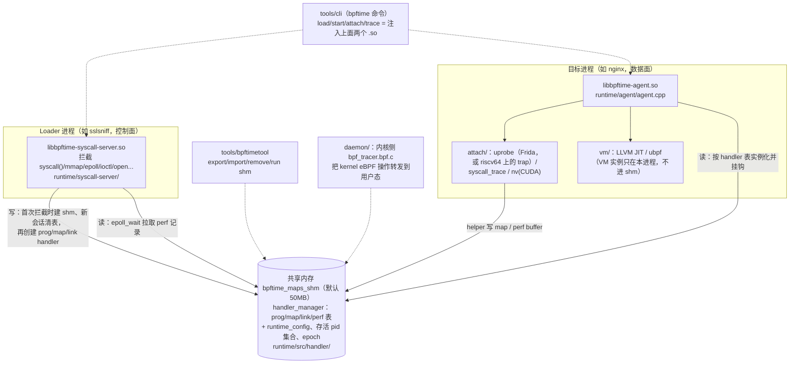
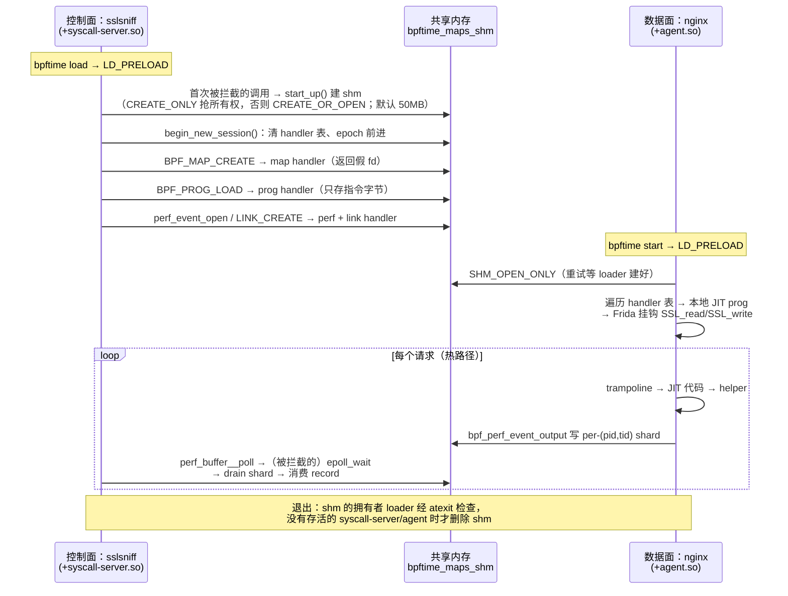

# 0. 全景架构：bpftime 是什么、由哪些部件组成

> 本章是整本指南的"地图页"：不深入任何一行热路径，只回答三个问题——bpftime 是什么、
> 由哪几块拼成、一次 trace 会话里谁在干什么。后续各章都在这张地图上放大某一块。
>
> 基线：官方上游 `177a1dc465ff`（2026-10-18）。文中 `文件:行号` 均按这一提交核对；
> 行号会随上游演进漂移，对不上时用函数名 grep。

## 0.1 bpftime 是什么

bpftime 是一个**用户态 eBPF runtime**：它把"内核 eBPF 的那套对象模型和 API"整体搬进
用户态共享内存里重新实现一遍，让现成的 eBPF 工具（sslsniff、bcc/libbpf 程序）**不改
一行代码**就能在纯用户态跑起来。

对比部署形态，差异一目了然：

| | kernel eBPF | bpftime |
|---|---|---|
| 对象（prog/map/link）存放在 | 内核内存，凭 fd 引用 | `boost::interprocess` 共享内存段 `bpftime_maps_shm`（`runtime/src/handler/handler_manager.hpp:51`），凭**假 fd**（数组下标）引用 |
| 加载入口 | `bpf(2)` 真 syscall | LD_PRELOAD 的 `libbpftime-syscall-server.so` 用同名符号覆盖 glibc 的 `syscall()` 等函数（`runtime/syscall-server/syscall_server_main.cpp:468`），**没有** seccomp/ptrace |
| uprobe 触发 | 断点指令 → 内核 trap → 内核 VM 执行 | 编译期二选一（`cmake/StandardSettings.cmake:76-82`）：**Frida 后端**（x86_64/aarch64 等默认）由 GumInterceptor 改写目标函数序言 → 同进程跳转 trampoline → 本进程 JIT 出的本机码（`attach/frida_uprobe_attach_impl/`）；**trap 后端**（仅 riscv64 默认打开）把首条指令换成 `ebreak`，在本进程的 `SIGTRAP` 处理器里执行（`attach/trap_uprobe_attach_impl/`） |
| 执行引擎 | 内核 verifier + JIT | 可选 PREVAIL verifier（`bpftime-verifier/`）+ LLVM OrcJIT / ubpf / AOT（`vm/`），默认 VM 名 `"llvm"`（`runtime/include/bpftime_config.hpp:17`） |
| 每次事件的代价 | ≥2 次内核 trap（"trap 计价"） | Frida 后端：纯函数调用（"代码计价"），成本随业务代码同比缩放；trap 后端：每次命中两次信号投递，仍要进内核 |

一句话：**kernel eBPF 的每个事件按 trap 计价，bpftime（Frida 后端）按代码计价**——这是
它性能优势的来源，也是读热路径时最该盯住的东西：helper 里任何一次真 syscall 都会把
"代码计价"偷偷退化回"trap 计价"。官方 177a1dc 的热路径上仍有这样的点，见 0.5 的 📌 案例。

代价是安全模型不同：bpftime 的 BPF 程序跑在目标进程地址空间里，隔离靠 verifier +
（可选）MPK，而不是内核态/用户态边界。所以 `bpf_probe_read` 必须自己模拟内核的
fault-safe copy：官方当前做法是对**本进程** pid 调 `process_vm_readv`，让坏地址返回
`-EFAULT` 而不是崩溃（`probe_read_memory`，`runtime/src/bpf_helper.cpp:98`；由
`ENABLE_PROBE_READ_CHECK` 控制，默认 ON，`cmake/StandardSettings.cmake:110`；关掉则退化为裸
`memcpy`）。同理，agent 被注入的是别人的进程，上游为此在 `CLAUDE.md` 里写了一份
**宿主进程契约**（见 0.2 末尾）。

## 0.2 组件图：两个 .so、一段 shm、若干工具

bpftime 运行时的主体是**两个动态库 + 一段共享内存**；其余都是工具和可选组件。



读图要点（均可在代码中核实）：

- **syscall-server 是"假内核"**：`BPF_MAP_CREATE`/`BPF_PROG_LOAD`/`BPF_LINK_CREATE` 全部
  落到 `syscall_context::handle_sysbpf`（`runtime/syscall-server/syscall_context.cpp:482`），
  最终只是往 shm 的 handler 表里写条目——prog 在 shm 里**只存指令字节**
  （`prog_handler.hpp:59` 的 `inst_vector insns`），不存任何 VM 状态。
- **shm 是懒创建的**：syscall-server 的构造函数只解析原函数指针、配置日志；第一次真正
  需要 mock 的调用才经 `try_startup` 走到 `start_up`（`syscall_server_utils.cpp:147`，
  `std::call_once`）。它先以 `SHM_CREATE_ONLY` 抢"所有权"，段已存在则退回
  `SHM_CREATE_OR_OPEN`（`initialize_global_shm_with_ownership`，`:126`），随后
  `begin_new_session()`（`:172`）清空 handler 表并推进 epoch。
- **agent 是"假内核的执行侧"**：启动时以 `SHM_OPEN_ONLY` 打开同一段 shm（最多重试
  60 次、每次 50ms，`runtime/agent/agent.cpp:932-948`），遍历 handler 表，在**本进程**
  构造 `bpftime_prog`、JIT、再通过 attach impl 挂钩。
- **uprobe 后端在编译期定死**：agent 里是一段 `#if BPFTIME_HAVE_TRAP_UPROBE_ATTACH /
  #elif BPFTIME_HAVE_FRIDA_ATTACH / #else` 的三选一（`agent.cpp:991-1035`），两者注册的
  是同一组 attach 类型（uprobe/uretprobe/override/ureplace）。Jetson（aarch64）上走
  Frida；Frida 后端还可用 `BPFTIME_FRIDA_FUZZY_BACKTRACER` 切到模糊栈回溯（#633，
  `runtime_config.enable_frida_fuzzy_backtracer`）。
- **VM 不在 shm 里**是关键设计：shm 只放"可序列化的对象描述"，每个 agent 进程各自
  JIT。这就是为什么 `bpftimetool export` 能把整个会话导出成 JSON。
- **daemon 是可选旁路**：不用 LD_PRELOAD 时，由内核 eBPF 程序
  （`daemon/kernel/bpf_tracer.bpf.c`）监听 `bpf(2)`/`perf_event_open(2)` 再转发进
  用户态 runtime。ssl-nginx benchmark 不走这条路。

**宿主进程契约**（`CLAUDE.md` 的 "Injected Agent Host-Process Contract"，#634）是读
agent/syscall-server 代码时的总纲：注入代码是宿主的"客人"——初始化/分配/执行失败不得
`exit`/`abort` 宿主，只关掉受影响的 bpftime 功能；默认不碰宿主的 stdin/stdout/stderr；
替换信号处理器必须恢复或链式转发。代码里对应的落点：

- syscall-server 的 `handle_exceptions(f, fallback)`（`syscall_server_main.cpp:238-257`）
  捕获异常后回落到**原始宿主操作**，`initialize_ctx()` 失败也直接走原函数（#640）；
- agent 初始化失败走 `init_fail()`（`agent.cpp:837`）撤销已做的部分然后 `return`，
  不退出宿主；
- 日志默认写 `~/.bpftime/runtime.log`（`bpftime_config.hpp:13`），`BPFTIME_LOG_OUTPUT=console`
  才显式写 stderr，日志器自身出错则换成 null sink（`bpftime_set_logger`，
  `runtime/include/bpftime_logger.hpp:38`，#632）；
- trap 后端的 `SIGTRAP` 处理器链式转发宿主原有处理器，且只允许审计过的
  async-signal-safe helper（见 `attach/trap_uprobe_attach_impl/README.md`）。

自七月快照（`6bd5319d`）以来的 58 个上游提交里，与这张地图相关的还有：shm 耗尽时的
处理（#597）、同名 map 隔离（#598）、handler fd 越界检查（#671）、关 link 级联释放 perf
handler 槽位（#672）、syscall 会话资源清理与 shm 所有权（#639）、`agent_config` 改名
`runtime_config`（#562）、fork 后刷新缓存的 pid/tid（#685）、epoll 就绪去重（#689），
以及 `bpf_get_func_ip`（#601）、`bpf_ktime_get_boot_ns`（#609）、`get_stack` 语义修正
（#631、#663）、hash map 修复（#650、#658）和一批 CUDA/GPU 工作。各章按需展开。

## 0.3 仓库顶层目录

以官方 `177a1dc465ff` 的 git 跟踪内容为准：

| 目录 | 一句话 |
|---|---|
| `runtime/` | 核心：shm + handler 注册表、map 实现、helper、syscall-server 与 agent 两个 .so 的源码 |
| `attach/` | 事件挂载层：`base_attach_impl/`（抽象接口）、`frida_uprobe_attach_impl/`、`trap_uprobe_attach_impl/`（无 Frida 架构用的断点后端，目前只支持 riscv64，#665）、`syscall_trace_attach_impl/`、`nv_attach_impl/`（CUDA）、`text_segment_transformer/`（syscall 指令改写，仅在启用 Frida 时构建）、`simple_attach_impl/` |
| `vm/` | 执行引擎：`vm-core/`（C 接口 `ebpf-vm.h`）、`compat/`（多后端抽象 `bpftime_vm_compat.hpp`，后端 `llvm-vm/`、`ubpf-vm/`）、`llvm-jit/`（LLVM OrcJIT/AOT，git submodule，上游仓库 llvmbpf） |
| `daemon/` | 内核协同模式：内核侧 tracer eBPF + 用户态 driver，把 kernel eBPF 操作重定向到 bpftime |
| `bpftime-verifier/` | PREVAIL（ebpf-verifier，submodule）的封装，loader 侧可选校验 |
| `tools/` | `cli/`（`bpftime load/start/attach/detach/trace` 命令）、`bpftimetool/`（shm load/export/import/remove/run）、`aot/`（AOT 编译器 CLI） |
| `example/` | 示例：`malloc/`、`minimal/`、`tracing/`（sslsniff 在 `example/tracing/sslsniff/`）、`gpu/`、`otel-ebpf-profiler/` 等 |
| `benchmark/` | 性能测试：`ssl-nginx/`（本指南的锚点场景；其 README 里仍写旧路径 `example/sslsniff`）、`syscount-nginx/`、`uprobe/`、`trap-uprobe/`、`fuse/`、`deepflow/`、`gpu/`、`mpk/` 等 |
| `third_party/` | submodule：`bpftool`（`third_party/libbpf` 是指向 `bpftool/libbpf/` 的符号链接）、`spdlog`、`argparse`、`Catch2`、`ubpf`；另有 `json.hpp`、`vmlinux/` 头。frida devkit 由 `cmake/frida.cmake` 构建时下载，boost 用系统包（`runtime/CMakeLists.txt:45` 的 `find_package(Boost REQUIRED)`） |
| `cmake/` | CMake 辅助模块（`StandardSettings.cmake` 里是各功能开关） |
| `scripts/`、`.agents/` | AI agent 技能同步脚本与对应 submodule，与运行时无关 |

上游已没有根目录 `docs/`（`CLAUDE.md` 明确要求不要建）。本地构建目录（`build/`、
`build-jetson-daily/` 等）不属于上游仓库。

入口文件：`Makefile`（`make build/release/unit-test` 等的封装）、根 `CMakeLists.txt`、
`CLAUDE.md`（组件速览 + 宿主进程契约 + trap 后端约束；`AGENTS.md` 内容与之相同）、
`usage.md`、`installation.md`。

## 0.4 一次 trace 会话：三方角色分工

以 ssl-nginx 为例（`bpftime load ./sslsniff` + `bpftime start nginx`，或对已运行进程
`bpftime attach <pid>`）。cli 做的事只是 fork 出子进程、在其环境里设好 `LD_PRELOAD`
后 `execvpe`，父进程 `waitpid` 等它结束（`run_command`，`tools/cli/main.cpp:107`）；
或用 Frida injector 把 agent 注入已运行进程（`inject_by_frida`，`tools/cli/main.cpp:276`）。



三方职责一句话：**控制面写对象表、拉取结果；数据面读对象表、跑代码、产生结果；shm
是唯一的交汇点，也是唯一需要跨进程同步的地方**。热路径上（第 11–13 步，见
[第一部分](01-lifecycle.md)）控制面与数据面零直接通信——所有耦合都通过 shm 中的
perf buffer 解开。

## 0.5 三段定音的代码

### 选段一：拦截就是符号覆盖（syscall-server 的全部魔法）

`runtime/syscall-server/syscall_server_main.cpp:468`（外面包着 `#if __linux__`）：

```c
extern "C" long syscall(long sysno, ...)
{
	// glibc directly reads the arguments without considering
	// the underlying argument number. So did us
	va_list args;
	va_start(args, sysno);
	long arg1 = va_arg(args, long);
	/* ... arg2..arg6 同理 ... */
	va_end(args);
	if (!initialize_ctx())
		return fallback_syscall(sysno, arg1, arg2, arg3, arg4, arg5,
					arg6);
	auto call_original = [&]() {
		return context->orig_syscall_fn(sysno, arg1, arg2, arg3, arg4,
						arg5, arg6);
	};
	if (sysno == __NR_bpf) {
		safe_spdlog_debug("SYS_BPF {} {} {} {} {} {}", arg1, arg2, arg3,
				  arg4, arg5, arg6);
		int cmd = (int)arg1;
		auto attr = (union bpf_attr *)(uintptr_t)arg2;
		auto size = (size_t)arg3;
		return handle_exceptions(
			[&]() {
				return context->handle_sysbpf(cmd, attr, size);
			},
			call_original);
	} else if (sysno == __NR_perf_event_open) {
		/* ... handle_perfevent(...)，同样以 call_original 兜底 ... */
	} /* ... __NR_ioctl（只打日志）/__NR_dup3/__NR_memfd_create 分支 ... */
	return call_original();
}
```

- **它在做什么**：定义一个和 glibc `syscall()` 同名的导出符号。LD_PRELOAD 让它排在
  链接查找序列最前面，libbpf 调 `syscall(__NR_bpf, ...)` 时进的就是这里。同文件
  282–466 行还覆盖了 `epoll_wait`/`epoll_ctl`/`epoll_create1`/`ioctl`/`mmap64`/`mmap`/
  `munmap`/`close`/`openat`/`open`/`read`/`fopen`/`fopen64`/`_IO_new_fopen` 一整族，
  统一经 `call_with_context` 包装。
- **为什么这样写**：零内核依赖、零权限要求（对比 seccomp/ptrace），且对 libbpf 完全
  透明——这是"兼容现成 eBPF 工具"目标的技术底座。每条路径都带"回落到原函数"的
  兜底（`fallback_syscall` / `call_original`），这是宿主进程契约在 loader 侧的体现
  （#640）：bpftime 自己坏了，宿主照常跑。
- **坑在哪**：只拦得住**走 PLT 的调用**。静态链接、`syscall` 指令内联（Go 程序）的
  调用会漏网——这正是 `attach/text_segment_transformer/` 存在的理由（改写 .text 段里
  的 syscall 指令）。另外无条件读 6 个 vararg 依赖"glibc 也这么干"的事实约定，注释
  写得很诚实。

### 选段二：agent 靠劫持 `__libc_start_main` 抢在 main 之前初始化

`runtime/agent/agent.cpp:544`：

```c
extern "C" int __libc_start_main(int (*main)(int, char **, char **), int argc,
				 char **argv,
				 int (*init)(int, char **, char **),
				 void (*fini)(void), void (*rtld_fini)(void),
				 void *stack_end)
{
	orig_main_func = main;
	using this_func_t = decltype(&__libc_start_main);
	this_func_t orig = (this_func_t)dlsym(RTLD_NEXT, "__libc_start_main");

	return orig(bpftime_hooked_main, argc, argv, init, fini, rtld_fini,
		    stack_end);
}
```

- **它在做什么**：把真正的 `main` 存起来，让 glibc 启动的是 `bpftime_hooked_main`
  （`agent.cpp:535`）——后者先跑 `bpftime_agent_main`（`agent.cpp:830`：打开 shm、注册
  syscall_trace / uprobe（trap 或 Frida）/ 可选 CUDA 三类 attach impl、实例化所有 prog
  并挂钩），再调用原 `main`。
- **为什么这样写**：uprobe 必须在业务代码执行前就位（nginx 一启动就会调
  `SSL_read`）。而 `bpftime attach <pid>` 场景没有启动时机可抢，走的是另一入口——
  Frida 注入后直接调用导出的 `bpftime_agent_main`（`agent.cpp:533` 的 extern 声明；
  cli 侧入口名写在 `tools/cli/main.cpp:284`，调用在 `:1043-1046`）。同一初始化函数、
  两个触发路径。
- **坑在哪**：shm 可能还没被 loader 建好，所以 open 带重试循环
  （`agent.cpp:932-948`，`SHM_OPEN_ONLY`）；同一进程可能被注入多次，入口先探测已加载
  的 agent 副本/IPC 服务并转交，再用 CAS 抢初始化权；任何一步失败都走 `init_fail()`
  后 `return`，不终止宿主。初始化在 main 之前意味着此时不能假设业务运行时
  （如 JVM/CUDA）已就绪，agent 里大量防御性代码源于此。

### 选段三：整个"内核对象模型"就是 shm 里的一个 variant 数组

`runtime/src/handler/handler_manager.hpp:87`：

```cpp
using handler_variant =
	std::variant<unused_handler, bpf_map_handler, bpf_link_handler,
		     bpf_prog_handler, bpf_perf_event_handler, epoll_handler,
		     memfd_handler>;

using handler_variant_allocator =
	allocator<handler_variant, managed_shared_memory::segment_manager>;

using handler_variant_vector =
	boost::interprocess::vector<handler_variant, handler_variant_allocator>;

// handler manager for keep bpf maps and progs fds
// This struct will be put on shared memory
class handler_manager {
	/* set_handler_at_empty_slot / get_handler / is_allocated / clear_id_at / clear_all ... */
    private:
	handler_variant_vector handlers;
};
```

- **它在做什么**：内核里的"fd → bpf 对象"映射，在这里退化成"下标 → variant"的
  shm vector。`set_handler_at_empty_slot` 返回的下标就是应用看到的"fd"。
- **为什么这样写**：`std::variant` + boost.interprocess allocator 让七种对象共用一张
  表、整表可跨进程寻址（shm 内偏移指针）、可 JSON 序列化（`bpftime_shm_json.cpp`）。
  agent 侧遍历时用 `std::visit`/`holds_alternative` 分派类型。
- **坑在哪**：假 fd 与真 fd 共用一个整数空间，syscall-server 必须精确判断"这个 fd
  是我的还是内核的"（`close`/`mmap`/`ioctl` 拦截里都有这类判断；越界 fd 的检查是 #671
  补上的）。vector 槽位会被复用（`find_minimal_unused_idx`，`handler_manager.hpp:119`）。
  跨会话残留的 shm 方面：新 loader 启动时 `begin_new_session` 会 `clear_all` 清表，
  但只起 agent、不起 loader 时 agent 会照单实例化残留对象；`open_or_create` 打开旧段
  时也沿用旧段大小，`BPFTIME_SHM_MEMORY_MB` 不生效。七月消融实验也曾观察到残留 shm
  与吞吐双峰同时出现——所以实验前仍应 `bpftimetool remove`。

### 📌 案例：热路径上三处"兼容层代价"在地图上的位置

这三处恰好落在不同组件，可当作全书的"坐标锚点"（七月我们在这三处各做过一个修复，
官方现状如下）：

1. **perf record 8 字节对齐** → **runtime/handler 层**。shm 里的 perf ring 是自实现的
   （`software_perf_event_buffer`，`perf_event_handler.hpp:71`），不是内核 mmap 页，
   perf ABI 的对齐规则得自己守：官方在 `software_perf_event_buffer::output_data`
   （`perf_event_handler.cpp:367-387`）里把 `record_size` 向上取整到 `sizeof(uint64_t)`，
   尾部补 padding。教训：**兼容层的 bug 表现为对端（libbpf）行为异常**——消费者读到
   未对齐/跨界记录时会出错，看起来像"性能问题"，实为正确性问题。
   （七月的修复 `0fcdb0e` 已由上游 #612 `417f7c61` 以这一形式合入。）
2. **每事件 CPU affinity 绑核** → **helper 层**（`bpf_perf_event_output`，
   `bpf_helper.cpp:487`）。官方仍是每个事件都执行 `my_sched_getcpu` →
   `sched_getaffinity` → `sched_setaffinity` 绑到当前 CPU（`:502`）→ 输出 →
   在 `restore_affinity` 标签处恢复原掩码（`:546-549`；#678 保证出错路径也恢复）。
   数据面 helper 的每条指令都由**业务线程**买单，这几次 syscall 就是"代码计价"里混进的
   "trap 计价"。绑核保证查 perf array 用的 `current_cpu` 在写入期间不变；而写入本身
   已按 per-(pid,tid) shard 分片（`software_perf_event_shard`，`perf_event_handler.hpp:101`），
   不靠 CPU 互斥。（dev 分支删除了这段绑核；上游未采纳。）
3. **probe_read 的 fault-safe copy** → 同在 helper 层，根因是**用户态模拟内核机制的
   副作用**：官方（#642 "use no-fault probe memory copies"）不再装 SIGSEGV 处理器，
   而是 `probe_read_memory` 对本进程调 `process_vm_readv`（`bpf_helper.cpp:98-117`）。
   代价是 `ENABLE_PROBE_READ_CHECK=ON`（默认）时**每次 `bpf_probe_read` 一次 syscall**；
   `bpf_probe_read_str` 按页/256 字节分块，每块读一次、写回一次。
   （七月 `ead56c9` 修的是旧 SIGSEGV 实现里"已安装"标志的问题，该实现已被 #642 整体取代。）

## 0.6 术语表

按"从外到内"排序。行号处即定义/核心使用点。

| 术语 | 含义 |
|---|---|
| **syscall-server** | `libbpftime-syscall-server.so`，LD_PRELOAD 进 loader 进程，用同名符号覆盖 `syscall()`/`mmap`/`epoll_*`/`open*` 等，把 eBPF 相关调用改写为 shm 操作，失败时回落到原函数（`runtime/syscall-server/syscall_server_main.cpp:468`） |
| **agent** | `libbpftime-agent.so`，进入目标进程（LD_PRELOAD 或 Frida 注入），读 shm handler 表、JIT、挂钩（`runtime/agent/agent.cpp:830` `bpftime_agent_main`） |
| **宿主进程契约** | `CLAUDE.md` 中对注入代码的约束（#634）：不终止宿主、默认不碰宿主 stdio、信号处理器须恢复或链式转发；读 agent/syscall-server 的错误处理时以此为准 |
| **全局 shm** | boost::interprocess managed_shared_memory 段，默认名 `bpftime_maps_shm`（可用 `BPFTIME_GLOBAL_SHM_NAME` 覆盖），默认 50MB（`bpftime_config.hpp:79`，可用 `BPFTIME_SHM_MEMORY_MB` 改），所有跨进程状态的唯一载体；由首个 loader 以"拥有者"身份创建，拥有者正常退出且无存活 syscall-server/agent 时删除（`syscall_server_utils.cpp:56`） |
| **handler** | shm 中代表一个 eBPF 对象的条目：`bpf_map_handler`/`bpf_prog_handler`/`bpf_link_handler`/`bpf_perf_event_handler`/`epoll_handler`/`memfd_handler`（`handler_manager.hpp:87`） |
| **handler_manager** | shm 中的 handler variant vector + 槽位分配逻辑，即"fd 表替身"（`handler_manager.hpp:100`） |
| **假 fd** | 应用侧拿到的"fd"实为 handler vector 下标，不是内核 fd；`close`/`mmap` 等拦截函数负责区分真假 |
| **link handler** | `bpf_link_handler{prog_id, attach_target_id}`（`link_handler.hpp:16`），把"哪个 prog 挂到哪个事件"记成两个假 fd 的连线 |
| **shard** | `software_perf_event_shard`（`perf_event_handler.hpp:101`）：software perf buffer 的 per-(pid,tid) 生产者分片，写入免跨线程锁竞争（`get_current_thread_shard`，`perf_event_handler.cpp:491`） |
| **drain** | 消费者侧把各 producer shard 的记录搬进 `consumer_buffer` 的动作（`drain_producer_shards`，`perf_event_handler.hpp:149`，实现在 `.cpp:550`），由 `has_data()` 触发，调用方是被拦截的 `epoll_wait` 路径上的 `bpftime_epoll_wait`（`bpftime_shm.cpp:418`） |
| **attach impl** | `base_attach_impl` 的实现（`attach/base_attach_impl/base_attach_impl.hpp:49`）：一种事件源=一个 impl，核心接口 `create_attach_with_ebpf_callback` / `detach_by_id` |
| **attach_private_data** | 每种 attach 类型的参数载体，由字符串解析（`initialize_from_string`），agent 注册 impl 时同时注册解析器（`agent.cpp:965-1057`） |
| **frida uprobe / trampoline** | 用 frida-gum 的 GumInterceptor 改写目标函数序言，跳转到保存 CPU 上下文的 trampoline，再回调 eBPF（`attach/frida_uprobe_attach_impl/`）；非 riscv64 的默认 uprobe 后端 |
| **trap uprobe** | 不依赖 Frida 的断点后端（`attach/trap_uprobe_attach_impl/`，#665）：首条指令换成 `ebreak`/`c.ebreak`，`SIGTRAP` 处理器里构造 `pt_regs` 跑 eBPF，原指令离线执行或软件模拟；仅支持 riscv64，只接纳审计过的 async-signal-safe helper（map 操作等不接纳） |
| **text segment transformer** | `libbpftime-agent-transformer.so`（`attach/text_segment_transformer/`，仅在启用 Frida 时构建）：改写 .text 里的 syscall 指令以拦截不走 PLT 的系统调用；`bpftime start -s` 时作为 LD_PRELOAD 外壳、通过 `AGENT_SO` 环境变量再加载真 agent（`tools/cli/main.cpp:1012-1022`） |
| **helper group** | 一组 helper 的注册单元：`kernel_utils`（probe_read/ktime 等）、`shm_maps`（map_lookup 等）、`ufunc` 三组，按 `runtime_config` 开关注册进 prog（`load_prog_and_helpers`，`bpf_attach_ctx.cpp:43-60`；定义在 `bpf_helper.cpp:1181`/`:1190`/`:1371`） |
| **ufunc** | bpftime 的 FFI 机制：BPF 程序直接调用宿主进程原生函数（`runtime/src/ufunc.cpp`） |
| **bpftime_prog** | 一个 prog 的**进程本地**执行体（指令 + VM 实例 + helper 绑定），从 shm 指令字节构造，**不在 shm 中**（`runtime/src/bpftime_prog.cpp`） |
| **VM backend / compat 层** | `bpftime_vm_impl` 抽象（`vm/compat/include/bpftime_vm_compat.hpp:27`：`load_code`/`exec`/`register_external_function`/`do_aot_compile`），按名字工厂创建（`create_vm_instance`，`:229`），后端有 llvm-vm 与 ubpf-vm |
| **LLVM JIT** | 默认高性能后端（`vm/llvm-jit/`，OrcJIT）。helper 调用在编译期绑定为符号 `_bpf_helper_ext_00NN` 的绝对地址（`absoluteSymbols`），运行期零查表 |
| **AOT** | 提前编译：`do_aot_compile` 产出 native ELF，`tools/aot/` 提供 build/compile/run 子命令，产物存回 prog handler 的 `aot_insns`（`prog_handler.hpp:60`） |
| **verifier** | `bpftime-verifier/` 封装 PREVAIL（ebpf-verifier）；仅 loader 侧 `BPF_PROG_LOAD` 时可选启用（编译开关 `ENABLE_BPFTIME_VERIFIER`，`syscall_context.cpp:650`），模式由 `BPFTIME_VERIFIER_LEVEL` 决定，默认失败只告警 |
| **daemon** | `daemon/`：内核 eBPF tracer 监听 `bpf(2)`/`perf_event_open(2)` 等，把 kernel eBPF 应用透明重定向到 bpftime，无需 LD_PRELOAD |
| **transporter** | daemon/共享 map 模式下的内核中继 eBPF 程序：把用户态 ringbuf 数据转投递到内核 perf event array，使 bpftime 事件能被内核侧消费者收到（`runtime/src/bpf_map/shared/perf_event_array_kernel_user.cpp:32`） |
| **runtime_config** | shm 中的全局配置块（helper group 开关、verifier 模式、shm 大小、max fd、日志路径、VM 名等，`struct runtime_config`，`runtime/include/bpftime_config.hpp:52`），shm 内对象名 `bpftime_runtime_config`（`handler_manager.hpp:53`）；loader 写、agent 读。七月版本叫 `agent_config`，#562 改名 |
| **bpftimetool** | shm 检查工具：`export`（导 JSON）/`import`/`remove`（`tools/bpftimetool/main.cpp:203-263`），另有 `load`/`run`；验证式阅读的主力，也是清理 shm 残留的标准动作 |
| **bpftime cli** | `bpftime load/start/attach/detach/trace` 命令（`tools/cli/main.cpp:877`）；本质只是"选择注入哪个 .so、怎么注入" |

## 0.7 自测题

1. **`bpftime load` 之后、`bpftime start` 之前，loader 进程退出，shm 里的 prog/map
   还在吗？`bpftimetool export` 想事后检查会话需要什么前提？**

   <details><summary>答案</summary>

   看怎么退出。loader 若是 shm 的拥有者（以 `SHM_CREATE_ONLY` 建出的段），`start_up`
   时注册了 `atexit(remove_syscall_server_global_shm)`（`syscall_server_utils.cpp:161`）：
   正常退出时，若存活的 syscall-server / agent pid 集合里已没有活进程，就删掉 shm——
   prog/map 随之消失。被 `kill -9` 时 atexit 不跑，POSIX shm 对象独立于进程存活，
   `bpftimetool export` 仍能读到。所以事后检查要么在 loader 还活着时做，要么接受
   "非正常退出留下的残留"。残留的反面后果见选段三：只起 agent 会实例化旧对象、旧段
   大小沿用，所以实验前仍要 `bpftimetool remove`。
   </details>

2. **为什么 VM/JIT 状态不放进共享内存，而是每个 agent 进程各自从指令字节重建？**

   <details><summary>答案</summary>

   JIT 产物含本进程绝对地址（helper 函数指针经 `absoluteSymbols` 绑定、代码页地址随
   ASLR 变化），跨进程无意义；而指令字节是纯数据，可序列化、可校验。于是 shm 只存
   "对象描述"（`prog_handler.hpp:59` 的 `insns`），执行体 `bpftime_prog` 在
   `init_attach_ctx_from_handlers`（`bpf_attach_ctx.cpp:62`/`:73`）里本地构造。附带收益：
   JSON export/import、多 agent 挂同一 prog、AOT 产物按 handler 缓存都变得自然。
   </details>

3. **`bpftime attach <pid>` 没有 LD_PRELOAD 的机会，agent 是怎么进去并初始化的？**

   <details><summary>答案</summary>

   cli 用 frida-core 的 injector（`inject_by_frida`，`tools/cli/main.cpp:276`）把
   `libbpftime-agent.so` 注入目标进程，并直接调用其导出入口 `bpftime_agent_main`
   ——与 LD_PRELOAD 路径（`__libc_start_main` 劫持 → `bpftime_hooked_main`，
   `agent.cpp:544`/`:535`）殊途同归。区别：attach 场景初始化发生在 main 之后任意时刻，
   错过的事件不补；重复注入时入口会发现已有 agent 副本并把请求转交给它，而不是再
   初始化一份。
   </details>

4. **数据面热路径上（每个 SSL 事件），bpftime 理论上应该产生几次真正的内核
   syscall？官方 177a1dc 的默认构建实际会有哪些？**

   <details><summary>答案</summary>

   理论 0 次——uprobe 分发（Frida 后端）、JIT 执行、shard 写入全在用户态（"代码计价"）。
   官方实际有两处：`bpf_perf_event_output` 的绑核序列——`my_sched_getcpu`（即 glibc
   `sched_getcpu`，是否真进内核取决于 libc/内核是否提供免 syscall 路径）+
   `sched_getaffinity` + 2×`sched_setaffinity`（`bpf_helper.cpp:490-549`）；以及
   sslsniff 每事件一次 `bpf_probe_read_user`，在默认 `ENABLE_PROBE_READ_CHECK=ON` 下就是
   一次 `process_vm_readv`（`bpf_helper.cpp:112`）。它们把 bpftime 部分退化回 trap
   计价。七月在 Jetson 上对旧代码的测量是每事件 6 次（4 次绑核 + 2 次 `rt_sigaction`），
   当时足以在每请求预算 ~60µs 的场景里反转与 kernel eBPF 的胜负；dev 分支的处理见
   summry 分支报告。
   </details>

5. **syscall-server 的拦截会漏掉哪类程序的 `bpf(2)` 调用？bpftime 对此的补救组件
   是什么？**

   <details><summary>答案</summary>

   静态链接或直接内联 `syscall` 指令（不经 glibc PLT）的程序，典型如 Go。补救是
   `attach/text_segment_transformer/`：扫描并改写 .text 段中的 syscall 指令；cli 的
   `-s/--enable-syscall-trace` 路径会把它作为外层 LD_PRELOAD、真 agent 经 `AGENT_SO`
   环境变量二段加载（`tools/cli/main.cpp:1012-1022`；attach 场景在 `:1036-1044`）。
   注意它只在启用 Frida 时构建（`attach/CMakeLists.txt`），riscv64 默认构建里没有。
   </details>

6. **在 riscv64 上，同一个 sslsniff 能原样用 trap 后端跑起来吗？**

   <details><summary>答案</summary>

   不能直接保证。trap 后端在 `SIGTRAP` 处理器里执行 eBPF，所以 runtime 管理的 link
   在挂探针前要做 async-signal-safe 准入：只接纳审计过的 helper（函数 IP、attach
   cookie、return override、trap 参数/返回值 helper），map 操作、打印、tail call、
   动态栈采集、AOT、MPK 等一律 `-ENOTSUP` 拒绝，且必须先 JIT 好（见
   `attach/trap_uprobe_attach_impl/README.md` 与 `CLAUDE.md`）。sslsniff 要用
   `bpf_perf_event_output` 和 map，会在准入阶段被拒。每次命中两次信号投递，也意味着
   它天然按"trap 计价"。
   </details>

---
[← 返回目录](README.md)
