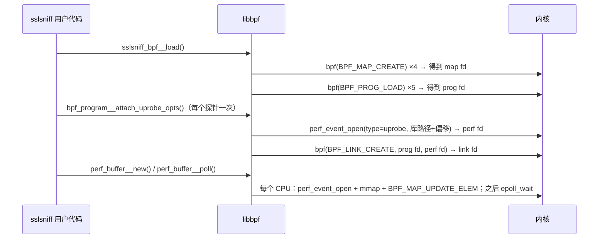
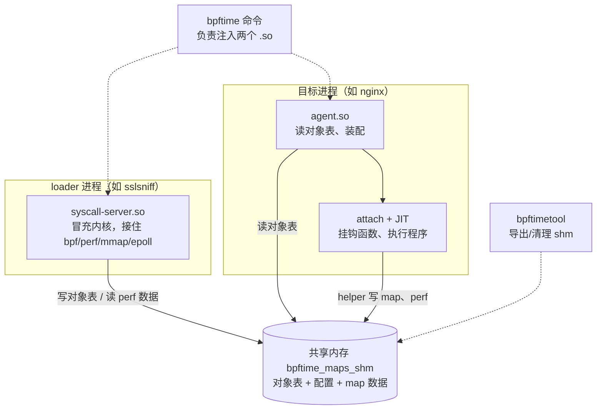
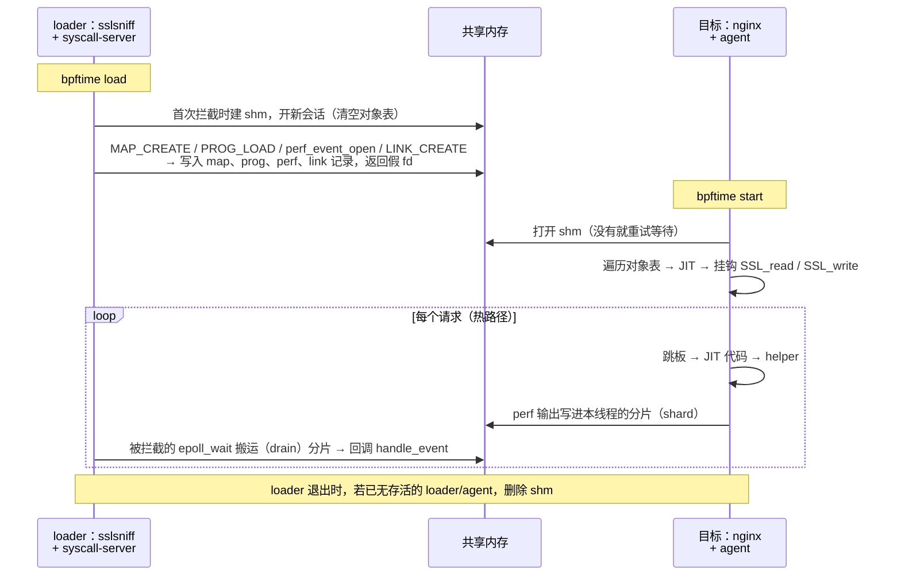

# 0. 全景架构：bpftime 是什么、由哪些部件组成

> 一句话：这是全书的"地图页"。先补齐读 bpftime 需要的 eBPF 最小概念，再讲 bpftime 的核心思路、
> 由哪几块拼成、一次追踪会话里谁在干什么。读完能回答"bpftime 为什么能让 sslsniff 不改一行代码
> 就在用户态跑起来"。后续各章都在这张地图上放大某一块。
>
> 前置：无，本章是起点。预计用时：60–90 分钟（0.1 节熟悉 libbpf 的读者可以跳读）。

## 本章要回答的问题

- 一个 eBPF 工具（比如 sslsniff）从启动到打印出数据，要和内核打哪些交道？
- bpftime 用什么办法让同一个工具"以为"自己在和内核说话，其实全在用户态？
- 为什么 bpftime 处理一个 uprobe 事件比内核快？它为此放弃了什么？
- bpftime 由哪几个部件组成？loader、目标进程、共享内存三方各干什么？
- 读源码时遇到"假 fd""handler""shard"这类词，去哪里查？

## 0.1 预备知识：读 bpftime 前需要的 eBPF 最小概念

这一节只讲"能看懂后续章节"所需的最少概念，全部以 bpftime 自带的 sslsniff 为例
（源码在 `example/tracing/sslsniff/`：内核态程序 `sslsniff.bpf.c`，用户态加载器 `sslsniff.c`）。
sslsniff 的作用是：在 `SSL_read`/`SSL_write` 返回时，把明文缓冲区抓出来打印。

### 0.1.1 prog、map、helper：eBPF 的三种基本对象

eBPF 程序由三样东西配合工作。下表先给出一句话定义，再给出 sslsniff 里的实例。

| 概念 | 是什么 | sslsniff 里的例子 |
|---|---|---|
| **prog**（程序） | 一段 eBPF 字节码，挂在某个事件上，事件发生时被执行。加载后用一个 fd 引用。 | `probe_SSL_rw_enter`（函数入口）、`probe_SSL_read_exit`（函数返回）等 5 个程序 |
| **map**（映射表） | 内核里的键值存储，用来在多次执行之间、或程序与用户态之间传数据。也用 fd 引用。 | `bufs`、`start_ns`（hash，按线程 id 暂存参数和时间戳）、`ssl_data`（per-CPU 数组，当大缓冲区用）、`perf_SSL_events`（perf 事件数组，往用户态送数据） |
| **helper**（辅助函数） | eBPF 程序不能随便调函数，只能调内核提供的一组编号固定的"helper"。 | `bpf_map_lookup_elem`、`bpf_get_current_pid_tgid`、`bpf_probe_read_user`（安全地读用户内存）、`bpf_perf_event_output`（发事件给用户态） |

记住一点：**prog 和 map 在内核里都是"对象"，用户态只拿到一个整数 fd**。bpftime 要做的，
就是在用户态把这套"对象 + fd"重新实现一遍。

### 0.1.2 uprobe 与 uretprobe：在用户函数上设"观察点"

**uprobe** 让 eBPF 程序在某个用户态函数**被调用时**执行；**uretprobe** 让它在函数**返回时**执行。
内核的实现方式是：把目标函数第一条指令换成断点指令，CPU 执行到这里就陷入内核，内核跑完 eBPF 程序
再让原函数继续。uretprobe 则是在函数入口偷偷改掉返回地址，让函数返回时再陷入一次内核。

sslsniff 正好两种都用：入口记下缓冲区指针 `buf`，返回时才知道实际读到多少字节，
再去 `buf` 里拷数据。

### 0.1.3 pt_regs 与 PT_REGS_PARM1：程序怎么拿到函数参数

uprobe 程序被调用时，唯一的参数 `ctx` 指向一个 `struct pt_regs`——**事件发生那一刻 CPU 寄存器的快照**。
按调用约定，函数参数和返回值都在寄存器里，所以 libbpf 提供宏来按名字取：
`PT_REGS_PARM1(ctx)` 是第一个参数，`PT_REGS_PARM2(ctx)` 是第二个，`PT_REGS_RC(ctx)` 是返回值。
`BPF_UPROBE`/`BPF_KPROBE` 宏会自动把这些展开成具名参数。

`example/tracing/sslsniff/sslsniff.bpf.c` 的 `probe_SSL_rw_enter()` 和 `SSL_exit()`（节选）：

```c
// SEC 名只决定程序类型（uprobe 程序在内核里的类型是 BPF_PROG_TYPE_KPROBE），
// 真正挂到哪个函数由用户态的 attach 调用决定
SEC("uprobe/do_handshake")
int BPF_UPROBE(probe_SSL_rw_enter, void *ssl, void *buf, int num) {
    // 宏展开后：buf = PT_REGS_PARM2(ctx)，即 SSL_read(ssl, buf, num) 的第二个参数
    u64 pid_tgid = bpf_get_current_pid_tgid();        // helper：高 32 位 pid，低 32 位 tid
    u32 tid = pid_tgid;
    u64 ts = bpf_ktime_get_ns();                       // helper：当前时间
    bpf_map_update_elem(&bufs, &tid, &buf, BPF_ANY);  // 按线程暂存 buf 指针
    bpf_map_update_elem(&start_ns, &tid, &ts, BPF_ANY);
    return 0;
}

static __always_inline int SSL_exit(struct pt_regs *ctx, int rw) {
    /* ... 取回 bufp、tsp ... */
    int len = PT_REGS_RC(ctx);                         // 返回值 = 实际读写的字节数
    /* ... 填 data 的 pid/tid/len 等字段 ... */
    ret = bpf_probe_read_user(&data->buf, buf_copy_size, (char *)*bufp);  // 安全拷用户内存
    /* ... 删除 bufs/start_ns 里的条目 ... */
    bpf_perf_event_output(ctx, &perf_SSL_events, BPF_F_CURRENT_CPU, data,
                          EVENT_SIZE(buf_copy_size));  // 发给用户态
    return 0;
}
```

这一点对 bpftime 很关键：**eBPF 程序是照着内核的 `pt_regs` 布局编译的**。bpftime 在用户态触发 uprobe 时，
必须先造一个同样布局的 `pt_regs` 再交给程序（见[第 4 章](04-attach-frida.md)）。

### 0.1.4 libbpf 加载一个程序时，依次发哪些系统调用

sslsniff 的 `main()` 只调了几个 libbpf 函数，但每个函数背后都是一串系统调用。
下面这张图要看的是：**用户态和内核之间的全部交互，就是这几类系统调用**——bpftime 只要把它们全部接住，
就能骗过 libbpf。



逐步说明（libbpf 源码在 `third_party/libbpf/src/libbpf.c`）：

| 步骤 | 系统调用 | 做了什么 |
|---|---|---|
| 建 map | `bpf(BPF_MAP_CREATE)` | 按 `SEC(".maps")` 里的定义逐个创建 map，拿到 fd。sslsniff 有 4 个 map。 |
| 加载程序 | `bpf(BPF_PROG_LOAD)` | 把每个程序的字节码交给内核，内核校验（verifier）、JIT，返回 prog fd。sslsniff 有 5 个程序。 |
| 建探针 | `perf_event_open` | 以 "uprobe" 这种 perf 事件类型、目标库路径和函数偏移为参数，创建一个探针事件，返回 perf fd。uprobe 的类型号要先读 `/sys/bus/event_source/devices/uprobe/type` 得到。 |
| 连线 | `bpf(BPF_LINK_CREATE)` | 把 prog fd 和 perf fd 连起来，返回 link fd。较老的内核上 libbpf 会改用 `ioctl(PERF_EVENT_IOC_SET_BPF)` + `ioctl(PERF_EVENT_IOC_ENABLE)` 完成同一件事。 |
| 收数据 | `perf_event_open` / `mmap` / `bpf(BPF_MAP_UPDATE_ELEM)` / `epoll_*` | 见下一小节 perf buffer。 |

另外，libbpf 加载前还会发几次"试探性"的 `bpf()` 调用，探测内核支持哪些功能。
sslsniff 默认会给 OpenSSL、GnuTLS、NSS 三个库都挂探针；以 OpenSSL 为例是 4 个：
`SSL_write`、`SSL_read` 各一个 uprobe + 一个 uretprobe。

### 0.1.5 perf buffer：内核往用户态送数据的管道

**perf buffer** 是一组 per-CPU 的环形缓冲区。

- **建立**（`perf_buffer__new`）：对每个 CPU 调一次 `perf_event_open`（软件事件 `PERF_COUNT_SW_BPF_OUTPUT`），
  把得到的 fd 用 `mmap` 映射成一块环形内存；再用 `BPF_MAP_UPDATE_ELEM` 把"CPU 号 → 这个 perf fd"
  写进 `PERF_EVENT_ARRAY` 类型的 map（sslsniff 的 `perf_SSL_events`）；最后把所有 fd 加进一个 epoll。
- **写**：eBPF 程序调 `bpf_perf_event_output(ctx, &perf_SSL_events, BPF_F_CURRENT_CPU, data, size)`，
  helper 用当前 CPU 号去 map 里找到那个 CPU 的环，把一条记录（头 + 数据）写进去。
- **读**：用户态 `perf_buffer__poll` 调 `epoll_wait` 等待有数据的环，然后直接在 mmap 出来的内存里读记录，
  逐条回调 `handle_event`。

### 0.1.6 要点

- eBPF 对象（prog、map、link、perf 事件）都活在内核里，用户态只持有 fd。
- libbpf 和内核之间只走几种系统调用：`bpf()`、`perf_event_open`、`ioctl`、`mmap`、`epoll_*`，外加读几个 `/sys` 文件。
- uprobe 程序通过 `pt_regs` 拿参数和返回值，这个布局是写死在程序里的。
- perf buffer = per-CPU 环形内存 + epoll 通知；生产者是 helper，消费者是用户态。

## 0.2 bpftime 是什么：把内核的 eBPF 搬进用户态

### 0.2.1 核心思想

打个比方：内核 eBPF 像一家银行，用户（libbpf）递上申请单（系统调用），银行在内部金库（内核内存）里
建账户（prog/map），给你一张号码牌（fd）。bpftime 则是在**用户态开了一家"仿真银行"**：
它的柜台、账本格式、号码牌都和真银行一模一样，但金库是一段**共享内存**。

具体来说，bpftime 用两个通过 `LD_PRELOAD` 注入的动态库，各管一侧：

- **`libbpftime-syscall-server.so`** 注入 **loader**（加载 eBPF 程序的一方，如 sslsniff）。
  它定义了和 glibc 同名的 `syscall()`、`mmap`、`epoll_wait` 等函数，抢先接住 libbpf 的调用，
  把"创建 map / 加载 prog / 建 link"变成"往共享内存里写一条记录"，然后返回一个**假 fd**。
- **`libbpftime-agent.so`** 注入**目标进程**（被追踪的程序，如 nginx）。它从共享内存读出这些记录，
  在本进程里把字节码 JIT 成本机码，再把目标函数（如 `SSL_read`）的开头改写成跳转，跳到这段代码。

两边之间唯一的联系是一段名为 `bpftime_maps_shm` 的共享内存（下文简称 shm）。
于是 sslsniff 不改一行代码，就"以为"自己在和内核打交道。

下表对比两种部署形态：

| | 内核 eBPF | bpftime |
|---|---|---|
| prog/map/link 存在哪 | 内核内存，用 fd 引用 | 共享内存 `bpftime_maps_shm`，用**假 fd**（一个数组下标）引用 |
| 加载入口 | 真的 `bpf(2)` 系统调用 | `LD_PRELOAD` 的 syscall-server 用同名函数覆盖 glibc 的 `syscall()` 等，不需要 seccomp 或 ptrace |
| uprobe 怎么触发 | 断点指令 → 陷入内核 → 内核执行程序 | 默认（Frida 后端）：目标函数开头被改写成跳转 → 同进程内跳板（trampoline）→ JIT 好的本机码 |
| 谁执行字节码 | 内核 verifier + 内核 JIT | 可选的用户态 verifier（PREVAIL）+ LLVM JIT（默认）或 ubpf 解释器/JIT |

### 0.2.2 为什么快：uprobe 不进内核

内核 uprobe 每命中一次，都要从用户态陷入内核（断点异常），执行完再返回；很多指令还需要再陷入一次去执行被替换掉的原指令，
uretprobe 在函数返回时又要陷入一次。像 sslsniff 这样一入一出都挂探针，每次 `SSL_read` 至少两次进出内核。
这类开销是**固定的**：哪怕 eBPF 程序本身只有几十条指令，每个事件也要先付这笔"过路费"。

bpftime 的 Frida 后端把这一切变成了**同一进程内的普通函数调用**：跳板保存寄存器 → 调 JIT 出来的本机码 →
helper 也是普通 C++ 函数。没有特权级切换，开销只和实际执行的指令数有关，跟业务代码一样随 CPU 快慢缩放。

但要注意一个前提：**只有热路径上真的不进内核，这个优势才成立**。如果某个 helper 内部调了真正的系统调用，
每个事件就又要付一次进出内核的钱。官方代码的 perf 输出和 probe_read 路径上确实还有这样的点，
具体在哪、影响多大，见本章深入参考的"热路径上的兼容层代价"。

> 另有一个**trap 后端**，用于没有 Frida 的架构（目前只在 riscv64 上启用）：它也把首条指令换成断点，
> 但在本进程的 `SIGTRAP` 信号处理函数里执行程序。每次命中仍有两次信号投递、仍要进内核，
> 所以它解决的是"能不能跑"，不是"快不快"。用哪个后端由编译时的 CPU 架构决定，不能运行时切换。

### 0.2.3 代价：安全模型变了

内核 eBPF 的程序跑在内核里，内核/用户态边界天然把它和被观测的进程隔开。bpftime 的程序直接跑在
**目标进程的地址空间**里，隔离只能靠 verifier 加（可选的）MPK 内存保护键。由此带来两个后果：

1. **内核顺手提供的保护要自己模拟**。例如内核的 `bpf_probe_read` 遇到坏指针会返回错误而不是崩溃。
   bpftime 默认（编译选项 `ENABLE_PROBE_READ_CHECK=ON`）的做法是对**本进程**调用 `process_vm_readv`
   来拷贝，坏地址就返回 `-EFAULT`；关掉这个选项则退化为直接 `memcpy`，坏指针会让宿主崩溃。
2. **agent 是住在别人家里的客人**。上游在 `CLAUDE.md` 里写了一份"宿主进程契约"：初始化、分配、执行
   失败都**不得**让宿主退出，只关掉受影响的 bpftime 功能；默认不碰宿主的 stdin/stdout/stderr；
   替换信号处理函数时必须恢复或转发原来的。读 agent 和 syscall-server 的错误处理代码时，以它为准。

### 0.2.4 要点

- bpftime = 用户态共享内存里的一套"仿内核"eBPF 对象模型 + 两个注入库。
- syscall-server 冒充内核接收 libbpf 的调用；agent 在目标进程里执行程序。
- 快的原因：Frida 后端的 uprobe 是进程内跳转，不进内核；前提是 helper 也不进内核。
- 代价：程序和宿主同处一个地址空间，故障隔离要靠自己模拟，注入代码必须"不伤宿主"。

## 0.3 组件图：两个 .so、一段 shm、若干工具

bpftime 运行时的主体是**两个动态库 + 一段共享内存**，其余是工具和可选组件。
这张图要看的是：**loader 和目标进程从不直接通信，所有数据都经过中间那段 shm**。



逐个说明：

- **syscall-server 是"假内核"**。`BPF_MAP_CREATE`、`BPF_PROG_LOAD`、`BPF_LINK_CREATE` 最终都只是在 shm 的对象表里
  加一条记录。prog 记录里**只存字节码**，不存任何执行状态。
- **shm 是懒创建的**。syscall-server 加载时什么都不建；直到第一次真正需要冒充内核的调用到来，才创建 shm。
  如果 shm 已存在（比如上一次没清理），它会打开旧的；无论哪种情况都会开启一个"新会话"，清空对象表。
- **agent 是"假内核的执行侧"**。它启动时打开同一段 shm（打不开就短暂重试，等 loader 建好），
  遍历对象表，在**本进程**为每个 prog 构造执行体、JIT，再交给对应的 attach 实现去挂钩。
- **执行状态不进 shm**，这是关键设计。JIT 出来的机器码里有本进程的绝对地址，换个进程就没意义；
  而字节码是纯数据，可以序列化。所以每个 agent 各自 JIT，`bpftimetool export` 也能把整段 shm 导出成 JSON。
- **uprobe 后端在编译期定死**：Frida 或 trap，二选一。两者对外提供同一组 attach 类型
  （uprobe、uretprobe、override、ureplace）。
- **daemon 是可选旁路**（图里未画）：不用 `LD_PRELOAD` 时，由一个内核 eBPF 程序监听 `bpf(2)` 和
  `perf_event_open(2)`，再转发给用户态 runtime。本书的 ssl-nginx 场景不走这条路，见[第 7 章](07-periphery.md)。

宿主进程契约在代码里的落点：syscall-server 的每个拦截函数都包了一层"出异常就改走原函数"
（`handle_exceptions`），agent 初始化失败走 `init_fail()` 撤销已做的部分然后 `return`；
日志默认写 `~/.bpftime/runtime.log` 而不是宿主的 stderr。

## 0.4 一次追踪会话：三方分工

以 ssl-nginx 为例：一个终端 `bpftime load ./sslsniff`，另一个终端 `bpftime start nginx`
（或对已经在跑的进程 `bpftime attach <pid>`）。`bpftime` 命令本身不做追踪，它只负责"把哪个 .so、
用什么方式注入哪个进程"：`load`/`start` 是 fork 子进程、设好 `LD_PRELOAD` 再 exec；`attach` 是用
Frida 的注入器把 agent 塞进已运行的进程。

这张图要看的是：**控制面（loader）只在开头写、在循环里读；数据面（目标进程）只读对象表、只写结果**。



一句话：**控制面写对象表、拉取结果；数据面读对象表、跑代码、产生结果；shm 是唯一的交汇点，
也是唯一需要跨进程同步的地方**。热路径上两边没有任何直接通信。完整的逐步时间线见
[第 1 章](01-lifecycle.md)。

两个和 0.1 对照着看的细节：

- loader 侧的 `mmap` 被 syscall-server 接住，返回的不是内核的 perf 环，而是 shm 里 bpftime 自己实现的环形缓冲区。
- bpftime 的 perf 缓冲区不是按 CPU 分，而是按**写入线程**分片（per-(pid, tid) 的 shard），
  消费者读之前先把各分片的数据"搬运"（drain）到一个汇总缓冲区。这样多个业务线程同时写也不用抢同一把锁。

## 0.5 三段关键代码

这三段代码合起来，基本就是 bpftime 的"骨架"：一段负责截胡、一段负责抢先初始化、一段是对象表本身。

### 选段一：拦截 = 同名符号覆盖

**直觉**：动态链接器查找函数时，`LD_PRELOAD` 的库排在最前面。只要 syscall-server 导出一个也叫 `syscall`
的函数，libbpf 调 `syscall(__NR_bpf, ...)` 时就会进到这里，而不是 glibc。

`runtime/syscall-server/syscall_server_main.cpp` 的 `syscall()`：

```c
extern "C" long syscall(long sysno, ...)
{
	// 不管实际几个参数，一律读 6 个（注释说 glibc 也是这么干的）
	va_list args;
	va_start(args, sysno);
	long arg1 = va_arg(args, long);
	/* ... arg2..arg6 同理 ... */
	va_end(args);
	if (!initialize_ctx())             // bpftime 自己没准备好 → 直接走真系统调用
		return fallback_syscall(sysno, arg1, /* ... */ arg6);
	auto call_original = [&]() {       // "原样交给内核"的兜底
		return context->orig_syscall_fn(sysno, arg1, /* ... */ arg6);
	};
	if (sysno == __NR_bpf) {
		int cmd = (int)arg1;
		auto attr = (union bpf_attr *)(uintptr_t)arg2;
		// 交给假内核处理；抛异常就退回真系统调用
		return handle_exceptions(
			[&]() { return context->handle_sysbpf(cmd, attr, (size_t)arg3); },
			call_original);
	} else if (sysno == __NR_perf_event_open) {
		/* ... handle_perfevent(...)，同样以 call_original 兜底 ... */
	} /* ... dup3 / memfd_create 分支 ... */
	return call_original();            // 其他系统调用原样放行
}
```

- **为什么这样写**：不需要内核模块、不需要 ptrace，对 libbpf 完全透明。同文件还用同样手法覆盖了
  `mmap`、`epoll_wait`、`ioctl`、`close`、`open`/`openat`、`read`、`fopen` 等一整族函数（比如读
  `/sys/.../uprobe/type` 时返回一个伪造的文件）。
- **坑**：只能拦住**经过 glibc 动态符号**的调用。静态链接、或者直接内联 `syscall` 指令的程序（典型如 Go）
  会漏网，这正是 `attach/text_segment_transformer/` 存在的理由。

### 选段二：agent 劫持 `__libc_start_main`，抢在 `main` 之前初始化

**直觉**：uprobe 必须在业务代码跑起来之前就挂好（nginx 一启动就会调 `SSL_read`）。
glibc 启动程序时会调 `__libc_start_main(main, ...)`，agent 就把它也覆盖掉，偷偷把 `main` 换成自己的包装函数。

`runtime/agent/agent.cpp` 的 `__libc_start_main()`：

```c
extern "C" int __libc_start_main(int (*main)(int, char **, char **), int argc,
				 char **argv, /* ... init, fini, rtld_fini, stack_end ... */)
{
	orig_main_func = main;                     // 记住真正的 main
	using this_func_t = decltype(&__libc_start_main);
	this_func_t orig = (this_func_t)dlsym(RTLD_NEXT, "__libc_start_main");
	// 让 glibc 启动 bpftime_hooked_main：它先调 bpftime_agent_main 初始化，再调原 main
	return orig(bpftime_hooked_main, argc, argv, /* ... */);
}
```

- `bpftime_agent_main` 做的事：打开 shm、注册各类 attach 实现（syscall trace、uprobe、可选 CUDA）、
  为每个 prog 构造执行体并挂钩。
- `bpftime attach <pid>` 场景没有"启动时机"可抢：Frida 注入 agent 后**直接调用**同一个导出函数
  `bpftime_agent_main`。同一个初始化函数，两条触发路径。
- **坑**：初始化发生在 `main` 之前，不能假设宿主的运行时（如 JVM、CUDA）已就绪；同一进程可能被注入多次，
  入口会先检查有没有已加载的 agent 副本、有就转交给它；任何一步失败都只撤销自己、不终止宿主。

### 选段三：整个"内核对象模型"就是 shm 里的一个数组

**直觉**：内核里有一张"fd → 对象"的表。bpftime 把它换成 shm 里的一个数组：下标就是 fd，
每个元素是"七种对象之一"。

`runtime/src/handler/handler_manager.hpp` 的 `handler_variant` 与 `handler_manager`：

```cpp
// 一个槽位可能是：空、map、link、prog、perf 事件、epoll、memfd
using handler_variant =
	std::variant<unused_handler, bpf_map_handler, bpf_link_handler,
		     bpf_prog_handler, bpf_perf_event_handler, epoll_handler,
		     memfd_handler>;

// 用 boost::interprocess 的分配器，让这个 vector 本身也住在共享内存里
using handler_variant_vector = boost::interprocess::vector<
	handler_variant,
	allocator<handler_variant, managed_shared_memory::segment_manager>>;

class handler_manager {  // 这个对象整体放在 shm 里
	/* set_handler_at_empty_slot：找最小空槽位放入，返回下标 = 假 fd */
	/* get_handler / is_allocated / clear_id_at / clear_all ... */
    private:
	handler_variant_vector handlers;
};
```

- **为什么这样写**：一张表装下所有对象类型；整表可以被多个进程寻址；还能整体导出成 JSON。
  agent 遍历时用 `std::visit` / `holds_alternative` 按类型分派。
- **坑**：假 fd 和真 fd 共用同一个整数空间。syscall-server 的 `close`、`mmap` 等拦截函数必须判断
  "这个 fd 是我的还是内核的"。另外，异常退出后 shm 可能残留，只起 agent 不起 loader 时 agent 会把残留对象
  照单挂上——所以做实验前先 `bpftimetool remove`。

## 0.6 仓库顶层目录

| 目录 | 里面有什么 | 详见 |
|---|---|---|
| `runtime/` | 核心：shm 与对象表（`src/handler/`）、map 实现、helper、syscall-server 与 agent 两个 .so 的源码 | 第 2、3、6 章 |
| `attach/` | 事件挂载层：抽象接口 `base_attach_impl/`、Frida uprobe、trap uprobe、syscall 追踪、CUDA、`text_segment_transformer/` | 第 4 章 |
| `vm/` | 执行引擎：多后端抽象 `compat/`，LLVM JIT/AOT（`llvm-jit/`，子模块），ubpf | 第 5 章 |
| `daemon/` | 内核协同模式：内核侧 tracer + 用户态 driver，无需 `LD_PRELOAD` | 第 7 章 |
| `bpftime-verifier/` | PREVAIL 用户态 verifier 的封装，loader 侧可选 | 第 7 章 |
| `tools/` | `cli/`（`bpftime` 命令）、`bpftimetool/`（检查和清理 shm）、`aot/` | 第 7 章 |
| `example/` | 示例；sslsniff 在 `example/tracing/sslsniff/` | 第 1、8 章 |
| `benchmark/` | 性能测试；本书锚点场景是 `ssl-nginx/` | 第 8 章 |
| `third_party/` | libbpf、spdlog、ubpf 等子模块 | — |

根目录的 `CLAUDE.md`（与 `AGENTS.md` 内容相同）有组件速览和宿主进程契约，`usage.md` 是用法说明。

## 0.7 术语表

<a id="glossary"></a>

按"从外到内"排列。具体代码位置见本章末尾「代码位置速查」。

| 术语 | 含义 |
|---|---|
| **loader / 控制面** | 加载 eBPF 程序的进程（如 sslsniff），里面注入了 syscall-server。负责写对象表、读结果。 |
| **目标进程 / 数据面** | 被追踪的进程（如 nginx），里面注入了 agent。负责执行 eBPF 程序、产生结果。 |
| **syscall-server** | `libbpftime-syscall-server.so`。用同名函数覆盖 `syscall()`/`mmap`/`epoll_*`/`open*` 等，把 eBPF 相关调用变成 shm 操作；出错就退回原函数。 |
| **agent** | `libbpftime-agent.so`。以 `LD_PRELOAD` 或 Frida 注入目标进程，读 shm 对象表、JIT、挂钩。入口是 `bpftime_agent_main`。 |
| **宿主进程契约** | `CLAUDE.md` 对注入代码的约束：不终止宿主、默认不碰宿主 stdio、替换信号处理函数须恢复或转发。 |
| **shm（全局共享内存）** | boost::interprocess 管理的共享内存段，默认名 `bpftime_maps_shm`、默认 50MB，所有跨进程状态的唯一载体。由第一个 loader 创建，loader 退出且无存活进程时删除。 |
| **handler** | shm 对象表里的一条记录，代表一个 eBPF 对象：map、prog、link、perf 事件、epoll、memfd 之一。 |
| **handler 表 / handler_manager** | shm 中的 handler 数组加槽位分配逻辑，相当于内核 fd 表的替身。 |
| **假 fd** | 应用拿到的"fd"其实是 handler 数组下标，不是内核 fd。拦截函数负责区分真假。 |
| **link handler** | 记录"哪个 prog 挂到哪个事件"：两个假 fd 之间的一条连线。 |
| **perf buffer** | 往用户态送事件的环形缓冲区。内核里是 per-CPU 的；bpftime 里是 shm 中自实现的环，接口与内核兼容。 |
| **shard（分片）** | bpftime perf buffer 的写入侧按 (pid, tid) 分的子缓冲区，每个写入线程一个，避免多线程抢锁。 |
| **drain（搬运）** | 消费者读之前，把各 shard 的记录搬进汇总缓冲区的动作，在被拦截的 `epoll_wait` 路径上触发。 |
| **attach impl** | 一种事件源的挂载实现（uprobe、syscall trace、CUDA 等），都继承 `base_attach_impl`。 |
| **attach_private_data** | 每种 attach 类型的参数载体（如"哪个库、哪个偏移"），从字符串解析而来。 |
| **跳板（trampoline）/ Frida uprobe** | Frida 把目标函数开头改写成跳转，跳到一小段保存寄存器的代码，再回调 eBPF 程序。非 riscv64 架构的 uprobe 后端。 |
| **trap uprobe** | 不依赖 Frida 的断点后端：首条指令换成断点，在 `SIGTRAP` 处理函数里执行程序。目前只支持 riscv64，只接受审计过的信号安全 helper。 |
| **text segment transformer** | 改写 `.text` 段中的 `syscall` 指令，用来拦截不经 glibc 的系统调用；`bpftime start -s` 时启用，只在启用 Frida 时构建。 |
| **helper** | eBPF 程序能调用的辅助函数。bpftime 里就是普通 C/C++ 函数，按组注册。 |
| **helper group** | 一组 helper 的注册单元：`kernel_utils`（probe_read、时间等）、`shm_maps`（map 操作）、`ufunc`，由 runtime_config 开关决定是否注册。 |
| **ufunc** | bpftime 的扩展机制：让 BPF 程序直接调用宿主进程里的原生函数。 |
| **bpftime_prog** | 一个 prog 的进程本地执行体（字节码 + VM 实例 + helper 绑定），由 shm 里的字节码构造，**不在 shm 中**。 |
| **VM 后端 / compat 层** | 执行引擎的统一抽象（加载代码、执行、注册外部函数、AOT），按名字创建，后端有 llvm 与 ubpf。 |
| **JIT / LLVM JIT** | 运行时把字节码编译成本机码。默认后端是 LLVM OrcJIT，helper 地址在编译时直接写进代码，运行时不查表。 |
| **AOT** | 提前编译：把字节码预先编译成本机 ELF，结果可以存回 prog handler。 |
| **verifier** | 用户态的 PREVAIL 校验器封装，仅在 loader 侧 `BPF_PROG_LOAD` 时可选启用，默认校验失败只告警。 |
| **daemon** | 内核协同模式：内核 eBPF tracer 监听 `bpf(2)` 等调用，把内核 eBPF 应用透明地重定向到 bpftime，无需 `LD_PRELOAD`。 |
| **transporter** | daemon/共享 map 模式下的内核中继程序，把用户态数据转投到内核 perf 事件数组，让内核侧消费者也能收到。 |
| **runtime_config** | shm 中的全局配置块：helper group 开关、verifier 模式、shm 大小、日志路径、VM 名等。loader 写，agent 读。 |
| **bpftimetool** | shm 检查工具：`export`（导出 JSON）、`import`、`remove`（删除 shm）、`load`、`run`。清理残留 shm 的标准动作。 |
| **bpftime 命令（cli）** | `bpftime load/start/attach/detach/trace`，本质只是"选择注入哪个 .so、怎么注入"。 |

## 小结

- eBPF 的用户态和内核之间只走几类系统调用（`bpf`、`perf_event_open`、`ioctl`、`mmap`、`epoll_*`）；接住它们就能冒充内核。
- bpftime 把 prog/map/link/perf 这些"内核对象"放进共享内存 `bpftime_maps_shm`，用数组下标充当 fd。
- syscall-server 注入 loader，负责"写对象表、读结果"；agent 注入目标进程，负责"读对象表、JIT、挂钩、执行"。
- 两边从不直接通信，shm 是唯一交汇点；JIT 结果不进 shm，每个进程各自编译。
- 快的原因是 Frida 后端的 uprobe 只是进程内跳转，不进内核；任何在热路径上调真系统调用的 helper 都会削弱这个优势。
- 代价是程序和宿主同处一个地址空间：内核的保护（如 fault-safe 读内存）要自己模拟，注入代码必须遵守"不伤宿主"的契约。
- 做实验前先 `bpftimetool remove`，避免上次残留的 shm 干扰。

## 动手验证

以下命令里的 `.so` 路径按你的构建目录调整（源码构建一般在 `build/runtime/...`，安装后在 `~/.bpftime/`）。

**实验 1：看 libbpf 在内核模式下发了哪些系统调用**（需要 root 和能跑内核 eBPF 的环境）

```sh
cd example/tracing/sslsniff && make
sudo strace -f -e trace=bpf,perf_event_open,ioctl,epoll_wait ./sslsniff 2>&1 | head -80
```

预期：先是若干 `bpf(BPF_PROG_LOAD, ...)` 等功能探测，然后 `bpf(BPF_MAP_CREATE, ...)`、
`bpf(BPF_PROG_LOAD, ...)`，接着每个探针一对 `perf_event_open` + `bpf(BPF_LINK_CREATE, ...)`
（或 `ioctl(..., PERF_EVENT_IOC_SET_BPF, ...)`），再是每个 CPU 一次 `perf_event_open`，最后循环 `epoll_wait`。
和 0.1.4 的表一一对照。

**实验 2：同一个程序，套上 syscall-server 后这些调用去哪了**

```sh
sudo strace -f -e trace=bpf,perf_event_open,epoll_wait \
  -E LD_PRELOAD=$PWD/build/runtime/syscall-server/libbpftime-syscall-server.so \
  ./example/tracing/sslsniff/sslsniff 2>&1 | head -80
```

预期：`BPF_MAP_CREATE`/`BPF_PROG_LOAD`/`BPF_LINK_CREATE` 和 uprobe 的 `perf_event_open` 不再出现——它们被
syscall-server 在用户态接住了；也看不到 `epoll_wait`，因为它被替换成了 bpftime 自己的轮询。
syscall-server 没有接管的 `bpf` 命令（比如加载 BTF 的 `BPF_BTF_LOAD`）仍会原样发给内核，可能出现在输出里。

**实验 3：看 shm 里的对象表**

```sh
# 终端 1
sudo bpftime load ./example/tracing/sslsniff/sslsniff
# 终端 2（loader 还在运行时）
ls -l /dev/shm/bpftime_maps_shm
sudo bpftimetool export /tmp/shm.json && jq 'to_entries[] | {fd: .key, type: .value.type}' /tmp/shm.json
# 做完清理
sudo bpftimetool remove
```

预期：`/dev/shm` 下有约 50MB 的共享内存文件；JSON 里键是假 fd，`type` 依次能看到
`bpf_map_handler`、`bpf_prog_handler`、`bpf_perf_event_handler`、`bpf_link_handler` 等，正好是 sslsniff 的 map、程序、探针和连线。

## 自测题

1. **`bpftime load` 之后、`bpftime start` 之前，loader 进程退出了。shm 里的 prog/map 还在吗？想事后用 `bpftimetool export` 检查需要什么前提？**

   <details><summary>答案</summary>

   看怎么退出。创建 shm 的 loader（"拥有者"）注册了一个退出钩子：正常退出时，如果已经没有存活的
   loader/agent 进程，就删除 shm，prog/map 随之消失。如果 loader 被 `kill -9`，退出钩子不会执行，
   而 POSIX 共享内存独立于进程存在，`bpftimetool export` 仍能读到。所以事后检查要么趁 loader 还活着做，
   要么接受"非正常退出留下的残留"。残留的副作用是：之后只起 agent 不起 loader，agent 会把残留对象照单挂上；
   而且打开旧段时沿用旧段大小。所以实验前要 `bpftimetool remove`。
   </details>

2. **为什么 JIT 出来的执行状态不放进共享内存，而是每个 agent 进程各自从字节码重建？**

   <details><summary>答案</summary>

   JIT 产物里写死了本进程的绝对地址（helper 函数地址直接编进机器码，代码页地址还受 ASLR 影响），
   换一个进程就无效；而字节码是纯数据，可以序列化、可以校验。于是 shm 只存"对象描述"，执行体
   `bpftime_prog` 在每个 agent 里本地构造。附带好处：可以导出/导入 JSON、多个进程挂同一个 prog、
   AOT 产物能按 prog 缓存。
   </details>

3. **`bpftime attach <pid>` 没有 `LD_PRELOAD` 的机会，agent 是怎么进去并完成初始化的？和 `bpftime start` 有什么区别？**

   <details><summary>答案</summary>

   `bpftime` 命令用 Frida 的注入器把 agent 库塞进目标进程，然后直接调用它导出的 `bpftime_agent_main`。
   `start` 路径则是劫持 `__libc_start_main`，在 `main` 之前调用同一个函数。区别：attach 时初始化发生在程序
   运行中的任意时刻，之前错过的事件不会补；如果进程里已经有 agent，入口会把请求转交给已有的那份，而不是再初始化一份。
   </details>

4. **按设计，每处理一个 SSL 事件，bpftime 在目标进程里应该进几次内核？如果某个 helper 里调了一次系统调用，会怎样？**

   <details><summary>答案</summary>

   按设计是 0 次：Frida 跳板、JIT 代码、写 shm 里的 perf 分片全在用户态。一旦 helper 里出现真系统调用，
   每个事件就要多付一次（或几次）进出内核的固定开销，bpftime 相对内核 uprobe 的优势就被部分抵消。
   官方代码里确实有这样的点：`bpf_perf_event_output` 每次都要读、改、恢复线程的 CPU 亲和性（3 次左右的
   系统调用），默认构建下的 `bpf_probe_read_user` 每次一次 `process_vm_readv`。具体分析见本章深入参考和
   [第 6 章](06-maps-helpers.md)。
   </details>

5. **syscall-server 的拦截会漏掉哪类程序的 `bpf(2)` 调用？bpftime 用什么组件补救？**

   <details><summary>答案</summary>

   不经过 glibc 动态符号的调用会漏掉：静态链接的程序，或者直接内联 `syscall` 指令的程序（典型如 Go）。
   补救是 `text_segment_transformer`：扫描并改写 `.text` 段里的 `syscall` 指令。`bpftime start -s` 时它作为外层
   `LD_PRELOAD`，再通过 `AGENT_SO` 环境变量二次加载真正的 agent。它只在启用 Frida 时构建，所以 riscv64 默认构建里没有。
   </details>

6. **在 riscv64 上，同一个 sslsniff 能原样用 trap 后端跑起来吗？为什么？**

   <details><summary>答案</summary>

   不能保证。trap 后端在 `SIGTRAP` 信号处理函数里执行 eBPF，而信号处理函数里只能做"异步信号安全"的事。
   所以挂探针前会检查程序用到的 helper：只接受审计过的少数几个（函数地址、attach cookie、返回值改写、
   读 trap 参数/返回值等），map 操作、打印、尾调用等一律拒绝。sslsniff 要用 map 和 `bpf_perf_event_output`，
   会在这一步被拒。另外每次命中有两次信号投递，本身也要进内核，谈不上快。
   </details>

## 深入参考

<details>
<summary>代码位置速查（按 177a1dc465ff 行号）</summary>

| 概念 / 函数 | 位置 |
|---|---|
| sslsniff 内核态程序 / 用户态加载器 | `example/tracing/sslsniff/sslsniff.bpf.c`，`sslsniff.c`（`main` 在 `:420`，`attach_openssl` 在 `:242`，`perf_buffer__new` 在 `:482`） |
| libbpf：perf link 还是 ioctl 二选一 | `third_party/libbpf/src/libbpf.c:11290`（`FEAT_PERF_LINK` 判断），`:11309`/`:11322`（ioctl 路径） |
| libbpf：perf buffer 建立 | `libbpf.c:13716`（`perf_buffer__open_cpu_buf`），`:13876`（`epoll_create1`），`:13936`（`bpf_map_update_elem`），`:14039`（`epoll_wait`） |
| shm 默认名 `bpftime_maps_shm` | `runtime/src/handler/handler_manager.hpp:51`（`BPFTIME_GLOBAL_SHM_NAME` 覆盖在 `:62`） |
| runtime_config 在 shm 内的对象名 `bpftime_runtime_config` | `handler_manager.hpp:54` |
| `handler_variant` / `handler_manager` / `find_minimal_unused_idx` | `handler_manager.hpp:87` / `:100` / `:119` |
| 覆盖 glibc `syscall()` | `runtime/syscall-server/syscall_server_main.cpp:468` |
| `epoll_wait`…`_IO_new_fopen` 一族覆盖 | `syscall_server_main.cpp:282-466` |
| `handle_exceptions` | `syscall_server_main.cpp:239` |
| `handle_sysbpf`（假内核入口） | `runtime/syscall-server/syscall_context.cpp:482`；`BPF_LINK_CREATE` 在 `:704`，未接管命令的 `default` 分支在 `:799` |
| `handle_perfevent` / `handle_mmap64` / `handle_ioctl` | `syscall_context.cpp:806` / `:949` / `:1010` |
| verifier 可选启用 | `syscall_context.cpp:650`（`ENABLE_BPFTIME_VERIFIER`） |
| 伪造 `/sys/.../uprobe/type` 等文件 | `runtime/syscall-server/syscall_server_utils.cpp:43-49`，`create_mocked_file_based_on_full_path` 在 `:300` |
| shm 删除 / 抢所有权 / `start_up` / 注册 atexit / `begin_new_session` | `syscall_server_utils.cpp:56` / `:126` / `:147` / `:161` / `:172` |
| `begin_new_session` → `reset_server_state` → `clear_all` | `runtime/src/bpftime_shm_internal.cpp:1017`，`:1381` |
| agent：`bpftime_agent_main` 声明 / `bpftime_hooked_main` / `__libc_start_main` | `runtime/agent/agent.cpp:533` / `:535` / `:544` |
| agent：`bpftime_agent_main` 定义 / `init_fail` | `agent.cpp:830` / `:837` |
| agent：打开 shm 的重试循环（60 次 × 50ms） | `agent.cpp:932-948` |
| agent：注册 attach impl 与解析器 | `agent.cpp:965-1057`；trap/Frida 三选一在 `:991-1035` |
| 默认日志路径 / 默认 VM 名 | `runtime/include/bpftime_config.hpp:13` / `:17` |
| `struct runtime_config` / 默认 shm 50MB | `bpftime_config.hpp:52` / `:79` |
| `bpftime_set_logger` | `runtime/include/bpftime_logger.hpp:39` |
| uprobe 后端按架构强制选择 | `cmake/StandardSettings.cmake:76-82` |
| `ENABLE_PROBE_READ_CHECK` 默认 ON | `cmake/StandardSettings.cmake:110` |
| `probe_read_memory`（`process_vm_readv`） | `runtime/src/bpf_helper.cpp:98`（syscall 在 `:112`） |
| `bpf_perf_event_output`（绑核序列） | `bpf_helper.cpp:487`（`my_sched_getcpu` `:490`，`sched_setaffinity` `:502`，`restore_affinity` `:546-549`） |
| helper group：ufunc / kernel_utils / shm_maps | `bpf_helper.cpp:1181` / `:1190` / `:1371` |
| `load_prog_and_helpers` / `init_attach_ctx_from_handlers` | `runtime/src/attach/bpf_attach_ctx.cpp:43-60` / `:62`、`:73` |
| `software_perf_event_buffer` / `software_perf_event_shard` / `drain_producer_shards` 声明 | `runtime/src/handler/perf_event_handler.hpp:71` / `:101` / `:149` |
| `output_data`（8 字节对齐）/ `get_current_thread_shard` / `drain_producer_shards` 实现 | `runtime/src/handler/perf_event_handler.cpp:367-387` / `:491` / `:550` |
| `bpftime_epoll_wait` | `runtime/src/bpftime_shm.cpp:418` |
| `base_attach_impl` | `attach/base_attach_impl/base_attach_impl.hpp:49` |
| `bpf_link_handler` | `runtime/src/handler/link_handler.hpp:16` |
| prog handler 的 `insns` / `aot_insns` | `runtime/src/handler/prog_handler.hpp:59` / `:60` |
| `bpftime_vm_impl` / `create_vm_instance` | `vm/compat/include/bpftime_vm_compat.hpp:27` / `:229` |
| transporter | `runtime/src/bpf_map/shared/perf_event_array_kernel_user.cpp:32` |
| cli：`run_command` / `inject_by_frida` / 入口名 / `main` | `tools/cli/main.cpp:107` / `:276` / `:284` / `:877` |
| cli：`start -s`（transformer 外壳）/ `attach -s` / attach 注入调用 | `tools/cli/main.cpp:1012-1022` / `:1036-1044` / `:1043-1046` |
| bpftimetool：`export` / `import` / `remove` / `run` | `tools/bpftimetool/main.cpp:203` / `:241` / `:255` / `:264` |
| boost 用系统包 | `runtime/CMakeLists.txt:45` |

</details>

<details>
<summary>细节与坑</summary>

**syscall-server 与 shm 生命周期**

- syscall-server 的构造函数只解析原函数指针、配置日志。第一次真正要冒充内核的调用才经 `try_startup` 走到
  `start_up`（`std::call_once`）：先以 `SHM_CREATE_ONLY` 抢"所有权"，段已存在就退回 `SHM_CREATE_OR_OPEN`；
  然后注册 atexit 钩子、把自己加入存活 syscall-server pid 集合，再 `begin_new_session()`：epoch 先变奇数、
  `clear_all` 清空 handler 表和 syscall pid 集合、epoch 再变偶数。打开已存在的旧段时也会执行 `begin_new_session`。
- shm 删除条件：只有拥有者（以 `CREATE_ONLY` 建出段的那个 pid）在正常退出时才会尝试删除，且要求存活
  syscall-server 集合和存活 agent 集合里都没有活进程。`kill -9` 时 atexit 不跑，段会残留。
- `open_or_create` 打开旧段时沿用旧段大小，此时 `BPFTIME_SHM_MEMORY_MB` 不生效。
- 只起 agent、不起 loader 时，agent 会照单实例化残留对象。七月消融实验曾观察到残留 shm 与吞吐双峰同时出现，所以实验前仍应 `bpftimetool remove`。
- 每条拦截路径都有兜底：`initialize_ctx()` 失败走 `fallback_syscall`；`handle_exceptions` 捕获 `bad_alloc` 等异常后走 `call_original`。
- **"零内核依赖"要打折扣**：`handle_sysbpf` 只接管 `MAP_CREATE`、`MAP_LOOKUP/UPDATE/DELETE_ELEM`、`MAP_LOOKUP_AND_DELETE_ELEM`、
  `MAP_GET_NEXT_KEY`、`PROG_LOAD`、`LINK_CREATE`、`MAP_FREEZE`、`OBJ_GET_INFO_BY_FD`、`PROG_ATTACH`；其余命令
  （如 `BPF_BTF_LOAD`）走 `default` 分支原样发给内核。拦截本身不需要特权，但不代表进程完全不和内核 eBPF 打交道。
- 设置 `BPFTIME_RUN_WITH_KERNEL` 时，syscall-server 会把大部分调用转回真内核（kernel 混合模式）。
- `syscall()` 里无条件读 6 个可变参数，依赖"glibc 也这么干"的事实约定；`__NR_ioctl` 分支只打日志，ioctl 的真正处理在覆盖的 `ioctl()` 函数里（`PERF_EVENT_IOC_ENABLE/DISABLE/SET_BPF`）。
- loader 侧的 `epoll_wait` 被替换成 `bpftime_epoll_wait`：屏蔽 SIGINT/SIGTERM，按 1ms 间隔轮询各 perf 缓冲区的 `has_data()`，而不是阻塞在内核里等待。

**agent**

- 打开 shm 用 `SHM_OPEN_ONLY`，最多重试 60 次、每次间隔 50ms。
- 入口先探测进程内是否已有 agent 的 IPC 服务或另一份已加载的 agent（Frida 常经匿名 fd 路径加载），有则转交；
  再用 CAS 把 `initialized` 从 UNINITIALIZED 改成 INITIALIZING 抢初始化权；已经 READY 时，除非 `force_reinit` 否则跳过。
- 失败走 `init_fail()`：重置 syscall trace、停自动刷新线程、关 detach 管道、销毁 ctx、从存活 agent 集合移除自己、把状态改回 UNINITIALIZED，然后 `return`。
- uprobe 后端是 `#if BPFTIME_HAVE_TRAP_UPROBE_ATTACH / #elif BPFTIME_HAVE_FRIDA_ATTACH / #else` 三选一。
  `cmake/StandardSettings.cmake` 用 `FORCE` 按 CPU 架构设置这两个开关（riscv 上 trap=ON、Frida=OFF；其余相反），所以不能用 `-D` 手动切换。
- Frida 后端可以用环境变量 `BPFTIME_FRIDA_FUZZY_BACKTRACER` 切到模糊栈回溯（`runtime_config.enable_frida_fuzzy_backtracer`）。
- trap 后端的 `SIGTRAP` 处理函数会链式转发宿主原有的处理函数，且只接纳审计过的 async-signal-safe helper（见 `attach/trap_uprobe_attach_impl/README.md`）；JIT 必须在挂探针前完成。

**对象表**

- vector 槽位会被复用（`find_minimal_unused_idx`，总是取最小空槽）。
- 越界 fd 检查是较新的上游版本才补上的（见下方变更记录）。
- 默认最大 fd 数 `DEFAULT_MAX_FD_COUNT` 为 6144，决定 handler vector 大小。

**内核 uprobe 的陷入次数**

- 入口 uprobe：断点陷入一次；被替换的原指令若不能被内核模拟，还要单步执行，再陷入一次。uretprobe：返回时再陷入一次。
  所以"每事件 ≥2 次"严格说只对 sslsniff 这种"入口 + 返回"成对挂的情况成立。

**热路径上的兼容层代价（原 📌 案例）**

这三处恰好落在不同组件，可以当全书的坐标锚点：

1. **perf 记录 8 字节对齐 → runtime/handler 层**。shm 里的 perf 环是自实现的（`software_perf_event_buffer`），
   perf ABI 的对齐规则得自己守：`output_data` 把 `record_size` 向上取整到 `sizeof(uint64_t)`，尾部补 padding。
   教训：**兼容层的 bug 往往表现为对端（libbpf）行为异常**——消费者读到未对齐或跨界记录时会出错，看起来像
   "性能问题"，实为正确性问题。
2. **每事件绑核 → helper 层**（`bpf_perf_event_output`）。官方每个事件都执行 `my_sched_getcpu`（glibc `sched_getcpu`，
   是否真进内核取决于 libc/内核是否提供免 syscall 路径）→ `sched_getaffinity` → `sched_setaffinity` 绑到当前 CPU →
   用当前 CPU 号查 perf 数组、输出 → 在 `restore_affinity` 标签处恢复原掩码（出错路径也恢复）。绑核是为了保证
   查 perf array 用的 `current_cpu` 在写入期间不变；而写入本身已按 per-(pid,tid) shard 分片，不靠 CPU 互斥。
   数据面 helper 的每条指令都由**业务线程**买单，这几次系统调用就是热路径上混进来的"进出内核"开销。
3. **probe_read 的 fault-safe 拷贝 → helper 层**，根因是用户态模拟内核机制的副作用：官方不再装 SIGSEGV 处理器，
   而是 `probe_read_memory` 对本进程调 `process_vm_readv`（fork 后会刷新缓存的 pid）。代价是
   `ENABLE_PROBE_READ_CHECK=ON`（默认）时每次 `bpf_probe_read` 一次系统调用；`bpf_probe_read_str` 按页/256 字节分块，
   每块读一次、写回一次。

**其他**

- 用户态 verifier 默认模式是 `BPFTIME_VERIFIER_WARNING`（失败只告警），可用 `BPFTIME_VERIFIER_LEVEL=STRICT/NO_VERIFY` 修改；编译开关 `ENABLE_BPFTIME_VERIFIER`。
- `ufunc` helper group 默认关闭（`enable_ufunc_helper_group = false`），`kernel_utils` 与 `shm_maps` 默认开启。
- LLVM JIT 通过 `absoluteSymbols` 把 helper 绑定为符号 `_bpf_helper_ext_00NN` 的绝对地址，运行期零查表。
- 日志：默认写 `~/.bpftime/runtime.log`，`BPFTIME_LOG_OUTPUT=console` 才写 stderr；日志器自身出错换成 null sink。
- `text_segment_transformer` 产物是 `libbpftime-agent-transformer.so`，只在 `BPFTIME_ENABLE_FRIDA` 时构建（`attach/CMakeLists.txt`）。
- `third_party/libbpf` 是指向 `bpftool/libbpf/` 的符号链接；frida devkit 由 `cmake/frida.cmake` 构建时下载；boost 用系统包。
- `benchmark/ssl-nginx/README.md` 里仍写旧路径 `example/sslsniff`，实际在 `example/tracing/sslsniff/`。sslsniff 自带 README 同样是旧路径。
- 上游已没有根目录 `docs/`（`CLAUDE.md` 明确要求不要建）；`scripts/`、`.agents/` 是 AI agent 技能同步脚本与对应子模块，与运行时无关。
- `vm/llvm-jit/` 是 git 子模块（上游仓库 llvmbpf）；`vm/vm-core/` 是 C 接口 `ebpf-vm.h`。
- `attach/simple_attach_impl/` 是一个最小的 attach 示例实现。
- 本地构建目录（`build/`、`build-jetson-daily/` 等）不属于上游仓库。

</details>

<details>
<summary>上游变更与我们的工作</summary>

**自七月快照 `6bd5319d` 到 `177a1dc465ff` 的 58 个上游提交中，与本章相关的：**

- #634：`CLAUDE.md` 加入宿主进程契约。
- #640：syscall-server `initialize_ctx()` 失败也直接走原函数（兜底路径完善）。
- #632：日志器出错换 null sink。
- #665：新增 riscv64 的 trap uprobe 后端。
- #633：Frida 模糊栈回溯开关。
- #562：`agent_config` 改名为 `runtime_config`。
- #597：shm 耗尽时的处理；#598：同名 map 隔离；#671：handler fd 越界检查；#672：关 link 时级联释放 perf handler 槽位；
  #639：syscall 会话资源清理与 shm 所有权；#685：fork 后刷新缓存的 pid/tid；#689：epoll 就绪去重。
- #601：`bpf_get_func_ip`；#609：`bpf_ktime_get_boot_ns`；#631、#663：`get_stack` 语义修正；#650、#658：hash map 修复；一批 CUDA/GPU 工作。
- #612（`417f7c61`）：perf record 8 字节对齐。
- #642 "use no-fault probe memory copies"：probe_read 从 SIGSEGV 处理器方案改为 `process_vm_readv`。
- #678：`bpf_perf_event_output` 出错路径也恢复 CPU 亲和性。

**我们的工作（七月，`ead56c9` = 上游 `6bd5319d` + 三个修复）：**

- perf record 对齐修复 `0fcdb0e`：已由上游 #612 以同一形式合入。
- `ead56c9` 修的是旧 SIGSEGV 版 probe_read 里"已安装"标志的问题；该实现已被 #642 整体取代。
- 每事件绑核：dev 分支删除了这段绑核；上游未采纳，官方 177a1dc 仍保留。
- 七月在 Jetson（aarch64，走 Frida 后端）上对旧代码的测量：数据面每事件 6 次真系统调用（4 次绑核 + 2 次 `rt_sigaction`），
  在每请求预算约 60µs 的场景里足以反转 bpftime 与内核 eBPF 的胜负。dev 分支的处理见 `summry` 分支报告。

</details>

---
[← 返回目录](README.md)
