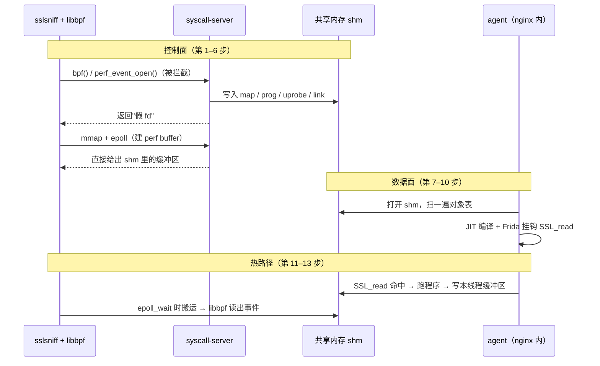
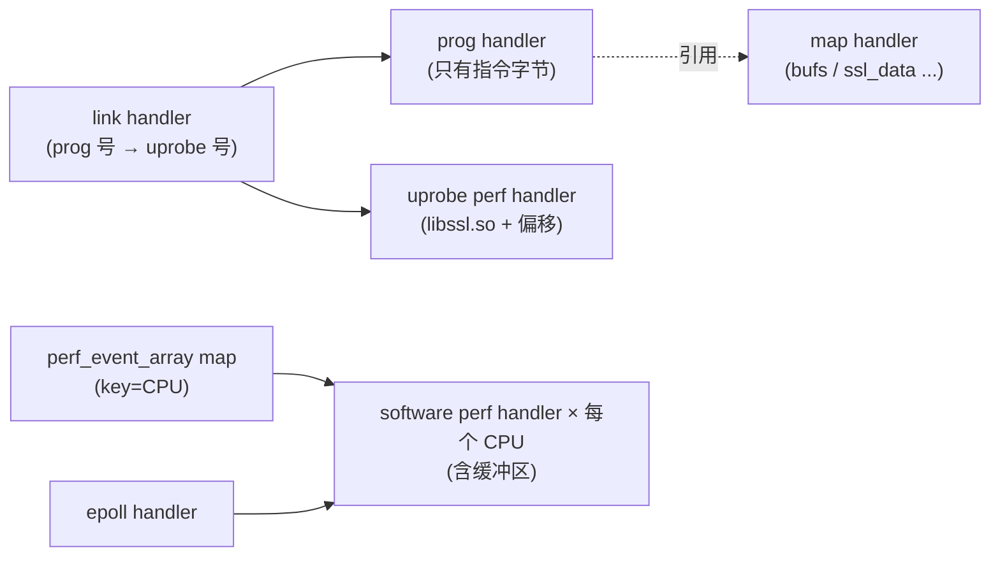
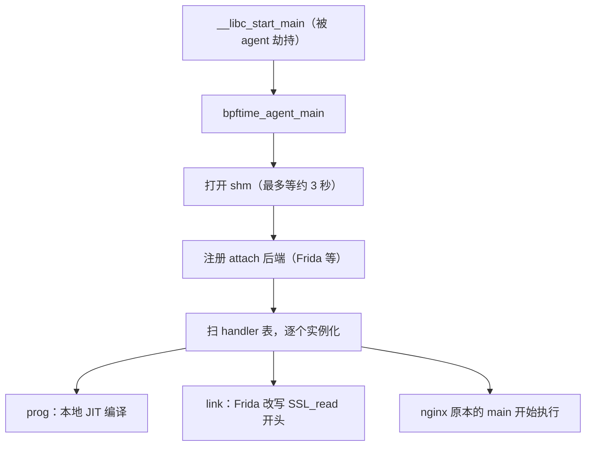
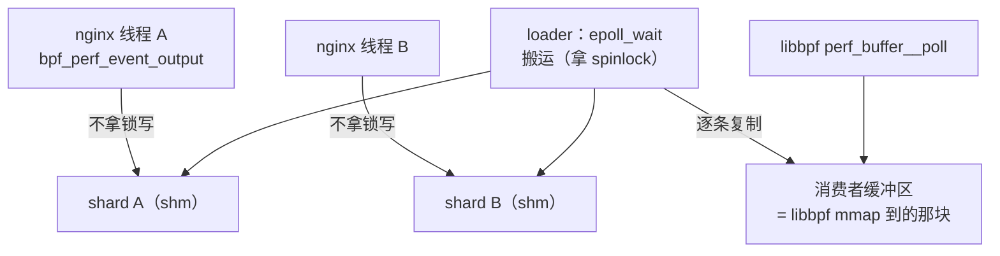

# 1. 一个事件的完整生命周期（主线，必读）

> 一句话：跟着一次真实的 SSL 追踪，从 loader 调用 `bpf(2)` 一直走到事件打印在屏幕上，
> 把 bpftime 的核心代码串成 13 步。读完你能回答："bpftime 不进内核，那 map、prog、
> uprobe、perf buffer 分别变成了什么，又是怎么在两个进程之间流动的？"
>
> 前置：建议先读[第 0 章](00-architecture.md)（至少看组件图和术语表）。预计用时：2 小时。

## 本章要回答的问题

- loader 调 `bpf(2)` 创建 map 时，为什么根本没有进内核？它拿到的"fd"又是什么？
- loader 和被追踪进程是两个独立进程，eBPF 程序是怎么从前者"跑到"后者里去的？
- `SSL_read` 被调用的那一刻，到底是谁把控制权交给了 eBPF 程序？
- 程序里一句 `bpf_perf_event_output`，数据要经过哪几块内存，才能被 loader 的
  `perf_buffer__poll` 读到？
- 哪些地方仍然要付真正的系统调用？

---

## 1.1 场景与全景

我们用一个固定场景串起全部代码（后面各章也沿用它）：

- **loader / 控制面**：`sslsniff`。它是普通的 libbpf 程序，启动时被 `LD_PRELOAD` 了
  `syscall-server.so`。它负责"创建对象"：map、prog、uprobe、link、perf buffer。
- **目标进程 / 数据面**：`nginx`。它被 `LD_PRELOAD` 了 `agent.so`。每当 nginx 调用
  `SSL_read` / `SSL_write`，agent 就执行 eBPF 程序，产出事件。
- **唯一的桥梁**：一块名为 `bpftime_maps_shm` 的共享内存（下文简称 shm）。两个进程之间
  没有 socket、没有管道，所有对象都住在这块 shm 里。

整件事分三段：**控制面**（第 1–6 步，loader 启动时做一次）、**数据面**（第 7–10 步，
nginx 启动时做一次）、**热路径**（第 11–13 步，每个事件都走一遍）。

这张图只看一件事：**两个进程从不直接对话，一切都经过 shm**。



---

## 1.2 控制面：loader 在 shm 里搭出对象图（第 1–6 步）

控制面结束时，shm 里会出现下面这张"对象图"。图里每个方框都是 shm 里的一个
**handler**——可以理解为"内核对象在用户态的替身"，它们排在一张叫 **handler 表**的数组里。
这张图要看的是：**箭头只是记录，此时还没有任何代码被挂钩、被编译**。



### 第 1 步：符号拦截

**这一步在干嘛**：libbpf 以为自己在调用 glibc 的 `syscall()`、`mmap()`、`close()` 等函数，
实际调到的是 syscall-server 里**同名**的函数。syscall-server 判断一下：是 bpf 相关的就自己处理，
不是就转给真正的 glibc。

**为什么要这样**：这是最轻的拦截方式。`LD_PRELOAD` 让 syscall-server.so 比 libc 先被
动态链接器搜到，同名符号就"盖住"了 libc 的版本——不需要 ptrace，也不需要 seccomp，
libbpf 一行都不用改。代价是**只有通过 libc 调用的才拦得到**；有人直接用汇编 `syscall`
指令进内核，就管不着。

被覆盖的函数有：`syscall`、`mmap`/`mmap64`/`munmap`、`ioctl`、`epoll_create1`/`epoll_ctl`/
`epoll_wait`、`close`、`open`/`openat`/`read`、`fopen` 一族。其中 `syscall()` 是 libbpf 发起
`bpf(2)` 和 `perf_event_open(2)` 的入口：

`runtime/syscall-server/syscall_server_main.cpp` 的 `syscall()`

```cpp
extern "C" long syscall(long sysno, ...)   // 与 glibc 同名：libbpf 调到的是这一个
{
	va_list args;
	va_start(args, sysno);
	long arg1 = va_arg(args, long);       // 不管实际几个参数，一律取 6 个（glibc 也如此）
	/* ... arg2 ~ arg6 ... */
	va_end(args);
	if (!initialize_ctx())                // 上下文还没就绪：直接走真 syscall
		return fallback_syscall(sysno, arg1, /* ... */ arg6);
	auto call_original = [&]() {          // "原样交给内核"的兜底
		return context->orig_syscall_fn(sysno, arg1, /* ... */ arg6);
	};
	if (sysno == __NR_bpf) {              // bpf(2)：交给用户态实现
		int cmd = (int)arg1;
		auto attr = (union bpf_attr *)(uintptr_t)arg2;
		return handle_exceptions(
			[&]() { return context->handle_sysbpf(cmd, attr, (size_t)arg3); },
			call_original);               // 内部抛异常 → 退回真内核
	} else if (sysno == __NR_perf_event_open) {
		/* ... 同样交给 handle_perfevent() ... */
	}
	/* ... __NR_dup3、__NR_memfd_create 也有各自的分支 ... */
	return call_original();               // 其他 syscall 原样放行
}
```

**要点**：

- 拦截 = 符号覆盖。真正的 libc 函数靠 `dlsym(RTLD_NEXT, ...)` 找到，留作兜底。
- 任何内部异常都**退回宿主原本的操作**（对 `bpf(2)` 就是交给真内核）。这叫 fail-open：
  注入的代码是宿主进程的"客人"，出错时宁可自己失效，也不能把宿主搞崩。
- 初始化时会 `unsetenv("LD_PRELOAD")`，免得 loader 再启动的子进程也被注入。

深入阅读：[第 3 章](03-agent-syscall-server.md)

### 第 2 步：创建 shm

**这一步在干嘛**：第一次有 bpf 相关调用进来时，syscall-server 做一次性启动：从环境变量读配置、
创建（或打开）名为 `bpftime_maps_shm` 的共享内存、开启一个新"会话"、把配置写进 shm。

**为什么要这样**：shm 是 loader 和 nginx 唯一的交汇点，所以由先到的 loader 创建它，
后到的 agent 只负责打开。配置也写进 shm，这样 agent 读到的就是 loader 这一份，
两边不会各说各话。

"会话"是为了应对旧 shm：如果上一次的 shm 还在，新 loader 会先把里面的 handler 全部清掉。
清的时候用一个 **epoch 序号**做标记——改之前加 1 变成奇数（"正在改"），改完再加 1 变回偶数
（"稳定"）。agent 看到序号是奇数或者变了，就知道 shm 被换过一茬（第 8 步会用到）。

`runtime/syscall-server/syscall_server_utils.cpp` 的 `start_up()`（节选，去掉了 try/catch）

```cpp
std::call_once(g_startup_once, [&ctx]() {           // 整个进程只做一次
	auto runtime_config = construct_runtime_config_from_env(); // 读 BPFTIME_* 环境变量
	shm_lifecycle_lock lifecycle_lock(/* shm 名 */);
	g_syscall_server_owns_shm =
		initialize_global_shm_with_ownership();     // 新建成功 = owner；已存在就打开
	std::atexit(remove_syscall_server_global_shm);  // 退出时（满足条件才）删 shm
	/* ... 把自己的 pid 登记进"活着的 syscall-server"集合 ... */
	shm_holder.global_shared_memory.begin_new_session(); // 新会话：清空旧 handler
	/* ... */
	bpftime_set_runtime_config(std::move(runtime_config)); // 配置写进 shm
});
```

`runtime/src/bpftime_shm_internal.cpp` 的 `bpftime_shm::begin_new_session()`（节选）

```cpp
__atomic_add_fetch(&epoch_state->epoch_seq, 1, __ATOMIC_ACQ_REL); // 变奇数："正在改"
reset_server_state();                                             // 清空全部 handler
return __atomic_add_fetch(&epoch_state->epoch_seq, 1, __ATOMIC_ACQ_REL); // 变偶数："稳定"
```

**要点**：

- shm 底层是 `boost::interprocess::managed_shared_memory`，默认 50MB；里面最重要的是
  handler 表（默认 6144 个槽）。名字和大小都能用环境变量改。
- 只有"创建者"（owner）进程在退出、并且没有其他活着的 loader/agent 时才删除 shm。
- 进程被 `SIGKILL` 时 `atexit` 不会执行，shm 会残留在 `/dev/shm/` 下。下次启动会复用并清空它，
  但做实验前手动清理（`bpftimetool remove` 或删掉 `/dev/shm/bpftime_maps_shm`）更稳妥。

深入阅读：[第 2 章](02-runtime-shm.md)

### 第 3 步：map 与 prog 诞生

**这一步在干嘛**：libbpf 发出 `BPF_MAP_CREATE`、`BPF_PROG_LOAD`。syscall-server 的
`handle_sysbpf()` 是 `bpf(2)` 的用户态版本：它在 shm 的 handler 表里占一个槽，放进
map handler 或 prog handler，然后把槽号当作 fd 还给 libbpf。

**为什么要这样**：libbpf 需要一个"fd"才能继续工作（后面要拿它填 map 引用、建 link）。
bpftime 的办法是**假 fd**：在 loader 里真的 `open("/dev/null")`，向内核要一个真 fd 号，
但它的**含义**由 shm 里同号的槽决定。内核占住这个号，就不会和进程里别的文件撞号。

`runtime/src/bpftime_shm_internal.cpp` 的 `bpftime_shm::open_fake_fd()`

```cpp
int fd = open("/dev/null", O_RDONLY);   // 向内核要一个真 fd，只为占住号码
int cnt = 5;
while (fd <= 2 && fd >= 0 && --cnt > 0)
	fd = dup(fd);                       // 避开 0/1/2（标准输入输出）
if (fd >= 0 && (std::size_t)fd >= manager->size()) {
	close(fd);                          // 号码超出 handler 表长度
	errno = ENOSPC;
	return -1;
}
return fd;                              // 这个号码 = handler 表下标
```

`runtime/src/handler/handler_manager.cpp` 的 `handler_manager::set_handler()`（节选）

```cpp
handlers[fd] = std::move(handler);                  // 槽号就是 fd
if (std::holds_alternative<bpf_map_handler>(handlers[fd]))
	/* ... */ map_handler.map_init(memory);         // map：立刻在 shm 里分配存储
return fd;
```

prog 这边要注意两件事：

- shm 里**只存指令字节和名字**，不存任何编译结果。谁执行谁编译（第 9 步）。
- 用户态 verifier（PREVAIL）只检查 prog 类型为 TRACEPOINT 或 SOCKET_FILTER 的程序。
  libbpf 把 `SEC("uprobe")` 标成 KPROBE 类型，所以 sslsniff 的 uprobe 程序**不经过**用户态校验。

**要点**：

- 假 fd 在内核眼里只是 `/dev/null`。所以 `close`、`dup3`、`mmap`、`ioctl` 都必须被拦截，
  否则操作只会落到 `/dev/null` 上，shm 里的对象既释放不了、也映射不出来。
- 判断"这个 fd 是不是 bpftime 的对象"，就是查同号槽里放的是哪种 handler。

深入阅读：[第 2 章](02-runtime-shm.md)；verifier 见[第 7 章](07-periphery.md)

### 第 4 步：uprobe 变成 perf 对象

**这一步在干嘛**：libbpf 挂 uprobe 时，先调 `perf_event_open(2)`，参数里写着"哪个文件、
哪个偏移、是不是 uretprobe"。syscall-server 把这些信息原样存成一个 uprobe 类型的
perf event handler，再还一个假 fd。

**为什么要这样**：在内核里，`perf_event_open` 之后 uprobe 就已经生效了。但在 bpftime 里，
loader 和 nginx 是两个进程，**loader 这时没法去改 nginx 的代码**。所以这一步只做"登记"：
记下要挂哪里，真正的挂钩留给 nginx 里的 agent（第 10 步）。

`runtime/syscall-server/syscall_context.cpp` 的 `syscall_context::handle_perfevent()`（节选）

```cpp
if ((int)attr->type == determine_uprobe_perf_type()) {      // uprobe 类型的 perf 事件
	bool retprobe =
		attr->config & (1 << determine_uprobe_retprobe_bit()); // uprobe 还是 uretprobe
	const char *name = (const char *)(uintptr_t)attr->config1; // 模块路径，如 libssl.so
	uint64_t offset = attr->config2;                        // 函数在文件里的偏移
	int id = bpftime_uprobe_create(-1 /* 让 shm 分配 fd */, pid, name,
				       offset, retprobe, ref_ctr_off);
	return id;                                              // 又一个假 fd
} else if (/* kprobe 类型 */) {
	/* ... */
} else if ((int)attr->type == (int)bpf_event_type::PERF_TYPE_SOFTWARE) {
	/* ... 第 6 步建 perf buffer 时走这里 ... */
}
```

**要点**：

- 此刻**没有任何指令被改写**，uprobe 只是 shm 里的一条记录。
- 同一入口还处理 SOFTWARE 类型的事件，那是 perf buffer 用的（第 6 步）。

深入阅读：[第 2 章](02-runtime-shm.md)、[第 4 章](04-attach-frida.md)

### 第 5 步：用 link 连线

**这一步在干嘛**：libbpf 发 `BPF_LINK_CREATE`，把"哪个 prog"和"哪个 uprobe"连起来。
syscall-server 在 shm 里写一个 link handler，里面的核心字段就两个：`prog_id` 和
`attach_target_id`——也就是两个假 fd 号。

**为什么要这样**：link 是 prog 和挂载点之间的"连线记录"。把它单独存成对象，
agent 扫表时就能顺着 link 找到"把哪段程序挂到哪里"；关掉 prog 或 uprobe 时，
也能顺着它把相关的 link 一起清掉。

`runtime/src/bpftime_shm_internal.cpp` 的 `bpftime_shm::add_bpf_link()`（节选）

```cpp
if (!is_prog_fd(args->prog_fd)) {        // 一端必须是 prog
	errno = EBADF;
	return -1;
}
if (args->attach_type == BPFTIME_BPF_PERF_EVENT_ATTACH_TYPE &&
    !is_perf_event_handler_fd(args->target_fd)) {
	errno = EBADF;                       // 另一端必须是 perf event
	return -1;                           // （libbpf 探测功能时正是在等这个 EBADF）
}
if (fd < 0)
	fd = open_fake_fd();                 // 先校验、后分配，出错不浪费 fd
return manager->set_handler(fd, bpftime::bpf_link_handler(*args), segment);
```

之后 libbpf 还会对 uprobe 的 fd 调 `ioctl(PERF_EVENT_IOC_ENABLE)`。这个调用也被拦下，
只是把 handler 上的一个"已启用"标志置位。

**要点**：

- 到这里，shm 里已经有了 `map ← prog → link → uprobe` 的完整对象图。
- 但是**没有一行代码被挂钩，没有一条指令被编译**。控制面只搭"图纸"。

深入阅读：[第 2 章](02-runtime-shm.md)

### 第 6 步：消费者就位（perf buffer）

**这一步在干嘛**：sslsniff 调 `perf_buffer__new()` 准备接收事件。libbpf 会依次：
`epoll_create1` 建一个 epoll；然后**每个 CPU** 打开一个 SOFTWARE 类型的 perf 事件、`mmap` 它的环形缓冲区、
`ioctl` 启用它、把它的 fd 写进 `perf_event_array` map（key 是 CPU 号）、`epoll_ctl` 把它加进 epoll。
这些调用全被 syscall-server 接住。

**为什么要这样**：内核的 perf buffer 是"内核写、用户读"的一块 mmap 内存，开头一页是
控制页（`perf_event_mmap_page`，里面有 `data_head`/`data_tail` 两个游标），后面是数据区。
bpftime 在 shm 里**一字节一字节地复刻了这个布局**，然后让 `mmap` 直接返回这块 shm 的地址。
libbpf 照常消费，完全不知道对面不是内核。

`runtime/syscall-server/syscall_context.cpp` 的 `syscall_context::handle_mmap64()`（节选）

```cpp
} else if (fd != -1 && bpftime_is_software_perf_event(fd)) { // 这个 fd 是 perf buffer
	errno = 0;
	if (auto ptr = bpftime_get_software_perf_event_raw_buffer(fd, length);
	    ptr != nullptr) {
		mocked_mmap_values.insert((uintptr_t)ptr); // 记账，munmap 时认得它
		return ptr;                  // 返回 shm 中"消费者缓冲区"的地址
	}
	if (errno == 0)
		errno = ENOMEM;              // shm 不够用：报 ENOMEM，而不是返回空指针
	return MAP_FAILED;
}
```

**要点**：

- 每个 CPU 一个 software perf handler，每个 handler 里有一块**消费者缓冲区**（consumer buffer），
  就是 libbpf `mmap` 拿到的那块。
- 数据区大小必须是 2 的幂，否则返回 `EINVAL`——和内核要求一致。
- `epoll_create1` 在 shm 里建一个 epoll handler，`epoll_ctl` 把 perf handler 挂上去，
  给第 13 步的 `epoll_wait` 用。

深入阅读：[第 6 章](06-maps-helpers.md)、[第 3 章](03-agent-syscall-server.md)

---

## 1.3 数据面：agent 把图纸变成钩子（第 7–10 步）

nginx 启动时，agent 读一遍 shm 里的对象图，在**自己的进程里**把它"实例化"：
编译程序、改写 `SSL_read`/`SSL_write` 的开头。这张图要看的是**先后顺序**：
所有准备工作都在 nginx 的 `main` 之前完成。



### 第 7 步：agent 启动

**这一步在干嘛**：agent 覆盖了 glibc 的 `__libc_start_main`（每个 C 程序在 `main` 之前都要经过它），
把真正的 `main` 换成自己的 `bpftime_hooked_main`。后者**先**跑 agent 的初始化，**再**调用原来的 `main`。

**为什么要这样**：这样能保证 nginx 执行第一行业务代码之前，所有钩子都已就位——不会漏掉启动早期的事件，
也不会在业务线程正在执行 `SSL_read` 时去改它的指令。

`runtime/agent/agent.cpp` 的 `__libc_start_main()` 与 `bpftime_hooked_main()`

```cpp
extern "C" int bpftime_hooked_main(int argc, char **argv, char **envp)
{
	int stay_resident = 0;
	injected_with_frida = false;            // 标记：走的是 LD_PRELOAD 路径
	bpftime_agent_main("", &stay_resident); // 先做全部初始化和挂钩
	return orig_main_func(argc, argv, envp);// 再进入 nginx 原本的 main
}

extern "C" int __libc_start_main(int (*main)(int, char **, char **), int argc,
				 char **argv, /* ... */)
{
	orig_main_func = main;                  // 记下真正的 main
	auto orig = (decltype(&__libc_start_main))dlsym(RTLD_NEXT, "__libc_start_main");
	return orig(bpftime_hooked_main, argc, argv, /* ... */); // 换成我们的 main
}
```

`bpftime_agent_main` 里做的事，按顺序：

1. 防重复初始化（同一进程里只能有一份 agent 生效）。
2. 以"只打开、不创建"的方式打开 shm，失败就每 50ms 重试一次，最多 60 次（约 3 秒）。
3. 读 shm 里的配置（就是第 2 步 loader 写进去的那份）。
4. 注册 **attach 后端**（attach impl）。attach 后端就是"真正负责挂钩的那部分代码"。
   uprobe 在 x86/ARM64 上用 Frida 后端；没有 Frida 的架构（如 RISC-V）用断点 + 信号的 trap 后端。
5. 扫描 handler 表（第 8 步），然后让 agent 常驻、不被卸载。

**要点**：

- 任何一步失败都会回滚并直接返回，nginx 照常运行，只是没有探针（fail-open）。
- **必须先启动 loader 并等它加载完，再启动 nginx**。LD_PRELOAD 方式下 agent 只在启动时扫一次表，
  之后 loader 新建的对象它看不到。那 3 秒重试只能容忍"shm 还没创建出来"。

深入阅读：[第 3 章](03-agent-syscall-server.md)

### 第 8 步：扫表实例化

**这一步在干嘛**：agent 从头到尾扫一遍 handler 表，对每个已占用的槽，按类型在本进程里造出
对应的"活对象"：prog 变成可执行的程序，uprobe 变成"本进程里的函数地址"，link 把两者接上。

**为什么要这样**：shm 里只有"图纸"，而图纸里不能放跟进程有关的东西（比如函数地址、编译好的机器码，
每个进程都不一样）。所以每个 agent 都要按图纸在自己的地址空间里再搭一遍。

扫表前后各读一次 epoch 序号：如果扫的过程中 loader 开了新会话，就把刚搭的全拆掉重来（最多 3 轮）。
扫表时遇到 link，会**先递归实例化它引用的 prog 和 uprobe**，保证依赖顺序：

`runtime/src/attach/bpf_attach_ctx.cpp` 的 `bpf_attach_ctx::instantiate_handler_at()`（节选）

```cpp
} else if (std::holds_alternative<bpf_link_handler>(handler)) {
	auto &link_handler = std::get<bpf_link_handler>(handler);
	// 先递归实例化 link 的一端：prog ……
	if (int err = instantiate_handler_at(manager, link_handler.prog_id,
					     stk, config, /* ... */); err < 0)
		return err;
	// …… 和另一端：perf event（uprobe）
	if (int err = instantiate_handler_at(manager, link_handler.attach_target_id,
					     stk, config, /* ... */); err < 0)
		return err;
	// 两端都就绪，再把它们接起来（第 10 步）
	if (int err = instantiate_bpf_link_handler_at(id, link_handler, /* ... */);
	    err < 0)
		return err;
}
```

各类 handler 的实例化：

- **prog**：用 shm 里的指令字节，在本进程 `new` 一个 `bpftime_prog`，注册 helper，然后编译（第 9 步）。
- **uprobe**：拼出 `"模块路径:偏移"` 字符串，交给第 7 步注册的 Frida 后端，解析成本进程里的**绝对地址**。
- **software perf event**：什么都不用做——缓冲区本来就在 shm 里。
- **link**：调用 attach 后端真正挂钩（第 10 步）。

**要点**：

- 单个 handler 实例化失败只记一条日志，不中断扫描。agent 被注入到无关进程（比如进程里根本没有 libssl）
  是常态，不是错误。
- 用一个集合记录递归路径，防止循环引用导致死递归。

深入阅读：[第 3 章](03-agent-syscall-server.md)、[第 2 章](02-runtime-shm.md)

### 第 9 步：JIT 编译

**这一步在干嘛**：把 eBPF 字节码编译成本机机器码。这一步其实就发生在第 8 步实例化 prog 的时候：
`bpftime_prog_load()` 先把指令拷进 VM，再调 `ebpf_compile()` 走 LLVM 生成一个函数指针
`uint64_t fn(void *mem, size_t len)`。

**为什么要这样**：机器码里写死了本进程的地址（helper、map 在哪），不能跨进程共享，只能每个进程各编一份。

最值得理解的是 **helper 怎么被调用**。eBPF 里 `call 25` 的意思是"调用 25 号 helper"
（25 号是 `bpf_perf_event_output`）。JIT 时它被翻译成对一个符号的调用，这个符号在链接时被绑定到
C++ 函数的真实地址：

```text
eBPF 指令:  call 25                                  ; 25 号 helper
  ↓ 翻译成 LLVM IR
LLVM IR:   %r0 = call @_bpf_helper_ext_0025(r1..r5)  ; 参数就是 r1–r5
  ↓ 建 JIT 实例时，把符号绑到函数指针
机器码:     call <C++ 函数 bpf_perf_event_output 的地址>
```

（这段是示意，不是源码。）

`runtime/src/bpftime_prog.cpp` 的 `bpftime_prog::bpftime_prog_load()`（节选）

```cpp
res = ebpf_load(vm, insns.data(),
		insns.size() * sizeof(struct ebpf_inst), &errmsg); // 指令拷进 VM
/* ... */
if (jit) {                                   // 默认开启；设 BPFTIME_DISABLE_JIT 可关
	ebpf_jit_fn jit_fn = ebpf_compile(vm, &errmsg); // LLVM 编译成本机码
	if (jit_fn == NULL) {
		SPDLOG_WARN("JIT compilation failed ({}), falling back to interpreter",
			    errmsg);
		jitted = false;
	} else {
		jitted = true;
		fn = jit_fn;                         // 以后每个事件直接调它
	}
}
```

**要点**：

- 运行时**没有查表**：从 JIT 代码到 helper 是一条直接的 `call` 指令，和调用普通 C 函数一样快。
- 所以 helper 必须在编译**之前**注册好；编译之后再注册的不会生效（第 5 章细讲）。

深入阅读：[第 5 章](05-vm-llvm-jit.md)

### 第 10 步：Frida 挂钩

**这一步在干嘛**：Frida 后端确认目标模块确实加载在本进程里，然后用 Frida 的
`gum_interceptor_attach` 改写 `SSL_read` / `SSL_write` 开头的几条指令，让它们跳到 Frida 准备好的
一小段**跳板代码（trampoline）**。同时，link 层把 JIT 出来的函数包成一个统一的回调，交给 Frida 后端。

**为什么要这样**：Frida 负责最难的部分——安全地改写正在运行的机器码。bpftime 只需要告诉它：
"命中时调这个回调"。这个回调是 prog 和 attach 后端之间**唯一的胶水**：

`runtime/src/attach/bpf_attach_ctx.cpp` 的 `bpf_attach_ctx::instantiate_bpf_link_handler_at()`（节选）

```cpp
auto cookie = handler.attach_cookie;
attach_id = attach_impl->create_attach_with_ebpf_callback(
	[=](void *mem, size_t mem_size, uint64_t *ret) -> int {
		if (auto *ctx = attach::current_signal_callback)
			ctx->cookie = cookie;              // trap 后端（信号里执行）才走这里
		else
			current_thread_bpf_cookie = cookie; // Frida 路径：存进线程局部变量
		return prog->bpftime_prog_exec(mem, mem_size, ret); // 执行 JIT 代码
	},
	*priv_data, attach_type);                  // priv_data 里有目标函数地址
```

`mem` 就是第 11 步造出来的寄存器快照（`pt_regs`），也就是 eBPF 程序看到的 `ctx`。

**要点**：

- 同一个函数地址只建一个 Frida 挂钩。sslsniff 在 `SSL_read` 上同时挂 uprobe 和 uretprobe，
  两者共享这个挂钩：uprobe 用"进入时"监听器，uretprobe 用"返回时"监听器。
- 至此静态链路完成：`SSL_read 开头 → Frida 跳板 → 上面这个 lambda → JIT 代码`。

深入阅读：[第 4 章](04-attach-frida.md)

---

## 1.4 热路径：一个事件从 SSL_read 到屏幕（第 11–13 步）

每个 HTTPS 请求都会触发 `SSL_read`/`SSL_write`，每次都要走一遍这三步。数据的流向是：
nginx 线程写进**自己的**缓冲区（shard），loader 在 `epoll_wait` 时把它们搬（drain）到
libbpf 看得到的消费者缓冲区。这张图要看的是：**多个 nginx 线程各写各的，互不抢锁**。



### 第 11 步：触发与执行

**这一步在干嘛**：nginx 调用 `SSL_read`。开头的指令早已被改成跳转，所以 CPU 先跳进 Frida 的跳板。
跳板把所有寄存器存成一个结构体 `GumCpuContext`，然后调用 bpftime 注册的监听器
（uretprobe 走 `uprobe_listener_on_leave`）。监听器在栈上造一个 `pt_regs`，把寄存器一个个抄过去，
再依次调用挂在这个函数上的每个回调——也就是第 10 步那个 lambda，最终跑到 JIT 代码。

**为什么要转换寄存器**：eBPF 程序是照着内核写的，它期待拿到内核格式的 `pt_regs`
（比如 `PT_REGS_PARM1(ctx)` 读第一个参数）。Frida 给的是它自己的格式，所以要转一次。
这是**单向拷贝**：程序改了 `ctx`，真实寄存器不会变。想改返回值要用另一种 attach 类型（override）。

`attach/frida_uprobe_attach_impl/src/frida_internal_attach_entry.cpp` 的 `uprobe_listener_on_leave()`

```cpp
static void uprobe_listener_on_leave(GumInvocationContext *ctx, gpointer user_data)
{
	auto *hook_entry = static_cast<frida_internal_attach_entry *>(user_data);
	bpftime::pt_regs regs;                                       // 栈上的 pt_regs
	convert_gum_cpu_context_to_pt_regs(*ctx->cpu_context, regs); // 寄存器逐个抄过去
	hook_entry->iterate_uretprobe_callbacks(regs);               // 跑这个函数上的所有 uretprobe
}
```

`runtime/src/bpftime_prog.cpp` 的 `bpftime_prog::bpftime_prog_exec()`（节选）

```cpp
bpftime_protect_disable();             // 启用内存保护时打开 shm 写权限；默认什么都不做
if (jitted)
	val = fn(memory, memory_size);     // 直接调用 JIT 出来的本机码
else
	res = ebpf_exec(vm, memory, memory_size, &val);
/* ... */
bpftime_protect_enable();
```

程序跑起来后会调用一串 helper（取 pid/tid、读写 hash map、`bpf_probe_read_user` 抄 SSL 缓冲区……）。
它们大多是纯用户态函数调用；其中 `bpf_probe_read_user` 默认每次做一次 `process_vm_readv`
真系统调用（为了读到坏地址时返回错误而不是崩溃），所以有一点额外开销。

**要点**：

- 和内核 uprobe 相比，从命中到进入程序这一段**完全不进内核**：没有断点异常、没有上下文切换。这是 bpftime 快的根本原因。
- 回调执行前，被挂函数的地址会存进一个线程局部变量，`bpf_get_func_ip` 就从这里读。
- `bpf_get_current_pid_tgid` 把 pid/tid 缓存起来，并在 `fork` 后刷新——nginx 的 worker 是从 master
  fork 出来的，不刷新就会报 master 的 pid。

深入阅读：[第 4 章](04-attach-frida.md)、[第 5 章](05-vm-llvm-jit.md)、[第 6 章](06-maps-helpers.md)

### 第 12 步：输出事件

**这一步在干嘛**：程序调用 `bpf_perf_event_output`。JIT 代码直接 call 到 C++ 函数
`bpf_perf_event_output`：它取当前 CPU 号，在 `perf_event_array` map 里查到这个 CPU 对应的
software perf handler，然后把记录写进**当前线程专属的 shard**。

这里有一个特殊之处：helper 在写之前会把线程临时绑到当前 CPU，写完再恢复。这要付几次真系统调用，
所以这一步有额外开销（来龙去脉见本章深入参考）。

**为什么要分 shard**：如果所有线程写同一个环形缓冲区，就得加锁。bpftime 给每个
(进程, 线程) 各开一个 shard，每个 shard 有自己的环形缓冲区；线程用一个线程局部缓存直接找到
自己的 shard，**正常情况下写入不拿任何锁**。只有第一次写（要新建 shard）时才拿一次自旋锁。

`runtime/src/bpf_helper.cpp` 的 `bpf_perf_event_output()`（骨架）

```cpp
int32_t current_cpu = my_sched_getcpu();      // 当前 CPU 号（不进内核）
/* ... 保存原 CPU 亲和性，绑到 current_cpu ... */
const int32_t *val_ptr = /* 以 current_cpu 为 key 查 perf_event_array */;
ret = bpftime_perf_event_output(*val_ptr, data, size); // → 本线程 shard
/* ... 恢复原 CPU 亲和性 ... */
```

`runtime/src/handler/perf_event_handler.cpp` 的 `software_perf_event_buffer::output_data()`（节选）

```cpp
constexpr size_t alignment = sizeof(uint64_t);
const size_t record_size =                    // 记录长度向上取整到 8 字节
	(sizeof(perf_sample_raw) + size + alignment - 1) & ~(alignment - 1);
perf_sample_raw header;
header.header.type = PERF_RECORD_SAMPLE;      // 和内核 perf 记录格式一致
header.header.size = record_size;
header.size = record_size - sizeof(header);
append_record_parts(&header, sizeof(header), buf, size,
		    header.size - size);          // 写 header + 数据，再推进 data_head
return 0;                                     // 注意：缓冲区满时也返回 0
```

**要点**：

- 记录按 8 字节对齐。libbpf 默认 header 永远不会跨越环形缓冲区的尾部，对齐就是为了保证这一点。
- 写完后用 release 语义更新 `data_head`，读方用 acquire 语义读，保证读到 head 时数据已经写好。
- 缓冲区满时**静默丢弃**：不报错，也不产生"丢失记录"通知。

深入阅读：[第 6 章](06-maps-helpers.md)

### 第 13 步：消费事件

**这一步在干嘛**：sslsniff 调 `perf_buffer__poll()`，里面的 `epoll_wait` 被拦下，变成一个
**每 1ms 扫一次的轮询**：对每个挂在 epoll 上的 perf handler 问"有数据吗？"。问的过程中，
loader 会把所有 nginx 线程 shard 里的记录**搬**到消费者缓冲区。有数据就返回，libbpf 按标准 perf
协议读出记录、回调 `print_event`。

**为什么要这样**：shm 里没有内核能帮忙"唤醒"等待者，只能轮询。而把搬运放在 loader 这边，
nginx 的热路径就只管往自己的 shard 里写，不用关心消费者。

`runtime/src/handler/perf_event_handler.cpp` 的 `has_data()`、`drain_producer_shards()` 与 `copy_next_record_to()`（节选）

```cpp
bool software_perf_event_data::has_data()
{
	drain_producer_shards();                     // 先搬运，再判断
	return consumer_buffer.has_data();
}
void software_perf_event_data::drain_producer_shards()
{
	spin_lock_guard guard(shard_lock);           // 搬运时拿锁
	for (auto &shard : producer_shards)
		while (shard.buffer.copy_next_record_to(consumer_buffer)) {}
	/* ... 顺带回收已退出线程的空 shard ... */
}
// copy_next_record_to() 核心：
read_wrapped(data_tail, &record_header, sizeof(record_header)); // 读记录头
if (record_header.size < sizeof(record_header) ||
    record_header.size > mmap_size()) {          // 长度不合理：丢弃整个 shard
	smp_store_release_u64(&header.data_tail, data_head);
	return false;
}
/* ... 还没写全就先不搬；否则复制进消费者缓冲区，推进 shard 的 data_tail ... */
```

**要点**：

- 读方仍要校验记录长度：shard 住在共享内存里，内容不受本进程控制。
- 消费者缓冲区满时，记录留在 shard 里，下一轮再搬。
- 游标的交接不需要系统调用：shard 是**跨进程**的（nginx 推进 head、loader 推进 tail）；消费者缓冲区
  则都在 loader 进程内（搬运代码推进 head、libbpf 推进 tail）。两处都靠 acquire/release 读写游标。
- 一条事件从 nginx 到屏幕共被复制 3 次：map 值 → shard，shard → 中转缓冲，中转缓冲 → 消费者缓冲区。

深入阅读：[第 6 章](06-maps-helpers.md)、[第 3 章](03-agent-syscall-server.md)

---

## 1.5 13 步一览表

| 步骤 | 发生在哪个进程 | 一句话 | 关键函数 |
|---|---|---|---|
| 1 符号拦截 | loader | LD_PRELOAD 同名函数盖住 libc，bpf 相关调用转给 syscall-server | `syscall()`、`handle_exceptions()` |
| 2 创建 shm | loader | 一次性启动：读配置、建/开 shm、开新会话 | `start_up()`、`begin_new_session()` |
| 3 map/prog 诞生 | loader | 在 handler 表里占槽，用 `/dev/null` 假 fd 当返回值 | `handle_sysbpf()`、`open_fake_fd()`、`set_handler()` |
| 4 uprobe 登记 | loader | `perf_event_open` 只记录"模块+偏移"，不挂钩 | `handle_perfevent()`、`bpftime_uprobe_create()` |
| 5 link 连线 | loader | 记下"哪个 prog 挂到哪个 uprobe" | `add_bpf_link()` |
| 6 perf buffer | loader | 每 CPU 一个 software perf handler，`mmap` 直接返回 shm 内存 | `handle_mmap64()`、`bpftime_get_software_perf_event_raw_buffer()` |
| 7 agent 启动 | nginx | 劫持 `__libc_start_main`，在 main 前打开 shm、注册 attach 后端 | `bpftime_hooked_main()`、`bpftime_agent_main()` |
| 8 扫表实例化 | nginx | 按图纸在本进程造出 prog / uprobe / link | `init_attach_ctx_from_handlers()`、`instantiate_handler_at()` |
| 9 JIT 编译 | nginx | LLVM 把字节码编成本机码，helper 调用编成直接 call | `bpftime_prog_load()`、`ebpf_compile()` |
| 10 Frida 挂钩 | nginx | 改写 `SSL_read` 开头，回调里执行 JIT 代码 | `create_attach_with_ebpf_callback()`、`gum_interceptor_attach()` |
| 11 触发执行 | nginx（每事件） | 跳板 → 寄存器转成 `pt_regs` → 跑 JIT 代码 | `uprobe_listener_on_leave()`、`bpftime_prog_exec()` |
| 12 输出事件 | nginx（每事件） | 记录按 8 字节对齐写进本线程 shard | `bpf_perf_event_output()`、`output_data()` |
| 13 消费事件 | loader（轮询） | `epoll_wait` 轮询时搬运 shard，libbpf 读出 | `bpftime_epoll_wait()`、`drain_producer_shards()` |

---

## 小结

- bpftime 的"内核"就是一块共享内存 shm。loader 和 nginx 从不直接对话，一切对象都住在 shm 的 handler 表里。
- 拦截靠 LD_PRELOAD 符号覆盖：只拦 libc 入口，出错就退回原始操作（fail-open）。
- loader 拿到的 fd 是指向 `/dev/null` 的真 fd，号码就是 handler 表下标；所以 `close`/`mmap`/`dup3`/`ioctl` 都要拦。
- 控制面只搭"图纸"：shm 里只有指令字节和挂载点描述，没有机器码、没有函数地址。
- 数据面在 nginx 的 `main` 之前，按图纸在本进程编译程序、改写函数开头；必须先启动 loader。
- 热路径完全在用户态：跳板 → `pt_regs` → JIT 代码 → helper 是一串普通函数调用。
- 输出写进每线程一个的 shard，不拿锁；loader 在 `epoll_wait` 轮询时把 shard 搬进 libbpf 看得到的缓冲区。
- 热路径上仍有少数真系统调用（比如 probe_read 和输出时的临时绑核），是性能分析的重点。

## 动手验证

以下命令假设你已按官方 README 编好 bpftime，`bpftime` 和 `bpftimetool` 在 `PATH` 里。

1. **看假 fd 指向哪里。** 用官方最小例子：

   ```bash
   make -C example/malloc
   bpftime load ./example/malloc/malloc &      # loader
   ls -l /proc/$(pgrep -n malloc)/fd
   ```

   预期：除了 0/1/2，还能看到好几个 fd 都指向 `/dev/null`——它们就是 libbpf 以为的 map / prog /
   uprobe / link。

2. **把 handler 表导出来对号入座。** loader 还在运行时：

   ```bash
   bpftimetool export /tmp/shm.json
   python3 -m json.tool /tmp/shm.json | less
   ```

   预期：JSON 按槽号列出对象，每个都有 `"type"`（`bpf_map_handler`、`bpf_prog_handler`、
   `bpf_perf_event_handler`、`bpf_link_handler` 等）。槽号和第 1 个实验里的 fd 号一一对应。

3. **确认 bpf(2) 没进内核，但热路径有真系统调用。**

   ```bash
   strace -f -e trace=bpf,openat bpftime load ./example/malloc/malloc 2>&1 | grep -E 'bpf\(|/dev/null'
   ```

   预期：能看到多次 `openat(..."/dev/null"...)`，基本看不到 `bpf(...)`（如果看到了，多半是某个
   调用触发了 fail-open 退回内核，值得查日志）。若你有 ssl-nginx 环境，可以对 nginx worker
   `strace -f -e trace=sched_getaffinity,sched_setaffinity,process_vm_readv -p <pid>`，
   每发一个 HTTPS 请求就能看到第 11、12 步的那几次系统调用。

## 自测题

**1. loader 拿到的 map "fd" 是什么？为什么 `close`、`dup3`、`mmap` 都必须被拦截？**

<details><summary>答案</summary>

它是 loader 进程里 `open("/dev/null")` 得到的真 fd，号码同时是 shm 中 handler 表的下标。
内核占住这个号，所以不会和进程里别的文件撞号；但在内核眼里它只是 `/dev/null`。

libbpf 会像对待真 fd 一样 `mmap` 它（perf buffer）、`close` 它（清理）、偶尔 `dup3` 它。
如果不拦：`mmap` 只会映射到 `/dev/null`；`close` 只关掉 `/dev/null`，shm 里的 handler 永远不释放；
`dup3` 出来的新号在 shm 里没有对应对象。所以 syscall-server 把这些入口全覆盖了：
`close` 先清掉 shm 里的槽（连带清掉引用它的 link）再关真 fd；`dup3` 对 map fd 走专门的复制逻辑；
`mmap` 遇到 perf buffer 的 fd 就返回 shm 内存，其余原样放行。
</details>

**2. eBPF 指令字节放在 shm 里，为什么 JIT 编译出的机器码不放？**

<details><summary>答案</summary>

机器码里写死了本进程的地址：helper 函数的地址、map 的地址、LLVM 运行时结构的地址。
不同进程的加载地址不同（ASLR），这些地址换个进程就是错的。所以 shm 只存与地址无关的
指令字节，每个 agent 在实例化 prog 时各自编译一份。代价是每个被注入的进程都要付一次编译时间，
换来的是不需要跨进程共享状态、也不需要重定位。
</details>

**3. 两个 nginx 线程同时命中 uprobe 并各自调用 `bpf_perf_event_output`，会抢同一个环形缓冲区吗？会拿锁吗？**

<details><summary>答案</summary>

不会抢：每个 (进程, 线程) 有自己的 shard，各有独立的环形缓冲区。
稳态下也不拿锁：线程局部缓存校验通过后直接返回自己的 shard。只有第一次写入（要新建 shard）
或缓存失效（消费者缓冲区扩容导致"代号"变化）时，才拿自旋锁走慢路径。
唯一常见的竞争在 loader 搬运和"新建 shard"之间，由同一把自旋锁串行化。
</details>

**4. 写方已经保证了每条记录按 8 字节对齐，为什么 loader 搬运时还要校验记录长度？校验不通过会怎样？**

<details><summary>答案</summary>

shard 住在共享内存里，内容不受 loader 控制：可能是旧版本进程留下的、也可能被破坏了。
而消费者缓冲区是 libbpf 直接读的，libbpf 不会再校验。一条长度为 0 的记录就能让 libbpf 原地空转。
所以读方必须自己把关——这是跨进程共享数据结构的通用原则：写方保证不变量，读方仍要验证。

校验的内容：长度不小于记录头、不大于缓冲区大小；不满足就把这个 shard 的存量**整个丢弃**。
另外，长度大于"已写入的字节数"时视为还没写完，留到下一轮。注意官方代码**没有**校验长度是否为 8 的倍数。
</details>

**5. `bpf_perf_event_output` 先取 CPU 号、再把线程绑到这个 CPU。如果线程恰好在两者之间被迁到别的 CPU，会出错吗？**

<details><summary>答案</summary>

不会。绑核只会把线程迁回快照里那个 CPU。CPU 号唯一的用途是作为 `perf_event_array` 的 key，
选出一个 software perf handler；真正的写入走每线程 shard，和 CPU 无关；loader 搬运时也是把所有
CPU 的 handler 都搬一遍。所以即使记录"归属"到了旧 CPU 的 handler 下，影响的只是按 CPU 统计的
准确性，不影响记录的完整性和顺序（内核 perf 同样有"采样时的 CPU"和"处理时的 CPU"不一致的情况）。
</details>

**6. agent 为什么劫持 `__libc_start_main`，而不是用 `__attribute__((constructor))`？**

<details><summary>答案</summary>

劫持 `__libc_start_main` 能拿到 `main` 的指针，从而精确地做到"所有库都初始化完、但业务代码还没开始"
时执行 agent 初始化：钩子先就位，nginx 才开始接请求，不丢早期事件。
构造函数虽然也早于 `main`，但它和其他共享库构造函数之间的先后顺序不可控，也拿不到 `main`。
另外，`bpftime_agent_main` 本身也是 Frida 注入路径的入口（`bpftime attach` 往运行中的进程注入时直接调它），
`__libc_start_main` 只是 LD_PRELOAD 场景下的触发点。初始化失败时它只回滚、返回，原 `main` 照常执行。
</details>

---

## 深入参考

<details>
<summary>代码位置速查（按 177a1dc465ff 行号）</summary>

`vm/llvm-jit` 是子模块（llvmbpf），行号按该提交固定的子模块版本 `87bac39` 计。

| 概念 / 函数 | 位置 |
|---|---|
| 被覆盖的 libc 入口 | `runtime/syscall-server/syscall_server_main.cpp:282-533` |
| `syscall()`；`__NR_bpf`/`perf_event_open`/`dup3`/`memfd_create` 分支 | `syscall_server_main.cpp:468`；`:488` / `:499` / `:513` / `:522` |
| `cached_next_symbol`（ctx 构造前的 dlsym 缓存） | `syscall_server_main.cpp:91-146` |
| `initialize_ctx()` / `handle_exceptions()` | `syscall_server_main.cpp:206-236` / `:238-257` |
| `init_original_functions()`、`unsetenv("LD_PRELOAD")` | `runtime/syscall-server/syscall_context.hpp:96-133`、`:132` |
| `try_startup()` | `runtime/syscall-server/syscall_context.cpp:237-254` |
| `handle_close()` / `handle_dup3()` | `syscall_context.cpp:256-275` / `:1200-1214` |
| `start_up()` / `initialize_global_shm_with_ownership()` | `runtime/syscall-server/syscall_server_utils.cpp:147-228` / `:126-145` |
| `remove_syscall_server_global_shm()` | `syscall_server_utils.cpp:56-124` |
| shm 默认名 / 环境变量覆盖 | `runtime/src/handler/handler_manager.hpp:51` / `:60-66` |
| shm 默认 50MB / `BPFTIME_SHM_MEMORY_MB` | `runtime/include/bpftime_config.hpp:79` / `runtime/src/bpftime_config.cpp:119-121` |
| `DEFAULT_MAX_FD_COUNT`（6144） | `runtime/include/bpftime_config.hpp:23` |
| shm create/open 分支 | `runtime/src/bpftime_shm_internal.cpp:830-880` |
| `begin_new_session()` / `reset_server_state()` | `bpftime_shm_internal.cpp:1017-1031` / `:1381-1397` |
| `bpftime_set/get_runtime_config` | `bpftime_shm_internal.cpp:1152-1177` |
| `is_map_fd` / `is_prog_fd` / `is_perf_fd` | `bpftime_shm_internal.cpp:594-602` / `:654-662` / `:664-672` |
| `open_fake_fd()` | `bpftime_shm_internal.cpp:674-688` |
| `add_bpf_prog()` / `add_bpf_link()` / `add_bpf_map()` | `bpftime_shm_internal.cpp:691-706` / `:709-750` / `:1048-1077` |
| `handler_manager::set_handler()` / `clear_id_at()` | `runtime/src/handler/handler_manager.cpp:63-88` / `:98-139` |
| `handle_sysbpf()`；`MAP_CREATE`/`PROG_LOAD`/`LINK_CREATE` | `syscall_context.cpp:482`；`:493` / `:628` / `:704` |
| verifier 类型过滤与调用 | `syscall_context.cpp:641-655`、`:658` |
| libbpf `SEC("uprobe")` → KPROBE | `third_party/bpftool/libbpf/src/libbpf.c:9832` |
| `handle_perfevent()`；uprobe / SOFTWARE 分支 | `syscall_context.cpp:806`；`:817-842` / `:905-910` |
| `bpftime_add_software_perf_event` | `runtime/src/bpftime_shm.cpp:541-546` → `bpftime_shm_internal.cpp:403-417` |
| link 失败兜底 `bpftime_attach_perf_to_bpf_with_cookie` | `syscall_context.cpp:722-730` |
| `ioctl(PERF_EVENT_IOC_ENABLE)` / `enable()` | `syscall_context.cpp:1025-1037` / `runtime/src/handler/perf_event_handler.hpp:194-200` |
| `handle_mmap64()`；software perf 分支 | `syscall_context.cpp:949`；`:987-1001` |
| mmap 调用链 | `bpftime_shm.cpp:568-573` → `bpftime_shm_internal.cpp:1185` → `perf_event_handler.cpp:642-652` → `:611-624` → `:276-305` |
| epoll 三件套 / `EPOLL_CTL_ADD` | `syscall_context.cpp:1070-1122` / `:1094-1098`；`bpftime_shm_internal.cpp:476-513` |
| libbpf `perf_buffer__new` 调用序列 | `libbpf.c:13876`（epoll_create1）、`:13928`（open_cpu_buf）、`:13936`（map update）、`:13948`（epoll_ctl） |
| `bpftime_hooked_main` / `__libc_start_main` | `runtime/agent/agent.cpp:535-542` / `:544-556` |
| `bpftime_agent_main` / `init_fail` | `agent.cpp:830` / `:837-878` |
| shm 打开重试（60 × 50ms） | `agent.cpp:932-948` |
| attach 后端注册：syscall_trace / trap / Frida / CUDA | `agent.cpp:971` / `:993` / `:1014` / `:1039` |
| 自动刷新线程（仅注入参数带 `auto_refresh` 时） | `agent.cpp:1082-1134` |
| alive agent 登记 / `stay_resident` | `agent.cpp:1138-1144` / `:1160` |
| `init_attach_ctx_from_handlers()` | `runtime/src/attach/bpf_attach_ctx.cpp:62`、`:73` |
| epoch 前检 / 扫表 / 后检 | `bpf_attach_ctx.cpp:77-104` / `:106-120` / `:137-159` |
| `instantiate_handler_at()`（防环 `:207-212`，link 递归 `:232-251`） | `bpf_attach_ctx.cpp:197` |
| `load_prog_and_helpers()` / `instantiate_prog_handler_at()` | `bpf_attach_ctx.cpp:43-60` / `:294-315` |
| `instantiate_bpf_link_handler_at()`；回调 lambda | `bpf_attach_ctx.cpp:316-419`；`:390-407` |
| `instantiate_perf_event_handler_at()` | `bpf_attach_ctx.cpp:420-510` |
| `add_helper_group_to_prog` | `runtime/src/bpf_helper.cpp:1163-1169` |
| `bpftime_prog_load()` / `ebpf_compile` 调用 / `bpftime_prog_exec()` | `runtime/src/bpftime_prog.cpp:171` / `:209` / `:238` |
| `current_thread_bpf_cookie` | `bpftime_prog.cpp:105` |
| JIT 翻译 `EBPF_OP_CALL` / 外部调用分支 | `vm/llvm-jit/src/compiler.cpp:1366-1482` / `:1470-1479` |
| `emitExtFuncCall` / 符号名 `_bpf_helper_ext_%04u` | `vm/llvm-jit/src/compiler_utils.cpp:312-371` / `compiler_utils.hpp:39-44` |
| `create_and_initialize_lljit_instance`（`absoluteSymbols`） | `vm/llvm-jit/src/llvm_jit_context.cpp:768-807` |
| `create_attach_with_ebpf_callback()` / `attach_at()` | `attach/frida_uprobe_attach_impl/src/frida_uprobe_attach_impl.cpp:175` / `:48-97` |
| `ensure_listener()` / 构造函数 | `frida_internal_attach_entry.cpp:115-143` / `:145-180` |
| `uprobe_listener_on_enter` / `on_leave` | `frida_internal_attach_entry.cpp:293-308` / `:310-318` |
| `iterate_uretprobe_callbacks` | `frida_internal_attach_entry.cpp:245-253` |
| `run_callback`（含 `current_thread_attach_func_ip`） | `frida_attach_entry.hpp:24-61` |
| 寄存器转换（x86_64 / ARM64） | `frida_register_conversion.cpp:6-31` / `:55-64` |
| `bpf_get_func_ip` | `bpf_helper.cpp:677-682` |
| `bpftime_probe_read` / `probe_read_memory` / atfork 刷新 | `bpf_helper.cpp:121` / `:97-119` / `:70-72` |
| `bpftime_get_current_pid_tgid` / `bpf_get_current_uid_gid` | `bpf_helper.cpp:208-259` / `:261-267` |
| `bpf_perf_event_output()` | `bpf_helper.cpp:487-553` |
| `my_sched_getcpu` | `runtime/src/platform_utils.cpp:7-9` |
| `bpftime_perf_event_output` | `bpftime_shm.cpp:575-596` |
| `software_perf_event_data` 定义 | `perf_event_handler.hpp:71-152` |
| `get_current_thread_shard()`（缓存 `:143-145`） | `perf_event_handler.cpp:491-548` |
| `append_record_parts()` / `output_data()` | `perf_event_handler.cpp:318-365` / `:367-388` |
| `copy_next_record_to()` / `drain_producer_shards()` / `has_data()` | `perf_event_handler.cpp:421-462` / `:550-558` / `:589-593` |
| shard 回收 / `is_thread_alive` | `perf_event_handler.cpp:560-587` / `:118-130` |
| `bpftime_epoll_wait()` | `bpftime_shm.cpp:418-539` |
| sslsniff BPF 程序 | `example/tracing/sslsniff/sslsniff.bpf.c:60-129` |
| `ENABLE_PROBE_READ_CHECK` 默认 ON | `cmake/StandardSettings.cmake:110` |
| trap 后端编译条件 | `cmake/StandardSettings.cmake:76-81` |

</details>

<details>
<summary>细节与坑</summary>

**第 1 步：拦截**

- 被覆盖的完整列表还包括 `fopen64` 和 `_IO_new_fopen`。
- 真 libc 函数有两套兜底：ctx 构造好之前，用 `cached_next_symbol` 按需 `dlsym(RTLD_NEXT, ...)`
  并缓存；ctx 构造时 `init_original_functions()` 用 `require_symbol` 逐个解析，缺一个就抛异常。
- `initialize_ctx()` 的状态机：用 CAS 把状态从 0 推到 1，构造期间置线程局部 `tls_initializing`。
  构造 ctx 时如果又调到被拦函数（例如 spdlog 初始化会调 `fopen`），直接返回 false，调用方走
  `dlsym` 缓存的原函数；其他线程看到状态 1 就 `sched_yield` 等待；构造抛异常则置 3（disabled），
  此后一律放行。
- `try_startup()` 在 `start_up` 抛异常时把 `enable_mock_after_initialized` 置 false，之后每个
  `handle_*` 开头的检查都直接走原函数。

**第 2 步：shm**

- `start_up` 流程：`construct_runtime_config_from_env()` → 持 `shm_lifecycle_lock` 调
  `initialize_global_shm_with_ownership()`（先 `SHM_CREATE_ONLY`，报 `already_exists` 再
  `SHM_CREATE_OR_OPEN`）→ `atexit` → 登记 alive syscall-server pid（登记失败就放弃自动删除）→
  `begin_new_session()` → （开 verifier 时）设置可用 helper 列表 → `bpftime_set_runtime_config` →
  `setenv("BPFTIME_USED", "1")`。
- shm 创建时 `find_or_construct` 出：`handler_manager`（handler 表，长度 = `max_fd_count`）、
  `syscall_pid_set`、`runtime_config`（对象名 `bpftime_runtime_config`）、alive agent / alive
  syscall-server 两个 pid 集合、`pid_set_lock`、epoch 状态。
- `reset_server_state()` 调 `manager->clear_all` 清空全部 handler，并清空 syscall pid 集合。
- 删除条件：只有 owner 进程，且 alive syscall-server 集合和 alive agent 集合里都没有活着的 pid 时，
  才真正 `shared_memory_object::remove`。被 `SIGKILL` 的上一轮留下的 shm，下一轮以非 owner 身份打开，
  于是下一轮退出时也不会删它。

**第 3 步：map / prog**

- `open_fake_fd()` 拿到 0–2 时最多 `dup` 4 次往上挪；号码超出 handler 表长度则关掉 fd、返回 `ENOSPC`。
  `set_handler` 自己也有越界检查，返回 `-ENOSPC`；槽已被占用返回 `-EEXIST`。
- verifier 模式取自 `runtime_config.verifier_mode`，由 `BPFTIME_VERIFIER_LEVEL` 控制
  STRICT / WARNING / NO_VERIFY，默认 WARNING；且只在编译时开启 `ENABLE_BPFTIME_VERIFIER` 时存在。
- 代码-注释不一致：`BPF_PROG_LOAD` 分支里的注释写着 "uprobe/uretprobe -> SOCKET_FILTER"，
  但 libbpf 实际把 `SEC("uprobe")` 映射成 `BPF_PROG_TYPE_KPROBE`，所以 uprobe 程序不进用户态 verifier。
- 设了 `BPFTIME_RUN_WITH_KERNEL` 时，`PROG_LOAD` 等会交给真内核（本章场景不涉及）。

**第 4–5 步：perf / link**

- uprobe 的 retprobe 位、`ref_ctr_off`（`attr->config >> PERF_UPROBE_REF_CTR_OFFSET_SHIFT`）都从
  `attr->config` 里取。
- `add_bpf_link` 先校验再分配 fd，避免错误路径泄漏 `open_fake_fd()` 拿到的 fd。libbpf 用
  `target_fd=-1` 探测是否支持 perf link 时正好拿到期望的 `EBADF`，于是走 link 路径。
- link 创建失败、而两端确实是 prog 和 perf event 时，还有一条经
  `bpftime_attach_perf_to_bpf_with_cookie` 的兜底。
- `PERF_EVENT_IOC_ENABLE` 只是置 `enabled` 位，代码里带 TODO。
- `close` 一个 prog 或 perf event 时，`clear_id_at` 会级联清掉引用它的 link。

**第 6 步：perf buffer**

- `mmap` 调用链：`bpftime_get_software_perf_event_raw_buffer` → `get_software_perf_event_raw_buffer`
  → `try_get_software_perf_data_raw_buffer` → `software_perf_event_data::ensure_mmap_buffer`
  （持 `shard_lock`，尺寸变了就推进 `producer_buffer_generation`）→
  `software_perf_event_buffer::ensure_mmap_buffer`（按 libbpf 请求的长度扩容，数据区须为 2^n，
  否则 `EINVAL`；扩容抛异常时报 `ENOMEM`）。
- `epoll_ctl(EPOLL_CTL_ADD)` 把 software perf event 的 weak_ptr 挂进 `epoll_handler`。
- 时间顺序：sslsniff 先 `sslsniff_bpf__load` → `attach_openssl`（uprobe + link）→ 最后才
  `perf_buffer__new()`，所以 software perf event 是在 uprobe/link 之后才创建的。

**第 7 步：agent**

- 若进程里已有一份 agent（IPC server 或另一个已加载的副本），转交给它。
- 每次尝试打开 shm 前持 `shm_lifecycle_lock`。
- uprobe 家族四种类型（UPROBE / URETPROBE / UPROBE_OVERRIDE / UREPLACE）由同一个后端处理；
  Frida 后端构造参数里带 `enable_frida_fuzzy_backtracer`。trap 后端只在没有 Frida 的架构上编进来。
- 注册 attach 后端时同时传入 `private_data_creator` 闭包，把字符串形式的 attach 参数解析成后端私有数据。
- `bpftime_agent_main` 本身也是 frida-gum agent 入口；`injected_with_frida` 默认 true，
  走 `__libc_start_main` 时才置 false。
- 自动刷新线程只在注入参数里给了 `auto_refresh` 时才启动；LD_PRELOAD 路径传的是空字符串，
  所以只在启动时扫一次表。官方 README 也要求"先 load 再 start"。

**第 8–9 步：实例化与 JIT**

- `init_attach_ctx_from_handlers` 在 `ctx_mutex` 下最多尝试 3 轮：序号为奇数则等 50ms 重试；
  序号变了就先拆掉本进程已有的全部 link；扫完再读一次，扫描期间会话变了就拆掉重来；
  3 轮都不稳定返回 `-EAGAIN`。实际扫两遍表：第二遍专门处理 CUDA link（它们需要 map 信息）。
- `load_prog_and_helpers` 按配置注册三组 helper（kernel utils / ufunc / shm maps），然后**在函数末尾
  调 `bpftime_prog_load` 完成 JIT**；attach 后端自定义的 helper 是之后才补注册的，
  因此编译时看不到它们（第 5 章详述其后果）。
- JIT 失败时日志写"falling back to interpreter"，但 llvm 后端并没有真解释器：之后每个事件都会重试
  编译（第 5 章）。
- helper 调用的实参是 r1–r5，返回值写回 r0。

**第 10 步：Frida**

- 挂钩前扫 `/proc/self/maps`，用 `std::filesystem::equivalent` 比对路径，确认目标模块确实映射在本进程，
  防止同名不同文件。
- uprobe 用 `gum_make_probe_listener(uprobe_listener_on_enter, ...)`，uretprobe 用
  `gum_make_call_listener(nullptr, uprobe_listener_on_leave, ...)`；构造函数按第一个 attach 的类型
  建第一个 listener，之后每次新增 user attach 都调 `ensure_listener` 按需补另一个。
- 已经有 override/replace 的函数不能再挂别的（`-EEXIST`）。
- trap 后端在建回调前先 `prepare_for_signal_execution()`，提前编译好，因为信号处理里不允许惰性编译。

**第 11 步：触发**

- 入口侧 `uprobe_listener_on_enter` 还会把 `ctx->cpu_context` 记进 `current_thread_gum_cpu_context`。
- 寄存器转换：x86_64 拷 `rip`、`r8–r15`、`rdi/rsi/rbp/rsp/rbx/rdx/rcx/rax`；ARM64 拷 `x0–x28`、
  `fp`、`lr`、`sp`、`pc`、`nzcv`。
- `run_callback` 进来时把被挂函数地址写进 `current_thread_attach_func_ip`，退出时恢复旧值。
- `bpftime_protect_disable/enable` 是 MPK（Intel 内存保护键）开关，未启用时是空操作。
- sslsniff 一次 `SSL_read` 进出两段程序用到的 helper：`bpf_get_current_pid_tgid`、
  `bpf_get_current_uid_gid`、`bpf_ktime_get_ns`、`bpf_map_update/lookup/delete_elem`
  （按 tid 增删 `bufs`、`start_ns` 两个 HASH map）、`bpf_get_current_comm`、`bpf_probe_read_user`、
  `bpf_perf_event_output`。
- `bpf_get_current_pid_tgid`（C 函数名 `bpftime_get_current_pid_tgid`）：tgid 缓存在文件作用域、
  tid 缓存在 thread_local，`pthread_atfork` 子进程回调刷新 tgid、作废 tid。注册 atfork 失败时退化为
  每次都查。
- `bpf_get_current_uid_gid`：每次调用都查 `getgid()`/`getuid()`（凭据可能在启动后变化），
  即每次两个系统调用。
- `bpf_probe_read_user` → `bpftime_probe_read`：默认开启的 `ENABLE_PROBE_READ_CHECK` 下走
  `probe_read_memory`，对自己进程调一次 `process_vm_readv`，读不到返回 `-EFAULT`，不碰信号处理；
  目标 pid 缓存在 `probe_access_pid`，同样靠 `pthread_atfork` 刷新。关掉该选项则是纯 `memcpy`。

**第 12 步：输出与绑核代价**

- `my_sched_getcpu` 在 Linux 上就是 glibc `sched_getcpu()`，现代 glibc 走 rseq/vDSO，不陷入内核。
- `flags`（sslsniff 传 `BPF_F_CURRENT_CPU`）**没有被读取**，CPU 一律取当前快照。
- 每事件三次亲和性系统调用：`sched_getaffinity` 保存原 mask、`sched_setaffinity` 钉到 `current_cpu`、
  结束时 `sched_setaffinity` 恢复。map 类型查询失败、lookup 失败的错误路径也会 `goto restore_affinity`，
  恢复时保住输出操作的 errno。
- 这串绑核在当前代码结构里不保护任何不变量：CPU 号在绑核**之前**已经快照，真正的写入走每线程 shard。
  剩下的风险是恢复用的 `orig` 是进入时的快照，若应用在此期间自己改了亲和性，会被覆盖回去。
- `get_current_thread_shard` 入口处每次都调 `getpid()` 和 `syscall(SYS_gettid)`，命中缓存也照付
  这两次调用。缓存校验 `event_generation`、`producer_buffer_generation`、pid/tid 和 shard 代号。
- `software_perf_event_data` 字段：

  | 字段 | 谁写 | 谁读 | 说明 |
  |---|---|---|---|
  | `consumer_buffer` | loader 搬运时 append | libbpf 经 mmap 直接读、推进 `data_tail` | 第 6 步 mmap 返回的那块；kernel perf ABI 布局 |
  | `producer_shards`（`boost::interprocess::list`） | nginx 各线程首次输出时 emplace | loader 搬运时遍历 | 每 (pid,tid) 一个 shard |
  | `shard_lock`（进程共享 spinlock） | 建 shard / 搬运 / 回收 / 扩容时持有 | — | 热路径写入不持锁 |
  | `event_generation` / `producer_buffer_generation` | 创建时 / 消费者缓冲区扩容时 | shard 缓存校验 | 换代即缓存失效 |

- `output_data` 以 `uint16_t` 上限拒绝超大记录（`E2BIG`）；`perf_sample_raw` 里的 `size` 包含 padding。
- `append_record_parts`：先校验 ring 状态（head < tail 或已用量 ≥ 容量即丢弃），恒留一字节空隙使
  `head == tail` 只表示"空"，然后 `write_wrapped` 写 header 和 payload，最后
  `smp_store_release_u64(&header.data_head, new_head)` 发布。
- padding 只参与长度计算，**padding 字节本身不写**，head 直接越过，里面是 ring 里的旧字节。
- ring 满时 `append_record_parts` 返回 false，但 `output_data` 不看返回值、恒返回 0：静默丢弃，
  也没有 `PERF_RECORD_LOST` 记录。
- 对齐为什么重要：如果记录不按 8 字节对齐，8 字节的 header 可能恰好横跨环形缓冲区的回绕点。libbpf
  读 header 时直接按位置取 `size`（内核保证 header 不跨界），会读到撕裂的 `size=0` 并原地空转，
  consumer 停摆 → shard 填满 → 静默丢事件。
- sslsniff 用的是 perf event array；ringbuf 路径另有"记录头和 payload 跨 ring 尾部保持连续"的处理，不在本条线上。

**第 13 步：消费**

- 调用链：`perf_buffer__poll` → 被拦的 `epoll_wait` → `handle_epoll_wait` → `bpftime_epoll_wait`。
- 轮询细节：一轮扫完只要有就绪项、或 `timeout == 0`，立即返回；否则用 `sigtimedwait` 睡 1ms，
  期间保持 SIGINT/SIGTERM 可中断（先 `sigprocmask` 阻塞，定时等待时解除；捕到信号则手动调用原 handler
  并返回 `EINTR`），出口恢复原 sigmask。每次调用每个就绪 fd 只报告一次。
- `copy_next_record_to`：读出 record header → 校验 `size >= sizeof(header)` 且 `size <= mmap_size()`，
  不满足则把 tail 推到 head、丢弃整个 shard 存量 → `size` 大于 `head - tail` 视为未写全，先不搬 →
  经 `copy_buffer` 中转搬进 consumer ring → `smp_store_release` 推进 shard 的 `data_tail`。
  consumer ring 满时返回 false，记录留在 shard 里。
- 不校验 `size % 8 == 0`。官方 shard ring 只由 `output_data` 写，正常不会出现非对齐记录；挡不住的是
  旧版本进程残留的记录或被破坏的 shm 内容。
- 按节流阈值回收已死线程的空 shard，`is_thread_alive` 用 `tgkill(pid, tid, 0)` 探活。
- 一条事件的拷贝：`bpf_probe_read_user` 先把 SSL 缓冲区抄进 `ssl_data`（PERCPU_ARRAY，值在 shm）；
  之后再经历 3 次 memcpy：map 值 → shard ring（第 12 步）；shard ring → `copy_buffer` → consumer ring
  （第 13 步，算两次）。
- 搬运（`has_data` → `drain_producer_shards`）在 loader 进程里执行，所以消费者缓冲区的 head 和 tail
  都由 loader 进程推进；跨进程交接游标的是 shard ring。

</details>

<details>
<summary>上游变更与我们的工作</summary>

**本章涉及的上游 PR（6bd5319d → 177a1dc）**

- #640 preload fail-open：`handle_exceptions` 捕获异常后回退到原始宿主操作；agent `init_fail` 回滚后照常执行 main。
- #634 把"注入代码是宿主进程的客人"写成约定：不终止宿主、不碰宿主 stdio、不破坏宿主信号处理。
- #632 把 preload 的日志从宿主 stdio 挪走。
- #562 `agent_config` 改名为 `runtime_config`。
- #639 会话清理（`remove_syscall_server_global_shm` 的删除条件）。
- #671 `open_fake_fd` 的边界检查（超出 handler 表长度返回 `ENOSPC`）。
- #672 关闭 prog / perf event 时级联清掉 link。
- #597 shm 耗尽：扩容抛 `bad_alloc` 时报 `ENOMEM`，而不是把空指针当成功。
- #633 Frida 后端的 `enable_frida_fuzzy_backtracer` 参数。
- #665 RISC-V 等无 Frida 架构的 trap（断点 + SIGTRAP）uprobe 后端。
- #601 新增 `bpf_get_func_ip`（数据来自 `current_thread_attach_func_ip`）。
- #685 `bpf_get_current_pid_tgid` 的 `pthread_atfork` 刷新（nginx worker 是 fork 出来的）。
- #691 `bpf_get_current_uid_gid` 改为每次调用都查。
- #650 hash map 删除冲突 key 后 lookup 出错的修复——sslsniff 每个事件按 tid 增删 `bufs`、`start_ns`，
  正好走到这条路径。
- #642（`f311de23`）probe_read 从"SIGSEGV handler + 改 PC"换成 `process_vm_readv` 的 no-fault 拷贝。
- #678（`3a1d2ecf`）`bpf_perf_event_output` 的错误路径也恢复 CPU 亲和性，并保住 errno。
- #612（`417f7c61`）perf record 8 字节对齐（源自我们 7 月的修复）。
- #689（`23646cfa`）`bpftime_epoll_wait`：之前有就绪项时会睡 1ms 再扫一轮，同一个 fd 可能被重复写进
  `out_evts` 直到填满 `max_evt`；`timeout == 0` 则不扫就返回 0，还漏了恢复 sigmask。
- #706 ringbuf 记录头和 payload 跨 ring 尾部保持连续（不在 sslsniff 路径上）。

**📌 案例：shm 残留与吞吐双峰**

上一轮 benchmark 被 `SIGKILL` 时 atexit 不会跑，残留的 shm 会被下一轮以非 owner 身份打开。新会话虽然会
`clear_all` 掉旧 handler，但我们在 7 月观察到脏状态曾是吞吐双峰的放大器之一，所以跑实验前清理
`/dev/shm/bpftime_maps_shm` 仍是 runbook 的固定步骤。

**📌 案例：sigaction 修复（`ead56c9`，已被上游 #642 取代）**

7 月时 `bpftime_probe_read` 用"装一个 SIGSEGV handler + 出错时把 PC 改到 `jump_point_read`"模拟内核
probe_read 的容错。我们修掉了"handler 是否已装"读**未初始化局部变量**、导致每次白付 2 个
`rt_sigaction` 的 bug（改为 thread_local 标志）。上游 #642 把整套信号方案换掉了：现在每次
probe_read 固定 1 个 `process_vm_readv`，不再碰进程级信号处理。教训：热路径上的"一次性初始化"必须有
明确的、可证明初始化过的标志位——更好的做法是根本不需要它。

**📌 案例：perf record 对齐修复（7 月 `0fcdb0e` → 上游 #612）**

修复前 record 按原始长度紧密排布，header 可以横跨环回绕点，libbpf 读到撕裂的 `size=0` 后空转 →
consumer 停摆 → shard 填满 → 静默丢事件 → 吞吐双峰。上游合入的版本只保留了生产侧对齐；我们 7 月版本里的
padding 清零、消费侧 `size % 8 == 0` 校验都不在官方代码里。

**📌 案例：每事件绑核删除（开发分支 `076e3e4`，官方未采纳）**

我们在 Jetson 上测到 `bpf_perf_event_output` 里这串亲和性调用每事件 3.1–6.7µs、占 event-output 段成本的
72%。走读认为它不保护任何不变量（CPU 号在绑核前已快照，写入走 per-thread shard），所以开发分支把整段删掉了；
官方至今保留"钉核 → 输出 → 恢复"的结构，并在 #678 里补齐了错误路径的恢复。7 月走读时发现的
"错误路径漏恢复 mask、把 nginx worker 永久钉死单核"的问题在官方已修。自测题 5 的推理正是这个提案的核心论据，
完整辩护见[附录 A.4](09-appendix-research-notes.md#a4-pr-状态与辩护清单)。

</details>

---
[← 返回目录](README.md)
