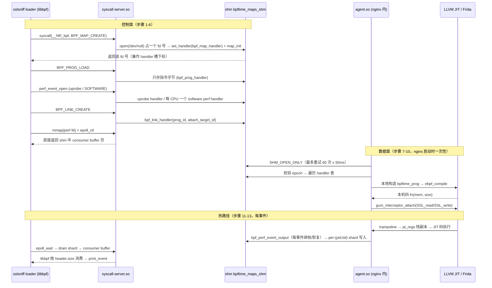
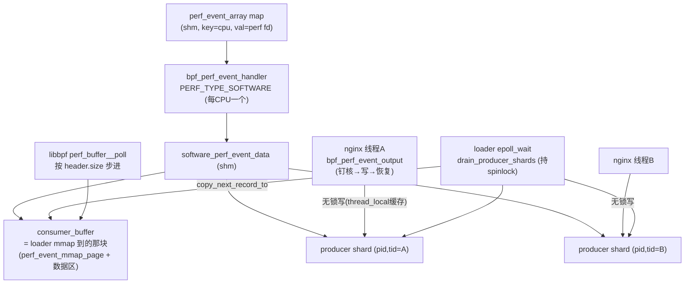

# 1. 一个事件的完整生命周期（主线，必读）

> 本章对齐**官方上游 bpftime `177a1dc465ff`**（2026-10 的 master）。文中路径、行号、
> 函数名、代码节选都按这个提交核对过；`vm/llvm-jit` 是子模块（llvmbpf），行号按
> 该提交固定的子模块版本 `87bac39` 计。凡是描述"我们的开发分支"的地方都会明确标出。

以 benchmark 的真实场景串起全部核心代码：`sslsniff`（loader，LD_PRELOAD 了
syscall-server.so）负责创建对象；`nginx`（LD_PRELOAD 了 agent.so）负责在
`SSL_read`/`SSL_write` 命中时执行 eBPF 程序并产出事件；两者之间**唯一的桥梁是
一块名为 `bpftime_maps_shm` 的共享内存**。你已经从第 11 步开始很熟了——这次从头走。

整条线的全景时序（五条泳道：loader / syscall-server / shm / agent+nginx / JIT+Frida）：



---

## 控制面（sslsniff loader 进程，LD_PRELOAD syscall-server）

### 第 1 步：符号拦截

`runtime/syscall-server/syscall_server_main.cpp:468` 定义了一个和 glibc 同名的
`syscall()`。拦截**只是 LD_PRELOAD 符号覆盖**：动态链接器让 libbpf 调到的
`syscall`/`mmap`/`mmap64`/`munmap`/`ioctl`/`epoll_*`/`close`/`open`/`openat`/
`read`/`fopen` 全部先落进 syscall-server 的同名导出函数
（`syscall_server_main.cpp:282-533`），不是 seccomp 也不是 ptrace——所以**只有走
libc 封装的调用会被拦到**，直接 `svc`/`syscall` 指令进内核的调用管不着。真正的
libc 函数有两套兜底：ctx 构造好之前，用 `cached_next_symbol` 按需
`dlsym(RTLD_NEXT, ...)` 解析并缓存（`:91-146`）；ctx 构造时
`syscall_context::init_original_functions()`（`syscall_context.hpp:96-133`）
用 `require_symbol` 逐个解析（缺一个就抛异常），并顺手 `unsetenv("LD_PRELOAD")`
防止污染子进程（`syscall_context.hpp:132`）。

```c
// syscall_server_main.cpp:468-533（节选）
extern "C" long syscall(long sysno, ...)
{
	// glibc directly reads the arguments without considering
	// the underlying argument number. So did us
	va_list args;
	va_start(args, sysno);
	long arg1 = va_arg(args, long);
	...
	va_end(args);
	if (!initialize_ctx())
		return fallback_syscall(sysno, arg1, arg2, arg3, arg4, arg5,
					arg6);
	auto call_original = [&]() {
		return context->orig_syscall_fn(sysno, arg1, arg2, arg3, arg4,
						arg5, arg6);
	};
	if (sysno == __NR_bpf) {
		...
		return handle_exceptions(
			[&]() {
				return context->handle_sysbpf(cmd, attr, size);
			},
			call_original);
	} else if (sysno == __NR_perf_event_open) {
		...
	}
	return call_original();
}
```

`syscall()` 里分流的除了 `__NR_bpf`（`:488`）和 `__NR_perf_event_open`（`:499`），
还有 `__NR_dup3`（`:513`）和 `__NR_memfd_create`（`:522`）。

坑一：`initialize_ctx()`（`syscall_server_main.cpp:206-236`）用
`__atomic_compare_exchange_n` 把状态从 0 推到 1，构造期间置线程局部
`tls_initializing`。构造 ctx 时如果又调到被拦函数（注释 `:45-46` 点名的例子：
spdlog 初始化会调 `fopen`），`initialize_ctx()` 直接返回 false，调用方走上面那套
`dlsym` 缓存的原函数；其他线程看到状态 1 则 `sched_yield` 等待；构造抛异常则置
3（disabled），此后一律放行。

坑二（上游 #640，preload fail-open）：`handle_exceptions`（`:238-257`）捕获所有
异常后**回退到原始宿主操作**——对 `bpf(2)` 来说就是交给真内核。
`syscall_context::try_startup()`（`syscall_context.cpp:237-254`）在 `start_up`
抛异常时把 `enable_mock_after_initialized` 置 false，之后每个 `handle_*` 开头的
检查都会直接走原函数。上游在 #634 里把这条写成了"注入代码是宿主进程的客人"的
约定：不终止宿主、不碰宿主 stdio（#632 把 preload 的日志从宿主 stdio 挪走）、
不破坏宿主信号处理。

### 第 2 步：shm 创建

每个 `handle_*` 先调 `try_startup()` → `start_up()`
（`syscall_server_utils.cpp:147-228`，`std::call_once` 保证一次）。流程：

1. `construct_runtime_config_from_env()`（`:152`）从环境变量组出
   `runtime_config`（上游 #562 把旧名 `agent_config` 改成了这个）；
2. 持 `shm_lifecycle_lock`（`:157-158`）调
   `initialize_global_shm_with_ownership()`（`:126-145`）：先以
   `SHM_CREATE_ONLY` 创建，成功则本进程是 shm 的 **owner**；若报
   `already_exists` 就退回 `SHM_CREATE_OR_OPEN` 打开现有的那块；
3. `std::atexit(remove_syscall_server_global_shm)`（`:161`）并把自己登记进
   alive syscall-server 集合（`:162-168`）；
4. `begin_new_session()`（`:172`）；
5. `bpftime_set_runtime_config(...)`（`:216`）把配置写进 shm——agent 侧之后用
   `bpftime_get_runtime_config()` 读到的就是 loader 这份配置
   （`bpftime_shm_internal.cpp:1152-1177`）。

shm 名字默认 `bpftime_maps_shm`（`handler_manager.hpp:51`，可用
`BPFTIME_GLOBAL_SHM_NAME` 覆盖，`:60-66`），默认 50MB（`bpftime_config.hpp:79`，
`BPFTIME_SHM_MEMORY_MB` 可调，`bpftime_config.cpp:119-121`），底层是
`boost::interprocess::managed_shared_memory`。create/open 分支在
`bpftime_shm_internal.cpp:830-880`：创建 segment 后 `find_or_construct` 出
`handler_manager`（全局对象注册表，handler vector 长度 = `max_fd_count`，默认
6144）、`syscall_pid_set`、`runtime_config`（对象名 `bpftime_runtime_config`）、
alive agent / alive syscall-server 两个 pid 集合、`pid_set_lock`、epoch 状态。

`begin_new_session()`（`bpftime_shm_internal.cpp:1017-1031`）把 epoch 序号加 1
变成奇数（"正在改"），调 `reset_server_state()`（`:1381-1397`，
`manager->clear_all` 清空**全部 handler**），再加 1 变回偶数——agent 靠这个序号
检测"shm 是不是换了一茬"（见第 8 步）。

退出时 `remove_syscall_server_global_shm()`（`syscall_server_utils.cpp:56-124`，
上游 #639 会话清理的一部分）：只有 owner 进程、并且 alive syscall-server 集合和
alive agent 集合里都没有活着的 pid 时，才真正 `shared_memory_object::remove`。

📌 **案例（对齐修复的背景）**：shm 打不开新的就复用旧的——上一轮 benchmark 被
SIGKILL 时 atexit 不会跑，残留的 shm 会被下一轮以非 owner 身份打开（于是下一轮
退出时也不会删它）。新会话虽然会 `clear_all` 掉旧 handler，但我们在 7 月时观察
到脏状态曾是吞吐双峰的放大器之一，所以跑实验前清理
`/dev/shm/bpftime_maps_shm` 仍是 runbook 的固定步骤。

### 第 3 步：对象诞生（map 与 prog）

`syscall_context::handle_sysbpf()`（`syscall_context.cpp:482`）是 bpf(2) 的
userspace 版本。`BPF_MAP_CREATE`（`:493`）→ `bpftime_maps_create`
（`:533`，实现在 `bpftime_shm.cpp:81-84` → `add_bpf_map`
`bpftime_shm_internal.cpp:1048-1077`）。`add_bpf_map` 先调 `open_fake_fd()`
（`:674-688`）：**在 loader 进程里真的 `open("/dev/null")` 拿一个内核 fd**（若
拿到 0-2 就 `dup` 几次往上挪），这个 fd 号同时就是 handler vector 的下标；号码
超出 vector 长度则关掉 fd、返回 `ENOSPC`（上游 #671 的边界检查）。随后
`handler_manager::set_handler`（`handler_manager.cpp:63-88`）把一个
`bpf_map_handler` 放进该槽，并立刻 `map_init`（`:81-86`）在 shm 里分配真正的
map 存储。

所以**返回给 libbpf 的"fd"是一个指向 `/dev/null` 的真 fd，含义却由 shm 里同号
槽决定**——内核占住了这个号，不会和进程别的文件撞号；但 `close`/`dup3`/`mmap`/
`ioctl` 必须被拦，否则操作只会落到 `/dev/null` 上，shm 里的对象既不会被释放也
无法被映射。判定函数是 `bpftime_is_map_fd` / `bpftime_is_perf_event_fd` 等（本质
是边界检查后查槽里 variant 的类型，如 `is_map_fd` `bpftime_shm_internal.cpp:594-602`、
`is_prog_fd` `:654-662`、`is_perf_fd` `:664-672`）。

`BPF_PROG_LOAD`（`syscall_context.cpp:628`）在编译时开启
`ENABLE_BPFTIME_VERIFIER` 的情况下过 PREVAIL verifier（`verify_ebpf_program`，
`:658`）。模式取自 `bpftime_get_runtime_config().verifier_mode`（`:651-652`，
`BPFTIME_VERIFIER_LEVEL` 控制 STRICT/WARNING/NO_VERIFY，默认 WARNING，
`bpftime_config.hpp:64`），而且**只校验 prog_type 为 TRACEPOINT 或
SOCKET_FILTER 的程序**（`:641-655`）。libbpf 把 `SEC("uprobe")` 映射成
`BPF_PROG_TYPE_KPROBE`（如 `third_party/bpftool/libbpf/src/libbpf.c:9832`），
所以 sslsniff 的 uprobe 程序在这里**不会进入用户态 verifier**（已核实；`:642` 的注释"uprobe/uretprobe -> SOCKET_FILTER"与此不符）。然后
`bpftime_progs_create`（`:695`，→ `add_bpf_prog` `bpftime_shm_internal.cpp:691-706`）——
注意 **shm 里只存指令字节和名字**（`bpf_prog_handler`），不存任何 VM/JIT 状态。
谁执行谁编译，见第 9 步。

### 第 4 步：perf 对象

`handle_perfevent()`（`syscall_context.cpp:806`）按 `attr->type` 分流：

- **uprobe/uretprobe**（`:817-842`）：从 `attr->config1/config2` 取出目标
  `模块路径 + 偏移`，`attr->config` 的 retprobe 位区分 uprobe/uretprobe
  （`:828-833`），`bpftime_uprobe_create`（`:837`）在 shm 写一个 uprobe 类型的
  `bpf_perf_event_handler`。**loader 进程此刻并没有任何东西被 hook**——挂钩发生
  在 nginx 侧的第 10 步。
- **PERF_TYPE_SOFTWARE**（`:905-910`）：`bpftime_add_software_perf_event`
  （`bpftime_shm.cpp:541-546` → `bpftime_shm_internal.cpp:403-417`，同样先
  `open_fake_fd()`）创建 software perf event handler。sslsniff 用
  `perf_event_array` 时 libbpf 会**每个 CPU 开一个**，所以 shm 里有 N 个这样的
  handler，每个持有一份 `software_perf_event_data`（对齐修复动的那个 buffer 家族
  就在这里诞生，结构详解见第 12 步）。

### 第 5 步：连线

`BPF_LINK_CREATE`（`syscall_context.cpp:704`）→ `bpftime_link_create`
（`:718`，→ `add_bpf_link` `bpftime_shm_internal.cpp:709-750`）在 shm 写入
`bpf_link_handler`，字段就两个核心：`prog_id` 和 `attach_target_id`——**两个 fd
号的连线记录**。`add_bpf_link` 先校验再分配 fd：prog 必须是 prog handler，
`BPF_PERF_EVENT` 类型的 target 必须是 perf handler，否则 `EBADF`（`:717-743`）；
libbpf 用 `target_fd=-1` 探测 perf link 支持时正好拿到它期望的 `EBADF`
（`:731-736`），于是走 link 路径。link 创建失败时还有一个经
`bpftime_attach_perf_to_bpf_with_cookie` 的兜底（`syscall_context.cpp:722-730`）。

`ioctl(PERF_EVENT_IOC_ENABLE)`（`:1025-1037`）→ `bpftime_perf_event_enable`
（`bpftime_shm.cpp:239`）只是置使能位（`perf_event_handler.hpp:194-200`，带
TODO）。反向操作也已对称：`close` 一个 prog 或 perf event 时，
`handler_manager::clear_id_at`（`handler_manager.cpp:98-139`）会级联清掉引用它
的 link（上游 #672）。到此 shm 里已经形成完整的对象图：
`map ← prog → link → perf_event(uprobe)`，但整个系统还没有一行代码被 hook、
没有一条指令被编译。

### 第 6 步：消费者就位

sslsniff 里 libbpf 建 perf buffer 的三件套全被拦：

```c
// syscall_context.cpp:987-1001（handle_mmap64 节选）
	} else if (fd != -1 && bpftime_is_software_perf_event(fd)) {
		SPDLOG_DEBUG(
			"Entering mocked mmap64: software perf event handler");
		errno = 0;
		if (auto ptr = bpftime_get_software_perf_event_raw_buffer(
			    fd, length);
		    ptr != nullptr) {
			mocked_mmap_values.insert((uintptr_t)ptr);
			return ptr;
		}
		if (errno == 0) {
			errno = ENOMEM;
		}
		return MAP_FAILED;
	}
```

libbpf 以为自己在 mmap 内核 perf fd 的环形缓冲，实际拿到的是 shm 中
consumer buffer 的原始内存；`mocked_mmap_values` 记账给 `munmap` 用。失败时返回
`MAP_FAILED` 并带 errno（上游 #597 处理 shm 耗尽：扩容抛 `bad_alloc` 时报
`ENOMEM`，而不是把空指针当成功）。

`handle_mmap64`（`syscall_context.cpp:949`）这条调用链是
`bpftime_get_software_perf_event_raw_buffer`（`bpftime_shm.cpp:568-573`）→
`bpftime_shm::get_software_perf_event_raw_buffer`（`bpftime_shm_internal.cpp:1185`）
→ `try_get_software_perf_data_raw_buffer`（`perf_event_handler.cpp:642-652`）→
`software_perf_event_data::ensure_mmap_buffer`（`:611-624`，持 `shard_lock`，
尺寸变了就推进 `producer_buffer_generation`）→
`software_perf_event_buffer::ensure_mmap_buffer`（`:276-305`，按 libbpf 请求的
length 扩容，数据区须为 2^n，否则 `EINVAL`）。返回的是 **consumer buffer 在 shm
中的地址**：第一页是标准 `perf_event_mmap_page`（`data_head`/`data_tail` 就在
这页上），后面是数据区——完全复刻 kernel perf ABI，libbpf 无需任何改动就能消费。

`epoll_create1/epoll_ctl/epoll_wait` 同理被拦（`syscall_context.cpp:1070-1122`）：
`epoll_create1` 在 shm 里建一个 `epoll_handler`；`epoll_ctl(EPOLL_CTL_ADD)`
（`:1094-1098`）经 `add_software_perf_event_to_epoll`
（`bpftime_shm_internal.cpp:476-513`）把 software perf event 的 weak_ptr 挂进
该 `epoll_handler`（`:504`），支撑 `perf_buffer__poll`。

---

## 数据面（nginx 进程，LD_PRELOAD agent）

### 第 7 步：agent 启动

agent 劫持的是 `__libc_start_main`（`runtime/agent/agent.cpp:544-556`）：把真正
的 `main` 换成 `bpftime_hooked_main`（`:535-542`），后者**先跑
`bpftime_agent_main`（`:830`）再跑原 main**——所以 nginx 第一行业务代码执行前，
attach 已全部就位。`bpftime_agent_main` 里：

1. 用 CAS 把 `initialized` 从 UNINITIALIZED 推到 INITIALIZING（`:899-923`），
   防重复初始化；若进程里已有一份 agent（IPC server 或另一个已加载的副本），
   转交给它（`:880-896`）；
2. 以 `SHM_OPEN_ONLY` 打开 shm，**最多重试 60 次、每次间隔 50ms**
   （`agent.cpp:932-948`，每次尝试前持 `shm_lifecycle_lock`）——容忍"先起 nginx
   后起 loader"的竞态窗口；
3. 读 shm 里的 `runtime_config`（`:956`），据此设日志去向（`:957-958`）；
4. `register_attach_impl` 注册 attach 后端：syscall_trace（`:971`）；uprobe 家族
   （覆盖 ATTACH_UPROBE/URETPROBE/UPROBE_OVERRIDE/UREPLACE 四种类型）在 ARM64/x86
   上是 Frida 后端（`:1014`，构造参数带上 #633 的
   `enable_frida_fuzzy_backtracer`），只有 RISC-V 这类没有 Frida 的架构才编进
   #665 的 trap（断点 + SIGTRAP）后端（`:993`，见
   `cmake/StandardSettings.cmake:76-81`）；CUDA（`:1039`，条件编译）。注册的同时
   传入一个 `private_data_creator` 闭包，负责把字符串形式的 attach 参数（如
   `"模块路径:偏移"`）解析成各后端的私有数据；
5. 进入第 8 步（`init_attach_ctx_from_handlers`，`:1063-1079`）；然后登记 alive
   agent pid（`:1138-1144`），置 `*stay_resident = TRUE`（`:1160`）防止 so 被
   卸载。

任一步失败都调 `init_fail`（`:837-878`）回滚（销毁 ctx、移除 pid、复位状态）
后直接 return——nginx 照常跑，只是没有探针（#640 的 fail-open）。

### 第 8 步：实例化（遍历 handler 表）

`bpf_attach_ctx::init_attach_ctx_from_handlers`
（`runtime/src/attach/bpf_attach_ctx.cpp:62`，真身在 `:73`）在 `ctx_mutex` 下最多
尝试 3 轮：先读 shm epoch 序号判断会话是否更替（`:77-104`，序号为奇数即"不稳定"
则等 50ms 重试；序号变了就先拆掉本进程已有的全部 link），然后**线性扫一遍
handler vector**（`:106-120`），对每个已分配槽调 `instantiate_handler_at`
（`:197`）；扫完再读一次 epoch（`:137-159`），扫描期间会话变了就拆掉重来，
3 轮都不稳定返回 `-EAGAIN`。

关键设计：link handler 会**递归先实例化它引用的 prog 和 perf event**
（`:232-251`，用 `std::set<int> stk` 防环，`:207-212`），保证依赖序；单个
handler 实例化失败只记 debug 不中断（`:112-117`）——LD_PRELOAD 到无关进程
（模块路径不存在）是常态而非错误。

分类型看：

- **prog**：`instantiate_prog_handler_at`（`:294-315`）从 shm 指令字节**在本进程
  本地**构造 `bpftime_prog`（`:301-302`）——**VM 和 JIT 产物都不在 shm 里**，每个
  agent 进程各编译一份。随后 `load_prog_and_helpers`（`:43-60`）按
  `runtime_config` 注册三组 helper（kernel utils / ufunc / shm maps，实现在
  `bpf_helper.cpp:1163-1169` 的 `add_helper_group_to_prog`，逐个经
  `bpftime_prog_register_raw_helper` → `ebpf_register` 进 VM，
  `bpftime_prog.cpp:278-287`），再补上 attach 后端自定义的 helper（`:310-312`）。
- **software perf event**：`instantiate_perf_event_handler_at`（`:420-510`）里
  software 类型直接返回（`:425-430`）——数据结构已在 shm，agent 侧无事可做。
- **uprobe perf event**：拼出 `"模块路径:偏移"` 字符串（`:446-451`），交给第 7 步
  注册的 `private_data_creator` 解析成 `frida_attach_private_data`（内部把模块名
  +偏移解析成本进程的**绝对地址**）。
- **link**：`instantiate_bpf_link_handler_at`（`:316-419`）把上面两者接起来，
  见第 10 步的回调闭包。

### 第 9 步：JIT

`bpftime_prog_load`（`runtime/src/bpftime_prog.cpp:171`）→ `ebpf_load`（`:179`）
校验并拷入指令 → `ebpf_compile`（`:209`）走 LLVM OrcJIT（`vm/llvm-jit/`）产出
`uint64_t fn(void *mem, size_t len)` 本机码函数指针存进 `fn`（`:215`）；JIT 失败
会告警并退回解释器（`:210-212`）。

**helper 分发没有运行期查表**：翻译 `EBPF_OP_CALL` 时
（`vm/llvm-jit/src/compiler.cpp:1366-1482`，`src != 1` 的外部调用分支在
`:1470-1479`），`emitExtFuncCall`（`compiler_utils.cpp:312-371`）按 `inst.imm`
直接生成对符号 `_bpf_helper_ext_%04u` 的调用（命名见 `compiler_utils.hpp:39-44`），
实参就是 r1–r5（`compiler_utils.cpp:335-349`）、返回值写回 r0（`:356-358`）。
建 LLJIT 实例时（`llvm_jit_context.cpp` 的
`create_and_initialize_lljit_instance`，`:768-807`）把每个已注册 helper 的
**函数指针**用 `absoluteSymbols` 绑到对应符号。于是 `call 25`
（perf_event_output）在编译期就定死为一条对 C++ 函数 `bpf_perf_event_output`
的直接调用——从 JIT 代码到 helper 是**零间接层**，这正是"代码计价"优势的来源。

### 第 10 步：挂钩

`frida_attach_impl::create_attach_with_ebpf_callback`
（`attach/frida_uprobe_attach_impl/src/frida_uprobe_attach_impl.cpp:175`）先扫
`/proc/self/maps` 确认目标模块确实映射在本进程（`:190-230`，用
`std::filesystem::equivalent` 比对路径，防同名不同文件），然后 `attach_at`
（`:48-97`）。同一函数地址只建一个 `frida_internal_attach_entry`（`:65-80`），
多个 user attach（如 sslsniff 的 uprobe + uretprobe 同挂 `SSL_read`）共享它。

真正改写指令的是 `frida_internal_attach_entry::ensure_listener`
（`frida_internal_attach_entry.cpp:115-143`）里的 `gum_interceptor_attach`
（`:131`）。uprobe 和 uretprobe **各有一个按需创建的 listener**：uprobe 用
`gum_make_probe_listener(uprobe_listener_on_enter, ...)`（`:124`），uretprobe 用
`gum_make_call_listener(nullptr, uprobe_listener_on_leave, ...)`（`:126`）。
构造函数（`:145-180`）按第一个 attach 的类型建第一个 listener，`attach_at` 每次
新增 user attach 时再 `ensure_listener`（`frida_uprobe_attach_impl.cpp:83`）
补上另一个。Frida 把 `SSL_read`/`SSL_write` 的函数序言改写为跳向 trampoline。

link 层则在 `bpf_attach_ctx.cpp:390-407` 里把 JIT 产物包成统一回调：

```cpp
// bpf_attach_ctx.cpp:390-407：prog 与 attach 后端之间唯一的胶水
		auto cookie = handler.attach_cookie;
#if BPFTIME_HAVE_TRAP_UPROBE_ATTACH
		if (dynamic_cast<attach::trap::trap_attach_impl *>(attach_impl)) {
			if (int err = prog->prepare_for_signal_execution(); err < 0)
				return err;
		}
#endif
		attach_id = attach_impl->create_attach_with_ebpf_callback(
			[=](void *mem, size_t mem_size, uint64_t *ret) -> int {
				if (auto *ctx = attach::current_signal_callback)
					ctx->cookie = cookie;
				else
					current_thread_bpf_cookie = cookie;
				int err = prog->bpftime_prog_exec(
					(void *)mem, mem_size, ret);
				return err;
			},
			*priv_data, attach_type);
```

Frida 路径下 `current_signal_callback` 为空，cookie 写进 thread_local
`current_thread_bpf_cookie`（`bpftime_prog.cpp:105`，供 `bpf_get_attach_cookie`
读）；`current_signal_callback` 分支只属于 trap 后端的 SIGTRAP 执行。`mem` 就是
下一步的 `pt_regs` 副本。

至此静态图完成：`SSL_read 序言 → Frida trampoline → 这个 lambda → JIT 码`。

---

## 热路径（每个请求 2 次，读者最熟的部分）

### 第 11 步：触发

`SSL_read` 返回 → trampoline 收拢现场为 `GumCpuContext` → Frida 分发到
`uprobe_listener_on_leave`（uretprobe 路径，
`frida_internal_attach_entry.cpp:310-318`；入口侧是 `uprobe_listener_on_enter`，
`:293-308`，它额外把 `ctx->cpu_context` 记进 `current_thread_gum_cpu_context`）。
每次命中都在**栈上**声明一个 `bpftime::pt_regs`，由
`convert_gum_cpu_context_to_pt_regs`（`frida_register_conversion.cpp:55-64`，
ARM64 版本）拷贝 x0–x28、fp、lr、sp、pc、nzcv——**单向拷贝**：BPF 程序改 ctx
不会写回真实寄存器（uprobe/uretprobe 语义本来就是只读观测；想改返回值要用
override attach，走 `bpftime_set_retval` 另一条路）。随后
`iterate_uretprobe_callbacks`（`:245-253`）遍历该地址上所有 user attach，
`run_callback`（`frida_attach_entry.hpp:24-61`）以
`ebpf_cb((void *)&regs, sizeof(regs), &ret)`（`:54-55`）进入上面第 10 步的
lambda → `bpftime_prog_exec`（`bpftime_prog.cpp:238`）。`run_callback` 进来时
还会把被挂函数地址写进 thread_local `current_thread_attach_func_ip`
（`:27-39`，退出时恢复旧值），这就是上游 #601 新增的 `bpf_get_func_ip`
（`bpf_helper.cpp:677-682`）的数据来源。

`bpftime_prog_exec` 先 `bpftime_protect_disable()`（`:255`，MPK 开启时解锁 shm
写权限，未启用时是空操作），jitted 分支直接 `val = fn(memory, memory_size)`
（`:260-263`）跑本机码，返回前 `bpftime_protect_enable()`（`:274`）。对比 kernel
uprobe 此处已省掉 2 次以上内核陷入——这是 bpftime 的结构性优势所在。

sslsniff 一次 `SSL_read` 进出两段程序调到的 helper（`example/tracing/sslsniff/
sslsniff.bpf.c:60-129`），在官方实现里各自的代价：

- `bpf_get_current_pid_tgid`（`bpf_helper.cpp:208-259`）：tgid/tid 缓存在文件
  作用域 + thread_local 里，`pthread_atfork` 子进程回调刷新 tgid、作废 tid
  （上游 #685）。这对 nginx 很关键：agent 在 master 里初始化，worker 是 fork
  出来的，没有这次刷新就会报 master 的 pid。
- `bpf_get_current_uid_gid`（`:261-267`）：上游 #691 改为每次调用都查
  `getgid()`/`getuid()`（注释：凭据可能在启动后变化），每次调用两个 syscall。
- `bpf_map_update/lookup/delete_elem`：sslsniff 每个事件都按 tid 增删 `bufs`、
  `start_ns` 两个 HASH map，正好走到上游 #650（删除冲突 key 后 lookup 出错）
  修过的路径。
- `bpf_probe_read_user`（见下面案例）。

📌 **案例（sigaction 修复，`ead56c9`，已被上游取代）**：7 月时
`bpftime_probe_read` 用"装一个 SIGSEGV handler + 出错时把 PC 改到
`jump_point_read`"模拟内核 probe_read 的容错，我们修掉了"handler 是否已装"读
**未初始化局部变量**、导致每次白付 2 个 `rt_sigaction` 的 bug（改为
thread_local 标志）。上游 #642（`f311de23`）把整套信号方案换掉了：现在
`bpf_probe_read_user` 映射到 `bpftime_probe_read`（`bpf_helper.cpp:1229-1234`），
在默认开启的 `ENABLE_PROBE_READ_CHECK`（`cmake/StandardSettings.cmake:110`）下
走 `probe_read_memory`（`:97-119`）——对自己进程调一次
`process_vm_readv`，读不到就返回 `-EFAULT`，不再碰进程级信号处理；目标 pid 缓存
在 `probe_access_pid`，同样靠 `pthread_atfork` 在子进程刷新（`:70-72`）。于是
每次 probe_read 固定 1 个 syscall。教训不变：热路径上的"一次性初始化"必须有
明确的、可证明初始化过的标志位——而更好的做法是根本不需要它。

### 第 12 步：输出

JIT 码里的 `call 25` 直落 `bpf_perf_event_output`（`bpf_helper.cpp:487`）：

```cpp
// bpf_helper.cpp:487-553（节选）
uint64_t bpf_perf_event_output(uint64_t ctx, uint64_t map, uint64_t flags,
			       uint64_t data, uint64_t size)
{
	int32_t current_cpu = my_sched_getcpu();
	...
	cpu_set_t mask, orig;
	CPU_ZERO(&mask);
	CPU_SET(current_cpu, &mask);
	if (sched_getaffinity(0, sizeof(orig), &orig) < 0)
		return (uint64_t)-1;
	// Bind to the current cpu
	if (sched_setaffinity(0, sizeof(mask), &mask) < 0) {
		...
	}
	int fd = (int)map;
	...
	if (int err = bpftime_map_get_info(fd, nullptr, nullptr, &map_ty);
	    err < 0) {
		SPDLOG_ERROR("Unable to query map type of fd {}", fd);
		goto restore_affinity;
	}
	if (map_ty == bpftime::bpf_map_type::BPF_MAP_TYPE_PERF_EVENT_ARRAY) {
		const int32_t *val_ptr =
			(int32_t *)(uintptr_t)bpftime::shm_holder
				.global_shared_memory.bpf_map_lookup_elem(
					fd, &current_cpu, false);
		...
		int32_t perf_handler_fd = *val_ptr;
		ret = bpftime_perf_event_output(perf_handler_fd,
						(const void *)(uintptr_t)data,
						(size_t)size);
	}
	...
restore_affinity:
	// Cleanup must not overwrite an error from the output operation.
	const int saved_errno = errno;
	if (sched_setaffinity(0, sizeof(orig), &orig) < 0 && ret >= 0)
		return (uint64_t)-1;
	errno = saved_errno;
	return (uint64_t)ret;
}
```

`my_sched_getcpu` 在 Linux 上就是 glibc `sched_getcpu()`
（`platform_utils.cpp:7-9`；现代 glibc 底层走 rseq/vDSO，纳秒级，无陷入）。
`flags`（sslsniff 传 `BPF_F_CURRENT_CPU`）没有被读取，CPU 一律取当前快照。
之后每事件有三次亲和性 syscall：`sched_getaffinity` 保存原 mask、
`sched_setaffinity` 钉到 `current_cpu`、结束时 `sched_setaffinity` 恢复。上游
#678（`3a1d2ecf`）让 map 类型查询失败、lookup 失败这两条错误路径也
`goto restore_affinity`，并在恢复时保住输出操作的 errno——7 月走读时发现的
"错误路径漏恢复 mask、把 nginx worker 永久钉死单核"的问题在官方已修。

📌 **案例（绑核删除，开发分支 `076e3e4`，官方未采纳）**：我们在 Jetson 上测到
这串亲和性调用每事件 3.1–6.7µs、占 event-output 段成本的 72%，而且走读认为它
不保护任何不变量（cpu 值在绑核**前**已快照，写入走 per-thread shard），所以开发
分支把整段删掉了；官方至今保留"钉核 → 输出 → 恢复"的结构。

`bpftime_perf_event_output`（`bpftime_shm.cpp:575-596`）由 fd 找到
`bpf_perf_event_handler`，转给 `software_perf_event_data::output_data`
（`perf_event_handler.cpp:601-604`）→ `get_current_thread_shard().buffer
.output_data(buf, size)`。核心数据结构（全部住在 shm，定义见
`perf_event_handler.hpp:71-152`）：

| `software_perf_event_data` 字段 | 谁写 | 谁读 | 说明 |
|---|---|---|---|
| `consumer_buffer` | loader 侧 drain 时 append（`:554` → `:456`） | libbpf 经 mmap 直接读、推进 `data_tail` | 就是第 6 步 mmap 返回的那块；kernel perf ABI 布局 |
| `producer_shards`（`boost::interprocess::list`） | nginx 各线程首次 output 时 emplace（`:535`） | loader drain 遍历（`:553`） | **每 (pid,tid) 一个 shard**，各含独立 ring |
| `shard_lock`（进程共享 spinlock） | 建 shard / drain / 回收 / 扩容时持有（`:513`,`:552`,`:613`） | — | **热路径写入不持锁**，靠 thread_local 缓存绕过 |
| `event_generation` / `producer_buffer_generation` | 创建时 / consumer buffer 扩容时（`:619-622`） | shard 缓存校验（`:500-506`） | 换代即缓存失效，防用到旧 shard |

`get_current_thread_shard`（`perf_event_handler.cpp:491-548`）先查
**thread_local 缓存**（`:143-145` 定义，`:497-510` 校验 generation + pid/tid），
命中则零锁零查找直达自己的 shard；未命中才拿 spinlock 线性找/建。这就是"两个
nginx 线程同时命中 uprobe 也互不争用"的机制根据。（注意：入口处每次都调
`getpid()` 和 `syscall(SYS_gettid)`（`:493-494`、`:97-108`），命中缓存也照付
这两次调用。）

真正落盘在 `output_data`（`perf_event_handler.cpp:367-388`）和
`append_record_parts`（`:318-365`），8 字节对齐是上游 #612（`417f7c61`，源自
我们 7 月的修复）的形状：

```cpp
// perf_event_handler.cpp:370-387（output_data 节选）
	constexpr size_t alignment = sizeof(uint64_t);
	if (size > std::numeric_limits<uint16_t>::max() -
			   sizeof(perf_sample_raw) - (alignment - 1)) {
		errno = E2BIG;
		return -1;
	}
	const size_t record_size =
		(sizeof(perf_sample_raw) + size + alignment - 1) &
		~(alignment - 1);
	perf_sample_raw header;
	header.header.type = PERF_RECORD_SAMPLE;
	header.header.size = record_size;
	header.header.misc = 0;
	header.size = record_size - sizeof(header);

	append_record_parts(&header, sizeof(header), buf, size,
			    header.size - size);
	return 0;
```

`append_record_parts` 先校验 ring 状态，恒留一字节空隙使 `head == tail` 只表示
"空"（`:343-350`），然后 `write_wrapped` 写 header 和 payload（`:352-355`），
最后 `smp_store_release_u64(&header.data_head, new_head)` 发布（`:356-357`）。
几个读代码时容易忽略的点：

- `record_size` 向上取整到 8 并写入 `header.size`，同时以 `uint16_t` 上限拒绝
  超大记录；`perf_sample_raw` 里的 `size` 也包含 padding。
- `padding_size` 只参与长度计算（`:329`），**padding 字节本身不写**——head 直接
  越过，里面是 ring 里的旧字节（7 月我们的版本会显式清零，上游没有）。
- ring 满时 `append_record_parts` 返回 false，但 `output_data` **不看返回值、
  恒返回 0**：静默丢弃，也没有 `PERF_RECORD_LOST` 记录。
- sslsniff 用的是 perf array；ringbuf 路径另有 #706（记录头和 payload 跨 ring
  尾部保持连续），不在本条线上。

📌 **案例（对齐修复，7 月 `0fcdb0e` → 上游 #612）**：修复前 record 按原始长度
紧密排布，header（8 字节）可以恰好横跨环回绕点——libbpf 读 header 时直接按位置
取 `size`，默认 header 永不跨界（kernel 保证 8B 对齐），读到撕裂的 `size=0` 后
空转，consumer 停摆 → shard 填满 → 静默丢事件 → 吞吐双峰。上游合入的版本只保留了
生产侧对齐；我们 7 月版本里的 padding 清零、消费侧 `size % 8 == 0` 校验都不在
官方代码里（消费侧校验见第 13 步）。

### 第 13 步：消费

sslsniff 的 `perf_buffer__poll` → 被拦截的 `epoll_wait`
（`syscall_server_main.cpp:282` → `handle_epoll_wait` `syscall_context.cpp:1110`
→ `bpftime_epoll_wait` `bpftime_shm.cpp:418-539`）。这是个 **1ms 粒度的轮询
模拟**：循环里对 epoll 实例挂的每个 software perf event 调 `has_data()`
（`bpftime_shm.cpp:473`）；一轮扫完只要有就绪项、或 `timeout == 0`，立即返回
（`:501-502`）；否则用 `sigtimedwait` 睡 1ms（`:455`、`:510`）并保持
SIGINT/SIGTERM 可中断（`:444-453` 先 sigprocmask 阻塞，`:507-529` 定时等待、捕到
信号则手动调用原 handler 并返回 `EINTR`），出口处恢复原 sigmask（`:533`）。

这一段是上游 #689（`23646cfa`）改过的：之前有就绪项时会睡 1ms 再扫一轮，同一个
fd 可能被重复写进 `out_evts` 直到填满 `max_evt`；`timeout == 0` 则不扫就返回 0，
还漏了恢复 sigmask。现在每次调用每个就绪 fd 只报告一次。

关键副作用：`has_data()`（`perf_event_handler.cpp:589-593`）**先
`drain_producer_shards()` 再判断**——搬运发生在 loader 进程里：

- `drain_producer_shards`（`:550-558`）持 `shard_lock` 遍历所有 shard，逐条
  `copy_next_record_to(consumer_buffer)`（`:421-462`）：读出 record header
  → 校验 `size >= sizeof(header)` 且 `size <= mmap_size()`（`:442-448`，不满足
  则把 tail 推到 head、丢弃整个 shard 存量）→ 记录还没写全（`size` 大于
  `head - tail`）就先不搬（`:449-451`）→ 经 `copy_buffer` 中转搬进 consumer
  ring → `smp_store_release` 推进 shard 的 `data_tail`（`:459-460`）。consumer
  ring 满时返回 false，记录留在 shard 里下轮再搬。
- 顺带按节流阈值回收已死线程的空 shard（`:560-587`，`is_thread_alive` 用
  `tgkill(sig 0)` 探活，`:118-130`）。

之后 libbpf 在 mmap 的 consumer buffer 上按标准 perf 协议消费：读
`data_head`、按每条 `header.size` 步进、回调 `print_event`、写回
`data_tail`——**跨进程各自推进同一页上的 head/tail，全程无锁无 syscall**（除了
那次被拦的 epoll_wait 本身）。

一个事件从 nginx 线程到 sslsniff 屏幕：`bpf_probe_read_user` 先把 SSL buffer
抄进 `ssl_data`（PERCPU_ARRAY，值在 shm）；之后数据再经历 3 次 memcpy：map 值
→ shard ring（第 12 步）；shard ring → `copy_buffer` → consumer ring（第 13 步
drain，算两次）。

热路径上 perf 数据结构的全景：



走完这 13 步，架构骨架即完整。下面横向展开。

---

## 自测题

**1. loader 拿到的 map "fd" 是什么？为什么 `close`、`dup3`、`mmap` 都必须被拦截？**

<details><summary>答案</summary>

是 `open_fake_fd()`（`bpftime_shm_internal.cpp:674-688`）在 loader 里
`open("/dev/null")` 得到的真 fd，它的号码同时是 shm 中 handler vector 的下标
（`handler_manager::set_handler`，`handler_manager.cpp:63-88` 把 handler 放进
同号槽并返回它）。内核占住了这个号，所以不会和进程别的文件撞号；但内核眼里它只是
`/dev/null`。libbpf 拿到后会像真 fd 一样 `mmap` 它（perf buffer）、`close` 它
（清理）、偶尔 `dup3` 它——若不拦截，`mmap` 只会映射到 `/dev/null`，`close` 只关掉
`/dev/null` 而 shm 里的 handler 永远不释放，`dup3` 出来的新号在 shm 里没有对应
对象。所以 `syscall_server_main.cpp` 把这些 libc 入口全部覆盖：`handle_close`
（`syscall_context.cpp:256-275`）先 `bpftime_close` 清槽（含 #672 的级联清
link）再关真 fd；`handle_dup3`（`:1200-1214`）对 map fd 走 `bpftime_maps_dup`；
`handle_mmap64` 按 `bpftime_is_*` 判定后返回 shm 内存，其余放行给原函数。
</details>

**2. eBPF 指令字节放在 shm 里，为什么 VM 和 JIT 产物不放？**

<details><summary>答案</summary>

JIT 产物是带绝对地址的本机码：helper 函数指针（`absoluteSymbols`，
`llvm_jit_context.cpp:768-807`）、LLVM 运行时结构都是**本进程地址空间**的指针，
跨进程无意义（ASLR 下各进程加载地址不同）。所以 shm 只存与地址无关的指令字节
（`bpf_prog_handler`），每个 agent 在 `instantiate_prog_handler_at`
（`bpf_attach_ctx.cpp:294-315`）里本地构造 `bpftime_prog` 并各自编译一份。
代价是每个被注入进程都付一次编译时间，换来的是零共享状态、零重定位。
</details>

**3. 两个 nginx worker 线程同时命中 uprobe 并各自 `bpf_perf_event_output`，会争用同一个 ring 吗？会拿锁吗？**

<details><summary>答案</summary>

不会争 ring：写入目标由 `get_current_thread_shard`
（`perf_event_handler.cpp:491`）按 (pid, tid) 选择，每线程独占一个 shard ring。
稳态下也不拿锁：thread_local 缓存（`:143-145`）校验 generation 与 pid/tid 后
直接返回 shard 指针；只有**首次写入**（建 shard）或缓存失效（consumer buffer
扩容导致 `producer_buffer_generation` 换代）才走 `shard_lock` 慢路径。
唯一的常态竞争在 loader 的 drain 与"建 shard"之间，同样由该 spinlock 序列化。
这也是我们论证"官方每事件绑核没有保护作用"的核心一环。
</details>

**4. 上游 #612 的对齐修复只在生产侧做了对齐。消费侧 `copy_next_record_to` 校验了什么、没校验什么？为什么消费侧仍然必须校验？**

<details><summary>答案</summary>

校验了：`size >= sizeof(perf_event_header)` 且 `size <= mmap_size()`
（`perf_event_handler.cpp:442-448`），不满足就把 shard 的 tail 推到 head、丢弃
全部存量；另外 `size` 超过 `head - tail` 时视为未写全，留到下轮
（`:449-451`）。没校验：`size % 8 == 0`——这条是我们 7 月版本有、上游没合入的。
在官方代码里 shard ring 只由 `output_data` 写，而它总是按 8 对齐，所以正常情况下
不会出现非对齐记录；它挡不住的是旧版本进程残留的记录或被破坏的 shm 内容。
消费侧必须校验，因为 shard ring 住在共享内存里，内容不受本进程控制，而 consumer
buffer 是 libbpf 直接消费、没有再校验能力的——这是跨进程共享数据结构的通用原则：
写方保证不变量，读方仍需验证不变量。
</details>

**5. 官方 `bpf_perf_event_output` 每事件把线程钉到 `current_cpu` 再恢复。如果线程在 `my_sched_getcpu()` 之后、`sched_setaffinity` 之前被迁核，会出错吗？这串绑核保护了什么？**

<details><summary>答案</summary>

不会出错：`sched_setaffinity` 只会把线程迁回快照里那个 CPU。`current_cpu` 唯一
的用途是作 `perf_event_array` 的 lookup key（`bpf_helper.cpp:517-521`）选出一个
software perf event fd；实际写入走 per-(pid,tid) shard，与 CPU 无关；消费侧也是把
所有 CPU 的 handler 统统 drain。即使去掉绑核、记录"归属"到旧 CPU 的 handler 下，
影响的也只是按 CPU 维度统计的准确性（kernel perf 同样存在采样瞬间与处理瞬间的
错位），不影响记录完整性与顺序。所以在当前代码结构里它不保护任何不变量，只付
3 个 syscall——这是我们开发分支删除它的理由；官方保留了它，并在 #678 里把错误
路径的 mask 恢复补齐。剩下的风险是恢复用的 `orig` 是进入时的快照，若应用在此
期间自己改了亲和性，会被覆盖回去。
</details>

**6. agent 为什么劫持 `__libc_start_main` 而不是用构造函数（`__attribute__((constructor))`）？**

<details><summary>答案</summary>

`bpftime_hooked_main`（`agent.cpp:535-542`）在 `orig_main_func` 之前同步执行
`bpftime_agent_main`，保证 attach（含 Frida 改写函数序言）完成后 nginx 才开始
接请求——不丢启动早期的事件，也避免"业务线程正在执行 `SSL_read` 时序言被改写"
的竞态。此外该文件也保留了 Frida 注入路径（`bpftime_agent_main` 本身就是
frida-gum agent 入口，可被 `bpftime attach` 注入调用；`injected_with_frida`
默认 true，走 `__libc_start_main` 时才置 false，`:77-81`、`:538`），
`__libc_start_main` 劫持只是 LD_PRELOAD 场景下的触发点。即使初始化失败，
`init_fail`（`:837-878`）也只是回滚并返回，原 main 照常执行（#640）。（注：构造
函数时机在 glibc 里同样早于 main，但相对其他 so 的构造顺序不可控，且拿不到 main
指针无法实现"先于业务、晚于全部初始化"的精确排序。）
</details>

---
[← 返回目录](README.md)
