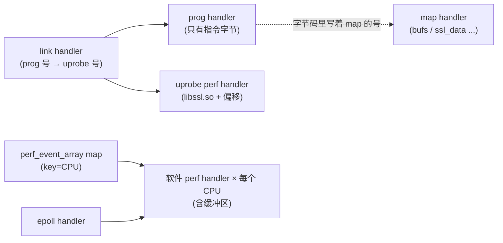
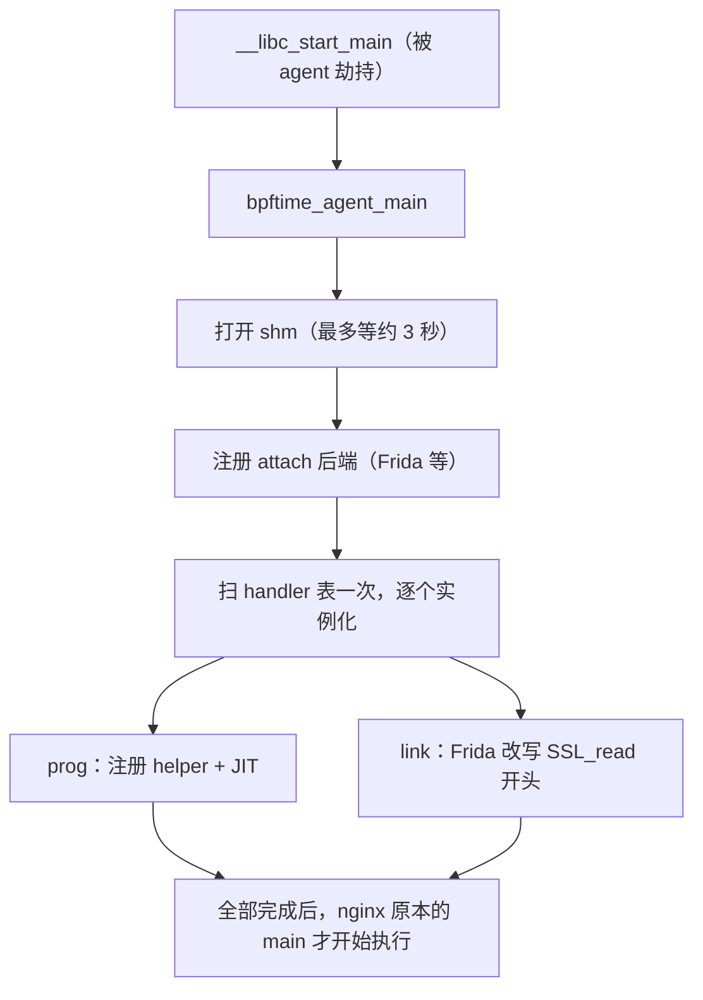
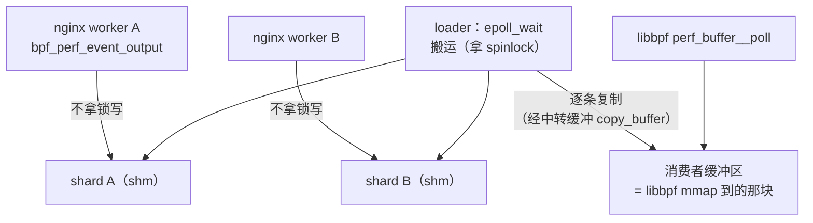

# 1. 一个事件的完整生命周期

> 一句话：跟着一次真实的 SSL 追踪，从 loader 加载程序一直走到事件打印在屏幕上，
> 把 bpftime 的核心代码串成 13 步。读完你能回答："bpftime 不进内核，那 map、prog、
> uprobe、perf buffer 分别变成了什么，又是怎么在两个进程之间流动的？"
>
> 前置：建议先读[第 0 章](00-architecture.md)（至少看组件图和术语表）。预计用时：2 小时。

## 本章要回答的问题

- loader 调 `bpf(2)` 创建 map 时，为什么根本没有进内核？它拿到的"fd"又是什么？
- loader 和被追踪进程是两个独立进程，eBPF 程序是怎么从前者"跑到"后者里去的？为什么必须先启动 loader？
- `SSL_read` 被调用的那一刻，到底是谁把控制权交给了 eBPF 程序？
- 程序里一句 `bpf_perf_event_output`，数据要经过哪几块内存，才能被 loader 的
  `perf_buffer__poll` 读到？
- 哪些地方仍然要付真正的系统调用？

---

## 1.1 场景与全景

我们用一个固定场景串起全部代码（后面各章也沿用它）：

- **loader / 控制面**：`sslsniff`。它是普通的 libbpf 程序，启动时被 `LD_PRELOAD` 了
  `syscall-server.so`。它负责"创建对象"：map、prog、uprobe、link、perf buffer。
- **目标进程 / 数据面**：`nginx`。它被 `LD_PRELOAD` 了 `agent.so`。每当 nginx 调用
  `SSL_read` / `SSL_write`，agent 就执行 eBPF 程序，产出事件。
- **数据的唯一通道**：一块名为 `bpftime_maps_shm` 的共享内存（下文简称 shm）。两个进程之间
  没有 socket、没有管道，所有对象都住在这块 shm 里。

启动命令是两条，**顺序不能反**：

```sh
bpftime load ./sslsniff        # 终端 1：先起 loader，等它把探针都建好
bpftime start nginx            # 终端 2：再起目标进程
```

原因在第 7 步：agent 只在启动时扫一次 shm 里的对象表。先起 nginx 的话，shm 还不存在时 agent 等约 3 秒打不开，就放弃初始化（日志 `Unable to initialize shared memory`）；shm 已经存在（上次残留，或 loader 刚建段）时，它会扫到一张空表或半张表，之后什么都不挂。

整件事分三段：**控制面**（第 1–6 步，loader 启动时做一次）、**数据面**（第 7–10 步，
nginx 启动时做一次）、**热路径**（第 11–13 步，每个事件都走一遍）。

这张图只看一件事：**两个进程从不直接对话，数据全部经过 shm**。


---

## 1.2 控制面：loader 在 shm 里搭出对象图（第 1–6 步）

控制面结束时，shm 里会出现下面这张"对象图"。图里每个方框都是 shm 里的一个
**handler**——可以理解为"内核对象在用户态的替身"，它们排在一张叫 **handler 表**的数组里。
这张图要看的是：**箭头只是记录，此时还没有任何代码被挂钩、被编译**。



### 第 1 步：符号拦截

**这一步在干嘛**：libbpf 以为自己在调用 glibc 的 `syscall()`、`mmap()`、`close()` 等函数，
实际调到的是 syscall-server 里**同名**的函数。syscall-server 判断一下：是 bpf 相关的就自己处理，
不是就转给真正的 glibc。

**为什么要这样**：这是最轻的拦截方式。`LD_PRELOAD` 让 syscall-server.so 比 libc 先被
动态链接器搜到，同名符号就"盖住"了 libc 的版本——不需要 ptrace，也不需要 seccomp，
libbpf 一行都不用改。代价是**只有通过 libc 调用的才拦得到**；有人直接用汇编 `syscall`
指令进内核，就管不着。

被覆盖的函数有：`syscall`、`mmap`/`mmap64`/`munmap`、`ioctl`、`epoll_create1`/`epoll_ctl`/
`epoll_wait`、`close`、`open`/`openat`/`read`、`fopen` 一族。其中 `syscall()` 是 libbpf 发起
`bpf(2)` 和 `perf_event_open(2)` 的入口（`runtime/syscall-server/syscall_server_main.cpp` 的 `syscall()`，
代码见[第 0 章](00-architecture.md)选段一）：按系统调用号分流，`__NR_bpf` 交给 `handle_sysbpf()`，
`__NR_perf_event_open` 交给 `handle_perfevent()`，都包在 `handle_exceptions()` 里——内部抛异常就改调原来的 `syscall`；
其他号原样放行。

**要点**：

- 拦截 = 符号覆盖。真正的 libc 函数靠 `dlsym(RTLD_NEXT, ...)` 找到，留作兜底。
- 任何内部异常都**退回宿主原本的操作**（对 `bpf(2)` 就是交给真内核）。这叫 fail-open：
  注入的代码是宿主进程的"客人"，出错时宁可自己失效，也不能把宿主搞崩。
- 第一次进入任一被拦截函数时，syscall-server 构造自己的上下文：解析原函数、建日志，
  并 `unsetenv("LD_PRELOAD")`，免得 loader 再启动的子进程（比如 sslsniff 用 `popen` 跑的 `ldconfig`）也被注入。

深入阅读：[第 3 章](03-entrypoints.md)

### 第 2 步：syscall-server 启动，创建 shm、开新会话

**这一步在干嘛**：syscall-server 做一次性启动：从环境变量读配置、创建（或打开）名为
`bpftime_maps_shm` 的共享内存、开启一个新"会话"、把配置写进 shm。

**什么时候发生**：不是"第一次 bpf 调用"，而是**第一个通过开关检查的被拦截调用**——
几乎每个被覆盖函数（包括普通的 `close`、`open`、`mmap`）一开头都会调 `try_startup()`。
实测一个 loader 在 `main` 开头只做一次 `close(-1)`，shm 就已经建出来了。

**为什么要这样**：shm 是 loader 和 nginx 的交汇点，所以由先到的 loader 创建它，
后到的 agent 只负责打开。配置也写进 shm，这样 agent 读到的就是 loader 这一份
（JIT 开关、日志路径都跟 loader 走），两边不会各说各话。

"会话"是为了应对旧 shm：如果上一次的 shm 还在，新 loader 会先把里面的 handler 全部清掉。
清的时候用一个 **epoch 序号**做标记——改之前加 1 变成奇数（"正在改"），改完再加 1 变回偶数
（"稳定"）。agent 看到序号是奇数或者变了，就知道换了一个会话（第 8 步会用到）。

`runtime/syscall-server/syscall_server_utils.cpp` 的 `start_up()`（节选，去掉了 try/catch）

```cpp
std::call_once(g_startup_once, [&ctx]() {           // 整个进程只做一次
	auto runtime_config = construct_runtime_config_from_env(); // 读 BPFTIME_* 环境变量
	shm_lifecycle_lock lifecycle_lock(/* shm 名 */);    // 文件锁，和 agent 协调生命周期
	g_syscall_server_owns_shm =
		initialize_global_shm_with_ownership();     // 新建成功 = owner；已存在就打开
	std::atexit(remove_syscall_server_global_shm);  // 退出时（满足条件才）删 shm
	/* ... 把自己的 pid 登记进"活着的 syscall-server"集合 ... */
	shm_holder.global_shared_memory.begin_new_session(); // epoch+1 → 清空 handler 表 → epoch+1
	/* ... */
	bpftime_set_runtime_config(std::move(runtime_config)); // 配置写进 shm
});
```

**要点**：

- shm 底层是 `boost::interprocess::managed_shared_memory`，默认 50MB；里面最重要的是
  handler 表（默认 6144 个格子）。名字和大小都能用环境变量改。
- 每个新 syscall-server 都会开新会话、清空整张表。所以两个 loader 不能共用一个 shm 名
  （[附录 B](B-known-issues.md#b-shm)）。
- 只有"创建者"（owner）进程在退出、并且没有其他活着的 loader 或 agent 时才删除 shm。
  进程被 `SIGKILL` 时 `atexit` 不会执行，shm 会残留在 `/dev/shm/` 下。

深入阅读：[第 2 章](02-runtime-shm.md)、[第 3 章](03-entrypoints.md)

### 第 3 步：map 与 prog 诞生

**这一步在干嘛**：libbpf 发出 `BPF_MAP_CREATE`、`BPF_PROG_LOAD`。syscall-server 的
`handle_sysbpf()` 是 `bpf(2)` 的用户态版本：它在 shm 的 handler 表里占一个格子，放进
map handler 或 prog handler，然后把格子号当作 fd 还给 libbpf。

**为什么要这样**：libbpf 需要一个"fd"才能继续工作（后面要拿它填 map 引用、建 link）。
bpftime 的办法是**假 fd**：在 loader 里真的 `open("/dev/null")`，向内核要一个真 fd 号，
但它的**含义**由 shm 里同号的格子决定。内核占住这个号，就不会和进程里别的文件撞号。

`runtime/src/bpftime_shm_internal.cpp` 的 `bpftime_shm::open_fake_fd()`

```cpp
int fd = open("/dev/null", O_RDONLY);   // 向内核要一个真 fd，只为占住号码
int cnt = 5;
while (fd <= 2 && fd >= 0 && --cnt > 0)
	fd = dup(fd);                       // 避开 0/1/2（标准输入输出）
if (fd >= 0 && (std::size_t)fd >= manager->size()) {
	close(fd);                          // 号码超出 handler 表长度
	errno = ENOSPC;
	return -1;
}
return fd;                              // 这个号码 = handler 表下标
```

拿到号码后，`handler_manager::set_handler()` 把 handler 放进下标为这个号的格子；如果是 map，
顺手调 `map_init` 在 shm 里分配存储。

prog 这边要注意三件事：

- shm 里**只存指令字节和名字**，不存 agent 用的编译结果，谁执行谁编译（第 9 步）。（handler 里还有个 `aot_insns` 字段，`bpftime-aot` 可以往里存 AOT 本机码，但 agent 不读它。）
- 字节码里引用 map 的指令（`lddw`，"加载 64 位立即数"），libbpf 在加载前已经把立即数填成了
  **map 的假 fd**。比如本书实测时，sslsniff 入口程序里有一条 `lddw r1, 7`，7 就是那次 `bufs` 拿到的假 fd。
  这个数字会一路保留到第 9 步。
- 用户态 verifier（PREVAIL，默认不编译）只检查 prog 类型为 TRACEPOINT 或 SOCKET_FILTER 的程序。
  libbpf 把 `SEC("uprobe")` 标成 KPROBE 类型，所以 sslsniff 的 uprobe 程序**不经过**用户态校验。

**要点**：

- 假 fd 在内核眼里只是 `/dev/null`。所以 `close`、`dup3`、`mmap`、`ioctl` 都必须被拦截，
  否则操作只会落到 `/dev/null` 上，shm 里的对象既释放不了、也映射不出来。
- 判断"这个 fd 是不是 bpftime 的对象"，就是查同号格子里放的是哪种 handler。

深入阅读：[第 2 章](02-runtime-shm.md)；map 实现见[第 8 章](08-maps.md)；verifier 见[第 10 章](10-periphery.md)

### 第 4 步：uprobe 变成 perf handler

**这一步在干嘛**：libbpf 挂 uprobe 时，先调 `perf_event_open(2)`，参数里写着"哪个文件、
哪个偏移、是不是 uretprobe"。syscall-server 把这些信息原样存成一个 uprobe 类型的
perf event handler，再还一个假 fd。

**为什么要这样**：在内核里，`perf_event_open` 之后 uprobe 就已经生效了。但在 bpftime 里，
loader 和 nginx 是两个进程，**loader 这时没法去改 nginx 的代码**。所以这一步只做"登记"：
记下要挂哪里，真正的挂钩留给 nginx 里的 agent（第 10 步）。

`runtime/syscall-server/syscall_context.cpp` 的 `syscall_context::handle_perfevent()`（节选）

```cpp
if ((int)attr->type == determine_uprobe_perf_type()) {      // uprobe 类型的 perf 事件
	bool retprobe =
		attr->config & (1 << determine_uprobe_retprobe_bit()); // uprobe 还是 uretprobe
	const char *name = (const char *)(uintptr_t)attr->config1; // 模块路径，如 libssl.so.3
	uint64_t offset = attr->config2;                        // 函数在文件里的偏移
	int id = bpftime_uprobe_create(-1 /* 让 shm 分配 fd */, pid, name,
				       offset, retprobe, ref_ctr_off);
	return id;                                              // 又一个假 fd
} else if (/* kprobe 类型 */) {
	/* ... 在 bpftime 里实际是 CUDA kernel 探针，见第 9 章 ... */
} else if ((int)attr->type == (int)bpf_event_type::PERF_TYPE_SOFTWARE) {
	/* ... 第 6 步建 perf buffer 时走这里 ... */
}
```

libbpf 判断"uprobe 的类型号是多少"要读 `/sys/bus/event_source/devices/uprobe/type`；
libbpf 用 `fopen` 读它，这次 `fopen` 也被 syscall-server 拦下，返回一个写好伪造内容的临时文件。

**要点**：

- 此刻**没有任何指令被改写**，uprobe 只是 shm 里的一条记录。
- 同一入口还处理 SOFTWARE 类型的事件，那是 perf buffer 用的（第 6 步）。

深入阅读：[第 3 章](03-entrypoints.md)、[第 4 章](04-attach-uprobe.md)

### 第 5 步：用 link 连线

**这一步在干嘛**：libbpf 发 `BPF_LINK_CREATE`，把"哪个 prog"和"哪个 uprobe"连起来。
syscall-server 在 shm 里写一个 link handler，里面的核心字段就两个：`prog_id` 和
`attach_target_id`——也就是两个假 fd 号。

**为什么要这样**：link 是 prog 和挂载点之间的"连线记录"。把它单独存成对象，
agent 扫表时就能顺着 link 找到"把哪段程序挂到哪里"。

`bpftime_shm::add_bpf_link()` 先校验、后分配 fd（建 map/prog/perf 的 `add_*` 则是先分配后放）：一端必须是 prog，
另一端（perf link 时）必须是 perf event handler，否则返回 `EBADF`，不浪费 fd。

（libbpf 为什么走 link 而不是 `ioctl(PERF_EVENT_IOC_SET_BPF)`，见本章深入参考。）
之后 libbpf 还会对 uprobe 的 fd 调 `ioctl(PERF_EVENT_IOC_ENABLE)`。这个调用也被拦下，
只是把 handler 上一个"已启用"标志置位——这个标志没有任何人读（[附录 B](B-known-issues.md#b-shm)）。

**要点**：

- 到这里，shm 里已经有了 `map ← prog → link → uprobe` 的完整对象图。
- 但是**没有一行代码被挂钩，没有一条指令被编译**。控制面只搭"图纸"。

深入阅读：[第 2 章](02-runtime-shm.md)

### 第 6 步：消费者就位（perf buffer）

**这一步在干嘛**：挂完全部探针之后，sslsniff 才调 `perf_buffer__new()` 准备接收事件。libbpf 会依次：
`epoll_create1` 建一个 epoll；然后**每个 CPU** 打开一个 SOFTWARE 类型的 perf 事件、`mmap` 它的环形缓冲区、
`ioctl` 启用它、把它的 fd 写进 `perf_event_array` map（key 是 CPU 号）、`epoll_ctl` 把它加进 epoll。
这些调用全被 syscall-server 接住。所以**软件 perf 事件是在这一步、在 uprobe 和 link 之后才创建的**——
导出 handler 表能看到它们的假 fd 排在最后。

**为什么要这样**：内核的 perf buffer 是"内核写、用户读"的一块 mmap 内存，开头一页是
控制页（`perf_event_mmap_page`，里面有 `data_head`/`data_tail` 两个游标），后面是数据区。
bpftime 在 shm 里**一字节一字节地复刻了这个布局**，然后让 `mmap` 直接返回这块 shm 的地址。
libbpf 照常消费，完全不知道对面不是内核。

`runtime/syscall-server/syscall_context.cpp` 的 `syscall_context::handle_mmap64()`（节选）

```cpp
} else if (fd != -1 && bpftime_is_software_perf_event(fd)) { // 这个 fd 是 perf buffer
	errno = 0;
	if (auto ptr = bpftime_get_software_perf_event_raw_buffer(fd, length);
	    ptr != nullptr) {
		mocked_mmap_values.insert((uintptr_t)ptr); // 记账，munmap 时认得它
		return ptr;                  // 返回 shm 中"消费者缓冲区"的地址
	}
	if (errno == 0)
		errno = ENOMEM;              // shm 不够用：报 ENOMEM，而不是返回空指针
	return MAP_FAILED;
}
```

**要点**：

- 每个 CPU 一个软件 perf handler，每个 handler 里有一块**消费者缓冲区**（consumer buffer），
  就是 libbpf `mmap` 拿到的那块。
- 数据区大小必须是 2 的幂，否则返回 `EINVAL`——和内核要求一致。
- `epoll_create1` 在 shm 里建一个 epoll handler，`epoll_ctl` 把 perf handler 挂上去，
  给第 13 步的 `epoll_wait` 用。

深入阅读：[第 8 章](08-maps.md)、[第 3 章](03-entrypoints.md)

---

## 1.3 数据面：agent 把图纸变成钩子（第 7–10 步）

nginx 启动时，agent 读一遍 shm 里的对象图，在**自己的进程里**把它"实例化"：
编译程序、改写 `SSL_read`/`SSL_write` 的开头。这张图要看的是**先后顺序**：
所有准备工作都在 nginx 的 `main` 之前完成，而且只做一次。



### 第 7 步：agent 启动

**这一步在干嘛**：agent 覆盖了 glibc 的 `__libc_start_main`（每个 C 程序在 `main` 之前都要经过它），
把真正的 `main` 换成自己的 `bpftime_hooked_main`。后者**先**跑 agent 的初始化，**再**调用原来的 `main`。

**为什么要这样**：这样能保证 nginx 执行第一行业务代码之前，所有钩子都已就位——不会漏掉启动早期的事件，
也不会在业务线程正在执行 `SSL_read` 时去改它的指令。

`runtime/agent/agent.cpp` 的 `__libc_start_main()` 与 `bpftime_hooked_main()`

```cpp
extern "C" int bpftime_hooked_main(int argc, char **argv, char **envp)
{
	int stay_resident = 0;
	injected_with_frida = false;            // 标记：走的是 LD_PRELOAD 路径
	bpftime_agent_main("", &stay_resident); // 先做全部初始化和挂钩（参数为空串）
	return orig_main_func(argc, argv, envp);// 再进入 nginx 原本的 main
}

extern "C" int __libc_start_main(int (*main)(int, char **, char **), int argc,
				 char **argv, /* ... */)
{
	orig_main_func = main;                  // 记下真正的 main
	auto orig = (decltype(&__libc_start_main))dlsym(RTLD_NEXT, "__libc_start_main");
	return orig(bpftime_hooked_main, argc, argv, /* ... */); // 换成我们的 main
}
```

`bpftime_agent_main` 里做的事，按顺序：

1. 先按 nginx 自己的 `BPFTIME_LOG_OUTPUT`（没设就是 `~/.bpftime/runtime.log`）建一个临时日志。
2. 防重复初始化（同一进程里只能有一份 agent 生效，已有就转交给它）。
3. 以"只打开、不创建"的方式打开 shm，失败就每 50ms 重试一次，最多 60 次（约 3 秒）。
4. 读 shm 里的配置（就是第 2 步 loader 写进去的那份），**立刻把日志切到配置里的路径**。
   所以 agent 启动最初的一两行日志写在 nginx 自己的位置，之后全部写进 loader 指定的日志文件。
5. 注册 **attach 后端**（attach impl），也就是"真正负责挂钩的那部分代码"：
   uprobe 在 x86/ARM64 上用 Frida 后端；riscv64 上用断点 + 信号的 trap 后端（[第 4 章](04-attach-uprobe.md) 4.8 节）。
6. 扫描 handler 表（第 8 步），把自己登记进"存活 agent"集合，启动卸载线程和 IPC 服务，然后让 agent 常驻。

**要点**：

- 任何一步失败都会回滚并直接返回，nginx 照常运行，只是没有探针（fail-open）。
- **必须先启动 loader 并等它加载完，再启动 nginx**。`bpftime start`（以及 `bpftime attach`）传给入口的参数是空串，
  没有开启自动刷新，agent 只在这里扫一次表，之后 loader 新建的对象它看不到。那 3 秒重试只能容忍"shm 还没创建出来"；
  如果 shm 已经在、但 loader 还没建完对象，agent 会扫到半张或空表，日志照样写 `Attach successfully`，却什么也没挂上。
- 想让 agent 跟上后来的变化，有两条路：`bpftime trace` 注入时带 `auto_refresh_ms`（默认 500ms），agent 起一个线程周期性增量扫表；
  或者通过 agent 的本地 IPC socket 发 `refresh` 命令，全部拆掉重扫（[第 3 章](03-entrypoints.md)）。
- 对已经在跑的进程，`bpftime attach <pid>` 用 Frida 把 agent 注入进去，直接调用同一个 `bpftime_agent_main`。

深入阅读：[第 3 章](03-entrypoints.md)

### 第 8 步：扫表实例化

**这一步在干嘛**：agent 从头到尾扫一遍 handler 表，对每个已占用的格子，按类型在本进程里造出
对应的"活对象"：prog 变成可执行的程序，uprobe 变成"本进程里的函数地址"，link 把两者接上。

**为什么要这样**：shm 里只有"图纸"，而图纸里不能放跟进程有关的东西（比如函数地址、编译好的机器码，
每个进程都不一样）。所以每个 agent 都要按图纸在自己的地址空间里再搭一遍。

扫表前后各读一次 epoch 序号：如果扫的过程中有新 loader 开了新会话，就把刚搭的全拆掉重来（最多 3 轮）。
扫表时遇到 link，会**先递归实例化它引用的 prog 和 uprobe**，保证依赖顺序：

`runtime/src/attach/bpf_attach_ctx.cpp` 的 `bpf_attach_ctx::instantiate_handler_at()`（节选）

```cpp
} else if (std::holds_alternative<bpf_link_handler>(handler)) {
	auto &link_handler = std::get<bpf_link_handler>(handler);
	// 先递归实例化 link 的一端：prog ……
	if (int err = instantiate_handler_at(manager, link_handler.prog_id,
					     stk, config, /* ... */); err < 0)
		return err;
	// …… 和另一端：perf event（uprobe）
	if (int err = instantiate_handler_at(manager, link_handler.attach_target_id,
					     stk, config, /* ... */); err < 0)
		return err;
	// 两端都就绪，再把它们接起来（第 10 步）
	if (int err = instantiate_bpf_link_handler_at(id, link_handler, /* ... */);
	    err < 0)
		return err;
}
```

各类 handler 的实例化：

- **prog**：用 shm 里的指令字节，在本进程 `new` 一个 `bpftime_prog`，注册 helper，然后编译（第 9 步）。
- **uprobe**：拼出 `"模块路径:偏移"` 字符串，交给第 7 步注册的 Frida 后端，解析成本进程里的**绝对地址**。
- **软件 perf event**：什么都不用做——缓冲区本来就在 shm 里。
- **link**：调用 attach 后端真正挂钩（第 10 步）。
- **map、epoll**：什么都不做。map 的数据就在 shm 里，helper 运行时按假 fd 直接去找。

**要点**：

- 某个 handler 实例化**返回错误码**时只记一条日志，不中断扫描。agent 被注入到无关进程是常态，不是错误。
  但如果 attach 后端**抛出 C++ 异常**（Frida 挂钩失败就是抛异常），整个 agent 初始化会回滚，同表里其他 link 也不挂
  （[附录 B](B-known-issues.md#b-entry)）。
- 用一个集合记录递归路径，防止循环引用导致死递归。

深入阅读：[第 3 章](03-entrypoints.md)、[第 2 章](02-runtime-shm.md)

### 第 9 步：JIT 编译

**这一步在干嘛**：把 eBPF 字节码编译成本机机器码。这一步发生在第 8 步实例化 prog 的时候：
`load_prog_and_helpers()` 先按配置注册三组 helper，然后调 `bpftime_prog_load()`，
它把指令交给 VM，再调 `ebpf_compile()` 走 LLVM 生成一个函数指针 `uint64_t fn(void *mem, size_t len)`。

**为什么不能共享**：机器码里写死了本进程的地址——helper 函数的地址就直接编在 `call` 指令里，
不能跨进程共享，只能每个进程各编一份。

最值得理解的是 **helper 和 map 在机器码里长什么样**。eBPF 里 `call 25` 的意思是"调用 25 号 helper"
（25 号是 `bpf_perf_event_output`）。JIT 时它被翻译成对一个符号的调用，这个符号在链接时被绑定到
C++ 函数的真实地址。而引用 map 的 `lddw r1, 7`，编进机器码的就是**常量 7**——map 的假 fd，不是 map 的地址：

```text
eBPF 指令:  lddw r1, map_fd=7                        ; 引用 bufs
  ↓ JIT（lddw 回调 map_ptr_by_fd 原样返回 fd）
机器码:     r1 = 7                                    ; 只是个整数
eBPF 指令:  call 1                                    ; bpf_map_lookup_elem
  ↓ 翻译成 LLVM IR，再把符号绑到函数指针
机器码:     call <C++ 函数 bpftime_map_lookup_elem_helper 的地址>
  ↓ 运行时
helper 拿到 7 → 去 shm 的 handler 表第 7 格找到 bufs → 查表
```

（这段是示意，不是源码。）

这就是为什么 map 能跨进程共享：数字 7 在 loader 里是一个 `/dev/null` fd，在 nginx 里什么都不是，
但两边都把它当作同一张 handler 表的下标。只有引用 `.data/.rodata` 这类"map 值"的指令，才会把 shm
在本进程里的真实地址编进代码。

`bpftime_prog_load()` 本身很短：`ebpf_load` 把指令交给 VM；JIT 开着（默认，`BPFTIME_DISABLE_JIT` 可关）就调 `ebpf_compile`，
成功则把返回的函数指针存进 `fn`，以后每个事件直接调它。

**要点**：

- 运行时**没有查表**：从 JIT 代码到 helper 是一条直接的 `call` 指令，和调用普通 C 函数一样快。
- 所以 helper 必须在编译**之前**注册好。attach 后端自带的 helper（Frida 的 `bpf_get_func_arg` 等）
  偏偏是在编译之后才补注册的：用到它们的程序这一步编译失败，要靠第一个事件到来时的惰性重编才"碰巧"成功（[第 6 章](06-vm-jit.md)）。
- 日志里说"falling back to interpreter"，但默认的 llvm 后端没有解释器，只是推迟到第一个事件再编（[第 6 章](06-vm-jit.md)）。

深入阅读：[第 6 章](06-vm-jit.md)、[第 7 章](07-helpers.md)

### 第 10 步：Frida 挂钩

**这一步在干嘛**：Frida 后端把第 8 步得到的地址交给 Frida 的 `gum_interceptor_attach`，
改写 `SSL_read` / `SSL_write` 开头的几条指令，让它们跳到 Frida 准备好的
一小段**跳板代码（trampoline）**。同时，link 层把 JIT 出来的函数包成一个统一的回调，交给 Frida 后端。

**为什么要这样**：Frida 负责最难的部分——安全地改写正在运行的机器码。bpftime 只需要告诉它：
"命中时调这个回调"。这个回调是 prog 和 attach 后端之间**唯一的胶水**：

`runtime/src/attach/bpf_attach_ctx.cpp` 的 `bpf_attach_ctx::instantiate_bpf_link_handler_at()`（节选）

```cpp
auto cookie = handler.attach_cookie;
attach_id = attach_impl->create_attach_with_ebpf_callback(
	[=](void *mem, size_t mem_size, uint64_t *ret) -> int {
		if (auto *ctx = attach::current_signal_callback)
			ctx->cookie = cookie;              // trap 后端（信号里执行）才走这里
		else
			current_thread_bpf_cookie = cookie; // Frida 路径：存进线程局部变量
		return prog->bpftime_prog_exec(mem, mem_size, ret); // 执行 JIT 代码
	},
	*priv_data, attach_type);                  // priv_data 里有目标函数地址
```

`mem` 就是第 11 步造出来的寄存器快照（`pt_regs`），也就是 eBPF 程序看到的 `ctx`。

**要点**：

- 同一个函数地址只建一个 Frida 挂钩。sslsniff 在 `SSL_read` 上同时挂 uprobe 和 uretprobe，
  两者共享这个挂钩：uprobe 用"进入时"监听器，uretprobe 用"返回时"监听器。
- 解析"模块路径:偏移"时，Frida 后端会先把这个模块**加载进目标进程**，再找它的基址。
  所以 sslsniff 登记的 GnuTLS、NSS 探针，也会让 nginx 把这两个它本来不用的库加载进来并挂上钩子
  （本书写作时用 `openssl s_client` 实测：注入后的进程 maps 里多出 `libgnutls` 和 `libnspr4`）。
  挂钩前那道"模块在不在 `/proc/self/maps` 里"的检查，因此几乎总是通过。
- 至此静态链路完成：`SSL_read 开头 → Frida 跳板 → 上面这个 lambda → JIT 代码`。

深入阅读：[第 4 章](04-attach-uprobe.md)

---

## 1.4 热路径：一个事件从 SSL_read 到屏幕（第 11–13 步）

每个 HTTPS 请求都会触发 `SSL_read`/`SSL_write`，每次都要走一遍这三步。数据的流向是：
nginx 的每个 worker（准确说是每个写事件的线程）写进**自己的**缓冲区（shard），loader 在 `epoll_wait` 时把它们搬（drain）到
libbpf 看得到的消费者缓冲区。这张图要看的是：**多个写方各写各的，互不抢锁**。



### 第 11 步：触发与执行

**这一步在干嘛**：nginx 调用 `SSL_read`。开头的指令早已被改成跳转，所以 CPU 先跳进 Frida 的跳板。
跳板把所有寄存器存成一个结构体 `GumCpuContext`，然后调用 bpftime 注册的监听器：
入口走 `uprobe_listener_on_enter`（跑 `probe_SSL_rw_enter`，记下 `buf`），
返回时走 `uprobe_listener_on_leave`（跑 `probe_SSL_read_exit`）。监听器在栈上造一个 `pt_regs`，
把寄存器一个个抄过去，再依次调用挂在这个函数上的每个回调——也就是第 10 步那个 lambda，最终跑到 JIT 代码。

**为什么要转换寄存器**：eBPF 程序是照着内核写的，它期待拿到内核格式的 `pt_regs`
（比如 `PT_REGS_PARM1(ctx)` 读第一个参数）。Frida 给的是它自己的格式，所以要转一次。
这是**单向拷贝**：程序改了 `ctx`，真实寄存器不会变。想改返回值要用另一种 attach 类型（override）。

`attach/frida_uprobe_attach_impl/src/frida_internal_attach_entry.cpp` 的 `uprobe_listener_on_leave()`

```cpp
static void uprobe_listener_on_leave(GumInvocationContext *ctx, gpointer user_data)
{
	auto *hook_entry = static_cast<frida_internal_attach_entry *>(user_data);
	bpftime::pt_regs regs;                                       // 栈上的 pt_regs
	convert_gum_cpu_context_to_pt_regs(*ctx->cpu_context, regs); // 寄存器逐个抄过去
	hook_entry->iterate_uretprobe_callbacks(regs);               // 跑这个函数上的所有 uretprobe
}
```

回调里的 `bpftime_prog_exec()` 很薄：（启用 MPK 时）打开 shm 写权限，直接调 JIT 出来的函数指针 `fn(mem, len)`，再关上写权限。

程序跑起来后会调用一串 helper：取 pid/tid、读写 `bufs`/`start_ns` 两个 hash map、`bpf_probe_read_user` 抄 SSL 缓冲区……
它们大多是纯用户态函数调用。几个例外会付真系统调用：`bpf_get_current_uid_gid` 每次调 `getuid`/`getgid`；
`bpf_probe_read_user` 在 `ENABLE_PROBE_READ_CHECK=ON` 构建里每次做一次 `process_vm_readv`
（为了读到坏地址时返回错误而不是崩溃）。

**要点**：

- 和内核 uprobe 相比，Frida 后端从命中到进入程序这一段**完全不进内核**：没有断点异常、没有上下文切换。这是 bpftime 快的根本原因。
- 回调执行前，被挂函数的地址会存进一个线程局部变量，`bpf_get_func_ip` 就从这里读。
- `bpf_get_current_pid_tgid` 把 pid/tid 缓存起来，并在 `fork` 后刷新——nginx 的 worker 是从 master
  fork 出来的，继承了 master 里已经改写好的代码，不刷新就会报 master 的 pid。

深入阅读：[第 4 章](04-attach-uprobe.md)、[第 6 章](06-vm-jit.md)、[第 7 章](07-helpers.md)

### 第 12 步：输出事件

**这一步在干嘛**：程序调用 `bpf_perf_event_output`。JIT 代码直接 call 到 C++ 函数
`bpf_perf_event_output`：它取当前 CPU 号，在 `perf_event_array` map 里查到这个 CPU 对应的
软件 perf handler，然后把记录写进**当前线程专属的 shard**。

这里有一个特殊之处：helper 在写之前会把线程临时绑到当前 CPU，写完再恢复。这是 3 个绑核相关的系统调用，再加上取本线程 shard 时的 `getpid`/`gettid`，成功写入一次共 5 次系统调用。绑核本身
并不保护什么（CPU 号在绑核之前就已经取好了），来龙去脉见[第 7 章](07-helpers.md)。

**为什么要分 shard**：如果所有线程写同一个环形缓冲区，就得加锁。bpftime 给每个
(进程, 线程) 各开一个 shard，每个 shard 有自己的环形缓冲区；线程用一个线程局部缓存直接找到
自己的 shard，**正常情况下写入不拿任何锁**。只有第一次写（要新建 shard）时才拿一次自旋锁。

`runtime/src/bpf_helper.cpp` 的 `bpf_perf_event_output()`（骨架）

```cpp
int32_t current_cpu = my_sched_getcpu();      // 当前 CPU 号（glibc 有不进内核的快速实现）
/* ... sched_getaffinity 保存原掩码，sched_setaffinity 绑到 current_cpu ... */
const int32_t *val_ptr = /* 以 current_cpu 为 key 查 perf_event_array */;
ret = bpftime_perf_event_output(*val_ptr, data, size); // → 本线程 shard
/* ... sched_setaffinity 恢复原掩码 ... */
```

`runtime/src/handler/perf_event_handler.cpp` 的 `software_perf_event_buffer::output_data()`（节选）

```cpp
constexpr size_t alignment = sizeof(uint64_t);
const size_t record_size =                    // 记录长度向上取整到 8 字节
	(sizeof(perf_sample_raw) + size + alignment - 1) & ~(alignment - 1);
perf_sample_raw header;
header.header.type = PERF_RECORD_SAMPLE;      // 和内核 perf 记录格式一致
header.header.size = record_size;
header.size = record_size - sizeof(header);
append_record_parts(&header, sizeof(header), buf, size,
		    header.size - size);          // 写 header + 数据，再推进 data_head
return 0;                                     // 注意：缓冲区满时也返回 0
```

**要点**：

- 记录按 8 字节对齐。libbpf 默认记录头永远不会跨越环形缓冲区的尾部，对齐就是为了保证这一点。
- 写完后用 release 语义更新 shard 的 `data_head`，读方用 acquire 语义读，保证读到 head 时数据已经写好。
  （小知识：release 写保证它之前的写先对别的 CPU 可见；acquire 读保证它之后的读不会被提前。两者配对，就是不加锁的"先写数据、再发布游标"。）
- 缓冲区满时**静默丢弃**：不报错，也不产生"丢失记录"通知。
- `flags` 参数（sslsniff 传 `BPF_F_CURRENT_CPU`）没有被读取，CPU 一律取当前快照。

深入阅读：[第 7 章](07-helpers.md)、[第 8 章](08-maps.md)

### 第 13 步：消费事件

**这一步在干嘛**：sslsniff 调 `perf_buffer__poll()`，里面的 `epoll_wait` 被拦下，变成一个
**每 1ms 扫一次的轮询**：对每个挂在 epoll 上的 perf handler 问"有数据吗？"。问的过程中，
loader 会把所有 nginx 线程 shard 里的记录**搬**到消费者缓冲区。有数据就返回，libbpf 按标准 perf
协议读出记录、回调 `handle_event`，后者调 `print_event` 把明文打印到屏幕上。

**为什么要这样**：shm 里没有内核能帮忙"唤醒"等待者，只能轮询。而把搬运放在 loader 这边，
nginx 的热路径就只管往自己的 shard 里写，不用关心消费者。

`runtime/src/handler/perf_event_handler.cpp` 的 `has_data()`、`drain_producer_shards()` 与 `copy_next_record_to()`（节选）

```cpp
bool software_perf_event_data::has_data()
{
	drain_producer_shards();                     // 先搬运，再判断
	return consumer_buffer.has_data();
}
void software_perf_event_data::drain_producer_shards()
{
	spin_lock_guard guard(shard_lock);           // 搬运时拿锁
	for (auto &shard : producer_shards)
		while (shard.buffer.copy_next_record_to(consumer_buffer)) {}
	/* ... 顺带回收已退出线程的空 shard ... */
}
// copy_next_record_to() 核心：
read_wrapped(data_tail, &record_header, sizeof(record_header)); // 读记录头
if (record_header.size < sizeof(record_header) ||
    record_header.size > mmap_size()) {          // 长度不合理：丢弃整个 shard
	smp_store_release_u64(&header.data_tail, data_head);
	return false;
}
/* ... 还没写全（size > head - tail）就先不搬 ... */
read_wrapped(data_tail, copy_buffer.data(), record_header.size); // 先整条读进中转缓冲
dst.append_record(copy_buffer.data(), record_header.size);       // 再追加进消费者缓冲区
/* ... 成功后推进 shard 的 data_tail ... */
```

**两组游标归谁**（这是理解整条热路径的关键）：

| 缓冲区 | `data_head`（写到哪）谁推进 | `data_tail`（读到哪）谁推进 | 跨进程吗 |
|---|---|---|---|
| shard（每线程一个） | nginx 里写数据的线程 | loader 里的搬运代码 | 是：nginx 写、loader 读 |
| 消费者缓冲区（每 CPU 一个） | loader 里的搬运代码 | loader 里的 libbpf | 否：两个游标都归 loader |

两处都靠 acquire/release 读写游标，交接不需要任何系统调用。

**要点**：

- 读方仍要校验记录长度：shard 住在共享内存里，内容不受本进程控制，而 libbpf 不会再校验——一条长度为 0 的记录就能让它原地空转。
  长度不合理时整个 shard 的存量被丢弃；长度大于已写入字节数时视为没写完，留到下一轮。官方代码不校验长度是否为 8 的倍数。
- 消费者缓冲区满时，记录留在 shard 里，下一轮再搬。
- 一条事件从 nginx 到屏幕，在 bpftime 里被复制 3 次：map 值 → shard（第 12 步），shard → 中转缓冲 `copy_buffer`（因为记录可能跨环尾，先整条读出来），中转缓冲 → 消费者缓冲区。

深入阅读：[第 8 章](08-maps.md)、[第 3 章](03-entrypoints.md)

---

## 1.5 13 步一览表

| 步骤 | 发生在哪个进程 | 一句话 | 关键函数 | 详见 |
|---|---|---|---|---|
| 1 符号拦截 | loader | LD_PRELOAD 同名函数盖住 libc，bpf 相关调用转给 syscall-server | `syscall()`、`handle_exceptions()` | [第 3 章](03-entrypoints.md) |
| 2 建 shm、开会话 | loader | 首个被拦截调用触发一次性启动：读配置、建/开 shm、清表、写配置 | `try_startup()`、`start_up()`、`begin_new_session()` | [第 2 章](02-runtime-shm.md) |
| 3 map/prog 诞生 | loader | 在 handler 表里占格子，用 `/dev/null` 假 fd 当返回值；prog 只存字节码 | `handle_sysbpf()`、`open_fake_fd()`、`set_handler()` | [第 2 章](02-runtime-shm.md) |
| 4 uprobe 登记 | loader | `perf_event_open` 只记录"模块+偏移"，不挂钩 | `handle_perfevent()`、`bpftime_uprobe_create()` | [第 4 章](04-attach-uprobe.md) |
| 5 link 连线 | loader | 记下"哪个 prog 挂到哪个 uprobe" | `add_bpf_link()` | [第 2 章](02-runtime-shm.md) |
| 6 perf buffer | loader | 探针挂完后才建：每 CPU 一个软件 perf handler，`mmap` 直接返回 shm 内存 | `handle_mmap64()`、`bpftime_get_software_perf_event_raw_buffer()` | [第 8 章](08-maps.md) |
| 7 agent 启动 | nginx | 劫持 `__libc_start_main`，在 main 前打开 shm、切日志、注册 attach 后端 | `bpftime_hooked_main()`、`bpftime_agent_main()` | [第 3 章](03-entrypoints.md) |
| 8 扫表实例化 | nginx | 只扫一次：按图纸在本进程造出 prog / uprobe / link | `init_attach_ctx_from_handlers()`、`instantiate_handler_at()` | [第 3 章](03-entrypoints.md) |
| 9 JIT 编译 | nginx | 先注册 helper 再编译；helper 编成直接 call，map 编成假 fd 常量 | `load_prog_and_helpers()`、`bpftime_prog_load()` | [第 6 章](06-vm-jit.md) |
| 10 Frida 挂钩 | nginx | 改写 `SSL_read` 开头，回调里执行 JIT 代码 | `create_attach_with_ebpf_callback()`、`gum_interceptor_attach()` | [第 4 章](04-attach-uprobe.md) |
| 11 触发执行 | nginx（每事件） | 跳板 → 寄存器转成 `pt_regs` → 跑 JIT 代码 | `uprobe_listener_on_leave()`、`bpftime_prog_exec()` | [第 4 章](04-attach-uprobe.md) |
| 12 输出事件 | nginx（每事件） | 记录按 8 字节对齐写进本线程 shard | `bpf_perf_event_output()`、`output_data()` | [第 7 章](07-helpers.md) |
| 13 消费事件 | loader（轮询） | `epoll_wait` 轮询时搬运 shard，libbpf 读出并打印 | `bpftime_epoll_wait()`、`drain_producer_shards()` | [第 8 章](08-maps.md) |

收尾时：sslsniff 收到 Ctrl+C 退出，若它是 shm 的 owner、且已经没有其他活着的 loader 或 agent，就删掉 shm；
nginx 还活着时 shm 会保留，agent 继续跑已经挂好的探针，只是输出没人读了。卸载探针用 `bpftime detach`
（它给每个存活 agent 发 IPC `detach` 和 `SIGUSR1`），见[第 3 章](03-entrypoints.md)。

---

## 小结

- bpftime 的"内核"就是一块共享内存 shm。loader 和 nginx 不直接对话，一切对象都住在 shm 的 handler 表里。
- 拦截靠 LD_PRELOAD 符号覆盖：只拦 libc 入口，出错就退回原始操作（fail-open）；第一个被拦截的调用（哪怕是 `close`）就触发建 shm。
- loader 拿到的 fd 是指向 `/dev/null` 的真 fd，号码就是 handler 表下标；所以 `close`/`mmap`/`dup3`/`ioctl` 都要拦。
- 控制面只搭"图纸"：shm 里只有指令字节和挂载点描述，没有机器码、没有函数地址；perf buffer 在探针之后才建。
- 数据面在 nginx 的 `main` 之前，按图纸在本进程编译程序、改写函数开头，而且只扫一次表——所以必须先启动 loader。
- JIT 代码里 helper 是直接 call，map 是假 fd 常量；同一个号码在两个进程里指向同一张表的同一个格子。
- 热路径完全在用户态：跳板 → `pt_regs` → JIT 代码 → helper 是一串普通函数调用；输出写进每线程一个的 shard，不拿锁。
- loader 在 `epoll_wait` 轮询时把 shard 搬进消费者缓冲区；消费者缓冲区的两个游标都归 loader。

## 动手验证

下面的实验只用官方树现成的 `build-jit/`，非 root 可跑，本书写作时在 x86_64 Debian 上实跑过。
nginx 不是必需的：任何链接 libssl 的程序都能当目标，这里用 `openssl s_client`。更多实验见[第 12 章](12-practice.md#exp-1)。

**准备**（`B` 指向 `build-jit`；sslsniff 需先 `make -C example/tracing/sslsniff`）：

```sh
B=/path/to/bpftime/build-jit
SS=/path/to/bpftime/example/tracing/sslsniff/sslsniff
export BPFTIME_GLOBAL_SHM_NAME=demo_$RANDOM        # 独立的 shm 名
openssl req -x509 -newkey rsa:2048 -nodes -keyout key.pem -out cert.pem -days 1 -subj /CN=localhost
(sleep 4; echo hello-from-server; sleep 2) | \
  openssl s_server -accept 127.0.0.1:44330 -cert cert.pem -key key.pem -quiet &
```

**实验 1：走完 13 步，看到一次 SSL_write 和一次 SSL_read**

```sh
# 第 1–6 步：先起 loader（Debian 非 root 要补 /usr/sbin，sslsniff 用 ldconfig 找库）
PATH=$PATH:/usr/sbin BPFTIME_LOG_OUTPUT=$PWD/loader.log \
  LD_PRELOAD=$B/runtime/syscall-server/libbpftime-syscall-server.so $SS > sniff.out &
sleep 2
# 第 7–13 步：再起目标进程
(echo hello-from-client; sleep 3) | BPFTIME_LOG_OUTPUT=$PWD/agent.log \
  LD_PRELOAD=$B/runtime/agent/libbpftime-agent.so openssl s_client -connect 127.0.0.1:44330 -quiet
kill -INT %2; cat sniff.out
```

预期：`sniff.out` 里先是一条 `WRITE/SEND ... openssl ... 18` 带 `hello-from-client`，
再是一条 `READ/RECV ... 18` 带 `hello-from-server`。

**实验 2：看第 7 步的日志切换**

```sh
sleep 1           # 等日志落盘
cat agent.log      # 只有两行：Global shm constructed... / Global shm initialized
grep -E 'bpf_attach_ctx constructed|epoch_seq|Attach successfully' loader.log
```

预期：agent 自己的日志文件里只有打开 shm 的头两行；之后的 `bpf_attach_ctx constructed`、
`bpftime: shm epoch_seq = 2`、`Attach successfully` 都出现在 **loader 的** `loader.log` 里，行首是 openssl 的 pid。

**实验 3：从假 fd 的编号看第 3–6 步的先后**

在实验 1 的 loader 运行期间（在起 `s_client` 之前）执行：

```sh
$B/tools/bpftimetool/bpftimetool export $PWD/shm.json
python3 -c "
import json; d=json.load(open('shm.json'))
for k in sorted(d, key=int): print(k, d[k]['type'])" | uniq -f1 -c
```

预期：编号从 4 开始依次是 4 个 `bpf_map_handler`、5 个 `bpf_prog_handler`、交替出现的
`bpf_perf_event_handler`/`bpf_link_handler`（每个探针一对）、1 个 `epoll_handler`，最后是每 CPU 一个的软件
`bpf_perf_event_handler`——印证"perf buffer 在探针之后才建"。prog 的 `insns` 十六进制里能找到
`1811000007000000`，即 `lddw r1, 7`（7 是 `bufs` 的假 fd）。

清理：`kill %1 %2 2>/dev/null; rm -f /dev/shm/$BPFTIME_GLOBAL_SHM_NAME /tmp/bpftime-shm-$BPFTIME_GLOBAL_SHM_NAME.lock`。

## 自测题

**1. loader 拿到的 map "fd" 是什么？为什么 `close`、`dup3`、`mmap` 都必须被拦截？**

<details><summary>答案</summary>

它是 loader 进程里 `open("/dev/null")` 得到的真 fd，号码同时是 shm 中 handler 表的下标。
内核占住这个号，所以不会和进程里别的文件撞号；但在内核眼里它只是 `/dev/null`。

libbpf 会像对待真 fd 一样 `mmap` 它（perf buffer）、`close` 它（清理）、偶尔 `dup3` 它。
如果不拦：`mmap` 只会映射到 `/dev/null`；`close` 只关掉 `/dev/null`，shm 里的 handler 永远不释放；
`dup3` 出来的新号在 shm 里没有对应对象。所以 syscall-server 把这些入口全覆盖了：
`close` 先清掉 shm 里的格子再关真 fd；`dup3` 对 map fd 走专门的复制逻辑；
`mmap` 遇到 perf buffer 的 fd 就返回 shm 内存，其余原样放行。
</details>

**2. 有人先 `bpftime start nginx`，过了 5 秒才 `bpftime load ./sslsniff`。会怎样？怎么补救？**

<details><summary>答案</summary>

agent 在 nginx 的 `main` 之前打开 shm。shm 还不存在时它每 50ms 重试、最多约 3 秒，5 秒后才起的 loader 赶不上，
agent 打不开 shm 就放弃（nginx 照常运行，没有探针）。如果 shm 恰好已经在，情况更糟：
loader 刚建了 shm 还没建完对象时，agent 扫到空表或半张表，日志照样写 `Attach successfully`，之后 loader 再建的对象它不会再看；
上次残留的 shm 则会让 agent 把旧对象照单挂上，等新 loader 开新会话清表后，这些旧钩子还在跑，引用的 map 号却已被清掉或复用
（推断，[附录 B](B-known-issues.md#b-shm)）。

补救：按顺序重启；或者用 `bpftime trace` 注入（会带 `auto_refresh_ms`，agent 周期性增量扫表）；
或者给 agent 的 IPC socket 发一个 `refresh` 命令让它全部拆掉重扫。
</details>

**3. sslsniff 的程序里有 `bpf_map_lookup_elem(&bufs, &tid)`。JIT 之后，机器码里的 `&bufs` 变成了什么？为什么 nginx 里的程序能找到 loader 创建的 map？**

<details><summary>答案</summary>

变成了一个整数常量：`bufs` 在 loader 里的假 fd（实验 3 里是 7）。libbpf 加载时就把它填进了 `lddw` 指令，
JIT 时 bpftime 的 lddw 回调 `map_ptr_by_fd` 原样返回这个 fd。运行时 helper 拿着 7 去 shm 的 handler 表
第 7 格找到 map 的实现对象。号码在 nginx 里不是一个有效 fd，但两个进程映射的是同一张表，
所以下标 7 指向同一个 map，map 的数据本来也在 shm 里。
</details>

**4. 两个 nginx worker（或同一进程里的两个线程）同时命中 uprobe 并各自调用 `bpf_perf_event_output`，会抢同一个环形缓冲区吗？会拿锁吗？loader 读的时候呢？**

<details><summary>答案</summary>

不会抢：每个 (进程, 线程) 有自己的 shard，各有独立的环形缓冲区。
稳态下也不拿锁：线程局部缓存校验通过后直接返回自己的 shard。只有第一次写入（要新建 shard）
或缓存失效（消费者缓冲区扩容导致"代号"变化）时，才拿自旋锁走慢路径。
loader 搬运时拿同一把自旋锁，所以唯一常见的竞争在"loader 搬运"和"新建 shard"之间。
搬运本身不阻塞写方：shard 的 head 由写方推进、tail 由搬运方推进，两边只靠 acquire/release 交接。
</details>

**5. nginx 进程没设 `BPFTIME_LOG_OUTPUT`，loader 设成了 `/tmp/loader.log`。agent 的"Attach successfully"会写到哪？为什么这样设计？**

<details><summary>答案</summary>

写到 `/tmp/loader.log`。agent 启动时先按自己的环境变量（这里是默认的 `~/.bpftime/runtime.log`）建一个临时日志，
打开 shm 后立刻按 shm 里 `runtime_config` 记录的路径重设日志，而这份配置是 loader 在第 2 步用自己的环境变量写进去的。
所以只有打开 shm 之前的一两行留在 nginx 那边。好处是一次追踪的两端日志集中在一处，而且不用改目标进程的环境；
同理，JIT 开关、helper 分组等配置也都跟 loader 走。
</details>

---

## 深入参考

<details>
<summary>代码位置速查（按 177a1dc465ff 行号）</summary>

`vm/llvm-jit` 是子模块（llvmbpf），行号按该提交固定的子模块版本 `87bac39` 计。

| 概念 / 函数 | 位置 |
|---|---|
| 被覆盖的 libc 入口 / 导出表 | `runtime/syscall-server/syscall_server_main.cpp:282-533`；`runtime/syscall-server/syscall-server.version` |
| `syscall()`；`__NR_bpf`/`perf_event_open`/`dup3`/`memfd_create` 分支 | `syscall_server_main.cpp:468`；`:488` / `:499` / `:513` / `:522` |
| `initialize_ctx()` / `handle_exceptions()` | `syscall_server_main.cpp:206-236` / `:238-257` |
| `syscall_context` 构造（建日志、读配置） | `runtime/syscall-server/syscall_context.cpp:196-212` |
| `try_startup()` | `syscall_context.cpp:237-254` |
| `handle_close()` / `handle_dup3()` | `syscall_context.cpp:256-275` / `:1200-1214` |
| `start_up()` / `initialize_global_shm_with_ownership()` / 退出删除 | `runtime/syscall-server/syscall_server_utils.cpp:147-228` / `:126-145` / `:56-124` |
| shm 默认名 / 环境变量覆盖 | `runtime/src/handler/handler_manager.hpp:51` / `:60-67` |
| shm 默认 50MB / `DEFAULT_MAX_FD_COUNT`（6144） | `runtime/include/bpftime_config.hpp:79` / `:23` |
| `begin_new_session()` / `reset_server_state()` | `runtime/src/bpftime_shm_internal.cpp:1017-1031` / `:1381-1397` |
| `open_fake_fd()` | `bpftime_shm_internal.cpp:674-688` |
| `add_bpf_link()` / `add_bpf_map()` | `bpftime_shm_internal.cpp:709-750` / `:1048-1077` |
| `handler_manager::set_handler()` / `clear_id_at()` | `runtime/src/handler/handler_manager.cpp:63-88` / `:98-148` |
| `handle_sysbpf()`；`MAP_CREATE`/`PROG_LOAD`/`LINK_CREATE` | `syscall_context.cpp:482`；`:493` / `:628` / `:704` |
| `handle_perfevent()`；uprobe / SOFTWARE 分支 | `syscall_context.cpp:806`；`:817-842` / `:905-910` |
| `handle_mmap64()`；软件 perf 分支 | `syscall_context.cpp:949`；`:987-1001` |
| `ioctl` 拦截 / epoll 三件套 | `syscall_context.cpp:1010-1068` / `:1070-1122` |
| libbpf：perf link 功能探测 / link 或 ioctl / perf buffer 建立 | `third_party/libbpf/src/features.c:332`；`libbpf.c:11290-11322`；`libbpf.c:13876`、`:13936`、`:13948` |
| `bpftime_hooked_main` / `__libc_start_main` | `runtime/agent/agent.cpp:535-542` / `:544-556` |
| `bpftime_agent_main` / 临时日志 `install_agent_bootstrap_logger` | `agent.cpp:830` / `:128-136` |
| shm 打开重试（60 × 50ms） / 切到 loader 的日志路径 | `agent.cpp:932-948` / `:956-957` |
| attach 后端注册：syscall trace / trap 或 Frida / CUDA | `agent.cpp:964-989` / `:991-1035` / `:1037-1057` |
| 扫表 / 自动刷新线程 / 登记存活 agent | `agent.cpp:1063-1079` / `:1082-1136` / `:1138-1145` |
| `init_attach_ctx_from_handlers()` | `runtime/src/attach/bpf_attach_ctx.cpp:73-162` |
| `instantiate_handler_at()`（link 递归在其中） | `bpf_attach_ctx.cpp:197-267` |
| `load_prog_and_helpers()` / `instantiate_prog_handler_at()` | `bpf_attach_ctx.cpp:43-60` / `:294-315` |
| `instantiate_bpf_link_handler_at()`；回调 lambda | `bpf_attach_ctx.cpp:316-419`；`:397-407` |
| `instantiate_perf_event_handler_at()` | `bpf_attach_ctx.cpp:420-510` |
| `bpftime_prog` 构造（设置 lddw 回调） | `runtime/src/bpftime_prog.cpp:108-130` |
| `bpftime_prog_load()` / `bpftime_prog_exec()` | `bpftime_prog.cpp:171-224` / `:238-276` |
| `map_ptr_by_fd` / `map_val` | `runtime/src/bpftime_shm.cpp:635-648` / `:650-672` |
| JIT 翻译 `CALL` / `emitExtFuncCall` / 符号名 | `vm/llvm-jit/src/compiler.cpp:1366-1482`；`compiler_utils.cpp:312-371`；`compiler_utils.hpp:39-44` |
| `lddw` 各 src 的处理 | `vm/llvm-jit/src/compiler.cpp:1052-1340` |
| `absoluteSymbols` 绑定 helper | `vm/llvm-jit/src/llvm_jit_context.cpp:768-807` |
| Frida：`create_attach_with_ebpf_callback()` / `attach_at()` | `attach/frida_uprobe_attach_impl/src/frida_uprobe_attach_impl.cpp:175-279` / `:48-97` |
| Frida：解析"模块:偏移"（`gum_module_load`） | `attach/frida_uprobe_attach_impl/src/frida_attach_private_data.cpp:10-42`；`frida_attach_utils.cpp:110-135`、`:147-151` |
| Frida：`uprobe_listener_on_enter` / `on_leave` | `frida_internal_attach_entry.cpp:293-308` / `:310-318` |
| trap 后端的信号安全 helper 白名单 / 签名检查 | `runtime/src/bpf_helper.cpp:895-910`；`bpftime_prog.cpp:289` 起 |
| `bpf_get_current_uid_gid` | `bpf_helper.cpp:261-267` |
| `bpf_perf_event_output()` | `bpf_helper.cpp:487-553` |
| `software_perf_event_data` 定义 | `runtime/src/handler/perf_event_handler.hpp:122-152` |
| `get_current_thread_shard()` | `perf_event_handler.cpp:491-548` |
| `output_data()` | `perf_event_handler.cpp:367-388` |
| `copy_next_record_to()` / `drain_producer_shards()` / `has_data()` | `perf_event_handler.cpp:421-462` / `:550-558` / `:589-593` |
| `bpftime_epoll_wait()` | `runtime/src/bpftime_shm.cpp:418-539` |
| sslsniff BPF 程序 / `main` | `example/tracing/sslsniff/sslsniff.bpf.c:60-129`；`sslsniff.c:420-521` |

</details>

<details>
<summary>细节与坑</summary>

**第 1–2 步：拦截与启动**

- 真 libc 函数有两套兜底：ctx 构造好之前，用 `cached_next_symbol` 按需 `dlsym(RTLD_NEXT, ...)` 并缓存；
  ctx 构造时 `init_original_functions()` 逐个解析，缺一个就抛异常。
- `initialize_ctx()` 的状态机：CAS 把状态从 0 推到 1，构造期间置线程局部 `tls_initializing`。构造 ctx 时如果又调到被拦函数
  （例如 spdlog 初始化会调 `fopen`），直接走原函数；其他线程看到状态 1 就 `sched_yield` 等待；构造抛异常则置 3（disabled），此后一律放行。
- 每个 `handle_*` 开头检查三个开关（`enable_mock`、`initializing_cuda`、`enable_mock_after_initialized`），然后调 `try_startup()`。
  `try_startup` 每次调用期间都把 `enable_mock` 临时置 false，多线程 loader 里存在一个短窗口（推断，[附录 B](B-known-issues.md#b-entry)）。
  `start_up` 抛异常时把 `enable_mock_after_initialized` 置 false，之后一律走原函数。
- `start_up` 结束时 `setenv("BPFTIME_USED", "1")`，宿主可以据此判断自己被 bpftime 接管了。
- shm 里的命名对象：handler 表、`syscall_pid_set`、`runtime_config`、存活 agent / 存活 syscall-server 两个 pid 集合、`pid_set_lock`、epoch 状态。
  打开旧段时沿用旧段大小。

**第 3–6 步：控制面对象**

- `open_fake_fd()` 拿到 0–2 时最多 `dup` 4 次往上挪；号码超出表长返回 `ENOSPC`。`set_handler` 格子已占用返回 `-EEXIST`，
  且不检查 `map_init` 的返回值，参数非法时可能留下"有 fd 无实现"的 map（[附录 B](B-known-issues.md#b-maps)）。
- `bpf_prog_handler` 构造时丢掉了 prog 类型，`type` 字段未初始化（导出 JSON 里是随机值）。
- uprobe 的 retprobe 位、`ref_ctr_off` 都从 `attr->config` 里取；uprobe 类型号由被伪造的 `/sys` 文件给出（恒为 9）。
- libbpf 选 link 还是 `ioctl(PERF_EVENT_IOC_SET_BPF)`，取决于一次功能探测：它先加载一个两条指令的小程序（在 bpftime 下也会建一个 prog handler，随后关掉），
  再用 `target_fd=-1` 调 `BPF_LINK_CREATE`，看到 `EBADF` 就认为"支持 perf link"。`add_bpf_link` 的先校验恰好给出这个 `EBADF`。
- link 创建失败、而两端确实是 prog 和 perf event 时，还有一条经 `bpftime_attach_perf_to_bpf_with_cookie` 的兜底。
- 关闭时的级联：关 prog 或 perf event 会清掉引用它的 link；关 link 会连带删掉它的目标 perf 格子以及同一 perf 上的其他 link
  （与内核语义不同，[附录 B](B-known-issues.md#b-shm)）。
- verifier 模式由 `BPFTIME_VERIFIER_LEVEL` 控制 STRICT / WARNING / NO_VERIFY，默认 WARNING。`BPF_PROG_LOAD` 分支的注释写着
  "uprobe/uretprobe -> SOCKET_FILTER"，但 libbpf 实际把 `SEC("uprobe")` 映射成 KPROBE。
- perf buffer 的 `mmap` 链：`bpftime_get_software_perf_event_raw_buffer` → `software_perf_event_data::ensure_mmap_buffer`
  （持 `shard_lock`，尺寸变了就推进 `producer_buffer_generation`）→ 按 libbpf 请求的长度扩容，数据区须为 2^n，扩容抛异常时报 `ENOMEM`。
- 被拦截的 `epoll_create1` 无条件返回 bpftime 的 epoll；loader 自己若也用 epoll 做别的事会坏（[附录 B](B-known-issues.md#b-entry)）。

**第 7–10 步：数据面装配**

- agent 入口三道防重：先连本进程的 IPC socket（`\0bpftime-agent-<pid>`），连上就发 `refresh` 转交；再找进程里另一份已加载的 agent；
  最后 CAS 抢初始化权。已经 READY 时，除非参数里有 `force_reinit=1`，否则跳过。
- 打开 shm 前拿 `shm_lifecycle_lock`，一直持有到扫表、JIT、挂钩、登记 pid 全部结束；期间新 loader 的第一个被拦截调用会在同一把 flock 上阻塞（读码确认）。
- syscall trace 后端也会注册，但只有经 `bpftime start -s` 的 transformer 启动时才有事件来源（[第 5 章](05-syscall-trace.md)）。
- nginx 默认会 daemonize：最初的进程 fork 出 master 后退出，master 再 fork worker。agent 只在最初那个进程里初始化一次；
  子进程继承了改写过的代码和 shm 映射，但不继承 agent 的后台线程（IPC、卸载 worker），存活 agent 集合里登记的也是最初那个 pid
  （读码支持，未实测）。更进一步：最初那个进程以 `exit()` 退出时，`__destruct_shm` 会把这个唯一登记的 pid 从集合里摘掉，
  存活集合可能变空，owner loader 退出时就可能删段，而 worker 仍映射着它在用（推断，未实测）。
- `init_attach_ctx_from_handlers` 在 `ctx_mutex` 下最多尝试 3 轮：序号为奇数则等 50ms 重试；序号变了就先拆掉本进程已有的全部 link；
  扫完再读一次，变了就拆掉重来；3 轮都不稳定返回 `-EAGAIN`。实际扫两遍表，第二遍专门处理 CUDA link。
  epoch 只在换会话时变，会话内的普通增删不会被发现。
- JIT 失败时日志写"falling back to interpreter"，但 llvm 后端没有真解释器：之后每个事件都会重试编译。
- Frida 解析模块：`frida_attach_private_data::initialize_from_string` 只特殊处理 `/proc/<pid>/map_files/...` 形式的路径，普通路径原样交给
  `resolve_function_addr_by_module_offset`，后者调 `gum_module_load` 再取基址。之后 `create_attach_with_ebpf_callback` 扫 `/proc/self/maps`
  比对模块路径——此时模块已被加载，比对通常通过。模块文件根本不存在时地址为 0，`attach_at` 返回 `-EINVAL`。
- uprobe 用 `gum_make_probe_listener`，uretprobe 用 `gum_make_call_listener`；同址后加的类型按需补另一个 listener。
  已经有 override/replace 的函数不能再挂别的（`-EEXIST`），反过来的检查缺失（[附录 B](B-known-issues.md#b-attach)）。
- trap 后端在建回调前先 `prepare_for_signal_execution()`：要求程序已编译、不是 AOT/CUDA、不用 MPK，并逐条检查 helper 调用是否在白名单里。

**第 11–13 步：热路径**

- 入口侧 `uprobe_listener_on_enter` 还会把 `ctx->cpu_context` 记进 `current_thread_gum_cpu_context`（给 `bpf_get_stack` 用）；
  uretprobe 侧不记，所以 uretprobe 里取不到栈。
- 寄存器转换：x86_64 拷 `rip`、`r8–r15`、`rdi/rsi/rbp/rsp/rbx/rdx/rcx/rax`；ARM64 拷 `x0–x28`、`fp`、`lr`、`sp`、`pc`、`nzcv`。
- `bpf_get_current_pid_tgid`：tgid 缓存在文件作用域、tid 缓存在 thread_local，`pthread_atfork` 子进程回调刷新。
- `bpf_probe_read_user`：`ENABLE_PROBE_READ_CHECK=ON` 时对自己进程调一次 `process_vm_readv`，读不到返回 `-EFAULT`；关掉则是纯 `memcpy`。
  官方树现成的 `build-jit/` 是关掉的。
- 绑核：`sched_getaffinity` 保存、`sched_setaffinity` 钉到 `current_cpu`、结束时恢复（出错路径也恢复并保住 errno）。
  若应用在此期间自己改了亲和性，会被覆盖回去。
- `get_current_thread_shard` 每次都取 pid/tid；缓存校验 `event_generation`、`producer_buffer_generation`、pid/tid 和 shard 代号。
- `output_data` 以 `uint16_t` 上限拒绝超大记录（`E2BIG`）；padding 只参与长度计算，padding 字节本身不写；
  `append_record_parts` 恒留一字节空隙使 `head == tail` 只表示"空"，满了返回 false，但 `output_data` 不看返回值。
- `bpftime_epoll_wait`：一轮扫完只要有就绪项、或 `timeout == 0`，立即返回；否则用 `sigtimedwait` 睡 1ms，期间保持 SIGINT/SIGTERM
  可中断（捕到信号则手动调原 handler 并返回 `EINTR`；只看代码像是 `SIG_IGN` 会被当函数指针调用，但实跑表明不会：`SIG_IGN` 的信号在产生时就被内核丢弃，`SIG_DFL` 的信号在解除屏蔽时按默认动作杀死进程，见[第 3 章](03-entrypoints.md)深入参考）。`has_data()` 不消费数据，同一源下次还会报就绪，直到 libbpf 读空。
- 已死线程的空 shard 按节流阈值回收，探活用 `tgkill(pid, tid, 0)`。
- 一条事件的拷贝：`bpf_probe_read_user` 先把 SSL 缓冲区抄进 `ssl_data`（PERCPU_ARRAY，值在 shm）；之后 map 值 → shard ring（第 12 步），
  shard ring → `copy_buffer` → consumer ring（第 13 步，算两次）。

</details>

<details>
<summary>上游变更与我们的工作</summary>

**本章涉及的上游 PR（6bd5319d → 177a1dc）**

- 宿主契约与兜底：#640 preload fail-open；#634 "注入代码是宿主的客人"约定；#632 日志从宿主 stdio 挪走。
- shm 与对象表：#562 `agent_config` 改名 `runtime_config`；#639 会话清理与 shm 所有权；#671 `open_fake_fd` 边界检查；
  #672 关闭 prog / perf event 时级联清 link；#597 shm 耗尽时报 `ENOMEM`。
- attach：#633 Frida 模糊栈回溯参数；#665 riscv64 的 trap 后端。
- helper：#601 `bpf_get_func_ip`；#685 pid/tgid 的 fork 刷新；#691 uid/gid 每次都查；#650 hash map 删除冲突 key 的修复
  （sslsniff 每个事件按 tid 增删 `bufs`、`start_ns`，正好走到这条路径）；#642 probe_read 改用 `process_vm_readv`；
  #678 `bpf_perf_event_output` 错误路径也恢复亲和性。
- perf 输出：#612 perf record 8 字节对齐（源自我们 7 月的修复）；#689 `bpftime_epoll_wait` 就绪去重与 sigmask 恢复；
  #706 ringbuf 记录跨环尾保持连续（不在 sslsniff 路径上）。

**📌 案例**

- **shm 残留与吞吐双峰**：上一轮 benchmark 被 `SIGKILL` 时 atexit 不跑，残留 shm 被下一轮以非 owner 身份打开。
  新会话会清表，但 7 月观察到脏状态曾是吞吐双峰的放大器之一，所以跑实验前清理 shm 仍是 runbook 的固定步骤。
- **perf record 对齐**（7 月 `0fcdb0e` → 上游 #612）：修复前记录头可以横跨环回绕点，libbpf 读到撕裂的 `size=0` 后空转 →
  shard 填满 → 静默丢事件 → 吞吐双峰。上游只合入了生产侧对齐；我们版本里的 padding 清零、消费侧 `size % 8 == 0` 校验不在官方代码里。
- **每事件绑核删除**（开发分支 `076e3e4`，官方未采纳）：Jetson 上测得这串亲和性调用每事件 3.1–6.7µs、占 event-output 段成本的 72%；
  它不保护任何不变量，开发分支删掉了。完整辩护见[附录 A](A-research-notes.md#a4)。
- **sigaction 修复**（`ead56c9`，已被 #642 取代）：旧 probe_read 的"handler 是否已装"读了未初始化变量，每次白付 2 个 `rt_sigaction`。

**本版相对上一版本章的更正**

- "第一次有 bpf 相关调用进来时才启动"不准确：任一通过开关的被拦截调用都会触发 `start_up`。
- "机器码里写死了 map 的地址"不对：lddw 编进代码的是 map 的假 fd，只有 map 值引用才是地址。
- 补充启动顺序的完整理由（agent 只扫一次；auto-refresh / IPC 刷新是例外）和 agent 日志切换时机。
- "单个 handler 失败只记日志"只对返回错误码成立，attach 后端抛异常会让整个初始化回滚。
- "Frida 后端确认目标模块已加载"不准确：它会先把模块加载进来。
- trap 后端只留一句并指向第 4 章。

</details>

---
[← 返回目录](README.md)
