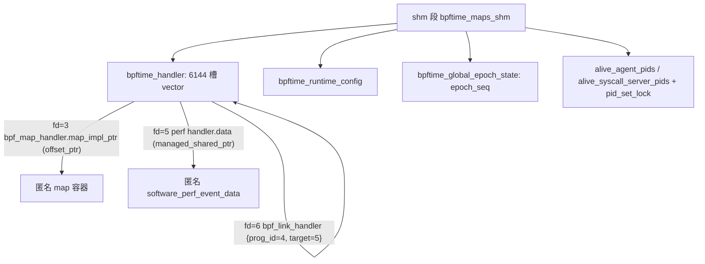
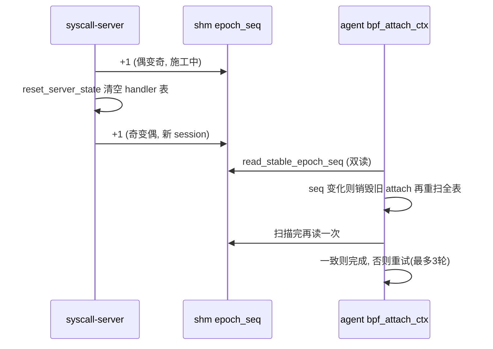

# 2. runtime 核心：共享内存与 handler 注册表

> 本章对照官方上游 bpftime **177a1dc465ff**（`master`）。行号均为该提交下的行号。

内核 eBPF 里，`bpf()` 返回的 fd 由内核对象表背书；bpftime 没有内核可依赖，
于是用一块跨进程共享内存（boost `managed_shared_memory`）来"冒充内核"。
一切的中心是 shm 里一个**定长（默认 6144 槽，`bpftime_config.hpp:23,84`）的
`boost::interprocess::vector<handler_variant>`**——**下标即假 fd，variant
的当前类型即 fd 的种类**（`handler_manager.hpp:87-96,131`）。loader（被
syscall-server 劫持的 sslsniff）往表里写，agent（注入 nginx 的 so）从表里读，
双方只共享这块内存，不做任何 RPC。

## 2.1 阅读地图

| 文件 | 行数 | 看什么 |
|---|---:|---|
| `runtime/src/handler/handler_manager.hpp` | 136 | handler_variant 的 7 个成员、shm 命名对象常量（先读，全读） |
| `runtime/src/handler/handler_manager.cpp` | 169 | `set_handler`（含越界检查）/ `clear_id_at`（级联删除，含 link→perf 级联）/ `clear_all` |
| `runtime/src/bpftime_shm_internal.cpp` | 1429 | **L790 构造函数是全子系统最密的一段**：按 shm_open_type 分支 = server 建 / agent 开的协作；L997 起是 epoch seqlock；L121-229 是 pid 集合锁与 `shm_lifecycle_lock` |
| `runtime/src/bpftime_shm_internal.hpp` | 343 | `class bpftime_shm` 当 API 目录读；`is_*_fd` 系列是 fd 判型层；L46-55 epoch 定义 |
| `runtime/src/bpftime_shm.cpp` | 710 | 纯 C ABI 转发层，扫一遍即可；但 L635 `map_ptr_by_fd` 值得细看 |
| `handler/{prog,link,map,perf_event,epoll,memfd}_handler.hpp` | ~720 | "shm 只放数据、VM 在各进程本地"的分界 |
| `runtime/src/bpftime_config.cpp` | 176 | BPFTIME_* 环境变量 → `runtime_config`（#562 前叫 `agent_config`） |
| `runtime/syscall-server/syscall_server_utils.cpp` | 352 | `start_up`：server 如何建/开 shm、开新会话、退出时是否删段 |

## 2.2 shm 内存布局：一段 segment、一组命名对象

boost `managed_shared_memory` 允许在一段 shm 里按**名字**construct/find 对象
（内部自带分配器与名字索引）。bpftime 的 segment 名默认 `bpftime_maps_shm`
（`handler_manager.hpp:51`，可用 `BPFTIME_GLOBAL_SHM_NAME` 覆盖，:60-67；
Linux 下就是 `/dev/shm/bpftime_maps_shm` 这个文件），默认大小 50MB
（`bpftime_config.hpp:79`；构造函数里 `memory_size << 20` 把 MB 换算成字节，
`bpftime_shm_internal.cpp:838,842,892`——REMOVE_AND_CREATE 分支旁那句
"Allocate 20M bytes" 注释（:891）是过时的）。

一个容易忽略的物理事实：bpftime 用的是系统 Boost（`runtime/CMakeLists.txt:45`
`find_package(Boost REQUIRED)`）。以本机 Boost 1.83 为例，创建 segment 时
`shared_memory_object::truncate` 先调 `posix_fallocate`
（`/usr/include/boost/interprocess/shared_memory_object.hpp:457-479`），
所以 **50MB 在创建那一刻就整段落到 tmpfs 上**，而不是按需稀疏分配；
`/dev/shm` 空间不足会在创建时直接抛 `interprocess_exception`。

```
/dev/shm/bpftime_maps_shm  (managed_shared_memory, 默认 50MB)
├── "bpftime_handler"                   handler_manager   ← 全书主角：6144 槽注册表
├── "bpftime_syscall_pid_set"           set<int>          哪些 pid 已装 syscall tracer
├── "bpftime_runtime_config"            runtime_config    helper 开关/JIT 开关等
├── "bpftime_alive_agent_pids"          set<int>          活着的 agent pid
├── "bpftime_alive_syscall_server_pids" set<int>          活着的 syscall-server pid（#639 新增）
├── "bpftime_pid_set_lock"              interprocess_mutex 保护上面三个 pid 集合（#639 新增）
├── "bpftime_global_epoch_state"        { uint64_t epoch_seq } 会话 seqlock（§2.5）
├── "cuda_comm_shared_mem"              仅 CUDA 构建（:937-976）
└── (匿名对象) × N                      各 map 的数据容器、map refcount、
                                        software_perf_event_data 等
```

命名常量在 `handler_manager.hpp:52-59`（注意常量名仍叫
`DEFAULT_AGENT_CONFIG_NAME`，值已随 #562 改成 `"bpftime_runtime_config"`）；
epoch 对象名是硬编码字面量（`bpftime_shm_internal.cpp:827,879,929`）。

**map 容器已经是匿名对象**（#598，"isolate maps with colliding public
names"）：旧版按 `"ebpf_map_fd_" + name` 命名构造容器，两个同名 map（比如两个
程序各有一个 `events`）会撞名；现在 `map_init` 一律
`memory.construct<...>(boost::interprocess::anonymous_instance)`
（`map_handler.cpp:784` 起的 switch，例如 :792-794），容器**只能**经 handler
里的 `map_impl_ptr` 找到，map 名只剩展示用途。



**指针纪律**：`bpftime_shm` 的成员 `manager` / `runtime_config` / `epoch_state`
等是**裸指针**（`bpftime_shm_internal.hpp:86-103`），每个进程 attach 时各自
`find<>` 出来（shm 在不同进程映射基址不同）；而 **shm 内部**的一切指涉都必须
用 `offset_ptr` 或 shm 分配器容器——例如 `bpf_map_handler::map_impl_ptr` 是
`offset_ptr<void>`（`map_handler.hpp:70,280`）。这就是"什么能放进 shm"的
判据：能位置无关的数据能放；JIT 代码、`bpftime_prog` 对象、真实文件 fd 都不能。
#598 之后这条纪律更关键：匿名容器丢了 offset_ptr 就再也找不回来。

## 2.3 handler_variant：七种 handler 字段级表

`handler_variant = std::variant<...>`（`handler_manager.hpp:87-90`），
variant 下标固定（`set_handler` 的 debug 日志就打印 `handler.index()`，
`handler_manager.cpp:79`）：

| idx | 类型 | 关键字段 | 谁写 | 谁读 | 生命周期备注 |
|---|---|---|---|---|---|
| 0 | `unused_handler` | 无（`handler_manager.hpp:46`） | — | `is_allocated` | 空槽标记；表初始化时全表填它；越界读也返回一个静态的它（§2.6） |
| 1 | `bpf_map_handler` | `attr`、`type`、`name`、`map_lock`(spinlock)、`map_impl_ptr`(offset_ptr)、`map_refcnt_ptr`、`key_size/value_size/max_entries`（`map_handler.hpp:67-300`） | loader 建；agent/loader 都可 update elem | 双方（helper 与 syscall 两条路径，`from_syscall` 参数区分） | 析构**不**释放 impl，靠 `clear_id_at`→`map_free`；析构时 impl 未释放会打 CRITICAL（`map_handler.hpp:132-142`） |
| 2 | `bpf_link_handler` | `args`、`prog_id`、`attach_target_id`、`attach_cookie`（`link_handler.hpp:16-43`） | loader | agent（attach 时把 prog 挂到 perf event 上） | 纯 POD；cookie 只在 perf-event 型 link 里取自 `perf_event.bpf_cookie`（:30-31）；**删 link 会级联删它的 target**（§2.6） |
| 3 | `bpf_prog_handler` | `type`、`insns`(shm vector\<ebpf_inst\>)、`aot_insns`、`name`（`prog_handler.hpp:36,59-62`） | loader 写入指令字节 | agent 读出并**本地**建 VM/JIT | shm 里只有字节码；改它不影响已实例化的 agent |
| 4 | `bpf_perf_event_handler` | `type`(int)、`enabled`(mutable bool)、`data`(内嵌 variant，见下)（`perf_event_handler.hpp:190-240`） | loader 建、`enable()` 只置位 `enabled=true`（:194-202，真正 attach 是 agent 的事） | agent 判型后做 uprobe attach；software 型双方都碰 | `data` 按事件类型五选一 |
| 5 | `epoll_handler` | `files`: vector\<epoll_file{variant\<weak_ptr\>, epoll_data_t}\>（`epoll_handler.hpp:20-35`） | loader（epoll_ctl 劫持） | loader 消费者轮询 | 存 weak_ptr（software perf 或 ringbuf），对象没了也不悬垂 |
| 6 | `memfd_handler` | `flags`、`name`（`memfd_handler.hpp:16-21`） | loader | loader | 给 memfd_create 劫持占位用 |

perf handler 的内嵌 `data` variant（`perf_event_handler.hpp:184-187`）：
`uprobe_perf_event_data{offset,pid,ref_ctr_off,_module_name}`(:161-166) /
`tracepoint_perf_event_data`(:173-178) / `kprobe_perf_event_data`(:168-172) /
`custom_perf_event_data`(:180-182) /
`software_perf_event_shared_ptr`——最后这个是跨进程 shared_ptr（:154-156），指向匿名的
`software_perf_event_data`（:122-152）：里面有消费者 ring
（`consumer_buffer`）、**per-(pid,tid) 生产者 shard 链表 `producer_shards`**
（:135；shard 结构 :101-113）和 `shard_lock` 自旋锁。

> 📌 **案例（对齐 bug）**：你查过的 8 字节对齐 bug 就长在这里——perf record
> 直接以字节形式写进 shm 里的 `software_perf_event_buffer::mmap_buffer`
> （`perf_event_handler.hpp:71-99`），生产者（nginx 里的 agent）和消费者
> （sslsniff 进程）读写的是**同一块物理内存**。record 头跨环尾时消费者读到
> `size=0`，就是"shm 是唯一媒介、没有任何序列化层"这个设计的直接后果。
> 上游已由 #612（"align software perf event records"）修复：
> `output_data` 把 record 长度按 `sizeof(uint64_t)` 向上取整
> （`perf_event_handler.cpp:370-378`）。

> 📌 **案例（绑核）**：per-(pid,tid) shard 链表正是"绑核无保护作用"论证的
> 核心证据：每个线程写自己的 shard，根本没有跨 CPU 竞争可言，绑核既不是锁
> 也不改变写入目标。但**官方代码仍然绑核**：`bpf_perf_event_output` 每次调用都
> `sched_setaffinity` 到当前 CPU（`bpf_helper.cpp:496-506`），结束时在
> `restore_affinity:` 恢复（:546-551，#678 让出错路径也恢复）。
> 我们的开发分支删掉了这段绑核，那是分支改动，不是官方行为。

还有个微妙细节：`map_lock` 是 `pthread_spinlock_t`，但初始化传的 pshared=0
（PTHREAD_PROCESS_PRIVATE，`map_handler.hpp:95,108,121`）。glibc 的 spinlock
本质是原子整数、不依赖该标志，跨进程实际能用——但严格说这是依赖实现的行为。

## 2.4 注释版选段一：构造函数的分支（`bpftime_shm_internal.cpp:790`）

构造函数按 `shm_open_type`（枚举定义 `bpftime_shm.hpp:137-143`，#639 新增
`SHM_CREATE_ONLY`）分流。先看谁用哪种：

| open_type | 语义 | 使用者 |
|---|---|---|
| `SHM_CREATE_ONLY` | 只建，已存在就抛 `already_exists_error` | syscall-server 首选（`syscall_server_utils.cpp:126-145` 的 `initialize_global_shm_with_ownership`）：建成 = 本进程"拥有"这段 shm |
| `SHM_CREATE_OR_OPEN` | 有则开、无则建 | syscall-server 回退（同函数 :143，段已存在时）、bpftimetool load/import（`tools/bpftimetool/main.cpp:197-198,249-250`） |
| `SHM_OPEN_ONLY` | 只开，不存在就抛异常 | agent（`agent.cpp:937-938`，外面套了 60 次×50ms 的重试环 :932-948，每次尝试先拿 `shm_lifecycle_lock`）、bpftimetool export/run/run-on-cuda（`main.cpp:225,87,328`）、`tools/cli/main.cpp:1263-1264` |
| `SHM_REMOVE_AND_CREATE` | 删了重建 | daemon（`daemon/user/bpftime_driver.cpp:402`）、各单测/基准/示例 controller |
| `SHM_NO_CREATE` | 什么都不建 | 纯测试（构造函数直接 return，:931-936） |

核心分支（节选自 `bpftime_shm_internal.cpp:794-880`）：

```cpp
auto config = construct_runtime_config_from_env();        // :794 shm 还没开，先读环境变量
if (type == shm_open_type::SHM_OPEN_ONLY) {               // :797 agent 路径
    segment = managed_shared_memory(open_only, shm_name);  // :800-801 不存在 → 抛异常
    manager = segment.find<handler_manager>(               // :802 只 find，不 construct
              DEFAULT_GLOBAL_HANDLER_NAME).first;          //      找不到得 nullptr
    /* syscall_installed_pids / runtime_config / injected_pids /
       alive_syscall_server_pids / pid_set_lock / epoch_state
       同理逐个 find<>()  :805-828 */
} else if (type == shm_open_type::SHM_CREATE_OR_OPEN ||
           type == shm_open_type::SHM_CREATE_ONLY) {       // :830-831 server 路径
    segment = (CREATE_ONLY ? create_only : open_or_create) // :835-843 MB→字节
              (shm_name, memory_size << 20);
    manager = segment.find_or_construct<handler_manager>(  // :845 关键：若 shm 残留，
              DEFAULT_GLOBAL_HANDLER_NAME)(                //   拿到的是**旧表**，
              segment, max_fd_count);                      //   不会重建！
    /* 其余对象同样 find_or_construct  :850-879 */
}
```

（中间那行三元表达式是为了排版的示意，源码是 :835-843 的 if/else。）

要点：

- **agent 全是 `find<>`**：agent 永远不改 shm 的"骨架"，找不到就拿 nullptr
  （所以 `is_*_fd` 系列都先判 `manager == nullptr`）。副作用：用旧版本（#562
  前，对象名 `bpftime_agent_config`）建的 shm 配新版本 agent，会 find 不到
  `bpftime_runtime_config`——新旧版本不要混用同一段 shm。
- **server 用 `find_or_construct`**：shm 残留时会拿到上一轮的旧 handler 表。
  这不是 bug 而是设计——已注入的 agent 还映射着这段内存，删了重建等于把别人
  脚下的地毯抽走。旧数据的清理交给 §2.5 的会话协议。
- runtime_config 虽然可能 find 到旧值，但 server 启动流程随后会
  `bpftime_set_runtime_config(std::move(runtime_config))` 用当前环境变量整体覆盖
  （`syscall_server_utils.cpp:216`；覆盖实现是显式析构 + `construct_at`，
  `bpftime_shm_internal.cpp:1152-1163`）。
- **shm 耗尽**（#597）：handler 表本身在构造时就从 segment 里分配
  （6144 × `sizeof(handler_variant)`），段太小会在这里抛
  `boost::interprocess::bad_alloc`。上游 `usage.md:228` 的建议是加大
  `BPFTIME_SHM_MEMORY_MB` 或减小 `BPFTIME_MAX_FD_COUNT`。运行期的 perf buffer
  扩容失败则被 `ensure_mmap_buffer` 捕获，置 `errno=ENOMEM` 返回 nullptr
  （`perf_event_handler.cpp:288-300`），mmap 劫持据此返回 `MAP_FAILED`
  （`syscall_context.cpp:990-1000`）。
- **失败要"放行"而不是"杀宿主"**（#640 + #634）：#597 最初在 server 启动分配
  失败时 `std::exit`，随后被 #640 改掉——现在 syscall-server 导出的每个拦截
  函数都包在 `handle_exceptions` 里，`bad_alloc` 和其他异常一律记日志后
  **回退到原始宿主操作**（`syscall_server_main.cpp:238-267`）；启动异常被
  缓存到 `g_startup_exception` 里，之后每次调用都重新抛出（`syscall_server_utils.cpp:222-227`），
  而 `try_startup` 失败时会把 `enable_mock_after_initialized` 清成 false
  （`syscall_context.cpp:249-252`），之后的调用直接走原始路径。agent 侧 60 次仍打不开 shm 就
  `init_fail()` 返回（`agent.cpp:949-955`）。这条规矩写进了仓库的
  "Injected Agent Host-Process Contract"（`CLAUDE.md:147` / `AGENTS.md:147`）：
  注入代码不得 `exit`/`abort` 宿主、不得动宿主的 stdio。

环境变量 → config 的映射（`bpftime_config.cpp`）：`BPFTIME_SHM_MEMORY_MB`
(:119，1MB–10GB 夹取)、`BPFTIME_MAX_FD_COUNT`(:124，128–1M)、`BPFTIME_HELPER_GROUPS`
(:92，逗号分隔 ufunc/kernel/shm_map)、`BPFTIME_DISABLE_JIT`(:106)、
`BPFTIME_ALLOW_EXTERNAL_MAPS`(:110)、`BPFTIME_FRIDA_FUZZY_BACKTRACER`(:114)、
`BPFTIME_VM_NAME`(:130)、`BPFTIME_VERIFIER_LEVEL`(:137)、`BPFTIME_LOG_OUTPUT`(:158)。

## 2.5 epoch/session seqlock：清态协议的底层

既然 server 复用旧 shm，就必须回答两个问题：旧 handler 怎么清？agent 怎么
知道"世界换代了"？答案是一个 8 字节的 seqlock：

```cpp
// bpftime_shm_internal.hpp:49-55
// Shared-memory global tracing session version.
// Use epoch_seq as a simple seqlock:
// - odd  : server is updating/resetting handlers
// - even : stable; session_id = epoch_seq / 2
struct bpftime_global_epoch_state { std::uint64_t epoch_seq = 0; };
```

**写侧**（server 启动时，`syscall_server_utils.cpp:172` 调用）：

```cpp
std::uint64_t bpftime_shm::begin_new_session()           // :1017
{
    if (!epoch_state) { ... reset_server_state(); return 0; } // :1019-1023 旧 shm 无 epoch
    __atomic_add_fetch(&epoch_state->epoch_seq, 1,       // :1025 偶→奇：挂"施工中"牌
                       __ATOMIC_ACQ_REL);
    reset_server_state();                                // :1026 clear_all 逐槽级联清空
                                                         //  + 持 pid_set_lock 清 syscall_installed_pids
                                                         //  （:1381-1397；注意 injected_pids
                                                         //   不清——agent 还活着）
    std::uint64_t seq = __atomic_add_fetch(              // :1028 奇→偶：新 session 号
        &epoch_state->epoch_seq, 1, __ATOMIC_ACQ_REL);   //      = seq/2
    return seq;
}
```

**读侧**（agent，经典 seqlock 双读）：

```cpp
std::uint64_t bpftime_shm::read_stable_epoch_seq(int max_tries) const // :997
{
    if (!epoch_state)
        return BPFTIME_EPOCH_SEQ_MISSING;                // :999-1000 旧版 shm 没有该对象
    for (int i = 0; i < max_tries; i++) {
        std::uint64_t a = __atomic_load_n(&epoch_state->epoch_seq,
                                          __ATOMIC_ACQUIRE);
        if (a & 1U) { usleep(1000); continue; }          // :1004-1008 奇数=施工中，等
        std::uint64_t b = __atomic_load_n(&epoch_state->epoch_seq,
                                          __ATOMIC_ACQUIRE);
        if (a == b) return a;                            // :1011-1012 两次读一致才算稳定
    }
    return BPFTIME_EPOCH_SEQ_UNSTABLE;                   // :1014 200 次仍不稳
}
```

特殊值（`bpftime_shm_internal.hpp:46-47`）：`MISSING = UINT64_MAX-1`（shm 里
根本没有 epoch 对象，视为"会话跟踪不可用"降级），`UNSTABLE = UINT64_MAX`。
注意 hpp:171 的注释说 "Returns 0 if the epoch object isn't available"——
**注释是错的**，实现返回的是 MISSING（只是调用方 `bpf_attach_ctx.cpp:79-83`
把 MISSING 当 0 用）；读大型代码时"以实现为准"的典型例子。

agent 侧的消费者是 `bpf_attach_ctx::init_attach_ctx_from_handlers`
（`bpf_attach_ctx.cpp:73-162`，持 `ctx_mutex`）：扫表前读一次 epoch，发现与
`last_epoch_seq_seen` 不同就先 `destroy_all_attach_links_unlocked()` +
`reset_instantiated_state_unlocked()`（:91-104）；然后两遍扫表（第二遍专给
CUDA link，:106-136）；**扫完表再读一次**，若期间 epoch 变了或不稳，
推倒重扫（最多 3 轮，否则 -EAGAIN，:137-161）。这保证 agent 绝不会把"半新
半旧"的 handler 表实例化出来。触发重扫的是 agent 的 auto-refresh 线程
（`agent.cpp:1125-1127`）或 IPC 刷新（`refresh_attach_session`）。



> 📌 **案例（shm 残留双峰）**：你在 benchmark 里踩过的"上一轮 map/prog 残留
> 导致双峰"正是这套机制要解决的问题域。官方现在（#639）多了一层**段的所有权**：
> server 用 `SHM_CREATE_ONLY` 建成段才算"owner"，并注册 atexit
> `remove_syscall_server_global_shm`（`syscall_server_utils.cpp:56-124,161`）：
> 退出时在 `shm_lifecycle_lock` 下把自己从 alive server 集合摘掉，若集合里
> 已无活 server、alive agent 集合里也无活 agent（`kill(pid,0)` 判活，:51-54），
> 才 `shared_memory_object::remove`。**只要还有活着的 agent，段就保留**——
> 残留窗口依旧存在。`bpftimetool remove` 走的是无条件那条路——
> `bpftime_remove_global_shm()`（`bpftime_shm_internal.cpp:81-88`）直接
> `shared_memory_object::remove`，整段 shm 从文件系统里消失，下一个 server
> 必然全新构建。**能删段就删段，是比 epoch 更彻底的清态**。

`shm_lifecycle_lock`（`bpftime_shm_internal.cpp:178-229`）是一把
`/tmp/bpftime-shm-<名字>.lock` 上的 `flock(LOCK_EX)`：server 的启动
（:157-158）与退出删段、agent 从 OPEN_ONLY 打开到登记 pid（`agent.cpp:931-948`
拿锁，:1145 放锁）都持它，避免"agent 刚打开、server 恰好删段"的竞态。
pid 集合本身由 shm 里的 `pid_set_lock` 保护，但加锁是 250ms 的 try_lock 轮询
（`pid_set_scoped_lock`，:121-175），超时就放弃本次操作并返回 false。

## 2.6 假 fd 的完整生命周期

**① 分配**（`bpftime_shm_internal.cpp:674-688`）：

```cpp
int bpftime_shm::open_fake_fd()
{
    int fd = open("/dev/null", O_RDONLY);   // 真实 fd！内核保证取最小空闲号，
                                            // 所以编号天然紧凑、能当表下标用
    int cnt = 5;
    while (fd <= 2 && fd >= 0 && --cnt > 0) // 避开 0/1/2：万一进程关了 stdio，
        fd = dup(fd);                       // open 会返回这些号，后患无穷
    if (fd >= 0 && (std::size_t)fd >= manager->size()) { // #671：超出表容量
        SPDLOG_ERROR(...); close(fd);       // 关掉真 fd，不泄漏
        errno = ENOSPC; return -1;
    }
    return fd;
}
```

"假 fd"其实是**真 fd 配假语义**：它在 loader 进程里真实存在（指向
/dev/null），close/dup 语义部分成立、编号不会被本进程复用；但它的**含义**
（是 map 还是 prog）完全由 shm 表的同号槽位决定。

**② 占位**：`manager->set_handler(fd, std::move(handler), segment)`
（`handler_manager.cpp:63-88`）——越界返回 -ENOSPC（:66-69，#671 新增）、
已占用返回 -EEXIST（:70-73）、放 `unused_handler` 返回 -ENOTSUP（:74-78）；
若放入的是 map handler 且还没有底层容器，就地 `map_init` 构造匿名数据容器
（:81-86，容器构造见 `map_handler.cpp:762-1144`）。注意 `set_handler` 不看
`map_init` 的返回值，也不捕获 `bad_alloc`——分配失败的异常会一路抛到
syscall-server 的 `handle_exceptions`（§2.4）。

**③ 跨进程**：跨进程传播的只有**整数编号**。agent 进程里并没有这个 /dev/null
fd——它遍历表下标（`bpf_attach_ctx.cpp:106-120` 的 `for i < manager->size()`）
或从 link handler 的 `prog_id`/`attach_target_id` 字段拿编号。helper 层更直白：
JIT 重定位 map 地址时调用的 `map_ptr_by_fd` **原样返回 fd 当"指针"**
（`bpftime_shm.cpp:635-648`），后续 helper 拿到这个"指针"再查表。这回答了
"map fd 如何变成 shm 缓冲区指针"：**它不变成，每次访问都查表**。

**④ 级联删除**（`handler_manager.cpp:98-148`，节选）：

```cpp
void handler_manager::clear_id_at(int fd, managed_shared_memory &memory)
{
    if (fd < 0 || (std::size_t)fd >= handlers.size()) return; // :100-102
    if (holds_alternative<bpf_map_handler>(handlers[fd])) {
        std::get<bpf_map_handler>(handlers[fd]).map_free(memory); // :103-104
        // 必须在这里 free：handler 析构函数不敢碰 shm 分配器（§2.3 表）
    } else if (holds_alternative<bpf_perf_event_handler>(handlers[fd])) {
        for (size_t i = 0; i < handlers.size(); i++)      // :109 O(n) 全表扫
            if (是 link 且 link.attach_target_id == fd)
                clear_id_at(i, memory);                   // :118 递归删引用者
    } else if (holds_alternative<bpf_prog_handler>(handlers[fd])) {
        for (...)                                          // :124 同样扫一遍
            if (是 link 且 link.prog_id == fd)
                clear_id_at(i, memory);                   // :135
    } else if (holds_alternative<bpf_link_handler>(handlers[fd])) { // :139 #672
        auto target_fd = std::get<bpf_link_handler>(handlers[fd]).attach_target_id;
        handlers[fd] = unused_handler();                  // :142 先清自己，防无限递归
        clear_id_at(target_fd, memory);                   // :144 再级联删 target
        return;
    }
    handlers[fd] = unused_handler();                      // :147 槽位归零
}
```

即：删 perf/prog 会连带删掉所有引用它的 link（防悬垂编号），每删一个是
O(n) 线性扫——6144 槽无所谓，但说明这条路不是热路径。#672 又补了反方向：
**删 link 会顺带删它的 `attach_target_id`**。动机是 libbpf `close(link_fd)`
后本该由内核释放 perf event 引用，bpftime 没有内核，旧代码每轮
attach/detach 泄漏一个 perf handler 槽，跑几轮基准就把表耗尽。link 槽先置
unused 再递归，是为了不让 perf 那边的 link 扫描再扫回自己。

`close_fd` 只清槽位（`bpftime_shm_internal.cpp:752-757`），**真实的 /dev/null
fd 由调用方自己 close**（约定写在 `bpftime_shm_internal.hpp:286-288` 注释里；
syscall-server 的 `handle_close` 正是先 `bpftime_close(fd)` 再
`orig_close_fn(fd)`，`syscall_context.cpp:273-274`）。`clear_all`（server
换代）就是对全表逐个已分配槽调 `clear_id_at`（`handler_manager.cpp:160-167`）。

另外 `add_bpf_map` 有一个宽容行为：目标槽已被占用时先 `clear_id_at` 再放新
map（`bpftime_shm_internal.cpp:1070-1074`）；而 `dup_bpf_map` 会经
`share_map_impl_from` 共享底层容器并递增 shm 里的匿名引用计数
（:1109-1116，`map_handler.hpp:246-262`），`map_free` 引用计数没减到 0 就只
解绑不销毁（`map_handler.cpp:1153-1163`）。`add_bpf_link` 则先校验 prog fd、
perf-event 型 link 的 target 必须是 perf handler，校验通过才分配 fd，失败
不泄漏 fd（:709-750）。

## 2.7 进程内生命周期：shm_holder 与两种"销毁"

- `shm_holder` 是 **union 包裹的全局对象**（`bpftime_shm_internal.hpp:327-339`）：
  union 的空析构函数骗过编译器，静态析构阶段不会自动跑 `~bpftime_shm`，
  改由显式控制——初始化用 placement new（`bpftime_shm_internal.cpp:49-57`），
  销毁用 `bpftime_destroy_global_shm`（:59-79，析构后把
  `global_shm_initialized` 清回 false 保证幂等）。CUDA 构建里它会先
  `stop_cuda_watcher_before_shm_unmap()`（:63-65，#620，实现在
  `bpf_attach_ctx_cuda.cpp:95`），先停掉 watcher 线程再解除映射，免得线程摸到
  已 unmap 的内存。
- 两种"销毁"务必分清：`bpftime_destroy_global_shm` 只析构**本进程**的映射
  对象，segment 仍在 /dev/shm 里；`bpftime_remove_global_shm`（:81-88，即
  `bpftimetool remove`，`tools/bpftimetool/main.cpp:255-263`）才删系统对象。
  第三种是 §2.5 的 owner server 退出时**有条件**删段。
- 退出兜底是 `__destruct_shm`（:90-112，`destructor(65535)` 保证最后跑）：
  先判 `global_shm_initialized`（:98-99，防止从未初始化就乱摸内存），再判
  `get_open_type() == SHM_OPEN_ONLY`——**只有 agent** 需要把自己的 pid 从
  `bpftime_alive_agent_pids` 里摘掉（:102-109）。#639 之后登记不再只限 Frida
  注入：所有 agent 在 attach 成功后登记（`agent.cpp:1138-1144`），IPC 刷新
  时也会补登记（:706-712）；正常 detach（:447-450）和初始化失败清理
  （:867-875）也会摘除。

## 2.8 两条升级版调用链

**控制面（loader 建 map）**：

```
libbpf bpf(BPF_MAP_CREATE, attr)                 ← 被 syscall-server 劫持
 └→ bpftime_maps_create(fd=-1, name, attr)         bpftime_shm.cpp:81
     └→ bpftime_shm::add_bpf_map                   bpftime_shm_internal.cpp:1048
         ├→ fd<0 → open_fake_fd()                  :1051-1054  真实 /dev/null fd
         ├→ 槽位被占 → clear_id_at 先清            :1070-1074
         └→ manager->set_handler(fd, bpf_map_handler{fd,name,segment,attr})  :1075-1076
             └→ map_init(memory)                   handler_manager.cpp:81-86
                 └→ segment.construct<hash_map_impl 等>(anonymous_instance)
                                                   map_handler.cpp:784 起
 返回 fd 给 libbpf —— 它以为这是内核发的 map fd
```

**数据面（你最熟的热路径，参数语义版）**：

```
uprobe 命中 → JIT 代码调 helper #25
 bpf_perf_event_output(ctx, map=假fd(map_ptr_by_fd 原样透传), flags, data, size)
                                                   bpf_helper.cpp:487
 ├→ my_sched_getcpu()          → 当前 cpu                          :490
 ├→ sched_getaffinity + sched_setaffinity 绑到当前 cpu             :496-506
 │    （📌 官方仍绑核；结束时恢复 :546-551）
 ├→ bpftime_map_get_info(fd,…,&map_ty)  → shm 判型                :512
 ├→ shm.bpf_map_lookup_elem(fd, &cpu)   → perf_event_array[cpu]
 │                                       = perf handler 的假 fd    :517-528
 └→ bpftime_perf_event_output(perf_fd, data, size) bpftime_shm.cpp:575
     ├→ is_perf_event_handler_fd 判型（含边界检查）                 :578
     └→ get<software_perf_event_shared_ptr>(handler.data)
          ->output_data(buf, sz)         → 本线程 shard ring 写入   :584-588
              （perf_event_handler.cpp:601-604 → :367-388；
               📌 8 字节对齐在 :370-378）
```

## 2.9 坑清单（扩充版）

- shm 里只有可跨进程的数据（boost 容器 + offset_ptr）；JIT 代码、`bpftime_prog`
  都是各进程从 `insns` 字节私有重建的——**改 shm 里的 prog 不影响已实例化的
  agent**（agent 只在 epoch 变化时重扫）。
- handler 注册表**没有全局锁**（`handler_manager` 只有一个 vector 成员，
  `handler_manager.hpp:131`）：假定写方基本只有 server；agent 无锁读，靠
  epoch 双读检测撕裂。表定长也是为此——扩容会让 vector 搬家，无锁读者会踩空。
  （#639 加的 `pid_set_lock` 只管 pid 集合，不管 handler 表。）
- `get_handler`/`operator[]` 现在有边界检查（#671），越界返回一个静态的
  `unused_handler` 哨兵（`handler_manager.cpp:35-47`），不再越界读；但它不
  报错，调用方仍应先走 `is_*_fd`（那里有 `manager==nullptr && fd 范围` 检查，如
  `bpftime_shm_internal.cpp:594-602`）。
- server 优先 `SHM_CREATE_ONLY`、段已存在就 `SHM_CREATE_OR_OPEN` 复用，是为了
  让已注入的 agent 保持映射；配套 epoch seqlock（奇数=正在 reset）。owner
  server 退出时只在"无活 server、无活 agent"时删段。**这正是"shm 残留"双峰
  假象的结构性根源**；根治手段是删段（`bpftimetool remove`）。
- 级联删除现在是双向的：按代码推演，删一个 prog → 删它的 link → link 级联删
  perf event → perf event 再删**所有**指向它的 link，包括别的 prog 的 link。
  另外 link 级联不检查 `attach_target_id` 的类型，非 perf-event 型 link
  的 target 槽也会被 `clear_id_at`。`enable()` 只置一个 bool，真正的 attach
  动作全在 agent 侧。
- `find_or_construct` 意味着 config/表都可能是旧的；runtime_config 靠 server
  启动后整体覆盖（`syscall_server_utils.cpp:216`），handler 表靠
  `begin_new_session` 清空（:172）——两者缺一都会出现"改了环境变量没生效"。
  另：`BPFTIME_SHM_MEMORY_MB` 只在**建段**时生效，复用旧段时改它没用。
- 段在创建时就被 `posix_fallocate` 整段占满（本机 Boost 1.83）：
  `BPFTIME_SHM_MEMORY_MB` 调大就是实打实多占 tmpfs 内存，不是"虚的上限"。

## 2.10 自测题

1. **sslsniff 传给 helper 的 map fd 如何从整数变成 shm 缓冲区指针？**
   <details><summary>答案</summary>
   它从不"变成"指针。JIT 重定位时 <code>map_ptr_by_fd</code> 校验后原样返回
   fd 当作"map 指针"（bpftime_shm.cpp:635-648）；此后每次 helper 调用（lookup/
   update/perf_output）都拿这个整数按下标查 handler 表，经
   <code>bpf_map_handler.map_impl_ptr</code>（offset_ptr）解引用到本进程映射
   地址。#598 之后容器是匿名对象，这根 offset_ptr 是找到它的唯一途径。
   间接层保留在每次访问里，换取跨进程编号稳定。
   </details>
2. **server 重启会话后 agent 为何不用重新 mmap？**
   <details><summary>答案</summary>
   只要 agent 还活着，旧 server 退出时就不会删段（syscall_server_utils.cpp:103-119
   检查 alive agent 集合）；新 server 的 <code>SHM_CREATE_ONLY</code> 因段已存在
   失败，回退到 <code>SHM_CREATE_OR_OPEN</code>（:126-145），segment 与命名对象
   都不销毁重建（bpftime_shm_internal.cpp:830-879），只是
   <code>begin_new_session</code> 就地清空表内容（:1017-1031）；agent 手里的
   segment 映射和 find 出来的裸指针（manager/epoch_state）全部仍然有效，检测到
   epoch_seq 变化后重扫表即可（bpf_attach_ctx.cpp:91-104）。
   </details>
3. **agent 退出时 `__destruct_shm` 为何要检查 `SHM_OPEN_ONLY`？**
   <details><summary>答案</summary>
   open_type 是"我是谁"的标记：只有 agent（OPEN_ONLY 打开 shm 的进程）会把 pid
   登记进 <code>bpftime_alive_agent_pids</code>（agent.cpp:1138-1144），所以也只有
   它需要在退出时摘除自己（bpftime_shm_internal.cpp:102-109）。这个集合直接决定
   owner server 退出时敢不敢删段，残留一个 pid 只会让删段被推迟（判活用
   <code>kill(pid,0)</code>，死 pid 不算数）。前置的
   <code>global_shm_initialized</code> 检查（:98-99）则防止 shm 从未初始化的
   进程在退出时摸到未构造的 union 内存。
   </details>
4. **`read_stable_epoch_seq` 为什么要读两次？只读一次判断"是偶数"不行吗？**
   <details><summary>答案</summary>
   偶数只说明"此刻没在施工"，不能排除两次访问 handler 表之间发生过一整轮
   奇→偶翻转（清空又填入了新内容）。双读取稳定值（:1001-1013）+ 扫描后再读比对
   （bpf_attach_ctx.cpp:137-159）才能证明"我扫描期间世界没变过"。这正是
   seqlock 与单标志位的本质区别。
   </details>
5. **删除一个 prog fd 会引发什么连锁反应？link fd 呢？map fd 呢？**
   <details><summary>答案</summary>
   prog：<code>clear_id_at</code> 全表扫描，递归删除所有
   <code>link.prog_id == fd</code> 的 link handler（handler_manager.cpp:122-138）；
   而每删一个 link 又会级联删它的 <code>attach_target_id</code>（:139-146，#672），
   perf event 被删时再扫掉所有指向它的 link——所以连别的 prog 挂在同一 perf event
   上的 link 也会一起消失。link：先清自己的槽，再删它的 target（这正是 #672 修
   perf 槽泄漏的方式）。map：调用 <code>map_free</code>（:103-104），refcount
   归零才销毁 shm 里的匿名容器，无级联——因为引用 map 的是 prog 指令里的 fd
   常量，表层无从追踪。悬垂的 map fd 访问由每次查表判型兜底
   （<code>try_get_map_handler</code> 置 errno=ENOENT，bpftime_shm_internal.cpp:266-273）。
   </details>
6. **既然假 fd 是真实的 /dev/null fd，为什么还要 dup 到大于 2？编号太大又会怎样？**
   <details><summary>答案</summary>
   若目标进程曾关闭 stdio，open 可能返回 0/1/2；这些编号一旦被当作 handler
   槽位，任何后续对"标准输入/输出"的常规操作都会与 bpftime 的 fd 语义打架
   （比如库代码往 fd 1 写日志）。所以 open_fake_fd 循环 dup 直到编号大于 2
   （bpftime_shm_internal.cpp:678-680），最多尝试 5 次。反过来，若进程 fd 很多、
   编号 ≥ 表容量，#671 之后会关掉这个真 fd 并返回 -1/ENOSPC（:681-686），
   而不是越界写表。
   </details>
7. **为什么 shm 不够用时，被 LD_PRELOAD 的 sslsniff 不会被 bpftime 弄死？**
   <details><summary>答案</summary>
   官方的"宿主进程契约"（CLAUDE.md:147）禁止注入代码 exit/abort 宿主。#597 一度在
   server 启动分配失败时 <code>std::exit</code>，#640 改为 fail-open：每个拦截函数
   经 <code>handle_exceptions</code> 捕获 <code>bad_alloc</code> 等异常，回退到原始宿主
   操作（syscall_server_main.cpp:238-267）；perf buffer 分配失败则以 ENOMEM /
   <code>MAP_FAILED</code> 报给调用方（perf_event_handler.cpp:288-300，
   syscall_context.cpp:990-1000）。代价是 bpftime 功能静默失效，要看日志才知道。
   </details>

---
[← 返回目录](README.md)
