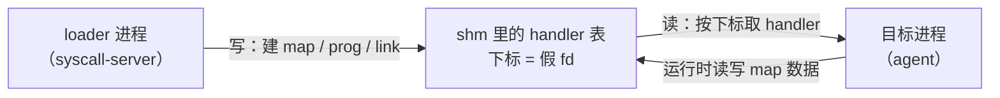
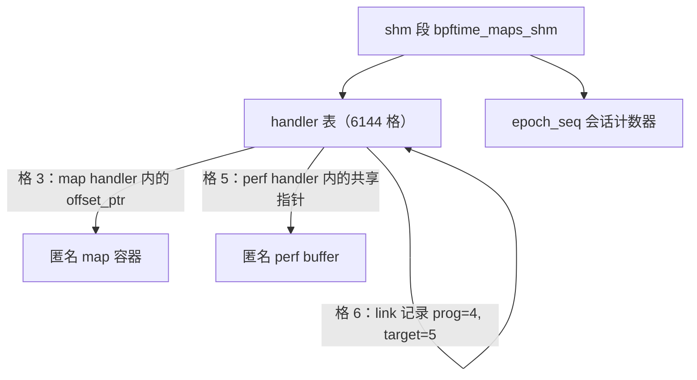
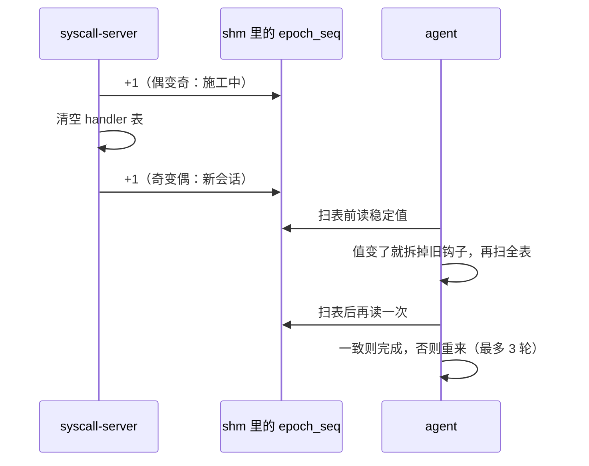

# 2. runtime 核心：共享内存与 handler 注册表

> 一句话：bpftime 没有内核可依赖，于是用一块跨进程共享内存（shm）来"冒充内核的对象表"。
> 读完本章，你能说清楚假 fd 是什么、shm 里放了什么、为什么 loader 和目标进程能看到同一批
> map / prog，以及上一轮会话留下的对象是怎么被清掉的。
>
> 前置：建议先读[第 0 章](00-architecture.md)（全景）和[第 1 章](01-lifecycle.md)（一次会话的生命周期）。
> 预计用时：60–90 分钟。

## 本章要回答的问题

- 内核里 `bpf()` 返回的 fd 背后有内核对象撑着。bpftime 没有内核，它返回的 fd 背后是什么？
- loader（如 sslsniff）和目标进程（如 nginx）是两个进程，它们怎么看到同一个 map？
- map、prog、link、perf event 种类各不相同，为什么一张表就能装下？
- 上一次会话留在 shm 里的旧对象，是谁、在什么时候清掉的？正在读表的 agent 怎么知道"表已经换过一轮"？
- 关掉一个 prog 的 fd，挂在它上面的 link 会怎样？

## 2.1 核心直觉：shm 是内核对象表的替身

先回忆内核是怎么做的。loader 调 `bpf(BPF_MAP_CREATE, ...)`，内核在自己的内存里建一个
map 对象，再在 loader 的 fd 表里放一个指向它的 fd。之后 loader 拿这个 fd 操作 map，
被追踪进程里触发的 eBPF 程序也能访问同一个 map——因为对象都在内核里，大家共用。

bpftime 把 eBPF 搬到了用户态，没有内核这个"公共场所"。它的办法是：

1. 开一块**两个进程都映射**的共享内存（shm），在里面放一个**定长数组**（默认 6144 格）。
2. 每创建一个 bpf 对象，就占用数组里的一格，把对象的描述写进去。
3. 这一格的**下标就是返回给 libbpf 的 fd**。我们管它叫"假 fd"——它不是内核发的。
4. 格子里放的东西是什么类型，这个 fd 就是什么种类（map、prog、link……）。

打个比方：shm 是一排共享储物柜，假 fd 是柜子编号。loader 往柜子里放东西，再把编号交给
libbpf；目标进程里的 agent 按编号开柜子取东西。双方只靠这排柜子交流，**不做任何 RPC**。

| | 内核 eBPF | bpftime |
|---|---|---|
| 对象存在哪 | 内核内存 | shm 里的 handler 表 |
| fd 是什么 | 内核 fd 表里的一项 | handler 表的下标（假 fd） |
| 怎么知道 fd 是 map 还是 prog | 内核对象的类型 | 表格那一格里装的是哪种 handler |
| 谁能看到 | 所有进程（经内核） | 映射了这块 shm 的进程 |

这里的 **handler** 就是"表里的一格装的那个对象描述"，**handler 表**就是那个定长数组。

下面这张图要看的是：两个进程不直接说话，所有信息都经过 shm 里的 handler 表。



> **C++/Linux 小知识：boost::interprocess 与 `managed_shared_memory`**
> Linux 的 POSIX 共享内存就是 `/dev/shm/` 下的一个文件，多个进程 `mmap` 它就能看到同一块
> 物理内存。但光有一块裸内存不够用：你还得在里面分配对象、找到对象。Boost 的
> `managed_shared_memory` 在这块内存里自带了一个分配器和一个"名字 → 对象"索引，于是可以像
> 用堆一样在 shm 里 `construct` 对象、用 boost 版的 `vector`/`set` 等容器。bpftime 用它
> 来放 handler 表和所有 map 数据。

**要点**

- 假 fd = handler 表的下标；handler 的类型 = fd 的种类。
- loader 写表，agent 读表，双方只共享这块内存。

## 2.2 shm 里放了什么

### 一段内存，几个"有名字的对象"

这块 shm 在 Linux 上就是文件 `/dev/shm/bpftime_maps_shm`（名字可以用环境变量
`BPFTIME_GLOBAL_SHM_NAME` 改），默认 50MB（`BPFTIME_SHM_MEMORY_MB` 可调）。
有一个容易忽略的物理事实：创建时这 50MB 会**一次性真实占满** tmpfs，而不是用多少占多少
（原因见本章深入参考）。所以调大它就是实打实多占内存；`/dev/shm` 空间不够时，创建当场失败。

段里有一组按名字存放的全局对象：

```
/dev/shm/bpftime_maps_shm  (默认 50MB)
├── "bpftime_handler"                    handler 表：6144 格的 vector    ← 本章主角
├── "bpftime_runtime_config"             运行配置：哪些 helper 可用、是否 JIT 等
├── "bpftime_global_epoch_state"         会话计数器 epoch_seq（§2.5）
├── "bpftime_alive_agent_pids"           还活着的 agent 进程 pid
├── "bpftime_alive_syscall_server_pids"  还活着的 syscall-server 进程 pid
├── "bpftime_pid_set_lock"               保护上面几个 pid 集合的锁
├── "bpftime_syscall_pid_set"            哪些进程已装了 syscall tracer
└── （匿名对象）× N                       每个 map 的数据容器、perf buffer 等
```

> **C++/Linux 小知识：命名对象与匿名对象**
> `managed_shared_memory` 里的对象可以带名字：`construct<T>("名字")` 新建，
> `find<T>("名字")` 查找，`find_or_construct<T>("名字")` 有就拿、没有就建。名字就是不同进程
> 互相找到对方建的对象的"门牌号"。也可以用 `anonymous_instance` 建**没有名字**的对象，
> 这种对象只能靠别处保存的指针找到。

为什么 map 的数据容器是匿名的？因为 map 名不唯一。两个 eBPF 程序各有一个叫 `events` 的
map 很正常，如果按 map 名给容器起名字，它们就会撞名。所以现在每个 map 的容器都匿名创建，
**唯一能找到它的途径是 handler 里保存的那根指针**；map 名只剩展示用途。

下面这张图要看的是：handler 表里的格子怎样"指向"shm 里别的对象，以及格子之间怎样用
fd 号互相引用。



### 指针纪律：什么能放进 shm

同一块 shm 在 loader 和 agent 里被映射到**不同的虚拟地址**。所以 shm 里如果存一个普通
指针（绝对地址），换个进程就指错了地方。

> **C++/Linux 小知识：`offset_ptr`**
> `boost::interprocess::offset_ptr<T>` 不存绝对地址，而是存"目标地址减去指针自身地址"的
> 差值。只要指针和目标都在同一块 shm 里，不管这块 shm 被映射到哪，差值都不变，解引用就总是
> 对的。bpftime 在 shm 内部的所有指涉都用它（或者用 boost 的 shm 容器，它们内部也是
> `offset_ptr`）。

由此得到一条判据：**位置无关的数据能放进 shm；和进程地址空间绑定的东西不能放。**

- 能放：map 的键值数据、prog 的字节码、link 的"prog 号 ↔ 目标号"关系、perf buffer 的环形缓冲。
- 不能放：JIT 出来的机器码、VM 对象、真实的文件 fd。这些都由 agent 在**自己进程里**按 shm
  里的描述重新建。

反过来，每个进程自己手里指向 shm 的入口（handler 表在哪、配置在哪）用的是普通指针，
因为它们只在本进程有效——每个进程打开 shm 时各自 `find` 一遍。

**要点**

- shm 段 = 一组命名全局对象 + 一堆匿名对象（map 容器、perf buffer）。
- shm 内部只能用 `offset_ptr` / shm 容器；JIT 代码、VM 都是各进程本地重建的。
- 匿名的 map 容器只能经 handler 里的指针找到。

## 2.3 handler_variant：一张表装七种对象

一张数组只能有一种元素类型，可 map、prog、link 长得完全不一样。bpftime 的做法是让
元素类型成为一个"七选一"的类型。

> **C++/Linux 小知识：`std::variant`**
> `std::variant<A, B, C>` 是一个"类型安全的 union"：同一时刻只装 A、B、C 中的一种，并且
> 自己记得当前装的是哪种（`index()` 返回 0、1、2……）。用 `std::holds_alternative<B>(v)`
> 判断是不是 B，用 `std::get<B>(v)` 取出来。bpftime 用它让 handler 表的每一格都能装任意
> 一种 bpf 对象，并且"判断 fd 种类"就是一次 `holds_alternative`。

定义只有一行：

`runtime/src/handler/handler_manager.hpp` 的 `handler_variant`

```cpp
using handler_variant =
	std::variant<unused_handler,        // 0：空格子
		     bpf_map_handler,       // 1：map
		     bpf_link_handler,      // 2：link（prog 与挂载点的关系）
		     bpf_prog_handler,      // 3：prog（字节码）
		     bpf_perf_event_handler,// 4：perf event（uprobe 说明书、perf buffer 等）
		     epoll_handler,         // 5：epoll 实例
		     memfd_handler>;        // 6：memfd 占位
```

七种 handler 一览（字段级细节见本章深入参考）：

| 序号 | 类型 | 代表什么 | 谁写 / 谁读 |
|---|---|---|---|
| 0 | `unused_handler` | 空格子。表初始化时全部填它 | — |
| 1 | `bpf_map_handler` | 一个 map：类型、键值大小，加一根指向匿名数据容器的 `offset_ptr` | loader 建；双方都读写数据 |
| 2 | `bpf_link_handler` | 一条关系："把 prog 号 X 挂到目标号 Y 上" | loader 写；agent 读后去真正挂钩 |
| 3 | `bpf_prog_handler` | 一段 eBPF 字节码 | loader 写；agent 读出后本地 JIT |
| 4 | `bpf_perf_event_handler` | 一个事件源：uprobe 的"在哪个文件哪个偏移挂"，或一个 perf buffer | loader 建；agent 照着挂 uprobe / 往 buffer 里写 |
| 5 | `epoll_handler` | loader 侧 epoll 实例，记录它在等哪些 perf buffer / ringbuf | loader 自己用 |
| 6 | `memfd_handler` | `memfd_create` 的占位 | loader 自己用 |

几点值得停下来想一想：

- **prog 在 shm 里只是字节码。** loader 不 JIT，编译发生在 agent 侧（[第 5 章](05-vm-llvm-jit.md)）。
  所以已经被 agent 实例化过的 prog，就算 shm 里的字节码被改了也不受影响。
- **perf event 在 loader 侧只是一张"说明书"。** 比如 uprobe 型的 perf handler 只写着
  "请在 pid 的某个 ELF 的某个偏移挂 uprobe"；真正动手的是 agent（[第 4 章](04-attach-frida.md)）。
  `PERF_EVENT_IOC_ENABLE` 在 bpftime 里也只是把一个 `enabled` 标志置真。
- **perf buffer 整个都在 shm 里。** 软件 perf event 型的 handler 指向一个匿名的
  `software_perf_event_data`：里面有一个给 loader 消费的环（consumer ring），以及每个
  生产线程各自一份的小环（shard，分片）。agent 里的 eBPF 程序写自己线程的 shard，loader
  读之前先把各 shard 的记录搬（drain）进 consumer ring。细节在[第 6 章](06-maps-helpers.md)。

perf buffer 这件事有一个直接后果：生产者（目标进程里的 agent）和消费者（loader 里的 libbpf）
读写的是**同一块物理内存**，中间没有任何序列化层。记录的字节布局稍有不对（比如没对齐），
消费者就会直接读出错的数据。本章深入参考里记录了一个真实的例子。

**要点**

- 一格 = 一个 `std::variant`；判断 fd 种类就是看 variant 当前装的是哪一种。
- shm 只放"描述"和"数据"：字节码、说明书、关系、缓冲区。执行相关的东西都在 agent 本地。

## 2.4 谁建、谁开：shm 的几种打开方式

shm 由谁创建？直觉上应该是 loader 侧：它先运行，它往表里写东西。目标进程里的 agent 只读，
它**只打开、从不创建**——找不到就当失败。

`bpftime_shm` 的构造函数按一个"打开方式"参数（`shm_open_type`）分三条路：

| 打开方式 | 含义 | 谁用 |
|---|---|---|
| `SHM_CREATE_ONLY` | 只建；已存在就抛异常 | syscall-server 首选：建成功 = "这段 shm 归我管" |
| `SHM_CREATE_OR_OPEN` | 有就开、没有就建 | syscall-server 的回退路径（段已存在时）、`bpftimetool load` 等 |
| `SHM_OPEN_ONLY` | 只开；不存在就抛异常 | agent、`bpftimetool export` 等只读工具 |
| `SHM_REMOVE_AND_CREATE` | 先删再建 | daemon、单测和示例 |

syscall-server 先试 `CREATE_ONLY`、失败再退到 `CREATE_OR_OPEN` 的完整调用流程放在
[第 3 章](03-agent-syscall-server.md)。这里只看构造函数本身：

`runtime/src/bpftime_shm_internal.cpp` 的 `bpftime_shm::bpftime_shm(const char *, shm_open_type)`

```cpp
auto config = construct_runtime_config_from_env();  // shm 还没开，先从环境变量读配置
if (type == SHM_OPEN_ONLY) {                          // agent 走这里
    segment = managed_shared_memory(open_only, shm_name);   // 不存在就抛异常
    manager = segment.find<handler_manager>(            // 只 find，从不 construct
                  "bpftime_handler").first;             // 找不到就是 nullptr
    /* runtime_config、alive pid 集合、epoch_state …… 同样逐个 find */
} else if (type == SHM_CREATE_OR_OPEN || type == SHM_CREATE_ONLY) {  // server 走这里
    segment = managed_shared_memory(create_only /* 或 open_or_create */,
                                    shm_name, memory_size << 20);    // MB → 字节
    manager = segment.find_or_construct<handler_manager>(
                  "bpftime_handler")(segment, max_fd_count);
    // ↑ 关键：如果 shm 是上一轮留下的，这里拿到的是**旧表**，不会重建！
    /* 其余命名对象同样 find_or_construct */
}
```

两条路的差别正是两方角色的差别：

- **agent 全用 `find`**：它永远不动 shm 的"骨架"。找不到某个对象就拿到 `nullptr`，所以
  后面所有"判断 fd 种类"的函数都会先检查表指针是不是空的。
- **server 用 `find_or_construct`**：段已存在时拿到的是上一轮的旧表、旧配置。

为什么不干脆删了重建？因为**可能还有 agent 映射着这段 shm**。比如 nginx 里的 agent 一直
活着，你先后跑了两次 sslsniff。如果第二个 sslsniff 删段重建，nginx 里的 agent 手里那块
映射就成了没人维护的孤儿——等于把别人脚下的地毯抽走。所以 server 选择复用，然后自己负责
清掉旧内容。这就引出了下一节的会话机制。

旧配置的问题比较简单：server 启动流程的最后会用当前环境变量生成的配置**整体覆盖**
shm 里那份 `runtime_config`。但注意 `BPFTIME_SHM_MEMORY_MB` 只在**建段**时生效，
复用旧段时改它没用。

**要点**

- agent 只 `find`，server `find_or_construct`；表的创建者永远是 loader 侧。
- server 复用旧段是有意的：不能抽走已注入 agent 脚下的内存。代价是必须自己清旧数据。

## 2.5 会话与 epoch：怎么清掉上一轮的残留

### 要解决的问题

上一节留下了两个问题：

1. **旧对象谁来清？** 第二个 loader 复用了旧段，表里还躺着上一轮的 map、prog、link。
   不清的话，新旧对象混在一起；agent 可能把上一轮的 prog 又挂上去。
2. **读者怎么知道表被清过？** agent 和 loader 是两个进程，agent 可能正在扫表、或者早就按
   旧表挂好了钩子。它需要一个信号来知道"表已经换代了，你手里那套要作废"。更麻烦的是：
   如果 agent 扫表扫到一半，server 恰好在清表、写新表，agent 可能读到"一半旧一半新"的表。

### 思路：一个会话计数器

bpftime 在 shm 里放了一个 8 字节计数器 `epoch_seq`，规则是：

- **奇数** = server 正在清表（"施工中"），读者别信表里的内容。
- **偶数** = 表稳定；`epoch_seq / 2` 就是当前会话编号。

server 每开一个新会话：先 +1（变奇数，挂"施工中"牌），清空整张表，再 +1（变偶数，摘牌）。

读者（agent）扫表前读一次计数器，扫完再读一次。如果两次读到的是同一个偶数，就说明扫表
期间没有任何施工发生，读到的表是一致的；否则推倒重来。如果计数器和上次记住的值不同，
就说明换代了，先把自己按旧表挂的钩子全拆掉。

这种"写者用奇偶表示忙闲、读者前后各读一次比对"的套路叫 **seqlock**（顺序锁）。它的好处
是读者完全不用加锁，写者也不会被读者挡住；代价是读者偶尔要重试。

### 实现

写侧，server 启动时调用：

`runtime/src/bpftime_shm_internal.cpp` 的 `bpftime_shm::begin_new_session`

```cpp
std::uint64_t bpftime_shm::begin_new_session()
{
    if (!epoch_state) {            // 很老的 shm 里没有这个计数器：只清表，不计数
        reset_server_state();
        return 0;
    }
    __atomic_add_fetch(&epoch_state->epoch_seq, 1, __ATOMIC_ACQ_REL); // 偶→奇：施工中
    reset_server_state();          // 逐格清空 handler 表（带级联，见 §2.6）
                                   // + 清空"已装 syscall tracer 的 pid"集合
    std::uint64_t seq = __atomic_add_fetch(&epoch_state->epoch_seq, 1,
                                           __ATOMIC_ACQ_REL);         // 奇→偶：新会话
    return seq;
}
```

注意 `reset_server_state` **不清** alive agent 集合：那些 agent 进程还活着，下一节删段的
判断要用到它。

读侧，拿一个"稳定的"计数值：

`runtime/src/bpftime_shm_internal.cpp` 的 `bpftime_shm::read_stable_epoch_seq`

```cpp
std::uint64_t bpftime_shm::read_stable_epoch_seq(int max_tries) const  // 默认 200 次
{
    if (!epoch_state)
        return BPFTIME_EPOCH_SEQ_MISSING;     // 老 shm 没有计数器：会话跟踪不可用
    for (int i = 0; i < max_tries; i++) {
        std::uint64_t a = __atomic_load_n(&epoch_state->epoch_seq, __ATOMIC_ACQUIRE);
        if (a & 1U) { usleep(1000); continue; }  // 奇数 = 施工中，等 1ms 再试
        std::uint64_t b = __atomic_load_n(&epoch_state->epoch_seq, __ATOMIC_ACQUIRE);
        if (a == b) return a;                 // 连读两次一致才算稳定
    }
    return BPFTIME_EPOCH_SEQ_UNSTABLE;        // 一直不稳
}
```

真正用它的是 agent 的 `bpf_attach_ctx::init_attach_ctx_from_handlers`（"按 handler 表装配
钩子"的入口，[第 3 章](03-agent-syscall-server.md)和[第 4 章](04-attach-frida.md)会再讲）。
它的逻辑是：

1. 扫表前读一次稳定值。和上次记住的不同 → 拆掉所有已挂的钩子、清空"已实例化"记录。
2. 扫全表，把没实例化过的 handler 实例化（已经实例化过的会跳过）。
3. 扫完再读一次。和扫表前一致 → 成功；不一致或不稳 → 拆掉刚挂的，重来。最多 3 轮，
   仍不成功就返回 `-EAGAIN`。

下面这张图要看的是：server 的"奇 → 清表 → 偶"和 agent 的"读 → 扫 → 再读"如何配合。



### 更彻底的清法：删掉整段 shm

epoch 机制解决的是"复用旧段"时的清理。但如果已经没人在用这段 shm 了，最干净的做法是
把它整个删掉，下一个 server 必然从零建表。bpftime 有两条删段路径：

- **自动、有条件**：用 `CREATE_ONLY` 建成段的那个 server 是"所有者"。它退出时检查 shm 里的
  alive server 集合和 alive agent 集合，**只有两边都没有活进程**时才删段。只要还有 agent
  活着，段就保留——于是"上一轮残留"的窗口依然存在，只能靠 epoch 清。
- **手动、无条件**：`bpftimetool remove` 直接删掉 `/dev/shm/bpftime_maps_shm`。

还有一个并发问题：如果 agent 刚打开 shm、还没来得及把自己登记进 alive 集合，server 恰好
在这时判断"没有活 agent"并删段怎么办？bpftime 用一把文件锁把两件事串行化：
`/tmp/bpftime-shm-<名字>.lock` 上的 `flock`。server 的启动和退出删段、agent 从打开 shm
到登记 pid 这一段，都持有这把锁。它叫 `shm_lifecycle_lock`。具体在哪里加锁、放锁，
见[第 3 章](03-agent-syscall-server.md)。

**要点**

- `epoch_seq` 是一个 seqlock：奇数=正在清表，偶数=稳定，`/2` 是会话号。
- server 每次启动：+1、清表、+1。agent 扫表前后各读一次，不一致就重来。
- 能删段时删段更彻底；但只要还有活 agent，所有者 server 就不会删。

## 2.6 假 fd 的一生

### ① 分配：借一个真 fd 当号码

`runtime/src/bpftime_shm_internal.cpp` 的 `bpftime_shm::open_fake_fd`

```cpp
int bpftime_shm::open_fake_fd()
{
    int fd = open("/dev/null", O_RDONLY);   // 真的打开一个 fd！内核总是给最小的空闲号，
                                            // 所以号码天然紧凑，正好当表下标
    int cnt = 5;
    while (fd <= 2 && fd >= 0 && --cnt > 0) // 拿到 0/1/2 就 dup 换个号（最多 4 次）：
        fd = dup(fd);                       // 进程关过 stdio 时会出现这种情况
    if (fd >= 0 && (std::size_t)fd >= manager->size()) { // 号码超出表容量
        close(fd);                          // 关掉真 fd，不泄漏
        errno = ENOSPC;
        return -1;
    }
    return fd;
}
```

为什么不自己从 0 开始数号？因为 libbpf 拿到这个号以后会把它当普通 fd 用：`dup`、`close`、
传给别的系统调用。如果号码只是凭空编的，它很可能和进程里某个真文件撞号。借一个真实的
`/dev/null` fd，号码就在进程的 fd 表里被真实占住了，**本进程不会再把这个号发给别人**。

所以"假 fd"更准确的说法是**真 fd、假语义**：它在 loader 里真实存在（指向 `/dev/null`），
但它代表 map 还是 prog，完全由 shm 表里同号的那一格决定。

### ② 占位：把 handler 放进表

拿到号以后调 `handler_manager::set_handler(fd, handler)`。它会检查越界、检查这一格是不是
已被占用。如果放进去的是 map handler，还会当场在 shm 里匿名构造这个 map 的数据容器。

### ③ 跨进程：只传整数

agent 进程里**并没有**这个 `/dev/null` fd。跨进程传播的只有整数编号：agent 遍历表的下标，
或者从 link handler 里读出 `prog_id` / `attach_target_id` 这两个编号。

helper 那一层更直白。内核里，eBPF 程序引用 map 时，加载器会把 map fd 换成内核里 map
对象的地址。bpftime 做这一步替换时调用 `map_ptr_by_fd`，而它**原样返回 fd 当"指针"**：

`runtime/src/bpftime_shm.cpp` 的 `map_ptr_by_fd`

```cpp
extern "C" uint64_t map_ptr_by_fd(uint32_t fd)
{
    if (!shm_holder.global_shared_memory.get_manager() ||
        !shm_holder.global_shared_memory.is_map_fd(fd)) {
        errno = ENOENT;
        return INVALID_MAP_PTR;   // 不是 map：给一个无效值
    }
    return fd;                    // "指针"就是 fd 本身
}
```

之后 helper 每次拿到这个"指针"都再查一次表。也就是说，**map fd 从来不会变成指针，每次
访问都经过查表**。多一次间接，换来的是编号在所有进程里都稳定。

### ④ 删除：清格子，并顺藤摸瓜

关掉一个假 fd 时，bpftime 不只是把那一格清空，还要处理"别人引用了它"的情况。比如删了一个
prog，引用它的 link 就成了悬空编号。清理逻辑在 `clear_id_at`：

`runtime/src/handler/handler_manager.cpp` 的 `handler_manager::clear_id_at`（节选）

```cpp
void handler_manager::clear_id_at(int fd, managed_shared_memory &memory)
{
    if (fd < 0 || (std::size_t)fd >= handlers.size()) return;
    if (holds_alternative<bpf_map_handler>(handlers[fd])) {
        get<bpf_map_handler>(handlers[fd]).map_free(memory);
        // 必须在这里释放数据容器：handler 的析构函数拿不到 shm 分配器
    } else if (holds_alternative<bpf_perf_event_handler>(handlers[fd])) {
        for (/* 全表每一格 i */)
            if (/* i 是 link 且 attach_target_id == fd */)
                clear_id_at(i, memory);     // 删掉挂在这个事件上的所有 link
    } else if (holds_alternative<bpf_prog_handler>(handlers[fd])) {
        for (/* 全表每一格 i */)
            if (/* i 是 link 且 prog_id == fd */)
                clear_id_at(i, memory);     // 删掉引用这个 prog 的所有 link
    } else if (holds_alternative<bpf_link_handler>(handlers[fd])) {
        auto target = get<bpf_link_handler>(handlers[fd]).attach_target_id;
        handlers[fd] = unused_handler();    // 先清自己，防止下面的递归又扫回来
        clear_id_at(target, memory);        // 再删它挂载的那个 perf event
        return;
    }
    handlers[fd] = unused_handler();        // 格子归零
}
```

读这段代码时抓住三点：

- **删 prog / perf event → 删引用它的 link。** 防止留下悬空编号。每删一个都要扫全表，
  6144 格无所谓，但说明这不是热路径。
- **删 link → 删它的目标 perf event。** 这是为了模拟内核行为：内核里关掉 link fd 后，
  perf event 的引用随之释放。bpftime 没有内核，不这么做的话每轮 attach/detach 都会泄漏
  一个 perf 格子，跑几轮就把表耗尽。
- **删 map 不级联。** 引用 map 的是 prog 字节码里的 fd 常量，表这一层追踪不到。悬空的 map
  fd 靠"每次访问都查表判型"兜底：查到不是 map 就报 `ENOENT`。

最后，`close_fd` 只清 shm 里的格子，**真实的 `/dev/null` fd 由调用方自己 close**。
syscall-server 拦截 `close` 时正是先清格子、再调原始 `close`。server 换会话时的
`clear_all` 就是对每个已占用的格子调一次 `clear_id_at`。

**要点**

- 假 fd = 借来的真 `/dev/null` fd，保证号码在本进程里不撞。
- 跨进程只传整数；map "指针"就是 fd，每次访问都查表。
- 删除会级联：prog/perf → link，link → perf；map 不级联。

## 2.7 进程内的 shm 对象：`shm_holder` 与三种"销毁"

每个进程里有一个全局对象 `shm_holder`，它包着本进程的 `bpftime_shm`（即"我映射的那段 shm
加上各个入口指针"）。它有个特别的写法：

`runtime/src/bpftime_shm_internal.hpp` 的 `bpftime_shm_holder`

```cpp
// 用 union 包一层，这样 bpftime_shm 的析构函数就不会被自动调用
union bpftime_shm_holder {
	bpftime_shm global_shared_memory;
	bpftime_shm_holder() {}    // 空构造：程序加载时不构造 bpftime_shm
	~bpftime_shm_holder() {}   // 空析构：程序退出时也不自动析构
};
```

普通全局对象会在程序启动时自动构造、退出时自动析构。可是 bpftime 想自己决定时机：
要等到知道"我是 server 还是 agent"才能用正确的打开方式构造；退出时也不能让 C++ 运行时
在不合适的时刻把 shm 拆掉（别的线程可能还在用）。union 的空构造/析构把这两个自动时机都
掐掉，改为手动：构造用 placement new（在已有内存上调构造函数），销毁时显式调析构函数。
第 3 章的 syscall-server 和 agent 也用了同一招。

"销毁"这个词在 bpftime 里有三种意思，务必分清：

| 操作 | 作用范围 | 谁触发 |
|---|---|---|
| `bpftime_destroy_global_shm` | 只拆**本进程**的映射，`/dev/shm` 里的段还在 | 进程退出兜底函数、显式调用 |
| 所有者 server 退出时删段 | 删系统里的段，但只在没有活 server、活 agent 时 | syscall-server 的退出清理（§2.5） |
| `bpftime_remove_global_shm` | 无条件删系统里的段 | `bpftimetool remove` |

进程退出时有一个兜底函数 `__destruct_shm`。它先确认本进程确实初始化过 shm，然后看本进程
是用什么方式打开的：如果是 `SHM_OPEN_ONLY`，说明"我是 agent"，就把自己的 pid 从 alive
agent 集合里摘掉，最后拆掉本进程的映射。

**要点**

- `shm_holder` 用 union 跳过自动构造/析构，构造和销毁时机完全手动控制。
- "拆本进程映射"和"删系统里的段"是两回事；后者又分有条件（所有者 server）和无条件（`bpftimetool remove`）。

## 2.8 串起来：两条调用链

最后把本章的零件放回两条真实路径上。下面的拦截部分在第 3 章展开，perf buffer 写入在第 6 章展开。

**控制面：loader 建一个 map**

```
libbpf 调 bpf(BPF_MAP_CREATE, attr)        ← 被 syscall-server 拦下（第 3 章）
 └→ bpftime_maps_create(fd=-1, name, attr)
     └→ bpftime_shm::add_bpf_map
         ├→ fd<0 → open_fake_fd()           借一个真 /dev/null fd 当号码
         ├→ 这格已被占 → clear_id_at 先清掉
         └→ set_handler(fd, bpf_map_handler{...})
             └→ map_init：在 shm 里匿名构造数据容器
 返回 fd 给 libbpf —— 它以为这是内核发的 map fd
```

**数据面：目标进程里的 eBPF 程序往 perf buffer 写一条记录**

```
uprobe 命中 → JIT 代码调 helper bpf_perf_event_output(ctx, map, flags, data, size)
 │   map 参数就是 map_ptr_by_fd 原样返回的 fd
 ├→ 查表：这个 fd 是 PERF_EVENT_ARRAY 型 map
 ├→ 在 map 里按当前 CPU 号取出一个值 = 某个 perf handler 的假 fd
 └→ bpftime_perf_event_output(perf_fd, data, size)
     ├→ 查表：确认是 perf handler
     └→ 取出它指向的 software_perf_event_data，写进本线程的 shard（第 6 章）
```

两条链里出现的每个"fd"都是 handler 表的下标，每一步"判断是什么"都是一次 variant 判型。

## 小结

- bpftime 用 shm 里的一个定长 handler 表替代内核对象表：**下标 = 假 fd，格子里的类型 = fd 种类**。
- loader（syscall-server）建段、写表；agent 只打开、只读结构，双方不做 RPC。
- shm 内部只能放位置无关的数据，用 `offset_ptr` 和 boost shm 容器；JIT 代码、VM 等都在 agent 本地重建。
- handler 是一个七选一的 `std::variant`；map 容器、perf buffer 是匿名对象，只能经 handler 找到。
- server 有意复用旧段（不抽走已注入 agent 的内存），用 epoch seqlock 清表并通知 agent 换代。
- 假 fd 是借来的 `/dev/null` 真 fd，号码不会和本进程别的 fd 撞；跨进程只传整数。
- 删除会级联：删 prog/perf event 会删引用它的 link，删 link 会删它的 perf event；删 map 不级联。
- 最彻底的清态是删段（`bpftimetool remove`）；所有者 server 只在没有活 agent 时才自动删。

## 动手验证

以下命令里 `B` 指你的 bpftime build 目录，示例程序来自官方仓库的 `example/malloc`。

1. **看 shm 段本身。** 在一个终端运行 loader：
   ```bash
   LD_PRELOAD=$B/runtime/syscall-server/libbpftime-syscall-server.so example/malloc/malloc
   ```
   另一个终端：
   ```bash
   ls -l /dev/shm/bpftime_maps_shm      # 文件大小约 50MB
   du -h /dev/shm/bpftime_maps_shm      # 实际占用也接近 50MB，说明创建时就整段分配了
                                        # （取决于系统 Boost 版本，见深入参考）
   ```

2. **看假 fd 长什么样。** loader 运行期间：
   ```bash
   ls -l /proc/$(pgrep -f example/malloc/malloc)/fd
   ```
   预期能看到若干指向 `/dev/null` 的 fd——它们就是 map、prog、link、perf event 的假 fd，
   号码对应 handler 表的下标。

3. **把 handler 表导出来逐格认。** 在 loader 运行期间导出（loader 退出时，如果没有活着的
   agent，作为所有者的 syscall-server 会自动删段）：
   ```bash
   $B/tools/bpftimetool/bpftimetool export /tmp/shm.json
   python3 -m json.tool /tmp/shm.json | less
   ```
   JSON 按格子编号列出，每格带一个 `"type"` 字符串（`bpf_map_handler`、`bpf_prog_handler`、
   `bpf_perf_event_handler`、`bpf_link_handler` 等；空格子不导出）。对照 §2.3 的表认一认，
   再看看 link 的 `attr` 里 `prog_fd` / `target_fd` 两个编号是否正好指向某个 prog 和某个
   perf event。如果段在 loader 退出后还在（例如有 agent 活着），用 `bpftimetool remove`
   删掉，确认 `/dev/shm/bpftime_maps_shm` 消失。

## 自测题

1. **libbpf 拿到的 map fd 是怎样在目标进程里变成 shm 缓冲区地址的？**
   <details><summary>答案</summary>

   它从不"变成"地址。加载 prog 时，`map_ptr_by_fd` 校验这个 fd 确实是 map 后原样返回 fd
   当"指针"。之后 helper 每次访问 map，都拿这个整数去 handler 表里查格子，再经格子里
   map handler 的 `offset_ptr` 找到本进程映射下的数据容器。每次访问多一次查表，换来的是
   编号在所有进程里都稳定，且容器（匿名对象）只能经这根指针找到。
   </details>

2. **第二个 loader 启动时为什么不干脆删掉旧 shm 重建？不删的话它怎么避免新旧对象混在一起？**
   <details><summary>答案</summary>

   旧段可能仍被某个活着的 agent 映射着。删段重建会让那个 agent 手里的映射变成孤儿，后续
   loader 写的新表它也看不到。所以 server 复用旧段（`find_or_construct` 拿到旧表），
   然后调 `begin_new_session`：计数器 +1 变奇数、清空整张表、再 +1 变偶数。agent 下次扫表
   时发现计数器和上次不同，就拆掉旧钩子、按新表重新装配。
   </details>

3. **`read_stable_epoch_seq` 读到一个偶数不就说明"没在施工"了吗？为什么 agent 扫完表还要再读一次？**
   <details><summary>答案</summary>

   偶数只说明"读的那一刻"没在施工。agent 扫表要花时间，在这期间 server 完全可能完成一整轮
   "奇 → 清表 → 偶"，然后又写进新内容，agent 就会读到一半旧一半新的表。扫表前后各读一次
   并比对，才能证明"我扫描期间没有发生过换代"。这就是 seqlock 和单个"忙碌"标志的本质区别。
   </details>

4. **关掉一个 prog 的 fd 会引发什么连锁反应？如果另一个 prog 也挂在同一个 perf event 上呢？**
   <details><summary>答案</summary>

   `clear_id_at` 会扫全表，删掉所有 `prog_id` 等于它的 link。每删一个 link，又会顺带删掉
   这个 link 的目标 perf event；而删 perf event 时，又会删掉**所有**指向它的 link——包括
   另一个 prog 挂在同一个 perf event 上的 link。所以另一个 prog 的挂载关系也会一起消失。
   </details>

5. **既然只是要一个编号，为什么 `open_fake_fd` 非要真的 `open("/dev/null")`？**
   <details><summary>答案</summary>

   libbpf 会把返回的号码当普通 fd 用（`dup`、`close`、传给别的调用）。借一个真实 fd，
   这个号码就在 loader 的 fd 表里被真实占住，本进程以后打开别的文件不会拿到同一个号。
   顺带还利用了"内核总是分配最小空闲号"的性质，号码紧凑、正好当表下标。拿到 0/1/2 时会
   `dup` 换号，避免和标准输入输出撞；号码超过表容量时关掉真 fd 并返回 `ENOSPC`。
   </details>

6. **为什么 handler 表是定长的、而且没有全局锁？如果允许它扩容会出什么问题？**
   <details><summary>答案</summary>

   写表的基本只有 server，agent 是无锁读者，靠 epoch 前后比对发现不一致。如果表能扩容，
   vector 扩容时会把元素搬到新内存、释放旧内存，正在无锁读表的 agent 就可能读到已释放的
   内存。定长数组一开始就分配好，地址永远不变，无锁读才安全。代价是容量要提前定好
   （`BPFTIME_MAX_FD_COUNT`），而且要占用相应的 shm 空间。
   </details>

## 深入参考

<details>
<summary>代码位置速查（按 177a1dc465ff 行号）</summary>

| 概念 / 函数 | 位置 |
|---|---|
| shm 名、命名对象常量、`get_global_shm_name` | `runtime/src/handler/handler_manager.hpp:51-67` |
| `handler_variant` 定义 | `runtime/src/handler/handler_manager.hpp:87-90` |
| handler 表成员（唯一的 vector） | `runtime/src/handler/handler_manager.hpp:131` |
| 默认表容量 6144、上下限 128 / 1M | `runtime/include/bpftime_config.hpp:23-25,84` |
| 默认 shm 大小 50MB | `runtime/include/bpftime_config.hpp:79` |
| `get_handler` / `operator[]` 越界哨兵 | `runtime/src/handler/handler_manager.cpp:35-47` |
| `set_handler` | `runtime/src/handler/handler_manager.cpp:63-88` |
| `clear_id_at`（级联删除） | `runtime/src/handler/handler_manager.cpp:98-148` |
| `clear_all` | `runtime/src/handler/handler_manager.cpp:160-167` |
| `bpftime_initialize_global_shm` / `bpftime_destroy_global_shm` | `runtime/src/bpftime_shm_internal.cpp:49-79` |
| `bpftime_remove_global_shm` | `runtime/src/bpftime_shm_internal.cpp:81-88` |
| `__destruct_shm` | `runtime/src/bpftime_shm_internal.cpp:90-112` |
| `pid_set_scoped_lock`（250ms 轮询） | `runtime/src/bpftime_shm_internal.cpp:121-175` |
| `shm_lifecycle_lock` | `runtime/src/bpftime_shm_internal.cpp:178-229` |
| `try_get_map_handler` | `runtime/src/bpftime_shm_internal.cpp:266-273` |
| `is_map_fd` 等判型函数 | `runtime/src/bpftime_shm_internal.cpp:594-672` |
| `open_fake_fd` | `runtime/src/bpftime_shm_internal.cpp:674-688` |
| `add_bpf_prog` / `add_bpf_link` | `runtime/src/bpftime_shm_internal.cpp:691-750` |
| `close_fd` | `runtime/src/bpftime_shm_internal.cpp:752-757` |
| `bpftime_shm` 构造函数 | `runtime/src/bpftime_shm_internal.cpp:790-995` |
| `read_stable_epoch_seq` | `runtime/src/bpftime_shm_internal.cpp:997-1015` |
| `begin_new_session` | `runtime/src/bpftime_shm_internal.cpp:1017-1031` |
| `add_bpf_map` / `dup_bpf_map` | `runtime/src/bpftime_shm_internal.cpp:1048-1125` |
| `set_runtime_config` | `runtime/src/bpftime_shm_internal.cpp:1152-1163` |
| `reset_server_state` | `runtime/src/bpftime_shm_internal.cpp:1381-1397` |
| epoch 特殊值、`bpftime_global_epoch_state` | `runtime/src/bpftime_shm_internal.hpp:46-55` |
| `class bpftime_shm` 成员指针 | `runtime/src/bpftime_shm_internal.hpp:78-110` |
| `shm_holder` union | `runtime/src/bpftime_shm_internal.hpp:327-339` |
| `map_ptr_by_fd` | `runtime/src/bpftime_shm.cpp:635-648` |
| `bpftime_perf_event_output` | `runtime/src/bpftime_shm.cpp:575-588` |
| `bpf_map_handler`（`offset_ptr`、析构检查） | `runtime/src/handler/map_handler.hpp:67-300` |
| map 容器匿名构造 | `runtime/src/handler/map_handler.cpp:762-1144`（`anonymous_instance` 从 :777 起） |
| `map_free` 引用计数 | `runtime/src/handler/map_handler.cpp:1153-1163` |
| perf handler、`software_perf_event_data`、shard | `runtime/src/handler/perf_event_handler.hpp:71-240` |
| `init_attach_ctx_from_handlers`（epoch 读侧使用者） | `runtime/src/attach/bpf_attach_ctx.cpp:73-162` |
| 环境变量 → `runtime_config` | `runtime/src/bpftime_config.cpp:92-158` |
</details>

<details>
<summary>细节与坑</summary>

**shm 段与布局**

- 段在创建时就整段落到 tmpfs：bpftime 用系统 Boost（`runtime/CMakeLists.txt:45`
  `find_package(Boost REQUIRED)`），以 Boost 1.83 为例，`shared_memory_object::truncate`
  先调 `posix_fallocate`（`/usr/include/boost/interprocess/shared_memory_object.hpp:457-479`）。
  `/dev/shm` 不够时创建当场抛 `interprocess_exception`。
- 构造函数里 `memory_size << 20` 把 MB 换成字节；`SHM_REMOVE_AND_CREATE` 分支旁的注释
  "Allocate 20M bytes of memory by default"（`bpftime_shm_internal.cpp:891`）已过时，默认是 50MB。
- 运行配置的常量名仍叫 `DEFAULT_AGENT_CONFIG_NAME`，值已改为 `"bpftime_runtime_config"`。
  用旧版本（对象名 `bpftime_agent_config`）建的 shm 配新版本 agent，会 find 不到配置——新旧版本
  不要混用同一段 shm。
- epoch 对象名是硬编码字面量 `"bpftime_global_epoch_state"`（`bpftime_shm_internal.cpp:827,879,929`），
  不在常量表里。CUDA 构建另有 `"cuda_comm_shared_mem"`（:937-976）。
- `SHM_NO_CREATE` 是纯测试用，构造函数直接 return（:931-936）。
- 打开方式的具体使用者：syscall-server（`syscall_server_utils.cpp:126-145`）；bpftimetool
  load/import 用 `CREATE_OR_OPEN`（`tools/bpftimetool/main.cpp:197-198,249-250`）；agent
  （`agent.cpp:937-938`）、bpftimetool export/run/run-on-cuda（`main.cpp:225,87,328`）、
  `tools/cli/main.cpp:1263-1264` 用 `OPEN_ONLY`；daemon（`daemon/user/bpftime_driver.cpp:402`）
  和各单测/基准/示例用 `REMOVE_AND_CREATE`。

**handler 字段级细节**

| 类型 | 关键字段 | 备注 |
|---|---|---|
| `unused_handler` | 无（`handler_manager.hpp:46`） | 越界读也返回一个静态的它 |
| `bpf_map_handler` | `attr`、`type`、`name`、`map_lock`（spinlock）、`map_impl_ptr`（`offset_ptr<void>`）、`map_refcnt_ptr`、`key_size/value_size/max_entries`（`map_handler.hpp:67-300`） | 析构**不**释放容器，靠 `clear_id_at`→`map_free`；析构时容器未释放会打 CRITICAL（`map_handler.hpp:132-142`）；helper 与 syscall 两条访问路径用 `from_syscall` 参数区分 |
| `bpf_link_handler` | `args`、`prog_id`、`attach_target_id`、`attach_cookie`（`link_handler.hpp:16-43`） | 纯 POD；cookie 只在 perf-event 型 link 里取自 `perf_event.bpf_cookie`（:30-31） |
| `bpf_prog_handler` | `type`、`insns`（shm vector\<ebpf_inst\>）、`aot_insns`、`name`（`prog_handler.hpp:36,59-62`） | 只有字节码 |
| `bpf_perf_event_handler` | `type`、`enabled`（mutable bool）、`data`（内嵌 variant）（`perf_event_handler.hpp:190-240`） | `enable()` 只置 `enabled=true`（:194-202） |
| `epoll_handler` | `files`：vector\<epoll_file{variant\<weak_ptr\>, epoll_data_t}\>（`epoll_handler.hpp:20-35`） | 存 weak_ptr（software perf 或 ringbuf），对象没了也不悬垂 |
| `memfd_handler` | `flags`、`name`（`memfd_handler.hpp:16-21`） | 给 memfd_create 劫持占位 |

- perf handler 的内嵌 `data` variant（`perf_event_handler.hpp:184-187`）五选一：
  `uprobe_perf_event_data{offset,pid,ref_ctr_off,_module_name}`（:161-166）、
  `kprobe_perf_event_data`（:168-172）、`tracepoint_perf_event_data`（:173-178）、
  `custom_perf_event_data`（:180-182）、`software_perf_event_shared_ptr`（:154-156，跨进程
  `managed_shared_ptr`），后者指向匿名的 `software_perf_event_data`（:122-152）：消费者环
  `consumer_buffer`、per-(pid,tid) 生产者 shard 链表 `producer_shards`（:135；shard 结构
  :101-113）、`shard_lock` 自旋锁。
- `map_lock` 是 `pthread_spinlock_t`，但初始化传的 pshared=0（PTHREAD_PROCESS_PRIVATE，
  `map_handler.hpp:95,108,121`）。glibc 的 spinlock 本质是原子整数，不依赖这个标志，跨进程
  实际能用——但严格说这是依赖实现的行为。

**表的读写与生命周期**

- handler 表**没有全局锁**（`handler_manager` 只有一个 vector 成员）：假定写方基本只有
  server，agent 无锁读、靠 epoch 前后比对发现撕裂。表定长也是为此。`pid_set_lock` 只管
  pid 集合，不管 handler 表。
- `get_handler` / `operator[]` 越界返回静态 `unused_handler` 哨兵，不报错。调用方仍应先走
  `is_*_fd`（那里有 `manager == nullptr` 与范围检查）。
- `set_handler`：越界返回 `-ENOSPC`、已占用返回 `-EEXIST`、放 `unused_handler` 返回
  `-ENOTSUP`。它不看 `map_init` 的返回值，也不捕获 `bad_alloc`——分配失败的异常一路抛到
  syscall-server 的异常兜底（第 3 章）。
- `add_bpf_map` 遇到目标格已占用时先 `clear_id_at` 再放新 map；`dup_bpf_map` 经
  `share_map_impl_from` 共享底层容器并递增 shm 里的匿名引用计数（`map_handler.hpp:246-262`），
  `map_free` 在引用计数没减到 0 时只解绑不销毁。
- `add_bpf_link` 先校验 prog fd、perf-event 型 link 的 target 必须是 perf handler，校验通过
  才分配 fd，失败不泄漏 fd。libbpf 会用 `target_fd=-1` 探测 perf link 支持并期待 `EBADF`，
  这种情况只打 debug 日志。
- 级联删除按代码推演：删 prog → 删它的 link → link 删 perf event → perf event 删**所有**
  指向它的 link（含别的 prog 的）。link 级联不检查 `attach_target_id` 的类型，非 perf 型 link
  的 target 格也会被 `clear_id_at`。删 perf event 时的递归会经 link 再回到这个 perf event
  （此时它还没被清空），会多扫几遍，但因为 link 格先被清空，递归能终止。
- 悬空 map fd 的访问由查表兜底：`try_get_map_handler` 置 `errno=ENOENT` 返回空。
- `open_fake_fd` 的 dup 循环：`cnt=5` 配 `--cnt > 0`，最多 dup 4 次。`add_bpf_prog`、
  `add_software_perf_event` 不检查它的返回值，-1 会落到 `set_handler` 的越界检查返回 `-ENOSPC`。
- `close_fd` 只清格子，真 fd 由调用方关（约定写在 `bpftime_shm_internal.hpp:286-288` 注释里；
  syscall-server 的 `handle_close` 先 `bpftime_close(fd)` 再 `orig_close_fn(fd)`）。

**epoch 与会话**

- 特殊值：`MISSING = UINT64_MAX-1`（shm 里根本没有 epoch 对象），`UNSTABLE = UINT64_MAX`。
  `bpftime_shm_internal.hpp:171` 的注释说 "Returns 0 if the epoch object isn't available"——
  **注释是错的**，实现返回 MISSING；只是调用方 `init_attach_ctx_from_handlers` 把 MISSING
  当 0 处理（`bpf_attach_ctx.cpp:79-83`），扫完表后若读到 MISSING 直接返回成功。
- agent 并不是"只在 epoch 变化时才扫表"：每次 `init_attach_ctx_from_handlers` 被调用（启动、
  auto-refresh 线程、IPC refresh）都会扫全表，只是已实例化过的格子会跳过
  （`instantiated_handlers`），**只有 epoch 变化时**才拆旧钩子、清空已实例化记录。所以
  "改 shm 里的 prog 不影响已实例化的 agent"成立。
- 第二遍扫表专给 CUDA link（`bpf_attach_ctx.cpp:125-136`），因为它们依赖 map 基本信息。
- `reset_server_state` 清 `syscall_installed_pids` 时持 `pid_set_lock`；`injected_pids`（alive
  agent 集合）不清。
- `pid_set_scoped_lock` 是 250ms 内每 1ms 一次 `try_lock`，超时就放弃本次 pid 集合操作并返回 false。
- 判活用 `kill(pid, 0) == 0 || errno == EPERM`（`syscall_server_utils.cpp:51-54`）：无权限发
  信号的进程也算活着。
- `find_or_construct` 意味着配置和表都可能是旧的：配置靠 server 启动流程里的
  `bpftime_set_runtime_config` 整体覆盖（实现是显式析构 + `std::construct_at`），表靠
  `begin_new_session` 清空——两者缺一都会出现"改了环境变量没生效"。

**shm 耗尽与失败语义**

- handler 表本身在构造时就从段里分配（容量 × `sizeof(handler_variant)`），段太小会在这里抛
  `boost::interprocess::bad_alloc`。上游 `usage.md:228` 建议加大 `BPFTIME_SHM_MEMORY_MB`
  或减小 `BPFTIME_MAX_FD_COUNT`。
- 运行期 perf buffer 扩容失败被 `ensure_mmap_buffer` 捕获，置 `errno=ENOMEM` 返回空
  （`perf_event_handler.cpp:288-300`），mmap 拦截据此返回 `MAP_FAILED`（第 3 章）。
- 注入代码出错不能把宿主进程搞挂，这条原则及其实现见[第 3 章](03-agent-syscall-server.md)。

**进程内生命周期**

- `bpftime_destroy_global_shm` 析构后把 `global_shm_initialized` 清回 false，保证幂等。
  CUDA 构建里先 `stop_cuda_watcher_before_shm_unmap()`（实现在 `bpf_attach_ctx_cuda.cpp:95`），
  免得 watcher 线程摸到已 unmap 的内存。
- `__destruct_shm` 标了 `destructor(65535)`，保证最后跑；先判 `global_shm_initialized`，防止
  从未初始化（或构造抛了异常）的进程在退出时读未构造的 union 内存。
- alive agent 集合的登记与摘除：所有 agent 在 attach 成功后登记（`agent.cpp:1138-1144`），
  IPC refresh 成功后补登记（:706-712），正常 detach（:447-450）和初始化失败清理（:867-875）
  会摘除，退出时 `__destruct_shm` 再兜底摘一次。

**环境变量 → 配置**（`bpftime_config.cpp`）

`BPFTIME_SHM_MEMORY_MB`（:119，夹取到 1MB–10GB）、`BPFTIME_MAX_FD_COUNT`（:124，128–1M）、
`BPFTIME_HELPER_GROUPS`（:92，逗号分隔 ufunc/kernel/shm_map）、`BPFTIME_DISABLE_JIT`（:106）、
`BPFTIME_ALLOW_EXTERNAL_MAPS`（:110）、`BPFTIME_FRIDA_FUZZY_BACKTRACER`（:114）、
`BPFTIME_VM_NAME`（:130）、`BPFTIME_VERIFIER_LEVEL`（:137）、`BPFTIME_LOG_OUTPUT`（:158）。

**调用链上的行号**

- 控制面：`bpftime_maps_create`（`bpftime_shm.cpp:81`）→ `add_bpf_map`
  （`bpftime_shm_internal.cpp:1048`；`open_fake_fd` 在 :1051-1054，先清占用格在 :1070-1074，
  `set_handler` 在 :1075-1076）→ `map_init`（`handler_manager.cpp:81-86`）→ 匿名构造
  （`map_handler.cpp:784` 起）。
- 数据面：`bpf_perf_event_output`（`bpf_helper.cpp:487`）：`my_sched_getcpu`（:490）、
  `sched_getaffinity` + `sched_setaffinity` 绑到当前 CPU（:496-506）、`bpftime_map_get_info`
  判型（:512）、按 CPU 查 perf event array（:517-528）、`bpftime_perf_event_output`
  （`bpftime_shm.cpp:575`，判型 :578，写入 :584-588）→ `perf_event_handler.cpp:601-604`
  → `output_data`（:367-388）。结束时在 `restore_affinity:`（:546-551）恢复 CPU 亲和性。
</details>

<details>
<summary>上游变更与我们的工作</summary>

**本章涉及的上游 PR（6bd5319d → 177a1dc）**

- #562：`agent_config` 更名为 `runtime_config`（对象名随之改为 `bpftime_runtime_config`）。
- #597：shm 耗尽处理——handler 表分配失败抛 `bad_alloc`；perf buffer 扩容失败报 `ENOMEM` /
  `MAP_FAILED`。#597 最初在 server 启动分配失败时 `std::exit`，随后被 #640 改为 fail-open。
- #598："isolate maps with colliding public names"。旧版按 `"ebpf_map_fd_" + name` 命名构造容器，
  同名 map 会撞；现在一律 `anonymous_instance`，之后"匿名容器丢了 offset_ptr 就再也找不回来"。
- #612："align software perf event records"，`output_data` 把 record 长度按 `sizeof(uint64_t)`
  向上取整（`perf_event_handler.cpp:370-378`）。
- #620：CUDA 构建在 unmap 前先停 watcher 线程。
- #634：仓库 `CLAUDE.md` / `AGENTS.md` 第 147 行起的 "Injected Agent Host-Process Contract"。
- #639：shm 所有权（`SHM_CREATE_ONLY`）、`shm_lifecycle_lock`、alive syscall-server 集合与
  `pid_set_lock`、owner 退出时有条件删段；所有 agent（不只 Frida 注入的）都登记 alive pid。
- #640：fail-open（第 3 章）。
- #671：`open_fake_fd` 与 `set_handler` 的表容量上界检查；`get_handler` 越界哨兵。
- #672：删 link 级联删它的 target，修每轮 attach/detach 泄漏一个 perf 格子的问题。
- #678：`bpf_perf_event_output` 出错路径也经 `restore_affinity:` 恢复 CPU 亲和性。

**与我们工作相关的案例**

- **对齐 bug**：我们七月查过的 8 字节对齐 bug 就长在 perf buffer 里——perf record 直接以字节
  形式写进 shm 里的 `software_perf_event_buffer::mmap_buffer`（`perf_event_handler.hpp:71-99`），
  生产者和消费者读写同一块物理内存。record 头跨环尾时消费者读到 `size=0`，正是"shm 是唯一
  媒介、没有序列化层"的直接后果。上游已由 #612 修复。
- **绑核**：per-(pid,tid) shard 链表是"绑核无保护作用"论证的核心证据：每个线程写自己的
  shard，不存在跨 CPU 竞争，绑核既不是锁，也不改变写入目标。但**官方代码仍然绑核**
  （`bpf_helper.cpp:496-506`，恢复在 :546-551）。我们的开发分支删掉了这段绑核，那是分支改动，
  不是官方行为。
- **shm 残留导致的双峰**：benchmark 里踩过的"上一轮 map/prog 残留导致双峰"正是 §2.5 的
  机制要解决的问题域。#639 之后 owner server 只在无活 server、无活 agent 时删段，所以只要
  还有活 agent，残留窗口仍在；根治手段是每轮之间 `bpftimetool remove`。
</details>

---
[← 返回目录](README.md)
