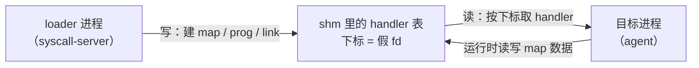
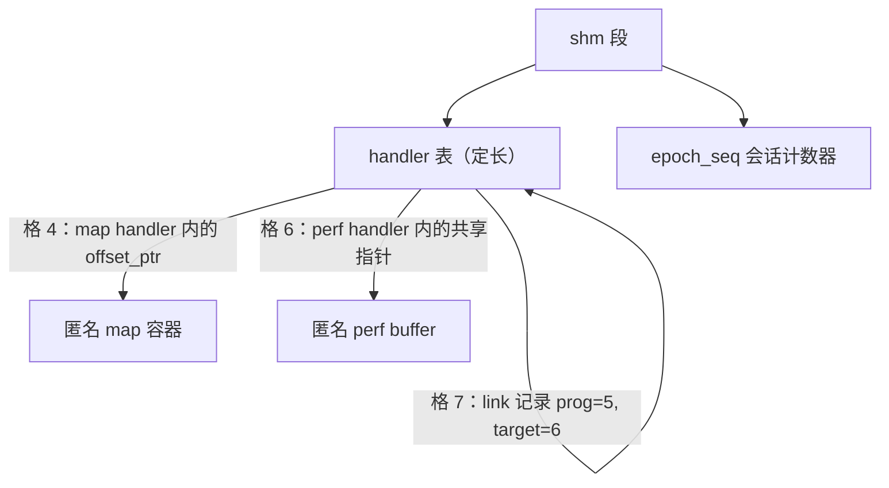
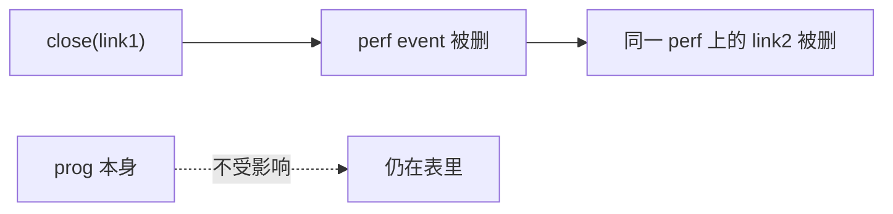
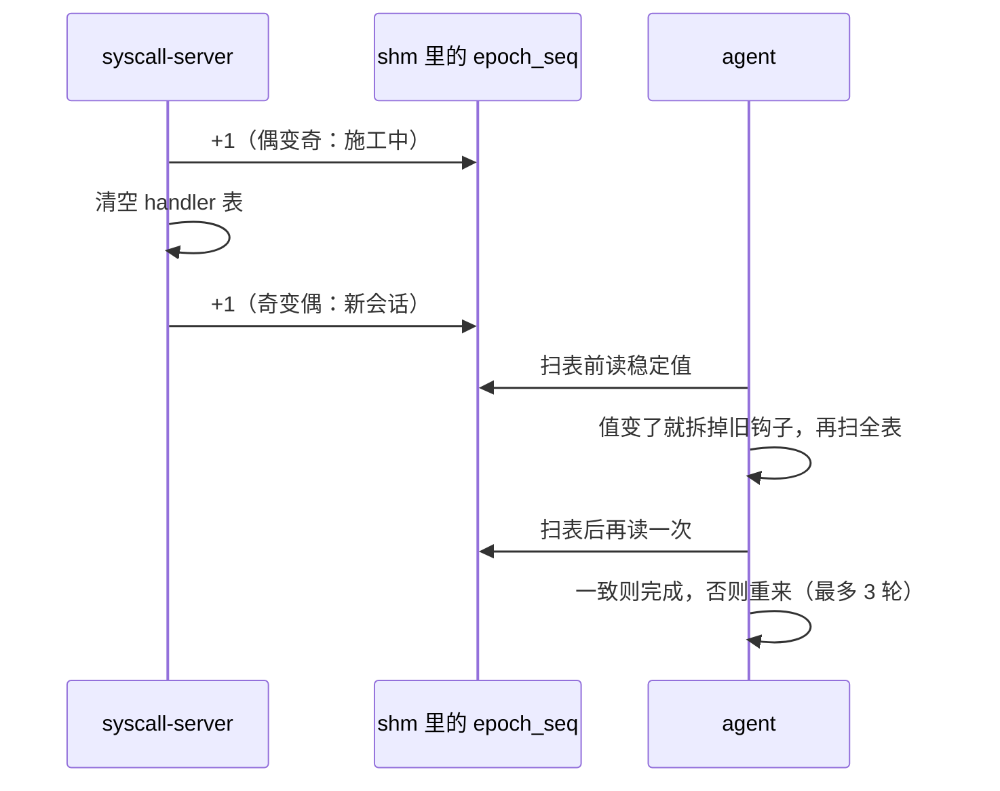

# 2. 共享内存与 handler 表

> 一句话：bpftime 没有内核可依赖，于是用一块跨进程共享内存（shm）来"冒充内核的对象表"。
> 读完本章，你能说清楚 shm 里放了什么、假 fd 的号码从哪来、关掉一个 fd 会连带删掉什么、
> 会话（epoch）机制能保证什么又不能保证什么，以及 shm 什么时候会被删、什么时候会残留。
>
> 前置：建议先读[第 0 章](00-architecture.md)（全景）和[第 1 章](01-lifecycle.md)（一个事件的生命周期）。
> 预计用时：60–90 分钟。

## 本章要回答的问题

- 内核里 `bpf()` 返回的 fd 背后有内核对象撑着。bpftime 没有内核，它返回的 fd 背后是什么？号码又是谁定的？
- loader（如 sslsniff）和目标进程（如 nginx）是两个进程，它们怎么看到同一个 map？
- 关掉一个 link 的 fd，为什么挂在同一个 perf event 上的别的 link 也没了？
- 第二个 loader 启动时，上一轮留在 shm 里的旧对象是谁清掉的？正在运行的 agent 能察觉吗？
- loader 都退出了，为什么 `/dev/shm` 里有时还躺着一个 50MB 的段？

## 2.1 核心直觉：shm 是内核对象表的替身

先回忆内核是怎么做的。loader 调 `bpf(BPF_MAP_CREATE, ...)`，内核在自己的内存里建一个
map 对象，再在 loader 的 fd 表里放一个指向它的 fd。之后 loader 拿这个 fd 操作 map，
被追踪进程里触发的 eBPF 程序也能访问同一个 map——因为对象都在内核里，大家共用。

bpftime 把 eBPF 搬到了用户态，没有内核这个"公共场所"。它的办法是：

1. 开一块**两个进程都映射**的共享内存（shm），在里面放一个**定长数组**（默认 6144 格）。
2. 每创建一个 bpf 对象，就占用数组里的一格，把对象的描述写进去。
3. 返回给 libbpf 的 fd 号码，**就是这一格的下标**。我们管它叫"假 fd"：它代表什么对象，
   由表里同号的那一格决定，而不是由内核决定。
4. 格子里放的东西是什么类型，这个 fd 就是什么种类（map、prog、link……）。

打个比方：shm 是一排共享储物柜，假 fd 是柜子编号。loader 往柜子里放东西，再把编号交给
libbpf；目标进程里的 agent 按编号开柜子取东西。运行时的热路径上，双方只靠这排柜子交流。
（控制面另有一条 agent 的本地 socket 通道，用来刷新、卸载，见[第 3 章](03-entrypoints.md)。）

| | 内核 eBPF | bpftime |
|---|---|---|
| 对象存在哪 | 内核内存 | shm 里的 handler 表 |
| fd 号码 | 内核 fd 表里的一项 | handler 表的下标（号码怎么来的见 §2.5） |
| 怎么知道 fd 是 map 还是 prog | 内核对象的类型 | 表里那一格装的是哪种 handler |
| 谁能看到 | 所有进程（经内核） | 映射了这块 shm 的进程 |

这里的 **handler** 就是"表里的一格装的那个对象描述"，**handler 表**就是那个定长数组。

下面这张图要看的是：loader 写表，agent 读表并在本进程里执行，map 数据双方都读写。



> **C++/Linux 小知识：boost::interprocess 与 `managed_shared_memory`**
> Linux 的 POSIX 共享内存就是 `/dev/shm/` 下的一个文件，多个进程 `mmap` 它就能看到同一块
> 物理内存。但光有一块裸内存不够用：你还得在里面分配对象、找到对象。Boost 的
> `managed_shared_memory` 在这块内存里自带了一个分配器和一个"名字 → 对象"索引，于是可以像
> 用堆一样在 shm 里 `construct` 对象、用 boost 版的 `vector`/`set` 等容器。bpftime 用它
> 来放 handler 表和所有 map 数据。

**要点**

- 假 fd 的号码 = handler 表的下标；handler 的类型 = fd 的种类。
- loader 写表，agent 读表；map 数据双方都读写。

## 2.2 shm 段里有什么

### 一段内存，几个"有名字的对象"

这块 shm 在 Linux 上就是文件 `/dev/shm/bpftime_maps_shm`（名字可以用环境变量
`BPFTIME_GLOBAL_SHM_NAME` 改），默认 50MB（`BPFTIME_SHM_MEMORY_MB` 可调）。
有一个容易忽略的物理事实：创建时这 50MB 会**一次性真实占满** tmpfs，而不是用多少占多少
（系统 Boost 建段时调用了 `posix_fallocate`，见本章深入参考）。`du -h` 看到的就是 50M。
所以调大它就是实打实多占内存；`/dev/shm` 空间不够时，创建当场失败。

段里有一组按名字存放的全局对象：

```
/dev/shm/bpftime_maps_shm  (默认 50MB)
├── "bpftime_handler"                    handler 表：6144 格的 vector    ← 本章主角
├── "bpftime_runtime_config"             运行配置：哪些 helper 可用、是否 JIT、日志写到哪……
├── "bpftime_global_epoch_state"         会话计数器 epoch_seq（§2.7）
├── "bpftime_alive_agent_pids"           还活着的 agent 进程 pid
├── "bpftime_alive_syscall_server_pids"  还活着的 syscall-server 进程 pid
├── "bpftime_pid_set_lock"               保护上面几个 pid 集合的锁
├── "bpftime_syscall_pid_set"            哪些进程已装了系统调用追踪（第 5 章）
└── （匿名对象）× N                       每个 map 的数据容器、perf buffer 等
```

> **C++/Linux 小知识：命名对象与匿名对象**
> `managed_shared_memory` 里的对象可以带名字：`construct<T>("名字")` 新建，
> `find<T>("名字")` 查找，`find_or_construct<T>("名字")` 有就拿、没有就建。名字就是不同进程
> 互相找到对方建的对象的"门牌号"。也可以用 `anonymous_instance` 建**没有名字**的对象，
> 这种对象只能靠别处保存的指针找到。

为什么 map 的数据容器是匿名的？因为 map 名不唯一。两个 eBPF 程序各有一个叫 `events` 的
map 很正常，如果按 map 名给容器起名字，它们就会撞名。所以每个 map 的容器都匿名创建，
**唯一能找到它的途径是 handler 里保存的那根指针**；map 名只剩展示用途。

### 表有多大

handler 表在建段时一次性分配好全部格子，之后**长度不变**。每格是一个 `handler_variant`
（下一节），在 x86-64 上实测 168 字节，所以默认 6144 格约占 1MB。表长由
`BPFTIME_MAX_FD_COUNT` 决定（允许 128 到 1M）。调到上限 1M 格就要 168MB，放不进默认的
50MB 段，建段当场抛 `bad_alloc`——第 3 章的 fail-open 实验正是利用了这一点。

运行配置 `runtime_config` 是一个约 1.2KB 的纯数据结构（全是定长字段和字符数组），正好
适合直接放进 shm。它来自**建段（或最后一次覆盖它）的那个进程的环境变量**；agent 读的是
shm 里这一份，所以 JIT 开关、日志路径等实际上跟着 loader 走（第 3 章 §3.7）。一个小陷阱：
结构体默认值里 ufunc helper 组是关的，但从环境变量构造配置时，只要没设
`BPFTIME_HELPER_GROUPS`，三个 helper 组**全部打开**（[第 7 章](07-helpers.md)）。

### 指针纪律：什么能放进 shm

同一块 shm 在 loader 和 agent 里被映射到**不同的虚拟地址**。所以 shm 里如果存一个普通
指针（绝对地址），换个进程就指错了地方。

> **C++/Linux 小知识：`offset_ptr`**
> `boost::interprocess::offset_ptr<T>` 不存绝对地址，而是存"目标地址减去指针自身地址"的
> 差值。只要指针和目标都在同一块 shm 里，不管这块 shm 被映射到哪，差值都不变，解引用就总是
> 对的。bpftime 在 shm 内部的所有指涉都用它（或者用 boost 的 shm 容器，它们内部也是
> `offset_ptr`）。

由此得到一条判据：**位置无关的数据能放进 shm；和进程地址空间绑定的东西不能放。**

- 能放：map 的键值数据、prog 的字节码、link 的"prog 号 ↔ 目标号"关系、perf buffer 的环形缓冲。
- 不能放：JIT 出来的机器码、VM 对象、真实的文件 fd。这些都由 agent 在**自己进程里**按 shm
  里的描述重新建。

反过来，每个进程自己手里指向 shm 的入口（handler 表在哪、配置在哪）用的是普通指针，
因为它们只在本进程有效——每个进程打开 shm 时各自 `find` 一遍。

下面这张图要看的是：handler 表里的格子怎样"指向"shm 里别的对象，以及格子之间怎样用
fd 号互相引用。



**要点**

- shm 段 = 一组命名全局对象 + 一堆匿名对象（map 容器、perf buffer）。
- 表长在建段时定死；段大小、表长两个环境变量都只在**建段**时生效。
- shm 内部只能用 `offset_ptr` / shm 容器；JIT 代码、VM 都是各进程本地重建的。

## 2.3 handler_variant：一张表装七种对象

一张数组只能有一种元素类型，可 map、prog、link 长得完全不一样。bpftime 的做法是让
元素类型成为一个"七选一"的类型。

> **C++/Linux 小知识：`std::variant`**
> `std::variant<A, B, C>` 是一个"类型安全的 union"：同一时刻只装 A、B、C 中的一种，并且
> 自己记得当前装的是哪种（`index()` 返回 0、1、2……）。用 `std::holds_alternative<B>(v)`
> 判断是不是 B，用 `std::get<B>(v)` 取出来。bpftime 用它让 handler 表的每一格都能装任意
> 一种 bpf 对象，并且"判断 fd 种类"就是一次 `holds_alternative`。

定义只有一行：

`runtime/src/handler/handler_manager.hpp` 的 `handler_variant`

```cpp
using handler_variant =
	std::variant<unused_handler,        // 0：空格子
		     bpf_map_handler,       // 1：map
		     bpf_link_handler,      // 2：link（prog 与挂载点的关系）
		     bpf_prog_handler,      // 3：prog（字节码）
		     bpf_perf_event_handler,// 4：perf event（uprobe 说明书、perf buffer 等）
		     epoll_handler,         // 5：epoll 实例
		     memfd_handler>;        // 6：memfd 占位
```

七种 handler 一览（字段级细节见本章深入参考）：

| 序号 | 类型 | 代表什么 | 谁写 / 谁读 |
|---|---|---|---|
| 0 | `unused_handler` | 空格子。表初始化时全部填它 | — |
| 1 | `bpf_map_handler` | 一个 map：类型、键值大小，加一根指向匿名数据容器的 `offset_ptr` | loader 建；双方都读写数据 |
| 2 | `bpf_link_handler` | 一条关系："把 prog 号 X 挂到目标号 Y 上" | loader 写；agent 读后去真正挂钩 |
| 3 | `bpf_prog_handler` | 一段 eBPF 字节码和名字 | loader 写；agent 读出后本地 JIT |
| 4 | `bpf_perf_event_handler` | 一个事件源：uprobe 的"在哪个文件哪个偏移挂"，或一个 perf buffer | loader 建；agent 照着挂 uprobe / 往 buffer 里写 |
| 5 | `epoll_handler` | loader 侧 epoll 实例，记录它在等哪些 perf buffer / ringbuf | loader 自己用 |
| 6 | `memfd_handler` | `memfd_create` 的占位 | loader 自己用 |

几点值得停下来想一想：

- **prog 在 shm 里只是字节码。** loader 不 JIT，编译发生在 agent 侧（[第 6 章](06-vm-jit.md)）。
  所以已经被 agent 实例化过的 prog，就算 shm 里的字节码被改了也不受影响。
- **perf event 在 loader 侧只是一张"说明书"。** 比如 uprobe 型的 perf handler 只写着
  "请在某个 ELF 的某个偏移挂 uprobe"；真正动手的是 agent（[第 4 章](04-attach-uprobe.md)）。
  perf handler 上有一个 `enabled` 标志，`ioctl(PERF_EVENT_IOC_ENABLE/DISABLE)` 只是改它；
  但 agent 的装配路径**从来不读这个标志**，只有 json 导出导入会读写它。也就是说
  `PERF_EVENT_IOC_DISABLE` 对已挂上的程序不起作用（见[附录 B](B-known-issues.md#b-shm)）。
- **perf buffer 整个都在 shm 里。** 软件 perf event 型的 handler 指向一个匿名的
  `software_perf_event_data`：里面有一个给 loader 消费的环（consumer ring），以及每个
  生产线程各自一份的小环（shard，分片）。agent 里的 eBPF 程序写自己线程的 shard，loader
  读之前先把各 shard 的记录搬（drain）进 consumer ring。细节在[第 8 章](08-maps.md)。
- **"kprobe" 型 perf handler 不是 CPU 上的 kprobe。** bpftime 在 CPU 侧没有 kprobe 实现；
  这类 handler 交给 CUDA 的 attach 实现，用来探测 GPU kernel（[第 9 章](09-gpu.md)）。

perf buffer 这件事有一个直接后果：生产者（目标进程里的 agent）和消费者（loader 里的 libbpf）
读写的是**同一块物理内存**，中间没有任何序列化层。记录的字节布局稍有不对（比如没对齐），
消费者就会直接读出错的数据。

**要点**

- 一格 = 一个 `std::variant`；判断 fd 种类就是看 variant 当前装的是哪一种。
- shm 只放"描述"和"数据"：字节码、说明书、关系、缓冲区。执行相关的东西都在 agent 本地。
- perf handler 的 `enabled` 标志没有消费者，`DISABLE` 停不掉探针。

## 2.4 谁建、谁开：五种打开方式

shm 由谁创建？loader 侧的 syscall-server：它先运行，它往表里写东西。目标进程里的 agent
**只打开、从不创建**——找不到就当失败。

`bpftime_shm` 的构造函数按一个"打开方式"参数（`shm_open_type`）分支：

| 打开方式 | 含义 | 谁用 |
|---|---|---|
| `SHM_CREATE_ONLY` | 只建；已存在就抛异常 | syscall-server 首选：建成功 = "这段 shm 归我管"（所有者） |
| `SHM_CREATE_OR_OPEN` | 有就开、没有就建 | syscall-server 的回退路径（段已存在时）、`bpftimetool import/load` |
| `SHM_OPEN_ONLY` | 只开；不存在就抛异常 | agent、`bpftimetool export/run`、cli 的 `detach` |
| `SHM_REMOVE_AND_CREATE` | 先删再建 | daemon、单测和示例 |
| `SHM_NO_CREATE` | 什么都不建，直接返回 | 仅测试用 |

`runtime/src/bpftime_shm_internal.cpp` 的 `bpftime_shm::bpftime_shm(const char *, shm_open_type)`（节选）

```cpp
auto config = construct_runtime_config_from_env();  // shm 还没开，先从环境变量读配置
if (type == SHM_OPEN_ONLY) {                          // agent 走这里
    segment = managed_shared_memory(open_only, shm_name);   // 不存在就抛异常
    manager = segment.find<handler_manager>(            // 只 find，从不 construct
                  "bpftime_handler").first;             // 找不到就是 nullptr
    /* runtime_config、alive pid 集合、epoch_state …… 同样逐个 find */
} else if (type == SHM_CREATE_OR_OPEN || type == SHM_CREATE_ONLY) {
    segment = managed_shared_memory(create_only /* 或 open_or_create */,
                                    shm_name, memory_size << 20);    // MB → 字节
    manager = segment.find_or_construct<handler_manager>(
                  "bpftime_handler")(segment, max_fd_count);
    // ↑ 如果 shm 是上一轮留下的，这里拿到的是**旧表**，不会重建！
    /* 其余命名对象同样 find_or_construct */
} else if (type == SHM_REMOVE_AND_CREATE) {
    /* 先 remove，再 create_only，逐个 construct */
} else if (type == SHM_NO_CREATE) {
    return;                                           // 测试用：什么都不做
}
/* CUDA 构建：建或找 GPU 通信区；MPK 构建：给整段打保护键（§2.9） */
```

两条主路的差别正是两方角色的差别：

- **agent 全用 `find`**：它不建 shm 的"骨架"。找不到某个对象就拿到 `nullptr`，所以
  后面所有"判断 fd 种类"的函数都会先检查表指针是不是空的。注意"不建骨架"不等于"不写 shm"：
  agent 会往 alive pid 集合里登记自己、往 hash map 里插数据、为每个生产线程新建 perf shard，
  这些都在 shm 里分配内存。
- **server 用 `find_or_construct`**：段已存在时拿到的是上一轮的旧表、旧配置、旧大小。

为什么不干脆删了重建？因为**可能还有 agent 映射着这段 shm**。比如 nginx 里的 agent 一直
活着，你先后跑了两次 sslsniff。如果第二个 sslsniff 删段重建，nginx 里的 agent 手里那块
映射就成了没人维护的孤儿。所以 server 选择复用，然后自己负责清掉旧内容（§2.7）。

旧配置的处理比较简单：server 启动流程的最后会用当前环境变量生成的配置**整体覆盖**
shm 里那份 `runtime_config`。但段大小和表长覆盖不了：复用旧段时，改
`BPFTIME_SHM_MEMORY_MB` 或 `BPFTIME_MAX_FD_COUNT` 都没用，要先删段。

**要点**

- 五种打开方式；agent 只 `find`，server `find_or_construct`；在 syscall-server / agent 这条主路上，表的创建者是 loader 侧
  （`bpftimetool import/load`、daemon 也会建段）。
- server 复用旧段是有意的：不能抽走已注入 agent 脚下的内存。代价是必须自己清旧数据。

## 2.5 假 fd：号码从哪来

"假 fd = 表下标"只说了一半。另一半是：**这个下标是谁挑的？** bpftime 里有两套互不相干的
分配器。

### 主路径：借一个真 fd 的号码

syscall-server 在 `bpf(BPF_MAP_CREATE)` 等调用里，传给 shm 的 fd 是 `-1`，意思是"帮我分配"。
shm 于是调用：

`runtime/src/bpftime_shm_internal.cpp` 的 `bpftime_shm::open_fake_fd`

```cpp
int bpftime_shm::open_fake_fd()
{
    int fd = open("/dev/null", O_RDONLY);   // 真的打开一个 fd！内核总是给最小的空闲号
    int cnt = 5;
    while (fd <= 2 && fd >= 0 && --cnt > 0) // 拿到 0/1/2 就 dup 换个号（最多 4 次）：
        fd = dup(fd);                       // 进程关过 stdio 时会出现这种情况
    if (fd >= 0 && (std::size_t)fd >= manager->size()) { // 号码超出表长
        close(fd);
        errno = ENOSPC;
        return -1;
    }
    return fd;                              // 这个号码就是 handler 表的下标
}
```

为什么不自己从 0 开始数号？因为 libbpf 拿到这个号以后会把它当普通 fd 用：`dup`、`close`、
传给别的系统调用。如果号码只是凭空编的，它很可能和进程里某个真文件撞号。借一个真实的
`/dev/null` fd，号码就在 loader 的 fd 表里被真实占住了，**本进程不会再把这个号发给别人**。

所以在 loader 里，假 fd 更准确的说法是**真 fd、假语义**：它在 loader 里真实存在（`ls -l
/proc/<pid>/fd` 能看到一排指向 `/dev/null` 的 fd），但它代表 map 还是 prog，完全由 shm 表里
同号的那一格决定。

这个设计有两个推论：

- **号码受 loader 自己打开的文件影响。** 如果 fd 3 已经被日志文件占了，第一个 map 就拿到 4。
  一个打开了上千个文件的 loader，即使只建几个 map，也可能因为号码 ≥ 表长而得到 `ENOSPC`。
- **关闭时要关两样东西。** shm 的 `close_fd` 只清表里的格子；真的 `/dev/null` fd 由调用方
  关。syscall-server 拦截 `close` 时正是先清格子、再调原始 `close`。

### 另一套：表内最小空格

handler 表自己也有一个分配器 `find_minimal_unused_idx`：从下标 0 开始线性扫，返回第一个空格。
它**不在 syscall-server 的路径上**，只有 daemon（[第 10 章](10-periphery.md)）在用；
基于它的 `set_handler_at_empty_slot` 只有单测在用。此外，`bpftimetool import/load` 直接按
JSON 里记录的号码写表。

| 号码来源 | 谁用 | 号码长什么样 |
|---|---|---|
| `open_fake_fd`（借 `/dev/null`） | syscall-server（libbpf 的所有建对象调用） | loader 进程 fd 表里的空闲号，通常从 3 或 4 开始 |
| `find_minimal_unused_idx`（表内最小空格） | daemon | 表里第一个空格，空表时是 0 |
| 调用方指定 | `bpftimetool import/load`、daemon 的部分路径 | JSON 或调用方给的号 |

在空表上实测：`find_minimal_unused_idx` 返回 0，而 `open_fake_fd` 返回 3。两套号码空间混用
同一张表时可能撞号：`set_handler` 遇到已占的格会返回 `-EEXIST`，而建 map 的路径会**先清掉
那一格原有的 handler 再放新 map**——可能清掉的是别人的对象（按代码推断，见
[附录 B](B-known-issues.md#b-shm)）。

### 跨进程只传整数

agent 进程里**并没有**这些 `/dev/null` fd。跨进程传播的只有整数编号：agent 遍历表的下标，
或者从 link handler 里读出 `prog_id` / `attach_target_id` 这两个编号。

helper 那一层更直白。内核里，eBPF 程序引用 map 时，加载器会把 map fd 换成内核里 map
对象的地址。bpftime 做这一步替换时调用 `map_ptr_by_fd`，而它**原样返回 fd 当"指针"**：

`runtime/src/bpftime_shm.cpp` 的 `map_ptr_by_fd`

```cpp
extern "C" uint64_t map_ptr_by_fd(uint32_t fd)
{
    if (!shm_holder.global_shared_memory.get_manager() ||
        !shm_holder.global_shared_memory.is_map_fd(fd)) {
        errno = ENOENT;
        return INVALID_MAP_PTR;   // 不是 map：给一个无效值
    }
    return fd;                    // "指针"就是 fd 本身
}
```

之后 helper 每次拿到这个"指针"都再查一次表。也就是说，**map fd 从来不会变成指针，每次
访问都经过查表**。多一次间接，换来的是编号在所有进程里都稳定（[第 6 章](06-vm-jit.md)讲
lddw 重定位）。

**要点**

- loader 里的假 fd 是借来的真 `/dev/null` fd，号码由 loader 自己的 fd 表决定。
- daemon 用另一套"表内最小空格"分配器；两套号码混用同一张表有撞号风险。
- 跨进程只传整数；map "指针"就是 fd，每次访问都查表。

## 2.6 删除与级联

关掉一个假 fd 时，bpftime 不只是把那一格清空，还要处理"别人引用了它"的情况。比如删了一个
prog，引用它的 link 就成了悬空编号。清理逻辑在 `clear_id_at`：

`runtime/src/handler/handler_manager.cpp` 的 `handler_manager::clear_id_at`（节选）

```cpp
void handler_manager::clear_id_at(int fd, managed_shared_memory &memory)
{
    if (fd < 0 || (std::size_t)fd >= handlers.size()) return;
    if (holds_alternative<bpf_map_handler>(handlers[fd])) {
        get<bpf_map_handler>(handlers[fd]).map_free(memory);
        // 必须在这里释放数据容器：handler 的析构函数拿不到 shm 分配器
    } else if (holds_alternative<bpf_perf_event_handler>(handlers[fd])) {
        for (/* 全表每一格 i */)
            if (/* i 是 link 且 attach_target_id == fd */)
                clear_id_at(i, memory);     // 删掉挂在这个事件上的所有 link
    } else if (holds_alternative<bpf_prog_handler>(handlers[fd])) {
        for (/* 全表每一格 i */)
            if (/* i 是 link 且 prog_id == fd */)
                clear_id_at(i, memory);     // 删掉引用这个 prog 的所有 link
    } else if (holds_alternative<bpf_link_handler>(handlers[fd])) {
        auto target = get<bpf_link_handler>(handlers[fd]).attach_target_id;
        handlers[fd] = unused_handler();    // 先清自己，防止下面的递归又扫回来
        clear_id_at(target, memory);        // 再删它挂载的目标（不检查目标类型）
        return;
    }
    handlers[fd] = unused_handler();        // 格子归零
}
```

把三条规则串起来，就会得到一个和内核很不一样的结果。下面这张图要看的是：只关一个 link，
连锁反应会扩散到哪里。



- **删 link → 删它的目标 perf event → 删挂在这个 perf event 上的所有 link。** 实测：同一个
  perf event 上挂两个 link，关掉 link1 后，perf event 和 link2 都没了，prog 还在。
  内核里不是这样：关一个 link 不会让用户手里的 perf fd 失效，也不影响别的 link。bpftime
  这样做是一种近似：没有内核的引用计数，不删 perf 格子的话每轮 attach/detach 都会泄漏一格。
  之后用户再对那个 perf fd 做 ioctl，会因为它已不是 perf handler 而落到原始 ioctl。
- **删 prog → 删引用它的 link → 每个 link 再连带删 perf event 和那上面的其他 link。** 所以
  关掉一个 prog，别的 prog 只要和它共用了 perf event，挂载关系也会一起消失。
- **删 map 不级联。** 引用 map 的是 prog 字节码里的 fd 常量，表这一层追踪不到。悬空的 map
  fd 靠"每次访问都查表判型"兜底：查到不是 map 就报 `ENOENT`。

link 删目标时不检查目标类型：非 perf 型的 link（比如目标号其实是一个网卡序号）也会把同号的
格子清掉（按代码推断，见[附录 B](B-known-issues.md#b-shm)）。

这些删除都不是热路径：每删一个 prog 或 perf event 都要扫全表。server 换会话时的
`clear_all` 就是对每个已占用的格子调一次 `clear_id_at`。

**要点**

- 删除会级联：prog/perf → link，link → 目标；map 不级联。
- 关一个 link 会删掉它的 perf event 和同一 perf 上的所有 link，这与内核语义不同。

## 2.7 会话与 epoch：能保证什么，不能保证什么

### 要解决的问题

§2.4 留下了两个问题：

1. **旧对象谁来清？** 第二个 loader 复用了旧段，表里还躺着上一轮的 map、prog、link。
   不清的话，新旧对象混在一起；agent 可能把上一轮的 prog 又挂上去。
2. **读者怎么知道表被清过？** agent 和 loader 是两个进程，agent 可能早就按旧表挂好了钩子，
   也可能正在扫表。它需要一个信号来知道"表已经换代了，你手里那套要作废"。

### 思路：一个会话计数器

bpftime 在 shm 里放了一个 8 字节计数器 `epoch_seq`，规则是：

- **奇数** = server 正在清表（"施工中"），读者别信表里的内容。
- **偶数** = 表稳定；`epoch_seq / 2` 就是当前会话编号。

server 每开一个新会话：先 +1（变奇数，挂"施工中"牌），清空整张表，再 +1（变偶数，摘牌）。
初值是 0，第一个 loader 启动后变成 2，第二个之后变成 4。

读者（agent）扫表前读一次计数器，扫完再读一次。两次读到同一个偶数，说明扫表期间没有
**换会话**；否则推倒重来。如果计数器和上次记住的值不同，就说明换代了，先把自己按旧表挂的
钩子全拆掉。

这种"写者用奇偶表示忙闲、读者前后各读一次比对"的套路叫 **seqlock**（顺序锁）。

### 实现

写侧，syscall-server 启动时调用：

`runtime/src/bpftime_shm_internal.cpp` 的 `bpftime_shm::begin_new_session`

```cpp
std::uint64_t bpftime_shm::begin_new_session()
{
    if (!epoch_state) {            // shm 里没有这个计数器：只清表，不计数
        reset_server_state();
        return 0;
    }
    __atomic_add_fetch(&epoch_state->epoch_seq, 1, __ATOMIC_ACQ_REL); // 偶→奇：施工中
    reset_server_state();          // 逐格清空 handler 表（带级联，见 §2.6）
                                   // + 清空"已装系统调用追踪的 pid"集合
    std::uint64_t seq = __atomic_add_fetch(&epoch_state->epoch_seq, 1,
                                           __ATOMIC_ACQ_REL);         // 奇→偶：新会话
    return seq;
}
```

注意 `reset_server_state` **不清** alive agent 集合：那些 agent 进程还活着，§2.8 删段的
判断要用到它。

读侧先拿一个"稳定的"计数值：`read_stable_epoch_seq` 读到奇数就睡 1ms 再试，读到偶数且紧接着
再读一次相等才返回，最多试 200 次；shm 里没有计数器时返回一个特殊值"缺失"。

真正用它的是 agent 的 `bpf_attach_ctx::init_attach_ctx_from_handlers`（"按 handler 表装配
钩子"的入口，[第 3 章](03-entrypoints.md)会再讲）：

1. 扫表前读一次稳定值。和上次记住的不同 → 拆掉所有已挂的钩子、清空"已实例化"记录。
2. 扫全表，把没实例化过的 handler 实例化（已经实例化过的会跳过）。
3. 扫完再读一次。和扫表前一致 → 成功；不一致或不稳 → 拆掉刚挂的，重来。最多 3 轮，
   仍不成功就返回 `-EAGAIN`。

下面这张图要看的是：server 的"奇 → 清表 → 偶"和 agent 的"读 → 扫 → 再读"如何配合。



### 它不能保证的事

epoch 机制容易被想得比它实际做的更多。读代码时要记住它的三个边界：

- **它只标记"换会话"，不标记会话内的增删。** 整个代码里改 `epoch_seq` 的只有
  `begin_new_session`。loader 在同一个会话里建 map、建 link、关 fd，计数器纹丝不动。
  所以"扫表前后计数器一致"只证明了"扫表期间没换会话"，**不**证明"扫表期间表没变"。
- **handler 表本身没有任何锁。** 表定长只保证格子的地址不变，不保证一格的读写是原子的。
  agent 扫表时 loader 恰好在写同一格，agent 可能读到写了一半的 variant，而 epoch 不会让它
  重试（按代码推断，未构造复现）。实际使用中能相安无事，靠的是时序：通常 loader 先写完表，
  agent 后扫。
- **只有"会再扫表"的 agent 才看得到换代。** 计数器是被动的：agent 只在调用
  `init_attach_ctx_from_handlers` 时才读它。用 `LD_PRELOAD` 或 `bpftime attach` 启动的
  agent 默认只扫一次（第 3 章 §3.8），之后换会话它也不知道，旧钩子继续跑。

另外，仓库里没有任何单测覆盖 epoch / 会话协议。

### 多个 syscall-server 并存

"每个 syscall-server 启动时都开新会话"这条规则对**任何**新起的 syscall-server 都成立——
包括打开别人建好的段、自己不是所有者的那个。于是两个 loader 用同一个 shm 名同时运行时，
**后启动的会把先启动的整张表清掉**，并用自己的环境变量覆盖 shm 里的配置。

本机实测：loader A 建好 map/prog/uprobe/link，目标进程里的 agent 挂上钩子，计数器每秒
+10；随后另起一个只调用了一次 `close(-1)` 的小程序（同样预加载 syscall-server）。它一启动，
表就被清空（`bpftimetool export` 导出为空），loader A 之后对自己 map 的每次查询都返回 -1。
目标进程里的 agent 没有 auto-refresh，旧钩子继续挂着，但它引用的 map 已经不在表里。

头文件注释写明了设计目标是"一次只有一个追踪会话"。要并行跑多个 loader，给它们设不同的
`BPFTIME_GLOBAL_SHM_NAME`（对应的 agent 也要用同一个名字）。

**要点**

- `epoch_seq` 是一个 seqlock：奇数=正在清表，偶数=稳定，`/2` 是会话号。
- server 每次启动：+1、清表、+1。agent 扫表前后各读一次，不一致就重来。
- 它只防"扫表时撞上换会话"，不保护会话内的增删；表本身无锁。
- 同一个 shm 名上，后起的 syscall-server 会清空先起者的表。

## 2.8 生命周期与残留

### 进程内的 shm 对象：`shm_holder`

每个进程里有一个全局对象 `shm_holder`，包着本进程的 `bpftime_shm`（"我映射的那段 shm 加上
各个入口指针"）。它是一个 union，空构造、空析构：

`runtime/src/bpftime_shm_internal.hpp` 的 `bpftime_shm_holder`

```cpp
// 用 union 包一层，这样 bpftime_shm 的析构函数就不会被自动调用
union bpftime_shm_holder {
	bpftime_shm global_shared_memory;
	bpftime_shm_holder() {}    // 空构造：程序加载时不构造 bpftime_shm
	~bpftime_shm_holder() {}   // 空析构：程序退出时也不自动析构
};
```

普通全局对象会在启动时自动构造、退出时自动析构。bpftime 要等到知道"我是 server 还是 agent"
才能用正确的打开方式构造，退出时也不能让 C++ 运行时在不合适的时刻把 shm 拆掉（别的线程可能
还在用）。所以改为手动：`bpftime_initialize_global_shm` 用 placement new（在已有内存上调构造
函数）构造，`bpftime_destroy_global_shm` 显式析构。第 3 章的 syscall-server 和 agent 也用了同一招。
进程退出时还有一个兜底函数 `__destruct_shm`：若本进程是以 `SHM_OPEN_ONLY` 打开的（agent 或只读
工具），先把自己的 pid 从 alive agent 集合里摘掉，再拆本进程的映射。

### 三种"销毁"

"销毁"这个词在 bpftime 里有三种意思，务必分清：

| 操作 | 作用范围 | 谁触发 |
|---|---|---|
| `bpftime_destroy_global_shm` | 只拆**本进程**的映射，`/dev/shm` 里的段还在 | 进程退出兜底函数、显式调用 |
| 所有者 syscall-server 退出时删段 | 删系统里的段，但只在没有其他活着的 loader（syscall-server）或 agent 时 | syscall-server 的 `atexit` 清理 |
| `bpftime_remove_global_shm` | 无条件删系统里的段 | `bpftimetool remove` |

### 谁会自动删段

只有**所有者**会自动删段。所有者就是用 `SHM_CREATE_ONLY` 成功建出段的那个 syscall-server
进程。它退出时（`atexit` 回调）依次检查：

1. 把自己从 alive syscall-server 集合里摘掉；
2. 集合里还有活着的 syscall-server？有就不删；
3. alive agent 集合里还有活着的 agent？有就不删；
4. 两个集合里任何一个读不出来（锁拿不到）？也不删；
5. 都没有，才删段。

"活着"的判断是 `kill(pid, 0)` 成功或返回 `EPERM`（无权限发信号的进程也算活着）。非所有者
（复用别人段的 syscall-server、fork 出的子进程）退出时只摘自己的 pid；agent 从不删段。

### 防止"刚打开就被删"：生命周期锁

如果 agent 刚打开 shm、还没来得及把自己登记进 alive 集合，所有者恰好在这时判断"没有活 agent"
并删段，agent 手里就剩一块孤儿映射。bpftime 用一把文件锁把这几件事串行化：
`/tmp/bpftime-shm-<名字>.lock` 上的 `flock`，叫 `shm_lifecycle_lock`。

- syscall-server 的启动（建段到开新会话）和退出删段，都持有它；
- agent 从打开 shm 到登记 pid（中间包括整个扫表、JIT、挂钩），也持有它。

这把锁有两个细节：锁文件**打开失败时静默不加锁**（fail-open，继续运行）；锁文件**从不删除**，
所以 `/tmp` 下会慢慢积累一堆 0 字节的 `bpftime-shm-*.lock`。它们无害，可以手动删。

### 什么时候会残留

把上面的规则放到真实场景里，`/dev/shm` 里留下段的常见情形有：

- **agent 比 loader 活得久。** loader（所有者）退出时看到活 agent，不删；之后 agent 退出，
  它本来就不删段 → 段永久残留。本机实测：loader 先退、目标进程后退，两者都退出后
  `/dev/shm/<名字>` 仍在。
- **loader 被 `kill -9`。** `atexit` 不会执行。
- **只用 `bpftimetool import` 建的段。** 它走 `SHM_CREATE_OR_OPEN`，不登记所有权。
- **单测。** 部分单测用固定的 shm 名，并且其清理辅助类析构时删错了名字（见
  [附录 B](B-known-issues.md#b-shm)），会留下自己的段，甚至删掉默认名的段。

残留段的后果是：下一个 syscall-server 会走"复用旧段"的路，旧的段大小、表长都沿用。最可靠
的清法是每轮之间 `bpftimetool remove`（或直接删 `/dev/shm` 下对应文件），前提是确认没有进程
还在用它。做实验时给每次运行设一个独立的 `BPFTIME_GLOBAL_SHM_NAME`，跑完删掉对应文件。

**要点**

- 只有所有者 syscall-server 会自动删段，且要求没有其他活着的 loader 或 agent。
- 生命周期锁串行化"agent 开段登记"和"server 判断删段"；锁文件永不删除。
- agent 比 loader 活得久、loader 被强杀，都会让段残留；`bpftimetool remove` 无条件删。

## 2.9 两个边角：json 导出导入、MPK

### json 导出导入

`bpftimetool` 能把 handler 表导出成 JSON，也能把 JSON 写回表里（工具本身见
[第 10 章](10-periphery.md)）：

- `bpftimetool export <file>`：用 `SHM_OPEN_ONLY` 打开，遍历非空格子，以格子号为 key 写出
  `{"type": ..., "attr": ..., "name": ...}`。
- `bpftimetool import <file>`：用 `SHM_CREATE_OR_OPEN` 打开，用当前环境变量覆盖配置，然后按
  JSON 里的号码逐个写回（link 排在最后，因为它引用别的格子）。它**不**开新会话，epoch 不变。
- `bpftimetool load <fd> <json>`：只写一个格子。

导出导入**不对称**，导出的 JSON 不能当备份用。最重要的几条：

- 只导出结构，不导出 map 里的数据。
- epoll、memfd 格子能导出，但导入不认，整次导入在那里中途停止（已写入的保留）。
- 软件 perf event（perf buffer）导出时缺一个导入必读的字段，导入直接抛异常。
- link 只导出 prog 号和目标号，cookie 丢失。
- prog 的 `type` 字段在建 handler 时从未被赋值，导出的是一个随机值。本机实测：一张只含
  map/prog/uprobe/link 的表导出再导入，再导出时只有 prog 的 `type` 不同（两次都是垃圾值）。

完整清单见[附录 B](B-known-issues.md#b-shm)。

### MPK：给 shm 加一把"写保护钥匙"

MPK（Memory Protection Keys，内存保护键）是 x86 的一个硬件特性：给一段内存打上一个"键号"，
然后每个线程可以通过一个寄存器（PKRU）单独控制自己对这个键号的读/写权限，切换权限不需要
系统调用。

bpftime 有一个编译选项 `BPFTIME_ENABLE_MPK`（默认关）。打开后：

- 每个进程构造 shm 时申请一个键（初始权限"禁止写"），把整段 shm 打上这个键；
- 每次执行 eBPF 程序之前放开写权限，执行完再禁止写。

它想防的是**宿主进程自己的代码在 eBPF 执行之外误写 shm**。读代码时知道有这个开关、默认关就够了；
它在多线程下能否正常工作存疑（推断，本机未构建 MPK 版验证），分析见[附录 B](B-known-issues.md#b-shm)。

**要点**

- `bpftimetool export` 适合"看一眼表里有什么"，不适合备份或迁移。
- MPK 是默认关闭的编译选项，目的是防宿主误写 shm；能否正常工作存疑（附录 B）。

## 小结

- bpftime 用 shm 里的一个定长 handler 表替代内核对象表：**下标 = 假 fd 的号码，格子里的类型 = fd 种类**。
- shm 内部只能放位置无关的数据（`offset_ptr`、boost shm 容器）；JIT 代码、VM 都在 agent 本地重建。
- handler 是一个七选一的 `std::variant`；map 容器、perf buffer 是匿名对象，只能经 handler 找到。
- loader 里的假 fd 是借来的真 `/dev/null` fd；daemon 另用"表内最小空格"分配，两套混用有撞号风险。
- 删除会级联：关一个 link 会删掉它的 perf event 和同一 perf 上的其他 link，与内核不同。
- 每个新起的 syscall-server 都用 epoch seqlock 开新会话、清空整张表；epoch 只标记换会话，不保护会话内的增删。
- 只有所有者 syscall-server 在没有其他活着的 loader 或 agent 时才删段；残留段和锁文件要手动清。
- json 导出导入不对称，不能当备份；MPK 是默认关闭的编译选项。

## 动手验证

以下命令里 `B` 指官方树的 `build-jit` 目录（它没有构建 `bpftime` 命令行，所以直接用 `LD_PRELOAD`）。
三个实验都由指南仓库 [labs/](labs/) 里的一个脚本完成：
```bash
cd labs && ./build.sh                # 编译 loader、victim（-O0）、poke
BPFTIME_BUILD=$B ./ch02-shm.sh
```
`loader` 不依赖 libbpf，直接调 `bpf(2)` / `perf_event_open(2)` 建一个 map、一段计数字节码、一个指向
`victim` 里 `target_func` 的 uprobe 和一个 link，然后每秒查一次 map；`poke` 只调一次 `close(-1)`。
脚本用随机的 `BPFTIME_GLOBAL_SHM_NAME`，结束时删掉段和锁文件。更多实验见[第 12 章](12-practice.md#exp-2)。

1. **看 shm 段和假 fd。** 脚本在 loader 运行时列出段文件、`du`、loader 的 `/proc/<pid>/fd` 和锁文件。
   本机实测：段文件 52428800 字节、`du` 显示 50M（建段时就整段占满了）；日志文件占了 fd 3，于是
   map、prog、perf event、link 依次拿到 4、5、6、7，全都指向 `/dev/null`；
   `/tmp/bpftime-shm-<名字>.lock` 是一个 0 字节文件。

2. **把 handler 表导出来逐格认。** 脚本接着跑 `bpftimetool export` 并格式化输出。JSON 的 key 是格子号，
   每格带 `"type"`：本机实测 `"4"` 是 `bpf_map_handler`（`name` 为 `cnt`），`"5"` 是 `bpf_prog_handler`，
   `"6"` 是 `bpf_perf_event_handler`（`_module_name` 指向 `victim`、`"enabled": false`），`"7"` 是
   `bpf_link_handler`（`prog_fd` 5、`target_fd` 6）。再看 prog 的 `attr.type`：它从未被初始化，可能是
   任何值——本机这次是 `1`，而加载时传的是 KPROBE（2）；换个程序可能是一个很大的数。别因为它看起来
   "很小很正常"就当它是对的。

3. **观察"后起的 syscall-server 清空表"。** 脚本在 loader 运行期间用同一个 shm 名启动 `poke`
   （它也预加载了 syscall-server），然后再导出一次。本机实测：第二次导出是 `null`；loader 的输出里
   前 3 秒 `lookup r=0`，`poke` 之后每一秒都是 `lookup r=-1`。

## 自测题

1. **在 loader 里 `ls -l /proc/<pid>/fd` 能看到 bpftime 的假 fd 吗？为什么 `open_fake_fd` 非要真的 `open("/dev/null")`？**
   <details><summary>答案</summary>

   能，它们是一排指向 `/dev/null` 的真实 fd。libbpf 会把返回的号码当普通 fd 用（`dup`、`close`、
   传给别的调用）。借一个真实 fd，这个号码就在 loader 的 fd 表里被真实占住，本进程以后打开别的
   文件不会拿到同一个号。号码由内核按"最小空闲号"分配，所以它受 loader 自己打开了哪些文件影响；
   拿到 0/1/2 时会 `dup` 换号，号码超过表长时关掉真 fd 并返回 `ENOSPC`。
   </details>

2. **agent 扫表前后各读一次 `epoch_seq` 且两次一致。能不能据此断定"扫表期间表没被改过"？**
   <details><summary>答案</summary>

   不能。`epoch_seq` 只在 `begin_new_session`（新 syscall-server 启动清表）时变化。同一个会话里
   loader 建 map、建 link、关 fd 都不改它。两次一致只说明"扫表期间没有换会话"。handler 表本身
   没有锁，会话内并发的写入和 agent 的读取之间没有任何同步；实际中相安无事主要靠"loader 先写完、
   agent 后扫"的时序。
   </details>

3. **同一个 uprobe perf event 上挂了两个 prog 的 link。关掉其中一个 link 的 fd，会怎样？和内核有什么不同？**
   <details><summary>答案</summary>

   `clear_id_at(link1)` 先清自己，再清它的目标 perf event；清 perf event 时扫全表，删掉所有
   `attach_target_id` 指向它的 link，于是 link2 也被删。两个 prog 本身还在表里。内核里关一个 link
   不会让 perf fd 失效，也不影响别的 link。bpftime 这么做是为了避免每轮 attach/detach 泄漏一个
   perf 格子，是一种近似。
   </details>

4. **两个人在同一台机器上各跑一个 sslsniff（都用默认 shm 名），会发生什么？怎么避免？**
   <details><summary>答案</summary>

   第二个 sslsniff 里的 syscall-server 启动时发现段已存在，退回 `SHM_CREATE_OR_OPEN` 复用它，
   然后照样 `begin_new_session`：把整张表清空，并用自己的环境变量覆盖 shm 里的配置。第一个
   sslsniff 建的 map/prog/link 全部消失，它之后的 map 操作失败；没有 auto-refresh 的 agent 还挂着
   旧钩子，但引用的 map 已不在。避免方法：给两组进程各设一个不同的 `BPFTIME_GLOBAL_SHM_NAME`。
   </details>

5. **loader 和 nginx 都退出了，`/dev/shm/bpftime_maps_shm` 却还在。可能是什么原因？**
   <details><summary>答案</summary>

   最常见的是 nginx（agent）比 loader 后退出：loader 作为所有者退出时看到 alive agent 集合里有活
   进程，就不删段；agent 退出时只摘自己的 pid，从不删段。其他可能：loader 被 `kill -9`，`atexit`
   没执行；段是 `bpftimetool import` 建的，没有所有者；某次单测留下的。用 `bpftimetool remove`
   或直接删文件清掉，前提是确认没人在用。
   </details>

6. **为什么 handler 表要做成定长的？定长能让 agent 的无锁读变得安全吗？**
   <details><summary>答案</summary>

   定长让格子的地址永远不变：如果 vector 能扩容，扩容会把元素搬到新内存、释放旧内存，另一个进程
   正在读的地址就失效了。但定长只解决"地址会不会变"，不解决"一格的内容会不会被读到一半"。
   `std::variant` 的赋值不是原子的，表也没有锁，所以并发读写同一格仍可能读到撕裂的数据。代价方面，
   表长要在建段时定好（`BPFTIME_MAX_FD_COUNT`），并占用相应的 shm 空间。
   </details>

## 深入参考

<details>
<summary>代码位置速查（按 177a1dc465ff 行号）</summary>

| 概念 / 函数 | 位置 |
|---|---|
| shm 名、命名对象常量、`get_global_shm_name` | `runtime/src/handler/handler_manager.hpp:51-67` |
| `bpftime::shm_remove`（析构删错名字） | `runtime/src/handler/handler_manager.hpp:69-85` |
| `handler_variant` 定义 | `runtime/src/handler/handler_manager.hpp:87-90` |
| `handler_manager` 类、唯一成员 `handlers` | `runtime/src/handler/handler_manager.hpp:100-132` |
| 默认表长 6144、上下限 128 / 1M | `runtime/include/bpftime_config.hpp:23-25` |
| 默认 shm 大小 50MB、`max_fd_count` 字段 | `runtime/include/bpftime_config.hpp:79,84` |
| `get_handler` / `operator[]` 越界哨兵 | `runtime/src/handler/handler_manager.cpp:35-47` |
| `set_handler_at_empty_slot` / `set_handler` | `runtime/src/handler/handler_manager.cpp:53-62` / `:63-88` |
| `clear_id_at`（级联删除） | `runtime/src/handler/handler_manager.cpp:98-148` |
| `find_minimal_unused_idx` / `clear_all` | `runtime/src/handler/handler_manager.cpp:150-158` / `:160-167` |
| `bpftime_initialize_global_shm` / `bpftime_destroy_global_shm` | `runtime/src/bpftime_shm_internal.cpp:49-79` |
| `bpftime_remove_global_shm` | `runtime/src/bpftime_shm_internal.cpp:81-88` |
| `__destruct_shm` | `runtime/src/bpftime_shm_internal.cpp:90-112` |
| `pid_set_scoped_lock`（250ms 轮询） | `runtime/src/bpftime_shm_internal.cpp:121-175` |
| `shm_lifecycle_lock` | `runtime/src/bpftime_shm_internal.cpp:178-229` |
| `open_fake_fd` | `runtime/src/bpftime_shm_internal.cpp:674-688` |
| `add_bpf_prog` / `add_bpf_link` | `runtime/src/bpftime_shm_internal.cpp:691-750` |
| `close_fd` | `runtime/src/bpftime_shm_internal.cpp:752-757` |
| MPK `enable_mpk` / `disable_mpk` | `runtime/src/bpftime_shm_internal.cpp:760-778` |
| `bpftime_shm` 构造函数（五种打开方式） | `runtime/src/bpftime_shm_internal.cpp:790-995`（OPEN_ONLY :797-829，CREATE :830-880，REMOVE_AND_CREATE :881-930，NO_CREATE :931-936，CUDA :937-976，MPK :979-994） |
| `read_stable_epoch_seq` | `runtime/src/bpftime_shm_internal.cpp:997-1015` |
| `begin_new_session` | `runtime/src/bpftime_shm_internal.cpp:1017-1031` |
| `add_bpf_map`（占用格先清） / `dup_bpf_map` | `runtime/src/bpftime_shm_internal.cpp:1048-1077` / `:1079` 起 |
| `set_runtime_config` / `get_runtime_config` | `runtime/src/bpftime_shm_internal.cpp:1152-1172` |
| `reset_server_state` | `runtime/src/bpftime_shm_internal.cpp:1381-1397` |
| `shm_lifecycle_lock` 类、epoch 特殊值、`bpftime_global_epoch_state` | `runtime/src/bpftime_shm_internal.hpp:34-55` |
| "一次一个会话"的注释、`read_stable_epoch_seq` 注释 | `runtime/src/bpftime_shm_internal.hpp:162-172` |
| `class bpftime_shm` 成员指针 | `runtime/src/bpftime_shm_internal.hpp:78-117` |
| `shm_holder` union | `runtime/src/bpftime_shm_internal.hpp:329-337` |
| `bpftime_perf_event_enable/disable` | `runtime/src/bpftime_shm.cpp:239-248` |
| `bpftime_close` | `runtime/src/bpftime_shm.cpp:282-285` |
| `map_ptr_by_fd` / `map_val` | `runtime/src/bpftime_shm.cpp:635-672` |
| `bpf_map_handler`（`offset_ptr`、析构检查） | `runtime/src/handler/map_handler.hpp:67-300` |
| `map_init`（匿名构造容器） / `map_free`（引用计数） | `runtime/src/handler/map_handler.cpp:762-1144` / `:1146-1270` |
| `bpf_prog_handler` / 构造函数（丢弃 prog_type） | `runtime/src/handler/prog_handler.hpp:26-63` / `prog_handler.cpp:9-19` |
| `bpf_link_handler` | `runtime/src/handler/link_handler.hpp:16-43` |
| `bpf_perf_event_handler`（`enabled`、`data`） | `runtime/src/handler/perf_event_handler.hpp:190-240` |
| perf data variant、`software_perf_event_data`、shard | `runtime/src/handler/perf_event_handler.hpp:71-187` |
| `epoll_file` / `epoll_handler` / `memfd_handler` | `runtime/src/handler/epoll_handler.hpp:22-29` / `:31-35` / `memfd_handler.hpp:16-21` |
| JSON 导入（单个 / 整份） | `runtime/src/bpftime_shm_json.cpp:106-221` / `:236-268` |
| JSON 导出 | `runtime/src/bpftime_shm_json.cpp:270-368` |
| `bpftimetool` 的 load / export / import / remove | `tools/bpftimetool/main.cpp:179-202` / `:203-240` / `:241-254` / `:255-263` |
| 环境变量 → `runtime_config` | `runtime/src/bpftime_config.cpp:92-176` |
| 所有者删段 / 所有权判定（syscall-server） | `runtime/syscall-server/syscall_server_utils.cpp:56-124` / `:126-145` |
| `start_up`（开新会话） | `runtime/syscall-server/syscall_server_utils.cpp:147-228` |
| `init_attach_ctx_from_handlers`（epoch 读侧） | `runtime/src/attach/bpf_attach_ctx.cpp:73-162` |
| MPK 开关、执行前后切换 | `cmake/StandardSettings.cmake:84-87`；`runtime/src/bpftime_prog.cpp:255,274` |
</details>

<details>
<summary>细节与坑</summary>

**shm 段与布局**

- 段在创建时就整段落到 tmpfs：bpftime 用系统 Boost，以 Boost 1.83 为例，
  `shared_memory_object::truncate` 先调 `posix_fallocate`（`/usr/include/boost/interprocess/shared_memory_object.hpp:462`）。
  `/dev/shm` 不够时创建当场抛 `interprocess_exception`。
- **每种打开方式都先读环境变量**构造一份配置，但只有建段时用得上它的大小和表长。段大小夹到
  1MB–10GB，表长夹到 128–1M。
- 运行配置的常量名仍叫 `DEFAULT_AGENT_CONFIG_NAME`，值是 `"bpftime_runtime_config"`；epoch 对象名
  是硬编码字面量 `"bpftime_global_epoch_state"`，不在常量表里。CUDA 构建另有 `"cuda_comm_shared_mem"`
  （server 建并清零，agent 最多等约 1 秒找它）。新旧版本不要混用同一段 shm。
- 实测 sizeof（x86-64）：`handler_variant` 168、map handler 160、prog 104、perf 72、link 72、
  epoll 32、memfd 40、`runtime_config` 1200。
- `SHM_REMOVE_AND_CREATE` 分支旁的注释 "Allocate 20M" 已过时（默认 50MB）。
- 配置相关的几处疑点（`strcpy` 进定长数组、复用旧段时配置里的 `max_fd_count` 与真实表长不一致、
  带 config 构造 `bpftime_prog` 会覆盖 shm 里的共享配置）见[附录 B](B-known-issues.md#b-shm)。

**handler 字段级细节**

| 类型 | 关键字段 | 备注 |
|---|---|---|
| `unused_handler` | 无 | 越界读也返回一个静态的它 |
| `bpf_map_handler` | `attr`、`type`、`name`、`map_lock`（spinlock）、`map_impl_ptr`（`offset_ptr<void>`）、`map_refcnt_ptr`、`key_size/value_size/max_entries` | 析构**不**释放容器，靠 `clear_id_at`→`map_free`；helper 与 syscall 两条访问路径用 `from_syscall` 参数区分 |
| `bpf_link_handler` | `args`、`prog_id`、`attach_target_id`、`attach_cookie` | 纯 POD；cookie 只在 perf-event 型 link（`attach_type==41`）里取自 `perf_event.bpf_cookie` |
| `bpf_prog_handler` | `type`、`insns`（shm vector）、`aot_insns`、`name` | `type` 从未被赋值（见附录 B）；`aot_insns` 在 runtime 内无人写入 |
| `bpf_perf_event_handler` | `type`、`enabled`（mutable bool）、`data`（内嵌 variant） | `enable()`/`disable()` 只改标志，无消费者 |
| `epoll_handler` | `files`：vector\<epoll_file{variant\<weak_ptr\>, epoll_data_t}\> | 存 weak_ptr（software perf 或 ringbuf），对象没了也不悬垂 |
| `memfd_handler` | `flags`、`name` | 给 `syscall(__NR_memfd_create)` 劫持占位 |

- perf handler 的内嵌 `data` 五选一：uprobe（`offset, pid, ref_ctr_off, _module_name`，
  uprobe/uretprobe/override/ureplace 共用）、kprobe（`func_name, addr, ref_ctr_off`）、
  tracepoint（`pid, tracepoint_id`）、custom（`attach_argument` 字符串）、software
  （`managed_shared_ptr<software_perf_event_data>`）。
- `bpf_btf_handler` 存在（`btf_handler.hpp`）但**不在** variant 里。
- `map_lock` 是 `pthread_spinlock_t`，初始化传的 pshared=0（PROCESS_PRIVATE）；glibc 下跨进程实际
  能用，但严格说依赖实现。锁在 handler（每个 fd）上，`impl->should_lock` 为假的实现完全无锁（第 8 章）。

**表的读写**

- handler 表**没有任何锁**（头文件 include 了 `sharable_mutex` 但没用）；`pid_set_lock` 只管
  pid 集合。同一个 server 进程里多线程同时 `bpf()` 也无保护（推断）。
- `set_handler`：越界返回 `-ENOSPC`、已占用返回 `-EEXIST`、放 `unused_handler` 返回 `-ENOTSUP`；
  放 map 时当场调 `map_init` 建容器。它**不看 `map_init` 的返回值**，而 map 实现类构造函数抛的
  异常会穿出去，由 syscall-server 的异常兜底把 `bpf()` 转给真内核（第 3 章）。于是同是"参数
  非法"，有的 map 类型得到一个"有 fd 无容器"的坏 fd，有的被转去真内核创建（见[附录 B](B-known-issues.md#b-shm)）。
- "先校验再分配 fd"的只有三处：`add_bpf_link`（prog 必须是 prog，perf 型 link 的目标必须是 perf
  handler；libbpf 用 `target_fd=-1` 探测 perf link 支持时只打 debug 日志）、`add_bpf_prog_attach_target`
  （先查 prog，`attach_perf_to_bpf` 在它之前先查 perf）、`dup_bpf_map`（先查旧 fd 是 map）。其他
  `add_*` 不预先校验，`set_handler` 失败时借来的 `/dev/null` fd 不关（推断泄漏）。
- `add_bpf_map` 目标格非空时先 `clear_id_at`；`dup_bpf_map` 共享底层容器并递增 shm 里的匿名
  引用计数，`map_free` 在引用计数没减到 0 时只解绑不销毁。
- syscall-server 拦截 `close` 时对**任何**号码都调 `bpftime_close`，会清掉表里同号的格子——
  即便那一格是别的进程按显式号码写进去的。
- 删 perf event 时的递归会经 link 再回到这个 perf event，多扫几遍，但因为 link 格先被清空，
  递归能终止。悬空 map fd 的访问由 `try_get_map_handler` 置 `ENOENT` 兜底。

**epoch 与会话**

- 特殊值：`MISSING = UINT64_MAX-1`（shm 里没有 epoch 对象），`UNSTABLE = UINT64_MAX`。
  头文件注释说缺失时 "Returns 0"，实现返回 MISSING；调用方把 MISSING 当 0 处理，扫完表后若读到
  MISSING 直接返回成功。
- `init_attach_ctx_from_handlers` 每次被调用都扫全表，已实例化过的格子跳过；它自己**只有 epoch
  变化时**才拆旧钩子、清空已实例化记录。所以启动和 auto-refresh 这两种调用只会增量挂新 link，表里
  被删掉的 link 要等换会话才会被拆。IPC `refresh` 不同：它在调用扫表函数**之前**自己先全拆、清空
  已实例化记录（第 3 章 §3.9）。第二遍扫表专给 CUDA link。
- IPC `status` 命令回显当前 `epoch_seq`（第 3 章）。实测第一个 loader 启动后为 2。

**生命周期与锁**

- `pid_set_scoped_lock` 是 250ms 内每 1ms 一次 `try_lock`，超时放弃本次 pid 集合操作并返回
  false。不用阻塞 lock，推断是因为持锁进程可能已死（不是 robust mutex）。
- 所有 shm 内的分配（hash 插入、新建 shard、perf 扩容）都经 boost segment manager 的进程间互斥量；
  若持锁进程被杀，其他进程分配时可能永久阻塞（推断，未验证）。
- `shm_lifecycle_lock` 把 shm 名中 `[A-Za-z0-9_.-]` 以外的字符换成 `_`，`open(O_CREAT, 0666)` 再
  `fchmod 0666`，`flock(LOCK_EX)` 阻塞等待。
- `bpftime_destroy_global_shm` 析构后把 `global_shm_initialized` 清回 false，保证幂等；CUDA 构建
  先停 watcher 线程。`__destruct_shm` 是 `.fini_array` 析构函数，在 `atexit` / `__cxa_atexit`
  回调（含 spdlog 全局对象析构）之后运行，所以 `bpftime_destroy_global_shm` 里避开 spdlog。
  旧版说"标了 65535 所以最后跑"，理由不对：带优先级的析构函数里 65535 反而最先跑（按 GCC/glibc 语义推断）。
- alive agent 集合：agent 装配成功后登记，IPC refresh 成功后补登记，正常 detach 和初始化失败
  清理会摘除，退出时 `__destruct_shm` 再兜底摘一次。
- 单测清理辅助类 `bpftime::shm_remove` 析构删错名字、`SHM_NO_CREATE` 实例上的未初始化指针等问题，
  见[附录 B](B-known-issues.md#b-shm)。

**json**

- 导入先收集所有 (号码, 对象)，`stable_sort` 把 link 放到最后，其余按 nlohmann 对象 key 的
  字典序（"10" 在 "3" 前）。只写一个格子的 `bpftimetool load` 不做排序。
- 其余不对称之处（kprobe/custom/ureplace 型 perf 不能导入、`attach_fds` 只读不写、offset 截断、
  异常穿过 `extern "C"` 等）见[附录 B](B-known-issues.md#b-shm)。

**MPK**

- 构造 shm 时 `pkey_alloc(0, PKEY_DISABLE_WRITE)` + `pkey_mprotect(整段, RW, pkey)`；
  `bpftime_prog_exec` 执行前 `pkey_set(pkey, 0)`、执行后 `pkey_set(pkey, PKEY_DISABLE_WRITE)`。
  trap 后端的信号执行路径不切换 MPK（第 4 章）。
- PKRU 寄存器每个线程各一份，这是"多线程下能否工作"存疑的根源，详见[附录 B](B-known-issues.md#b-shm)。
</details>

<details>
<summary>上游变更与我们的工作</summary>

**本章涉及的上游 PR（6bd5319d → 177a1dc）**

- #562：`agent_config` 更名为 `runtime_config`（对象名随之改为 `bpftime_runtime_config`）。
- #597：shm 耗尽处理——handler 表分配失败抛 `bad_alloc`；perf buffer 扩容失败报 `ENOMEM` /
  `MAP_FAILED`。#597 最初在 server 启动分配失败时 `std::exit`，随后被 #640 改为 fail-open。
- #598："isolate maps with colliding public names"。旧版按 `"ebpf_map_fd_" + name` 命名构造容器，
  同名 map 会撞；现在一律 `anonymous_instance`。
- #612："align software perf event records"，`output_data` 把 record 长度按 8 字节向上取整。
- #620：CUDA 构建在 unmap 前先停 watcher 线程。
- #639：shm 所有权（`SHM_CREATE_ONLY`）、`shm_lifecycle_lock`、alive syscall-server 集合与
  `pid_set_lock`、owner 退出时有条件删段；所有 agent（不只 Frida 注入的）都登记 alive pid。
- #671：`open_fake_fd` 与 `set_handler` 的表容量上界检查；`get_handler` 越界哨兵。
- #672：删 link 级联删它的 target，修每轮 attach/detach 泄漏一个 perf 格子的问题。
- （本节 PR 编号沿用旧版，未逐个回查。）

**与我们工作相关的案例**

- **对齐 bug**：我们七月查过的 8 字节对齐 bug 就长在 perf buffer 里——perf record 直接以字节
  形式写进 shm 里的 `software_perf_event_buffer::mmap_buffer`，生产者和消费者读写同一块物理内存。
  record 头跨环尾时消费者读到 `size=0`，正是"shm 是唯一媒介、没有序列化层"的直接后果。上游已由
  #612 修复。
- **绑核**：per-(pid,tid) shard 链表是"绑核无保护作用"论证的核心证据：每个线程写自己的
  shard，不存在跨 CPU 竞争。但**官方代码仍然绑核**（`bpf_helper.cpp` 的 `bpf_perf_event_output`）。
  我们的开发分支删掉了这段绑核，那是分支改动，不是官方行为。
- **shm 残留导致的双峰**：benchmark 里踩过的"上一轮 map/prog 残留导致双峰"正是 §2.7、§2.8 的
  问题域。只要还有活 agent，所有者就不删段；根治手段是每轮之间 `bpftimetool remove`。
</details>

---
[← 返回目录](README.md)
