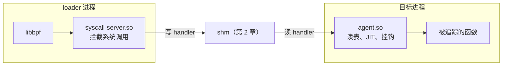
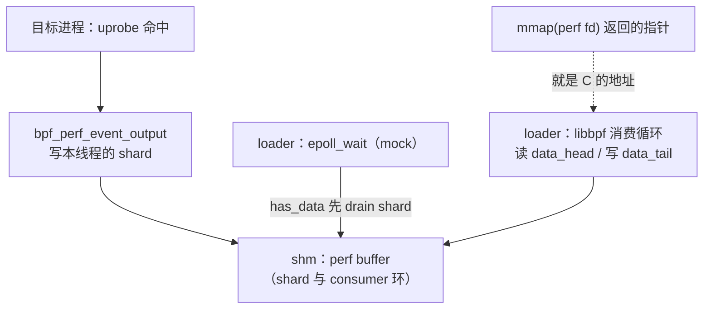
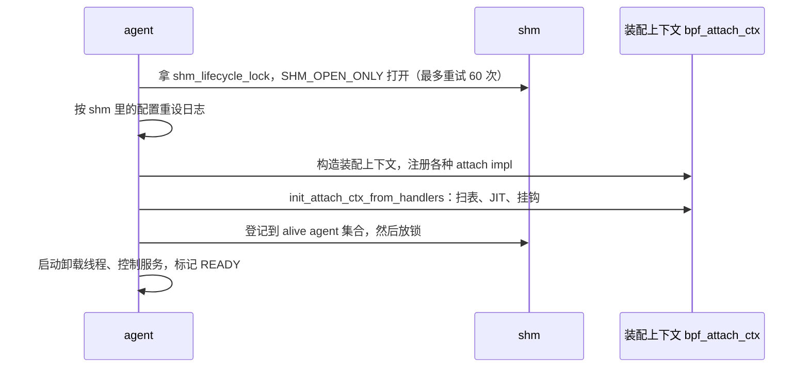

# 3. agent 与 syscall-server：两个 LD_PRELOAD 入口层

> 一句话：bpftime 有两个注入用的 .so。syscall-server 注入 loader（如 sslsniff），把 libbpf
> 发出的 `bpf()`、`perf_event_open()`、`mmap()`、epoll 调用骗进共享内存；agent 注入被追踪的
> 目标进程（如 nginx），从同一块共享内存读出 handler，真正把钩子挂上。读完本章，你能说清楚
> loader 调 `bpf(2)` 为什么没进内核、libbpf `mmap` 到的 perf buffer 是哪来的、agent 是怎么在
> `main` 之前启动并装配钩子的。
>
> 前置：建议先读[第 2 章](02-runtime-shm.md)（shm 与 handler 表）。预计用时：90 分钟。

## 本章要回答的问题

- 为什么 loader 和目标进程**各**需要一个 .so，而不是一个就够？
- loader 调 `bpf(2)` 时，为什么没有进内核？拦截是怎么做到的？
- libbpf 以为自己 `mmap` 了内核的 perf ring，实际拿到的是什么？
- agent 怎么抢在目标进程的 `main` 之前跑起来？它从 handler 表到真正挂上钩子经过了哪几步？
- 注入的代码出了错（比如 shm 不够用），宿主进程会被弄死吗？

## 3.1 为什么需要两个 .so

一次 bpftime 追踪涉及两个进程，它们要做的事完全不同：

- **loader（控制面）**：它跑的是 libbpf，会发一串 `bpf()`、`perf_event_open()`、`mmap()`
  调用来建 map、加载 prog、创建 uprobe、准备 perf buffer。bpftime 要做的是**让这些调用别进
  内核**，改成往 shm 的 handler 表里写记录。这需要一个"拦截器"——syscall-server。
- **目标进程（数据面）**：被追踪的函数在这个进程里执行。要在函数入口跑 eBPF 程序，就必须
  有代码**住在这个进程里**：读 handler 表、JIT 编译 prog、改写目标函数的指令。这是 agent 的活。

两边要的东西不一样，又分处两个地址空间，所以是两个 .so。它们之间唯一的联系就是第 2 章讲的
那块 shm。

| | syscall-server | agent |
|---|---|---|
| 注入到谁 | loader（如 sslsniff） | 目标进程（如 nginx） |
| 怎么进入 | `LD_PRELOAD` 覆盖 libc 函数 | `LD_PRELOAD` 劫持 `__libc_start_main`，或 Frida 运行时注入 |
| 对 shm | 建段、写 handler 表 | 只打开、读表 |
| 核心工作 | 把 libbpf 的系统调用改写成写表 | 按表 JIT prog、挂 uprobe、运行 eBPF |

下面这张图要看的是：两个 .so 各住一个进程，彼此不直接通信，全靠 shm。



还有一个容易踩的点：两个 .so 都只是"薄壳"，真正干活的代码在 runtime 库里，而 runtime 是
**静态库**，分别链进了两个 .so。也就是说，同一份 map/helper 代码在两个进程里各有一份拷贝，
**全局变量互不相通**，真正共享的只有 shm 里的数据。在 agent 里打印 loader 侧的某个全局变量，
是新手常犯的错误。

> **C++/Linux 小知识：`LD_PRELOAD` 符号覆盖与 `dlsym(RTLD_NEXT)`**
> 动态链接器解析一个函数名（比如 `mmap`）时，按加载顺序在各个 .so 里找，第一个找到的
> 就用。`LD_PRELOAD` 指定的 .so 排在最前面，所以只要它导出了一个同名函数，程序（以及
> libbpf 等其他库）调用 `mmap` 时就会进到它的版本里——这就是"符号覆盖"。覆盖后如果还想
> 调用真正的 libc 版本，用 `dlsym(RTLD_NEXT, "mmap")`：意思是"在查找顺序里排在我后面的
> 那个 `mmap`"。syscall-server 和 agent 都靠这一对机制工作。

**要点**

- 控制面要"拦截"，数据面要"驻留执行"，所以是两个 .so。
- 两个 .so 各链一份 runtime 静态库；进程间只共享 shm 数据，不共享代码和全局变量。

## 3.2 设计原则：注入的代码不能把宿主搞挂

syscall-server 和 agent 都运行在**别人的进程**里。sslsniff、nginx 不知道也不关心 bpftime
存在。所以 bpftime 给所有注入代码定了一条原则：**我是客人。我出了错，只能关掉我自己的功能，
不能连累主人。**

官方仓库把它写成了"注入代码的宿主进程契约"，归纳起来是三条：

1. **不终止宿主**：初始化、配置、内存分配、执行中任何一步失败，都不能 `exit`/`abort`。
   要么返回错误，要么记下来，然后只关掉受影响的那项 bpftime 功能。
2. **不碰宿主的 stdin/stdout/stderr**：日志默认写到文件里，除非用户显式要求输出到控制台。
3. **不乱换宿主的信号处理函数**：要换就得保存原来的并正确链式调用。

这种"出错就放行，退回原本的行为"的做法叫 **fail-open**。在本章的代码里，它体现为几个
反复出现的模式：

- syscall-server 的每个拦截函数都包了一层异常兜底：bpftime 这边抛了异常，就改为调用
  原始的 libc 函数——比如 `bpf()` 就真的发给内核。
- syscall-server 初始化失败后，**本进程内的拦截永久关闭**，之后所有调用直接走原始路径。
- agent 初始化中途失败，会把已经做的事回滚掉，然后返回，不驻留、不挂钩。
- 日志默认写 `~/.bpftime/runtime.log`，路径不可用就干脆不写，绝不退到终端上。

fail-open 有一个必须知道的副作用：**bpftime 失效时是静默的**。你在终端上看不到任何报错，
现象可能是"探针没生效"或者"请求落到了真内核"（没权限时就是 `EPERM`）。排障第一步永远是
看日志文件（或 `BPFTIME_LOG_OUTPUT` 指定的位置）。

实现细节（具体哪个函数怎么兜底）放在本章深入参考里；下文遇到时也会顺手点一下。

**要点**

- 原则：注入的代码出错时只关掉自己，退回宿主原本的行为，不终止、不碰 stdio。
- 代价：失效是静默的，排障先看 bpftime 的日志文件。

---

下面四节讲 syscall-server：**拦截 → 分流 → 处理 `bpf()` → mock perf event 与 mmap**。

## 3.3 syscall-server ①：拦截，以及如何安全地"晚起床"

### 拦截了哪些函数

syscall-server 导出了一批与 libc 同名的函数，靠 `LD_PRELOAD` 覆盖它们：

- `syscall()`：libbpf 发 `bpf` 命令时不走 glibc 包装函数，而是直接
  `syscall(__NR_bpf, ...)`。所以必须连 `syscall()` 本身一起覆盖。
- `mmap` / `mmap64` / `munmap`：perf buffer、ringbuf、可 mmap 的 array map 都要映射。
- `epoll_create1` / `epoll_ctl` / `epoll_wait`：libbpf 用 epoll 等 perf buffer 有数据。
- `ioctl`：`PERF_EVENT_IOC_ENABLE`、`PERF_EVENT_IOC_SET_BPF` 等。
- `open` / `openat` / `read` / `close` / `fopen` 系列：libbpf 会读 `/sys` 下的几个文件，
  也会 `close` 假 fd。

### 自己咬自己的问题

拦截层需要一个全局上下文对象 `syscall_context`，里面存着原始 libc 函数的指针、三个 mock
开关等。它不能在 .so 加载时就构造（那时 libc 环境未必就绪），所以等**第一次有调用被拦截时**
再构造。

麻烦在于：构造 `syscall_context` 时要建日志文件，建日志会调 `fopen`——而 `fopen` 正好被
自己拦截了。于是"构造中"的线程又一次进入拦截函数，又一次尝试初始化上下文。如果用普通的
"别人在初始化就等着"逻辑，这个线程会**等它自己**，永远等不到。

解决办法是一个四状态的初始化状态机，加一个**每线程**的"我正在初始化"标志：

> **C++/Linux 小知识：`thread_local` / `__thread`**
> 加了 `thread_local`（C++ 标准写法）或 `__thread`（GCC 扩展）的变量，每个线程各有一份
> 独立的拷贝，一个线程改它不影响别的线程。syscall-server 用它标记"本线程正在构造上下文"：
> 本线程重入时一看标志就知道是自己，直接放行；别的线程看到的还是 0，会老老实实等待。

`runtime/syscall-server/syscall_server_main.cpp` 的 `initialize_ctx`

```cpp
// 0 = 未初始化, 1 = 初始化中, 2 = 完成, 3 = 已禁用
static int ctx_initialized = 0;
static __thread int tls_initializing = 0;    // 每线程一份

static bool initialize_ctx() noexcept
{
	if (tls_initializing)                // 构造期间本线程又进来了：
		return false;                //   返回 false → 调用方走原始 libc
	int state = __atomic_load_n(&ctx_initialized, __ATOMIC_ACQUIRE);
	if (state == 2) return true;
	if (state == 3) return false;        // 曾经构造失败：永久不拦截
	int expected = 0;
	if (__atomic_compare_exchange_n(&ctx_initialized, &expected, 1, /*...*/)) {
		tls_initializing = 1;        // 抢到了：由我来构造
		try {
			new (&context.ctx) syscall_context;  // placement new
		} catch (...) {
			tls_initializing = 0;
			__atomic_store_n(&ctx_initialized, 3, __ATOMIC_RELEASE); // 失败 → 禁用
			return false;
		}
		tls_initializing = 0;
		__atomic_store_n(&ctx_initialized, 2, __ATOMIC_RELEASE);
		return true;
	}
	while ((state = __atomic_load_n(&ctx_initialized, __ATOMIC_ACQUIRE)) == 1)
		sched_yield();               // 没抢到：等别人构造完
	return state == 2;
}
```

几点说明：

- `context` 是一个用 union 包着的全局对象，和第 2 章 §2.7 的 `shm_holder` 是同一招：跳过
  自动构造与析构，改为第一次需要时 placement new、并且永不析构（进程退出时别的线程可能还在
  拦截函数里跑）。
- 状态 3 是 fail-open 原则的体现：构造抛异常（比如某个原始 libc 符号解析不到）时，不把异常
  抛给宿主，而是从此不再拦截任何东西。
- `initialize_ctx()` 返回 `false` 时上下文不可用，自然也拿不到上下文里存的原始函数指针。
  所以 syscall-server 另备了一套**不依赖上下文**的"原始符号"缓存，同样用 `dlsym(RTLD_NEXT)`
  解析，专供这种情况使用。

**要点**

- `syscall()` 本身也要覆盖，因为 libbpf 直接用它发 `bpf` 命令。
- 上下文懒初始化；`__thread` 标志防止构造过程中自己等自己；构造失败就永久放行。

## 3.4 syscall-server ②：分流，以及启动

### `syscall()` 分流表

每个被覆盖的 libc 函数都是同一个形状：准备一个"调用原始函数"的 lambda，再准备一个"走
bpftime 处理"的 lambda，交给一个兜底包装去执行——上下文不可用、或处理过程中抛了异常，就调
原始函数。`syscall()` 多了一步：先按系统调用号分流。

`runtime/syscall-server/syscall_server_main.cpp` 的 `syscall`

```cpp
extern "C" long syscall(long sysno, ...)
{
	va_list args;
	va_start(args, sysno);
	long arg1 = va_arg(args, long);  // 一律读 6 个参数：多读无害，少读就错了
	/* ... arg2 ~ arg6 同理 ... */
	va_end(args);
	if (!initialize_ctx())           // 上下文不可用 → 原始 syscall
		return fallback_syscall(sysno, arg1, arg2, arg3, arg4, arg5, arg6);
	auto call_original = [&]() {
		return context->orig_syscall_fn(sysno, arg1, arg2, arg3, arg4, arg5, arg6);
	};
	if (sysno == __NR_bpf) {         // bpf(cmd, attr, size)
		return handle_exceptions(
			[&]() { return context->handle_sysbpf((int)arg1,
					(union bpf_attr *)arg2, (size_t)arg3); },
			call_original);  // 抛异常 → 真的发给内核
	} else if (sysno == __NR_perf_event_open) {
		/* 同样形状 → handle_perfevent */
	} else if (sysno == __NR_dup3)        { /* → handle_dup3：复制 map fd */ }
	  else if (sysno == __NR_memfd_create){ /* → handle_memfd_create */ }
	return call_original();          // 其余系统调用原样放行
}
```

`handle_exceptions` 就是 3.2 节说的异常兜底：`try` 里跑 bpftime 的处理，`catch` 到任何异常
（包括 shm 不够用时 Boost 抛的 `bad_alloc`）就记日志、改调 `call_original`。

注意 `syscall()` 分流表只是**第二道网**。libbpf 多数时候调的是 `mmap`、`ioctl`、`epoll_wait`
这些 glibc 包装函数，它们由同名的函数覆盖直接拦下，那是第一道网。

### 三个 mock 开关

进入 `syscall_context` 的各个处理函数后，几乎每个开头都有同样一句检查：

```cpp
if (!enable_mock || initializing_cuda || !enable_mock_after_initialized)
	return orig_xxx_fn(...);   // 任一开关不允许 → 原样放行
```

它们解决的是同一个问题：**bpftime 自己发出的系统调用，必须绕过自己的拦截**。

| 开关 | 什么时候不允许 mock |
|---|---|
| `enable_mock` | 构造上下文、建日志期间；`start_up`（见下）执行期间——启动代码自己要真的 `open`、`mmap` |
| `initializing_cuda` | CUDA 驱动初始化期间（驱动会发大量真实的 ioctl / mmap） |
| `enable_mock_after_initialized` | runtime 内部需要临时调用真系统调用时；**启动失败后永久为 false** |

读主线时可以把三个开关都当成"允许"，把每个分支里的 `run_with_kernel`（让 bpftime 和内核
eBPF 混合运行的模式）也先跳过。

### 启动：第一次拦截时建 shm

shm 不是在 .so 加载时建的，而是在**第一个真正需要 mock 的调用**到来时，由 `try_startup()`
调 `start_up()` 完成。`start_up` 只能跑一次。

> **C++/Linux 小知识：`std::call_once`**
> `std::call_once(flag, f)` 保证：不管多少线程同时调用，`f` 只会被执行一次；其他线程会
> 等那一次执行完再返回。syscall-server 用它包住启动逻辑，因为 libbpf 的第一批调用可能来自
> 任意线程。

`start_up` 的流程如下（shm 本身的结构、打开方式、epoch 机制见[第 2 章](02-runtime-shm.md)）：

```
start_up(ctx)                         仅执行一次（call_once）
  ├ 拿 shm_lifecycle_lock             与 agent 打开 shm、自己退出时删段互斥（第 2 章 §2.5）
  ├ 先用 SHM_CREATE_ONLY 建段
  │    成功 → 本进程是这段 shm 的"所有者"
  │    已存在 → 退回 SHM_CREATE_OR_OPEN 复用旧段（不是所有者）
  ├ atexit(退出清理)                  所有者退出时：没有活 server、没有活 agent 才删段
  ├ 把自己的 pid 登记进 alive syscall-server 集合
  ├ begin_new_session()               epoch 奇 → 清表 → 偶（第 2 章 §2.5）
  ├ 注册 mock 开关回调                 runtime 内部可借它临时关掉 mock
  ├ 用当前环境变量整体覆盖 shm 里的 runtime_config
  └ setenv("BPFTIME_USED", "1")
```

如果 `start_up` 里任何一步抛异常（典型情况是 shm 空间不够），这个异常会被存起来，以后每次
调用都重新抛出；`try_startup` 第一次捕获到它时就把 `enable_mock_after_initialized` 置为
false。结果是：**当次调用由异常兜底退回原始操作，之后的所有调用在开关检查处直接放行**。
bpftime 在这个进程里就此失效，但 loader 照常运行。

**要点**

- 每个拦截函数 = "bpftime 处理" + "原始调用"两个 lambda，异常时自动退回原始调用。
- 三个 mock 开关的共同目的：bpftime 自己的系统调用不被自己拦截。
- shm 在第一次需要 mock 时由 `start_up` 建立，只执行一次；失败后本进程永久放行。

## 3.5 syscall-server ③：`handle_sysbpf` 的三个 case

`handle_sysbpf` 是一个按 `bpf` 命令号分支的大 `switch`。挑三个最重要的看。先记住一个
容易坑人的事实：**没实现的命令走 `default` 分支，静默地发给真内核**，不会报"未实现"。调试
时遇到权限错误或诡异行为，先想想是不是落到了这里。

### `BPF_MAP_CREATE`：建一个 map

主线只有一件事：把 `bpf_attr` 里的 map 参数抄进 bpftime 自己的 `bpf_map_attr`，然后
调 `bpftime_maps_create(-1, ...)`。`-1` 的意思是"让 shm 帮我分配 fd"。接下来就是第 2 章
§2.6 讲过的流程：借一个 `/dev/null` 真 fd 当号码、在 handler 表里放一个 map handler、在 shm
里匿名构造数据容器。返回的号码交给 libbpf，它以为这是内核发的 map fd。

### `BPF_PROG_LOAD`：加载一个 prog

`runtime/syscall-server/syscall_context.cpp` 的 `syscall_context::handle_sysbpf`（`BPF_PROG_LOAD` 分支，节选）

```cpp
case BPF_PROG_LOAD: {
	std::optional<std::string> simple_section_name;
	if (attr->prog_type == BPF_PROG_TYPE_TRACEPOINT)
		simple_section_name = "tracepoint";
	else if (attr->prog_type == BPF_PROG_TYPE_SOCKET_FILTER)
		simple_section_name = "uprobe";
#ifdef ENABLE_BPFTIME_VERIFIER
	/* 只有上面两种类型才会过用户态 verifier；
	   STRICT 模式失败 → errno=EINVAL 返回 -1；WARNING 模式只告警 */
#endif
	int id = bpftime_progs_create(-1,       // 让 shm 分配 fd
		(ebpf_inst *)attr->insns, attr->insn_cnt,
		attr->prog_name, attr->prog_type);
	return id;                              // 字节码整段拷进 shm 的 prog handler
}
```

关键是最后那一步：**loader 侧不做 JIT，只把字节码存进 shm**。编译发生在 agent 侧
（[第 5 章](05-vm-llvm-jit.md)）。

### `BPF_LINK_CREATE`：把 prog 和事件关联起来

`runtime/syscall-server/syscall_context.cpp` 的 `syscall_context::handle_sysbpf`（`BPF_LINK_CREATE` 分支，节选）

```cpp
case BPF_LINK_CREATE: {
	auto prog_fd = attr->link_create.prog_fd;     // 前面 PROG_LOAD 返回的假 fd
	auto target_fd = attr->link_create.target_fd; // 前面 perf_event_open 返回的假 fd
	auto attach_type = attr->link_create.attach_type;
	int id = bpftime_link_create(-1,              // 在表里放一个 link handler：
		(bpf_link_create_args *)&attr->link_create); // 记下 prog_fd ↔ target_fd
	if (id < 0 && bpftime_is_prog_fd(prog_fd) &&
	    bpftime_is_perf_event_fd(target_fd) &&
	    attach_type == BPF_PERF_EVENT) {          // 兜底：换一条路径再建一次
		auto cookie = attr->link_create.perf_event.bpf_cookie;
		id = bpftime_attach_perf_to_bpf_with_cookie(target_fd, prog_fd, cookie);
	}
	return id;
}
```

link 只是 shm 里的一条"prog ↔ perf event"关系记录，**此刻什么都还没挂上**。真正插桩要等
agent 扫表扫到这条 link（§3.8 和[第 4 章](04-attach-frida.md)）。老式的挂载方式
（`ioctl(PERF_EVENT_IOC_SET_BPF)` 和 `BPF_PROG_ATTACH`）也被 mock 了，最终落到同一个
"在表里记一条关系"的函数上；`ioctl(PERF_EVENT_IOC_ENABLE)` 也只是把 perf handler 的
`enabled` 标志置真。

这带来一个排障要点：loader 侧看起来一切成功，**不代表探针真的挂上了**。如果 agent 没起来
或者装配失败，loader 完全察觉不到。

**要点**

- 三个 case 都只是往 handler 表里写东西：map 描述、字节码、关系记录。
- loader 侧既不 JIT 也不挂钩；没实现的 `bpf` 命令静默发给真内核。

## 3.6 syscall-server ④：perf event 与 mmap 的 mock

这一节对应 libbpf 创建 uprobe 和 perf buffer 的那几步。

### 先骗过 `/sys` 下的几个文件

libbpf 创建 uprobe 前，会读 `/sys/bus/event_source/devices/uprobe/type` 来确定 uprobe 的
perf 类型号，还会读 `.../uprobe/format/retprobe` 确定"返回探针"用哪一位。bpftime 不想依赖
宿主的 `/sys`（比如容器里可能没有），于是连文件都 mock 了：只要被拦截的 `open`/`openat`/`fopen`
打开的是这几个固定路径（uprobe、kprobe 各两个），就返回一个内容由 bpftime 指定的"文件"——
uprobe 类型号固定是 9。

"文件"本身是用 `mkstemp` 建出来、随即 `unlink` 掉的临时文件，这样能拿到一个真实 fd，
又不会在磁盘上留下垃圾。注意它和第 2 章的假 fd（`/dev/null`）是两套机制，不要混淆。

### `perf_event_open`：写一张"说明书"

`handle_perfevent` 按 `attr->type` 分支。uprobe 分支按 libbpf 的编码约定从 `attr` 里拆出
参数：

```
attr->type == uprobe 类型号（9）
retprobe    = attr->config 的"返回探针"位
ref_ctr_off = attr->config 的高位
name        = (const char *)attr->config1   // 目标 ELF 路径
offset      = attr->config2                 // 函数在文件里的偏移
→ bpftime_uprobe_create(-1, pid, name, offset, retprobe, ref_ctr_off)
  → 借一个假 fd，在表里放一个 perf handler，内容就是上面这几项
```

也就是说，**loader 侧的"perf event"只是一张说明书**："请在 pid 进程里、name 文件的 offset
处挂一个 uprobe"。执行者是 agent。

`PERF_TYPE_SOFTWARE` 分支则不同：libbpf 建 perf buffer 时会为每个 CPU 开一个软件 perf event。
bpftime 为它在 shm 里建一个 perf handler，指向一个匿名的 perf buffer 对象（第 2 章 §2.3）。

### `mmap`：直接递出 shm 里的指针

libbpf 拿到每个 CPU 的 perf event fd 后，会 `mmap(fd, 页数)` 把内核的环形缓冲映射进来。
bpftime 拦下这个调用，直接返回 shm 里那块缓冲区的地址：

`runtime/syscall-server/syscall_context.cpp` 的 `syscall_context::handle_mmap64`（节选）

```cpp
/* ...前面还有 ringbuf map、可 mmap 的 array map 两个分支... */
} else if (fd != -1 && bpftime_is_software_perf_event(fd)) {
	errno = 0;
	if (auto ptr = bpftime_get_software_perf_event_raw_buffer(fd, length);
	    ptr != nullptr) {
		mocked_mmap_values.insert((uintptr_t)ptr); // 记账，munmap 时认出它
		return ptr;   // 直接返回 shm 内的指针！根本没有发生真正的 mmap
	}
	if (errno == 0)
		errno = ENOMEM;
	return MAP_FAILED;    // 长度不合法(EINVAL)或 shm 不够(ENOMEM)：如实告诉 libbpf
}
/* 不认识的 fd：调原始 mmap */
```

拿缓冲区的函数会检查长度（必须是"一页 + 2 的幂页"，和内核要求一致），必要时在 shm 里把
缓冲区扩容。缓冲区开头一页照内核格式放 `perf_event_mmap_page`（里面有 `data_head`、
`data_tail`），后面跟数据区。所以 **libbpf 的消费代码（读 head、搬记录、写 tail）原封不动
就能工作**——它以为自己在读内核的 perf ring，其实读的是 boost shm 里一个普通 vector。

### `epoll_wait`：等数据时顺便搬运

libbpf 用 `epoll_wait` 等 perf buffer 有数据。bpftime 的 `epoll_wait` 会依次问每个登记过的
perf buffer "有数据吗"，而这个询问函数**先把各生产线程 shard 里的记录搬（drain）进 loader
读的那个环**，再看环里有没有东西。没有数据时最多等 1ms 再扫一轮，期间允许 `SIGINT`/`SIGTERM`
打断它（行为细节见本章深入参考）。

下面这张图要看的是：一条记录从目标进程里的 eBPF 程序出发，经过 shm，被 loader 里原生的
libbpf 代码读走，全程没有经过内核。



**要点**

- `/sys` 的几个 uprobe/kprobe 描述文件被 mock，uprobe 类型号固定为 9。
- `perf_event_open` 在 loader 侧只写说明书；软件 perf event 对应 shm 里的一个 perf buffer。
- `mmap` 直接返回 shm 内的指针；失败时如实返回 `MAP_FAILED`，不会退到真 mmap。

---

下面两节讲 agent：**启动 → 读 handler 表 → 装配 attach**。

## 3.7 agent ①：启动——抢在 `main` 之前

agent 要在目标进程的业务代码跑起来之前就把钩子挂好。它有三种进入方式，最后都汇到同一个
入口函数 `bpftime_agent_main`：

1. **`LD_PRELOAD` 启动**：agent 覆盖了 glibc 的 `__libc_start_main`。这个函数是 C 程序
   真正的入口，由它调用 `main`。agent 的版本把 `main` 换成自己的一个包装函数，包装函数先
   调 `bpftime_agent_main`，再调真正的 `main`。
2. **Frida 运行时注入**（`bpftime attach <pid>`）：进程已经在跑，Frida 把 agent 加载进去，
   直接调用导出的 `bpftime_agent_main`。
3. **syscall trace 模式**：另一个组件先把系统调用转发钩子装好，再进入 `bpftime_agent_main`。

第一种方式的代码很短：

`runtime/agent/agent.cpp` 的 `__libc_start_main` 与 `bpftime_hooked_main`

```cpp
extern "C" int bpftime_hooked_main(int argc, char **argv, char **envp)
{
	int stay_resident = 0;
	injected_with_frida = false;
	bpftime_agent_main("", &stay_resident);   // 先初始化 agent
	return orig_main_func(argc, argv, envp);  // 再跑真正的 main
}

extern "C" int __libc_start_main(int (*main)(int, char **, char **), int argc,
				 char **argv, /* init, fini, rtld_fini, stack_end */ ...)
{
	orig_main_func = main;                    // 记下真正的 main
	auto orig = (decltype(&__libc_start_main))
		dlsym(RTLD_NEXT, "__libc_start_main"); // 找到 glibc 的版本
	return orig(bpftime_hooked_main, argc, argv, /* ... */); // 把 main 偷换掉
}
```

进入 `bpftime_agent_main` 后，第一件事是防止**重复初始化**。同一个进程里 agent 可能被加载
两次（比如先 `LD_PRELOAD`、后来又被 Frida 注入一次），也可能被并发调用。所以开头有三道
检查：

- 本进程里已经有一个 agent 在跑控制服务？→ 把请求转发给它，自己返回。
- 本进程里已经加载了另一份 agent？→ 调它的控制函数，自己返回。
- 用原子比较交换把状态从"未初始化"改成"初始化中"，失败说明别人正在初始化或已经完成
  → 直接返回（除非请求里带了"强制重新装配"，那就走刷新流程）。

读主线时这三道检查都可以跳过，只需要知道：**每个进程里最多只有一个 agent 实例在工作**，
它通过一个只在进程内可见的 unix socket（名字是 `bpftime-agent-<pid>`）接受"刷新 / 卸载 /
查询状态"请求。`bpftime trace` 的二次 attach、刷新、卸载都走这条通道。

**要点**

- `LD_PRELOAD` 时 agent 靠覆盖 `__libc_start_main` 抢在 `main` 之前初始化。
- 入口处三道防重入检查，保证每个进程只有一个 agent 实例在工作。

## 3.8 agent ②：读 handler 表并装配 attach

通过防重入检查之后，agent 的主线可以分成三段：打开 shm、准备装配器、按表装配。

下面这张图要看的是主线的先后顺序，尤其是"打开 shm"和"登记 pid"之间一直持着一把锁。



### 打开 shm：为什么要重试、为什么要拿锁

agent 用 `SHM_OPEN_ONLY` 打开 shm——不存在就失败。但在"先启动目标进程、再启动 loader"的
工作流里，agent 初始化时 loader 可能还没来得及建 shm。所以 agent 最多重试 60 次、每次间隔
50ms，给 loader 最多 3 秒。仍然失败就回滚返回（fail-open：目标进程照常跑，只是没有探针）。

每次尝试前都先拿 `shm_lifecycle_lock`（第 2 章 §2.5 的那把文件锁），**成功打开后一直持有，
直到把自己的 pid 登记进 alive agent 集合**。原因是：loader 退出时会检查"还有没有活着的 agent"
来决定要不要删段。如果 agent 刚打开 shm、还没登记，loader 恰好在这时检查，就会以为没人在用而
把段删掉。持锁把这两件事串行化了。

### 准备装配器

- **重设日志**：shm 里的 `runtime_config` 记着 loader 指定的日志路径，agent 按它重新设置
  日志（初始化最早期用的是一个按环境变量建的临时日志）。
- **构造装配上下文** `bpf_attach_ctx`：它也是用 union 包着的全局对象（和 §3.3、第 2 章
  §2.7 同一招），多了显式的 `init()` / `destroy()`，方便失败时回滚。
- **注册 attach impl**：attach impl 是"某一类钩子怎么挂"的实现。agent 按编译选项注册
  syscall trace 的实现，以及一个 uprobe 后端——平台支持断点式（trap）后端时用它，否则用
  Frida（[第 4 章](04-attach-frida.md)）。

### 按表装配

核心一步是 `init_attach_ctx_from_handlers`。它扫一遍 handler 表：

- 遇到 prog → 取出字节码，在本进程里建 VM、JIT 编译（[第 5 章](05-vm-llvm-jit.md)）。
- 遇到 uprobe 说明书 → 交给 uprobe 后端去改写目标函数的指令。
- 遇到 link → 把对应的 prog 挂到对应的事件上。

扫表前后它会各读一次 epoch 计数器，确保没有读到"一半旧一半新"的表——这正是第 2 章 §2.5
的 seqlock 读侧。扫表失败（包括 epoch 一直不稳定）同样走回滚。

装配成功后：登记 alive pid、放锁；启动一个后台"卸载线程"；启动进程内控制服务；为 `SIGUSR1`
装上处理函数；最后告诉注入方"请让我常驻"，并把状态标成 READY。注意这些"让自己常驻"的动作
**都放在所有初始化成功之后**——中途任何一步失败，回滚函数会把已经做的事逐项撤销（停线程、
关管道、析构装配上下文、从 alive 集合摘掉 pid、状态改回"未初始化"），然后安静地返回。

装配之后 agent 还可以再扫表：如果启动参数里带了自动刷新间隔，会有一个线程定期重扫；也可以
通过控制服务发"刷新"请求。这就是为什么 loader 先跑、agent 后跑，或者 agent 先跑、loader
后跑，最终都能对上。

### 卸载：`SIGUSR1` → 管道 → 工作线程

收到 `SIGUSR1` 时 agent 要拆掉所有钩子。但信号处理函数里能做的事非常有限：它可能打断了一个
正持有 malloc 内部锁的线程，这时在处理函数里再调 malloc、加锁、打日志，就可能死锁。只有少数
"异步信号安全"的函数可以在里面调用。

所以 agent 的处理函数只做两件安全的事：一次原子加法，和往一个管道里 `write` 一个字节。

`runtime/agent/agent.cpp` 的 `sig_handler_sigusr1_detach`

```cpp
static void sig_handler_sigusr1_detach(int sig)
{
	(void)sig;
	// Async-signal-safe: do not call spdlog / malloc / locks here.
	auto_refresh_epoch.fetch_add(1, std::memory_order_acq_rel); // 让自动刷新线程退出
	int fd = detach_pipe_fds[1];
	if (fd >= 0) {
		uint8_t one = 1;
		ssize_t ignored = write(fd, &one, 1);  // 唯一的"重活"：通知工作线程
		(void)ignored;
	}
}
```

真正的卸载（拿锁、join 线程、拆钩子、打日志）由一个预先启动好的工作线程完成：它阻塞在管道
的读端，读到字节、并确认 agent 处于 READY 状态后，在普通线程上下文里执行。这是处理信号的
标准模式：**处理函数只装一次、里面只做安全操作、重活交给普通线程**。

**要点**

- 打开 shm 最多重试 3 秒；从打开到登记 pid 一直持锁，防止 loader 退出时误删段。
- `init_attach_ctx_from_handlers` 按表 JIT、挂钩，并用 epoch 保证读到一致的表。
- "常驻"相关动作都在成功之后；任何一步失败都完整回滚，宿主照常运行。
- `SIGUSR1` 处理函数只写管道，卸载由工作线程完成。

## 小结

- loader 需要拦截（控制面），目标进程需要驻留执行（数据面），所以有 syscall-server 和 agent 两个 .so；两者只靠 shm 交流，代码和全局变量各有一份。
- 两个 .so 都靠 `LD_PRELOAD` 符号覆盖进入，靠 `dlsym(RTLD_NEXT)` 找回原始函数。
- 设计原则是 fail-open：注入的代码出错只关掉 bpftime 自己的功能，退回原始行为，不终止宿主、不碰 stdio；代价是失效时静默，要看日志。
- syscall-server 懒初始化上下文，用 `__thread` 标志解决"构造中自己拦截自己"的死锁；shm 在第一次需要 mock 时由 `start_up` 建立，只执行一次。
- `handle_sysbpf` 只往 handler 表里写：map 描述、prog 字节码、link 关系。没实现的命令静默发给真内核。
- `perf_event_open` 在 loader 侧只是说明书；`mmap` 直接返回 shm 里 perf buffer 的指针，libbpf 的原生消费代码照常工作。
- agent 靠覆盖 `__libc_start_main` 抢在 `main` 之前启动；打开 shm 时重试并持锁，然后扫表、JIT、挂钩，成功后才常驻。
- loader 侧"一切成功"不代表探针已挂上；真正的插桩发生在 agent 侧。

## 动手验证

以下命令里 `B` 指你的 bpftime build 目录，示例程序来自官方仓库的 `example/malloc`。

1. **看两个 .so 覆盖了哪些符号。**
   ```bash
   nm -D --defined-only $B/runtime/syscall-server/libbpftime-syscall-server.so \
     | grep -wE 'syscall|mmap|mmap64|munmap|ioctl|epoll_wait|epoll_ctl|open|openat|fopen|close|read'
   nm -D --defined-only $B/runtime/agent/libbpftime-agent.so \
     | grep -wE '__libc_start_main|bpftime_agent_main'
   ```
   预期 syscall-server 导出了一串与 libc 同名的函数；agent 导出了 `__libc_start_main` 和
   `bpftime_agent_main`。这就是 `LD_PRELOAD` 能"接管"它们的前提。

2. **确认 `bpf()` 没有进内核。**
   ```bash
   strace -f -e trace=bpf,perf_event_open \
     env LD_PRELOAD=$B/runtime/syscall-server/libbpftime-syscall-server.so \
         BPFTIME_LOG_OUTPUT=console SPDLOG_LEVEL=debug \
     example/malloc/malloc
   ```
   预期 strace 里几乎看不到 `bpf(` 和 `perf_event_open(`——它们都被拦在了用户态。如果看到了
   个别 `bpf(` 调用，那很可能是 `handle_sysbpf` 没实现、走 `default` 放行到内核的命令（§3.5）。
   stderr 上的 bpftime 日志里能看到建 map、加载 prog 的记录（Release 构建可能把 debug 级日志
   编译掉，此时只剩 info 级）。

3. **亲眼看 fail-open。** 把 handler 表容量调到上限，让 50MB 的 shm 放不下它：
   ```bash
   BPFTIME_MAX_FD_COUNT=1048576 BPFTIME_LOG_OUTPUT=console \
     LD_PRELOAD=$B/runtime/syscall-server/libbpftime-syscall-server.so \
     example/malloc/malloc; echo "exit=$?"
   ```
   预期日志里出现 `Boost interprocess bad_alloc` 和 `Falling back to the original host
   operation`；loader 没有被 bpftime 杀掉，后续的 `bpf()` 被放行给真内核——非 root 时 loader
   会因为 `EPERM` 自己报错退出，用 root 跑甚至可能真的在内核里加载成功。这就是"出错时退回
   原始行为"。

## 自测题

1. **既然两个 .so 都链了完整的 runtime，为什么不能只用一个 .so 同时注入 loader 和目标进程？**
   <details><summary>答案</summary>

   能不能共用一份二进制不是重点，重点是两个进程要做的事不同：loader 侧需要覆盖 libc 函数，
   把 libbpf 的系统调用改写成写表；目标进程侧需要在业务代码运行前初始化、读表、JIT、改写函数
   指令。如果把 syscall-server 的那批覆盖函数放进目标进程，nginx 自己的 `mmap`、`epoll_wait`、
   `close` 也会被拦截；反过来 loader 里也不需要挂钩。职责和注入方式都不同，所以拆成两个。
   </details>

2. **libbpf 调 `bpf(BPF_LINK_CREATE)` 成功返回后，nginx 里的 `SSL_write` 已经被插桩了吗？**
   <details><summary>答案</summary>

   没有。loader 侧的 `BPF_LINK_CREATE` 只在 handler 表里写了一条"prog ↔ perf event"的关系
   记录。真正插桩发生在 agent 侧的 `init_attach_ctx_from_handlers` 扫表时：读出 uprobe
   说明书，由 uprobe 后端改写目标函数的指令，再 JIT 编译 prog。所以 agent 必须在 loader 写完
   表之后扫表——要么后启动，要么靠自动刷新或控制服务的"刷新"请求重扫。
   </details>

3. **`initialize_ctx` 里的 `tls_initializing` 为什么必须是每线程变量？换成一个普通全局变量会怎样？**
   <details><summary>答案</summary>

   它要区分"本线程在构造过程中重入"和"别的线程在等构造完成"。本线程重入时必须立刻返回
   false 走原始 libc，否则会在等待分支里等自己，永远等不到。如果换成全局变量，构造期间
   **所有**线程都会看到它为 1，别的线程就不会等待，而是直接走原始 libc——这一次调用会绕过
   bpftime（比如某个 `bpf()` 被直接发给内核），造成难以复现的错误行为。
   </details>

4. **loader 的 `mmap(perf fd)` 拿到的内存来自哪里？分配失败时 libbpf 看到什么？**
   <details><summary>答案</summary>

   来自 shm：`handle_mmap64` 认出这是软件 perf event 的假 fd，就返回 shm 里那块 perf buffer
   的起始地址，全程没有发生真正的 mmap。libbpf 能照常消费，是因为这块内存开头一页按内核格式
   放了 `perf_event_mmap_page`。如果长度不合法（`EINVAL`）或 shm 不够扩容（`ENOMEM`），
   `handle_mmap64` 返回 `MAP_FAILED` 并保留 errno，不会退到真 mmap。
   </details>

5. **agent 为什么要在"打开 shm"到"登记 pid"之间一直持有 `shm_lifecycle_lock`？**
   <details><summary>答案</summary>

   loader（所有者 syscall-server）退出时会在同一把锁下检查 alive agent 集合，没有活 agent
   才删段。如果 agent 打开 shm 后不持锁，loader 可能恰好在 agent 登记之前完成检查，认为没人
   在用而删段，agent 手里就剩一块孤儿映射。持锁到登记完成，就把"agent 开段并登记"和"loader
   检查并删段"串行化了。
   </details>

6. **为什么卸载要绕一圈"信号处理函数 → 管道 → 工作线程"，而不是在处理函数里直接卸载？**
   <details><summary>答案</summary>

   卸载要拿锁、join 线程、拆钩子、打日志（会 malloc），这些都不是异步信号安全的。信号可能
   打断一个正持有 malloc 内部锁或别的锁的线程，在处理函数里再去拿同一把锁就会死锁。处理函数
   只做原子加法和 `write`（都是信号安全的），由预先启动的工作线程从管道读到字节后，在普通
   线程上下文里完成卸载。
   </details>

## 深入参考

<details>
<summary>代码位置速查（按 177a1dc465ff 行号）</summary>

| 概念 / 函数 | 位置 |
|---|---|
| 两个 .so 链入 runtime | `runtime/syscall-server/CMakeLists.txt:27-32`、`runtime/agent/CMakeLists.txt:70-78`；runtime 的 `add_library` 未写 STATIC/SHARED（`runtime/CMakeLists.txt:122-125`） |
| ctx 状态变量、`tls_initializing` | `runtime/syscall-server/syscall_server_main.cpp:34-36` |
| `safe_spdlog_debug` / `safe_spdlog_error` | `syscall_server_main.cpp:47-70` |
| 不依赖 context 的原始符号缓存 | `syscall_server_main.cpp:91-189`（`cached_next_symbol` :91-109、`open_flags_have_mode` :111-120、`resolve_cached_next_symbol` :122-133、`call_next_symbol` :135-146、`fallback_*` :148-189） |
| ctx union、`initialize_ctx` | `syscall_server_main.cpp:191-236` |
| `handle_exceptions` / `call_with_context(_debug)` | `syscall_server_main.cpp:238-280` |
| 各 libc 覆盖函数 | `syscall_server_main.cpp:282-466` |
| `syscall()` 分流表 | `syscall_server_main.cpp:467-534` |
| mock 文件常量（uprobe 类型 9） | `runtime/syscall-server/syscall_context.hpp:34-35` |
| `init_original_functions` | `syscall_context.hpp:96-133` |
| 三个 mock 开关 | `syscall_context.hpp:154-158` |
| `create_unlinked_mock_fd` | `runtime/syscall-server/syscall_context.cpp:84-109` |
| `load_config_from_env`（`BPFTIME_RUN_WITH_KERNEL`） | `syscall_context.cpp:177-194` |
| `syscall_context` 构造函数 | `syscall_context.cpp:196-212` |
| `initialize_cuda` | `syscall_context.cpp:215-234` |
| `try_startup` | `syscall_context.cpp:237-254` |
| `handle_close` / `handle_openat` / `handle_open` / `handle_read` | `syscall_context.cpp:256-362` |
| `handle_sysbpf`（MAP_CREATE :493-553、PROG_LOAD :628-703、LINK_CREATE :704-732、PROG_ATTACH :787-799、default :800-802） | `syscall_context.cpp:482-805` |
| `handle_perfevent`（uprobe :817-842、software :905-910） | `syscall_context.cpp:806-935` |
| `handle_mmap` / `handle_mmap64` | `syscall_context.cpp:937-1008` |
| `handle_ioctl` | `syscall_context.cpp:1010-1068` |
| `handle_epoll_create1` / `_ctl` / `_wait` | `syscall_context.cpp:1070-1122` |
| `handle_munmap` | `syscall_context.cpp:1124-1150` |
| `handle_fopen` | `syscall_context.cpp:1152-1198` |
| `handle_dup3` / `handle_memfd_create` | `syscall_context.cpp:1200-1230` |
| 四个 mock 路径 | `runtime/syscall-server/syscall_server_utils.cpp:42-49` |
| `remove_syscall_server_global_shm`（atexit 清理） | `syscall_server_utils.cpp:56-124` |
| `initialize_global_shm_with_ownership` | `syscall_server_utils.cpp:126-145` |
| `start_up` | `syscall_server_utils.cpp:147-228` |
| `determine_uprobe_perf_type` 等 | `syscall_server_utils.cpp:260-298` |
| `create_mocked_file_based_on_full_path` | `syscall_server_utils.cpp:299-322` |
| `bpftime_set_logger` | `runtime/include/bpftime_logger.hpp:39-93` |
| 默认日志路径 | `runtime/include/bpftime_config.hpp:13` |
| `bpftime_epoll_wait` | `runtime/src/bpftime_shm.cpp:418-539` |
| `get_software_perf_event_raw_buffer` 链 | `bpftime_shm.cpp:568-573` → `bpftime_shm_internal.cpp:1184-1194` → `perf_event_handler.cpp:642-652` → `:611-624` → `:276-305` |
| `drain_producer_shards` / `has_data` | `runtime/src/handler/perf_event_handler.cpp:550-557,589-593` |
| agent 状态枚举、`initialized` | `runtime/agent/agent.cpp:69-73` |
| `injected_with_frida` | `agent.cpp:81` |
| `bpf_attach_ctx_holder` union | `agent.cpp:100-117` |
| `install_agent_bootstrap_logger` | `agent.cpp:128-136` |
| `find_other_loaded_agent_control` | `agent.cpp:162` 起 |
| `make_agent_ipc_addr` / `try_forward_to_existing_agent` | `agent.cpp:206-217,262` 起 |
| IPC 服务线程（`SO_PEERCRED`、请求解析 :333-389） | `agent.cpp:271-417` |
| `perform_detach` | `agent.cpp:419-454` |
| `ensure_detach_worker_started`（工作线程 :508-523） | `agent.cpp:464-529` |
| `bpftime_hooked_main` / `__libc_start_main` | `agent.cpp:535-556` |
| `sig_handler_sigusr1_detach` | `agent.cpp:557-568` |
| `refresh_attach_session` | `agent.cpp:676` 起 |
| `bpftime_agent_main`（`init_fail` :837-878、防重入 :883-923、shm 重试 :927-955、注册 impl :964-1035、装配 :1063-1079、auto-refresh :1082-1136、登记与驻留 :1138-1163） | `agent.cpp:830-1177` |
| `syscall_callback` / `_bpftime__setup_syscall_trace_callback` | `agent.cpp:1182-1212` |
| `run_callbacks` | `attach/syscall_trace_attach_impl/src/syscall_trace_attach_impl.cpp:40-53` |
| CLI 拼装 agent 参数 | `tools/cli/main.cpp:1156-1160` |
| 宿主进程契约 | 仓库根 `CLAUDE.md:147`（`AGENTS.md:147` 同文） |
</details>

<details>
<summary>细节与坑</summary>

**宿主进程契约原文要点**（`CLAUDE.md` "Injected Agent Host-Process Contract"）

- 不得因 bpftime 初始化/配置/分配/执行失败而 `exit`、`_exit`、`abort`、`terminate` 宿主——
  "Return or record the error and disable only the affected bpftime operation."
- 不得写、关、重定向、flush 宿主的 stdin/stdout/stderr，除非用户显式选择；诊断输出（含
  `bpf_trace_printk`）走显式配置的 bpftime sink。
- 不得替换宿主的信号行为，除非恢复或正确链式调用原 handler。
- 失败路径与"默认不终止、不碰 stdio"要有回归测试。

**fail-open 的实现落点**

- `handle_exceptions` 依次捕获 `boost::interprocess::bad_alloc`、`std::exception`、`...`，
  都记日志后 `return fallback()`。`call_with_context` 在 `initialize_ctx()` 失败时直接走 fallback。
- `safe_spdlog_debug` 先判 `spdlog::default_logger_raw()`；`safe_spdlog_error` 还要求
  `ctx_initialized == 2`，构造期间不碰可能未建好的 logger。
- 构造函数先 `enable_mock=false`，按 `BPFTIME_LOG_OUTPUT`（缺省 `~/.bpftime/runtime.log`）
  调 `bpftime_set_logger`，最后才 `enable_mock=true`——logger 建好之前不 mock。
- `bpftime_set_logger`：路径展开失败（空、`$HOME` 缺失、不支持的 `~user`）时装一个
  `null_sink`、level=off 的静默 logger，而不是退到 console；`"console"` 必须显式指定，且写
  **stderr**；文件 sink 是 rotating（5MB × 3）；sink 出错时 error handler 把 logger 关掉。
- `start_up` 失败：异常存进 `g_startup_exception`，每次调用都 `rethrow`；`try_startup` 捕获后
  置 `enable_mock_after_initialized=false` 再重抛。`enable_mock_guard` 的析构在任何出口（含异常）
  把 `enable_mock` 恢复为 true。
- `initialize_global_shm_with_ownership`：`CREATE_ONLY` 抛的不是 `already_exists_error`
  （例如 `bad_alloc`，它也是 `interprocess_exception` 的子类）时，先 `remove` 掉刚建了一半的段
  再重抛。
- 启动失败门闩：一旦失败，本进程内 mock 永久关闭，不会自动重试。
- agent 侧：整个主体包在 `try { ... } catch (...) { init_fail(); }` 里；`init_fail` 只在本次调用
  赢得了初始化（`claimed_initialization`）时才回滚：重置 syscall-trace 全局、停 auto-refresh
  线程、关 detach 管道、析构 ctx、从 alive 集合摘 pid、状态回到 `AGENT_UNINITIALIZED`。
  `init_attach_ctx_from_handlers` 返回非 0（如 epoch 3 轮仍不稳的 `-EAGAIN`）或抛异常、
  alive pid 登记失败、detach 工作线程起不来，都走 `init_fail`。
- syscall trace 回调：`syscall_callback` 把 `dispatch_syscall` 包在 `try/catch` 里，异常或未装
  impl 时退回 `orig_hooker`，都没有则返回 `-ENOSYS`；`run_callbacks` 对每个 BPF 回调单独
  `try/catch`，一个回调抛异常不会打断其余回调和真实 syscall。

**syscall-server 细节**

- `initialize_ctx` 的四个设计点：union 空构造/析构（不在加载期构造、不在退出期析构）；
  CAS + `sched_yield` 自旋（只有一个线程构造）；`tls_initializing`（构造函数里的 `dlsym`、
  `bpftime_set_logger` 建 rotating file sink → `fopen` 会重入）；状态 3（`require_symbol`
  解析失败抛 `std::runtime_error` 时永久禁用）。
- `init_original_functions` 的三个细节：解析失败时 `require_symbol` 抛异常；`orig_mmap64_fn`
  直接设为 `orig_mmap_fn`（都来自 `"mmap"`）；`fopen` 解析不到时退而找 `fopen64`；最后
  `unsetenv("LD_PRELOAD")`——**exec 出的子进程不继承注入**，但 fork 出的子进程带着已加载的
  .so（地址空间一并继承）。fork 场景下 helper 的 pid/tid 缓存由 `pthread_atfork` 回调刷新
  （`bpf_helper.cpp:208-231`）；atexit 清理对非所有者 pid 只做"把自己从 alive server 集合摘掉"
  （`syscall_server_utils.cpp:61-69`）。
- `syscall()` 在非 x86_64 上用 `asm-generic/unistd.h` 取 `__NR_*`（`syscall_server_main.cpp:7-11`）。
  `__NR_ioctl` 分支只记日志不处理——作者假设 ioctl 总从 `ioctl()` 包装函数进来。
- `open`/`openat` 包装只在 `open_flags_have_mode(oflag)`（`O_CREAT` 或 `O_TMPFILE`）时才读
  第三个变参 `mode`，避免读到未传入的参数。
- 开关的翻转者：`enable_mock` 由构造函数和 `try_startup` 翻；`initializing_cuda` 由
  `initialize_cuda()` 翻（`cuda_init_guard` 析构时复位）；`enable_mock_after_initialized` 由
  shm 的 `mock_setter` 回调翻（`syscall_server_utils.cpp:173-180`，CUDA map 构造代码从
  `map_handler.cpp:952` 起经 `set_enable_mock` 调用），以及 `try_startup` 失败时置 false。
- gate 条件不完全一致：`handle_epoll_ctl` 不检查 `initializing_cuda`；`handle_mmap`/`handle_mmap64`/
  `epoll_*`/`munmap`/`dup3` 在 gate 里额外检查 `run_with_kernel`，`handle_sysbpf`/`handle_perfevent`/
  `handle_ioctl` 则在各 case 内部判断。
- `start_up` 的完整顺序：`construct_runtime_config_from_env` → 记下 shm 名与所有者 pid →
  `shm_lifecycle_lock` → `initialize_global_shm_with_ownership` → `atexit(remove_syscall_server_global_shm)`
  → 登记 alive server pid（失败则放弃自动删段）→ [CUDA] `ctx.initialize_cuda()` →
  `begin_new_session()` → `set_mock_setter` → [VERIFIER] 设置可用 helper → `bpftime_set_runtime_config`
  → `setenv("BPFTIME_USED", "1", 0)`。
- 退出清理 `remove_syscall_server_global_shm`：fork 出的子进程（pid ≠ owner）或非所有者只摘自己；
  所有者在锁内摘自己后，依次检查 alive server、alive agent 集合，任一集合快照失败或有活进程就不删。
- mock 文件两条落地路径：`handle_open`/`handle_openat` 用 unlinked 临时 fd，把 `mocked_file_provider`
  挂进 `mocked_files`，之后 `handle_read` 从内存 buf 喂数据，`handle_close` 摘掉；`handle_fopen`
  则把 buf **真正写进**临时文件、`lseek` 回开头、`fdopen(fd, "r")` 返回，stdio 之后读的是真文件
  内容，不经过 `mocked_files`。任一步失败都关 fd 并退回原始 `fopen`。
- mock 是**无条件**的：只要 mock 处于开启状态，打开这四个路径就一定拿到 bpftime 指定的内容，
  不管宿主上真文件是否存在。`determine_uprobe_perf_type` 只在文件不存在时直接返回 9，存在时
  用 `fopen` 去读——按代码推演，这次 `fopen` 发生在 mock 开启的处理函数内部，也会被自己拦截而
  读到 9，所以两边一致。
- `BPF_PROG_LOAD` 的 section 映射：只有 `BPF_PROG_TYPE_TRACEPOINT` → `"tracepoint"`、
  `BPF_PROG_TYPE_SOCKET_FILTER` → `"uprobe"` 两种会过用户态 verifier。libbpf 对 `SEC("uprobe")`
  程序报的类型是 `BPF_PROG_TYPE_KPROBE`，按代码推演这类程序拿不到 section 名，**不会经过
  用户态 verifier**。
- `ioctl(PERF_EVENT_IOC_ENABLE/DISABLE/SET_BPF)` 的 mock 失败时打 WARN 后退回原始 `ioctl`。
- `handle_mmap64` 还处理 ringbuf map（按 prot 区分 consumer 页 / producer 页）与可 mmap 的
  array map。fallthrough 尾巴先做了一次匿名映射却丢弃结果，再映射一次——疑似历史遗留，
  每次 fallthrough 会泄漏一段匿名映射，读代码时不要试图理解它的"深意"。
- 软件 perf buffer 长度要求：`length >= 一页` 且 `length - 一页` 是 2 的幂，否则 `EINVAL`；
  shm vector `resize` 抛异常 → `ENOMEM`。扩容后 `producer_buffer_generation + 1`，让 agent
  侧缓存的 shard 指针失效重取。
- `bpftime_epoll_wait`：一轮扫完只要收集到 ≥1 个事件、或 `timeout == 0`，就立即返回；无事件时
  临时解除对 SIGINT/SIGTERM 的屏蔽，`sigtimedwait` 最多等 1ms，收到信号则手工调用原 handler
  并以 `EINTR` 返回；所有出口都恢复原信号掩码。`timeout < -1` 返回 `EINVAL`。

**agent 细节**

- `injected_with_frida` 在 agent.cpp 里只被写、不被读（:81、:538），仍在 `agent.version` 中
  导出，供 text-transformer 设置。旧版"只有 Frida 注入才登记 alive pid"的判断已删除。
- 防重入三道检查：① `try_forward_to_existing_agent`：本进程已有 IPC server → 转发
  `refresh <data>` 后返回；② `find_other_loaded_agent_control`：`dlsym`/`dl_iterate_phdr` 找到
  另一份已加载的 agent（Frida 常经匿名 fd 路径加载）→ 调它的 `bpftime_agent_control` 后返回；
  ③ CAS `UNINITIALIZED → INITIALIZING` 失败：状态是 INITIALIZING 则直接返回；READY 且无
  `force_reinit` 则只确保 IPC server 起来；READY 且 `force_reinit=1` 则 `refresh_attach_session`。
- IPC：abstract unix socket `bpftime-agent-<pid>`（`sun_path[0]='\0'`，不落文件系统）；服务线程
  用 `SO_PEERCRED` 只接受 root 或同 euid 的对端，认 `refresh <k=v;...>`、`detach`、`status`
  三种请求。`bpftime trace` 拼出 `loader_pid=...;force_reinit=1[;auto_refresh_ms=...]`；IPC 不通时
  CLI 退回 `kill(pid, SIGUSR1)`。
- 打开 shm 后还会 `apply_injected_kv_overrides(data)`，把注入参数里的键值覆盖到配置上。
- auto-refresh 线程：每隔 `auto_refresh_ms` 调一次 `init_attach_ctx_from_handlers`；发现
  `loader_pid` 已不存在（`kill` 返回 `ESRCH`）或 `auto_refresh_epoch` 变了就退出；注册了
  `atexit(stop_auto_refresh_at_exit)`。
- uprobe 后端二选一：`BPFTIME_HAVE_TRAP_UPROBE_ATTACH`（断点 + SIGTRAP 后端，riscv 上默认开启）
  优先，否则 Frida（构造参数 `runtime_config.enable_frida_fuzzy_backtracer`）。aarch64 默认走 Frida。
- `perform_detach`：拿 `detach_mutex`、join auto-refresh 线程、`destroy_all_attach_links`、
  `reset_instantiated_state`、摘 alive pid、打日志——全都不是 async-signal-safe。工作线程在管道
  读到字节且 `initialized == AGENT_READY` 时才执行。
- 对照契约第三条的一个观察：agent 用的是裸 `signal(SIGUSR1, ...)`，既没有保存宿主原先的
  SIGUSR1 handler，也没有链式调用它。（读代码得到的观察；上游是否视为待修项，源码与
  `CLAUDE.md` 都没有说明。）
- 排障：loader 侧只登记不执行。若 agent 没起来或装配失败，loader 一侧看起来一切成功，
  但探针根本没挂——先查 agent 的日志（agent 失败同样是静默回滚）。
</details>

<details>
<summary>上游变更与我们的工作</summary>

**上游变更对照（6bd5319d → 177a1dc，仅本章相关）**

| PR | 落在哪 | 一句话 |
|---|---|---|
| #634 | `CLAUDE.md` | 注入代码的宿主契约：不终止、不碰 stdio、不乱换信号 |
| #632 | `bpftime_logger.hpp`、ctx 构造函数 | 默认日志写文件，路径无效时静默；console 需显式且走 stderr；logger 就绪前不 mock |
| #640 | `syscall_server_main.cpp` 全部包装、`try_startup`、`start_up`、agent 主线 | fail-open：ctx 状态 3、缓存原始符号、异常退回原始操作、启动失败门闩、agent `AGENT_*` 状态机与驻留延后（"Delay agent residency until initialization succeeds"、"Fail open when detach worker setup fails"） |
| #639 | `start_up`、agent shm 循环、mock fd | shm 所有权 + 生命周期锁 + alive server/agent 集合 + atexit 清理；mock 临时文件立即 unlink；所有 agent 登记 alive pid |
| #597 | `handle_mmap64`、`ensure_mmap_buffer`、`usage.md` | perf buffer 分配失败 → `MAP_FAILED`/`ENOMEM`，不再落到真 mmap；`usage.md:228` 说明 `BPFTIME_SHM_MEMORY_MB` / `BPFTIME_MAX_FD_COUNT`。#597 最初在启动分配失败时 `std::exit`，后被 #640 改掉 |
| #628 | `syscall_trace_attach_impl.cpp` | 每个 syscall BPF 回调单独吞异常 |
| #689 | `bpftime_epoll_wait` | 不再重复上报就绪事件（旧版拿到事件后还会 sleep 1ms 再扫一轮，同一个 fd 可能被重复填进 `out_evts`）；`timeout == 0` 也恢复信号掩码（旧版在扫描前就 `return 0`，既不报事件又让 SIGINT/SIGTERM 一直被屏蔽） |
| #685 | `bpf_helper.cpp:208-231` | `bpf_get_current_pid_tgid` 的 pid/tid 缓存移到文件作用域，`pthread_atfork` 子进程回调刷新 |
| #562 / #626 | 全局 | `agent_config` → `runtime_config`（`construct_runtime_config_from_env`、`bpftime_get/set_runtime_config`） |
| #694 | `tools/cli`、`tools/bpftimetool`、`tools/aot` | CLI 工具也先按 `BPFTIME_LOG_OUTPUT` 设 logger（`tools/cli/main.cpp:883`、`tools/bpftimetool/main.cpp:155`），避免 spdlog 默认 logger 写 stdout |
| #671 | `open_fake_fd` | 假 fd 超出 handler 表容量 → `ENOSPC` |
| #612 | `perf_event_handler.cpp` | 软件 perf record 按 8 字节对齐 |
| #678 | `bpf_helper.cpp` | `bpf_perf_event_output` 出错路径也恢复 CPU 亲和性 |
| #642 | `bpf_helper.cpp` | `bpftime_probe_read` 改为不依赖 SIGSEGV handler |
| #665 / #633 | agent uprobe 后端 | trap 后端；Frida fuzzy backtracer 开关 |

**与我们工作相关的案例**

- **dev 分支的 fail-open 差异**：我们 dev 分支把 `bad_alloc` 处理改成返回 `ENOMEM` 而不是退回
  内核，**不是**官方行为。
- **对齐修复（#612）**：`software_perf_event_buffer::output_data`（`perf_event_handler.cpp:367-387`）
  里 `constexpr size_t alignment = sizeof(uint64_t);`（:370）把记录长度向上取整（:376-378），差额
  作为 padding 传给 `append_record_parts`（:385-386）；drain 端 `copy_next_record_to`（:421-462）
  校验 `record_header.size` 不小于头长、不大于环长（:442-447），否则丢弃该 shard 的积压数据。
  修复前 record header 可以横跨环尾，libbpf 在"mmap"到的这块 shm 里读出跨界的 `size=0`，
  消费者空转、事件静默丢失、吞吐双峰。受害者是 loader 侧 libbpf 原生消费代码——它完全信任这块
  "内核格式"的内存。我们 `ead56c9` 里的同类修复写法不同（`perf_event_record_alignment` 常量 +
  drain 端 `size % 8` 校验），官方没有采用。
- **绑核论证（消费端一半）**：drain 路径对 CPU 毫无要求——shard 按 (pid,tid) 组织，搬运在
  `shard_lock` 下进行（`perf_event_handler.cpp:550-557`），消费者从不按 CPU 索引 shard。而官方
  producer 侧 `bpf_perf_event_output`（`bpf_helper.cpp:487-553`）至今仍是每事件 `sched_getcpu`
  + `sched_getaffinity` + 2×`sched_setaffinity`（#678 让出错路径也经 `restore_affinity:` :546 恢复）。
  这正是"producer 侧绑核序列无任何保护作用"论证的消费端一半。删除绑核是我们分支的改动，
  不是官方行为。
- **信号上下文纪律**：SIGUSR1 → 管道 → 工作线程是正面教材。我们当年修的 `bpf_probe_read` bug
  （"是否重新安装 SIGSEGV handler"的判断读了未初始化变量，每次调用白付 2 个 `rt_sigaction`）
  是它的反面邻居——但在 177a1dc 里那段代码已不存在：#642 把 `bpftime_probe_read`
  （`bpf_helper.cpp:121-136`）改为在 `ENABLE_PROBE_READ_CHECK` 下用 `process_vm_readv` 做无故障
  拷贝（`probe_read_memory` :98-118），否则直接 `memcpy`，整条路径上不再有任何 `sigaction`。
- **消融实验**：因为两个 .so 各链一份 runtime，消融实验只需要换 agent 侧的 .so。
</details>

---
[← 返回目录](README.md)
