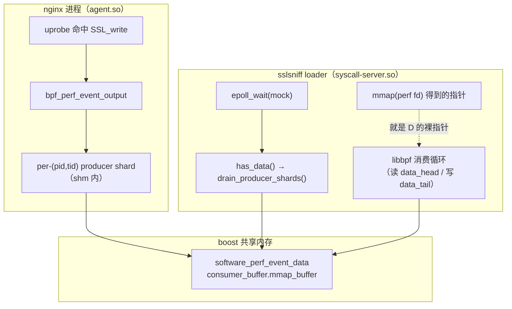

# 3. agent 与 syscall-server：两个 LD_PRELOAD 入口层

> 一句话定位：**syscall-server.so 注入 loader（如 sslsniff CLI），把 libbpf 发出的
> bpf()/perf_event_open()/mmap()/epoll 骗进共享内存；agent.so 注入被追踪进程
> （如 nginx），从同一块共享内存读出 handler 并真正挂钩。** 两个 .so 都只是
> "拦截 + 转发"的薄壳，干活的代码全在它们各自链入的 runtime 库里。
>
> 本章对应官方上游 **177a1dc465ff**（master）。行号均按该提交测量。

## 3.0 阅读地图

| 文件 | 行数 | 看什么 |
|---|---:|---|
| `runtime/syscall-server/syscall_server_main.cpp` | 551 | 全读：防重入初始化 `initialize_ctx`(L206)、fail-open 包装 `handle_exceptions`/`call_with_context`(L238–280)、各 libc 包装 + `syscall()` 分流表(L467–534) |
| `runtime/syscall-server/syscall_context.hpp` | 198 | `init_original_functions`(L96)、三个 mock 开关字段（L154–158） |
| `runtime/syscall-server/syscall_context.cpp` | 1238 | 构造函数(L196)、`try_startup`(L237)、`handle_sysbpf`(L482)、`handle_perfevent`(L806)、`handle_mmap64`(L949) |
| `runtime/syscall-server/syscall_server_utils.cpp` | 352 | `start_up`(L147)；shm 会话清理（L51–145）；uprobe perf type 的 /sys 文件 mock（L260–322） |
| `runtime/agent/agent.cpp` | 1213 | 主线 `bpftime_agent_main`(L830)；IPC/auto-refresh 可略 |
| 两个 `CMakeLists.txt` | — | 确认 ".so = 薄入口 + 整个 runtime 库" |
| 仓库根 `CLAUDE.md` | — | "Injected Agent Host-Process Contract" 一节：本章所有 fail-open 改动的设计准则 |

CMake 事实核对：`runtime/syscall-server/CMakeLists.txt:27-32` 的
`target_link_libraries(bpftime-syscall-server PUBLIC runtime ...)` 与
`runtime/agent/CMakeLists.txt:70-78` 的 `target_link_libraries(bpftime-agent PUBLIC runtime ...)`
——**两个 .so 各自链入一份完整 runtime**（`runtime/CMakeLists.txt:122-125` 的
`add_library` 未写 STATIC/SHARED，默认构建即静态库）。同一段 helper/map 代码在两个
进程各有一份拷贝，真正共享的只有 boost shm 里的数据。（这就是为什么你的消融实验只需要换
agent 侧的 .so。）

### 先读这条契约

官方 `CLAUDE.md` 的 "Injected Agent Host-Process Contract"（#634）给所有注入代码定了
四条规矩，原文要点：

- 不得因 bpftime 初始化/配置/分配/执行失败而 `exit`、`_exit`、`abort`、`terminate`
  宿主——"Return or record the error and disable only the affected bpftime operation."
- 不得写、关、重定向、flush 宿主的 stdin/stdout/stderr，除非用户显式选择；诊断输出走
  显式配置的 bpftime sink。
- 不得替换宿主的信号行为，除非恢复或正确链式调用原 handler。
- 失败路径与"默认不终止、不碰 stdio"要有回归测试。

下文 2.1 的 fail-open 包装、日志 sink、3.6 的 agent 失败回滚，都是这条契约的落地
（#632、#640、#639）。读代码时带着一个问题："这里失败了，宿主会怎样？"——在 177a1dc
里答案几乎总是"bpftime 这一次操作退回到原始 libc/内核行为，宿主照常运行"。

## 3.1 syscall-server：全局上下文如何"安全地晚起床"

libbpf 的第一次调用可能来自任何线程、任何时机，而拦截层自己初始化时（spdlog 开日志
文件、dlsym）又会触发被拦截的 `fopen`/`open`——这是典型的"拦截器自噬"问题。看
`syscall_server_main.cpp:34-36` 与 `191-236` 怎么解的：

```cpp
// syscall_server_main.cpp:34-36, 191-236（节选，注释为导读）
// 0 = uninitialized, 1 = in progress, 2 = done, 3 = disabled
static int ctx_initialized = 0;
static __thread int tls_initializing = 0;      // 每线程重入标志
...
union syscall_server_ctx_union {               // union + 空构造/析构：
	syscall_context ctx;                   //  1) 不在 .so 加载时跑构造函数
	syscall_context *operator->() { return &ctx; }
	syscall_server_ctx_union() {}          //  2) 进程退出时也不跑析构——
	~syscall_server_ctx_union() {}         //     其他线程可能还在调 hook
};
static syscall_server_ctx_union context;
static bool initialize_ctx() noexcept
{
	if (tls_initializing)                  // 构造期间自己再进来：
		return false;                  //   返回 false → 调用方走原始 libc
	int state = __atomic_load_n(&ctx_initialized, __ATOMIC_ACQUIRE);
	if (state == 2)
		return true;
	if (state == 3)                        // 构造曾失败：永久禁用 mock
		return false;
	int expected = 0;
	if (__atomic_compare_exchange_n(&ctx_initialized, &expected, 1, false,
					__ATOMIC_SEQ_CST, __ATOMIC_SEQ_CST)) {
		tls_initializing = 1;
		try {
			new (&context.ctx) syscall_context;   // placement new
		} catch (...) {
			tls_initializing = 0;
			__atomic_store_n(&ctx_initialized, 3, __ATOMIC_RELEASE);
			return false;
		}
		tls_initializing = 0;
		__atomic_store_n(&ctx_initialized, 2, __ATOMIC_RELEASE);
		return true;
	} else {
		while ((state = __atomic_load_n(&ctx_initialized,
						__ATOMIC_ACQUIRE)) == 1) {
			sched_yield();         // 没抢到的线程等构造结束
		}
		return state == 2;
	}
}
```

四个设计点：

1. **union 技巧**：普通全局 `syscall_context` 会在 .so 加载时构造（此时 libc 环境
   未必就绪）、在 `exit()` 时析构（此时别的线程可能还在 hook 里跑）。union 的空
   构造/析构把这两个时机都掐掉，改为首次拦截时 placement-new，永不析构。
2. **CAS + 自旋**：多线程同时首次进入时，只有一个线程构造，其余 `sched_yield()`
   等状态离开 1。
3. **`tls_initializing`**：构造 `syscall_context` 时，其构造函数
   （`syscall_context.cpp:196-212`）里的 `dlsym`、`bpftime_set_logger`（建 rotating
   file sink → `fopen`）会再进入被拦截的 libc → 重新调 `initialize_ctx`。此时
   `ctx_initialized==1`，若无此标志，本线程会在自旋分支里**等自己**——死锁。TLS
   标志让重入调用直接返回 `false`，包装函数随即走"原始符号"路径。
4. **状态 3 = disabled**（#640 新增）：构造抛异常（例如
   `init_original_functions` 里 `require_symbol` 解析不到某个原始符号，hpp L98–106）
   时不再把异常抛给宿主，而是置 3，之后所有包装永久退回原始 libc。

#### "原始符号"从哪来：不依赖 context 的退路

`initialize_ctx()` 返回 `false` 时 context 不可用，`context->orig_*` 也就不能用。
所以 177a1dc 在 main.cpp 里另备一套**与 context 无关**的 `dlsym(RTLD_NEXT)` 缓存：
`cached_next_symbol<Fn>`（L91–109）+ `resolve_cached_next_symbol`（L122–133）+
`call_next_symbol`（L135–146，解析失败时置 `errno = ENOSYS` 返回失败值），以及
`fallback_mmap64`/`fallback_openat`/`fallback_open`/`fallback_syscall`（L148–189）。

#### fail-open 包装：`handle_exceptions` / `call_with_context`

```cpp
// syscall_server_main.cpp:238-267（节选）
template <typename F, typename Fallback>
auto handle_exceptions(F &&f, Fallback &&fallback) noexcept -> decltype(f())
{
	try {
		return f();
	} catch (const boost::interprocess::bad_alloc &e) {
		safe_spdlog_error("Boost interprocess bad_alloc: {}", e.what());
		safe_spdlog_error(
			"Falling back to the original host operation");
		return fallback();
	} catch (const std::exception &e) {
		/* 记日志后 return fallback(); */
	} catch (...) {
		/* 同上 */
	}
}

template <typename F, typename Fallback>
auto call_with_context(F &&f, Fallback &&fallback) noexcept
	-> decltype(fallback())
{
	if (!initialize_ctx())
		return fallback();
	return handle_exceptions(std::forward<F>(f),
				 std::forward<Fallback>(fallback));
}
```

每个 libc 包装（L282–466）都是同一个形状：先写一个 `call_original` lambda
（走上面的缓存原始符号），再 `call_with_context_debug(fmt, mock_lambda,
call_original, ...)`。要点：

- **shm 耗尽不再杀进程**：boost shm 的 `bad_alloc` 被捕获后，退回到原始宿主操作
  （例如 `bpf()` 就真的发给内核）。这是 #640 按契约做的 fail-open；对应的用户可见
  说明在 `usage.md:228`（`BPFTIME_SHM_MEMORY_MB` / `BPFTIME_MAX_FD_COUNT`）。
  （我们 dev 分支把这里改成返回 `ENOMEM` 而不是退回内核，**不是**官方行为。）
- `safe_spdlog_debug`（L47–57）先判 `spdlog::default_logger_raw()`；
  `safe_spdlog_error`（L59–70）更进一步，只有 `ctx_initialized == 2` 时才打——
  构造期间的错误不会去碰一个可能还没建好的 logger。

#### 日志不碰宿主 stdio（#632）

构造函数 L199–202：先 `enable_mock.store(false)`，再按 `BPFTIME_LOG_OUTPUT`
（缺省 `DEFAULT_LOGGER_OUTPUT_PATH` = `"~/.bpftime/runtime.log"`，
`bpftime_config.hpp:13`）调用 `bpftime_set_logger`，最后 L211 才把 `enable_mock`
置回 true——"logger 建好之前不 mock"。`bpftime_set_logger`
（`runtime/include/bpftime_logger.hpp:39-93`）的新语义：路径展开失败（空、`$HOME`
缺失、不支持的 `~user`）时装一个 `null_sink`、level=off 的静默 logger，而不是像旧版
那样退到 console；`"console"` 必须显式指定，且写 **stderr**；sink 出错时
`set_error_handler` 把 logger 关掉。#694 把同样的"先按 `BPFTIME_LOG_OUTPUT` 设
logger"补到了 CLI 工具（`tools/cli/main.cpp:883`、`tools/bpftimetool/main.cpp:155`），
避免 spdlog 默认 logger 写 stdout。

### mock 分流三件套

几乎每个 `handle_*` 开头都是同一句咒语（如 `syscall_context.cpp:484-488`）：

```cpp
if (!enable_mock.load(std::memory_order_relaxed) ||
    initializing_cuda.load(std::memory_order_acquire) ||
    !enable_mock_after_initialized.load(std::memory_order_relaxed))
	return orig_syscall_fn(__NR_bpf, (long)cmd,
			       (long)(uintptr_t)attr, (long)size);
```

三个开关现在都是 `std::atomic<bool>`：

| 开关（`syscall_context.hpp`） | 谁翻转它 | 何时为 false |
|---|---|---|
| `enable_mock`(L154) | 构造函数（cpp L199/L211）与 `try_startup()`（cpp L237–254，RAII guard 恢复） | 构造期间建 logger 时；`start_up` 自身执行期间——启动代码自己的 open/mmap 必须走真 libc |
| `initializing_cuda`(L156) | `initialize_cuda()`（cpp L215–234，`cuda_init_guard` 析构时复位） | CUDA 驱动初始化期间（驱动狂发 ioctl/mmap，不能被 mock） |
| `enable_mock_after_initialized`(L158) | ① shm 的 `mock_setter` 回调（utils L173–180；被 `map_handler.cpp:952` 起的 CUDA map 构造代码经 `set_enable_mock` 翻转）；② `try_startup` 捕获 `start_up` 异常时置 false（cpp L249–252） | runtime 内部需要临时"素颜"调用真 syscall 时；**启动失败后永久为 false**——之后所有 mock 都退回原始调用 |

`try_startup` 的第二个用途是 #640 的"启动失败门闩"：`start_up`（utils L147–228）用
`std::call_once` 包住，失败时把异常存进 `g_startup_exception`、每次调用都
`rethrow`（L222–227）；`try_startup` 则在第一次失败时关掉
`enable_mock_after_initialized`，使后续调用在 gate 处就直接放行，而当次调用的异常由
2.1 的 `handle_exceptions` 转成原始操作。

读主线时可把三者一律当 `true`；同理每个 case 里的 `run_with_kernel`
（`BPFTIME_RUN_WITH_KERNEL`，cpp L177–194 `load_config_from_env` 读环境变量）分支先全部跳过。

### `start_up`：会话与 shm 生命周期（#639）

177a1dc 的 `start_up` 不再只是 `SHM_CREATE_OR_OPEN`：

```
start_up(ctx)                                         [utils L147-228]
  call_once:
    g_syscall_server_shm_name = get_global_shm_name()
    shm_lifecycle_lock(...)       // flock("/tmp/bpftime-shm-<name>.lock")
    initialize_global_shm_with_ownership()            [L126-145]
       先 SHM_CREATE_ONLY → 成功 = 本进程"拥有" shm
       already_exists → 退回 SHM_CREATE_OR_OPEN（不拥有）
    std::atexit(remove_syscall_server_global_shm)     [L56-124]
    add_pid_into_alive_syscall_server_set(getpid())
    [CUDA] ctx.initialize_cuda()
    begin_new_session()           // epoch_seq 奇数→reset_server_state→偶数
    set_mock_setter(...)
    [VERIFIER] 设置可用 helper
    bpftime_set_runtime_config(...)   // #562：原 agent_config 更名
    setenv("BPFTIME_USED", "1", 0)
```

`remove_syscall_server_global_shm` 在退出时：fork 出的子进程（pid ≠ owner）或非拥有者
只把自己从 alive-server 集合删掉；拥有者在锁内检查 alive syscall-server 集合与 alive
agent 集合里是否还有活着的 pid（`kill(pid,0)`），都没有才 `shared_memory_object::remove`。
`shm_lifecycle_lock`（`bpftime_shm_internal.cpp:178-229`）是对
`/tmp/bpftime-shm-<sanitized-name>.lock` 的 `flock(LOCK_EX)`，agent 打开 shm 时也拿
同一把锁（3.6），从而把"server 删 shm"和"agent 开 shm"串行化。

## 3.2 `syscall()` 分流表（注释版）

libbpf 发 bpf 命令不走 glibc 包装函数，而是直接 `syscall(__NR_bpf, ...)`，所以
拦截层必须重写 `syscall()` 本身（`syscall_server_main.cpp:467-534`，整段在
`#if __linux__` 里）：

```cpp
// syscall_server_main.cpp:468-533（节选，略去日志行）
extern "C" long syscall(long sysno, ...)
{
	// glibc directly reads the arguments without considering
	// the underlying argument number. So did us
	va_list args;
	va_start(args, sysno);
	long arg1 = va_arg(args, long);   // 一律读 6 个：多读无害，绝不能少读
	/* ... arg2..arg6 同理 ... */
	va_end(args);
	if (!initialize_ctx())            // context 不可用 → 缓存的 RTLD_NEXT syscall
		return fallback_syscall(sysno, arg1, arg2, arg3, arg4, arg5,
					arg6);
	auto call_original = [&]() {
		return context->orig_syscall_fn(sysno, arg1, arg2, arg3, arg4,
						arg5, arg6);
	};
	if (sysno == __NR_bpf) {          // ① bpf(cmd, attr, size)
		int cmd = (int)arg1;
		auto attr = (union bpf_attr *)(uintptr_t)arg2;
		auto size = (size_t)arg3;
		return handle_exceptions(
			[&]() {
				return context->handle_sysbpf(cmd, attr, size);
			},
			call_original);   // 出异常 → 真 bpf()
	} else if (sysno == __NR_perf_event_open) {   // ② 五参全转发
		return handle_exceptions(
			[&]() {
				return context->handle_perfevent(
					(perf_event_attr *)(uintptr_t)arg1,
					(pid_t)arg2, (int)arg3, (int)arg4,
					(unsigned long)arg5);
			},
			call_original);
	} else if (sysno == __NR_ioctl) {
		/* 只打日志，不拦！ioctl 靠 ioctl() 函数包装拦截 */
	} else if (sysno == __NR_dup3)        { /* → handle_dup3: map fd 复制 */ }
	  else if (sysno == __NR_memfd_create){ /* → handle_memfd_create */ }
	return call_original();           // 其余放行
}
```

注意分流表只是**第二道网**。第一道网是同文件里对 `epoll_wait`/`epoll_ctl`/
`epoll_create1`/`ioctl`/`mmap64`/`mmap`/`munmap`/`close`/`openat`/`open`/`read`/
`fopen`/`fopen64`/`_IO_new_fopen` 的直接函数拦截（L282–466）——libbpf 大多数时候调的
是这些 glibc 包装。`__NR_ioctl` 分支（L510–512）只记日志不处理，正说明作者假设 ioctl
总是从包装函数进来。aarch64 上头文件也不同：L7–11 在非 x86_64 上用
`asm-generic/unistd.h` 取 `__NR_*`。`open`/`openat` 包装只在
`open_flags_have_mode(oflag)`（`O_CREAT` 或 `O_TMPFILE`，L111–120）时才读第三个
变参 `mode`，避免读到未传入的参数。

context 内部的 `orig_*` 函数指针在 `syscall_context.hpp:96-133` 的
`init_original_functions` 里用 `dlsym(RTLD_NEXT, ...)` 解析——`RTLD_NEXT` 即"链路里
排在我后面的那个 libc 实现"。三个细节：解析失败时 `require_symbol` 抛
`std::runtime_error`（L98–106），由 2.1 的状态 3 兜住；L117–118 把 `orig_mmap64_fn`
直接设为 `orig_mmap_fn`（都来自 `"mmap"`）；L132 `unsetenv("LD_PRELOAD")`——**子进程
不继承注入**，调 fork/exec 场景时必记（你的 nginx master/worker 若靠 LD_PRELOAD 注入，
worker 是 master fork 出来的、已加载的 .so 随地址空间一并继承，但再 exec 别的程序就不会
带上）。

## 3.3 `handle_sysbpf`：三个必读 case

`syscall_context.cpp:482-805` 是一张 `switch(cmd)` 大表（gate 在 L484–488，之后
`try_startup()`）。default 分支（L800–802）放行到内核——**没实现的命令不会报错，会静默
走真内核**，调试时要警惕。挑三个带读（均忽略 `run_with_kernel`）：

### BPF_MAP_CREATE（L493–553）

主线只有一件事（L529–552）：把 `bpf_attr` 里的 map 参数抄进 bpftime 自己的
`bpf_map_attr`，然后

```
bpftime_maps_create(-1 /* let the shm alloc fd for us */, attr->map_name, {...})   (L533-547)
  → bpftime_shm::add_bpf_map                    [bpftime_shm.cpp:81-84 → shm_internal.cpp:1048-1077]
      fd < 0 时 fd = open_fake_fd()             [shm_internal.cpp:674-688]
      若该槽位已有 handler 先 clear_id_at
      manager->set_handler(fd, bpf_map_handler{...})   // handler 落入共享内存
  返回值 = 这个 fd，libbpf 拿它当真 map fd 用
```

`open_fake_fd()`（`bpftime_shm_internal.cpp:674-688`）值得看一眼：它
`open("/dev/null", O_RDONLY)` 拿一个**真实 fd** 当号码占位——号码在进程 fd 表里
被真实占住，后续 libbpf 对它做 dup/close 都不会撞号；若拿到 ≤2 的号码会 `dup`
着跳过（最多 4 次），避免占用 stdin/stdout/stderr。#671 新增上界检查：fd 号
≥ `manager->size()`（handler 表容量，`BPFTIME_MAX_FD_COUNT`）时 `close` 并返回 -1、
`errno = ENOSPC`。fd 号即 handler_manager 的下标，这是第 1 章 shm 布局的接口约定。

### BPF_PROG_LOAD（L628–703）

```
attr->prog_type == BPF_PROG_TYPE_TRACEPOINT     → section = "tracepoint"   (L644-645)
attr->prog_type == BPF_PROG_TYPE_SOCKET_FILTER  → section = "uprobe"       (L646-649)
  （libbpf 对 uprobe 实际报的类型是 KPROBE；这里映射到 SOCKET_FILTER 是
   bpftime loader 侧的约定，能对上就行，读到别纠结语义）
[可选] ENABLE_BPFTIME_VERIFIER：verifier_mode 取自 bpftime_get_runtime_config()
  verify_ebpf_program(insns, insn_cnt, section)
  失败时 STRICT 模式 errno = EINVAL、返回 -1；WARNING 模式只告警照样加载   (L650-694)
bpftime_progs_create(-1, (ebpf_inst *)attr->insns, attr->insn_cnt,
                     attr->prog_name, attr->prog_type)              (L695-699)
  → add_bpf_prog [shm_internal.cpp:691-706]：指令字节码整段拷入 shm 的
    bpf_prog_handler。注意：loader 侧不做 JIT，只存字节码；编译发生在
    agent 侧 attach 时（第 5 章）。
```

### BPF_LINK_CREATE（L704–732，注释版）

```cpp
// syscall_context.cpp:704-732（节选，略去日志与 run_with_kernel 分支）
case BPF_LINK_CREATE: {
	auto prog_fd = attr->link_create.prog_fd;      // 前面 PROG_LOAD 返回的假 fd
	auto target_fd = attr->link_create.target_fd;  // 前面 perf_event_open 返回的假 fd
	auto attach_type = attr->link_create.attach_type;
	...
	int id = bpftime_link_create(                  // 在 shm 里放一个
		-1 /* let the shm alloc fd for us */,  // bpf_link_handler{prog_fd, target_fd}
		(bpf_link_create_args *)&attr->link_create);
	SPDLOG_DEBUG("Created link {}", id);
	if (id < 0 && bpftime_is_prog_fd(prog_fd) &&   // 兜底：新式 link 建失败但
	    bpftime_is_perf_event_fd(target_fd) &&     // 两个 fd 都合法且是
	    attach_type == BPF_PERF_EVENT) {           // perf-event 挂载
		auto cookie = attr->link_create.perf_event.bpf_cookie;
		...
			id = bpftime_attach_perf_to_bpf_with_cookie(target_fd, prog_fd, cookie);
	}
	return id;
}
```

link 只是 shm 里的一条"prog_fd ↔ perf_event_fd"关系记录，**此刻什么都没挂上**。
真正插桩要等 agent 侧 `init_attach_ctx_from_handlers` 扫到这条 link（第 4 章）。
旧式 attach 路径也有对应 mock：`ioctl(PERF_EVENT_IOC_SET_BPF)`（L1051–1064）和
`BPF_PROG_ATTACH`（L787–799）最终都落到 `bpftime_attach_perf_to_bpf`。
`ioctl(PERF_EVENT_IOC_ENABLE)`（L1025–1037）也只是翻 shm 里 handler 的使能位
（mock 失败时打 WARN 后退回原始 `ioctl`，L1066–1067）。

## 3.4 `handle_perfevent` 与 /sys 文件 mock

libbpf 创建 uprobe 前会读 `/sys/bus/event_source/devices/uprobe/type` 确定
perf type。容器里可能没有这个文件，于是 syscall-server 连文件都 mock 了：
`create_mocked_file_based_on_full_path`（utils L299–322）对四个固定路径（utils
L42–49）返回内存文件（uprobe type 恒为 `MOCKED_UPROBE_TYPE_VALUE = 9`，hpp L34）。
两条入口的落地方式不同：

- `handle_open`/`handle_openat`（ctx L306–328 / L277–304）用
  `create_unlinked_mock_fd`（ctx L84–109：`mkstemp`/`mkostemp("/tmp/bpftime-mock.XXXXXX")`
  后立刻 `unlink`，#639）造一个真实 fd，把 `mocked_file_provider` 挂进
  `mocked_files`；之后 `handle_read`（L330–362）从内存 buf 喂数据，`handle_close`
  （L256–275）摘掉。
- `handle_fopen`（L1152–1198）同样拿一个 unlinked 临时 fd，但把 buf **真正写进**
  文件（`write_all_to_fd`）、`lseek` 回开头、`fdopen(fake_fd, "r")` 返回——stdio
  之后读的是真文件内容，不经过 `mocked_files`。任一步失败都关 fd 并退回原始 `fopen`。

随后 `handle_perfevent`（L806–935）按 `attr->type` 分发；uprobe 分支（L817–842）：

```
attr->type == determine_uprobe_perf_type()        // utils L260-268；文件不存在时返回 9
retprobe    = attr->config  & (1 << determine_uprobe_retprobe_bit())  // libbpf 的编码约定
ref_ctr_off = attr->config >> PERF_UPROBE_REF_CTR_OFFSET_SHIFT
name        = (const char *)attr->config1         // 目标 ELF 路径
offset      = attr->config2                       // 函数在文件内偏移
→ bpftime_uprobe_create(-1, pid, name, offset, retprobe, ref_ctr_off)
  → add_uprobe [shm_internal.cpp:349-363]：open_fake_fd() + 写入
    bpf_perf_event_handler{retprobe, offset, pid, name, ref_ctr_off}
```

即：**loader 侧的 "perf event" 只是 shm 里的一张说明书**——"请在 pid 的 name+offset
处挂一个 uprobe"。执行者是 agent。

## 3.5 `handle_mmap64`：把 shm perf buffer 页递给 libbpf 消费者

这里与你最熟的路径对接。libbpf `perf_buffer__new` 的动作序列是：每 CPU
`perf_event_open`（→ 2.4 的 SOFTWARE 分支，L905–910，`bpftime_add_software_perf_event`
[bpftime_shm.cpp:541 → shm_internal.cpp:403-417] 造假 fd）→ `mmap(fd, 页数)` 拿环形
缓冲 → `epoll_ctl` 注册 → 循环 `epoll_wait` + 读环。三步全被拦截：

```cpp
// syscall_context.cpp:987-1007（节选）
} else if (fd != -1 && bpftime_is_software_perf_event(fd)) {
	SPDLOG_DEBUG(
		"Entering mocked mmap64: software perf event handler");
	errno = 0;
	if (auto ptr = bpftime_get_software_perf_event_raw_buffer(
		    fd, length);                  // ↓ 见下方调用链
	    ptr != nullptr) {
		mocked_mmap_values.insert((uintptr_t)ptr); // 记账，munmap 时识别
		return ptr;   // 直接返回 shm 内指针！没有发生任何真 mmap
	}
	if (errno == 0) {
		errno = ENOMEM;
	}
	return MAP_FAILED;    // #597：失败如实报给 libbpf，不再落到下面的真 mmap
}
SPDLOG_DEBUG(...);
auto ptr = orig_mmap64_fn(addr, length, prot | PROT_WRITE,
			  flags | MAP_ANONYMOUS, -1, 0);
return orig_mmap64_fn(addr, length, prot, flags, fd, offset);
/* 未识别的 fd 走原始 mmap64（L1002-1007）。注意 L1005-1006 先做了一次
   匿名映射却丢弃结果、L1007 又映射一次——疑似历史遗留的死代码，
   每次 fallthrough 会泄漏一段匿名映射。读到这里不要试图理解它的
   "深意"，它没有。 */
```

调用链（带语义）：

```
handle_mmap64(fd, length)
 → bpftime_get_software_perf_event_raw_buffer(fd, length)   [bpftime_shm.cpp:568-573]
 → bpftime_shm::get_software_perf_event_raw_buffer          [shm_internal.cpp:1184-1194]
     校验 fd 是 software perf event handler（否则 errno=EINVAL）
 → bpf_perf_event_handler::try_get_software_perf_data_raw_buffer  [perf_event_handler.cpp:642-652]
 → software_perf_event_data::ensure_mmap_buffer(length)     [perf_event_handler.cpp:611-624]
     在 shard_lock 下调 consumer_buffer.ensure_mmap_buffer：
       software_perf_event_buffer::ensure_mmap_buffer        [perf_event_handler.cpp:276-305]
         length < 一页或 (length - 页) 不是 2 的幂 → errno=EINVAL, nullptr
         mmap_buffer（boost shm 里的 vector）resize 抛异常 → errno=ENOMEM, nullptr（#597）
         成功则返回 .data()
     若发生了扩容，把 producer_buffer_generation +1（L619-622），
     让 agent 侧缓存的 shard 指针失效重取。
```

所以：**libbpf 以为自己 mmap 了内核 perf ring，实际拿到的是 boost 共享内存段内
一块普通 vector 的裸指针**；开头一页照内核布局放 `perf_event_mmap_page`
（data_head/data_tail 就在里面，`get_header_ref` L258–267），后面跟数据区。libbpf 的
消费代码（读 head、搬记录、写 tail）原封不动地工作。

消费触发链：`epoll_wait`（mock，ctx L1110–1122）→ `bpftime_epoll_wait`
[bpftime_shm.cpp:418-539] 询问每个注册的 event → `software_perf_event_data::has_data()`
[perf_event_handler.cpp:589-593] → **先 `drain_producer_shards()`（L550–557）把各
per-(pid,tid) producer shard 的记录搬进 consumer_buffer**，再看 consumer 环里
是否有数据。

`bpftime_epoll_wait` 在 #689 后的语义（L455–531）：

- 一轮扫完只要收集到 ≥1 个事件，或 `timeout == 0`，就立即 `break`（L501–502）。
  旧版在拿到事件后还会 sleep 1ms 再扫一轮，同一个就绪 fd 可能被重复填进
  `out_evts`——这就是 "without duplicates" 修的问题。
- 无事件时临时解除对 SIGINT/SIGTERM 的屏蔽，`sigtimedwait` 最多等 1ms（`ts`，L455）；
  收到信号则手工调用原 handler 并以 `EINTR` 返回。
- 所有出口都走 L533 的 `sigprocmask(SIG_SETMASK, &orig_sigset, nullptr)`。旧版
  `timeout == 0` 时在循环顶部、扫描之前就 `return 0`——既不报告任何就绪事件，又跳过
  了这句，调用线程的信号掩码就一直屏蔽着 SIGINT/SIGTERM——这就是 "restore signals"
  修的问题。

你熟悉的完整链条在两个进程间就此闭合：



> **📌 案例（对齐修复）**：上游 #612（"align software perf event records"）在
> `software_perf_event_buffer::output_data`（`perf_event_handler.cpp:367-387`）里把
> 记录长度按 `constexpr size_t alignment = sizeof(uint64_t);`（L370）向上取整
> （L376–378），并把差额作为 padding 传给 `append_record_parts`（L385–386）；
> drain 端 `copy_next_record_to`（L421–462）校验 `record_header.size` 不小于头长、
> 不大于环长（L442–447），否则丢弃该 shard 的积压数据。修复前 record header 可以
> 横跨环尾，libbpf 在"mmap"到的这块 shm 里读出跨界的 `size=0`，消费者空转、事件
> 静默丢失、吞吐双峰。注意受害者是 loader 侧 libbpf 原生消费代码——它完全信任这块
> "内核格式"的内存。（我们 ead56c9 里的同类修复写法不同——
> `perf_event_record_alignment` 常量 + drain 端 `size % 8` 校验——官方没有采用。）

> **📌 案例（绑核论证）**：注意 drain 路径对 CPU 毫无要求：shard 按 (pid,tid)
> 组织、搬运在 `shard_lock` 下进行（L550–557）。而官方 producer 侧
> `bpf_perf_event_output`（`bpf_helper.cpp:487-553`）至今仍是每事件
> `sched_getcpu` + `sched_getaffinity` + 2×`sched_setaffinity`（绑定、再恢复；#678
> 让出错路径也经 `restore_affinity:` L546 恢复）。消费者从不按 CPU 索引 shard——
> 这正是"producer 侧绑核序列无任何保护作用"论证的消费端一半。（删除绑核是我们分支的
> 改动，不是官方行为。）

## 3.6 agent：启动主线与三条防重入旁路

agent 有三种进入方式，殊途同归到 `bpftime_agent_main`（agent.cpp:830）：

1. **LD_PRELOAD**：拦截 `__libc_start_main`（L544–556）→ `bpftime_hooked_main`
   （L535–542）先置 `injected_with_frida = false` 再调 `bpftime_agent_main`，
   然后才跑真 main；
2. **Frida 注入**（`bpftime attach <pid>`）：Frida 直接调用导出的
   `bpftime_agent_main`，`injected_with_frida` 保持默认 true（L81）；
3. **text-transformer / syscall trace**：`_bpftime__setup_syscall_trace_callback`
   （L1199–1212）先把 syscall 转发钩子装好再进主函数。

注意：177a1dc 的 agent.cpp 里 `injected_with_frida` 只被写、不被读（L81、L538；
它仍在 `agent.version` 中导出，供 text-transformer 设置）。旧版"只有 Frida 注入才登记
alive pid"的判断已被 #639 删除——现在**所有**成功初始化的 agent 都登记。

```mermaid
sequenceDiagram
    participant I as 注入器(LD_PRELOAD/Frida)
    participant A as agent.so
    participant S as 共享内存(shm)
    participant X as bpf_attach_ctx
    I->>A: bpftime_agent_main(data, stay_resident)
    Note over A: install_agent_bootstrap_logger() (L832)
    Note over A: 旁路1(L883): 本进程已有 agent IPC server?<br/>→ 转发 "refresh <data>" 到 socket bpftime-agent-pid 后返回
    Note over A: 旁路2(L891): dlsym/dl_iterate_phdr 找到<br/>另一份已加载 agent? → 调它的 bpftime_agent_control 后返回
    Note over A: 旁路3(L898-923): CAS initialized UNINITIALIZED→INITIALIZING 失败?<br/>→ INITIALIZING: 直接返回; READY: 跳过(或 force_reinit 走 refresh)
    loop 最多 60 次, 每次 50ms (L932-948)
        A->>S: shm_lifecycle_lock + bpftime_initialize_global_shm(SHM_OPEN_ONLY)
    end
    A->>A: bpftime_set_logger(runtime_config 路径) (L956-958)
    A->>X: ctx_holder.init() (L960)
    A->>X: register_attach_impl(syscall_trace) (L964-989)
    A->>X: register_attach_impl(uprobe 系: trap L991-1012 或 frida L1013-1032)
    A->>X: init_attach_ctx_from_handlers(runtime_config) (L1063-1079)
    Note over X,S: 遍历 shm 中 loader 写好的 handler,<br/>JIT + 真正插桩 → 第 4 章
    A->>S: add_pid_into_alive_agent_set(getpid()) (L1138-1144), 释放 shm 锁 (L1145)
    A->>A: ensure_detach_worker_started() (L1151)
    A->>A: start_agent_ipc_server_once() (L1157)
    A->>A: signal(SIGUSR1, ...) (L1158)
    A->>A: *stay_resident = TRUE; initialized = AGENT_READY (L1160-1163)
```

三条**旁路都是防重入**，读主流程时全部跳过即可；只需记住存在一个 abstract unix
socket `bpftime-agent-<pid>`（`make_agent_ipc_addr` L206–217，`sun_path[0]='\0'` 即
abstract namespace，不落文件系统）作为进程内 agent 的控制面。服务线程（L271–417）
用 `SO_PEERCRED` 只接受 root 或同 euid 的对端，认 `refresh <k=v;...>`、`detach`、
`status` 三种请求（L333–389）。`bpftime trace` 的二次 attach/refresh/detach 都从这里走
（`tools/cli/main.cpp` 拼出 `loader_pid=...;force_reinit=1[;auto_refresh_ms=...]`，
L1156–1160；IPC 不通时退回 `kill(pid, SIGUSR1)`）。

几个主线细节：

- **为什么重试 60 次开 shm**（L927–955）：agent 用 `SHM_OPEN_ONLY`（不存在即抛
  异常），而"先 spawn loader 再注入 agent"的工作流里 loader 可能还没来得及创建 shm
  （utils L126–145）。60 × 50ms = 最多等 3 秒，源码注释原话：
  "SHM can race with the loader process; retry a bit to avoid flakiness in "spawn
  loader then inject agent" workflows." 每次尝试都先拿 `shm_lifecycle_lock`，成功后
  一直持有到 alive pid 登记完成（L1145 `shm_lock.reset()`）——这样 loader 退出时的
  `remove_syscall_server_global_shm` 不会在 agent"开了 shm 但还没登记"的窗口里把 shm 删掉。
- **`bpf_attach_ctx_holder` union**（L100–117）：与 2.1 的 union 同一招——不让全局
  attach 上下文在加载期构造/退出期析构；多了 `init()`/`destroy()` 供失败回滚用。
- **失败回滚 lambda `init_fail`**（L837–878）：只有 `claimed_initialization` 为真
  （本次调用赢得 CAS）才回滚——重置 syscall-trace 全局、停 auto-refresh 线程、关 detach
  pipe、析构 ctx、从 alive 集合摘 pid、`initialized` 回到 `AGENT_UNINITIALIZED`。
  整个主体包在 `try { ... } catch (...) { init_fail(); }`（L879、L1172–1176）里，异常
  **不会**逃到宿主（#640；旧版这里还会 `fprintf(stderr, ...)`，已删除以遵守"不碰宿主
  stdio"）。
- **驻留延后**（#640 "Delay agent residency until initialization succeeds"）：
  `*stay_resident = TRUE`、`signal(SIGUSR1)`、IPC server 都放到所有初始化成功之后；
  detach worker 起不来（`ensure_detach_worker_started` 返回 false）也走 `init_fail`
  而不是带病运行（"Fail open when detach worker setup fails"）。
- **alive agent 集合**的用途已不止 detach：它与 2.1 的 alive syscall-server 集合一起，
  决定最后一个退出者是否删除 shm（#639）。`perform_detach` 成功后摘 pid（L447–450），
  `refresh_attach_session` 成功后重新登记（L706–712）。
- **syscall trace 回调**：`syscall_callback`（L1182–1197）把 `dispatch_syscall` 包在
  `try/catch` 里，异常或未装 impl 时退回 `orig_hooker`，都没有则 `-ENOSYS`；
  `dispatch_syscall` 内部的 `run_callbacks`（`attach/syscall_trace_attach_impl/src/
  syscall_trace_attach_impl.cpp:40-53`，#628）对每个 BPF 回调单独 `try/catch`，一个
  回调抛异常不会打断其余回调和真实 syscall 的执行。
- **uprobe 后端二选一**：`BPFTIME_HAVE_TRAP_UPROBE_ATTACH`（riscv 上默认开启的断点 +
  SIGTRAP 后端，#665）优先，否则 Frida（构造参数
  `runtime_config.enable_frida_fuzzy_backtracer`，#633）。aarch64 默认走 Frida。

### SIGUSR1 → pipe → 工作线程的 detach 链

```cpp
// agent.cpp:557-568
static void sig_handler_sigusr1_detach(int sig)
{
	(void)sig;
	// Async-signal-safe: do not call spdlog / malloc / locks here.
	auto_refresh_epoch.fetch_add(1, std::memory_order_acq_rel);
	int fd = detach_pipe_fds[1];
	if (fd >= 0) {
		uint8_t one = 1;
		ssize_t ignored = write(fd, &one, 1);  // 唯一的"重活"
		(void)ignored;
	}
}
```

信号处理函数里只做原子加和 `write(pipe)`（两者都是 async-signal-safe），真正的
`perform_detach()`（L419–454：拿 `detach_mutex`、join auto-refresh 线程、
`destroy_all_attach_links`、`reset_instantiated_state`、摘 alive pid、spdlog 打日志——
全都**不是** async-signal-safe）由 `ensure_detach_worker_started`（L464–529）预先起好的
工作线程（L508–523）在 pipe 读端阻塞等待、收到字节且 `initialized == AGENT_READY` 时
执行。若在信号上下文直接做这些，撞上"信号打断了正持有 malloc 内部锁的线程"就会死锁。

对照 2.0 的契约第三条可以留意一个事实：L1158 用的是裸 `signal(SIGUSR1, ...)`，既没有
保存宿主原先的 SIGUSR1 handler，也没有链式调用它。（这是读代码得到的观察，上游是否
视之为待修项，源码与 CLAUDE.md 都没有说明。）

> **📌 案例（信号上下文纪律）**：这段是"信号上下文纪律"的正面教材：**信号处理器应当
> 装一次、处理函数里只做 safe 操作、重活丢给普通线程**。你当年修的 `bpf_probe_read`
> bug（"是否重新安装 SIGSEGV handler"的判断读了未初始化变量，每次调用白付 2 个
> `rt_sigaction`）是它的反面邻居——但在 177a1dc 里那段代码已不存在：#642 把
> `bpftime_probe_read`（`bpf_helper.cpp:121-136`）改为在 `ENABLE_PROBE_READ_CHECK`
> 下用 `process_vm_readv` 做无故障拷贝（`probe_read_memory` L98–118），否则直接
> `memcpy`，整条路径上不再有任何 `sigaction`。

## 3.7 上游变更对照（6bd5319d → 177a1dc，仅本章相关）

| PR | 落在哪 | 一句话 |
|---|---|---|
| #634 | `CLAUDE.md` | 注入代码的宿主契约：不终止、不碰 stdio、不乱换信号 |
| #632 | `bpftime_logger.hpp`、ctx 构造函数 | 默认日志写文件，路径无效时静默；console 需显式且走 stderr；logger 就绪前不 mock |
| #640 | main.cpp 全部包装、`try_startup`、`start_up`、agent 主线 | fail-open：ctx 状态 3、缓存原始符号、异常退回原始操作、启动失败门闩、agent `AGENT_*` 状态机与驻留延后 |
| #639 | `start_up`、agent shm 循环、mock fd | shm 所有权 + 生命周期锁 + alive server/agent 集合 + atexit 清理；mock 临时文件立即 unlink；所有 agent 登记 alive pid |
| #597 | `handle_mmap64`、`ensure_mmap_buffer`、`usage.md` | perf buffer 分配失败 → `MAP_FAILED`/`ENOMEM`，不再落到真 mmap |
| #628 | `syscall_trace_attach_impl.cpp` | 每个 syscall BPF 回调单独吞异常 |
| #689 | `bpftime_epoll_wait` | 不再重复上报就绪事件；`timeout == 0` 也恢复信号掩码 |
| #685 | `bpf_helper.cpp:208-231` | `bpf_get_current_pid_tgid` 的 pid/tid 缓存移到文件作用域，`pthread_atfork` 子进程回调刷新 |
| #562 / #626 | 全局 | `agent_config` → `runtime_config`（`construct_runtime_config_from_env`、`bpftime_get/set_runtime_config`） |
| #694 | `tools/cli`、`tools/bpftimetool`、`tools/aot` | CLI 工具也先按 `BPFTIME_LOG_OUTPUT` 设 logger |
| #671 | `open_fake_fd` | 假 fd 超出 handler 表容量 → `ENOSPC` |

## 3.8 坑清单（修订版）

- 两个 .so 各链一份 runtime；进程间只共享 shm 数据，**代码与全局变量互不相通**——在
  agent 里打印 loader 侧的全局状态是新手常犯错。
- `default:` 分支静默放行到真内核（ctx L800–802）：mock 没覆盖的 bpf 命令不会
  报"未实现"，现象是权限错误或行为诡异。
- **fail-open 的另一面**：shm 耗尽、构造失败、启动失败时，官方实现退回原始 libc/内核
  调用，而不是报错退出。表现可能是"bpftime 悄悄不生效、请求落到了真内核"（无权限时
  则是 EPERM）。排障先看 `~/.bpftime/runtime.log`（或 `BPFTIME_LOG_OUTPUT` 指定处）；
  默认**不会**在终端上看到任何报错。
- 启动失败门闩：`start_up` 一旦失败，本进程内 mock 永久关闭（`enable_mock_after_initialized`
  = false），不会自动重试。
- `unsetenv("LD_PRELOAD")`（hpp L132）：exec 出的子进程无注入；fork 出的子进程则带着
  已加载的 .so。fork 场景下 helper 的 pid/tid 缓存由 #685 的 atfork 回调刷新
  （`bpf_helper.cpp:208-231`）；syscall-server 的 atexit 清理对非 owner pid 只做
  "摘自己"（utils L61–69）。
- 假 fd 是 `open("/dev/null")` 的真实 fd（`open_fake_fd`，shm_internal.cpp:674-688），
  号码被真实占位、受 handler 表容量约束；mock 的 /sys 文件则另用 unlinked `mkstemp`
  临时文件占号（ctx L84–109）。两套机制别混淆。
- `handle_mmap64` 的 fallthrough 尾巴（ctx L1005–1007）有一次结果被丢弃的匿名
  mmap——死代码 + 映射泄漏，读代码时别被它带偏。
- gate 条件不完全一致：`handle_epoll_ctl`（L1083–1085）不检查 `initializing_cuda`；
  `handle_mmap`/`handle_mmap64`/`epoll_*`/`munmap`/`dup3` 额外检查 `run_with_kernel`，
  `handle_sysbpf`/`handle_perfevent`/`handle_ioctl` 则在各 case 内部判断。
- loader 侧只登记不执行：`PERF_EVENT_IOC_ENABLE`、`BPF_LINK_CREATE` 都只改 shm；
  若 agent 没起来或 `init_attach_ctx_from_handlers` 失败，loader 一侧看起来
  一切成功，但探针根本没挂——排障时先查 agent 日志（agent 失败同样是静默回滚）。

## 3.9 自测题

**Q1. loader `mmap(perf fd)` 拿到的内存来自哪里？分配失败时 libbpf 看到什么？**

<details><summary>答案</summary>

来自 boost managed shared memory：`handle_mmap64`（ctx L987–1001）识别出 software
perf event 假 fd 后，经 `bpftime_get_software_perf_event_raw_buffer`
[bpftime_shm.cpp:568] → `software_perf_event_data::ensure_mmap_buffer`
[perf_event_handler.cpp:611] 返回 shm 内 `consumer_buffer.mmap_buffer`（shm vector）
的裸指针。全程没有发生真 mmap syscall；fd 本身只是 `/dev/null` 占位。libbpf 能
照常消费是因为这块内存开头按内核布局放了 `perf_event_mmap_page`。若长度不合法
（EINVAL）或 shm 不够（resize 抛异常 → ENOMEM），`handle_mmap64` 返回 `MAP_FAILED`
并保留该 errno（#597），不会退到真 mmap。
</details>

**Q2. agent 为何要重试 60 次开 shm？为什么每次重试还要拿一把文件锁？**

<details><summary>答案</summary>

agent 用 `SHM_OPEN_ONLY` 打开（不存在即抛异常，agent.cpp:937–938），而 shm 由
loader 在 `start_up` 里创建（`SHM_CREATE_ONLY`，已存在则 `SHM_CREATE_OR_OPEN`，
utils L126–145）。"先 spawn 目标进程/注入 agent、loader 稍后才跑"的工作流存在竞态，故
重试 60 次、每次 sleep 50ms（agent.cpp:932–948），给 loader 最多 3 秒创建时间。
`shm_lifecycle_lock`（`/tmp/bpftime-shm-<name>.lock` 上的 `flock`）与 loader 退出时
删除 shm 的路径互斥；agent 持锁直到把自己登记进 alive agent 集合（L1138–1145），
loader 的 atexit 清理据此判断"还有活着的 agent，不删 shm"。
</details>

**Q3. SIGUSR1 的 detach 为什么要经过 pipe，而不在信号处理函数里直接做？**

<details><summary>答案</summary>

`perform_detach`（agent.cpp:419–454）要拿 mutex、join 线程、销毁 attach link、调
spdlog（内含 malloc）——都不是 async-signal-safe；在信号上下文执行可能与被打断线程
持有的锁互死。处理函数（L557–568）因此只做原子操作和 `write(pipe)`（POSIX 规定
signal-safe），由预先启动的工作线程（L508–523）从 pipe 读到字节、确认
`initialized == AGENT_READY` 后在普通线程上下文完成 detach。
</details>

**Q4. `initialize_ctx` 里 `tls_initializing` 防的是哪种死锁？状态 3 又防什么？**

<details><summary>答案</summary>

构造 `syscall_context` 期间（`ctx_initialized == 1`），构造代码自己触发被拦截的
libc 调用（如 `bpftime_set_logger` 建文件 sink 时的 fopen）→ 同一线程重入
`initialize_ctx` → 若落入 else 分支会自旋等待状态离开 1——但改状态的正是被卡住的
自己，永久自旋（syscall_server_main.cpp:206–236）。普通互斥锁同样会自己等自己（递归锁
又解决不了"半构造对象被使用"的问题）；TLS 标志让重入直接返回 `false`，包装函数随即走
缓存的 `RTLD_NEXT` 原始符号。状态 3 则处理"构造抛异常"：不把异常传给宿主，而是
永久禁用 mock，之后所有调用都 fail-open 到原始 libc（#640）。
</details>

**Q5. libbpf 调 `bpf(BPF_LINK_CREATE)` 成功返回后，nginx 里的
`SSL_write` 被插桩了吗？如果没有，插桩发生在何时？**

<details><summary>答案</summary>

没有。loader 侧 `BPF_LINK_CREATE`（ctx L704–732）只在 shm 写入一条
link handler（prog_fd ↔ perf_event_fd 关系）。真正插桩发生在 agent 侧
`init_attach_ctx_from_handlers`（agent.cpp:1064–1066）扫描 shm handler 时：读出
uprobe 说明书 → frida_attach_impl（或 trap 后端）改写目标函数指令（第 4 章）→ JIT
编译 prog（第 5 章）。所以时序上 agent 必须在 loader 写完 handler 之后初始化
（或经 IPC `refresh` / auto-refresh 重扫）。
</details>

**Q6. 为什么 `enable_mock` 在 `try_startup` 里要先关后开（ctx L237–254）？
`start_up` 抛异常时又会发生什么？**

<details><summary>答案</summary>

`start_up`（utils L147–228）自己要做真 IO：拿 flock、创建/映射 boost shm、
`atexit` 注册等。若 mock 仍开着，这些调用会被拦截层再次接管——轻则走进依赖"shm
已就绪"的 mock 逻辑造成递归初始化，重则死锁或用到半初始化状态。所以 `try_startup`
先 `enable_mock=false` 放行真 libc，由 `enable_mock_guard` 的析构在任何出口（含异常）
恢复 true。若 `start_up` 抛异常，`try_startup` 把 `enable_mock_after_initialized` 置
false 再重抛；当次调用由 `handle_exceptions` 退回原始操作，此后所有 `handle_*` 在 gate
处直接放行——启动失败只让 bpftime 失效，不让宿主崩。这与构造函数里"logger 建好前不
mock"（ctx L199/L211）、`initialize_cuda` 的 `initializing_cuda`、CUDA map 构造时经
`mock_setter` 翻转 `enable_mock_after_initialized`（map_handler.cpp:952 等）是同一个
模式：**runtime 自己的 syscall 必须绕过自己的拦截**。
</details>

---
[← 返回目录](README.md)
