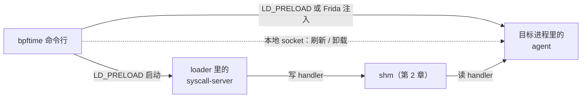
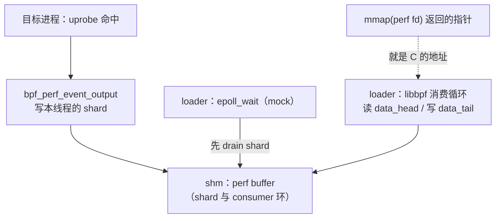
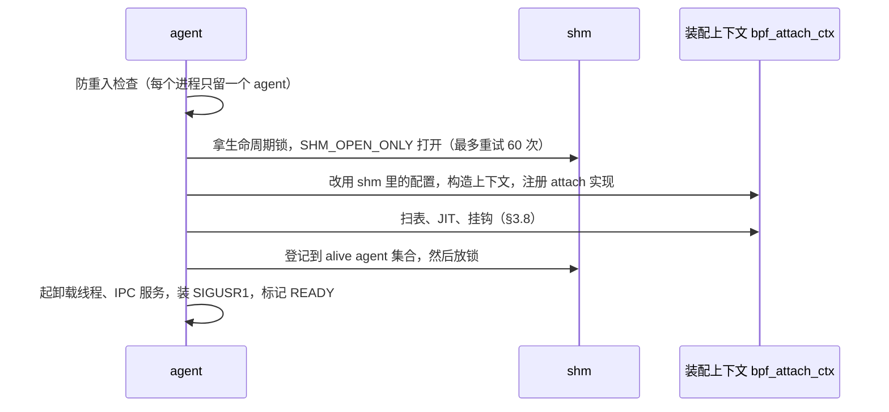
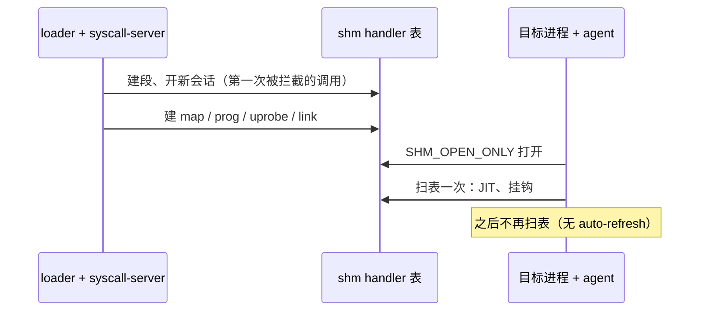

# 3. 两个入口：syscall-server、agent 与 cli

> 一句话：bpftime 有两个注入用的 .so 和一个命令行。syscall-server 注入 loader（如 sslsniff），把
> libbpf 发出的 `bpf()`、`perf_event_open()`、`mmap()`、epoll 等调用改写成对共享内存的读写；
> agent 注入被追踪的目标进程（如 nginx），从同一块共享内存读出 handler，真正把钩子挂上；
> `bpftime` 命令行只是帮你设好环境变量、启动进程或注入。读完本章，你能说清楚 loader 调 `bpf(2)`
> 为什么没进内核、agent 什么时候扫表又为什么只扫一次、为什么必须先启动 loader。
>
> 前置：建议先读[第 2 章](02-runtime-shm.md)（shm 与 handler 表）。预计用时：90 分钟。

## 本章要回答的问题

- 为什么 loader 和目标进程**各**需要一个 .so，而不是一个就够？
- loader 调 `bpf(2)` 时，为什么没有进内核？哪些 `bpf` 命令其实还是进了内核？
- syscall-server 是在什么时候建出 shm 的？只有 `bpf()` 才会触发吗？
- agent 怎么抢在目标进程的 `main` 之前跑起来？它扫几次 handler 表？
- `bpftime start` 和 `bpftime trace` 对启动顺序的要求为什么不一样？
- 注入的代码出了错（比如 shm 不够用），宿主进程会被弄死吗？

## 3.1 两个 .so，加一个命令行

一次 bpftime 追踪涉及两个进程，它们要做的事完全不同：

- **loader（控制面）**：它跑的是 libbpf，会发一串 `bpf()`、`perf_event_open()`、`mmap()`
  调用来建 map、加载 prog、创建 uprobe、准备 perf buffer。bpftime 要做的是**让这些调用别进
  内核**，改成往 shm 的 handler 表里写记录。这需要一个"拦截器"——syscall-server。
- **目标进程（数据面）**：被追踪的函数在这个进程里执行。要在函数入口跑 eBPF 程序，就必须
  有代码**住在这个进程里**：读 handler 表、JIT 编译 prog、改写目标函数的指令。这是 agent 的活。

两边要的东西不一样，又分处两个地址空间，所以是两个 .so。热路径上它们之间唯一的联系就是
第 2 章讲的那块 shm。第三个角色 `bpftime` 命令行（cli）不常驻：它设好 `LD_PRELOAD` 等环境变量
再启动程序，或者用 Frida 把 agent 注入一个已在运行的进程，或者通过 agent 的本地 socket 发命令。

| | syscall-server | agent | cli（`bpftime`） |
|---|---|---|---|
| 住在哪 | loader（如 sslsniff） | 目标进程（如 nginx） | 自己的短命进程 |
| 怎么进入 | `LD_PRELOAD` 覆盖 libc 函数 | `LD_PRELOAD` 劫持 `__libc_start_main`，或 Frida 运行时注入 | 用户直接运行 |
| 对 shm | 建段、写 handler 表 | 只打开（`SHM_OPEN_ONLY`）、按表装配 | `detach` 时只读 alive agent 集合 |
| 核心工作 | 把 libbpf 的系统调用改写成写表 | 按表 JIT prog、挂钩、运行 eBPF | 拼环境变量、fork/exec、注入、发 IPC |

下面这张图要看的是：三个角色各自通过什么和别人打交道。



两个 .so 都只是"薄壳"，真正干活的代码在 runtime 库里，而 runtime 是**静态库**，分别链进了
两个 .so。同一份 map/helper 代码在两个进程里各有一份拷贝，**全局变量互不相通**，真正共享的
只有 shm 里的数据。在 agent 里打印 loader 侧的某个全局变量，是新手常犯的错误。

> **C++/Linux 小知识：`LD_PRELOAD` 符号覆盖与 `dlsym(RTLD_NEXT)`**
> 动态链接器解析一个函数名（比如 `mmap`）时，按加载顺序在各个 .so 里找，第一个找到的
> 就用。`LD_PRELOAD` 指定的 .so 排在最前面，所以只要它导出了一个同名函数，程序（以及
> libbpf 等其他库）调用 `mmap` 时就会进到它的版本里——这就是"符号覆盖"。覆盖后如果还想
> 调用真正的 libc 版本，用 `dlsym(RTLD_NEXT, "mmap")`：意思是"在查找顺序里排在我后面的
> 那个 `mmap`"。syscall-server 和 agent 都靠这一对机制工作。

**要点**

- 控制面要"拦截"，数据面要"驻留执行"，所以是两个 .so；cli 只负责启动和注入。
- 两个 .so 各链一份 runtime 静态库；进程间只共享 shm 数据，不共享代码和全局变量。

## 3.2 设计原则：注入的代码不能把宿主搞挂

syscall-server 和 agent 都运行在**别人的进程**里。sslsniff、nginx 不知道也不关心 bpftime
存在。官方仓库在 `CLAUDE.md` / `AGENTS.md` 里把这条原则写成了"注入代码的宿主进程契约"，
归纳起来是三条：

1. **不终止宿主**：初始化、配置、内存分配、执行中任何一步失败，都不能 `exit`/`abort`/`terminate`。
   要么返回错误，要么记下来，然后只关掉受影响的那项 bpftime 功能。
2. **不碰宿主的 stdin/stdout/stderr**：日志默认写到文件里，除非用户显式要求输出到控制台。
3. **不乱换宿主的信号处理函数**：要换就得保存原来的并正确链式调用。

这种"出错就放行，退回原本的行为"的做法叫 **fail-open**。在本章的代码里，它体现为几个
反复出现的模式：

- syscall-server 的每个拦截函数都包了一层异常兜底：bpftime 这边抛了异常，就改为调用
  原始的 libc 函数——比如 `bpf()` 就真的发给内核。
- syscall-server 启动失败后，**本进程内的拦截永久关闭**，之后所有调用直接走原始路径。
- agent 初始化中途失败，会把已经做的事回滚掉，然后返回，不驻留、不挂钩，宿主照常跑。
- 日志默认写 `~/.bpftime/runtime.log`，路径不可用就干脆不写，绝不退到终端上。

fail-open 有一个必须知道的副作用：**bpftime 失效时是静默的**。你在终端上看不到任何报错，
现象可能是"探针没生效"或者"请求落到了真内核"（没权限时就是 `EPERM`）。排障第一步永远是
看日志文件（或 `BPFTIME_LOG_OUTPUT` 指定的位置）。

官方代码并没有处处守住这份契约：agent 用裸 `signal()` 装 `SIGUSR1` 处理器、不保存也不链式调用
宿主原有的处理器；IPC 刷新路径上挂钩抛出的异常没人接，会让宿主被 `std::terminate` 杀掉（本机
实跑过）；helper `bpf_trace_printk` 直接 `vprintf` 到目标进程的 stdout，而契约点名要求它走 bpftime
的日志通道（[第 7 章](07-helpers.md)）；syscall-server 还会顺带改变宿主自己的 epoll、
`syscall(__NR_memfd_create)` 和 mmap 行为。
这些都只记一句，细节见[附录 B](B-known-issues.md#b-entry)。

**要点**

- 原则：注入的代码出错时只关掉自己，退回宿主原本的行为，不终止、不碰 stdio、不乱换信号。
- 代价：失效是静默的，排障先看 bpftime 的日志文件。
- 官方实现有几处违反契约的地方，读代码时别把"契约"当成"已保证"。

---

下面四节讲 syscall-server：**拦截总表 → 启动 → `bpf()` 命令 → 其余调用**。

## 3.3 syscall-server ①：拦了哪些函数，以及如何安全地"晚起床"

### 拦截总表

syscall-server 导出了 15 个与 libc 同名的函数（CUDA 构建另加一个给 GPU 示例用的轮询函数），
靠 `LD_PRELOAD` 覆盖它们。用 `nm -D` 可以直接看到：

```
close epoll_create1 epoll_ctl epoll_wait fopen fopen64 ioctl _IO_new_fopen
mmap mmap64 munmap open openat read syscall
```

| 函数 | 什么时候被 bpftime 接管 | 接管后做什么 | 否则 |
|---|---|---|---|
| `syscall(__NR_bpf)` | 见 §3.5 命令表 | 读写 handler 表 | 原 syscall |
| `syscall(__NR_perf_event_open)` | 见 §3.6 | 建 perf handler | 原 syscall |
| `syscall(__NR_dup3)` | 旧 fd 是 bpftime map | 让新号共享同一个 map | 原 syscall |
| `syscall(__NR_memfd_create)` | 总是 | 借 `/dev/null` 假 fd + memfd 占位 | — |
| `syscall(其它号)` | 从不 | — | 原 syscall |
| `mmap` / `mmap64` | fd 是 ringbuf / array map / 软件 perf event | 直接返回 shm 内的指针 | 原 mmap |
| `munmap` | 地址是上面返回过的 shm 指针 | 只摘账，返回 0 | 原 munmap |
| `ioctl` | `PERF_EVENT_IOC_ENABLE/DISABLE/SET_BPF` | 改 perf handler / 建 link | 原 ioctl |
| `epoll_create1` | 总是（非混合模式） | 建 bpftime 的 epoll handler | — |
| `epoll_ctl` | 往 bpftime epoll 里加 ringbuf / 软件 perf event | 登记进 epoll handler | 原 epoll_ctl |
| `epoll_wait` | epfd 是 bpftime epoll | 轮询 shm 里的缓冲区 | 原 epoll_wait |
| `open` / `openat` / `fopen` 系列 | 打开 4 个固定的 `/sys` 路径 | 返回 bpftime 指定内容的"文件" | 原函数 |
| `read` | fd 是上面 mock 出来的文件 | 从内存供数据 | 原 read |
| `close` | 总是 | 清 handler 表同号格子（或摘 mock 文件），再真 close | — |

为什么连 `syscall()` 本身都要覆盖？因为 libbpf 发 `bpf` 命令时不走 glibc 包装函数，而是直接
`syscall(__NR_bpf, ...)`。而 `mmap`、`ioctl`、`epoll_wait` 这些 libbpf 走的是 glibc 包装函数，
由同名覆盖直接拦下。

"什么时候被接管"一列之外，还有一个总前提：本节下面的上下文已构造好、§3.4 的三个开关都允许。
另外，设了环境变量 `BPFTIME_RUN_WITH_KERNEL`（混合模式：map 和 verifier 用内核的）时，大部分
分支改为放行给内核；读主线时可以先跳过混合模式。

### 自己咬自己的问题

拦截层需要一个全局上下文对象 `syscall_context`，里面存着原始 libc 函数的指针、三个 mock
开关等。它不能在 .so 加载时就构造（那时 libc 环境未必就绪），所以等**第一次有调用被拦截时**
再构造。

麻烦在于：构造 `syscall_context` 时要建日志文件，建日志会调 `fopen`——而 `fopen` 正好被
自己拦截了。于是"构造中"的线程又一次进入拦截函数，又一次尝试初始化上下文。如果用普通的
"别人在初始化就等着"逻辑，这个线程会**等它自己**，永远等不到。

解决办法是一个四状态的初始化状态机，加一个**每线程**的"我正在初始化"标志：

> **C++/Linux 小知识：`thread_local` / `__thread`**
> 加了 `thread_local`（C++ 标准写法）或 `__thread`（GCC 扩展）的变量，每个线程各有一份
> 独立的拷贝，一个线程改它不影响别的线程。syscall-server 用它标记"本线程正在构造上下文"：
> 本线程重入时一看标志就知道是自己，直接放行；别的线程看到的还是 0，会老老实实等待。

`runtime/syscall-server/syscall_server_main.cpp` 的 `initialize_ctx`

```cpp
// 0 = 未初始化, 1 = 初始化中, 2 = 完成, 3 = 已禁用
static int ctx_initialized = 0;
static __thread int tls_initializing = 0;    // 每线程一份

static bool initialize_ctx() noexcept
{
	if (tls_initializing)                // 构造期间本线程又进来了：
		return false;                //   返回 false → 调用方走原始 libc
	int state = __atomic_load_n(&ctx_initialized, __ATOMIC_ACQUIRE);
	if (state == 2) return true;
	if (state == 3) return false;        // 曾经构造失败：永久不拦截
	int expected = 0;
	if (__atomic_compare_exchange_n(&ctx_initialized, &expected, 1, /*...*/)) {
		tls_initializing = 1;        // 抢到了：由我来构造
		try {
			new (&context.ctx) syscall_context;  // placement new
		} catch (...) {
			tls_initializing = 0;
			__atomic_store_n(&ctx_initialized, 3, __ATOMIC_RELEASE); // 失败 → 禁用
			return false;
		}
		tls_initializing = 0;
		__atomic_store_n(&ctx_initialized, 2, __ATOMIC_RELEASE);
		return true;
	}
	while ((state = __atomic_load_n(&ctx_initialized, __ATOMIC_ACQUIRE)) == 1)
		sched_yield();               // 没抢到：等别人构造完
	return state == 2;
}
```

几点说明：

- `context` 是一个用 union 包着的全局对象，和第 2 章 `shm_holder` 是同一招：跳过自动构造与
  析构，改为第一次需要时 placement new、并且永不析构。
- 构造函数用 `dlsym(RTLD_NEXT)` 找齐原始函数，然后 `unsetenv("LD_PRELOAD")`：loader 之后
  `exec` 出来的子进程不会再被注入（fork 出的子进程则带着已加载的 .so）。
- 状态 3 是 fail-open 的体现：构造抛异常（比如某个原始 libc 符号解析不到）时，不把异常
  抛给宿主，而是从此不再拦截任何东西。上下文不可用时拿不到它里面存的原始函数指针，所以
  syscall-server 另备了一套**不依赖上下文**的原始符号缓存，同样用 `dlsym(RTLD_NEXT)` 解析。

**要点**

- 拦了 15 个 libc 函数，包括 `syscall()` 本身和 `close`/`open`/`read` 这类通用函数。
- 上下文懒初始化；`__thread` 标志防止构造过程中自己等自己；构造失败就永久放行。

## 3.4 syscall-server ②：什么时候启动，启动做了什么

### 每个拦截函数的形状

每个被覆盖的 libc 函数都是同一个形状：准备一个"调用原始函数"的 lambda，再准备一个"走
bpftime 处理"的 lambda，交给一个兜底包装去执行——上下文不可用、或处理过程中抛了异常，就调
原始函数。`syscall()` 多了一步：先按系统调用号分流。

`runtime/syscall-server/syscall_server_main.cpp` 的 `syscall`（节选）

```cpp
extern "C" long syscall(long sysno, ...)
{
	/* 用 va_arg 一律读 6 个参数：多读无害，少读就错了 */
	if (!initialize_ctx())           // 上下文不可用 → 原始 syscall
		return fallback_syscall(sysno, arg1, arg2, arg3, arg4, arg5, arg6);
	auto call_original = [&]() {
		return context->orig_syscall_fn(sysno, arg1, arg2, arg3, arg4, arg5, arg6);
	};
	if (sysno == __NR_bpf) {         // bpf(cmd, attr, size)
		return handle_exceptions(
			[&]() { return context->handle_sysbpf((int)arg1,
					(union bpf_attr *)arg2, (size_t)arg3); },
			call_original);  // 抛异常 → 真的发给内核
	} else if (sysno == __NR_perf_event_open) {
		/* 同样形状 → handle_perfevent */
	} else if (sysno == __NR_dup3)        { /* → handle_dup3 */ }
	  else if (sysno == __NR_memfd_create){ /* → handle_memfd_create */ }
	return call_original();          // 其余系统调用原样放行
}
```

`handle_exceptions` 依次捕获 `boost::interprocess::bad_alloc`、`std::exception` 和其它任何
异常，记日志后改调 `call_original`。

### 三个 mock 开关

进入 `syscall_context` 的各个处理函数后，几乎每个开头都有同样一句检查：

```cpp
if (!enable_mock || initializing_cuda || !enable_mock_after_initialized)
	return orig_xxx_fn(...);   // 任一开关不允许 → 原样放行
```

它们解决的是同一个问题：**bpftime 自己发出的系统调用，必须绕过自己的拦截**。

| 开关 | 什么时候不允许 mock |
|---|---|
| `enable_mock` | 构造上下文期间；以及**每一次** `try_startup()` 调用期间（见下） |
| `initializing_cuda` | CUDA 驱动初始化期间（驱动会发大量真实的 ioctl / mmap） |
| `enable_mock_after_initialized` | runtime 内部需要临时调用真系统调用时；**启动失败后永久为 false** |

### 启动时机：任意一个被拦截的调用

shm 不是在 .so 加载时建的。每个处理函数在通过开关检查后都会先调 `try_startup()`，而它调用的
`start_up()` 包在 `std::call_once` 里（不管多少线程同时调用，都只执行一次）。所以**第一个通过
开关检查的被拦截调用**就会触发启动——不必是 `bpf()`，一次普通的 `close`、`open`、`read`、`mmap`、`ioctl` 都行。

本机实测：一个预加载了 syscall-server 的程序在 `main` 开头时 shm 还不存在，执行一次
`close(-1)` 之后，`/dev/shm/<名字>` 就出现了，`BPFTIME_USED=1` 也被设上，`LD_PRELOAD` 已被清除。

`try_startup()` 每次被调用时都会先把 `enable_mock` 置为 false、返回时再置回 true（这样
`start_up` 里 bpftime 自己的 `open`/`mmap` 不被拦截）。注意这是"每一次"而不只是第一次；
多线程 loader 里这留下了一个很小的窗口，别的线程在窗口内的调用会绕过 bpftime（按代码推断，
见[附录 B](B-known-issues.md#b-entry)）。

### `start_up` 做了什么

shm 本身的结构、打开方式、epoch 机制见[第 2 章](02-runtime-shm.md)。启动流程是：

```
start_up(ctx)                         仅执行一次（call_once）
  ├ 从环境变量构造 runtime_config
  ├ 拿 shm_lifecycle_lock             与 agent 打开 shm、自己退出时删段互斥（第 2 章 §2.8）
  ├ 先用 SHM_CREATE_ONLY 建段
  │    成功 → 本进程是这段 shm 的"所有者"
  │    已存在 → 退回 SHM_CREATE_OR_OPEN 复用旧段（不是所有者）
  │    其它失败 → 删掉建了一半的段，抛异常
  ├ atexit(退出清理)                  所有者退出时：没有其他活着的 loader 或 agent 才删段
  ├ 把自己的 pid 登记进 alive syscall-server 集合（失败则放弃自动删段）
  ├ begin_new_session()               epoch 奇 → 清空整张表 → 偶（第 2 章 §2.7）
  ├ 注册 mock 开关回调                 runtime 内部可借它临时关掉 mock
  ├ 用本进程的配置整体覆盖 shm 里的 runtime_config
  └ setenv("BPFTIME_USED", "1")       宿主程序可据此知道自己被 bpftime 接管了
```

注意 `begin_new_session` 对**每一个**新起的 syscall-server 都执行，包括复用别人段的那个。
所以同一个 shm 名上后起的 loader 会清空先起者的表（第 2 章 §2.7 有实测）。

如果 `start_up` 里任何一步抛异常（典型情况是 shm 空间不够），这个异常会被存起来，以后每次
调用都重新抛出；`try_startup` 第一次捕获到它时就把 `enable_mock_after_initialized` 置为
false。结果是：**当次调用由异常兜底退回原始操作，之后的所有调用在开关检查处直接放行**。
bpftime 在这个进程里就此失效，但 loader 照常运行。

**要点**

- 每个拦截函数 = "bpftime 处理" + "原始调用"两个 lambda，异常时自动退回原始调用。
- 三个 mock 开关的共同目的：bpftime 自己的系统调用不被自己拦截。
- 启动由**任意一个**被拦截调用触发，只执行一次；每个新 syscall-server 都会清空整张表；失败后本进程永久放行。

## 3.5 syscall-server ③：`bpf()` 命令总表

`handle_sysbpf` 是一个按 `bpf` 命令号分支的大 `switch`。先记住一个容易坑人的事实：
**没实现的命令走 `default` 分支，静默地发给真内核**，不会报"未实现"。调试时遇到权限错误
或诡异行为，先想想是不是落到了这里。

| 命令 | 默认（用户态）模式下做什么 | 混合模式（`BPFTIME_RUN_WITH_KERNEL`） |
|---|---|---|
| `BPF_MAP_CREATE` | `bpftime_maps_create(-1, ...)`：借 `/dev/null` 假 fd，在表里建 map handler 和容器 | 先在内核真建 map，再在 shm 里建一个以内核 map id 为号的影子 map |
| `BPF_MAP_LOOKUP_ELEM` | 查 shm 里的 map，把值拷到 `attr->value`；查不到 `ENOENT` | 进内核 |
| `BPF_MAP_UPDATE_ELEM` / `DELETE_ELEM` / `GET_NEXT_KEY` | 对 shm 里的 map 做同样操作 | 进内核 |
| `BPF_MAP_LOOKUP_AND_DELETE_ELEM` | 只实现成 pop（给 queue/stack 用） | 进内核 |
| `BPF_PROG_LOAD` | `bpftime_progs_create(-1, ...)`：**只把字节码存进 shm**，不 JIT、不校验（verifier 构建另说，见下） | 程序进内核过 verifier，再在 shm 里存一份 |
| `BPF_LINK_CREATE` | `bpftime_link_create(-1, ...)`：在表里记一条"prog ↔ perf event"关系 | 目标不是 bpftime perf fd → 进内核 |
| `BPF_PROG_ATTACH` | 同样记一条关系 | 目标不是 bpftime perf fd → 进内核 |
| `BPF_MAP_FREEZE` | 直接返回 0（未实现） | 进内核 |
| `BPF_OBJ_GET_INFO_BY_FD` | map：填一部分 `bpf_map_info`（id 填的是 fd 本身）；prog：只填 id；**其它 fd：什么都不填、返回 0** | 进内核 |
| 其它（`BPF_BTF_LOAD`、`OBJ_PIN/GET`、`PROG_TEST_RUN`、各种 `GET_NEXT_ID` / `GET_FD_BY_ID`、批量 map 操作……） | `default`：**原样发给内核** | 同左 |

几点说明：

- **loader 侧不做 JIT，只把字节码存进 shm**。编译发生在 agent 侧（[第 6 章](06-vm-jit.md)）。
  只有打开 `ENABLE_EBPF_VERIFIER` 编译时，`PROG_LOAD` 才会对 tracepoint 和 socket filter 两类
  程序跑用户态 verifier（[第 10 章](10-periphery.md)）；本书用的 `build-jit` 没有打开它。
- **link 只是 shm 里的一条关系记录，此刻什么都还没挂上**。真正插桩要等 agent 扫表扫到这条
  link（§3.8）。所以 loader 侧看起来一切成功，**不代表探针真的挂上了**。
- 本机实测：非 root 下 `BPF_BTF_LOAD` 走 `default` 进内核，得到 `EPERM`；对 fd 0 调
  `BPF_OBJ_GET_INFO_BY_FD` 返回 0、errno 0，输出缓冲区原样未动。
- 建 map 时，有些 map 类型参数非法会得到一个"有 fd 无容器"的坏 map，另一些会因为构造函数抛
  异常而被异常兜底**转去真内核创建**——同一类错误、两种结局（见[附录 B](B-known-issues.md#b-shm)）。

**要点**

- `bpf()` 的用户态处理只往 handler 表里写：map 描述、字节码、关系记录。
- 没实现的命令静默发给真内核；`MAP_FREEZE` 假装成功；`OBJ_GET_INFO_BY_FD` 对陌生 fd 返回 0。

## 3.6 syscall-server ④：perf event、mmap、epoll、ioctl 与 `/sys`

这一节对应 libbpf 创建 uprobe 和 perf buffer 的那几步。

### 先骗过 `/sys` 下的几个文件

libbpf 创建 uprobe 前，会读 `/sys/bus/event_source/devices/uprobe/type` 来确定 uprobe 的
perf 类型号，还会读 `.../uprobe/format/retprobe` 确定"返回探针"用哪一位。bpftime 连这几个
文件都 mock 了（uprobe、kprobe 各两个路径），内容固定：uprobe 类型号 9、kprobe 类型号 8、
retprobe 位 `config:0`。只要 mock 处于开启状态，打开这几个路径就一定拿到这些内容，不管宿主上
真文件是否存在、值是多少。

两种打开方式的落地不同：

- `open`/`openat`：用 `mkostemp` 建一个临时文件并立刻 `unlink`，拿到一个**空的**真实 fd，内容
  只经被拦截的 `read()` 从内存供给（所以 `pread`、`mmap` 这类绕过 `read` 的读法读不到内容）。
  `openat` 用 `AT_FDCWD` 加相对路径时不会命中。
- `fopen` 系列：把内容**真的写进**临时文件、`lseek` 回开头，再 `fdopen` 返回。

注意它和第 2 章的假 fd（`/dev/null`）是两套机制。本机实测：在 loader 里 `open` 再 `read`
uprobe 的 type 文件，fd 指向 `/tmp/bpftime-mock.XXXXXX (deleted)`，读到 `9`。

### `perf_event_open`：写一张"说明书"

`handle_perfevent` 按 `attr->type` 分支：

| `attr->type` | 用户态模式 | 混合模式 |
|---|---|---|
| uprobe 类型号（9） | 拆出 `retprobe`（config 的那一位）、`ref_ctr_off`（config 高 32 位）、文件名（config1）、偏移（config2）→ `bpftime_uprobe_create` | 进内核 |
| kprobe 类型号（8） | `bpftime_kprobe_create`（在 bpftime 里它表示 CUDA 探针，[第 9 章](09-gpu.md)） | 名字以 `cuda_` 开头时特殊处理，否则进内核 |
| `PERF_TYPE_TRACEPOINT` | `bpftime_tracepoint_create`（系统调用追踪用，[第 5 章](05-syscall-trace.md)） | 进内核 |
| `PERF_TYPE_SOFTWARE` | `bpftime_add_software_perf_event`：在 shm 里建一个 perf buffer | 同左（不看混合模式） |
| 1008 / 1009 | bpftime 自定义的 override / ureplace 事件（[第 4 章](04-attach-uprobe.md)） | 同左 |
| 其它 | 进内核 | 进内核 |

也就是说，**loader 侧的"perf event"只是一张说明书**："请在某个文件的某个偏移挂一个 uprobe"。
执行者是 agent。

### `ioctl`：只改标志，或建一条关系

- `PERF_EVENT_IOC_ENABLE` / `DISABLE`：只把 perf handler 的 `enabled` 标志置真/置假。这个
  标志没有任何消费者，所以 `DISABLE` 停不掉已挂上的探针（第 2 章 §2.3）。
- `PERF_EVENT_IOC_SET_BPF`：老式挂载方式，和 `BPF_PROG_ATTACH` 一样在表里记一条关系。它把新
  建 link 的假 fd 当返回值返回（内核这里返回 0），这个 link fd 也没有人关（见[附录 B](B-known-issues.md#b-entry)）。
  libbpf 只检查返回值是否小于 0，所以功能上无碍。
- 其它请求一律落到原始 `ioctl`，并且**每次都打一条 WARN 日志**。

### `mmap`：直接递出 shm 里的指针

libbpf 拿到每个 CPU 的 perf event fd 后，会 `mmap(fd, 页数)` 把内核的环形缓冲映射进来。
bpftime 拦下这个调用，直接返回 shm 里那块缓冲区的地址：

`runtime/syscall-server/syscall_context.cpp` 的 `syscall_context::handle_mmap64`（节选）

```cpp
/* ...前面还有 ringbuf map（按 prot 区分消费者页/生产者页）、可 mmap 的 array map 两个分支... */
} else if (fd != -1 && bpftime_is_software_perf_event(fd)) {
	errno = 0;
	if (auto ptr = bpftime_get_software_perf_event_raw_buffer(fd, length);
	    ptr != nullptr) {
		mocked_mmap_values.insert((uintptr_t)ptr); // 记账，munmap 时认出它
		return ptr;   // 直接返回 shm 内的指针！根本没有发生真正的 mmap
	}
	if (errno == 0)
		errno = ENOMEM;
	return MAP_FAILED;    // 长度不合法(EINVAL)或 shm 不够(ENOMEM)：如实告诉 libbpf
}
/* 不认识的 fd：调原始 mmap */
```

缓冲区开头一页照内核格式放 `perf_event_mmap_page`（里面有 `data_head`、`data_tail`），后面
跟数据区。所以 **libbpf 的消费代码（读 head、搬记录、写 tail）原封不动就能工作**——它以为
自己在读内核的 perf ring，其实读的是 shm 里一个普通 vector（细节见[第 8 章](08-maps.md)）。
ringbuf 和 array map 拿不到指针时会落到真 mmap；软件 perf event 失败则如实返回 `MAP_FAILED`，
不回退。

落到原始 mmap 的那条路有个瑕疵：每次都会先多做一次匿名映射并丢弃结果，于是 loader 的**每一次
普通 mmap** 都泄漏一段地址空间。本机实测 1000 次 4KiB 的 mmap+munmap 让 VmSize 涨了正好
4000 kB（见[附录 B](B-known-issues.md#b-entry)）。

### `epoll`：等数据时顺便搬运

libbpf 用 `epoll_wait` 等 perf buffer 有数据。bpftime 接管了整套 epoll：

- `epoll_create1` 无条件返回一个 bpftime epoll 假 fd（也是借来的 `/dev/null`）。
- `epoll_ctl` 只认"往里加 ringbuf 或软件 perf event"，其它情况调原始 `epoll_ctl`——对一个
  `/dev/null` fd 做 epoll_ctl 必然失败。所以**loader 自己若也用 epoll 等普通 fd**（网络、
  timerfd），会失效（本机实测：对 pipe 做 `epoll_ctl` 返回 `EINVAL`）。
- `epoll_wait` 依次问每个登记过的缓冲区"有数据吗"。对软件 perf event，这个询问函数**先把各
  生产线程 shard 里的记录搬进 loader 读的那个环**，再看环里有没有东西。没有数据时最多等 1ms
  再扫一轮，期间临时放开 `SIGINT`/`SIGTERM`，让 Ctrl+C 能打断它。

下面这张图要看的是：一条记录从目标进程里的 eBPF 程序出发，经过 shm，被 loader 里原生的
libbpf 代码读走，全程没有经过内核。



**要点**

- `/sys` 的 uprobe/kprobe 描述文件被 mock，uprobe 类型号固定为 9。
- `perf_event_open` 在 loader 侧只写说明书；软件 perf event 对应 shm 里的一个 perf buffer。
- `mmap` 直接返回 shm 内的指针；`ioctl(ENABLE/DISABLE)` 只改一个没人读的标志。
- syscall-server 会改变 loader 自己的 epoll 和 mmap 行为，loader 越"普通"越安全。

---

下面三节讲 agent：**启动 → 扫表装配 → 刷新与卸载**。

## 3.7 agent ①：两种启动方式与初始化

agent 要在目标进程的业务代码跑起来之前（或者在注入的那一刻）把钩子挂好。它有两种进入方式，
最后都汇到同一个入口函数 `bpftime_agent_main(data, &stay_resident)`：

1. **`LD_PRELOAD` 启动**（`bpftime start`）：agent 覆盖了 glibc 的 `__libc_start_main`。这个
   函数是 C 程序真正的入口，由它调用 `main`。agent 的版本把 `main` 换成自己的一个包装函数，
   包装函数先调 `bpftime_agent_main("")`，**无论成败**再调真正的 `main`。
2. **Frida 运行时注入**（`bpftime attach <pid>`、`bpftime trace`）：进程已经在跑，cli 用 Frida
   把 agent 加载进去，直接调用导出的 `bpftime_agent_main(data)`。`stay_resident` 为假时 Frida
   会把库卸载掉，所以 agent 只在初始化成功后才把它置真。

还有第三条路 `bpftime start -s` / `attach -s`：先注入一个"代码段改写器"，由它在一个隔离的链接
命名空间里加载 agent，并把系统调用追踪的回调接上。这条路属于系统调用追踪，放在
[第 5 章](05-syscall-trace.md)。不经过它启动的 agent 也会注册系统调用追踪的 attach 实现，但没有
系统调用钩子，这类 link 能"挂上"却永远不会触发。

第一种方式的代码很短：

`runtime/agent/agent.cpp` 的 `__libc_start_main` 与 `bpftime_hooked_main`

```cpp
extern "C" int bpftime_hooked_main(int argc, char **argv, char **envp)
{
	int stay_resident = 0;
	injected_with_frida = false;
	bpftime_agent_main("", &stay_resident);   // 先初始化 agent（data 为空串）
	return orig_main_func(argc, argv, envp);  // 再跑真正的 main，不管上面成败
}

extern "C" int __libc_start_main(int (*main)(int, char **, char **), int argc,
				 char **argv, /* init, fini, rtld_fini, stack_end */ ...)
{
	orig_main_func = main;                    // 记下真正的 main
	auto orig = (decltype(&__libc_start_main))
		dlsym(RTLD_NEXT, "__libc_start_main"); // 找到 glibc 的版本
	return orig(bpftime_hooked_main, argc, argv, /* ... */); // 把 main 偷换掉
}
```

`data` 是一串 `key=value;...` 形式的参数。agent 认识这几个键：`auto_refresh_ms`（定期重扫
间隔）、`loader_pid`（loader 退出后停止重扫）、`force_reinit`（已初始化时强制重新装配），以及
两个 CUDA 相关的键。`LD_PRELOAD` 和 `bpftime attach`（不带 `-s`）传的都是空串，只有 `bpftime trace` 会带上
前三个键。这决定了 agent 之后会不会再扫表（§3.8）。

### 初始化主线

进入 `bpftime_agent_main` 后，主线可以分成五步。下面这张图要看的是先后顺序，尤其是"打开 shm"
和"登记 pid"之间一直持着一把锁。



**① 防重入。** 同一个进程里 agent 可能被加载两次（比如先 `LD_PRELOAD`、后来又被 Frida 注入），
也可能被并发调用。所以开头有三道检查：本进程里已有 agent 在跑 IPC 服务 → 把请求转成
`refresh <data>` 发给它，自己返回；本进程里已加载了另一份 agent → 调它导出的控制函数，自己返回；
否则用原子比较交换把状态从"未初始化"改成"初始化中"，失败说明别人正在初始化或已经完成——
已完成且带 `force_reinit=1` 就走刷新流程，否则直接返回。结论：**每个进程里最多一个 agent 实例在工作**。

**② 打开 shm。** 用 `SHM_OPEN_ONLY`，不存在就失败。最多重试 60 次、每次间隔 50ms，给 loader
最多 3 秒来建段；仍然失败就记一条 `Unable to initialize shared memory` 日志、回滚返回，目标进程
照常跑，只是没有探针。本机实测：目标进程先于任何
loader 启动时，agent 放弃初始化，`main` 照常运行到结束，`SIGUSR1` 仍是默认处理（说明没有驻留）。

每次尝试前都先拿 `shm_lifecycle_lock`（第 2 章 §2.8），**成功打开后一直持有，直到把自己的 pid
登记进 alive agent 集合**，中间包括整个扫表、JIT 和挂钩。原因是：loader 退出时会在同一把锁下
检查"还有没有活 agent"来决定要不要删段，持锁把"agent 开段并登记"和"loader 检查并删段"串行化了。

**③ 改用 loader 的配置。** agent 最早的几行日志按它自己进程的 `BPFTIME_LOG_OUTPUT` 写；一打开
shm，就改用 shm 里 `runtime_config` 记的日志路径——也就是 **loader** 配置的位置。JIT 开关、
helper 组、栈回溯方式（[第 4 章](04-attach-uprobe.md)）等配置同样来自 shm。所以想改 agent 的行为，要在 **loader** 那边设环境
变量（shm 名除外，两边必须一致）。

**④ 构造装配上下文并注册 attach 实现。** 装配上下文 `bpf_attach_ctx` 也是用 union 包着的全局
对象，带显式的 `init()` / `destroy()` 方便回滚。attach 实现（attach impl）是"某一类钩子怎么挂"
的实现，按 perf handler 的类型号登记：

| perf handler 类型 | 交给哪个 attach 实现 |
|---|---|
| uprobe(6) / uretprobe(7) / override(1008) / ureplace(1009) | uprobe 后端：平台支持断点式（trap）后端时用它，否则用 Frida（[第 4 章](04-attach-uprobe.md)） |
| tracepoint(2) | 系统调用追踪（[第 5 章](05-syscall-trace.md)） |
| kprobe(8) / kretprobe(9) | CUDA 探针，仅 CUDA 构建（[第 9 章](09-gpu.md)） |

**⑤ 扫表，成功后才常驻。** 扫表见下一节。成功后依次：（若 data 里有 `auto_refresh_ms`）起定期
重扫线程——注意它在放锁之前就起了；登记 alive pid、放锁；起卸载工作线程和 IPC 服务；为 `SIGUSR1`
装处理函数；告诉注入方"请让我常驻"，状态标为 READY。这些"让自己常驻"的动作**都放在初始化成功之后**——中途任何
一步失败，回滚函数会把已经做的事逐项撤销（停线程、关管道、析构上下文、摘 pid、状态改回"未初始化"）。

**要点**

- 两种启动方式：`LD_PRELOAD` 劫持 `__libc_start_main`（在 `main` 之前），或 Frida 注入（随时）。
- 每个进程最多一个 agent；打开 shm 最多等 3 秒；从开 shm 到登记 pid 一直持生命周期锁。
- agent 的配置（含日志路径）来自 shm，也就是来自 loader 的环境变量。

## 3.8 agent ②：扫表与装配——默认只扫一次

### 扫表做了什么

核心一步是 `bpf_attach_ctx::init_attach_ctx_from_handlers`。它在第 2 章 §2.7 的 epoch 前后检
框架里扫一遍 handler 表，对每个非空格子递归实例化：

- **prog** → 取出字节码，在本进程里建 VM、注册 helper、JIT 编译（[第 6 章](06-vm-jit.md)）。
- **perf event** → 按类型号找到 attach 实现，把"说明书"翻译成它要的私有数据。uprobe 拼成
  `"<模块>:<偏移>"` 交给 Frida 后端解析：它先用 `gum_module_load` 把模块**加载进本进程**再取基址
  （所以目标进程可能多加载一个它本来不用的库），后面挂钩前对 `/proc/self/maps` 的检查因此几乎总能
  通过；只有模块文件根本不存在时才失败（[第 4 章](04-attach-uprobe.md)）。软件 perf event（perf
  buffer）不需要实例化，直接跳过。
- **link** → 先递归实例化它的 prog 和目标 perf event，再调 attach 实现真正挂钩，回调里执行 prog。
- **map、epoll、memfd** → 什么都不做（数据就在 shm 里）。

扫过一遍后还有第二遍，专门处理 CUDA link。已经实例化过的格子会记在一个集合里，再扫时跳过。

单个 handler 实例化**返回错误**时只记日志（下层多为 ERROR 级，默认级别下看得到），不中断扫描。但如果 attach 实现**抛异常**
（Frida 挂钩失败就是抛异常），异常会一路穿出扫表函数，整个 agent 初始化被回滚——同一张表里本来
能挂上的 link 也一个都不挂（本机实跑过：对一个 4 字节的函数挂 uprobe 就会触发，见
[附录 B](B-known-issues.md#b-entry)）。

### 只扫一次意味着什么

扫表函数只在三种时候被调用：初始化时一次；data 里带 `auto_refresh_ms` 时定期再调；收到 IPC
`refresh` 请求时再调。`bpftime start`（`LD_PRELOAD`）和 `bpftime attach` 传的 data 是空串，
**所以它们启动的 agent 只扫一次表**。

后果很直接：agent 扫表时表里有什么，就挂什么。如果那一刻 shm 已经存在（loader 刚建了段，或者
有上一轮残留的段）但 loader 还没建好 link，agent 照样报 `Attach successfully`，然后永远不会再看
这张表。（shm 还不存在的情况见 §3.7②：agent 干脆放弃初始化。）本机实测（[labs/](labs/) 的
`ch03-refresh.sh`）：loader 先建出 shm 和 map，隔 4 秒才建 prog 和 link；1 秒后启动带 agent 的目标
进程——agent 日志写着 `Attach successfully`，loader 读到的计数器一直是 0；之后用 IPC 发一个
`refresh`，计数器才开始每秒增长约 10。

由此得到使用 `bpftime start` 时的启动顺序（[第 1 章](01-lifecycle.md)的主线也按这个顺序）：

1. 先启动 loader（`bpftime load`），**等它把 map、prog、uprobe、link 都建完**；
2. 再启动目标进程（`bpftime start`），或对已运行的目标进程 `bpftime attach`。

反过来也不是完全不行：agent 先起、loader 后起时，只要 agent 初始化成功了（shm 已存在），后来有人
触发重扫（IPC `refresh`）就能对上；更省心的是用 `bpftime trace`。`bpftime trace` 正是为此设计的：它启动 loader 后**立刻**注入 agent，
并带上默认 500ms 的 `auto_refresh_ms`，靠定期重扫追上 loader 的进度（§3.10）。

下面这张图要看的是 `bpftime start` 工作流里，agent 扫表的时机必须落在 loader 建完表之后。



**要点**

- 扫表 = 按 prog / perf event / link 递归实例化；返回错误只跳过，抛异常会让整个 agent 放弃。
- `bpftime start` / `attach` 启动的 agent 只扫一次表，所以要先让 loader 建完表。
- `bpftime trace` 用 auto-refresh 定期重扫，不要求严格顺序。

## 3.9 agent ③：刷新与卸载

### IPC：进程内的控制通道

agent 初始化成功后会起一个线程，监听一个 **abstract unix socket**，名字是
`\0bpftime-agent-<pid>`（开头是 0 字节，不在文件系统里留文件）。它用 `SO_PEERCRED` 只接受
root 或同一用户的连接，认三种文本请求：

| 请求 | 做什么 | 回复 |
|---|---|---|
| `refresh <k=v;...>` | 按参数更新设置；先停掉正在跑的 auto-refresh 线程，拆掉全部钩子、清空已实例化记录，再完整扫一遍表；参数里带 `auto_refresh_ms` 才会起新的 auto-refresh 线程（不带就从此没有） | `ok` 或 `err refresh <rc>` |
| `detach` | 拆掉全部钩子（同 `SIGUSR1`） | `ok` 或 `err detach <rc>` |
| `status` | 读 shm 里的 epoch | `epoch_seq=<n>`、`missing` 或 `unstable` |
| 其它 | — | `unknown` |

本机实测：用十几行 Python 连上这个 socket，`status` 得到 `epoch_seq=2`，`refresh ` 得到 `ok`
且之后钩子生效。

注意 `refresh` 和 auto-refresh 不一样：`refresh` 是"全拆再全扫"；auto-refresh 线程每隔
`auto_refresh_ms` 调一次扫表函数，只**增量**挂新出现的 handler，表里被删掉的 link 要等到换会话
才会被拆（第 2 章 §2.7）。auto-refresh 线程发现 `loader_pid` 已不存在时自己退出。

### 卸载：`SIGUSR1` → 管道 → 工作线程

收到 `SIGUSR1` 时 agent 要拆掉所有钩子。但信号处理函数里能做的事非常有限：它可能打断了一个
正持有 malloc 内部锁的线程，这时在处理函数里再调 malloc、加锁、打日志，就可能死锁。只有少数
"异步信号安全"的函数可以在里面调用。

所以 agent 的处理函数只做两件安全的事：一次原子加法，和往一个管道里 `write` 一个字节。

`runtime/agent/agent.cpp` 的 `sig_handler_sigusr1_detach`

```cpp
static void sig_handler_sigusr1_detach(int sig)
{
	(void)sig;
	// Async-signal-safe: do not call spdlog / malloc / locks here.
	auto_refresh_epoch.fetch_add(1, std::memory_order_acq_rel); // 让 auto-refresh 线程退出
	int fd = detach_pipe_fds[1];
	if (fd >= 0) {
		uint8_t one = 1;
		ssize_t ignored = write(fd, &one, 1);  // 唯一的"重活"：通知工作线程
		(void)ignored;
	}
}
```

真正的卸载（拿锁、join 线程、拆钩子、打日志）由一个预先启动好的工作线程完成：它阻塞在管道
的读端，读到字节、并确认 agent 处于 READY 状态后，在普通线程上下文里执行。这是处理信号的
标准模式：**处理函数里只做安全操作，重活交给普通线程**。

卸载之后 agent 仍然是 READY 状态，IPC 服务还在，所以之后还能用 `refresh` 重新装配。卸载成功
时会把自己从 alive agent 集合里摘掉。

这个处理函数是用裸 `signal(SIGUSR1, ...)` 装的，没有保存宿主原有的处理器，也不链式调用它——
宿主自己若用 `SIGUSR1`，会被 bpftime 抢走（违反 §3.2 第三条，见[附录 B](B-known-issues.md#b-entry)）。

**要点**

- IPC 认 `refresh` / `detach` / `status`；`refresh` 全拆全扫，auto-refresh 只增量挂新的。
- `SIGUSR1` 处理函数只写管道，卸载由工作线程完成；卸载后还能再 `refresh`。

## 3.10 cli：`bpftime` 的各个子命令

`bpftime` 命令行（`tools/cli`）本身很薄：它不碰 handler 表的内容，只负责把正确的 .so 塞进正确的
进程。本书用的 `build-jit` **没有构建**这个命令行，下面的行为都来自读代码，本机未实跑。

它先找 .so：如果 `bpftime` 自己就在构建目录里，就用构建目录里的 .so；否则用安装目录
`-i/--install-location`（默认 `~/.bpftime`）下的；都找不到直接退出。

| 子命令 | 做什么 |
|---|---|
| `load [选项] 命令...` | 把运行选项翻成环境变量（`--no-jit` → `BPFTIME_DISABLE_JIT`、`--memory-size` → `BPFTIME_SHM_MEMORY_MB`、`--bpftime-log-output`、`--spdlog-level`、`--allow-external-maps`、`--fuzzy-backtracer`、`--run-with-kernel-verifier`、`--bpftime-not-load-pattern` 等），设 `LD_PRELOAD=<syscall-server.so>`（**整体替换**原有的 `LD_PRELOAD`），fork + exec 命令并等它结束，返回它的退出码 |
| `start 命令...` | 设 `LD_PRELOAD=<agent.so>` 后 fork + exec。没有运行选项——agent 的配置来自 loader |
| `start -s 命令...` | 改为预加载代码段改写器，并用 `AGENT_SO` 告诉它 agent 在哪（[第 5 章](05-syscall-trace.md)） |
| `attach [-s] PID` | 用 Frida 把 agent 注入正在运行的进程，data 为空串；`-s` 时注入的是改写器，传给它的 data 是 agent 的路径 |
| `detach` | 以 `SHM_OPEN_ONLY` 打开 shm，对 alive agent 集合里的每个 pid 先发 IPC `detach`，再发 `SIGUSR1` |
| `trace --pid N \| --pidof 名字 [--auto-refresh-ms 500] 命令...` | 一条命令完成"启动 loader + 注入 agent"（见下） |

`trace` 的流程值得单独看，它把本章的几块拼在了一起：

1. 确定目标 pid（`--pidof` 要求 `/proc/*/comm` 精确且唯一匹配）。以 root 运行时，loader 会被
   降权成目标进程的用户，已存在的 shm 也会被改成目标用户所有。
2. 以 `LD_PRELOAD=<syscall-server.so>` 启动 loader，**不等它**。
3. 拼 agent 参数 `loader_pid=<loader>;force_reinit=1;auto_refresh_ms=500;...`；先试着通过 IPC 给
   目标进程里已有的 agent 发 `refresh`，不通再用 Frida 注入。
4. 等 loader 结束。期间按 Ctrl+C 时，先让 agent 卸载（IPC `detach`，不通就 `SIGUSR1`），再停 loader；
   loader 正常结束后同样会给 agent 发一次卸载。

另外，`trace` 的返回值是注入的结果，不是 loader 的退出码。

**要点**

- `load` 给 loader 预加载 syscall-server，`start`/`attach` 给目标进程装 agent，`detach` 让所有 agent 卸载。
- `trace` = 启动 loader + 立即注入带 auto-refresh 的 agent，所以不需要手动排启动顺序。
- 运行选项只挂在 `load` 上，因为 agent 的配置本来就来自 loader。

## 小结

- loader 需要拦截（控制面），目标进程需要驻留执行（数据面），所以有 syscall-server 和 agent 两个 .so；cli 只负责启动、注入和发命令。
- 设计原则是 fail-open：出错只关掉 bpftime 自己的功能，退回原始行为；代价是失效时静默，要看日志。官方代码有几处违反这份契约。
- syscall-server 拦了 15 个 libc 函数；上下文懒初始化，用 `__thread` 标志解决"构造中自己拦截自己"。
- syscall-server 的启动由**任意一个**被拦截调用触发，只执行一次；每个新 syscall-server 都会开新会话、清空整张表。
- `bpf()` 的用户态处理只往 handler 表里写；没实现的命令静默发给真内核。`mmap` 直接返回 shm 里 perf buffer 的指针。
- agent 靠覆盖 `__libc_start_main` 或 Frida 注入进入；配置（含日志路径）来自 loader 写进 shm 的那份。
- `bpftime start` / `attach` 的 agent 只扫一次表，所以要先让 loader 建完表；`bpftime trace` 靠 auto-refresh 不受顺序限制。
- 卸载走 `SIGUSR1` → 管道 → 工作线程，或 IPC `detach`；之后可以 IPC `refresh` 重新装配。

## 动手验证

以下命令里 `B` 指官方树的 `build-jit` 目录（没有 `bpftime` 命令行，所以直接用 `LD_PRELOAD`）。
实验 2、3 用指南仓库 [labs/](labs/) 里的小程序：一个不依赖 libbpf、直接调 `bpf(2)` 建 map/prog/uprobe/link
并每秒打印计数的 `loader`，一个每 100ms 调一次 `target_func` 的 `victim`。先 `cd labs && ./build.sh`。
脚本自带随机的 `BPFTIME_GLOBAL_SHM_NAME`，结束时删掉段和锁文件。更多实验见[第 12 章](12-practice.md#exp-3)。

1. **看两个 .so 覆盖了哪些符号。**
   ```bash
   nm -D --defined-only $B/runtime/syscall-server/libbpftime-syscall-server.so
   nm -D --defined-only $B/runtime/agent/libbpftime-agent.so
   ```
   本机实测：syscall-server 导出 §3.3 那 15 个与 libc 同名的函数；agent 导出 7 个，包括
   `__libc_start_main`、`bpftime_agent_main`、`bpftime_agent_control`。

2. **亲眼看 fail-open。** 把 handler 表长调到上限，让 50MB 的 shm 放不下它：
   ```bash
   cd labs
   export BPFTIME_GLOBAL_SHM_NAME=lab_fo_$RANDOM
   OFF=0x$(nm victim | awk '/ target_func$/{print $1}')
   SECS=1 BPFTIME_MAX_FD_COUNT=1048576 BPFTIME_LOG_OUTPUT=console \
     LD_PRELOAD=$B/runtime/syscall-server/libbpftime-syscall-server.so ./loader $PWD/victim $OFF
   rm -f /tmp/bpftime-shm-$BPFTIME_GLOBAL_SHM_NAME.lock
   ```
   本机实测：stderr 上出现 `Boost interprocess bad_alloc` 和 `Falling back to the original host
   operation`；建了一半的段被删掉（`/dev/shm` 里没有）；之后的 `bpf()` 全部落到真内核，非 root 下
   `map fd=-1 errno=1`、`perf fd=-1 errno=13`；loader 正常退出，退出码 0。

3. **启动顺序与 IPC 刷新。**
   ```bash
   BPFTIME_BUILD=$B ./labs/ch03-refresh.sh
   ```
   脚本让 loader 先建 map、等 4 秒再建 prog 和 link（`DELAY=4`）；1 秒后以 `LD_PRELOAD` 启动带 agent 的
   `victim`，它扫到的表里还没有 link；再过 7 秒用 Python 连 agent 的 IPC socket 发 `status` 和
   `refresh `。本机实测输出：
   ```
   status:  b'epoch_seq=2\n'
   refresh: b'ok\n'
   t=0 … t=4  counter=0          ← agent 日志早已写着 Attach successfully
   t=5 counter=9, t=6 19, t=7 29, t=8 39
   t=9 之后停在 40               ← 脚本 kill 了 victim
   ```
   `victim` 必须用 `-O0` 编译（`build.sh` 已这样做）：优化后 `target_func` 只有 4 字节，Frida 挂不上，
   而 IPC `refresh` 路径不接挂钩抛出的异常，宿主会被 `std::terminate` 杀掉（§3.2，见
   [附录 B](B-known-issues.md#b-entry)）——你会以为是自己操作错了。

## 自测题

1. **loader 的 `main` 里第一行是 `close(-1)`，后面才有 libbpf 的调用。shm 是在哪一步建出来的？**
   <details><summary>答案</summary>

   在 `close(-1)` 那一步。`close` 是被覆盖的函数之一：第一次进入时先 `initialize_ctx()` 构造
   上下文，然后 `handle_close` 通过开关检查后调 `try_startup()` → `start_up()`，建段、开新会话。
   启动不挑调用种类，第一个通过开关检查的被拦截调用就会触发它，且只执行一次。
   </details>

2. **libbpf 调 `bpf(BPF_LINK_CREATE)` 成功返回后，nginx 里的 `SSL_write` 已经被插桩了吗？如果 nginx 是用 `bpftime start` 在这之前启动的呢？**
   <details><summary>答案</summary>

   没有。`BPF_LINK_CREATE` 只在 handler 表里写了一条"prog ↔ perf event"的关系记录。真正插桩
   发生在 agent 扫表时。如果 nginx 是 `bpftime start` 在这之前启动的，要分两种情况：
   - nginx 启动时 shm **已经存在**（loader 刚建了段，或者有上一轮残留的段）：agent 扫到一张还没有这条
     link 的表，日志写着 `Attach successfully`，之后不再扫——探针永远不会生效。
   - nginx 启动时 shm **还不存在**：agent 最多等约 3 秒仍打不开，日志写 `Unable to initialize shared
     memory`，放弃初始化，nginx 照常运行，同样没有探针。
   两种情况的补救都是：先让 loader 建完表再重启 nginx，或改用带 auto-refresh 的 `bpftime trace`；
   第一种情况下 agent 还在，也可以通过 IPC 发 `refresh`。
   </details>

3. **`initialize_ctx` 里的 `tls_initializing` 为什么必须是每线程变量？换成一个普通全局变量会怎样？**
   <details><summary>答案</summary>

   它要区分"本线程在构造过程中重入"和"别的线程在等构造完成"。本线程重入时必须立刻返回
   false 走原始 libc，否则会在等待分支里等自己，永远等不到。如果换成全局变量，构造期间
   **所有**线程都会看到它为 1，别的线程就不会等待，而是直接走原始 libc——这一次调用会绕过
   bpftime（比如某个 `bpf()` 被直接发给内核），造成难以复现的错误行为。
   </details>

4. **想关掉 agent 的 JIT，在目标进程的环境里设 `BPFTIME_DISABLE_JIT=1` 有用吗？**
   <details><summary>答案</summary>

   基本没用。agent 打开 shm 后用的是 shm 里的 `runtime_config`，那份配置是 loader 里的
   syscall-server 用 **loader** 的环境变量写进去的。应该在启动 loader 时设（`bpftime load --no-jit`）。
   agent 自己的环境变量只影响 shm 名和打开 shm 之前那几行日志写到哪。
   </details>

5. **agent 为什么要在"打开 shm"到"登记 pid"之间一直持有 `shm_lifecycle_lock`？**
   <details><summary>答案</summary>

   loader（所有者 syscall-server）退出时会在同一把锁下检查 alive agent 集合，没有活 agent
   才删段。如果 agent 打开 shm 后不持锁，loader 可能恰好在 agent 登记之前完成检查，认为没人
   在用而删段，agent 手里就剩一块孤儿映射。持锁到登记完成，就把"agent 开段并登记"和"loader
   检查并删段"串行化了。代价是这段时间（含 JIT 和挂钩）里新 loader 的启动也会被挡住。
   </details>

6. **为什么卸载要绕一圈"信号处理函数 → 管道 → 工作线程"，而不是在处理函数里直接卸载？**
   <details><summary>答案</summary>

   卸载要拿锁、join 线程、拆钩子、打日志（会 malloc），这些都不是异步信号安全的。信号可能
   打断一个正持有 malloc 内部锁或别的锁的线程，在处理函数里再去拿同一把锁就会死锁。处理函数
   只做原子加法和 `write`（都是信号安全的），由预先启动的工作线程从管道读到字节后，在普通
   线程上下文里完成卸载。
   </details>

## 深入参考

<details>
<summary>代码位置速查（按 177a1dc465ff 行号）</summary>

| 概念 / 函数 | 位置 |
|---|---|
| 导出符号白名单 | `runtime/syscall-server/syscall-server.version:2`；`runtime/agent/agent.version:2` |
| 两个 .so 链入 runtime | `runtime/syscall-server/CMakeLists.txt:27-32`、`runtime/agent/CMakeLists.txt:70-78` |
| ctx 状态变量、`tls_initializing` | `runtime/syscall-server/syscall_server_main.cpp:35-36` |
| 不依赖 context 的原始符号缓存 | `syscall_server_main.cpp:91-189` |
| ctx union、`initialize_ctx` | `syscall_server_main.cpp:192-236` |
| `handle_exceptions` / `call_with_context` | `syscall_server_main.cpp:238-280` |
| `syscall()` 分流 | `syscall_server_main.cpp:468-533` |
| mock 常量（uprobe 9、kprobe 8） | `runtime/syscall-server/syscall_context.hpp:34-38` |
| `init_original_functions`（含 `unsetenv("LD_PRELOAD")`） | `syscall_context.hpp:96-133` |
| 三个 mock 开关 | `syscall_context.hpp:154-158` |
| `load_config_from_env`（`BPFTIME_RUN_WITH_KERNEL` 存在即真） | `runtime/syscall-server/syscall_context.cpp:177-194` |
| `syscall_context` 构造函数 | `syscall_context.cpp:196-212` |
| `try_startup` | `syscall_context.cpp:237-254` |
| `handle_close` / `handle_openat` / `handle_open` / `handle_read` | `syscall_context.cpp:256-362` |
| 混合模式建 map / 建 prog | `syscall_context.cpp:363-400` / `:402-480` |
| `handle_sysbpf`（MAP_CREATE :493，LOOKUP :554，PROG_LOAD :628，LINK_CREATE :704，FREEZE :733，OBJ_GET_INFO :743，PROG_ATTACH :787，default :800） | `syscall_context.cpp:482-805` |
| `handle_perfevent` | `syscall_context.cpp:806-935` |
| `handle_mmap` / `handle_mmap64`（回退处多一次匿名映射 :1005-1007） | `syscall_context.cpp:937-1008` |
| `handle_ioctl` | `syscall_context.cpp:1010-1068` |
| `handle_epoll_create1` / `_ctl` / `_wait` | `syscall_context.cpp:1070-1122` |
| `handle_munmap` / `handle_fopen` | `syscall_context.cpp:1124-1150` / `:1152-1198` |
| `handle_dup3` / `handle_memfd_create` | `syscall_context.cpp:1200-1228` |
| 四个 mock 路径 | `runtime/syscall-server/syscall_server_utils.cpp:42-49` |
| 退出清理 `remove_syscall_server_global_shm` | `syscall_server_utils.cpp:56-124` |
| `initialize_global_shm_with_ownership` | `syscall_server_utils.cpp:126-145` |
| `start_up` | `syscall_server_utils.cpp:147-228` |
| `determine_uprobe_perf_type` 等 / mock 内容 | `syscall_server_utils.cpp:260-298` / `:299-322` |
| `bpftime_epoll_wait` | `runtime/src/bpftime_shm.cpp:418-539` |
| agent 状态枚举 / 全局变量 | `runtime/agent/agent.cpp:68-117` |
| `install_agent_bootstrap_logger` | `agent.cpp:128-136` |
| `bpftime_agent_control` / `find_other_loaded_agent_control` | `agent.cpp:148-158` / `:162-203` |
| IPC 地址、转发、服务线程（请求解析 :333-389） | `agent.cpp:206-268`、`:271-417` |
| `perform_detach` | `agent.cpp:419-454` |
| `ensure_detach_worker_started` | `agent.cpp:464-529` |
| `bpftime_hooked_main` / `__libc_start_main` | `agent.cpp:535-556` |
| `sig_handler_sigusr1_detach` | `agent.cpp:557-568` |
| data 解析（`auto_refresh_ms` / `loader_pid` / `force_reinit`） | `agent.cpp:570-674` |
| `refresh_attach_session` | `agent.cpp:676-763` |
| `apply_injected_kv_overrides` | `agent.cpp:765-800` |
| `bpftime_agent_main`（`init_fail` :837-878，防重入 :880-923，开 shm :929-955，切日志 :956-958，注册 impl :964-1060，扫表 :1063-1079，auto-refresh :1082-1136，登记与常驻 :1138-1163） | `agent.cpp:830-1177` |
| `syscall_callback` / `_bpftime__setup_syscall_trace_callback` | `agent.cpp:1182-1212` |
| `bpf_attach_ctx` 类 | `runtime/include/bpf_attach_ctx.hpp:156-259` |
| `init_attach_ctx_from_handlers` | `runtime/src/attach/bpf_attach_ctx.cpp:62-162` |
| `instantiate_handler_at` / prog / link / perf | `bpf_attach_ctx.cpp:197-267` / `:294-315` / `:316-419` / `:420-510` |
| `register_attach_impl` | `bpf_attach_ctx.cpp:269-293` |
| 拆除与重置 | `bpf_attach_ctx.cpp:513-579` |
| cli `main` 与子命令分派 | `tools/cli/main.cpp:877-1290`（load :994，start :1004，attach :1029，trace :1048，detach :1260） |
| cli 运行选项 → 环境变量 | `tools/cli/main.cpp:777-868` |
| cli `run_command` / `spawn_command` / `inject_by_frida` | `tools/cli/main.cpp:107-197` / `:199-274` / `:276-298` |
| 宿主进程契约 | 仓库根 `CLAUDE.md:147-163`（`AGENTS.md` 同文） |
</details>

<details>
<summary>细节与坑</summary>

**宿主进程契约原文要点**（`CLAUDE.md` "Injected Agent Host-Process Contract"）

- 不得因 bpftime 初始化/配置/分配/执行失败而 `exit`、`_exit`、`abort`、`terminate` 宿主——
  "Return or record the error and disable only the affected bpftime operation."
- 不得写、关、重定向、flush 宿主的 stdin/stdout/stderr，除非用户显式选择；诊断输出（含
  `bpf_trace_printk`）走显式配置的 bpftime sink。
- 不得替换宿主的信号行为，除非恢复或正确链式调用原 handler。
- 失败路径与"默认不终止、不碰 stdio"要有回归测试（`runtime/unit-test/test_shm_allocation_failure.cpp`
  的 13 个用例覆盖了 fail-open、stdio、删段条件；agent 成功路径的信号行为、IPC、refresh 异常没有覆盖）。

**fail-open 的实现落点**

- syscall-server：`initialize_ctx` 失败 → 全部走缓存的原始符号；构造期重入 → 原函数；`dlsym` 失败 →
  `errno=ENOSYS` 返回失败值；`handle_exceptions` 三层 catch → 原操作；`start_up` 失败 → 门闩 +
  `enable_mock_after_initialized=false`；建段失败先删半成品；alive pid 登记失败 → 放弃自动删段；
  mock 文件建不出 → 原 open/fopen；ioctl / epoll_ctl mock 失败 → 原函数。
- `safe_spdlog_*` 在 logger 未就绪时不打日志。`bpftime_set_logger` 路径展开失败时装一个静默 logger，
  不退到 console；`"console"` 必须显式指定，且写 **stderr**。
- agent：整个主体包在 `try{...} catch(std::exception&) catch(...)` 里；`init_fail` 只在本次调用赢得
  了初始化时才回滚。`LD_PRELOAD` 路径无论成败都进入原 `main`。`bpftime_agent_control` 吞所有异常；
  系统调用追踪回调异常时退回原 hooker；auto-refresh 线程只接 `std::exception`。
- **不是** fail-open 的地方：IPC 线程里的 `refresh`（无 try）、扫表时 attach 实现抛异常（整个 agent
  放弃而非跳过一个 link）、`perform_detach`（无 try）。细节见[附录 B](B-known-issues.md#b-entry)。

**syscall-server 细节**

- `init_original_functions`：缺任何一个原始符号就抛异常（`fopen` 可退到 `fopen64`）；`orig_mmap64_fn`
  直接取 `"mmap"`；`_IO_new_fopen` 的原函数回退用的是 `"fopen"` 符号。
- `syscall()` 里 `__NR_ioctl` 分支只记日志不处理（作者假设 ioctl 总从 `ioctl()` 包装函数进来）。
  glibc 的 `dup3()` 包装是内联 syscall，不经过 bpftime 的 `syscall()`；`syscall(__NR_dup3)` 在 oldfd
  是 map 时只做表内共享，不做真 dup3。glibc 的 `memfd_create()` 同样不受影响。
- `open`/`openat` 包装只在 `O_CREAT` 或 `O_TMPFILE` 时才读第三个变参 `mode`。
- 开关的翻转者：`enable_mock` 由构造函数和 `try_startup` 翻；`initializing_cuda` 由 `initialize_cuda()`
  翻；`enable_mock_after_initialized` 由 shm 的 `mock_setter` 回调翻（CUDA map 构造时用），以及启动
  失败时置 false。gate 不完全一致：`handle_epoll_ctl` 不检查 `initializing_cuda`；mmap/epoll/munmap/dup3
  在 gate 里额外检查混合模式，`handle_sysbpf`/`handle_perfevent`/`handle_ioctl` 在各分支内部判断。
- `BPFTIME_RUN_WITH_KERNEL` 和 `BPFTIME_DISABLE_JIT` 都是"存在即真"，设成 `false` 也会开启。
- fork 出的子进程带着已初始化的上下文，不会再 `begin_new_session`（`call_once` 已执行），退出时只摘自己。
- `determine_uprobe_perf_type` 在文件存在时用 `fopen` 去读，这次 `fopen` 会被自己拦截而读到 mock 值，
  所以实际值恒为 9/8（按代码推断；本机真值恰好也是 9/8，无法用实验区分）。
- `BPF_PROG_LOAD` 的用户态 verifier 只认 `TRACEPOINT` 与 `SOCKET_FILTER`；libbpf 把 `SEC("uprobe")`
  设为 `KPROBE`，所以 uprobe 程序不经过它。
- 软件 perf buffer 长度要求：`length >= 一页` 且 `length - 一页` 是 2 的幂，否则 `EINVAL`；shm 扩容
  失败 → `ENOMEM`。ringbuf 的 mmap 按 prot 区分消费者页（RW）和生产者页（R），忽略 offset。
- `bpftime_epoll_wait`：一轮扫完只要收集到 ≥1 个事件、或 `timeout == 0`，就立即返回；无事件时临时解除
  对 SIGINT/SIGTERM 的屏蔽，`sigtimedwait` 最多等 1ms，收到信号则手工调用宿主装的处理函数并以 `EINTR`
  返回；所有出口都恢复原信号掩码。只有宿主装了真实处理函数的信号会被 `sigtimedwait` 取到：本机实测
  `SIG_IGN` 的 SIGINT 在产生时就被丢弃，`epoll_wait` 照常超时返回；`SIG_DFL` 的 SIGINT 直接按默认动作
  终止进程。`has_data()` 不消费数据，同一源下次还会报就绪。
- 其余疑点（`mocked_mmap_values` 无锁、混合模式下 `/sys` mock 依旧生效、混合模式下 perf buffer 大概率
  不可用、混合模式建 map 已存在时返回 0、verifier helper 列表复制错组等）见[附录 B](B-known-issues.md#b-entry)。

**agent 细节**

- `injected_with_frida` 在 agent 里只写不读，仍导出，供代码段改写器设置。
- cli `trace` 总会尝试对目标程序跑一次 `cuobjdump --extract-ptx all` 来准备 CUDA 相关文件，即使目标
  不是 CUDA 程序；cli 的 `-d/--dry-run` 选项定义了但没有被使用。
- agent 不清除 `LD_PRELOAD`：`bpftime start` 下目标进程 `exec` 出的子进程也会加载 agent 并各自初始化
  （推断）。fork 子进程继承 READY 状态和已改写的指令，但 IPC / 工作线程 / auto-refresh 线程不随 fork 复制。
- uprobe 后端二选一在 CMake 层面互斥：riscv 强制 trap、其它架构用 Frida（`cmake/StandardSettings.cmake:76-82`）。
- `perform_detach`：拿 `detach_mutex`、停 auto-refresh、`destroy_all_attach_links`（遇到第一个错误就停）、
  无论成败都 `reset_instantiated_state`、只有成功才摘 alive pid。
- cli `detach` 对每个 pid 先发 IPC 再发 `SIGUSR1`，同一 agent 会收到两次 detach。
- detach 失败后的悬空回调、`find_instantiated_prog` 无锁、cli `detach` 可能误发信号给复用了 pid 的无关
  进程等推断问题，见[附录 B](B-known-issues.md#b-entry)。
- 排障：loader 侧只登记不执行。若 agent 没起来或装配失败，loader 一侧看起来一切成功，但探针根本没挂——
  先查日志（agent 的日志在 loader 配置的位置）。
</details>

<details>
<summary>上游变更与我们的工作</summary>

**上游变更对照（6bd5319d → 177a1dc，仅本章相关；PR 编号沿用旧版，未逐个回查）**

| PR | 落在哪 | 一句话 |
|---|---|---|
| #634 | `CLAUDE.md` | 注入代码的宿主契约：不终止、不碰 stdio、不乱换信号 |
| #632 | `bpftime_logger.hpp`、ctx 构造函数 | 默认日志写文件，路径无效时静默；console 需显式且走 stderr；logger 就绪前不 mock |
| #640 | `syscall_server_main.cpp` 全部包装、`try_startup`、`start_up`、agent 主线 | fail-open：ctx 状态 3、缓存原始符号、异常退回原始操作、启动失败门闩、agent 状态机与驻留延后 |
| #639 | `start_up`、agent shm 循环、mock fd | shm 所有权 + 生命周期锁 + alive server/agent 集合 + atexit 清理；mock 临时文件立即 unlink；所有 agent 登记 alive pid |
| #597 | `handle_mmap64`、`ensure_mmap_buffer` | perf buffer 分配失败 → `MAP_FAILED`/`ENOMEM`，不再落到真 mmap |
| #628 | `syscall_trace_attach_impl.cpp` | 每个 syscall BPF 回调单独吞异常 |
| #689 | `bpftime_epoll_wait` | 不再重复上报就绪事件；`timeout == 0` 也恢复信号掩码 |
| #685 | `bpf_helper.cpp` | `bpf_get_current_pid_tgid` 的 pid/tid 缓存由 `pthread_atfork` 子进程回调刷新 |
| #562 / #626 | 全局 | `agent_config` → `runtime_config` |
| #694 | `tools/cli`、`tools/bpftimetool`、`tools/aot` | CLI 工具也先按 `BPFTIME_LOG_OUTPUT` 设 logger，避免 spdlog 默认 logger 写 stdout |
| #665 / #633 | agent uprobe 后端 | trap 后端；Frida fuzzy backtracer 开关 |

**与我们工作相关的案例**

- **dev 分支的 fail-open 差异**：我们 dev 分支把 `bad_alloc` 处理改成返回 `ENOMEM` 而不是退回
  内核，**不是**官方行为。
- **对齐修复（#612）**：受害者是 loader 侧 libbpf 原生消费代码——它完全信任 `mmap` 拿到的这块
  "内核格式"的 shm。修复前 record header 可以横跨环尾，libbpf 读出跨界的 `size=0`，消费者空转、事件
  静默丢失、吞吐双峰。我们 `ead56c9` 里的同类修复写法不同，官方没有采用。
- **绑核论证（消费端一半）**：drain 路径对 CPU 毫无要求——shard 按 (pid,tid) 组织，消费者从不按 CPU
  索引 shard。官方 producer 侧仍是每事件 `sched_getcpu` + `sched_getaffinity` + 2×`sched_setaffinity`。
  删除绑核是我们分支的改动，不是官方行为。
- **信号上下文纪律**：SIGUSR1 → 管道 → 工作线程是正面教材；我们当年修的 `bpf_probe_read` 反复装
  SIGSEGV handler 的 bug 是反面邻居，177a1dc 里那段代码已被 #642 改写为不依赖信号。
- **消融实验**：因为两个 .so 各链一份 runtime，消融实验只需要换 agent 侧的 .so。
</details>

---
[← 返回目录](README.md)
