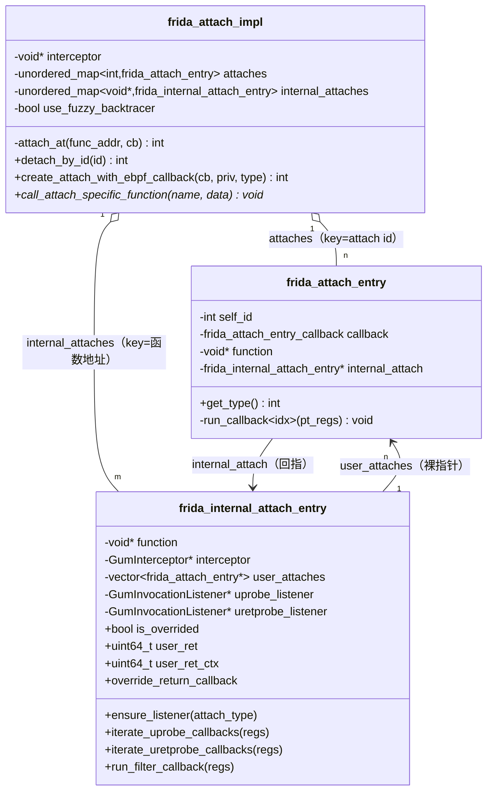
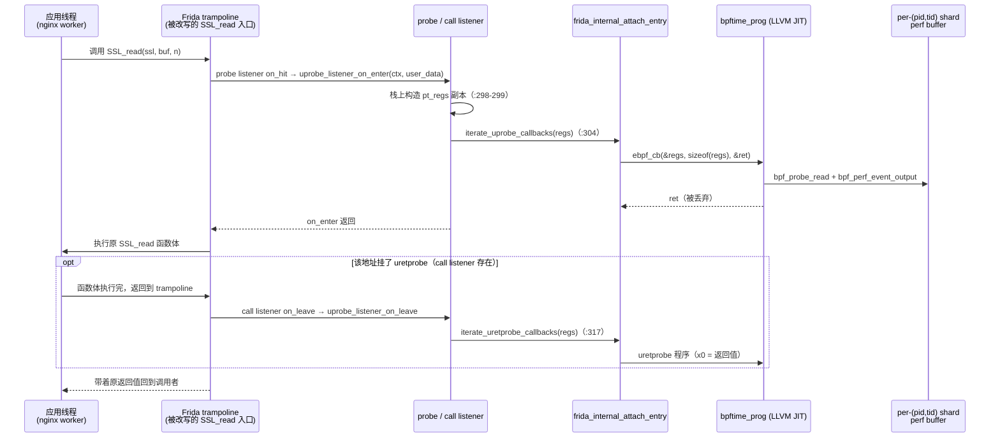

# 4. attach：事件挂载层（Frida uprobe，附 trap 后端）

> 本章回答一个问题：**应用线程调用 `SSL_read` 的那一瞬间，控制权是怎么一步步走到你的
> BPF 程序，又怎么走回来的。** 这条链你在 ssl-nginx benchmark 里测过无数次——现在
> 把每一跳落到代码行上。
>
> 版本基准：本章所有路径、行号、代码摘录均对应**官方 upstream bpftime `177a1dc`**
> （master）。Jetson（aarch64）上用的是 Frida 后端；4.7 节补充官方新增的 trap
> （断点 + SIGTRAP）后端，它目前只在 riscv64 上启用。

## 4.0 全景：runtime 与 attach 层的唯一契约

runtime 与所有 attach 实现之间只有一个契约：`ebpf_run_callback` 三参签名
（`attach/base_attach_impl/base_attach_impl.hpp:42-43`）：

```cpp
using ebpf_run_callback = std::function<int(void *memory, size_t memory_size,
					    uint64_t *return_value)>;
```

这个 callback 由 runtime 侧构造——`runtime/src/attach/bpf_attach_ctx.cpp:390-407`
在 `instantiate_bpf_link_handler_at`（:316）里把 `bpftime_prog` 包成 lambda：

```cpp
auto cookie = handler.attach_cookie;
#if BPFTIME_HAVE_TRAP_UPROBE_ATTACH
if (dynamic_cast<attach::trap::trap_attach_impl *>(attach_impl)) {
        if (int err = prog->prepare_for_signal_execution(); err < 0)
                return err;                 // trap 后端：先做信号安全准入（见 4.7）
}
#endif
attach_id = attach_impl->create_attach_with_ebpf_callback(
        [=](void *mem, size_t mem_size, uint64_t *ret) -> int {
                if (auto *ctx = attach::current_signal_callback)
                        ctx->cookie = cookie;               // trap 后端：写进信号上下文
                else
                        current_thread_bpf_cookie = cookie; // Frida 等：thread_local
                int err = prog->bpftime_prog_exec(
                        (void *)mem, mem_size, ret);
                return err;
        },
        *priv_data, attach_type);
```

`bpf_get_attach_cookie`（`runtime/src/bpf_helper.cpp:662-675`）的数据源因此有两条：
普通后端走 thread_local `current_thread_bpf_cookie`，trap 后端走
`current_signal_callback->cookie`
（理由见 4.7：信号处理函数里不能碰需要动态初始化的 TLS）。

也就是说：**attach 层只负责"在正确的时机、用正确的 `memory` 调这个黑盒"**；
`memory` 是什么由 attach 实现自己定义——Frida uprobe 给的是 `pt_regs*`。
先把 `base_attach_impl.hpp` 全部 142 行读完，重点三块：
`curr_thread_override_return_callback` 与 `current_thread_attach_func_ip`
两个 thread_local（:19-22）、给信号型后端用的 `signal_callback_context` /
`current_signal_callback` / `signal_handler_depth`（:24-39）、以及
`bpftime_set_retval` / `bpftime_override_return` 两个 C 导出函数（:97-138，后面
override 机制会用到）。

uprobe 后端在 agent 启动时**编译期二选一**注册（`runtime/agent/agent.cpp:990-1035`）：
定义了 `BPFTIME_HAVE_TRAP_UPROBE_ATTACH` 就注册 trap 后端（:991-1012），否则
`BPFTIME_HAVE_FRIDA_ATTACH` 时注册 Frida 后端（:1013-1032），两者都没有只打一条
warning。Frida 分支一个实例包揽四种 attach type：

```cpp
ctx_holder.ctx.register_attach_impl(
        { ATTACH_UPROBE, ATTACH_URETPROBE,
          ATTACH_UPROBE_OVERRIDE, ATTACH_UREPLACE },
        std::make_unique<attach::frida_attach_impl>(
                runtime_config.enable_frida_fuzzy_backtracer),
        [](const std::string_view &sv, int &err)
                -> std::unique_ptr<attach_private_data> { ... });
```

构造参数 `enable_frida_fuzzy_backtracer` 决定 `bpf_get_stack(id)` 用哪种栈回溯器
（4.4.1）。

## 4.1 文件地图

目录 `attach/frida_uprobe_attach_impl/`：

| 文件 | 行数 | 看什么 |
|---|---:|---|
| `include/frida_uprobe_attach_impl.hpp` | 112 | 四个 attach type 常量（:20-31）、callback variant 类型系统（:37-61）、`frida_attach_impl` 类（:65-108，含 `use_fuzzy_backtracer` :104） |
| `include/frida_attach_entry.hpp` | 80 | 面向用户的 entry（:14-76）、`run_callback<idx>`（:24-61，含 func_ip 作用域） |
| `include/frida_internal_attach_entry.hpp` | 50 | 面向 Frida 的 entry（:15-47），两个 listener 指针（:19-20） |
| `src/frida_internal_attach_entry.cpp` | 318 | **热路径核心**：`uprobe_listener_on_enter`(:293)/`on_leave`(:310)、override handler(:257)、`ensure_listener`(:115)、内部 entry 构造(:145) |
| `src/frida_uprobe_attach_impl.cpp` | 335 | attach 建立：`attach_at` 去重复用(:48-97)、module 校验(:190-230)、UREPLACE 降级 wrapper(:238-265)、`generate_stack`(:298-330) |
| `src/frida_register_conversion.cpp` | 114 | GumCpuContext↔pt_regs，aarch64 分支 :54-75（你的平台） |
| `include/frida_register_def.hpp` | 78 | bpftime 自带的 `pt_regs` 定义 + `PT_REGS_*` 宏（aarch64 :42-59） |
| `src/frida_attach_utils.cpp` | 212 | map_files 路径还原（:67-108）、module base + offset（:110-135）、`bpf_get_func_arg` 等三个自定义 helper（:176-212） |
| `src/frida_attach_private_data.cpp` | 42 | 解析 `"module:offset"` 字符串 → 函数地址 |
| `../trap_uprobe_attach_impl/` | — | 官方新增的断点后端（riscv64），见 4.7 |
| `../syscall_trace_attach_impl/src/syscall_trace_attach_impl.cpp` | 195 | 对比读：同一契约、不同 ctx（依赖 text_segment_transformer 改写 `syscall` 指令而非 Frida） |

`nv_attach_impl/`（CUDA）占了 attach 目录过半代码量，与 uprobe 无关，先跳过。

## 4.2 两层实体：attach id 视角 vs 函数地址视角

用户可以往同一地址挂任意多个 uprobe/uretprobe，但 bpftime 对每个函数地址只向
Frida 注册**有限且固定**的 hook：最多一个 probe listener（服务所有 uprobe）+ 一个
call listener（服务所有 uretprobe），或者一个 `gum_interceptor_replace`
（override/replace）。多出来的用户 attach 全在 bpftime 内部分发。所以这里拆成两层实体：



### 字段级说明

**`frida_attach_entry`**（`frida_attach_entry.hpp:14-20`）——面向用户，一个 attach id 一条：

| 字段 | 谁写 | 谁读 | 说明 |
|---|---|---|---|
| `self_id` | `attach_at` 用 `allocate_id()` 分配（`frida_uprobe_attach_impl.cpp:84`） | `detach_by_id` 按它查 map | 就是返回给 runtime 的 attach id |
| `callback` | 构造时传入（`frida_attach_entry.hpp:71-74`） | `run_callback<idx>`（:24-61） | `std::variant<callback_variant, ebpf_callback_args>`：要么是接受 `pt_regs&` 的裸函数（单测用），要么是 ebpf callback + attach_type（生产路径） |
| `function` | 构造 | `run_callback` 写进 `current_thread_attach_func_ip`（:27-39） | `bpf_get_func_ip` 的数据源（#601） |
| `internal_attach` | `attach_at` 插入后回填（`frida_uprobe_attach_impl.cpp:95`） | `detach_by_id` 用它找回内部 entry | 裸指针，生命周期由 `internal_attaches` map 保证 |

`run_callback` 先用一个 RAII 小结构保存/恢复 `current_thread_attach_func_ip`
（`frida_attach_entry.hpp:27-39`）：UPROBE/URETPROBE 设为被 hook 函数地址，override
设为 0——这就是 `bpf_get_func_ip`（`runtime/src/bpf_helper.cpp:677-682`）在 Frida
后端读到的值。ebpf 分支（`frida_attach_entry.hpp:53-59`）：

```cpp
uint64_t ret = 0;
int err = ebpf_call_args.ebpf_cb((void *)&regs,
				 sizeof(regs), &ret);
if (err < 0) {
	SPDLOG_ERROR("Unable to run ebpf callback: {}",
		     err);
}
```

`ret` 声明了但**从不使用**——普通 uprobe 的 BPF 返回值直接丢弃（override 路径除外，
见 4.6）；`err < 0` 只打日志。

**`frida_internal_attach_entry`**（`frida_internal_attach_entry.hpp:15-47`）——面向
Frida，一个函数地址一条：

| 字段 | 谁写 | 谁读 | 说明 |
|---|---|---|---|
| `function` | 构造 | `detach_by_id` 判断是否清理 | 被 hook 的函数地址，同时是外层 map 的 key |
| `uprobe_listener` / `uretprobe_listener` | `ensure_listener`（`.cpp:115-143`）按需创建 | 析构时逐个 detach（:185-190） | 第一个 UPROBE 时建 probe listener，第一个 URETPROBE 时建 call listener；两者都为 null 说明走的是 replace（:191-194 `gum_interceptor_revert`） |
| `user_attaches` | `attach_at` push（`frida_uprobe_attach_impl.cpp:93-94`）、`detach_by_id` remove | 三个 iterate/run 函数遍历过滤 | 触发时按 `get_type()` 现场过滤，没有按类型分桶 |
| `is_overrided` / `user_ret` / `user_ret_ctx` | override handler 每次进入清 false（:266），BPF 调 `bpf_override_return` 时经 lambda 置 true（:169-177） | handler 尾部判断（:283） | ⚠️ 是普通成员而非 thread_local——多线程并发命中同一 override 函数理论上有数据竞争（未在代码中看到防护，不确定是否有意） |
| `override_return_callback` | 构造（仅 override 路径，:169-177） | override handler 存入 thread_local（:267-268） | 桥接全局 C 函数 `bpftime_override_return`/`bpftime_set_retval` 与这个具体 entry |

生命周期：两层 entry 都由 `frida_attach_impl` 的两个 `unordered_map` 持有
`unique_ptr`（`frida_uprobe_attach_impl.hpp:99-103`）。`detach_by_id`
（`frida_uprobe_attach_impl.cpp:126-151`）先从内部 entry 的 `user_attaches` 里摘掉
自己，**最后一个用户 attach 消失时才析构内部 entry**，析构函数
（`frida_internal_attach_entry.cpp:182-197`）对每个非空 listener 调
`gum_interceptor_detach`，两个 listener 都没有时（replace 路径）调
`gum_interceptor_revert`，把原函数的机器码恢复原样。注意 listener 只增不减：
同一地址上 uretprobe 全部 detach 而 uprobe 还在时，call listener 仍挂着，直到整个
内部 entry 析构。

## 4.3 attach 建立：从 `"module:offset"` 到改写函数入口

完整链（自顶向下）：

```
bpf_attach_ctx::instantiate_perf_event_handler_at        bpf_attach_ctx.cpp:420
  拼出 arg_str = "module_name:offset"                                  :448-451
  → private_data_gen(arg_str, err)  （agent.cpp:1019 注册的 lambda）
    → frida_attach_private_data::initialize_from_string   frida_attach_private_data.cpp:10
      → resolve_mapped_module_path(module_part)           frida_attach_utils.cpp:67
          /proc/<pid>/map_files/<start>-<end> → 查 /proc/self/maps 还原真实路径（#657）
      → resolve_function_addr_by_module_offset            frida_attach_utils.cpp:110
        get_module_base_addr = gum_module_load + gum_module_find_base_address (:147-151)
        + offset → 绝对地址 addr
bpf_attach_ctx::instantiate_bpf_link_handler_at           bpf_attach_ctx.cpp:316
  → frida_attach_impl::create_attach_with_ebpf_callback   frida_uprobe_attach_impl.cpp:175
      校验 module 确实在 /proc/self/maps 里                            :190-230
      → attach_at_with_ebpf_callback → attach_at(addr, ebpf_callback_args{cb, type})  :48
        → new frida_internal_attach_entry(...)            frida_internal_attach_entry.cpp:145
          → ensure_listener → gum_interceptor_attach      （uprobe/uretprobe）
          → gum_interceptor_replace                       （override）
```

**注意地址解析发生在 private data 解析时**（还没碰 Frida interceptor）。
`resolve_mapped_module_path`（#657）只处理 `/proc/<pid>/map_files/<start>-<end>`
形式的路径：它要求 pid 是本进程，然后在 `/proc/self/maps` 里找与
`[start,end)` 有重叠的那一行，取出真实文件路径并校验 inode/设备号一致——这样即使
原 VMA 已被拆分、map_files 名字里的区间不再精确存在，也能还原出模块路径；其它形式
的路径原样返回（:75-78）。
`/proc/self/maps` 校验的意义在 `.cpp:187-189` 注释里只写了"module_name 为空就不检查"；
真正的动机在 `resolve_function_addr_by_module_offset` 的注释（`frida_attach_utils.cpp:127-128`）
和 `bpf_attach_ctx.cpp:410-411`：LD_PRELOAD 的 agent 可能被注入到无关进程
（比如 nginx 的 master 拉起的 shell），module 不存在时只打 INFO 并返回 `-EINVAL`
（:224-229），runtime 侧也只记 DEBUG。

### 注释版选段 1：`attach_at` 的去重复用（`frida_uprobe_attach_impl.cpp:55-96` 节选）

```cpp
auto itr = internal_attaches.find(func_addr);     // 按函数地址查内部 entry
...
if (itr == internal_attaches.end()) {
        // 第一次 hook 这个地址：创建内部 entry。
        // ★ 传入的 current_attach_type 决定走 listener 还是 replace，
        //   而且只有这第一次有机会决定！
        itr = internal_attaches
                      .emplace(func_addr,
                               std::make_unique<
                                       frida_internal_attach_entry>(
                                       func_addr, current_attach_type,
                                       (GumInterceptor *)interceptor))
                      .first;
        ...
} else if (itr->second->has_override()) {
        // 已有 override/replace：任何新 attach 都拒绝
        ...
        return -EEXIST;
}

auto &inner_attach = itr->second;
inner_attach->ensure_listener(current_attach_type); // 按需补挂 probe/call listener
int used_id = this->allocate_id();                  // base_attach_impl.hpp:64-67，从 1 递增
frida_attach_entry ent(used_id, std::move(cb), func_addr);
...
inner_attach->user_attaches.push_back(
        inserted_attach_entry->second.get());       // 内部 entry 记住用户 entry
inserted_attach_entry->second->internal_attach = inner_attach.get();  // 反向回指
return result;                                      // 返回 attach id
```

`ensure_listener`（:83，#644 引入）让"先 uprobe 后 uretprobe"能在已有内部 entry 上
补挂 call listener；它对非 UPROBE/URETPROBE 类型直接 return（`frida_internal_attach_entry.cpp:117-118`）。

坑在 `★` 处：互斥检查是**不对称**的。先 override 后 uprobe → `-EEXIST`（:76-80）；
但**先 uprobe 后 override 不报错**——新 entry 被塞进 `user_attaches`，可内部 entry
构造时只装了 listener、从未调 `gum_interceptor_replace`，`ensure_listener` 对
override 类型又什么都不做，`run_filter_callback` 永远不会被触发，这个 override
**静默失效**；而且此后 `has_override()` 变成 true，后续再挂 uprobe 反而会被拒。
（从代码看是缺陷；`has_uprobe_or_uretprobe()`（`frida_internal_attach_entry.cpp:209-218`）
定义了却没人调用，疑似本想做反向检查。trap 后端的对应检查是对称的，见 4.7。）

内部 entry 构造/`ensure_listener` 都把 Frida 改写包在
`gum_interceptor_begin_transaction` / `gum_interceptor_end_transaction` 之间，
出错分支先 end transaction 再抛异常（`frida_internal_attach_entry.cpp:130-142`、
:155-168）。attach 失败时（函数太短、Frida 无法改写指令）会抛出带诊断信息的异常，
错误信息里包含 attach 类型、`GumAttachReturn` 名称、`dladdr` 解析出的模块/符号和
前 8 个字节，甚至建议 `-O0` / `__attribute__((noinline))` / 挂更大的 wrapper
（`build_frida_attach_failure_message`，:99-111）——单测
`test/test_attach_failure_diagnostics.cpp` 专门测这个。

## 4.4 uprobe 触发的完整时序（热路径）

这就是你 benchmark 里每个 HTTPS 请求走两次（SSL_read + SSL_write）的路径：



关键认知：**整条链在应用线程里同步执行**。BPF 程序跑多久，`SSL_read` 就慢多久。
另外，#644 之后纯 uprobe 只挂 `gum_make_probe_listener` 建的 probe listener
（只有入口回调），只有真挂了 uretprobe 才会有 `gum_make_call_listener(nullptr, on_leave, ...)`
建的 call listener 去拦截返回（`frida_internal_attach_entry.cpp:123-127`）。

> 📌 **案例：每事件绑核（官方仍在）**。正因为这条链是同步的，官方
> `bpf_perf_event_output`（`runtime/src/bpf_helper.cpp:487-553`）每个事件都要
> `sched_getaffinity`（:499）+ `sched_setaffinity` 绑到当前 CPU（:502）+ 结束时
> `sched_setaffinity` 恢复（:549），即每事件 3 个 syscall。我们在 Jetson 上测到这套
> 序列带来约 3.1–6.7 µs/事件的请求延迟——它不是后台开销，是被 hook 函数的"税"。
> attach 层的同步设计决定了 runtime 层任何每事件成本都会被 1:1 传导给应用。
> （我们的开发分支删掉了这段绑核，那不是官方行为。）

> 📌 **案例：`bpf_probe_read` 的每次调用成本**。同理，sslsniff 每个事件都在这条链上调
> `bpf_probe_read` 拷 SSL buffer。官方默认 `ENABLE_PROBE_READ_CHECK=ON`
> （`cmake/StandardSettings.cmake:110`），此时 `bpftime_probe_read`
> （`bpf_helper.cpp:121-136`）走 `probe_read_memory`（:98-118），每次调用都是一个
> `process_vm_readv` syscall（#642 引入，取代了 7 月版本里基于 SIGSEGV handler 的
> 实现，也就让我们当时那个 sigaction 重装修复在官方失去了对象）。一次事件里 helper
> 被调几次，这个税就交几次。

> 📌 **案例：8 字节对齐（已进官方，#612）**。时序图最后一跳 `Ring` 就是第 2 章的
> per-(pid,tid) shard perf buffer；record 对齐发生在
> `software_perf_event_buffer::output_data`（`runtime/src/handler/perf_event_handler.cpp:367-378`），
> `record_size` 向上取整到 `sizeof(uint64_t)`。attach 层不感知，但事件的"出生地"在这条链上。

### 注释版选段 2：`uprobe_listener_on_enter`（`frida_internal_attach_entry.cpp:293-308`）

```cpp
static void uprobe_listener_on_enter(GumInvocationContext *ctx,
				     gpointer user_data)
{
	// user_data 就是 gum_make_probe_listener(on_enter, this, nullptr)
	// 时传入的 this（:124-125），即内部 entry
	auto *hook_entry = static_cast<frida_internal_attach_entry *>(user_data);
	SPDLOG_TRACE("Handle uprobe at uprobe_listener_on_enter");
	bpftime::pt_regs regs;                        // ★ 栈上副本，生命周期到函数尾
	convert_gum_cpu_context_to_pt_regs(*ctx->cpu_context, regs);

	SPDLOG_DEBUG("Setting current thread gum cpu context");
	// thread_local，给 bpf_get_stack / bpf_get_stackid（generate_stack）用
	current_thread_gum_cpu_context = ctx->cpu_context;

	hook_entry->iterate_uprobe_callbacks(regs);   // 遍历所有 UPROBE 类型的用户 attach

	SPDLOG_DEBUG("Resetting current thread gum cpu context");
	current_thread_gum_cpu_context.reset();       // 出了 on_enter 就取不到栈了
}
```

三个要点：

1. `regs` 是**栈上副本**：`convert_gum_cpu_context_to_pt_regs` 拷出来后传 const 引用
   一路到 BPF（`(void*)&regs`），从不回写。BPF 改 ctx 寄存器不影响被 hook 函数。
2. `current_thread_gum_cpu_context`（thread_local，声明在
   `frida_uprobe_attach_impl.hpp:63`，定义在 `frida_uprobe_attach_impl.cpp:28-29`）
   只在 on_enter（:302）和 override handler（:278）设置——`on_leave`（:310-318）
   **不设置**，所以在官方代码里 uretprobe 中调 `bpf_get_stackid` / `bpf_get_stack`
   必然失败（`generate_stack` 在 `frida_uprobe_attach_impl.cpp:299-302` 检查
   `has_value()` 后返回 nullptr，`bpf_helper.cpp:797` / :864 转成 `-ENOENT`）。
   （我们的开发分支在 on_leave 里补设了这个上下文，那是分支改动，不是官方行为。）
3. `on_leave` 除了不设置栈上下文、调用的是 `iterate_uretprobe_callbacks`（:317），
   结构与 on_enter 相同；此时 GumCpuContext 里 `x[0]` 已是原函数返回值，所以
   uretprobe BPF 用 `PT_REGS_RC` 拿到的正是 `SSL_read` 的返回值。

listener 的接线现在直接写在 `ensure_listener` 里（`frida_internal_attach_entry.cpp:123-127`）：
UPROBE → `gum_make_probe_listener(uprobe_listener_on_enter, this, nullptr)`，
URETPROBE → `gum_make_call_listener(nullptr, uprobe_listener_on_leave, this, nullptr)`。
这就是"注释写反、以代码为准"的最终裁判：**on_enter 跑 UPROBE，on_leave 跑 URETPROBE**
（`frida_uprobe_attach_impl.hpp:20-25` 的两段注释恰好互换了）。7 月版本里那套
`G_DEFINE_TYPE_EXTENDED` 自定义 GObject listener + `iface_init` 已被 #644 删除。

### 4.4.1 栈回溯：accurate 还是 fuzzy（#633）

`bpf_get_stackid` / `bpf_get_stack`（`bpf_helper.cpp:773`、:828）按 attach type 6
（`ATTACH_UPROBE`）找到 uprobe 后端，调用
`call_attach_specific_function("generate_stack", nullptr)`。Frida 后端的实现
（`frida_uprobe_attach_impl.cpp:298-330`）：

```cpp
auto tracer = use_fuzzy_backtracer ?
		      gum_backtracer_make_fuzzy() :
		      gum_backtracer_make_accurate();
gum_backtracer_generate(
	tracer,
	(GumCpuContext *)*current_thread_gum_cpu_context,
	(GumReturnAddressArray *)&array);
```

- 默认 accurate（`runtime_config.enable_frida_fuzzy_backtracer = false`，
  `runtime/include/bpftime_config.hpp:72-74`）；fuzzy 通过环境变量
  `BPFTIME_FRIDA_FUZZY_BACKTRACER`（`runtime/src/bpftime_config.cpp:114-116`）或
  `bpftime load --fuzzy-backtracer`（`tools/cli/main.cpp:819-822`、:852-853）打开，
  `usage.md` 的说法是给 accurate 回溯不出足够帧的 stripped 二进制用。
- 结果最多 127 帧，每次调用都新建并 `g_object_unref` 一个 tracer，`new` 一个
  `std::vector<uint64_t>` 交给 helper 释放——这些都不是信号安全的，所以 trap 后端的
  `generate_stack` 直接返回 null（4.7）。
- helper 侧语义（#663、#631）：只支持 `BPF_F_USER_STACK`；`bpf_get_stack` 遇到
  `BPF_F_USER_BUILD_ID` 返回 `-ENOTSUP`，buffer 大小不是 8 的倍数返回 `-EINVAL`，
  跳过帧数超过总帧数返回 `-EFAULT`，否则返回拷贝的字节数并把剩余部分清零
  （`bpf_helper.cpp:828-888`）。

## 4.5 GumCpuContext → pt_regs：aarch64 带读

bpftime 不用内核头文件的 `pt_regs`，自己在 `frida_register_def.hpp` 定义了一份
布局兼容的（aarch64 :43-48，宏 :50-59）：

```cpp
struct pt_regs {
	uint64_t regs[31];   // x0..x30
	uint64_t sp;
	uint64_t pc;
	uint64_t pstate;
};
#define PT_REGS_PARM1(x) ((x)->regs[0])   // x0（PARM1..PARM8 = x0..x7）
#define PT_REGS_RET(x) ((x)->regs[30])    // lr
#define PT_REGS_RC(x) ((x)->regs[0])      // 返回值也是 x0
```

Frida 侧的 `GumArm64CpuContext`（frida-gum.h）布局是
`{ pc, sp, nzcv, x[29], fp, lr, v[32] }`——注意 `x` 只有 29 个（x0–x28），fp(x29)、
lr(x30) 单独存放。转换函数（`frida_register_conversion.cpp:55-64`）：

```cpp
void convert_gum_cpu_context_to_pt_regs(const ::_GumArm64CpuContext &context,
					pt_regs &regs)
{
	memcpy(&regs.regs, &context.x, sizeof(context.x)); // 拷 x0..x28（29×8 字节）
	regs.regs[29] = context.fp;    // x29 = frame pointer，单独补
	regs.regs[30] = context.lr;    // x30 = link register，单独补
	regs.sp = context.sp;
	regs.pc = context.pc;
	regs.pstate = context.nzcv;    // 只有条件码，不是完整 PSTATE
}
```

为什么这样写：`memcpy` 一把梭比 29 次赋值简洁，也是每事件热路径；
`sizeof(context.x)` 让拷贝长度跟着 Frida 的定义走。aarch64 的 `pt_regs`
34 个字段全部被赋值，所以栈上副本没有未初始化字段。坑：`pstate` 只填了 NZCV
条件码——BPF 程序若依赖 PSTATE 其他位（如 DAIF）会拿到 0；反向函数
`convert_pt_regs_to_gum_cpu_context`（:66-75）存在但**热路径没人调**（uprobe 从不回写）。

对照 x86-64 分支（:6-30）：字段一一手工赋值；Gum 不提供 `orig_ax`/`cs`/`ss`/`flags`，
官方现在先 `regs = {};`（:12，#656）把整个结构清零，这些字段对 BPF 恒为 0，
不再泄漏栈上垃圾值。

## 4.6 override / replace：让原函数"消失"

Frida 提供两种互斥机制，bpftime 各用其一：

| | uprobe / uretprobe | UPROBE_OVERRIDE (1008) | UREPLACE (1009) |
|---|---|---|---|
| Frida 原语 | `gum_interceptor_attach`（probe/call listener，:131） | `gum_interceptor_replace`（换入口，:156-159） | 同 override（降级实现） |
| 原函数执行？ | 一定执行 | 默认执行；BPF 调了 `bpf_override_return` 才跳过 | **从不执行**（wrapper 无条件 set_retval） |
| BPF 返回值 | 丢弃（`frida_attach_entry.hpp:53-59`） | 丢弃；生效的是 helper 设置的 `user_ret` | `*return_value` 直接成为函数返回值（`frida_uprobe_attach_impl.cpp:259-260`） |
| 同地址可挂几个 | 任意多 | 1 个，且排他（`frida_uprobe_attach_impl.cpp:76-80`） | 1 个，且排他 |
| 触发时点 | entry / exit | entry | entry |
| 参数转发 | 无需（原调用流不被截断） | 仅前 5 个整型参数（:255、:270-274、:288-289） | 仅前 5 个整型参数 |
| 对应内核能力 | uprobe/uretprobe | `bpf_override_return`（kprobe error injection 的用户态版） | 无对应（bpftime 扩展） |

### 注释版选段 3：override handler（`frida_internal_attach_entry.cpp:257-291` 节选）

```cpp
extern "C" void *__bpftime_frida_attach_manager__override_handler()
{
	// 此函数被 gum_interceptor_replace 安装为"新的函数体"。
	// 应用调 SSL_read 实际进的是这里。
	ctx = gum_interceptor_get_current_invocation();
	convert_gum_cpu_context_to_pt_regs(*ctx->cpu_context, regs);
	auto hook_entry = (frida_internal_attach_entry *)
		gum_invocation_context_get_replacement_data(ctx);
	hook_entry->is_overrided = false;            // 每次进入先复位
	curr_thread_override_return_callback =       // thread_local ← entry 的 lambda
		hook_entry->override_return_callback;

	auto arg0 = gum_invocation_context_get_nth_argument(ctx, 0);
	... // arg1..arg4，只取 5 个
	ufunc_func func = (ufunc_func)ctx->function; // 原函数（Frida 保存的入口）

	current_thread_gum_cpu_context = ctx->cpu_context;
	hook_entry->run_filter_callback(regs);       // 跑 BPF；可能触发 override
	current_thread_gum_cpu_context.reset();
	if (hook_entry->is_overrided) {
		auto value = (uintptr_t)hook_entry->user_ret;
		return (void *)value;                // 跳过原函数
	} else {
		return func((void *)arg0, (void *)arg1, (void *)arg2,
			    (void *)arg3, (void *)arg4); // 手工重放调用
	}
}
```

`bpf_override_return` 的完整回路（自测题 3 的答案骨架）：

```
BPF 程序调 helper 58                bpf_helper.cpp:1276-1281 注册
 → bpftime_override_return          base_attach_impl.hpp:118-138
   （先看 current_signal_callback：Frida 下为 null，跳过 trap 分支 :121-126）
   → curr_thread_override_return_callback（thread_local，handler :267-268 刚设置）
     → entry 构造时装的 lambda      frida_internal_attach_entry.cpp:169-177
       is_overrided = true; user_ret = v; user_ret_ctx = ctx;
 → 回到 handler :283：检查 is_overrided → 直接 return user_ret（:284-286），原函数没被调
```

**UREPLACE 是语法糖**：`create_attach_with_ebpf_callback` 的 UREPLACE 分支
（`frida_uprobe_attach_impl.cpp:238-265`）把用户 callback 包一层 wrapper——先跑
BPF，成功后无条件 `bpftime_set_retval(*return_value)`（:259-260），再以
`ATTACH_UPROBE_OVERRIDE` 类型注册。于是"replace"=「必然 override 的 override」，
BPF 程序的返回值就是被替换函数的返回值。

**override 路径的坑**（对照表里"仅 5 个参数"那行）：`ufunc_func` 签名只有 5 个
`void*`（:255）。原函数若有第 6+ 个整型参数、浮点参数或栈上参数，重放调用
`func(arg0..arg4)` 时这些参数是垃圾——uprobe listener 路径没有此问题（原调用流
未被截断）。这是在 Frida 后端选 override 还是 uprobe 时的硬约束。

## 4.7 另一个后端：trap（断点 + SIGTRAP）uprobe（#665）

官方新增了 `attach/trap_uprobe_attach_impl/`，一个**不依赖 frida-gum** 的
`base_attach_impl` 实现，同样支持 uprobe / uretprobe / uprobe-override / ureplace，
而且 attach type 编号与 Frida 后端完全相同（`include/trap_uprobe_attach_impl.hpp:35-40`），
runtime 无需区分。

**什么时候用**：纯编译期选择。`cmake/StandardSettings.cmake:76-82` 按
`CMAKE_SYSTEM_PROCESSOR` 强制（`FORCE`）设置：riscv64 上 `BPFTIME_ENABLE_TRAP_UPROBE=ON`、
`BPFTIME_ENABLE_FRIDA=OFF`；其它架构反之。trap 库被构建时 runtime/agent 获得
`BPFTIME_HAVE_TRAP_UPROBE_ATTACH=1`（`runtime/CMakeLists.txt:167-170`、
`runtime/agent/CMakeLists.txt:90-95`），agent 走 3.0 里那个 `#if` 分支。
**结论：Jetson（aarch64）上用的仍是 Frida，trap 后端目前只在 riscv64 上启用**
（它的 `trap_arch.hpp` 只有 `trap_arch_riscv64.cpp` 一个实现）。

**怎么工作**（README "How it works" + `src/trap_uprobe_attach_impl.cpp`）：

| 步骤 | 做什么 | 代码 |
|---|---|---|
| attach | 解码首条指令，保存，覆盖为 `ebreak`/`c.ebreak`；4 字节指令落在 2 字节边界时用三阶段写入，保证每个中间态都是陷阱指令 | `trap_engine::attach` :656、`store_patch` :488 |
| 命中 | SIGTRAP → `on_sigtrap`，按 pc 在**不可变、无锁**的 `site_table` 里二分查找 | `on_sigtrap` :1044-1069，`site_table` :102-127 |
| 跑回调 | 从 `ucontext_t` 填一份内核风格 `pt_regs`，在被打断的线程上跑 UPROBE 回调（或 override） | `handle_hit` :917-973 |
| 原指令 | 拷到 out-of-line slot 执行（slot 末尾再放一个断点，第二次陷入后 pc 跳回原指令之后），或对 pc 相对/跳转类指令软件模拟 | `resume` :904-911，:1056-1057 |
| uretprobe | 把返回地址 `ra` 换成一个断点 trampoline，原返回地址压进每线程影子栈（深度 128） | :960-969，`handle_return` :975-1018 |
| override | `arch::do_return(uc, value)` 直接写返回值寄存器并返回调用者，函数体不执行 | :955-958 |
| 非本后端断点 | 转发给宿主原先装的 SIGTRAP handler | `chain_previous` :1020-1037 |

与 Frida 后端的几处对照：

- **override 没有"5 个参数"限制**：不 override 时原函数从断点处继续执行，调用流
  不被截断；override 状态存在每线程槽 `tl_slot->override` 里（`set_override` :196-203），
  没有 Frida 那个 `is_overrided` 普通成员的竞争问题。
- **互斥检查是对称的**：已有 override 再挂任何东西、或已有 uprobe/uretprobe 再挂
  override，都返回 `-EEXIST`（`trap_engine::attach` :672-685）。
- **重入**：回调里再调被探测函数时，嵌套命中不跑回调、只执行原指令
  （`tl_slot->in_handler` 检查，:919）。
- **代价**：每次命中两次信号投递；README 在 32 核 riscv64 上测得 uprobe 约 5.7 µs、
  uprobe+uretprobe 约 8.7 µs（Frida 在 x86_64 上约 1.3 µs）。

**信号安全规则**（官方 `CLAUDE.md:165-170` + README "Host process contract"）——
回调跑在 SIGTRAP 处理函数里，所以：

1. **runtime 管理的 BPF link 先做准入**：`bpf_attach_ctx.cpp:391-396` 对 trap 后端调用
   `bpftime_prog::prepare_for_signal_execution()`（`runtime/src/bpftime_prog.cpp:289-340`）。
   它拒绝 MPK、CUDA、AOT 对象、非 llvm/ubpf VM、`CALLX`，并逐条检查 helper 调用：
   只有 `helper_is_async_signal_safe`（`runtime/src/bpf_helper.cpp:895-910`）白名单里
   **编号和具体函数指针都匹配**的 helper 才放行——`bpf_get_func_ip`(173)、
   `bpf_get_attach_cookie`(174)、`bpf_override_return`(58)、`bpf_set_retval`(187)，
   以及 trap 自己的 `get_func_arg`/`get_func_ret`/`get_retval`(183/184/186)。
   map 操作、打印、tail call、栈采集等一律 `-ENOTSUP`；**不允许把被拒 helper 静默换成
   no-op**。通过后立即 JIT 编译（失败也拒绝），再装断点。
2. **执行期再查一次**：`bpftime_prog_exec` 发现 `current_signal_callback` 非空时，
   若程序没准备好/没 JIT 就返回 `-ENOTSUP`；否则直接调 JIT 函数，跳过 shm 保护切换和
   日志（`bpftime_prog.cpp:241-248`）。
3. **处理函数里不分配、不加锁、不碰动态 TLS**：每线程状态来自静态的 1024 个槽
   （`trap_tls thread_slots[THREAD_SLOTS]` :149-162），首次命中用原子 CAS 认领
   （`claim_thread_slot` :171-185），TLS 只用 `initial-exec` 模型的小指针
   （`tl_slot` :168；`base_attach_impl.hpp:32-39` 的 `current_signal_callback`、
   `signal_handler_depth`）。这也是 3.0 里 cookie 要写进 `current_signal_callback` 的原因。
4. **回调里不能 attach/detach**：`attach_at`、`detach_by_id` 等在
   `current_signal_callback` 非空时直接返回 `-EOPNOTSUPP`（如 :1135-1136）。原生回调和
   手工提供的不透明 eBPF 回调要自己遵守同一契约（不分配、不加锁、不写日志、不抛异常）。
5. **`generate_stack` 返回 null**（`call_attach_specific_function` :1301-1305，注释
   "Dynamic unwinding and heap-owned vectors are not signal-safe"）。
6. 已探测站点、slot、已 detach 的 entry 在进程生命周期内不释放，避免与 detach 竞争的
   信号处理函数踩到已释放内存（README Limitations）。

测试在 `attach/trap_uprobe_attach_impl/test/`（如 `test_trap_signal_safety.cpp`、
`test_trap_concurrent_patch.cpp`、`late_injection_*`）；`CLAUDE.md:172-176` 还要求
RISC-V 验证覆盖 2 mod 4 地址上的 4 字节指令、worker 线程已存在后的 late dlopen、
以及 arm/disarm/rollback 时的权限失败。

## 4.8 坑与暗礁（汇总）

- **`frida_uprobe_attach_impl.hpp:20-25` 的 UPROBE/URETPROBE 注释写反了**，以
  `ensure_listener`（`frida_internal_attach_entry.cpp:123-127`）的接线为准。
- BPF 拿到的 ctx 是栈上 `pt_regs` **副本**（:298/:315），从不回写；普通 uprobe 的
  BPF 返回值也被丢弃（`frida_attach_entry.hpp:53-59`）。
- 互斥检查不对称：先 override 后任何 attach → `-EEXIST`；**先 uprobe 后 override
  静默失效**，且之后再挂 uprobe 会被拒（4.3 选段 ★ 处）。trap 后端两个方向都拒。
- `current_thread_gum_cpu_context` 只在 on_enter/override handler 设置——
  **官方 uretprobe 里 `bpf_get_stackid`/`bpf_get_stack` 必失败**（`-ENOENT`）。
- 栈回溯默认 accurate；stripped 二进制可开 `BPFTIME_FRIDA_FUZZY_BACKTRACER` /
  `--fuzzy-backtracer`。trap 后端不支持栈采集。
- Frida override handler 只转发 **5 个整型参数**；浮点/栈参数函数不能用 override/UREPLACE。
- `is_overrided`/`user_ret` 是内部 entry 的普通成员，非 thread_local——多线程并发
  命中同一 override 点存在理论数据竞争（未见防护，不确定是否有意）。
- aarch64 的 `pstate` 只有 NZCV；x86-64 的 `orig_ax`/`cs`/`ss`/`flags` 恒为 0（#656 清零）。
- listener 只增不减：内部 entry 存活期间，uretprobe 全部 detach 后 call listener 仍挂着。
- attach 太短的函数会被 Frida 拒绝（如 `GUM_ATTACH_WRONG_SIGNATURE`），错误消息
  （:99-111）给了绕法：`-O0`、`noinline`、或挂更大的 wrapper 函数。
- 官方 `bpf_perf_event_output` 每事件仍有 3 个绑核相关 syscall，`bpf_probe_read`
  默认每次一个 `process_vm_readv`——都在同步链上。
- `nv_attach_impl`（CUDA）与 uprobe 无关，先跳过。

## 4.9 自测题

**Q1（底稿原题）：sslsniff 的 `pt_regs *ctx` 在哪行构造？生命周期多长？**

<details><summary>答案</summary>

uprobe：`frida_internal_attach_entry.cpp:298` 的 `bpftime::pt_regs regs;`（栈变量），
:299 由 `convert_gum_cpu_context_to_pt_regs` 填充，经
`iterate_uprobe_callbacks(regs)`（:304）→ `run_callback<ATTACH_UPROBE_INDEX>(regs)` →
`ebpf_cb((void *)&regs, sizeof(regs), &ret)`（`frida_attach_entry.hpp:54-55`）以指针
形式进入 BPF。生命周期到 `uprobe_listener_on_enter` 返回为止；BPF 程序里保存这个
指针跨事件使用是悬垂指针。uretprobe 同理在 :315-316。
</details>

**Q2（底稿原题，按官方现状修订）：同一地址挂 3 个 uprobe + 1 个 uretprobe，各种实体各几个？**

<details><summary>答案</summary>

`frida_attach_entry` ×4（每个 attach id 一个，`attaches` map 4 条）；
`frida_internal_attach_entry` ×1（`internal_attaches` 按函数地址去重，
`frida_uprobe_attach_impl.cpp:55-80`）；`GumInvocationListener` ×2——第一个 UPROBE
时由 `ensure_listener` 建一个 probe listener，第一个 URETPROBE 时再建一个 call
listener（`frida_internal_attach_entry.cpp:115-143`），两者都 `gum_interceptor_attach`
到同一函数。on_enter 时现场按 `get_type()` 过滤出 3 个 UPROBE，on_leave 过滤出
1 个 URETPROBE。`GumInterceptor` 是 `frida_attach_impl` 构造时
`gum_interceptor_obtain()` 拿到的（`frida_uprobe_attach_impl.cpp:41`），每个内部
entry 再 `gum_object_ref` 一次（`frida_internal_attach_entry.cpp:179`）。
</details>

**Q3（底稿原题）：`bpf_override_return` 的"不执行原函数"经过哪几步？**

<details><summary>答案</summary>

① helper 58 注册指向 `bpftime_override_return`（`bpf_helper.cpp:1276-1281`）；
② 它先检查 `current_signal_callback`（Frida 下为 null），再调 thread_local 的
`curr_thread_override_return_callback`（`base_attach_impl.hpp:118-138`），该变量在
override handler 进入时刚被设为本 entry 的 lambda（`frida_internal_attach_entry.cpp:267-268`）；
③ lambda（:169-177）置 `is_overrided=true`、存 `user_ret` / `user_ret_ctx`；
④ handler 跑完 BPF 后检查 `is_overrided`（:283），为真则直接
`return user_ret`（:284-286），跳过 `func(arg0..arg4)` 的重放调用（:288-289）。
</details>

**Q4（新）：为什么在官方代码的 uretprobe BPF 程序里调 `bpf_get_stackid` 拿不到栈？错误码是什么？fuzzy 回溯器能救吗？**

<details><summary>答案</summary>

`generate_stack`（`frida_uprobe_attach_impl.cpp:299-302`）依赖 thread_local
`current_thread_gum_cpu_context`，它只在 `uprobe_listener_on_enter`（:302）和 override
handler（:278）设置、且在回调结束即 `reset()`；`uprobe_listener_on_leave`（:310-318）
从不设置。于是 `has_value()` 为 false → 返回 nullptr → `bpf_helper.cpp:797` 返回
`-ENOENT`（`bpf_get_stack` 是 :864）。fuzzy 不能救：回溯器选择（:310-312）发生在
`has_value()` 检查之后，根本走不到。
</details>

**Q5（新）：先对 `SSL_read` 挂一个普通 uprobe，再挂一个 UPROBE_OVERRIDE，会发生什么？反过来呢？换成 trap 后端呢？**

<details><summary>答案</summary>

Frida，先 uprobe 后 override：`attach_at` 只在已有 entry `has_override()` 时才拒绝
（`frida_uprobe_attach_impl.cpp:76-80`），`ensure_listener` 对 override 类型直接返回
（`frida_internal_attach_entry.cpp:117-118`），所以第二次 attach **成功返回 id**，但内部
entry 是构造时定死的 listener 模式，`gum_interceptor_replace` 从未执行，
`run_filter_callback` 永远不会被调——override 静默失效（疑似缺陷），而且之后再挂
uprobe 会因 `has_override()` 为真被拒。
反过来先 override 后 uprobe：命中 :76-80 的检查，返回 `-EEXIST`。
trap 后端两个方向都返回 `-EEXIST`（`trap_uprobe_attach_impl.cpp:672-685`）。
</details>

**Q6（新）：官方 `bpf_perf_event_output` 的绑核和 `bpf_probe_read` 的 syscall 都不在 attach/ 目录里，为什么说 attach 层的设计"放大"了它们的影响？**

<details><summary>答案</summary>

因为 uprobe listener 在**应用线程里同步执行**整条
on_enter → pt_regs → BPF → helpers 链。每事件的固定成本（`bpf_perf_event_output` 的
`sched_getaffinity` + 两次 `sched_setaffinity`，`bpf_helper.cpp:499/:502/:549`；
每次 `bpf_probe_read` 一个 `process_vm_readv`，:112-114）不是后台开销，而是逐事件
叠加在被 hook 函数（SSL_read/SSL_write）的延迟上，再经 nginx 的请求路径直接变成
吞吐损失；perf buffer 的 record 写入（`output_data`）同样位于这条同步链的末端。
这也是评估任何"每事件工作"时的第一原则：先问它在不在这条同步链上。
</details>

**Q7（新）：在 riscv64 上，一个调了 `bpf_map_update_elem` 的 uprobe 程序能 attach 吗？为什么？**

<details><summary>答案</summary>

不能。riscv64 默认构建 trap 后端，`instantiate_bpf_link_handler_at` 对它先调
`prepare_for_signal_execution()`（`bpf_attach_ctx.cpp:391-396`）；该函数扫描每条
helper 调用，`bpf_map_update_elem` 不在 `helper_is_async_signal_safe` 白名单
（`bpf_helper.cpp:895-910`）里，返回 `-ENOTSUP`（`bpftime_prog.cpp:323-329`），
link 实例化失败、断点不会被装上。原因是回调跑在 SIGTRAP 处理函数里，只有审计过的
异步信号安全 helper 才能准入，trap README 明确列出 map 操作不被准入；官方规定不能用
no-op 静默替代被拒的 helper。
</details>

---
[← 返回目录](README.md)
