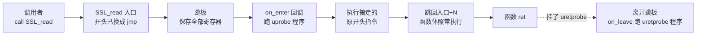
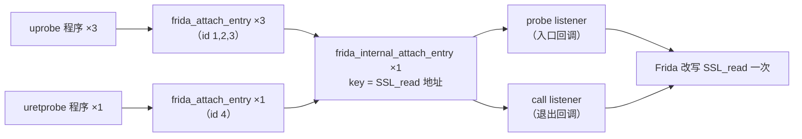
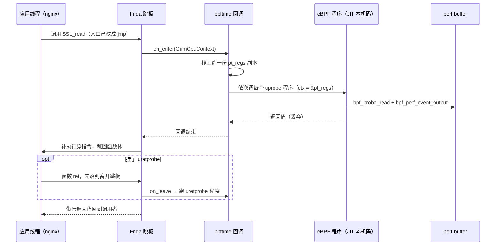

# 4. attach：Frida uprobe（附 trap 后端）

> 一句话：本章讲 bpftime 怎么在**不进内核**的前提下"拦住"目标进程里的一个函数，并在那一刻
> 跑你的 eBPF 程序。读完你能说清：应用调用 `SSL_read` 的瞬间，控制权怎么一步步走到 eBPF
> 程序、又怎么走回来；uprobe / uretprobe / override / replace 四种挂法有什么不同。
> 前置：建议先读[第 1 章](01-lifecycle.md)（事件全流程）和[第 3 章](03-agent-syscall-server.md)
> （agent 怎么装配 attach）。预计用时：2–3 小时。

## 本章要回答的问题

1. 目标进程里根本没有"内核 uprobe"，那 `SSL_read` 一被调用，CPU 是怎么拐进 bpftime 的？
2. 同一个函数上挂 3 个 uprobe，函数本身被改写了几次？
3. eBPF 程序里的 `PT_REGS_PARM1(ctx)` 读到的值是从哪来的？程序改了 `ctx`，被 hook 的函数会受影响吗？
4. override 是怎么做到"原函数根本不执行"的？它有什么限制？
5. riscv64 上为什么换成了另一套 trap 后端？它和 Frida 后端差在哪？

---

## 4.1 runtime 与 attach 层之间只有一个接口

**直觉**：runtime（第 2 章）手里有"一个 eBPF 程序"，attach 层手里有"一个事件源"
（比如某个函数被调用）。两者之间只约定一件事：runtime 把"运行这个程序"包成一个回调函数交给
attach 层；attach 层负责**在对的时机、带着对的上下文**调用它。上下文是什么，由 attach 层自己
决定——对 uprobe 来说就是一份寄存器快照 `pt_regs`。

这个回调的类型只有三个参数：

`attach/base_attach_impl/base_attach_impl.hpp` 的 `ebpf_run_callback`

```cpp
// memory      : 交给 eBPF 程序的 ctx（uprobe 时是 pt_regs*）
// memory_size : ctx 的字节数
// return_value: eBPF 程序的返回值（r0）写到这里
using ebpf_run_callback = std::function<int(void *memory, size_t memory_size,
                                            uint64_t *return_value)>;
```

runtime 在实例化一个 link（"把哪个程序挂到哪个事件"）时构造这个回调：

`runtime/src/attach/bpf_attach_ctx.cpp` 的 `instantiate_bpf_link_handler_at()`

```cpp
auto cookie = handler.attach_cookie;
/* ... trap 后端在这里先做"信号安全准入"，见 4.8 ... */
attach_id = attach_impl->create_attach_with_ebpf_callback(
        [=](void *mem, size_t mem_size, uint64_t *ret) -> int {
                // bpf_get_attach_cookie 的数据源：普通后端放 thread_local，
                // trap 后端放信号上下文（信号处理函数里不能碰普通 TLS）
                if (auto *ctx = attach::current_signal_callback)
                        ctx->cookie = cookie;
                else
                        current_thread_bpf_cookie = cookie;
                // 真正执行 eBPF（JIT 好的本机码，见第 5 章）
                return prog->bpftime_prog_exec((void *)mem, mem_size, ret);
        },
        *priv_data, attach_type);
```

所以 attach 层对 runtime 来说是一个**黑盒调用者**：它不知道 eBPF 程序长什么样，只管调回调。

uprobe 由哪个后端负责，是**编译期二选一**：agent 启动时（`runtime/agent/agent.cpp` 的
`bpftime_agent_main` 里），编进了 trap 后端就注册 trap，否则注册 Frida。Frida 后端**一个实例包揽
四种 attach 类型**：uprobe、uretprobe、uprobe-override、ureplace。

**要点**
- attach 层只管"什么时候调"和"传什么 ctx"；执行 eBPF 的是 runtime 给的回调。
- uprobe 的 ctx 是一份 `pt_regs`。
- x86_64 / aarch64 上用 Frida 后端，riscv64 上用 trap 后端（4.8）。

---

## 4.2 inline hook 是什么

**直觉**：内核 uprobe 的做法是在函数开头放一条断点指令，CPU 执行到它就陷入内核。
bpftime 不想进内核，于是用另一种老技术——**inline hook（内联钩子）**：直接改写目标函数
开头的几条机器指令，换成一条**跳转**，跳到一段事先准备好的代码上。这段代码叫
**跳板（trampoline）**。跳板做完"额外的事"以后，再把被覆盖掉的原指令补执行一遍，然后跳回
原函数继续往下走。对调用者来说，函数照常执行、照常返回，只是中途"绕了一下路"。

> **小知识**：Frida 是一个动态插桩工具包，bpftime 用的是它的 C 核心库 frida-gum。
> 其中的 Interceptor 组件专门做 inline hook：给它一个函数地址，它负责改写指令、生成跳板、
> 在跳板里把寄存器保存成结构体 `GumCpuContext`，然后调用你注册的回调。

在 x86_64 上，改写前后大致是这样（示意，具体指令随函数而变）：

```text
改写前                                改写后
SSL_read:                             SSL_read:
  push rbp          (1 字节)            jmp  <跳板>        ← 覆盖开头 ≥5 字节
  push r15          (2 字节)            (被覆盖的残余字节，不会再执行)
  mov  rbp, rsp     (3 字节)            ...函数体其余部分不变...
  ...函数体...
                                      跳板（Frida 新分配的可执行内存）:
                                        把所有通用寄存器存成 GumCpuContext
                                        调用回调 on_enter（bpftime 在这里跑 eBPF）
                                        恢复寄存器
                                        push rbp ; push r15 ; mov rbp, rsp   ← 搬过来的原指令
                                        jmp  SSL_read+6                      ← 跳回原函数
```

下面这张图看控制流：实线是每次调用都走的路，虚线只在挂了 uretprobe 时才有。



uretprobe 怎么拦"返回"？Frida 在进入时把栈上的**返回地址**换成自己的"离开跳板"。函数 `ret`
时先落到离开跳板，跳板调用 on_leave 回调，再跳回真正的调用者。

这个设计带来三个直接后果：

1. **全程在应用线程里同步执行**。eBPF 程序跑多久，`SSL_read` 就慢多久——没有"后台"。
2. **不进内核**，所以比内核 uprobe 快。trap 后端的 README 里有一组 x86_64 对比：
   内核 uprobe 每次命中约 4.7 µs，Frida 后端约 1.35 µs。
3. **函数太短可能挂不上**。开头至少要能腾出一条跳转指令的位置，而且被搬走的指令必须能在别处
   正确执行。挂不上时 Frida 返回错误，bpftime 会给出带诊断信息的异常（见本章深入参考）。

**要点**
- inline hook = 改写函数开头为跳转 + 跳板保存现场、调回调、补执行原指令、跳回。
- uretprobe 靠"替换返回地址"拦截函数返回。
- 整条链是同步的：attach 层把 eBPF 和 helper 的每一分成本都 1:1 传给被 hook 的函数。

---

## 4.3 四种 attach：uprobe / uretprobe / override / replace

**直觉**：Frida 提供两种拦截原语。一种是"**旁听**"（`gum_interceptor_attach` + listener）：
原函数照常执行，你只是在进入或退出时被通知一下。另一种是"**顶替**"
（`gum_interceptor_replace`）：函数入口直接换成你的函数，原函数是否执行由你决定。
bpftime 的四种 attach 就分别建在这两种原语上。

| | uprobe | uretprobe | uprobe-override | ureplace |
|---|---|---|---|---|
| attach type 编号 | 6 | 7 | 1008 | 1009 |
| eBPF 什么时候跑 | 函数入口 | 函数返回时 | 函数入口 | 函数入口 |
| Frida 原语 | 旁听（只有入口回调的 probe listener） | 旁听（只有退出回调的 call listener） | 顶替 | 顶替（复用 override 实现） |
| 原函数执行吗 | 一定执行 | 一定执行 | 默认执行；eBPF 调了 `bpf_override_return` 就跳过 | **从不执行** |
| eBPF 返回值去哪 | 丢弃 | 丢弃 | 丢弃；起作用的是 helper 设的值 | 直接成为函数返回值 |
| 同一地址能挂几个 | 任意多 | 任意多 | 1 个，且排斥其他 | 1 个，且排斥其他 |
| 能看到的参数 | 全部寄存器 | 全部寄存器（`ax` 已是返回值） | 全部寄存器；但重放原函数时只转发前 5 个整型参数 | 同 override |
| 对应内核能力 | uprobe | uretprobe | kprobe 上的 `bpf_override_return`（错误注入） | 无，bpftime 扩展 |

两个容易混的地方：

- **override 是"可选地顶替"**：eBPF 程序看完参数，决定要不要调 `bpf_override_return(ctx, v)`。
  调了，函数直接返回 `v`；没调，bpftime 替你调用原函数。
- **replace 是"一定顶替"**：eBPF 程序本身就是新的函数体，它的返回值就是函数的返回值。
  实现上 replace 只是给 override 包了一层（4.7）。

**要点**
- uprobe/uretprobe = 旁听，原函数一定跑；override/replace = 顶替，原函数可能不跑。
- 同一地址上，旁听型可以叠加任意多个；顶替型只能有一个，并且独占。

---

## 4.4 两层实体：用户的 attach 与 Frida 的 hook

**为什么需要两层**：用户可以往同一个函数上挂任意多个程序（比如 3 个 uprobe + 1 个
uretprobe）。但对 Frida 来说，没必要也不应该把同一个函数改写 4 次：

- 一个地址上，一个"入口回调"就能服务所有 uprobe，一个"退出回调"就能服务所有 uretprobe；
- 顶替（replace）一个地址只能有一个替身；
- 用户 detach 其中一个程序时，不能把别人的 hook 一起拆掉。

所以 bpftime 把"用户看到的 attach"和"Frida 看到的 hook"拆成两层：

| 层 | 类 | 一条代表什么 | 按什么查 |
|---|---|---|---|
| 用户视角 | `frida_attach_entry` | 一次用户 attach（一个程序挂到一个函数） | attach id |
| Frida 视角 | `frida_internal_attach_entry` | 一个被 hook 的函数地址 | 函数地址 |

这张图看"3 个 uprobe + 1 个 uretprobe 挂在 `SSL_read` 上"时，各有几个对象：



触发时，内部 entry 遍历自己记下的所有用户 attach，**按类型现场过滤**：入口回调里只跑
uprobe 类型的，退出回调里只跑 uretprobe 类型的。

建立 attach 的核心是 `attach_at`：先按函数地址找内部 entry，没有就新建，有就复用。

`attach/frida_uprobe_attach_impl/src/frida_uprobe_attach_impl.cpp` 的 `frida_attach_impl::attach_at()`

```cpp
auto itr = internal_attaches.find(func_addr);      // 按函数地址查内部 entry
if (itr == internal_attaches.end()) {
        // 第一次 hook 这个地址：新建内部 entry。
        // 构造函数按 attach 类型决定：旁听（建 listener）还是顶替（replace）
        itr = internal_attaches.emplace(func_addr,
                std::make_unique<frida_internal_attach_entry>(
                        func_addr, current_attach_type,
                        (GumInterceptor *)interceptor)).first;
} else if (itr->second->has_override()) {
        return -EEXIST;                             // 已经被顶替：谁都不让再挂
}
auto &inner_attach = itr->second;
inner_attach->ensure_listener(current_attach_type); // 按需补一个入口/退出 listener
int used_id = this->allocate_id();                  // attach id，从 1 递增
frida_attach_entry ent(used_id, std::move(cb), func_addr);
/* ... 放进 attaches 表（key = attach id） ... */
inner_attach->user_attaches.push_back(/* 新的用户 entry */);
/* 用户 entry 反向记住自己属于哪个内部 entry */
return used_id;
```

detach 是"最后一个离开的关灯"：`detach_by_id` 把用户 entry 从内部 entry 的列表里摘掉；
只有列表空了，才析构内部 entry——这时才调用 Frida 把函数恢复原样。

**一个要知道的坑**：上面的互斥检查只有一个方向。先 override 后 uprobe 会被拒（`-EEXIST`）；
但**先 uprobe 后 override 不会报错**，而 override 实际上不会生效（内部 entry 早已按"旁听"
模式建好，不会再改成"顶替"）。细节见深入参考。

**要点**
- 一个 attach id 一个用户 entry；一个函数地址一个内部 entry。
- 同一地址最多两个 listener（入口、退出各一），或者一个顶替。
- 内部 entry 在最后一个用户 attach 离开时才拆除 hook。

---

## 4.5 一次命中的完整时序（热路径）

这张图看一次 `SSL_read` 调用从进入到返回的全过程。这就是 sslsniff 场景里每个 HTTPS 请求
都要走的路。



入口回调的全部代码很短：

`attach/frida_uprobe_attach_impl/src/frida_internal_attach_entry.cpp` 的 `uprobe_listener_on_enter()`

```cpp
static void uprobe_listener_on_enter(GumInvocationContext *ctx,
                                     gpointer user_data)
{
        // user_data 是注册 listener 时传入的 this，即内部 entry
        auto *hook_entry = static_cast<frida_internal_attach_entry *>(user_data);
        bpftime::pt_regs regs;                        // 栈上副本，活到函数结束
        convert_gum_cpu_context_to_pt_regs(*ctx->cpu_context, regs); // 见 4.6

        // 记下 Frida 的寄存器现场，给 bpf_get_stack / bpf_get_stackid 回溯用
        current_thread_gum_cpu_context = ctx->cpu_context;
        hook_entry->iterate_uprobe_callbacks(regs);   // 只跑 uprobe 类型的用户 attach
        current_thread_gum_cpu_context.reset();       // 离开回调就取不到栈了
}
```

退出回调 `uprobe_listener_on_leave()` 结构相同，只是调 `iterate_uretprobe_callbacks`，并且
**不设置** `current_thread_gum_cpu_context`。

三件事要记住：

1. **ctx 是单向拷贝**。`regs` 是栈上的副本，地址被当成 `ctx` 交给 eBPF。程序改 `ctx` 里的
   寄存器，不会写回真实 CPU 状态；回调返回后这块内存也就失效了。
2. **普通 uprobe 的返回值被丢弃**。回调把返回值收进一个局部变量就不再使用；出错也只打日志。
3. **uretprobe 里拿不到栈**。栈回溯依赖 `current_thread_gum_cpu_context`，而只有入口回调和
   override 处理函数设置了它。所以在 uretprobe 程序里调 `bpf_get_stackid` / `bpf_get_stack`
   会返回 `-ENOENT`。

**栈回溯顺带一提**：`bpf_get_stack` 最终调到 Frida 的 Backtracer，从保存的寄存器现场往回找
返回地址。默认用 accurate（依赖 unwind 信息）回溯器；遇到 stripped 二进制回溯不出足够帧时，
可以设 `BPFTIME_FRIDA_FUZZY_BACKTRACER` 或 `bpftime load --fuzzy-backtracer` 换成 fuzzy
（扫描栈上像返回地址的值）回溯器。

**同步执行意味着什么**：attach 层本身很轻，但它把 helper 里的每一分成本都直接加到被 hook
函数上。官方代码里两个典型例子（详见[第 6 章](06-maps-helpers.md)）：

- `bpf_perf_event_output` 每个事件要做 3 次与绑核相关的系统调用
  （1 次 `sched_getaffinity` + 2 次 `sched_setaffinity`）；
- 默认构建下 `bpf_probe_read` 每次调用是一次 `process_vm_readv` 系统调用。

它们不在 attach/ 目录里，但都发生在这条同步链上。评估任何"每事件的工作"，先问：它在不在这条链上？

**要点**
- 热路径：跳板 → on_enter → 造 `pt_regs` → 逐个跑 uprobe 程序 → 回到原函数。
- `pt_regs` 是栈上副本，只读有效，生命期就是这一次回调。
- uretprobe 里取不到栈；栈回溯默认 accurate，可切 fuzzy。

---

## 4.6 GumCpuContext → pt_regs（以 x86_64 为例）

**为什么要转换**：eBPF 程序是照着内核写的。`PT_REGS_PARM1(ctx)` 这类宏在编译时就被展开成
"从 `ctx` 偏移若干字节处读 8 字节"。所以 bpftime 交给程序的结构体，**内存布局必须和内核的
`pt_regs` 一模一样**。而 Frida 保存的 `GumCpuContext` 是另一种布局，必须一个字段一个字段地抄过去。

看一个真实例子。下面是 bpftime 单测里一个 x86_64 uprobe 程序的反汇编（第一个参数是 `int`，
第二个是 `char *`，第三个是 `char`）：

```text
0:  r6 = r1                          ; r6 = ctx（pt_regs 指针）
1:  r4 = *(u64 *)(r6 + 0x68)         ; 0x68/8 = 第 13 个字段 = si → 第 2 个参数
2:  r3 = *(u64 *)(r6 + 0x70)         ; 0x70/8 = 第 14 个字段 = di → 第 1 个参数
3:  r5 = *(u64 *)(r6 + 0x60)         ; 0x60/8 = 第 12 个字段 = dx → 第 3 个参数
```

偏移量是编译器按**内核** x86_64 `pt_regs` 布局算好的常量。bpftime 自己定义了一份布局完全相同的
`pt_regs`（`attach/frida_uprobe_attach_impl/include/frida_register_def.hpp`），字段顺序是：

```text
r15 r14 r13 r12 bp bx r11 r10 r9 r8 ax cx dx si di orig_ax ip cs flags sp ss   （21 个，每个 8 字节）
```

Frida 的 `GumX64CpuContext` 则是：

```text
rip r15 r14 r13 r12 r11 r10 r9 r8 rdi rsi rbp rsp rbx rdx rcx rax              （17 个）
```

两者**顺序不同**，所以不能 `memcpy`；Frida 也**没有** `orig_ax`、`cs`、`flags`、`ss` 这 4 个字段。
转换函数于是先整体清零，再逐个赋值：

`attach/frida_uprobe_attach_impl/src/frida_register_conversion.cpp` 的 `convert_gum_cpu_context_to_pt_regs()`（x86_64 分支）

```cpp
void convert_gum_cpu_context_to_pt_regs(const ::_GumX64CpuContext &context,
                                        pt_regs &regs)
{
        regs = {};                // 先清零：orig_ax / cs / flags / ss 对 eBPF 恒为 0，
                                  // 而不是栈上残留的垃圾值
        regs.ip  = context.rip;
        regs.r15 = context.r15;   /* r14 r13 r12 r11 r10 r9 r8 同理 ... */
        regs.di  = context.rdi;   // 第 1 个参数
        regs.si  = context.rsi;   // 第 2 个参数
        regs.bp  = context.rbp;
        regs.sp  = context.rsp;   // 入口处 *sp 就是返回地址
        regs.bx  = context.rbx;
        regs.dx  = context.rdx;   // 第 3 个参数
        regs.cx  = context.rcx;   // 第 4 个参数
        regs.ax  = context.rax;   // uretprobe 时是返回值
}
```

于是 x86_64 上常用宏的含义是：

| 宏 | 读哪个字段 | 含义 |
|---|---|---|
| `PT_REGS_PARM1`…`PARM6` | `di` `si` `dx` `cx` `r8` `r9` | System V 调用约定的前 6 个整型参数 |
| `PT_REGS_RC` | `ax` | 返回值（uretprobe 里有意义） |
| `PT_REGS_RET` | `sp` | 栈指针；函数入口时返回地址在 `*sp` |

aarch64 用的是同一个函数名的另一个分支，思路一样，细节不同：

| | x86_64 | aarch64 |
|---|---|---|
| bpftime `pt_regs` | 21 个具名字段，内核顺序 | `regs[31]`（x0–x30）+ `sp` + `pc` + `pstate` |
| 怎么拷 | 顺序不同，逐字段赋值 | `x0–x28` 一次 `memcpy`；`fp`(x29)、`lr`(x30) 单独补 |
| Frida 缺的字段 | `orig_ax` `cs` `flags` `ss`，清零为 0 | 所有字段都有值；但 `pstate` 只填了 NZCV 条件码 |
| 参数 / 返回值 | `di si dx cx r8 r9` / `ax` | `x0`–`x7` / `x0` |
| `PT_REGS_RET` | `sp`（返回地址在栈上） | `regs[30]`（lr，返回地址就在寄存器里） |

**要点**
- `pt_regs` 布局必须和内核完全一致，因为字段偏移已经编进了 eBPF 字节码。
- x86_64 上 Frida 少 4 个字段，转换前先整体清零。
- 转换是单向的：反向函数存在，但热路径从不调用。

---

## 4.7 override 与 replace：让原函数"消失"

**直觉**：override 用的是"顶替"原语。Frida 把函数入口换成 bpftime 的一个处理函数
`__bpftime_frida_attach_manager__override_handler`。应用以为在调 `SSL_read`，实际进的是它。
处理函数先跑 eBPF 程序，然后看程序有没有要求"覆盖返回值"：要求了，就直接返回那个值；
没要求，就**自己把原函数再调一遍**，把结果返回。

`attach/frida_uprobe_attach_impl/src/frida_internal_attach_entry.cpp` 的 `__bpftime_frida_attach_manager__override_handler()`

```cpp
extern "C" void *__bpftime_frida_attach_manager__override_handler()
{
        GumInvocationContext *ctx = gum_interceptor_get_current_invocation();
        bpftime::pt_regs regs;
        convert_gum_cpu_context_to_pt_regs(*ctx->cpu_context, regs);
        auto hook_entry = (frida_internal_attach_entry *)
                gum_invocation_context_get_replacement_data(ctx);
        hook_entry->is_overrided = false;            // 每次进入先复位
        // 让全局 helper 知道"现在该通知哪个 entry"
        curr_thread_override_return_callback = hook_entry->override_return_callback;

        auto arg0 = gum_invocation_context_get_nth_argument(ctx, 0);
        /* ... arg1..arg4，一共只取 5 个参数 ... */
        ufunc_func func = (ufunc_func)ctx->function; // 原函数

        current_thread_gum_cpu_context = ctx->cpu_context;
        hook_entry->run_filter_callback(regs);       // 跑 eBPF；它可能调 bpf_override_return
        current_thread_gum_cpu_context.reset();
        if (hook_entry->is_overrided)
                return (void *)(uintptr_t)hook_entry->user_ret; // 跳过原函数
        return func((void *)arg0, (void *)arg1, (void *)arg2,   // 用 5 个参数重放调用
                    (void *)arg3, (void *)arg4);
}
```

`bpf_override_return` 是怎么"通知"到这里的？一共四步：

1. eBPF 程序调 helper 58，绑定的是 C 函数 `bpftime_override_return`
   （`attach/base_attach_impl/base_attach_impl.hpp`）。
2. 它调用 thread_local 变量 `curr_thread_override_return_callback`——处理函数刚刚把它设成了
   本 entry 的回调。
3. 这个回调（内部 entry 构造时装好的 lambda）把 `is_overrided` 置为 true，把值存进 `user_ret`。
4. eBPF 跑完，处理函数看到 `is_overrided`，直接返回 `user_ret`，原函数没被调用。

**replace 只是包了一层**：注册 ureplace 时，`create_attach_with_ebpf_callback` 把用户回调
包进一个 wrapper：先跑 eBPF，成功后**无条件**调 `bpftime_set_retval(返回值)`，再按 override
类型注册。所以 replace 就是"一定会 override 的 override"，eBPF 的返回值就是函数的返回值。

**最大的限制：只转发 5 个整型参数**。重放调用的函数指针类型是 5 个 `void *` 参数。在 x86_64
上这对应 `rdi rsi rdx rcx r8`。如果原函数有第 6 个整型参数（`r9`）、浮点参数（`xmm` 寄存器）或者
从栈上传的参数，重放时这些值都不对。uprobe 没有这个问题，因为原调用流从未被打断。
这是选 override 还是 uprobe 时的硬约束。

另一个值得知道的细节：`is_overrided` / `user_ret` 是内部 entry 的普通成员，不是 thread_local。
多个线程同时命中同一个 override 点时，理论上存在数据竞争（代码里没看到防护）。

**要点**
- override = 顶替入口 + 处理函数里决定"直接返回"还是"重放原函数"。
- `bpf_override_return` 经 thread_local 回调把结果交给处理函数。
- replace = 必然 override；Frida 后端只能转发前 5 个整型参数。

---

## 4.8 另一个后端：trap（只在 riscv64 上用）

**它是什么**：`attach/trap_uprobe_attach_impl/` 是一个**不依赖 Frida** 的 uprobe 后端。它的
思路更接近内核 uprobe：把函数第一条指令换成断点指令（riscv 的 `ebreak`），CPU 执行到断点时
进程收到 `SIGTRAP` 信号，bpftime 在**信号处理函数**里构造 `pt_regs`、跑 eBPF，然后把原指令
放到别处执行，再回到函数里。它同样支持四种 attach，编号与 Frida 后端相同，runtime 不用区分。

**什么时候用**：纯编译期决定。`cmake/StandardSettings.cmake` 按 CPU 架构强制设置：
riscv64 上打开 trap、关掉 Frida；其他架构反过来。trap 后端目前也只有 riscv64 的指令实现。
**所以在 x86_64 和 aarch64 上，你读到和用到的都是 Frida 后端。**

**和 Frida 后端的主要区别**：

| | Frida 后端 | trap 后端 |
|---|---|---|
| 拦截方式 | 改写开头为 jmp，跳到跳板 | 换成断点，靠 `SIGTRAP` |
| eBPF 跑在哪 | 普通函数调用上下文 | 信号处理函数里 |
| 每次命中成本 | 约 1.35 µs（x86_64） | 约 5.7 µs（riscv64，两次信号投递） |
| 能用哪些 helper | 全部 | 只有审计过的"异步信号安全" helper；map 操作、打印、栈采集等一律拒绝 |
| override 参数限制 | 只转发 5 个整型参数 | 无（不 override 时原函数从断点处继续执行） |
| uprobe 与 override 互斥 | 只检查一个方向 | 两个方向都检查 |

信号处理函数里不能分配内存、不能加锁、不能碰需要动态初始化的线程局部变量。所以 trap 后端在
attach 时就先检查程序：程序里只要调用了一个不在白名单里的 helper，attach 直接失败（`-ENOTSUP`），
不会静默地把它换成空操作。通过检查的程序会被立刻 JIT 编译好，命中时直接调本机码。
这也是 4.1 里 cookie 要写进信号上下文、而不是 thread_local 的原因。

详细的工作步骤、信号安全规则和测试要求见本章深入参考。

**要点**
- trap = 断点 + `SIGTRAP`，不依赖 Frida，只在 riscv64 上启用。
- 跑在信号处理函数里，所以只准入少数信号安全的 helper。
- 比 Frida 慢，但没有"5 个参数"限制，互斥检查也更严格。

---

## 小结

- runtime 把"运行 eBPF 程序"包成一个三参数回调交给 attach 层；attach 层决定何时调、传什么 ctx。
- Frida 后端用 inline hook：函数开头改成 jmp，跳板保存寄存器、调回调、补执行原指令、跳回。
  全程在应用线程同步执行，不进内核。
- uprobe/uretprobe 是"旁听"，原函数一定执行，同一地址可叠加多个；override/replace 是"顶替"，
  同一地址独占一个。
- 两层实体：用户 attach（按 id）→ 内部 hook（按函数地址）。同一地址 Frida 只改写一次。
- eBPF 拿到的 `ctx` 是栈上的 `pt_regs` 副本，布局与内核一致；x86_64 上要逐字段转换，并把
  Frida 没有的 4 个字段清零。程序改 `ctx` 不会影响被 hook 的函数。
- override 在处理函数里决定"直接返回"还是"用 5 个参数重放原函数"；replace 是必然 override。
- trap 后端只在 riscv64 上启用，eBPF 跑在 `SIGTRAP` 处理函数里，只准入信号安全的 helper。

## 动手验证

以下命令假设你有一份打开单测的官方构建（`cmake -DBPFTIME_ENABLE_UNIT_TESTING=ON ...`，
构建目录记为 `$B`）。

1. **跑 Frida attach 单测，看四种 attach 的行为**
   ```bash
   T=$B/attach/frida_uprobe_attach_impl/bpftime_frida_uprobe_attach_tests
   $T --list-tests                                       # 共 17 个用例
   $T "Test the mix usage of uprobe and uretprobe"       # uprobe + uretprobe 叠加
   $T "Test attaching filter programs and revert"        # override
   $T "Test attaching replace programs and revert"       # replace
   $T "Frida x86 register conversion clears unavailable pt_regs fields"
   ```
   预期：每个都输出 `All tests passed`。最后一个用例先把 `pt_regs` 填满 `0xa5`，再转换，然后
   断言 `orig_ax`、`cs`、`flags`、`ss` 都是 0——正是 4.6 里 `regs = {}` 的作用。
   读 `attach/frida_uprobe_attach_impl/test/test_uprobe_uretprobe.cpp`，对照 4.4 数一数每一步有
   几个内部 entry、几个 listener。

2. **亲眼看 `pt_regs` 偏移被编进字节码**
   ```bash
   llvm-objdump -d $B/runtime/unit-test/uprobe.bpf.o | head -30
   ```
   预期：`my_function_uprobe` 开头能看到 `r3 = *(u64 *)(r6 + 0x70)` 之类的读取。把偏移除以 8，
   对照 4.6 的字段顺序，确认 `0x70` 是 `di`（第 1 个参数）、`0x68` 是 `si`、`0x60` 是 `dx`。
   源码在 `runtime/unit-test/assets/uprobe.bpf.c`。

3. **（改代码）数一数入口回调被调了几次**：在 `uprobe_listener_on_enter()` 和
   `uprobe_listener_on_leave()` 里各加一个原子计数器并在进程退出时打印，重编 agent，跑一次
   sslsniff + nginx 短测。预期：入口计数 ≈ 消费者收到的 `SSL_read` + `SSL_write` 入口事件数之和。

## 自测题

**Q1. 同一个函数上挂了 3 个 uprobe 和 1 个 uretprobe。`frida_attach_entry`、
`frida_internal_attach_entry`、Frida listener 各有几个？函数开头被改写了几次？**

<details><summary>答案</summary>

用户 entry 4 个（每个 attach id 一个）；内部 entry 1 个（按函数地址去重）；listener 2 个——第一个
uprobe 时建一个只有入口回调的 probe listener，第一个 uretprobe 时再补一个只有退出回调的 call
listener。函数开头只被改写一次，两个 listener 共享同一个 hook。触发时，入口回调里按类型过滤出
3 个 uprobe 依次运行，退出回调里过滤出 1 个 uretprobe。
</details>

**Q2. 一个 uprobe 程序把 `ctx->di` 改成了 0。被 hook 的函数看到的第一个参数会变吗？
如果程序把 `ctx` 指针存进一个全局变量，下次事件再读，会怎样？**

<details><summary>答案</summary>

不会变。`ctx` 指向的是回调栈上的 `pt_regs` 副本，从 `GumCpuContext` 单向拷贝而来，从不回写。
存下来的指针在回调返回后就成了悬垂指针，下次再读是未定义行为——那块栈早已被别的调用覆盖。
</details>

**Q3. 为什么 x86_64 的转换函数不能像 aarch64 那样用一次 `memcpy`？为什么开头要 `regs = {}`？**

<details><summary>答案</summary>

因为 `GumX64CpuContext` 和内核 `pt_regs` 的字段顺序不同（前者 `rip` 在最前、`r8` 之后是
`rdi rsi rbp rsp ...`；后者按内核栈帧顺序 `r15 ... r8 ax cx dx si di orig_ax ip ...`），只能逐字段
赋值。`pt_regs` 的布局又不能改，因为 eBPF 字节码里已经写死了字段偏移。`regs = {}` 是因为 Frida
不提供 `orig_ax`、`cs`、`flags`、`ss`，不清零的话这 4 个字段会带出栈上的残留数据。aarch64 上
`x0–x28` 在两边都是连续数组，才可以一次拷贝。
</details>

**Q4. 为什么在官方代码的 uretprobe 程序里调 `bpf_get_stackid` 拿不到栈？换成 fuzzy 回溯器能解决吗？**

<details><summary>答案</summary>

栈回溯（`generate_stack`）依赖 thread_local 的 `current_thread_gum_cpu_context`，而它只在入口回调
和 override 处理函数里设置，退出回调从不设置。于是检查发现没有值，直接返回空，helper 转成
`-ENOENT`。换 fuzzy 也没用：选回溯器发生在这个检查之后，根本走不到。
</details>

**Q5. 对 `SSL_read` 先挂一个普通 uprobe，再挂一个 override，会发生什么？反过来呢？在 riscv64 上呢？**

<details><summary>答案</summary>

Frida 后端，先 uprobe 后 override：`attach_at` 只在"已有 override"时才拒绝，所以第二次 attach
成功返回 id。但内部 entry 在第一次 attach 时已经按"旁听"模式建好，`ensure_listener` 对 override
类型什么也不做，顶替从未发生，override 程序永远不会运行——静默失效。而且此后再挂 uprobe 反而会因
"已有 override"被拒。反过来先 override 后 uprobe：直接 `-EEXIST`。trap 后端两个方向都返回
`-EEXIST`。
</details>

**Q6. 一个 override 程序挂在 `int f(int a, int b, int c, int d, int e, int g)` 上，没有调
`bpf_override_return`。原函数收到的 `g` 对吗？换成普通 uprobe 呢？**

<details><summary>答案</summary>

不一定对。override 处理函数只取前 5 个参数，用 5 参数的函数指针重放调用；在 x86_64 上第 6 个
参数在 `r9`，重放时 `r9` 里是处理函数执行过程中留下的任意值。普通 uprobe 不截断原调用流，原函数
照常拿到所有参数，没有这个问题。
</details>

---

## 深入参考

<details>
<summary>代码位置速查（按 177a1dc465ff 行号）</summary>

| 概念 / 函数 | 位置 |
|---|---|
| `ebpf_run_callback` 定义 | `attach/base_attach_impl/base_attach_impl.hpp:42-43` |
| `curr_thread_override_return_callback`、`current_thread_attach_func_ip` | `attach/base_attach_impl/base_attach_impl.hpp:19-22` |
| `signal_callback_context`、`current_signal_callback`、`signal_handler_depth` | `attach/base_attach_impl/base_attach_impl.hpp:24-39` |
| `allocate_id`（从 1 递增） | `attach/base_attach_impl/base_attach_impl.hpp:64-67` |
| `bpftime_set_retval` / `bpftime_override_return` | `attach/base_attach_impl/base_attach_impl.hpp:97-115` / `:118-138` |
| runtime 构造回调（含 trap 准入、cookie） | `runtime/src/attach/bpf_attach_ctx.cpp:390-407`（函数 `instantiate_bpf_link_handler_at` 起于 :316） |
| 拼 `"module:offset"` 字符串 | `runtime/src/attach/bpf_attach_ctx.cpp:448-451`（`instantiate_perf_event_handler_at` 起于 :420） |
| agent 编译期二选一注册后端 | `runtime/agent/agent.cpp:990-1035`（trap :991-1012，Frida :1013-1032） |
| `bpf_get_attach_cookie` / `bpf_get_func_ip` | `runtime/src/bpf_helper.cpp:662-675` / `:677-682` |
| attach type 常量（注释写反） | `attach/frida_uprobe_attach_impl/include/frida_uprobe_attach_impl.hpp:20-31` |
| callback variant 类型 | `frida_uprobe_attach_impl.hpp:37-61` |
| `frida_attach_impl` 类 / 两张 map | `frida_uprobe_attach_impl.hpp:65-108` / `:99-103` |
| `frida_attach_entry`、`run_callback<idx>` | `include/frida_attach_entry.hpp:14-76`、`:24-61` |
| `frida_internal_attach_entry` 类 | `include/frida_internal_attach_entry.hpp:15-47` |
| `frida_attach_impl` 构造（`gum_interceptor_obtain`） | `src/frida_uprobe_attach_impl.cpp:36-42` |
| `attach_at` | `src/frida_uprobe_attach_impl.cpp:48-97` |
| `detach_by_id` | `src/frida_uprobe_attach_impl.cpp:126-151` |
| `create_attach_with_ebpf_callback`（module 校验 :190-230，UREPLACE wrapper :238-265） | `src/frida_uprobe_attach_impl.cpp:175-279` |
| 自定义 helper 注册（183/184/186） | `src/frida_uprobe_attach_impl.cpp:280-292` |
| `generate_stack` | `src/frida_uprobe_attach_impl.cpp:298-330` |
| 诊断信息 `build_frida_attach_failure_message` | `src/frida_internal_attach_entry.cpp:99-111` |
| `ensure_listener` | `src/frida_internal_attach_entry.cpp:115-143` |
| 内部 entry 构造 / 析构 | `src/frida_internal_attach_entry.cpp:145-180` / `:182-197` |
| `has_override` / `has_uprobe_or_uretprobe`（后者无人调用） | `src/frida_internal_attach_entry.cpp:199-218` |
| override 处理函数 | `src/frida_internal_attach_entry.cpp:257-291` |
| `uprobe_listener_on_enter` / `on_leave` | `src/frida_internal_attach_entry.cpp:293-308` / `:310-318` |
| 寄存器转换 x86_64 / aarch64 / arm32 | `src/frida_register_conversion.cpp:5-52` / `:54-75` / `:76-110` |
| bpftime 自带 `pt_regs` 与 `PT_REGS_*` 宏 | `include/frida_register_def.hpp`（x86_64 :9-40，aarch64 :43-59） |
| `"module:offset"` 解析 | `src/frida_attach_private_data.cpp:10-42` |
| `resolve_mapped_module_path` / `resolve_function_addr_by_module_offset` | `src/frida_attach_utils.cpp:68` / `:111` |
| `bpf_get_func_arg` 等三个自定义 helper | `src/frida_attach_utils.cpp:176-212` |
| 栈 helper `bpftime_get_stackid` / `bpftime_get_stack` | `runtime/src/bpf_helper.cpp:773`（`-ENOENT` :797）/ `:828-888`（`-ENOENT` :864） |
| fuzzy 回溯开关 | `runtime/include/bpftime_config.hpp:72-74`、`runtime/src/bpftime_config.cpp:114-116`、`tools/cli/main.cpp:819-822,852-853` |
| 官方 `bpf_perf_event_output` 绑核 | `runtime/src/bpf_helper.cpp:487-553`（:499、:502、:549） |
| `bpftime_probe_read` / `probe_read_memory` | `runtime/src/bpf_helper.cpp:121-136` / `:98-118` |
| trap 后端：架构选择 | `cmake/StandardSettings.cmake:76-82`；`runtime/CMakeLists.txt:167-170`；`runtime/agent/CMakeLists.txt:90-95` |
| trap 后端：attach type、主要函数 | `attach/trap_uprobe_attach_impl/include/trap_uprobe_attach_impl.hpp:35-40`；`src/trap_uprobe_attach_impl.cpp`：`trap_engine::attach` :656、`store_patch` :488、`handle_hit` :917、`handle_return` :975、`chain_previous` :1020、`on_sigtrap` :1044 |
| trap 准入 `prepare_for_signal_execution` | `runtime/src/bpftime_prog.cpp:289-340` |
| 信号安全 helper 白名单 | `runtime/src/bpf_helper.cpp:895-910` |
| 对比读：syscall trace attach | `attach/syscall_trace_attach_impl/src/syscall_trace_attach_impl.cpp` |

</details>

<details>
<summary>细节与坑</summary>

**两层实体的字段级说明**

`frida_attach_entry`（用户视角，一个 attach id 一条）：

| 字段 | 谁写 | 谁读 | 说明 |
|---|---|---|---|
| `self_id` | `attach_at` 用 `allocate_id()` 分配 | `detach_by_id` 按它查 map | 返回给 runtime 的 attach id |
| `callback` | 构造时传入 | `run_callback<idx>` | `std::variant<callback_variant, ebpf_callback_args>`：要么是接受 `pt_regs&` 的裸函数（单测用），要么是 eBPF 回调 + attach type（生产路径） |
| `function` | 构造 | `run_callback` 写进 `current_thread_attach_func_ip` | `bpf_get_func_ip` 的数据源 |
| `internal_attach` | `attach_at` 插入后回填 | `detach_by_id` 用它找回内部 entry | 裸指针，生命周期由 `internal_attaches` map 保证 |

`run_callback` 先用一个 RAII 小结构保存/恢复 `current_thread_attach_func_ip`：uprobe/uretprobe 设为
被 hook 的函数地址，override 设为 0——这就是 Frida 后端下 `bpf_get_func_ip` 读到的值。eBPF 分支里
`ret` 声明了但从不使用；`err < 0` 只打日志。

`frida_internal_attach_entry`（Frida 视角，一个函数地址一条）：

| 字段 | 谁写 | 谁读 | 说明 |
|---|---|---|---|
| `function` | 构造 | `detach_by_id` 判断是否清理 | 被 hook 的函数地址，也是外层 map 的 key |
| `uprobe_listener` / `uretprobe_listener` | `ensure_listener` 按需创建 | 析构时逐个 `gum_interceptor_detach` | 两者都为 null 说明走的是顶替，析构时调 `gum_interceptor_revert` |
| `user_attaches` | `attach_at` push、`detach_by_id` 删除 | 三个 iterate/run 函数遍历 | 触发时按 `get_type()` 现场过滤，没有按类型分桶 |
| `is_overrided` / `user_ret` / `user_ret_ctx` | override 处理函数每次进入清 false；lambda 置 true | 处理函数尾部判断 | 普通成员而非 thread_local，多线程并发命中同一 override 点理论上有数据竞争（未见防护，不确定是否有意） |
| `override_return_callback` | 构造（仅 override 路径） | override 处理函数存进 thread_local | 桥接全局 C 函数 `bpftime_override_return` / `bpftime_set_retval` 与具体 entry |

两层 entry 都由 `frida_attach_impl` 的两个 `unordered_map` 以 `unique_ptr` 持有。`GumInterceptor`
在 `frida_attach_impl` 构造时由 `gum_interceptor_obtain()` 获得，每个内部 entry 再 `gum_object_ref` 一次。

**attach 建立全链（自顶向下）**

```
bpf_attach_ctx::instantiate_perf_event_handler_at
  拼出 arg_str = "module_name:offset"
  → private_data_gen(arg_str, err)          （agent 注册的 lambda）
    → frida_attach_private_data::initialize_from_string
      → resolve_mapped_module_path(module_part)
          /proc/<pid>/map_files/<start>-<end> → 查 /proc/self/maps 还原真实路径
      → resolve_function_addr_by_module_offset
          gum_module_load + gum_module_find_base_address，再加 offset → 绝对地址
bpf_attach_ctx::instantiate_bpf_link_handler_at
  → frida_attach_impl::create_attach_with_ebpf_callback
      校验 module 确实出现在 /proc/self/maps 里
      → attach_at_with_ebpf_callback → attach_at(addr, {cb, type})
        → new frida_internal_attach_entry(...)
          → ensure_listener → gum_interceptor_attach   （uprobe/uretprobe）
          → gum_interceptor_replace                    （override）
```

- 地址解析发生在解析 private data 时，那时还没碰 Frida interceptor。
- `resolve_mapped_module_path` 只处理 `/proc/<pid>/map_files/<start>-<end>` 形式的路径：要求 pid 是本进程，
  在 `/proc/self/maps` 里找与 `[start,end)` 有重叠的那一行，取出真实路径并校验 inode / 设备号一致。
  这样即使原 VMA 被拆分、名字里的区间不再精确存在，也能还原。其他形式的路径原样返回。
- module 名为空表示主程序。
- `/proc/self/maps` 校验的动机：LD_PRELOAD 的 agent 可能被注入到无关进程（比如 nginx master 拉起的 shell）。
  module 不存在时只打 INFO 并返回 `-EINVAL`，runtime 侧也只记 DEBUG。

**listener 与事务**

- 纯 uprobe 只挂 `gum_make_probe_listener` 建的 probe listener（只有入口回调）；只有真挂了 uretprobe
  才会建 `gum_make_call_listener(nullptr, on_leave, ...)` 的 call listener 去拦截返回。
- `ensure_listener` 让"先 uprobe 后 uretprobe"能在已有内部 entry 上补挂 call listener；它对非
  uprobe/uretprobe 类型直接 return。
- listener 只增不减：同一地址上 uretprobe 全部 detach 而 uprobe 还在时，call listener 仍挂着，直到整个内部
  entry 析构。
- 内部 entry 构造和 `ensure_listener` 都把 Frida 改写包在 `gum_interceptor_begin_transaction` /
  `end_transaction` 之间，出错分支先 end transaction 再抛异常。

**互斥检查不对称（疑似缺陷）**

- 先 override 后任何 attach → `-EEXIST`。
- 先 uprobe 后 override → 成功返回 id，但内部 entry 构造时只装了 listener、从未 `gum_interceptor_replace`，
  `ensure_listener` 对 override 又什么都不做，`run_filter_callback` 永远不会被触发：override 静默失效；
  之后 `has_override()` 变 true，再挂 uprobe 反而被拒。
- `has_uprobe_or_uretprobe()` 定义了却没人调用，疑似本想做反向检查。trap 后端两个方向都拒。

**attach 失败诊断**

函数太短或 Frida 无法改写指令时（如 `GUM_ATTACH_WRONG_SIGNATURE`），抛出的异常信息包含：attach 类型、
`GumAttachReturn` 名称、`dladdr` 解析出的模块/符号、函数前 8 个字节，并建议 `-O0`、
`__attribute__((noinline))` 或挂更大的 wrapper。单测 `test/test_attach_failure_diagnostics.cpp` 专门测
这个；它的目标是 5 字节的 `lea 1(%rdi),%rax; ret`，在 x86_64 上 Frida 实际能挂上（恰好够一条 5 字节
`jmp`），测试走的是"接受"分支。

**注释与代码不一致**

`frida_uprobe_attach_impl.hpp` 里 `ATTACH_UPROBE = 6` 的注释写着"函数返回时调用"，`ATTACH_URETPROBE = 7`
写着"函数被调用时"——两段注释写反了。以 `ensure_listener` 的接线为准：uprobe 挂入口回调，uretprobe 挂退出回调。

**栈回溯细节**

- `bpf_get_stackid` / `bpf_get_stack` 按 attach type 6（uprobe）找到 uprobe 后端，调用
  `call_attach_specific_function("generate_stack", nullptr)`。
- 结果最多 127 帧；每次调用都新建并 `g_object_unref` 一个 tracer，`new` 一个 `std::vector<uint64_t>`
  交给 helper 释放——这些都不是信号安全的，所以 trap 后端的 `generate_stack` 直接返回 null。
- helper 侧语义：只支持 `BPF_F_USER_STACK`；`bpf_get_stack` 遇 `BPF_F_USER_BUILD_ID` 返回 `-ENOTSUP`，
  buffer 大小不是 8 的倍数返回 `-EINVAL`，跳过帧数超过总帧数返回 `-EFAULT`，否则返回拷贝的字节数并把剩余清零。
- `usage.md` 的说法：fuzzy 回溯器用于 accurate 回溯不出足够帧的 stripped 二进制。

**aarch64 转换函数**

```cpp
void convert_gum_cpu_context_to_pt_regs(const ::_GumArm64CpuContext &context,
                                        pt_regs &regs)
{
        memcpy(&regs.regs, &context.x, sizeof(context.x)); // x0..x28（29×8 字节）
        regs.regs[29] = context.fp;    // x29
        regs.regs[30] = context.lr;    // x30
        regs.sp = context.sp;
        regs.pc = context.pc;
        regs.pstate = context.nzcv;    // 只有条件码，不是完整 PSTATE
}
```

`GumArm64CpuContext` 布局是 `{ pc, sp, nzcv, x[29], fp, lr, v[32] }`，`x` 只有 29 个。aarch64 `pt_regs` 34 个字段
全部被赋值，没有未初始化字段；但 `pstate` 只有 NZCV，依赖 DAIF 等其他位的程序会读到 0。反向函数
`convert_pt_regs_to_gum_cpu_context` 在各架构都存在，但热路径没人调。

**override 的其他细节**

- `gum_invocation_context_get_nth_argument` 在 x86_64 上读 `rdi rsi rdx rcx r8`；`ufunc_func` 是
  `void *(*)(void*, void*, void*, void*, void*)`。
- UREPLACE wrapper：先跑 eBPF，失败则返回错误；成功则 `bpftime_set_retval(*return_value)`，再以
  `ATTACH_UPROBE_OVERRIDE` 注册。
- `bpftime_override_return` / `bpftime_set_retval` 先看 `current_signal_callback`（Frida 下为 null），再调
  `curr_thread_override_return_callback`；都没有时抛 `std::invalid_argument`。

**Frida 后端自定义 helper**

`register_custom_helpers` 注册三个：`bpf_get_func_arg`(183)、`bpf_get_func_ret`(184)、`bpf_get_retval`(186)，
都通过 `gum_interceptor_get_current_invocation()` 现取 Frida 上下文。注意它们是在程序编译之后才注册的
（见[第 5 章](05-vm-llvm-jit.md) 5.5 节"为什么 helper 必须在编译前注册"）。

**trap 后端工作步骤**（README "How it works" + `src/trap_uprobe_attach_impl.cpp`）

| 步骤 | 做什么 |
|---|---|
| attach | 解码首条指令并保存，覆盖为 `ebreak` / `c.ebreak`；4 字节指令落在 2 字节边界时用三阶段写入，保证每个中间态都是陷阱指令 |
| 命中 | `SIGTRAP` → `on_sigtrap`，按 pc 在不可变、无锁的 `site_table` 里二分查找 |
| 跑回调 | 从 `ucontext_t` 填一份内核风格 `pt_regs`，在被打断的线程上跑 uprobe 回调（或 override） |
| 原指令 | 拷到 out-of-line slot 执行（slot 末尾再放一个断点，第二次陷入后 pc 跳回原指令之后），或对 pc 相对/跳转类指令软件模拟 |
| uretprobe | 把返回地址 `ra` 换成一个断点 trampoline，原返回地址压进每线程影子栈（深度 128） |
| override | `arch::do_return(uc, value)` 直接写返回值寄存器并返回调用者，函数体不执行；override 状态存在每线程槽里 |
| 非本后端断点 | 转发给宿主原先装的 `SIGTRAP` handler |
| 重入 | 回调里再调被探测函数时，嵌套命中不跑回调、只执行原指令 |

**trap 后端信号安全规则**（官方 `CLAUDE.md` + README "Host process contract"）

1. runtime 管理的 link 先准入：`prepare_for_signal_execution()` 拒绝 MPK、CUDA、AOT 对象、非 llvm/ubpf VM、
   `CALLX`，并逐条检查 helper 调用：只有白名单里**编号和函数指针都匹配**的 helper 才放行——
   `bpf_get_func_ip`(173)、`bpf_get_attach_cookie`(174)、`bpf_override_return`(58)、`bpf_set_retval`(187)，
   以及 trap 自己的 `get_func_arg` / `get_func_ret` / `get_retval`(183/184/186)。map 操作、打印、tail call、
   栈采集等一律 `-ENOTSUP`；不允许把被拒 helper 静默换成 no-op。通过后立即 JIT（失败也拒绝），再装断点。
2. 执行期再查一次：`bpftime_prog_exec` 发现 `current_signal_callback` 非空时，若程序没准备好或没 JIT 就返回
   `-ENOTSUP`；否则直接调 JIT 函数，跳过 shm 保护切换和日志。
3. 处理函数里不分配、不加锁、不碰动态 TLS：每线程状态来自静态的 1024 个槽，首次命中用原子 CAS 认领；TLS 只用
   `initial-exec` 模型的小指针。
4. 回调里不能 attach / detach：`attach_at`、`detach_by_id` 等在 `current_signal_callback` 非空时返回
   `-EOPNOTSUPP`。原生回调和手工提供的不透明 eBPF 回调要自己遵守同一契约（不分配、不加锁、不写日志、不抛异常）。
5. `generate_stack` 返回 null（"Dynamic unwinding and heap-owned vectors are not signal-safe"）。
6. 已探测站点、slot、已 detach 的 entry 在进程生命周期内不释放，避免与 detach 竞争的信号处理函数踩到已释放内存。
7. README 的其他限制：首条指令必须可解码、可重定位；已经以断点开头的函数返回 `-ENOTSUP`；uretprobe 替换了
   返回地址，穿过被探测函数的 unwind 看到的是 trampoline（Frida 后端和内核 uretprobe 同样如此）。

**trap 后端性能与测试**

- README 实测（32 核 riscv64，Release）：uprobe 约 5.7 µs，uprobe+uretprobe 约 8.7 µs；8 线程同时命中时总吞吐
  几乎不涨，因为内核在进程内串行投递信号。
- 同表 x86_64（Xeon 8259CL）：内核 uprobe 4706 ns、Frida 1346 ns、uprobe+uretprobe Frida 2579 ns。
- 测试在 `attach/trap_uprobe_attach_impl/test/`（如 `test_trap_signal_safety.cpp`、`test_trap_concurrent_patch.cpp`、
  `late_injection_*`）；官方 `CLAUDE.md` 还要求 RISC-V 验证覆盖 2 mod 4 地址上的 4 字节指令、worker 线程已存在后的
  late dlopen，以及 arm/disarm/rollback 时的权限失败。

**对比读**

`attach/syscall_trace_attach_impl/` 遵守同一个 `ebpf_run_callback` 契约，但 ctx 不同，且依赖
text segment transformer 改写 `syscall` 指令，而不是 Frida。`nv_attach_impl/`（CUDA）占了 attach 目录过半代码，
与 uprobe 无关，可以先跳过。

</details>

<details>
<summary>上游变更与我们的工作</summary>

**相关上游 PR（6bd5319d → 177a1dc）**

- #644：Frida 后端改为纯 uprobe 只建 probe listener、uretprobe 才建 call listener，引入 `ensure_listener`；
  删除了七月版本里 `G_DEFINE_TYPE_EXTENDED` 自定义 GObject listener + `iface_init` 那一套。
- #656：x86_64 转换函数开头加 `regs = {}`，`orig_ax`/`cs`/`ss`/`flags` 不再泄漏栈上垃圾值。
- #657：`resolve_mapped_module_path`，支持 `/proc/<pid>/map_files/...` 路径。
- #633：fuzzy 回溯器开关（`BPFTIME_FRIDA_FUZZY_BACKTRACER` / `--fuzzy-backtracer`）。
- #663、#631：`bpf_get_stack` / `bpf_get_stackid` 的 helper 侧语义。
- #601：`bpf_get_func_ip` 经 `current_thread_attach_func_ip` 提供。
- #665：trap（断点 + SIGTRAP）后端。
- #642：`bpf_probe_read` 改为 `process_vm_readv` 的 no-fault 拷贝（默认 `ENABLE_PROBE_READ_CHECK=ON`），
  取代了七月版本里基于 SIGSEGV handler 的实现。
- #612：software perf buffer 的 record 8 字节对齐（`software_perf_event_buffer::output_data` 把 `record_size`
  向上取整到 `sizeof(uint64_t)`）。时序图最后一跳就是第 2 章的 per-(pid,tid) shard perf buffer，attach 层不感知。

**我们的工作**

- 每事件绑核：我们在 Jetson（aarch64）上测到官方 `bpf_perf_event_output` 的绑核序列带来约 3.1–6.7 µs/事件的
  请求延迟。我们的开发分支删掉了这段绑核，那不是官方行为。论据见[附录 A.4](09-appendix-research-notes.md#a4-pr-状态与辩护清单)。
- 七月我们做过一个"每线程只装一次 SIGSEGV handler"的修复；#642 改用 `process_vm_readv` 后，那个修复在官方代码里
  失去了对象。
- 我们的开发分支在 `uprobe_listener_on_leave` 里补设了 `current_thread_gum_cpu_context`，使 uretprobe 能取栈；
  这是分支改动，官方代码里 uretprobe 取栈仍返回 `-ENOENT`。
- Jetson（aarch64）上用的是 Frida 后端，本章 aarch64 对照表即对应该平台。
- 七月版"事件计数"实验用的 `v4-ablation/short-test.sh`、`event-audit.sh` 已找不到；十月的等价脚本是
  `uprobe/ssl-nginx-2x2-20261023/bench/run_fair.py`（`benchmark-results/jetson` 分支），用前需确认参数。

</details>

---
[← 返回目录](README.md)
