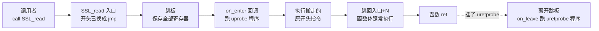
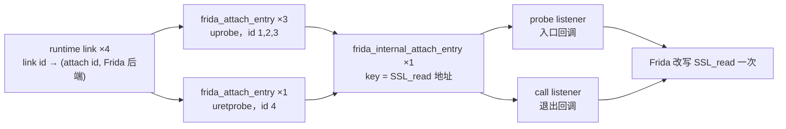
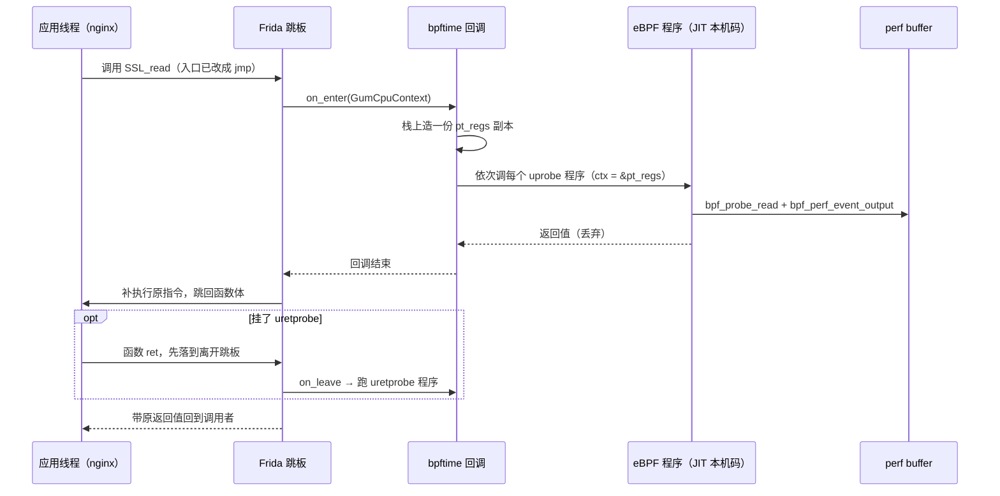
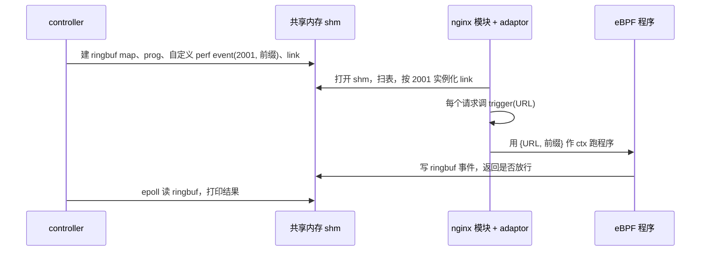

# 4. uprobe 类 attach

> 一句话：本章讲 bpftime 怎么在**不进内核**的前提下拦住目标进程里的一个函数，并在那一刻跑你的
> eBPF 程序。读完你能说清：应用调用 `SSL_read` 的瞬间，控制权怎么一步步走到 eBPF 程序、又怎么走回来；
> uprobe / uretprobe / override / ureplace 四种挂法有什么不同；想接一个自己的事件源该怎么写。
> 前置：建议先读[第 1 章](01-lifecycle.md)（事件全流程）和[第 3 章](03-entrypoints.md)
> （agent 怎么扫表、装配 attach）。预计用时：2–3 小时。

## 本章要回答的问题

1. 目标进程里根本没有"内核 uprobe"，那 `SSL_read` 一被调用，CPU 是怎么拐进 bpftime 的？
2. 同一个函数上挂 3 个 uprobe，函数本身被改写了几次？runtime 怎么记住"哪个 link 对应哪次挂钩"？
3. eBPF 程序里的 `PT_REGS_PARM1(ctx)` 读到的值是从哪来的？程序改了 `ctx`，被 hook 的函数会受影响吗？
4. override 和 ureplace 怎么让原函数"不执行"？eBPF 程序执行失败时又会怎样？
5. riscv64 上为什么换成了另一套 trap 后端？如果我想让自己的程序（比如 nginx 模块）触发 eBPF，该怎么接？

---

## 4.1 attach 层的位置：一个回调、一个基类

**直觉**：runtime（[第 2 章](02-runtime-shm.md)）手里有"一个 eBPF 程序"，attach 层手里有"一个事件源"
（比如某个函数被调用）。两者之间只约定一件事：runtime 把"运行这个程序"包成一个回调交给 attach 层；
attach 层负责**在对的时机、带着对的上下文**调用它。上下文（ctx）长什么样，由 attach 层自己决定——
uprobe 给一份寄存器快照 `pt_regs`，系统调用追踪给一个 tracepoint 结构（[第 5 章](05-syscall-trace.md)），
自定义事件源给宿主自己定义的结构（4.9）。

这个回调只有三个参数：

`attach/base_attach_impl/base_attach_impl.hpp` 的 `ebpf_run_callback`

```cpp
// memory      : 交给 eBPF 程序的 ctx（uprobe 时是 pt_regs*）
// memory_size : ctx 的字节数
// return_value: eBPF 程序的返回值（r0）写到这里
using ebpf_run_callback = std::function<int(void *memory, size_t memory_size,
                                            uint64_t *return_value)>;
```

所有 attach 后端都继承同一个基类 `base_attach_impl`。把它的接口列出来，就知道一个后端要做什么：

| 成员 | 必须实现？ | 作用 |
|---|---|---|
| `create_attach_with_ebpf_callback(cb, private_data, attach_type)` | 是 | 按 private data 描述的位置挂上回调，返回本后端内部的 **attach id**（负数是错误码） |
| `detach_by_id(id)` | 是 | 拆掉一次挂钩 |
| `allocate_id()` | 基类提供 | 从 1 开始自增。**每个后端实例各数各的**，不同后端可能返回同一个 id |
| `register_custom_helpers(cb)` | 可选 | 后端注册自己的 helper（Frida 后端注册了 `bpf_get_func_arg` 等三个） |
| `call_attach_specific_function(name, data)` | 可选 | 给 runtime 一个"按名字调后端特有功能"的口子；目前用于栈回溯 `generate_stack` |

**private data** 是"挂在哪"的描述。runtime 不懂每种后端的地址格式，所以只给一个字符串
（uprobe 是 `"模块路径:偏移"`，syscall trace 是 tracepoint id），由后端注册时附带的**工厂函数**把字符串
解析成自己的 `attach_private_data` 子类。后端拿到后再用 `dynamic_cast` 还原成具体类型。

**runtime 怎么认识后端**：agent 启动时调 `bpf_attach_ctx::register_attach_impl`，传三样东西——
这个后端负责的 attach type 列表、后端对象、private data 工厂。runtime 按 attach type 建一张索引表；
之后扫 handler 表遇到一个 perf event，就按它的 type 找到后端和工厂。注册时 runtime 还会先调后端的
`register_custom_helpers`，把后端 helper 记下来；这些 helper 要到程序编译之后才登记进 VM，后果见
[第 6 章](06-vm-jit.md) 6.5（细节见本章深入参考）。

uprobe 类的四种 type 由哪个后端负责，是**编译期二选一**：

`runtime/agent/agent.cpp` 的 `bpftime_agent_main`（节选）

```cpp
#if BPFTIME_HAVE_TRAP_UPROBE_ATTACH          // 只在 riscv64 上为真，见 4.8
	ctx_holder.ctx.register_attach_impl(
		{ trap::ATTACH_UPROBE, trap::ATTACH_URETPROBE,
		  trap::ATTACH_UPROBE_OVERRIDE, trap::ATTACH_UREPLACE },
		std::make_unique<trap::trap_attach_impl>(), /* 工厂 */);
#elif BPFTIME_HAVE_FRIDA_ATTACH              // 其他架构走这里
	ctx_holder.ctx.register_attach_impl(
		{ ATTACH_UPROBE, ATTACH_URETPROBE,
		  ATTACH_UPROBE_OVERRIDE, ATTACH_UREPLACE },
		std::make_unique<attach::frida_attach_impl>(
			runtime_config.enable_frida_fuzzy_backtracer),
		/* 工厂：frida_attach_private_data::initialize_from_string */);
#else
	SPDLOG_WARN("No uprobe attach backend available");
#endif
```

一个 Frida 后端实例**包揽四种 attach type**。四个编号 6 / 7 / 1008 / 1009 与 runtime 的事件类型枚举
（`bpf_event_type`）一致，所以 runtime 不用区分后端。

**runtime 怎么包回调**：实例化一个 link（"把哪个程序挂到哪个事件"）时，runtime 构造这个 lambda：

`runtime/src/attach/bpf_attach_ctx.cpp` 的 `instantiate_bpf_link_handler_at`

```cpp
auto cookie = handler.attach_cookie;          // link 创建时带的 cookie
/* ... trap 后端在这里先做"信号安全准入"，见 4.8 ... */
attach_id = attach_impl->create_attach_with_ebpf_callback(
	[=](void *mem, size_t mem_size, uint64_t *ret) -> int {
		// bpf_get_attach_cookie 的数据源：每次运行前都重新写一遍。
		// 普通后端写 thread_local；trap 后端写信号上下文
		// （信号处理函数里不能碰普通 TLS）
		if (auto *ctx = attach::current_signal_callback)
			ctx->cookie = cookie;
		else
			current_thread_bpf_cookie = cookie;
		// 真正执行 eBPF（JIT 好的本机码，见第 6 章）
		return prog->bpftime_prog_exec((void *)mem, mem_size, ret);
	},
	*priv_data, attach_type);
```

关于 cookie 有一个容易多想的地方：`current_thread_bpf_cookie` 执行完**不复位**。但因为每次经这个 lambda
运行前都会重新赋值，runtime 管理的 link 不会读到别的 link 的 cookie。只有绕过这个 lambda、直接调后端的
代码（比如单测里手写的回调）才可能读到上一次的残留值。

所以 attach 层对 runtime 来说是一个**黑盒调用者**：它不知道 eBPF 程序长什么样，只管调回调。

**要点**
- attach 层只管"什么时候调"和"传什么 ctx"；执行 eBPF 的是 runtime 给的三参数回调。
- 后端实现两个纯虚函数；"挂在哪"由字符串经工厂变成 private data。
- uprobe 后端编译期二选一：riscv64 用 trap，其余用 Frida。cookie 在每次运行前由 runtime 写入。

---

## 4.2 inline hook 是什么

**直觉**：内核 uprobe 的做法是在函数开头放一条断点指令，CPU 执行到它就陷入内核。
bpftime 不想进内核，于是用另一种老技术——**inline hook（内联钩子）**：直接改写目标函数
开头的几条机器指令，换成一条**跳转**，跳到一段事先准备好的代码上。这段代码叫
**跳板（trampoline）**。跳板做完"额外的事"以后，再把被覆盖掉的原指令补执行一遍，然后跳回
原函数继续往下走。对调用者来说，函数照常执行、照常返回，只是中途"绕了一下路"。

> **小知识**：Frida 是一个动态插桩工具包，bpftime 用的是它的 C 核心库 frida-gum（构建时下载 16.1.2 的
> devkit，支持 Linux x86_64 / aarch64 / armhf 和 macOS arm64）。其中的 Interceptor 组件专门做 inline hook：
> 给它一个函数地址，它负责改写指令、生成跳板、在跳板里把寄存器保存成结构体 `GumCpuContext`，
> 然后调用你注册的回调。

在 x86_64 上，改写前后大致是这样（示意，具体指令随函数而变）：

```text
改写前                                改写后
SSL_read:                             SSL_read:
  push rbp          (1 字节)            jmp  <跳板>        ← 覆盖开头 ≥5 字节
  push r15          (2 字节)            (被覆盖的残余字节，不会再执行)
  mov  rbp, rsp     (3 字节)            ...函数体其余部分不变...
  ...函数体...
                                      跳板（Frida 新分配的可执行内存）:
                                        把所有通用寄存器存成 GumCpuContext
                                        调用回调 on_enter（bpftime 在这里跑 eBPF）
                                        恢复寄存器
                                        push rbp ; push r15 ; mov rbp, rsp   ← 搬过来的原指令
                                        jmp  SSL_read+6                      ← 跳回原函数
```

下面这张图看控制流：实线是每次调用都走的路，虚线只在挂了 uretprobe 时才有。



uretprobe 怎么拦"返回"？Frida 在函数入口把**返回地址**换成自己的"离开跳板"的地址——x86_64 上返回地址
在栈顶，aarch64 上在 `lr`（x30）寄存器里。函数返回时先落到离开跳板，跳板调用 on_leave 回调，再跳回
真正的调用者。（这一段是 frida-gum 的内部机制，本仓库里没有它的源码，这里按 Frida 的公开设计描述。）

这个设计带来三个直接后果：

1. **全程在应用线程里同步执行**。eBPF 程序跑多久，`SSL_read` 就慢多久——没有"后台"。
2. **不进内核**，所以比内核 uprobe 快。trap 后端的 README 里有一组 x86_64 对比：
   内核 uprobe 每次命中约 4.7 µs，Frida 后端约 1.35 µs。这组数字来自另一台机器（Xeon 8259CL、Release、
   ubpf JIT）和 README 自己的测法；本书在本机用官方 `benchmark/` 测的是每次约 120 ns（[第 12 章](12-practice.md#exp-4)
   实验 4b），相差一个数量级。两者的被测程序、JIT 后端、构建配置都不同，这里没有逐项拆分原因——只看"用户态比
   进内核便宜"这个结论，具体数字以你自己机器上测的为准。
3. **函数太短可能挂不上**。开头至少要能腾出一条跳转指令的位置，而且被搬走的指令必须能在别处
   正确执行。挂不上时 bpftime 抛出带诊断信息的 C++ 异常（见本章深入参考）。

**要点**
- inline hook = 改写函数开头为跳转 + 跳板保存现场、调回调、补执行原指令、跳回。
- uretprobe 靠"替换返回地址"拦截函数返回（x86_64 在栈上，aarch64 在 `lr`）。
- 整条链是同步的：attach 层把 eBPF 和 helper 的每一分成本都 1:1 传给被 hook 的函数。

---

## 4.3 四种 attach：uprobe / uretprobe / override / ureplace

**直觉**：Frida 提供两种拦截原语。一种是"**旁听**"（`gum_interceptor_attach` + listener）：
原函数照常执行，你只是在进入或退出时被通知一下。另一种是"**顶替**"
（`gum_interceptor_replace`）：函数入口直接换成你的函数，原函数是否执行由你决定。
bpftime 的四种 attach 就分别建在这两种原语上。

| | uprobe | uretprobe | uprobe-override（filter） | ureplace |
|---|---|---|---|---|
| attach type 编号 | 6 | 7 | 1008 | 1009（后端内部按 1008 登记） |
| eBPF 什么时候跑 | 函数入口 | 函数返回时 | 函数入口 | 函数入口 |
| Frida 原语 | 旁听（只有入口回调的 probe listener） | 旁听（只有退出回调的 call listener） | 顶替 | 顶替（复用 override 实现） |
| 原函数执行吗 | 一定执行 | 一定执行 | 默认执行；eBPF 调了 `bpf_override_return` / `bpf_set_retval` 就跳过 | 正常情况下不执行；**eBPF 执行失败时退回执行原函数** |
| eBPF 返回值去哪 | 丢弃 | 丢弃 | 丢弃；起作用的是 helper 设的值 | 直接成为函数返回值 |
| 同一地址能挂几个 | 任意多 | 任意多 | 1 个，且应排斥其他（见 4.4 的坑） | 同 override |
| 能看到的参数 | 全部寄存器 | 全部寄存器（`ax`/`x0` 已是返回值） | 全部寄存器；但重放原函数时只转发前 5 个整型参数 | 同 override |
| `bpf_get_func_ip` 返回 | 函数地址 | 函数地址 | 0 | 0 |
| 对应内核能力 | uprobe | uretprobe | kprobe 上的 `bpf_override_return`（错误注入） | 无，bpftime 扩展 |

两个容易混的地方：

- **override 是"可选地顶替"**：eBPF 程序看完参数，决定要不要调 `bpf_override_return(ctx, v)`。
  调了，函数直接返回 `v`；没调，bpftime 替你调用原函数。
- **ureplace 是"程序成功就顶替"**：eBPF 程序本身就是新的函数体，它的返回值就是函数的返回值。
  实现上 ureplace 只是给 override 包了一层（4.7）：程序**成功**才设置返回值。程序执行失败
  （例如 `bpftime_prog_exec` 返回负数）时什么也不设，原函数照常执行——这是一种 **fail-open**
  （失败时放行）的设计，不是"原函数从不执行"。

**要点**
- uprobe/uretprobe = 旁听，原函数一定跑；override/ureplace = 顶替，原函数可能不跑。
- 同一地址上，旁听型可以叠加任意多个；顶替型只能有一个。
- ureplace 在后端内部被当作 1008 登记；程序失败时原函数照跑。

---

## 4.4 两层实体：runtime 的 link 与后端内部的条目

**为什么要分层**：一次"挂钩"在 bpftime 里要被记好几次，每一层回答不同的问题：

- runtime 要知道：shm 里第 N 号 link handler 实例化成了**哪个后端的哪个 attach id**——将来 detach 时找它。
- Frida 后端要知道：attach id 对应**哪个程序、哪种类型**；以及每个被 hook 的**函数地址**上装了什么。
- 用户可以往同一个函数上挂任意多个程序（比如 3 个 uprobe + 1 个 uretprobe），但 Frida 没必要、也不应该
  把同一个函数改写 4 次；detach 其中一个时，也不能把别人的 hook 一起拆掉。

所以记录分成两层，Frida 后端内部又再拆成两级：

| 层 | 在哪 | 一条代表什么 | 按什么查 |
|---|---|---|---|
| runtime | `bpf_attach_ctx` 的 `instantiated_attach_links` | 一个已实例化的 link → `(attach id, 后端指针)` | shm 里的 link id |
| 后端：用户视角 | `frida_attach_impl::attaches` 里的 `frida_attach_entry` | 一次 attach（一个程序挂到一个函数） | attach id |
| 后端：Frida 视角 | `frida_attach_impl::internal_attaches` 里的 `frida_internal_attach_entry` | 一个被 hook 的函数地址 | 函数地址 |

runtime 记的是 `(attach id, 后端指针)` 这一**对**，因为 attach id 只在单个后端里唯一（4.1）。

这张图看"3 个 uprobe + 1 个 uretprobe 挂在 `SSL_read` 上"时，各有几个对象：



触发时，内部 entry 遍历自己记下的所有用户 entry，**按类型现场过滤**：入口回调里只跑
uprobe 类型的，退出回调里只跑 uretprobe 类型的。

建立 attach 的核心是 `attach_at`：先按函数地址找内部 entry，没有就新建，有就复用。

`attach/frida_uprobe_attach_impl/src/frida_uprobe_attach_impl.cpp` 的 `frida_attach_impl::attach_at`

```cpp
if (func_addr == nullptr)
	return -EINVAL;
auto itr = internal_attaches.find(func_addr);      // 按函数地址查内部 entry
if (itr == internal_attaches.end()) {
	// 第一次 hook 这个地址：新建内部 entry。
	// 构造函数按 attach 类型决定：旁听（建 listener）还是顶替（replace）
	itr = internal_attaches.emplace(func_addr,
		std::make_unique<frida_internal_attach_entry>(
			func_addr, current_attach_type,
			(GumInterceptor *)interceptor)).first;
} else if (itr->second->has_override()) {
	return -EEXIST;                             // 已经被顶替：谁都不让再挂
}
auto &inner_attach = itr->second;
inner_attach->ensure_listener(current_attach_type); // 按需补一个入口/退出 listener
int used_id = this->allocate_id();                  // attach id，从 1 递增
/* ... 建 frida_attach_entry，放进 attaches 表（key = attach id） ... */
inner_attach->user_attaches.push_back(/* 新的用户 entry */);
/* 用户 entry 反向记住自己属于哪个内部 entry */
return used_id;
```

detach 是"最后一个离开的关灯"：`detach_by_id` 把用户 entry 从内部 entry 的列表里摘掉；
只有列表空了，才析构内部 entry——这时才调用 Frida 把函数恢复原样。

**一个要知道的坑：互斥检查只有一个方向**。上面的代码只在"已有 override"时拒绝新挂钩。
所以先 override 后 uprobe 会被拒（`-EEXIST`）；但**先 uprobe 后 override 不会报错**——内部 entry
早已按"旁听"模式建好，`ensure_listener` 对 override 类型什么也不做，顶替从未发生，override 程序
永远不会运行；而且此后再挂 uprobe 反而会因"已有 override"被拒（已实跑）。trap 后端两个方向都检查。
见[附录 B](B-known-issues.md#b-attach)。

另外，`detach_by_id` 遇到不存在的 id 时返回 0（而不是错误码），见[附录 B](B-known-issues.md#b-attach)。

**谁来保证并发安全**：Frida 后端的几张表（`attaches`、`internal_attaches`、`user_attaches`）都是普通容器，
后端自己**不加锁**。控制面的串行由 runtime 负责：`bpf_attach_ctx` 有一把 `ctx_mutex`，扫表实例化
（`init_attach_ctx_from_handlers`）、拆单个 link、拆全部 link、重置状态都持这把锁。所以经 runtime 走的
attach / detach 彼此不会并发。但热路径（命中时跑回调）**不持这把锁**：如果一个线程正在
遍历 `user_attaches`，另一个线程（比如 agent 收到卸载 / 刷新请求的工作线程）同时 detach 同一函数，
就是数据竞争（读码确认两边都没有同步，未实测出故障）。

**要点**
- runtime 记 `link id → (attach id, 后端)`；Frida 后端记 `attach id → 用户 entry` 和 `函数地址 → 内部 entry`。
- 同一地址最多两个 listener（入口、退出各一），或者一个顶替；函数只被改写一次。
- 内部 entry 在最后一个用户 attach 离开时才拆除 hook。
- 控制面靠 runtime 的 `ctx_mutex` 串行；后端本身无锁，热路径也不拿锁。

---

## 4.5 一次命中的完整时序（热路径）

这张图看一次 `SSL_read` 调用从进入到返回的全过程。这就是 sslsniff 场景里每个 HTTPS 请求
都要走的路。



入口回调的全部代码很短：

`attach/frida_uprobe_attach_impl/src/frida_internal_attach_entry.cpp` 的 `uprobe_listener_on_enter`

```cpp
static void uprobe_listener_on_enter(GumInvocationContext *ctx,
                                     gpointer user_data)
{
	// user_data 是注册 listener 时传入的 this，即内部 entry
	auto *hook_entry = static_cast<frida_internal_attach_entry *>(user_data);
	bpftime::pt_regs regs;                        // 栈上副本，活到函数结束
	convert_gum_cpu_context_to_pt_regs(*ctx->cpu_context, regs); // 见 4.6

	// 记下 Frida 的寄存器现场，给 bpf_get_stack / bpf_get_stackid 回溯用
	current_thread_gum_cpu_context = ctx->cpu_context;
	hook_entry->iterate_uprobe_callbacks(regs);   // 只跑 uprobe 类型的用户 attach
	current_thread_gum_cpu_context.reset();       // 离开回调就取不到栈了
}
```

退出回调 `uprobe_listener_on_leave` 结构相同，只是调 `iterate_uretprobe_callbacks`，并且
**不设置** `current_thread_gum_cpu_context`。

每个用户 entry 真正调回调的地方是 `frida_attach_entry::run_callback`：它先把 `current_thread_attach_func_ip`
设成被 hook 的函数地址（override 类型设成 0），这就是 `bpf_get_func_ip` 读到的值；然后调
`ebpf_cb(&regs, sizeof(regs), &ret)`，`ret` 不再使用，出错只打日志。

三件事要记住：

1. **ctx 是单向拷贝**。`regs` 是栈上的副本，地址被当成 `ctx` 交给 eBPF。程序改 `ctx` 里的
   寄存器，不会写回真实 CPU 状态；回调返回后这块内存也就失效了。
2. **普通 uprobe 的返回值被丢弃**。出错也只打日志，不影响被 hook 的函数。
3. **uretprobe 里拿不到栈**。栈回溯依赖 `current_thread_gum_cpu_context`，而只有入口回调和
   override 处理函数设置了它。所以在 uretprobe 程序里调 `bpf_get_stackid` / `bpf_get_stack`
   会返回 `-ENOENT`。

**栈回溯顺带一提**：`bpf_get_stack` 经 `call_attach_specific_function("generate_stack")` 调到 Frida 的
Backtracer，从保存的寄存器现场往回找返回地址。默认用 accurate（依赖 unwind 信息）回溯器；遇到
stripped 二进制回溯不出足够帧时，可以设 `BPFTIME_FRIDA_FUZZY_BACKTRACER` 或
`bpftime load --fuzzy-backtracer` 换成 fuzzy（扫描栈上像返回地址的值）回溯器。

**同步执行意味着什么**：attach 层本身很轻，但它把 helper 里的每一分成本都直接加到被 hook
函数上。官方代码里两个典型例子（详见[第 7 章](07-helpers.md)）：

- `bpf_perf_event_output` 每个事件要做 3 次与绑核相关的系统调用
  （1 次 `sched_getaffinity` + 2 次 `sched_setaffinity`）；成功写入时另有找分片用的 `getpid`、`gettid`，
  共 5 个（见第 7 章）；
- 打开 `ENABLE_PROBE_READ_CHECK`（默认 ON）时，`bpf_probe_read` 每次调用是一次 `process_vm_readv` 系统调用。

它们不在 attach/ 目录里，但都发生在这条同步链上。评估任何"每事件的工作"，先问：它在不在这条链上？

**要点**
- 热路径：跳板 → on_enter → 造 `pt_regs` → 逐个跑 uprobe 程序 → 回到原函数。
- `pt_regs` 是栈上副本，只读有效，生命期就是这一次回调。
- uretprobe 里取不到栈；栈回溯默认 accurate，可切 fuzzy。

---

## 4.6 寄存器 → `pt_regs`：x86_64 与 aarch64

**为什么要转换**：eBPF 程序是照着内核写的。`PT_REGS_PARM1(ctx)` 这类宏在编译时就被展开成
"从 `ctx` 偏移若干字节处读 8 字节"。所以 bpftime 交给程序的结构体，**内存布局必须和内核的
`pt_regs` 一模一样**。而 Frida 保存的 `GumCpuContext` 是另一种布局，必须一个字段一个字段地抄过去。

看一个真实例子。下面是 bpftime 单测里一个 x86_64 uprobe 程序的反汇编（第一个参数是 `int`，
第二个是 `char *`，第三个是 `char`）：

```text
0:  r6 = r1                          ; r6 = ctx（pt_regs 指针）
1:  r4 = *(u64 *)(r6 + 0x68)         ; 0x68/8 = 13 → 下标 13（从 0 数）= si → 第 2 个参数
2:  r3 = *(u64 *)(r6 + 0x70)         ; 0x70/8 = 14 → 下标 14 = di → 第 1 个参数
3:  r5 = *(u64 *)(r6 + 0x60)         ; 0x60/8 = 12 → 下标 12 = dx → 第 3 个参数
```

偏移量是编译器按**内核** x86_64 `pt_regs` 布局算好的常量。bpftime 自己定义了一份布局完全相同的
`pt_regs`，字段顺序是：

```text
r15 r14 r13 r12 bp bx r11 r10 r9 r8 ax cx dx si di orig_ax ip cs flags sp ss   （21 个，每个 8 字节；下标从 0 数，r15 是 0，si 是 13）
```

（这份定义有两份几乎相同的头文件：Frida 后端的 `frida_register_def.hpp` 和基类目录的
`bpftime_pt_regs.hpp`，后者多了 riscv64。两者故意共用同一个 include guard，谁先被包含谁生效。）

Frida 的 `GumX64CpuContext` 则是：

```text
rip r15 r14 r13 r12 r11 r10 r9 r8 rdi rsi rbp rsp rbx rdx rcx rax              （17 个）
```

两者**顺序不同**，所以不能 `memcpy`；Frida 也**没有** `orig_ax`、`cs`、`flags`、`ss` 这 4 个字段。
转换函数于是先整体清零，再逐个赋值：

`attach/frida_uprobe_attach_impl/src/frida_register_conversion.cpp` 的 `convert_gum_cpu_context_to_pt_regs`（x86_64 分支）

```cpp
void convert_gum_cpu_context_to_pt_regs(const ::_GumX64CpuContext &context,
                                        pt_regs &regs)
{
	regs = {};                // 先清零：orig_ax / cs / flags / ss 对 eBPF 恒为 0，
	                          // 而不是栈上残留的垃圾值
	regs.ip  = context.rip;
	regs.r15 = context.r15;   /* r14 r13 r12 r11 r10 r9 r8 同理 ... */
	regs.di  = context.rdi;   // 第 1 个参数
	regs.si  = context.rsi;   // 第 2 个参数
	regs.bp  = context.rbp;
	regs.sp  = context.rsp;   // 入口处 *sp 就是返回地址
	regs.bx  = context.rbx;
	regs.dx  = context.rdx;   // 第 3 个参数
	regs.cx  = context.rcx;   // 第 4 个参数
	regs.ax  = context.rax;   // uretprobe 时是返回值
}
```

aarch64 用的是同一个函数名的另一个分支，思路一样，细节不同：

`attach/frida_uprobe_attach_impl/src/frida_register_conversion.cpp` 的 `convert_gum_cpu_context_to_pt_regs`（aarch64 分支）

```cpp
memcpy(&regs.regs, &context.x, sizeof(context.x)); // x0..x28，两边都是连续数组
regs.regs[29] = context.fp;    // x29（帧指针），Frida 单独存
regs.regs[30] = context.lr;    // x30（返回地址）
regs.sp = context.sp;
regs.pc = context.pc;
regs.pstate = context.nzcv;    // 只有 NZCV 条件码，不是完整 PSTATE
```

两种架构对照：

| | x86_64 | aarch64 |
|---|---|---|
| bpftime `pt_regs` | 21 个具名字段，内核顺序 | `regs[31]`（x0–x30）+ `sp` + `pc` + `pstate` |
| 怎么拷 | 顺序不同，逐字段赋值 | `x0–x28` 一次 `memcpy`；`fp`(x29)、`lr`(x30) 单独补 |
| Frida 缺的字段 | `orig_ax` `cs` `flags` `ss`，清零为 0 | 所有字段都有值；但 `pstate` 只填了 NZCV |
| `PT_REGS_PARM*` | `di si dx cx r8 r9`（6 个） | `x0`–`x7`（8 个） |
| `PT_REGS_RC` | `ax` | `x0` |
| `PT_REGS_RET` | `sp`（返回地址在 `*sp`） | `regs[30]`（lr，返回地址就在寄存器里） |

**要点**
- `pt_regs` 布局必须和内核完全一致，因为字段偏移已经编进了 eBPF 字节码。
- x86_64 上 Frida 少 4 个字段，转换前先整体清零；aarch64 字段齐全，但 `pstate` 只有条件码。
- 转换是单向的：反向函数存在，但热路径从不调用。

---

## 4.7 override 与 ureplace：让原函数"消失"

**直觉**：override 用的是"顶替"原语。Frida 把函数入口换成 bpftime 的一个处理函数
`__bpftime_frida_attach_manager__override_handler`。应用以为在调 `SSL_read`，实际进的是它。
处理函数先跑 eBPF 程序，然后看程序有没有要求"覆盖返回值"：要求了，就直接返回那个值；
没要求，就**自己把原函数再调一遍**，把结果返回。

`attach/frida_uprobe_attach_impl/src/frida_internal_attach_entry.cpp` 的 `__bpftime_frida_attach_manager__override_handler`

```cpp
extern "C" void *__bpftime_frida_attach_manager__override_handler()
{
	GumInvocationContext *ctx = gum_interceptor_get_current_invocation();
	bpftime::pt_regs regs;
	convert_gum_cpu_context_to_pt_regs(*ctx->cpu_context, regs);
	auto hook_entry = (frida_internal_attach_entry *)
		gum_invocation_context_get_replacement_data(ctx);
	hook_entry->is_overrided = false;            // 每次进入先复位
	// 让全局 helper 知道"现在该通知哪个 entry"
	curr_thread_override_return_callback = hook_entry->override_return_callback;

	auto arg0 = gum_invocation_context_get_nth_argument(ctx, 0);
	/* ... arg1..arg4，一共只取 5 个参数 ... */
	ufunc_func func = (ufunc_func)ctx->function; // 原函数

	current_thread_gum_cpu_context = ctx->cpu_context;
	hook_entry->run_filter_callback(regs);       // 跑 eBPF；它可能调 bpf_override_return
	current_thread_gum_cpu_context.reset();
	if (hook_entry->is_overrided)
		return (void *)(uintptr_t)hook_entry->user_ret; // 跳过原函数
	return func((void *)arg0, (void *)arg1, (void *)arg2,   // 用 5 个参数重放调用
		    (void *)arg3, (void *)arg4);
}
```

`bpf_override_return` 是怎么"通知"到这里的？一共四步：

1. eBPF 程序调 helper 58，绑定的是 C 函数 `bpftime_override_return`
   （定义在 `attach/base_attach_impl/base_attach_impl.hpp`；helper 187 `bpf_set_retval` 同理，对应
   `bpftime_set_retval`）。
2. 它调用 thread_local 变量 `curr_thread_override_return_callback`——处理函数刚刚把它设成了
   本 entry 的回调。（两个都没设时，这两个 helper 会抛 `std::invalid_argument`。）
3. 这个回调（内部 entry 构造时装好的 lambda）把 `is_overrided` 置为 true，把值存进 `user_ret`。
4. eBPF 跑完，处理函数看到 `is_overrided`，直接返回 `user_ret`，原函数没被调用。

**ureplace 只是包了一层**：注册 ureplace 时，`create_attach_with_ebpf_callback` 把 runtime 给的回调
包进一个 wrapper，然后**以 1008（override）类型**交给 `attach_at`：

`attach/frida_uprobe_attach_impl/src/frida_uprobe_attach_impl.cpp` 的 `frida_attach_impl::create_attach_with_ebpf_callback`（ureplace 分支，节选）

```cpp
} else if (attach_type == ATTACH_UREPLACE) {
	return attach_at_with_ebpf_callback(
		(void *)(uintptr_t)sub.addr,
		ebpf_callback_args{
			.ebpf_cb = [=](void *memory, size_t memory_size,
				       uint64_t *return_value) -> int {
				if (int err = cb(memory, memory_size, return_value);
				    err < 0) {
					return err;   // 程序失败：不设返回值 → 原函数照常执行
				} else {
					bpftime_set_retval(*return_value); // 成功：r0 成为函数返回值
					return err;
				}
			},
			.attach_type = ATTACH_UPROBE_OVERRIDE }); // 内部按 1008 登记
}
```

由此得出三条语义：

- **成功时**，eBPF 的 r0 就是函数返回值，原函数不执行。
- **失败时 fail-open**：程序执行失败（比如程序没准备好、`bpftime_prog_exec` 返回负数）时 wrapper 不调
  `bpftime_set_retval`，处理函数看到 `is_overrided == false`，就用 5 个参数重放原函数。override（1008）
  也一样：程序没跑成功，就等于"没要求覆盖"。（本机已用 Frida 后端实跑：回调返回 `-95` 时，
  被替换函数返回了原函数的结果。）trap 后端的 ureplace wrapper 写法相同。
- **对外报告的类型是 1008**：ureplace 在后端内部登记为 override，`iterate_attaches` 等接口报的是 1008
  而不是 1009（已实跑）。

**最大的限制：只转发 5 个整型参数**。重放调用的函数指针类型是 5 个 `void *` 参数。在 x86_64
上这对应 `rdi rsi rdx rcx r8`。如果原函数有第 6 个整型参数（`r9`）、浮点参数（`xmm` 寄存器）或者
从栈上传的参数，重放时这些值都不对——第 6 个参数会变成处理函数执行过程中留在 `r9` 里的任意值
（已实跑：`f6(1,2,3,4,5,6)` 期望 6015，实际得到一个巨大的垃圾值）。uprobe 没有这个问题，因为原调用流
从未被打断。这是选 override 还是 uprobe 时的硬约束，见[附录 B](B-known-issues.md#b-attach)。

另外两个值得知道的细节：

- `is_overrided` / `user_ret` 是内部 entry 的普通成员，不是 thread_local。多个线程同时命中同一个
  override 点时存在数据竞争（读码确认没有任何同步）。
- 处理函数设置的 `curr_thread_override_return_callback` 之后**从不复位**（已实跑），同一线程之后在别处
  误调 `bpf_override_return` 不会报错，而是写进旧 entry（除非这期间该线程跑过一次 syscall trace 分发，
  那里会复位它），见[附录 B](B-known-issues.md#b-attach)。

**要点**
- override = 顶替入口 + 处理函数里决定"直接返回"还是"重放原函数"。
- `bpf_override_return` 经 thread_local 回调把结果交给处理函数。
- ureplace = 程序成功就 override；程序失败时 fail-open，原函数照常执行；内部类型是 1008。
- Frida 后端重放时只转发前 5 个整型参数。

---

## 4.8 另一个后端：trap（只在 riscv64 上用）

**它是什么**：`attach/trap_uprobe_attach_impl/` 是一个**不依赖 Frida** 的 uprobe 后端。它的
思路更接近内核 uprobe：把函数第一条指令换成断点指令（riscv 的 `ebreak`），CPU 执行到断点时
进程收到 `SIGTRAP` 信号，bpftime 在**信号处理函数**里构造 `pt_regs`、跑 eBPF，然后把原指令
放到别处执行，再回到函数里。它同样支持四种 attach，编号与 Frida 后端相同，runtime 不用区分。

**什么时候用**：纯编译期决定。`cmake/StandardSettings.cmake` 按 CPU 架构**强制**（`FORCE`）设置：
riscv64 上打开 trap、关掉 Frida；其他架构反过来。命令行传 `-DBPFTIME_ENABLE_TRAP_UPROBE=ON`
也会被覆盖。trap 后端目前也只有 riscv64 的指令实现（`trap_arch_riscv64.cpp`）。
**所以在 x86_64 和 aarch64 上，你读到和用到的都是 Frida 后端。**

**和 Frida 后端的主要区别**：

| | Frida 后端 | trap 后端 |
|---|---|---|
| 拦截方式 | 改写开头为 jmp，跳到跳板 | 换成断点，靠 `SIGTRAP` |
| eBPF 跑在哪 | 普通函数调用上下文 | 信号处理函数里 |
| 每次命中成本（README，测法见 4.2） | 约 1.35 µs（x86_64；本机实测约 120 ns） | 约 5.7 µs（riscv64，两次信号投递） |
| 能用哪些 helper | 全部 | 只有审计过的"异步信号安全" helper；map 操作、打印、栈采集等一律拒绝 |
| override 不覆盖时 | 用 5 个参数重放原函数 | 从断点处继续执行原函数，无参数限制 |
| override 覆盖时 | 处理函数直接返回值 | 改写返回值寄存器和 pc，直接回到调用者 |
| uprobe 与 override 互斥 | 只检查一个方向 | 两个方向都检查 |
| ureplace 失败时 | fail-open | fail-open |

信号处理函数里不能分配内存、不能加锁、不能碰需要动态初始化的线程局部变量。所以 trap 后端在
attach 时就先检查程序（`bpftime_prog::prepare_for_signal_execution`）：程序里只要调用了一个不在白名单
里的 helper，attach 直接失败（`-ENOTSUP`），不会静默地把它换成空操作。通过检查的程序会被立刻
JIT 编译好，命中时直接调本机码。这也是 4.1 里 cookie 要写进信号上下文、而不是 thread_local 的原因。

注意：只说"每次命中都不进内核"对 trap 后端不成立——它每次命中至少一次 `SIGTRAP`（执行原指令时
通常还有第二次）。

详细的工作步骤、信号安全规则和测试要求见本章深入参考。

**要点**
- trap = 断点 + `SIGTRAP`，不依赖 Frida，只在 riscv64 上启用，开关由架构强制决定。
- 跑在信号处理函数里，所以只准入少数信号安全的 helper。
- 比 Frida 慢，但没有"5 个参数"限制，互斥检查也是双向的。

---

## 4.9 自定义 attach：simple_attach 与 nginx 示例

**直觉**：uprobe 是"bpftime 主动去拦别人的函数"。还有一种用法反过来：宿主程序**自己愿意**在某个
时刻调 eBPF——比如 nginx 想在处理每个请求时让一段 eBPF 程序决定放行还是拒绝。这时不需要 inline
hook，宿主直接调一个函数触发就行。`attach/simple_attach_impl/` 就是为这种场景准备的最小后端。

`simple_attach_impl` 只做三件事：

- attach 时，记下 runtime 给的 eBPF 回调和一个 attach 参数字符串（来自 shm 里的自定义 perf event）；
- 宿主调 **trigger(字符串)** 时，把"attach 参数、trigger 参数、eBPF 回调"三样交给宿主事先提供的
  回调函数；由宿主准备 ctx、调 eBPF、解释返回值；
- **每个实例只能挂一个** attach；还没挂上就 trigger，返回 1。

宿主只需调一个模板函数完成注册，它返回 trigger 闭包：

`example/attach_implementation/nginx_plugin_adaptor/nginx_plugin_adaptor.cpp` 的 `nginx_plugin_example_initialize`（节选）

```cpp
bpftime_initialize_global_shm(shm_open_type::SHM_OPEN_ONLY); // 打开 controller 建好的 shm
ctx_holder.emplace();                                        // 宿主自建 bpf_attach_ctx
trigger_event = simple_attach::add_simple_attach_impl_to_attach_ctx(
	NGINX_REQUEST_FILTER_ATTACH_TYPE,                        // 自定义 attach type 2001
	[&](const std::string &attach_argument,                  // = 允许的 URL 前缀
	    const std::string &trigger_argument,                 // = 本次请求的 URL
	    const attach::ebpf_run_callback &run_ebpf_program) -> int {
		uint64_t ret;
		request_filter_argument arg;                         // 宿主自定义的 ctx
		arg.accept_prefix = attach_argument.c_str();
		arg.url_to_check = trigger_argument.c_str();
		int err = run_ebpf_program((void *)&arg, sizeof(arg), &ret);
		if (unlikely(err < 0))
			return 0;                                        // 程序出错：拒绝
		return ret != 0;                                     // r0 非 0：放行
	},
	*ctx_holder);
int res = ctx_holder->init_attach_ctx_from_handlers(bpftime_get_runtime_config());
```

整个示例有三方：



- **controller**（`example/attach_implementation/controller/`）直接调 runtime API（不经 syscall-server）：
  `bpftime_maps_create` 建 ringbuf、`bpftime_progs_create` 建程序、`bpftime_add_custom_perf_event(2001, 前缀)`
  建一个自定义事件、`bpftime_attach_perf_to_bpf` 建 link，然后 epoll 读 ringbuf。
- **nginx 模块**在 ACCESS 阶段调 adaptor 的 `nginx_plugin_example_run_filter(url)`，即 trigger；返回 0
  就回 403。
- 没有 agent、没有 Frida：宿主自建 `bpf_attach_ctx`，扫表时遇到 type 2001 的自定义 perf event，
  就把它的 `attach_argument` 字符串当 private data，交给 simple_attach。

一个值得注意的语义：没挂程序时 trigger 返回 1，nginx 把非 0 当"放行"，所以**没有程序时放行**；
程序执行出错时宿主回调返回 0，即**出错时拒绝**。这是宿主回调自己的选择，不是框架规定。

**要点**
- 自定义事件源 = 宿主主动 trigger；simple_attach 负责把 runtime 回调交给宿主。
- 控制面用 `bpftime_add_custom_perf_event(type, 参数)` 建事件；数据面用 `add_simple_attach_impl_to_attach_ctx` 注册同一 type。
- ctx 结构、返回值含义完全由宿主约定。

---

## 小结

- runtime 把"运行 eBPF 程序"包成一个三参数回调交给 attach 层；attach 层决定何时调、传什么 ctx。
  后端继承 `base_attach_impl`，"挂在哪"以字符串经工厂变成 private data。
- Frida 后端用 inline hook：函数开头改成 jmp，跳板保存寄存器、调回调、补执行原指令、跳回。
  全程在应用线程同步执行，不进内核。
- uprobe/uretprobe 是"旁听"，原函数一定执行，同一地址可叠加多个；override/ureplace 是"顶替"，
  同一地址只能有一个——但 Frida 后端的互斥检查只有一个方向。
- 记录分层：runtime 记 `link → (attach id, 后端)`；Frida 后端记 `attach id → 用户 entry`、`函数地址 → 内部 entry`。
  同一地址 Frida 只改写一次。控制面由 runtime 的 `ctx_mutex` 串行，热路径不拿锁。
- eBPF 拿到的 `ctx` 是栈上的 `pt_regs` 副本，布局与内核一致；x86_64 要逐字段转换并清零 Frida 没有的
  4 个字段，aarch64 大段 `memcpy`。程序改 `ctx` 不会影响被 hook 的函数。
- override 在处理函数里决定"直接返回"还是"用 5 个参数重放原函数"；ureplace 是"程序成功才覆盖"，
  失败时 fail-open。
- trap 后端只在 riscv64 上启用，eBPF 跑在 `SIGTRAP` 处理函数里，只准入信号安全的 helper。
- simple_attach 让宿主程序自己触发 eBPF，nginx 示例演示了完整的 controller / 宿主 / 程序三方协作。

## 动手验证

以下命令用官方树里已有的 `build-jit/`（单测已打开）。记 `B=/home/y/src/bpftime-wt-official-177a1dc`。

1. **跑 Frida attach 单测，看四种 attach 的行为**（本机已跑：`All tests passed (1072 assertions in 17 test cases)`）
   ```bash
   T=$B/build-jit/attach/frida_uprobe_attach_impl/bpftime_frida_uprobe_attach_tests
   $T --list-tests                                       # 共 17 个用例
   $T "Test the mix usage of uprobe and uretprobe"       # uprobe + uretprobe 叠加
   $T "Test attaching filter programs and revert"        # override
   $T "Test attaching replace programs and revert"       # replace
   $T "Frida x86 register conversion clears unavailable pt_regs fields"
   ```
   最后一个用例先把 `pt_regs` 填满 `0xa5`，再转换，然后断言 `orig_ax`、`cs`、`flags`、`ss` 都是 0——
   正是 4.6 里 `regs = {}` 的作用。读 `attach/frida_uprobe_attach_impl/test/test_uprobe_uretprobe.cpp`，
   对照 4.4 数一数每一步有几个内部 entry、几个 listener。

2. **亲眼看 ureplace 的 fail-open**：写一个小程序直接链接 Frida 后端静态库（不需要 shm、不需要 root）。
   要用到的头文件是 `frida_uprobe_attach_impl.hpp`、`frida_attach_private_data.hpp`，命名空间 `bpftime::attach`。
   完整源码（本机已用下面的命令编译运行）：

   <details><summary>exp_replace.cpp（全文）</summary>

   ```cpp
   // exp_replace.cpp：观察 ureplace 的 fail-open（直接用 Frida 后端，不需要 shm、不需要 root）
   #include <frida_uprobe_attach_impl.hpp>   // frida_attach_impl、ATTACH_UREPLACE
   #include <frida_attach_private_data.hpp>  // frida_attach_private_data
   #include <cstdint>
   #include <cstdio>
   #include <string>
   using namespace bpftime::attach;

   extern "C" __attribute__((noinline)) uint64_t h2(uint64_t a, uint64_t b) { asm(""); return a * 10 + b; }
   extern "C" __attribute__((noinline)) uint64_t k2(uint64_t a, uint64_t b) { asm(""); return a * 10 + b; }

   int main()
   {
       frida_attach_impl m;
       frida_attach_private_data p1, p2;
       p1.initialize_from_string(std::to_string((uintptr_t)&h2)); // 纯地址形式
       p2.initialize_from_string(std::to_string((uintptr_t)&k2));
       // 回调成功：r0 = 42 成为函数返回值
       m.create_attach_with_ebpf_callback(
           [](void *, size_t, uint64_t *r) -> int { *r = 42; return 0; }, p1, ATTACH_UREPLACE);
       // 回调失败（模拟 bpftime_prog_exec 返回负数）：fail-open，原函数照常执行
       m.create_attach_with_ebpf_callback(
           [](void *, size_t, uint64_t *r) -> int { *r = 42; return -95; }, p2, ATTACH_UREPLACE);
       printf("h2(1,2)=%lu  k2(1,2)=%lu  (original would be 12)\n", h2(1, 2), k2(1, 2));
       m.iterate_attaches([](int id, const void *, int ty) { printf("attach id=%d type=%d\n", id, ty); });
       return 0;
   }
   ```
   </details>

   ```bash
   g++-13 -std=c++20 -O1 -o exp_replace exp_replace.cpp \
     -I$B/attach/frida_uprobe_attach_impl/include -I$B/attach/base_attach_impl \
     -I$B/build-jit/FridaGum-prefix/src/FridaGum -I$B/third_party/spdlog/include -DSPDLOG_COMPILED_LIB \
     $B/build-jit/attach/frida_uprobe_attach_impl/libbpftime_frida_uprobe_attach_impl.a \
     $B/build-jit/FridaGum-prefix/src/FridaGum/libfrida-gum.a $B/build-jit/third_party/spdlog/libspdlog.a \
     -ldl -lpthread -lresolv
   ./exp_replace
   ```
   本机实跑：先打印两行 error 日志（`k2` 的回调返回 `-95`），然后
   `h2(1,2)=42  k2(1,2)=12  (original would be 12)`——回调成功的 `h2` 返回 42，回调失败的 `k2` 退回原函数的 12。
   最后两行 `attach id=... type=1008`：两个 ureplace 在后端内部都登记成了 1008。

3. **亲眼看 `pt_regs` 偏移被编进字节码**
   ```bash
   llvm-objdump -d $B/build-jit/runtime/unit-test/uprobe.bpf.o | head -16   # Debian 上可能叫 llvm-objdump-19
   ```
   本机实跑：`my_function_uprobe` 开头正是 4.6 引用的那三行 `r4 = *(u64 *)(r6 + 0x68)`、
   `r3 = *(u64 *)(r6 + 0x70)`、`r5 = *(u64 *)(r6 + 0x60)`。把偏移除以 8，对照 4.6 的字段顺序，
   确认 `0x70` 是 `di`（第 1 个参数）、`0x68` 是 `si`、`0x60` 是 `dx`。源码在 `runtime/unit-test/assets/uprobe.bpf.c`。

更多实验见[第 12 章](12-practice.md#exp-4)。

## 自测题

**Q1. 同一个函数上挂了 3 个 uprobe 和 1 个 uretprobe。runtime 的 link 记录、`frida_attach_entry`、
`frida_internal_attach_entry`、Frida listener 各有几个？函数开头被改写了几次？**

<details><summary>答案</summary>

runtime 侧 4 条 link 记录，每条是 `(attach id, Frida 后端指针)`；用户 entry 4 个（每个 attach id 一个）；
内部 entry 1 个（按函数地址去重）；listener 2 个——第一个 uprobe 时建一个只有入口回调的 probe listener，
第一个 uretprobe 时再补一个只有退出回调的 call listener。函数开头只被改写一次，两个 listener 共享同一个
hook。触发时，入口回调里按类型过滤出 3 个 uprobe 依次运行，退出回调里过滤出 1 个 uretprobe。
</details>

**Q2. 一个 uprobe 程序把 `ctx->di` 改成了 0。被 hook 的函数看到的第一个参数会变吗？
如果程序把 `ctx` 指针存进一个全局变量，下次事件再读，会怎样？**

<details><summary>答案</summary>

不会变。`ctx` 指向的是回调栈上的 `pt_regs` 副本，从 `GumCpuContext` 单向拷贝而来，从不回写。
存下来的指针在回调返回后就成了悬垂指针，下次再读是未定义行为——那块栈早已被别的调用覆盖。
</details>

**Q3. 为什么 x86_64 的转换函数不能像 aarch64 那样用一次 `memcpy`？为什么开头要 `regs = {}`？**

<details><summary>答案</summary>

因为 `GumX64CpuContext` 和内核 `pt_regs` 的字段顺序不同（前者 `rip` 在最前、`r8` 之后是
`rdi rsi rbp rsp ...`；后者按内核栈帧顺序 `r15 ... r8 ax cx dx si di orig_ax ip ...`），只能逐字段
赋值。`pt_regs` 的布局又不能改，因为 eBPF 字节码里已经写死了字段偏移。`regs = {}` 是因为 Frida
不提供 `orig_ax`、`cs`、`flags`、`ss`，不清零的话这 4 个字段会带出栈上的残留数据。aarch64 上
`x0–x28` 在两边都是连续数组，才可以一次拷贝。
</details>

**Q4. 一个 ureplace 程序挂在 `int check(int x)` 上。某次运行时程序执行失败了（例如
`bpftime_prog_exec` 返回负数）。调用者拿到的返回值是什么？如果要"失败时拒绝"，该怎么做？**

<details><summary>答案</summary>

调用者拿到的是原函数的返回值。ureplace 的 wrapper 只在回调成功时才调 `bpftime_set_retval`；失败时直接
返回错误码，override 处理函数看到 `is_overrided == false`，就用前 5 个参数重放原函数——即 fail-open。
如果需要"失败时拒绝"，bpftime 的 ureplace 本身做不到；要么让原函数本身就是拒绝逻辑，要么像 4.9 的
nginx 示例那样用宿主自己的回调（simple_attach）来决定出错时的返回值。
</details>

**Q5. 对 `SSL_read` 先挂一个普通 uprobe，再挂一个 override，会发生什么？反过来呢？在 riscv64 上呢？**

<details><summary>答案</summary>

Frida 后端，先 uprobe 后 override：`attach_at` 只在"已有 override"时才拒绝，所以第二次 attach
成功返回 id。但内部 entry 在第一次 attach 时已经按"旁听"模式建好，`ensure_listener` 对 override
类型什么也不做，顶替从未发生，override 程序永远不会运行——静默失效。而且此后再挂 uprobe 反而会因
"已有 override"被拒。反过来先 override 后 uprobe：直接 `-EEXIST`。trap 后端两个方向都返回
`-EEXIST`。
</details>

**Q6. agent 的卸载工作线程正在 detach 一个 uprobe，同时应用线程正好命中这个函数。runtime 的
`ctx_mutex` 能防住冲突吗？**

<details><summary>答案</summary>

防不住。`ctx_mutex` 只把控制面操作（扫表实例化、拆 link、重置）彼此串行起来；热路径（Frida 跳板里遍历
`user_attaches`、跑回调）不拿这把锁，Frida 后端自身也没有锁。所以 detach 修改 `user_attaches` 与命中线程
遍历它可以同时发生，是数据竞争（读码确认，未实测出故障）。trap 后端用"不可变表 + 发布新表 + 等待正在跑的回调结束"
解决了这个问题，Frida 后端没有对应机制。
</details>

---

## 深入参考

<details>
<summary>代码位置速查（按 177a1dc465ff 行号）</summary>

| 概念 / 函数 | 位置 |
|---|---|
| `ebpf_run_callback`、`ebpf_helper_register_callback` | `attach/base_attach_impl/base_attach_impl.hpp:42-47` |
| `base_attach_impl` 类（纯虚函数、`allocate_id`、`next_id = 1`） | `attach/base_attach_impl/base_attach_impl.hpp:49-89` |
| `curr_thread_override_return_callback`、`current_thread_attach_func_ip` | `attach/base_attach_impl/base_attach_impl.hpp:19-22` |
| `signal_callback_context`、`current_signal_callback`、`signal_handler_depth` | `attach/base_attach_impl/base_attach_impl.hpp:27-39` |
| `bpftime_set_retval` / `bpftime_override_return` | `attach/base_attach_impl/base_attach_impl.hpp:97-115` / `:118-138` |
| `attach_private_data` 基类 | `attach/base_attach_impl/attach_private_data.hpp:12-31` |
| `register_attach_impl`（含 `register_custom_helpers` 覆盖 helper） | `runtime/src/attach/bpf_attach_ctx.cpp:269-293` |
| 程序实例化：先全局 helper 并编译，再登记后端 helper | `runtime/src/attach/bpf_attach_ctx.cpp:304`、`:310-312`；llvm 后端重复编号返回 `-EEXIST`：`vm/llvm-jit/src/vm.cpp:93-96` |
| runtime 构造回调（trap 准入、cookie） | `runtime/src/attach/bpf_attach_ctx.cpp:390-407`（函数起于 :316） |
| link 记录 `instantiated_attach_links[id] = (attach_id, impl)` | `runtime/src/attach/bpf_attach_ctx.cpp:416` |
| 拼 `"module:offset"` 字符串 | `runtime/src/attach/bpf_attach_ctx.cpp:446-453`（函数起于 :420） |
| 自定义 perf event → private data | `runtime/src/attach/bpf_attach_ctx.cpp:490-503` |
| `ctx_mutex` 及加锁处 | `runtime/include/bpf_attach_ctx.hpp:200`；`bpf_attach_ctx.cpp:76,513,544,568` |
| 拆 link → `detach_by_id` | `runtime/src/attach/bpf_attach_ctx.cpp:517-541` |
| agent 注册 uprobe 后端（trap / Frida） | `runtime/agent/agent.cpp:991-1012` / `:1013-1032` |
| cookie 读取 / `bpf_get_func_ip` | `runtime/src/bpftime_shm.cpp:262-269`、`runtime/src/bpf_helper.cpp:662-675` / `:677-682` |
| attach type 常量（注释写反） | `attach/frida_uprobe_attach_impl/include/frida_uprobe_attach_impl.hpp:20-31` |
| `frida_attach_impl` 类 / 两张 map | `frida_uprobe_attach_impl.hpp:65-108` / `:99-103` |
| `frida_attach_entry`、`run_callback<idx>` | `attach/frida_uprobe_attach_impl/include/frida_attach_entry.hpp:14-76`、`:24-61` |
| `frida_internal_attach_entry` 类 | `attach/frida_uprobe_attach_impl/include/frida_internal_attach_entry.hpp:15-47` |
| `frida_attach_impl` 构造（`gum_interceptor_obtain`） | `attach/frida_uprobe_attach_impl/src/frida_uprobe_attach_impl.cpp:36-42` |
| `attach_at`（单向互斥检查 :76-80） | `src/frida_uprobe_attach_impl.cpp:48-97` |
| `detach_by_id`（未知 id 返回 0） | `src/frida_uprobe_attach_impl.cpp:126-151` |
| `create_attach_with_ebpf_callback`（module 校验 :190-230，ureplace wrapper :238-265） | `src/frida_uprobe_attach_impl.cpp:175-279` |
| 自定义 helper 注册（183/184/186） | `src/frida_uprobe_attach_impl.cpp:280-292` |
| `generate_stack` | `src/frida_uprobe_attach_impl.cpp:294-335` |
| 诊断信息 `build_frida_attach_failure_message` | `src/frida_internal_attach_entry.cpp:99-111` |
| `ensure_listener` | `src/frida_internal_attach_entry.cpp:115-143` |
| 内部 entry 构造 / 析构 | `src/frida_internal_attach_entry.cpp:145-180` / `:182-197` |
| `has_override` / `has_uprobe_or_uretprobe`（后者无人调用） | `src/frida_internal_attach_entry.cpp:199-218` |
| override 处理函数 | `src/frida_internal_attach_entry.cpp:257-291` |
| `uprobe_listener_on_enter` / `on_leave` | `src/frida_internal_attach_entry.cpp:293-308` / `:310-318` |
| 寄存器转换 x86_64 / aarch64 | `src/frida_register_conversion.cpp:6-30` / `:55-64` |
| `pt_regs` 与 `PT_REGS_*` 宏 | `attach/base_attach_impl/bpftime_pt_regs.hpp`（x86_64 :24-56，aarch64 :58-75）；`attach/frida_uprobe_attach_impl/include/frida_register_def.hpp` |
| `"module:offset"` 解析 | `src/frida_attach_private_data.cpp:10-42` |
| `resolve_mapped_module_path` / `resolve_function_addr_by_module_offset` | `src/frida_attach_utils.cpp:68` 起 / `:111` 起 |
| `bpf_get_func_arg` 等三个自定义 helper | `src/frida_attach_utils.cpp:176-212` |
| 栈 helper 调 `generate_stack` | `runtime/src/bpf_helper.cpp:793`、`:860` |
| fuzzy 回溯开关 | `runtime/include/bpftime_config.hpp:74`、`runtime/src/bpftime_config.cpp:114-116` |
| trap / Frida 架构选择 | `cmake/StandardSettings.cmake:76-82`；`attach/CMakeLists.txt` |
| trap：attach type、主要函数 | `attach/trap_uprobe_attach_impl/include/trap_uprobe_attach_impl.hpp:37-40`；`src/trap_uprobe_attach_impl.cpp`：`trap_engine::attach` :656（双向互斥 :671-685）、`store_patch` :488、`handle_hit` :917、`handle_return` :975、`chain_previous` :1020、`on_sigtrap` :1044、ureplace wrapper :1263-1279 |
| trap 准入 `prepare_for_signal_execution` | `runtime/src/bpftime_prog.cpp:289` 起 |
| 信号安全 helper 白名单 `helper_is_async_signal_safe` | `runtime/src/bpf_helper.cpp:895-910` |
| `simple_attach_impl` 类 / 注册模板 | `attach/simple_attach_impl/simple_attach_impl.hpp:27-57` / `:100-123` |
| `simple_attach_impl` create / detach / trigger | `attach/simple_attach_impl/simple_attach_impl.cpp:7-29` / `:31-43` / `:44-55` |
| nginx adaptor | `example/attach_implementation/nginx_plugin_adaptor/nginx_plugin_adaptor.cpp:30-67` |
| controller 建事件与 link | `example/attach_implementation/controller/controller.cpp:77-80` |
| `bpftime_add_custom_perf_event` | `runtime/src/bpftime_shm.cpp:674` |

</details>

<details>
<summary>细节与坑</summary>

**两层实体的字段**

- `frida_attach_entry`（一个 attach id 一条）：`self_id`（attach id）、`callback`（`std::variant`：单测用的
  `pt_regs&` 裸函数，或生产路径的"eBPF 回调 + attach type"）、`function`（被 hook 地址，也是
  `bpf_get_func_ip` 的数据源）、`internal_attach`（指回内部 entry 的裸指针）。
- `frida_internal_attach_entry`（一个函数地址一条）：`function`、`uprobe_listener` / `uretprobe_listener`
  （按需创建；两者都为空说明走的是顶替，析构时 `gum_interceptor_revert`）、`user_attaches`（触发时按
  `get_type()` 现场过滤，没有按类型分桶）、override 状态 `is_overrided` / `user_ret` / `user_ret_ctx`
  （普通成员）、`override_return_callback`（桥接全局 C 函数与具体 entry）。
- 两层 entry 都由 `frida_attach_impl` 的两个 `unordered_map` 以 `unique_ptr` 持有。`GumInterceptor`
  在 `frida_attach_impl` 构造时由 `gum_interceptor_obtain()` 获得，每个内部 entry 再 `gum_object_ref` 一次。

**attach 建立全链（自顶向下）**

```
bpf_attach_ctx::instantiate_perf_event_handler_at
  拼出 arg_str = "module_name:offset"
  → private_data_gen(arg_str, err)          （agent 注册的工厂 lambda）
    → frida_attach_private_data::initialize_from_string
      → resolve_mapped_module_path(module_part)
          /proc/<pid>/map_files/<start>-<end> → 查 /proc/self/maps 还原真实路径
      → resolve_function_addr_by_module_offset
          gum_module_load + gum_module_find_base_address，再加 offset → 绝对地址
bpf_attach_ctx::instantiate_bpf_link_handler_at
  → frida_attach_impl::create_attach_with_ebpf_callback
      校验 module 确实出现在 /proc/self/maps 里
      → attach_at_with_ebpf_callback → attach_at(addr, {cb, type})
        → new frida_internal_attach_entry(...)
          → ensure_listener → gum_interceptor_attach   （uprobe/uretprobe）
          → gum_interceptor_replace                    （override / ureplace）
```

- 地址解析发生在解析 private data 时，那时还没碰 Frida interceptor。
- `resolve_mapped_module_path` 只处理 `/proc/<pid>/map_files/<start>-<end>` 形式的路径：要求 pid 是本进程，
  在 `/proc/self/maps` 里找与 `[start,end)` 有重叠的那一行，取出真实路径并校验 inode / 设备号一致。
  其他形式的路径原样返回。
- module 名为空或等于 `/proc/self/exe` 表示主程序。
- 取基址前会先 `gum_module_load`：模块文件存在、只是目标进程还没加载时，Frida 会**把它加载进目标进程**再挂钩（例如 sslsniff 的 GnuTLS / NSS 探针会让只用 OpenSSL 的进程也载入这两个库），见[附录 B](B-known-issues.md#b-attach)。
- `/proc/self/maps` 校验的动机：LD_PRELOAD 的 agent 可能被注入到无关进程（比如 nginx master 拉起的 shell）。
  module 不存在时只打 INFO 并返回 `-EINVAL`，runtime 侧也只记 DEBUG。这是"正常的失败"。
- Frida 版 `frida_attach_private_data::initialize_from_string` 对非数字的偏移直接 `std::stoul`（会抛），
  `addr` 无初值，也没有覆盖 `to_string`；trap 版有 try/catch 和初值。

**listener 与事务**

- 纯 uprobe 只挂 `gum_make_probe_listener` 建的 probe listener（只有入口回调）；只有真挂了 uretprobe
  才会建 `gum_make_call_listener(nullptr, on_leave, ...)` 的 call listener 去拦截返回。
- `ensure_listener` 让"先 uprobe 后 uretprobe"能在已有内部 entry 上补挂 call listener；它对非
  uprobe/uretprobe 类型直接 return。
- listener 只增不减：同一地址上 uretprobe 全部 detach 而 uprobe 还在时，call listener 仍挂着，直到整个内部
  entry 析构。
- 内部 entry 构造和 `ensure_listener` 都把 Frida 改写包在 `gum_interceptor_begin_transaction` /
  `end_transaction` 之间，出错分支先 end transaction 再抛异常。

**attach 失败与异常**

- 函数太短或 Frida 无法改写指令时（如 `GUM_ATTACH_WRONG_SIGNATURE`），抛出的 `std::runtime_error` 包含：
  attach 类型、`GumAttachReturn` 名称、`dladdr` 解析出的模块/符号、函数前 8 个字节，并建议 `-O0`、
  `__attribute__((noinline))` 或挂更大的 wrapper。单测 `test/test_attach_failure_diagnostics.cpp` 专门测这个；
  它的目标是 5 字节的 `lea 1(%rdi),%rax; ret`，在 x86_64 上 Frida 实际能挂上，测试走的是"接受"分支。
- `create_attach_with_ebpf_callback` 只 catch `std::bad_cast`，这个 `runtime_error` 会继续往上冒。
  runtime 的扫表循环对返回负数的 handler 是"跳过、继续"，但对异常不拦；agent 在 `init_attach_ctx_from_handlers`
  外面有 `try/catch`，接住后走初始化失败路径。所以一个挂不上的函数会让整次扫表中止，而不是只跳过它
（读码确认：中间各层都没有 catch；第 5 章 tracefs 异常走的是同一条路）。

**疑似问题（详情见[附录 B](B-known-issues.md#b-attach)，这里只列名目）**

- 互斥检查只单向：先 uprobe 后 override 静默失效，之后再挂 uprobe 反被拒（已实跑）；`has_uprobe_or_uretprobe()` 定义了却没人调用。
- `detach_by_id` 对未知 id 返回 0，并把 `errno` 设成负数（已实跑）。
- override 不覆盖时只用 5 个参数重放原函数，第 6 个参数变成垃圾值（已实跑）；返回类型 `void *`，浮点返回值也不保留（推断）。
- ureplace 内部登记为 1008，对外查询报不出 1009（已实跑）。
- override 处理函数设置的 `curr_thread_override_return_callback` 从不复位（已实跑）。
- 多线程并发命中同一 override 点时 `is_overrided` / `user_ret` 存在数据竞争；detach 与命中线程并发遍历 `user_attaches`（均为读码确认没有同步）。
- 拒绝挂钩时的错误日志 `"Function {} was already attached ..."` 没传参数，打印字面 `{}`。

**注释与代码不一致**

`frida_uprobe_attach_impl.hpp` 里 `ATTACH_UPROBE = 6` 的注释写着"函数返回时调用"，`ATTACH_URETPROBE = 7`
写着"函数被调用时"——两段注释写反了。以 `ensure_listener` 的接线为准：uprobe 挂入口回调，uretprobe 挂退出回调。

**栈回溯细节**

- `bpf_get_stackid` / `bpf_get_stack` 按 attach type 6 找到 uprobe 后端，调 `call_attach_specific_function("generate_stack", nullptr)`。
  结果最多 127 帧；每次调用都新建一个 tracer、`new` 一个 vector 交给 helper 释放——不是信号安全的，所以 trap 后端直接返回 null。
  helper 侧的 flag / 返回值语义见[第 7 章](07-helpers.md)。

**aarch64 转换细节**

`GumArm64CpuContext` 布局是 `{ pc, sp, nzcv, x[29], fp, lr, v[32] }`，`x` 只有 29 个。aarch64 `pt_regs` 34 个字段
全部被赋值，没有未初始化字段；但 `pstate` 只有 NZCV，依赖 DAIF 等其他位的程序会读到 0。反向函数
`convert_pt_regs_to_gum_cpu_context` 在各架构都存在，但热路径没人调。arm32 分支用 `uregs[18]`。

**override / ureplace 的其他细节**

- `gum_invocation_context_get_nth_argument` 在 x86_64 上读 `rdi rsi rdx rcx r8`；`ufunc_func` 是
  `void *(*)(void*, void*, void*, void*, void*)`。
- `bpftime_override_return` / `bpftime_set_retval` 先看 `current_signal_callback`（Frida 下为 null），再调
  `curr_thread_override_return_callback`；都没有时抛 `std::invalid_argument`。
- `run_filter_callback` 只跑第一个 1008 类型的用户 entry；找不到时抛 `runtime_error`。

**后端 helper 怎么进 VM**

- `register_attach_impl` 调后端的 `register_custom_helpers`，把 helper 记进本 attach ctx 自己的 `helpers` 表。
  这张表只装后端 helper（不含全局 helper），不同后端同号时后注册的覆盖先注册的。
- 实例化程序时，先 `load_prog_and_helpers` 登记三组全局 helper 并编译，然后才把 `helpers` 表里的后端 helper
  逐个登记进 VM。默认的 llvm 后端对已登记的编号返回 `-EEXIST`（调用方不看返回值），所以若后端 helper 与
  全局 helper 同号，**先登记的全局 helper 生效**（见[第 6 章](06-vm-jit.md) 6.5、[第 7 章](07-helpers.md) 7.2）。
- 目前 Frida 后端的 183/184/186 不在三组全局表里，没有撞号。

**Frida 后端自定义 helper**

`register_custom_helpers` 注册三个：`bpf_get_func_arg`(183)、`bpf_get_func_ret`(184，注册名写成
`"bpf_get_func_ret_id"`)、`bpf_get_retval`(186)，都通过 `gum_interceptor_get_current_invocation()` 现取 Frida
上下文。它们与内核同号 helper 的语义有差异（参数个数不检查上限、186 在内核里是 cgroup 用的等），
见[第 7 章](07-helpers.md)和[附录 B](B-known-issues.md#b-attach)。

**trap 后端工作步骤**（README "How it works" + `src/trap_uprobe_attach_impl.cpp`）

| 步骤 | 做什么 |
|---|---|
| attach | 解码首条指令并保存，覆盖为 `ebreak` / `c.ebreak`；4 字节指令落在 2 字节边界时用三阶段写入，保证每个中间态都是陷阱指令。**先发布 site 表、再写断点**，所以命中总能查到 site |
| 命中 | `SIGTRAP` → `on_sigtrap`，按 pc 在不可变、无锁的 `site_table` 里二分查找 |
| 跑回调 | 从 `ucontext_t` 填一份内核风格 `pt_regs`，在被打断的线程上跑 uprobe 回调（或 override） |
| 原指令 | 拷到 out-of-line slot 执行（slot 末尾再放一个断点，第二次陷入后 pc 跳回原指令之后），或对 pc 相对/跳转类指令软件模拟 |
| uretprobe | 把返回地址 `ra` 换成一个断点 trampoline，原返回地址压进每线程影子栈（深度 128）；被 longjmp 遗弃的帧在返回时丢弃 |
| override | `arch::do_return(uc, value)` 直接写返回值寄存器并返回调用者，函数体不执行；override 状态存在每线程槽里 |
| 非本后端断点 | 转发给宿主原先装的 `SIGTRAP` handler |
| 重入 | 回调里再调被探测函数时，嵌套命中不跑回调、只执行原指令 |
| detach | 复制 site 去掉 entry，空了就写回原指令；发布新表后先把 entry 的 `enabled` 置 false，再自旋等正在跑的回调数归零 |

slot 分配：先复用已有区域，再在目标地址 ±1GB 内用 `MAP_FIXED_NOREPLACE` 试 RWX 页，最后回退为 RW 页写完再 `mprotect RX`。
改写代码页时保留原权限，从不去掉 EXEC；权限恢复失败返回 `-EIO`。site、slot、entry 在进程生命周期内永不释放。

**trap 后端信号安全规则**（官方 `CLAUDE.md` + README "Host process contract"）

1. runtime 管理的 link 先准入：`prepare_for_signal_execution()` 拒绝 MPK、CUDA、AOT 对象、非 llvm/ubpf VM、
   `CALLX`，并逐条检查 helper 调用：只有白名单里**编号和函数指针都匹配**的 helper 才放行——
   `bpf_get_func_ip`(173)、`bpf_get_attach_cookie`(174)、`bpf_override_return`(58)、`bpf_set_retval`(187)，
   以及 trap 自己的 `get_func_arg` / `get_func_ret` / `get_retval`(183/184/186)。map 操作、打印、tail call、
   栈采集等一律 `-ENOTSUP`；不允许把被拒 helper 静默换成 no-op。通过后立即 JIT（失败也拒绝），再装断点。
2. 执行期再查一次：`bpftime_prog_exec` 发现 `current_signal_callback` 非空时，若程序没准备好或没 JIT 就返回
   `-ENOTSUP`；否则直接调 JIT 函数，跳过 shm 保护切换和日志。
3. 处理函数里不分配、不加锁、不碰动态 TLS：每线程状态来自静态的 1024 个槽，首次命中用原子 CAS 认领；TLS 只用
   `initial-exec` 模型的小指针。槽耗尽时跳过回调但仍执行原指令。
4. 回调里不能 attach / detach：`attach_at`、`detach_by_id` 等在 `current_signal_callback` 非空时返回 `-EOPNOTSUPP`。
5. trap 后端的 `generate_stack` 直接返回 null；不过用了 `bpf_get_stack` / `bpf_get_stackid` 的程序在 attach 时就被准入检查以 `-ENOTSUP` 拒绝（单测 `runtime/unit-test/attach_with_ebpf/test_attach_uprobe_with_ebpf_trap.cpp` 覆盖了这一点），走不到这里。
6. README 的其他限制：首条指令必须可解码、可重定位；已经以断点开头的函数返回 `-ENOTSUP`；uretprobe 替换了
   返回地址，穿过被探测函数的 unwind 看到的是 trampoline（Frida 后端和内核 uretprobe 同样如此）。
7. `trap_arch_riscv64.cpp` 没有架构宏保护、直接用 `uc_mcontext.__gregs`，所以 trap 后端只能在 riscv64 上编译（推断）。

**trap 后端性能与测试**：README 表里 riscv64 上 uretprobe 约 8.5 µs、uprobe+uretprobe 约 8.7 µs，8 线程同时命中时总吞吐
几乎不涨（内核在进程内串行投递信号）；x86_64 上 uprobe+uretprobe 的 Frida 数字是 2579 ns。测试在
`attach/trap_uprobe_attach_impl/test/`，本机 x86 无法编译运行，需要 riscv64 实机或 qemu-user。

**simple_attach 细节**

- `add_simple_attach_impl_to_attach_ctx` 用 SFINAE 检查目标类型有 `register_attach_impl`（"代替 concept，兼容老编译器"）。
- 返回的 trigger 闭包裸持 impl 指针，impl 归 attach ctx 所有；attach ctx 析构后再调 trigger 是悬垂调用。
- 每实例只能挂一个：第二次 attach 返回 -1；attach type 与注册时不同也返回 -1。
- nginx 模块拷 URI 时用的是 `%*s`（宽度）而不是 `%.*s`（精度），见[附录 B](B-known-issues.md#b-attach)。
- `example/attach_implementation/benchmark/` 对比 eBPF 模块与原生 C / dlopen / Wasm / Lua / RLBox / ERIM 过滤器的 nginx 吞吐，
  约 5200 行，本章未逐行读。

**对比读**

`attach/syscall_trace_attach_impl/` 遵守同一个 `ebpf_run_callback` 契约，但 ctx 不同，且依赖
text segment transformer 改写 `syscall` 指令，而不是 Frida，见[第 5 章](05-syscall-trace.md)。
`nv_attach_impl/`（CUDA）占了 attach 目录过半代码，与 uprobe 无关，见[第 9 章](09-gpu.md)；注意它注册的
attach type 8/9 与 kprobe/kretprobe 同号——bpftime 里的"kprobe"其实是 CUDA 探针，CPU 侧没有 kprobe 实现。

</details>

<details>
<summary>上游变更与我们的工作</summary>

**相关上游 PR（6bd5319d → 177a1dc）**

- #644：Frida 后端改为纯 uprobe 只建 probe listener、uretprobe 才建 call listener，引入 `ensure_listener`；
  删除了七月版本里 `G_DEFINE_TYPE_EXTENDED` 自定义 GObject listener + `iface_init` 那一套。
- #656：x86_64 转换函数开头加 `regs = {}`，`orig_ax`/`cs`/`ss`/`flags` 不再泄漏栈上垃圾值。
- #657：`resolve_mapped_module_path`，支持 `/proc/<pid>/map_files/...` 路径。
- #633：fuzzy 回溯器开关（`BPFTIME_FRIDA_FUZZY_BACKTRACER` / `--fuzzy-backtracer`）。
- #663、#631：`bpf_get_stack` / `bpf_get_stackid` 的 helper 侧语义。
- #601：`bpf_get_func_ip` 经 `current_thread_attach_func_ip` 提供。
- #665：trap（断点 + SIGTRAP）后端。
- #642：`bpf_probe_read` 改为 `process_vm_readv` 的 no-fault 拷贝（`ENABLE_PROBE_READ_CHECK=ON` 时），
  取代了七月版本里基于 SIGSEGV handler 的实现。
- #612：software perf buffer 的 record 8 字节对齐。时序图最后一跳就是第 2 章的 per-(pid,tid) shard perf buffer，
  attach 层不感知。

**我们的工作**

- 每事件绑核：我们在 Jetson（aarch64）上测到官方 `bpf_perf_event_output` 的绑核序列带来约 3.1–6.7 µs/事件的
  请求延迟。我们的开发分支删掉了这段绑核，那不是官方行为。论据见[附录 A](A-research-notes.md#a4)。
- 七月我们做过一个"每线程只装一次 SIGSEGV handler"的修复；#642 改用 `process_vm_readv` 后，那个修复在官方代码里
  失去了对象。
- 我们的开发分支在 `uprobe_listener_on_leave` 里补设了 `current_thread_gum_cpu_context`，使 uretprobe 能取栈；
  这是分支改动，官方代码里 uretprobe 取栈仍返回 `-ENOENT`。
- Jetson（aarch64）上用的是 Frida 后端，本章 aarch64 对照表即对应该平台。
- 七月版"事件计数"实验用的 `v4-ablation/short-test.sh`、`event-audit.sh` 已找不到；十月的等价脚本是
  `uprobe/ssl-nginx-2x2-20261023/bench/run_fair.py`（`benchmark-results/jetson` 分支），用前需确认参数。

**本版相对旧版第 4 章的更正**

- 旧版说 ureplace"原函数从不执行"——不对：程序执行失败时 fail-open，原函数照常执行。
- 旧版说"Frida 在进入时把栈上的返回地址换成离开跳板"——只对 x86_64 成立，aarch64 的返回地址在 `lr`。
- 旧版说"x86_64 / aarch64 上用 Frida 后端"——不全：Frida 还支持 armhf 和 macOS arm64；x86_64 macOS 没有 devkit。

</details>

---
[← 返回目录](README.md)
