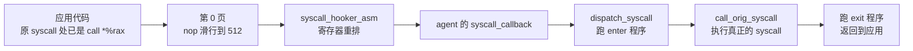
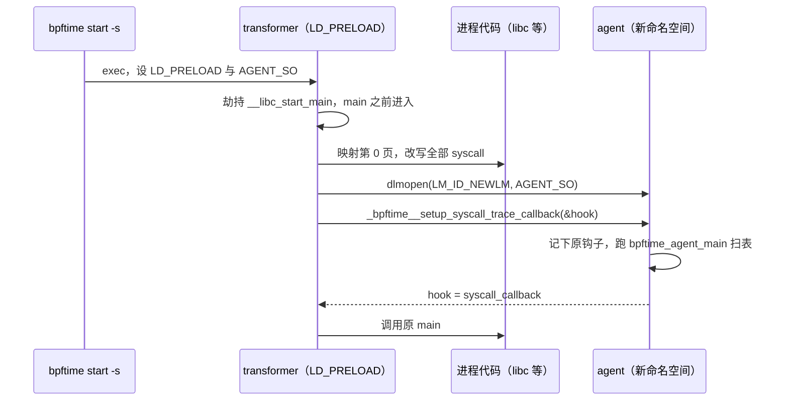

# 5. 系统调用追踪

> 一句话：本章讲 bpftime 怎么让 `SEC("tracepoint/syscalls/sys_enter_openat")` 这类程序在**用户态**触发——
> 不靠内核 tracepoint，而是把目标进程里每一条 `syscall` 指令改写成一次函数调用。读完你能说清：
> 为什么要把内存地址 0 映射成可执行页；agent 为什么要用 `dlmopen` 装进另一个命名空间；哪些系统调用
> 永远不会触发程序；为什么启动目标进程时必须加 `bpftime start -s`。
> 前置：建议先读[第 3 章](03-entrypoints.md)（agent 怎么启动、扫表）和[第 4 章](04-attach-uprobe.md)
> （attach 层的接口、override 机制）。预计用时：1.5–2 小时。

## 本章要回答的问题

1. 内核 tracepoint 在 bpftime 里不存在，那 `sys_enter_openat` 程序是被谁、在什么时刻调用的？
2. 把 `syscall` 指令换成 `call *%rax` 以后，CPU 为什么会跳到地址 0 附近？那里为什么必须有代码？
3. agent 自己也要发系统调用（写日志、读共享内存），它为什么不会被自己的钩子拦住、无限递归？
4. 哪些系统调用不会触发 eBPF 程序？
5. 用普通的 `bpftime start`（不加 `-s`）启动目标进程，syscall trace 程序能挂上吗？会触发吗？

---

## 5.1 全景：分发者与拦截者

**直觉**：内核里，每次系统调用进出内核都会经过 `sys_enter` / `sys_exit` 两个 tracepoint，挂在上面的
eBPF 程序就被调用。bpftime 不进内核，它要在**用户态**找到"每次系统调用"这个时刻。办法是：在目标进程
启动时，把进程代码里所有的 `syscall` 机器指令都改写掉，让它们先跳进 bpftime 的代码，由 bpftime 跑完 eBPF
程序，再替应用真正执行那条系统调用。

这件事由两个部件分工完成：

| 部件 | 目录 / 产物 | 负责什么 |
|---|---|---|
| **拦截者**：text segment transformer | `attach/text_segment_transformer/` → `libbpftime-agent-transformer.so` | 启动时改写所有 `syscall` 指令；准备跳板；用 `dlmopen` 装入 agent |
| **分发者**：syscall trace attach impl | `attach/syscall_trace_attach_impl/` → 静态链进 `libbpftime-agent.so` | 实现 `base_attach_impl`；按系统调用号记下 eBPF 回调；每次系统调用时构造 ctx、依次调用 |

两者之间只有一个函数指针：拦截者手里有一个"系统调用钩子" `call_hook`，初值是"直接执行原系统调用"；
agent 装好以后把它换成自己的 `syscall_callback`，后者再调分发者的 `dispatch_syscall`。

下面这张图看一次系统调用（比如 `write`）从应用到内核再回来的路：



注意，这条链和 uprobe 一样是**同步**的：eBPF 程序在发起系统调用的那个应用线程上、在系统调用前后执行。

**要点**
- transformer 负责"拦住每一条 `syscall` 指令"，syscall trace impl 负责"按号分发给 eBPF 程序"。
- 两者靠一个可替换的函数指针 `call_hook` 接在一起。
- 只在 Linux x86_64 上可用（5.7）。

---

## 5.2 注册：从 tracepoint id 到"第几号系统调用"

**直觉**：loader 这一侧（比如 libbpf 加载 opensnoop）和内核下一样，以为自己在挂 tracepoint：它先从
tracefs（`/sys/kernel/tracing/events/syscalls/sys_enter_openat/id`）读出 tracepoint 的数字 id，再调
`perf_event_open(type = PERF_TYPE_TRACEPOINT, config = id)`。syscall-server 拦下这个调用，在共享内存里
记一个 tracepoint 类型的 perf event handler（[第 3 章](03-entrypoints.md)）。

到了 agent 这一侧，问题变成：这个数字 id 对应**哪个系统调用、是进入还是退出**？

**谁来认领**：agent 启动时把 syscall trace impl 注册为 attach type **2**——正好就是
`PERF_TYPE_TRACEPOINT` 的值。所以扫表时所有 tracepoint 类型的 perf event 都交给它：

`runtime/agent/agent.cpp` 的 `bpftime_agent_main`（节选）

```cpp
#if __linux__ && BPFTIME_BUILD_WITH_LIBBPF
	auto syscall_trace_impl = std::make_unique<syscall_trace_attach_impl>();
	// orig_hooker：transformer 交来的"执行原系统调用"函数；不经 transformer 启动时为空
	syscall_trace_impl->set_original_syscall_function(orig_hooker);
	auto *syscall_trace_impl_ptr = syscall_trace_impl.get();
	ctx_holder.ctx.register_attach_impl(
		{ ATTACH_SYSCALL_TRACE },                 // = 2 = PERF_TYPE_TRACEPOINT
		std::move(syscall_trace_impl),
		/* 工厂：syscall_trace_attach_private_data::initialize_from_string */);
#endif
	/* ... 注册 uprobe 后端（第 4 章）、CUDA 后端 ... */
#if __linux__ && BPFTIME_BUILD_WITH_LIBBPF
	syscall_trace_impl_ptr->set_to_global();   // 存进全局指针，供 syscall_callback 找到
#endif
```

整段注册包在编译开关 `BPFTIME_BUILD_WITH_LIBBPF` 里。它默认是 ON（`cmake/StandardSettings.cmake`），打开时
CMake 定义同名宏，agent 才会包含、注册、在 `syscall_callback` 里使用 syscall trace impl。关掉它构建的 agent
里根本没有这条路径。

**id → 系统调用号**：private data 的工厂拿到的字符串就是 tracepoint id（runtime 用 `to_string(tracepoint_id)`
传来）。解析分两步：

1. 在**目标进程里**遍历 tracefs 的 `events/syscalls/*/id`，建一张"id → 名字"表；另外把
   `raw_syscalls/sys_enter`、`raw_syscalls/sys_exit` 的 id 记成两个特殊名字。
2. 名字是 `sys_enter_X` / `sys_exit_X` 的，去掉前缀得到系统调用名 `X`，再查一张**编译期**生成的
   "名字 → 号"表（构建时用 `cpp -dM` 展开 `<sys/syscall.h>` 得到）。

结果就是两个字段：

| 字段 | 含义 |
|---|---|
| `sys_nr` | 系统调用号；`-1` 表示"所有系统调用"（来自 `raw_syscalls`） |
| `is_enter` | 进入（`sys_enter_*`）还是退出（`sys_exit_*`） |

**挂上去**：`create_attach_with_ebpf_callback` 只检查 type 必须是 2、`sys_nr` 必须在 `[-1, 512)`，然后把
runtime 给的回调插进对应的集合：

| 集合 | 放什么 |
|---|---|
| `sys_enter_callbacks[512]` / `sys_exit_callbacks[512]` | 按系统调用号分桶的 enter / exit 回调 |
| `global_enter_callbacks` / `global_exit_callbacks` | `raw_syscalls` 的回调，每个系统调用都跑 |

注意"挂上去"只是往集合里插一个指针，**不改任何代码**——代码早在进程启动时就由 transformer 改写好了（5.4）。

两个与权限有关的细节：

- 第 1 步在**目标进程里**读 tracefs。tracefs 一般只有 root 可读（本机非 root 下
  `ls /sys/kernel/tracing/events/syscalls` 返回 Permission denied）。读不到时这里会抛 C++ 异常；
  从 private data 工厂到扫表循环都没有 catch，异常一路冒到 agent 的扫表外层 `try/catch`，走初始化失败路径，
  导致整次扫表失败，而不只是这一个 link 失败（读码确认）。
- 找不到对应系统调用时返回的错误码是 `-EEXIST`，不太贴切；非 syscall 的 tracepoint（比如 `sched/*`）
  也会走到这里并失败。

**要点**
- syscall trace impl 认领 attach type 2（`PERF_TYPE_TRACEPOINT`），只在 `BPFTIME_BUILD_WITH_LIBBPF` 打开时注册。
- tracepoint id 在目标进程里经 tracefs 翻译成 `(sys_nr, is_enter)`；`raw_syscalls` 对应 `sys_nr = -1`。
- attach 只是往按号分桶的集合里插回调。

---

## 5.3 分发：`dispatch_syscall` 的 enter / exit / override 语义

**直觉**：每次被拦下的系统调用都会走到 `dispatch_syscall(号, 6 个参数)`。它做的事和内核差不多：
进入前跑 enter 程序，真正执行系统调用，退出后跑 exit 程序。但 bpftime 多给了一项能力：**程序可以用
`bpf_override_return` 改结果**，甚至让系统调用根本不执行。

ctx 是和内核 tracepoint 布局一致的两个结构：

| 结构 | 字段 | 说明 |
|---|---|---|
| `trace_event_raw_sys_enter` | `ent`（8 字节通用头）、`id`、`args[6]` | `ent` 全部填 0（内核里有 pid 等，这里没有） |
| `trace_event_raw_sys_exit` | `ent`、`id`、`ret` | 同上 |

所以照着内核写的 `ctx->args[1]`、`ctx->ret` 能直接用；但读 `ctx->ent.pid` 只会得到 0。

`attach/syscall_trace_attach_impl/src/syscall_trace_attach_impl.cpp` 的 `dispatch_syscall`（节选）

```cpp
if (sys_nr == __NR_exit_group || sys_nr == __NR_exit)        // 不会返回用户态，直接放行
	return orig_syscall(sys_nr, arg1, arg2, arg3, arg4, arg5, arg6);
bool is_overrided = false;  uint64_t user_ret = 0;          // 都在本次调用的栈上
curr_thread_override_return_callback =                      // bpf_override_return 写到这里
	override_return_set_callback([&](uint64_t ctx, uint64_t v) {
		is_overrided = true; user_ret = v; });
if (!sys_enter_callbacks[sys_nr].empty() || !global_enter_callbacks.empty()) {
	trace_event_raw_sys_enter ctx;
	memset(&ctx, 0, sizeof(ctx));                           // ent 全 0
	ctx.id = sys_nr;  /* ctx.args[0..5] = arg1..arg6 */
	run_callbacks(sys_enter_callbacks[sys_nr], ctx);        // 先跑按号挂的
	run_callbacks(global_enter_callbacks, ctx);             // 再跑 raw_syscalls 的
}
curr_thread_override_return_callback.reset();
if (is_overrided)
	return user_ret;                    // enter 程序 override：系统调用不执行，exit 程序也不跑
/* ... 重新设置 override 回调 ... */
int64_t ret = orig_syscall(sys_nr, arg1, arg2, arg3, arg4, arg5, arg6); // 真正执行
/* ... 有 exit 回调就构造 trace_event_raw_sys_exit{id, ret}，同样两组依次跑 ... */
curr_thread_override_return_callback.reset();
return is_overrided ? user_ret : ret;   // exit 程序也可以改返回值
```

`run_callbacks` 给每个回调一份 ctx 的**副本**，并用 `try/catch(...)` 吞掉异常；回调的返回值和错误码都只打
DEBUG 日志。每个回调都是 runtime 包过的 lambda（[第 4 章](04-attach-uprobe.md) 4.1），所以 cookie 在每次运行前
都会重新写入。

由此得出的语义：

| 情形 | 结果 |
|---|---|
| enter 程序调了 `bpf_override_return(ctx, v)` | 原系统调用**不执行**；exit 程序**不跑**；应用拿到 `v` |
| exit 程序调了 `bpf_override_return(ctx, v)` | 原系统调用已执行；应用拿到 `v` 而不是真实返回值 |
| 都没调 | 和内核行为一致：只观察，不改变 |
| 程序抛异常或执行失败 | 吞掉，当作没 override |

这和内核不同：内核的 syscall tracepoint 程序不能改返回值（错误注入要靠 kprobe + `bpf_override_return`）。
官方示例 `example/error-inject/error_inject_syscall.bpf.c` 正是在 `sys_enter_write` 里随机
`bpf_override_return(ctx, -1)`，让一半的 `write` 不执行、直接返回 -1（即 `-EPERM`）。

注意返回值是**原始的系统调用返回值**（`-errno` 形式），不是 libc 包装后的 `-1 + errno`：返回 -1 时，
libc 看到的是 `-EPERM`。

**要点**
- 先按号、再全局；enter → 原系统调用 → exit。ctx 布局与内核相同，但 `ent` 全 0。
- enter 程序 override 会跳过系统调用本身和 exit 程序；exit 程序 override 只改返回值。
- `exit` / `exit_group` 直接放行，不触发任何程序。

---

## 5.4 拦截：zpoline 式改写

### 两字节的巧合

**直觉**：要拦住"每一次系统调用"，最直接的是改写每一条 `syscall` 指令，让它跳进我们的代码。难点在于：
`syscall` 只有 **2 字节**（`0f 05`），而一条能跳到任意地址的跳转至少要 5 字节——直接替换会把后面的指令
踩坏。

zpoline（ATC 2023 的一篇论文提出的技术，名字来自 zero page + trampoline）注意到一个巧合：

- 执行 `syscall` 的那一刻，`%rax` 里一定是**系统调用号**（x86_64 Linux 上是 0 到四百多的小整数）；
- `call *%rax`（"调用 rax 里存的地址"）恰好也是 **2 字节**（`ff d0`）。

所以把 `0f 05` 原地换成 `ff d0`，指令长度不变，周围代码一字节都不用动。CPU 执行到这里时，会**调用地址 =
系统调用号**的位置：`write`（1 号）就跳到地址 1，`openat`（257 号）就跳到地址 257。`call` 还顺手把
"下一条指令的地址"压栈——将来一条 `ret` 就能回到原 `syscall` 之后，和真的系统调用返回一模一样。

### 为什么要映射 0 地址

于是地址 0 到 511 必须有代码。transformer 在进程最低处映射一页可执行内存（**第 0 页**）：

```text
地址      内容
0 .. 511  全是 nop (0x90)          ← call *%rax 落在这里任何位置，都一路"滑"到 512
512       push %rax                ← 保存系统调用号（下一条要占用 rax）
513       movabs $syscall_hooker_asm, %rax
523       jmp *%rax                ← 跳进真正的处理代码
```

落在第几个 nop 上都无所谓，nop 一路执行到 512，这种布局叫 **nop 滑板（nop sled）**。

**`mmap_min_addr` 是什么**：Linux 默认不让普通进程映射地址 0 附近的内存。内核参数 `vm.mmap_min_addr`
（多数发行版是 65536，本机也是）规定了用户态映射的最低地址。这是一道安全防线：若内核代码有空指针解引用 bug，
攻击者不能在地址 0 预先放好数据来利用它。zpoline 恰恰需要映射地址 0，所以：

- 普通用户运行时，transformer 的 `mmap(0, ...)` 会失败（`EPERM`），然后**直接 `exit(1)` 结束目标进程**（本机已实跑，
  见"动手验证"）；
- 需要管理员把 `vm.mmap_min_addr` 设为 0，或以 root 运行目标进程。官方示例的命令都带 `sudo`。按 Linux 的规则，
  带 `CAP_SYS_RAWIO` 的进程（如 root）可以映射低于该阈值的地址（启用 SELinux 时另有检查）——这一条是内核
  `cap_mmap_addr` 的规则，已对内核源码核实；本机没有以 root 实测。

两种做法都会削弱上面那道防线，只适合实验环境。

### 改写全部可执行段

`attach/text_segment_transformer/text_segment_transformer.cpp` 的 `setup_syscall_tracer`（节选）

```cpp
// 1. 映射第 0 页（需要 mmap_min_addr 放行），失败就 exit(1)
if (mmap(0x0, 0x1000, PROT_EXEC | PROT_READ | PROT_WRITE,
	 MAP_PRIVATE | MAP_FIXED | MAP_ANONYMOUS, -1, 0) == MAP_FAILED)
	exit(1);
for (int i = 0; i < NR_syscalls; i++)            // NR_syscalls = 512
	*((char *)(uintptr_t)(i)) = 0x90;            // nop 滑板
/* ... 在 512 处写 push %rax; movabs $syscall_hooker_asm,%rax; jmp *%rax ... */
mprotect(0, 0x1000, PROT_EXEC);                  // 之后只留执行权限
// 2. 读 /proc/self/maps，跳过 [stack]、[vsyscall] 和刚映射的第 0 页
for (const auto &map : entries)
	if (map.x == 'x' && map.begin != 0)
		rewrite_segment((uint8_t *)map.begin, map.end - map.begin,
				map.get_perm());
```

`rewrite_segment` 对每个可执行段：先 `mprotect` 成可读写可执行；用 capstone 反汇编器从头**线性**反汇编；
遇到 `syscall` 或 `sysenter`，只要不是 transformer 自己留着"执行原系统调用"的那一条（`syscall_addr`），就把
两个字节改成 `ff d0`；最后恢复原权限。`mprotect` 或 capstone 打开失败会 `exit(1)`；中途解码失败则只停止扫描
这个段（见下段），进程照常运行。

"线性反汇编"是把代码段当作一条连续的指令流从头解码。它有两个已知弱点（都是推断）：代码段里夹着数据时可能
误改；某处解码失败就 `break`，这个段剩下的部分不再扫描。

**要点**
- `syscall`（`0f 05`）→ `call *%rax`（`ff d0`）：都是 2 字节，原地替换。
- `call *%rax` 跳到"地址 = 系统调用号"；第 0 页前 512 字节是 nop 滑板，512 处跳进处理代码。
- 映射地址 0 需要 `vm.mmap_min_addr` 放行；不放行时目标进程被 `exit(1)`。

---

## 5.5 跳板里发生了什么：`syscall_hooker_asm`

**直觉**：跳到 `syscall_hooker_asm` 时，寄存器还是"系统调用约定"：号在 `rax`，6 个参数在
`rdi rsi rdx r10 r8 r9`。而 C 函数的约定是 `rdi rsi rdx rcx r8 r9` + 栈。跳板要做的就是：取回系统调用号，
处理几个特殊号，然后把寄存器重排成 C 调用约定，调 C++ 函数；返回时一条 `ret` 回到应用。

`attach/text_segment_transformer/text_segment_transformer.cpp` 的 `__asm_holder`（`syscall_hooker_asm` 部分，节选）

```asm
syscall_hooker_asm:
	pop  %rax                 # 取回第 0 页里 push 的系统调用号
	cmp  $15, %rax            # rt_sigreturn：不追踪，直接执行原 syscall
	je   handle_sigreturn
	cmp  $56, %rax            # clone
	je   handle_clone
	cmp  $435, %rax           # clone3
	je   handle_clone3
	movq (%rsp), %rcx         # 栈顶是 call 压的返回地址（模仿 syscall 把返回地址放进 rcx）
	pushq %rbp
	movq %rsp, %rbp
	andq $-16, %rsp           # 16 字节对齐，满足 C 调用约定
	pushq %rax ; pushq %rdi ; pushq %rsi ; pushq %rdx
	pushq %r10 ; pushq %r8  ; pushq %r9    # 7 个值存到栈上
	movq 48(%rsp), %rdi       # 第 1 个 C 参数 = 系统调用号
	movq 40(%rsp), %rsi       # arg1 ... 依次重排
	/* ... rdx rcx r8 r9 = arg2..arg5 ... */
	pushq (%rsp)              # arg6 按 C 约定放栈上
	call syscall_hooker_cxx   # → call_hook(...)，即 agent 的 syscall_callback
	leave                     # 丢掉上面压的东西，恢复 rbp
	ret                       # 回到应用里原 syscall 的下一条指令；返回值在 rax
```

`syscall_hooker_cxx` 只有一行：`return call_hook(sys_nr, arg1, ..., arg6);`。

**执行原系统调用**：`call_orig_syscall` 是反方向的重排——把 C 参数挪回系统调用寄存器，然后执行一条**没被改写**
的 `syscall`（就在标签 `syscall_addr` 处，改写时特意跳过它），`ret` 回到 C 代码。分发者手里的 `orig_syscall`
最终就是它。

### 三个特殊号：为什么不追踪

| 系统调用 | 怎么处理 | 为什么 |
|---|---|---|
| `rt_sigreturn`（15） | 跳到 `handle_sigreturn`，原样执行 `syscall` | 它从信号栈帧恢复全部寄存器、不按常规返回，不能被当成普通函数调用来包装 |
| `clone`（56） | 若给了子线程栈，先把应用的返回地址写到子栈顶，再原样执行 | 子线程从系统调用"返回"时站在一个全新的栈上，那里没有 `call` 压过的返回地址；不预先放一个，子线程的 `ret` 会跳到垃圾地址 |
| `clone3`（435） | 同上，并把 `stack_size` 减 8，让内核从预置地址开始 | 同上 |

这三个号**不经过 C 钩子**，所以永远不会触发 eBPF 程序。加上 5.3 里 `dispatch_syscall` 直接放行的 `exit` /
`exit_group`，一共 5 个系统调用不会被追踪。挂在 `sys_enter_clone` 上的程序会成功 attach，但永远收不到事件。

### 几个尚未验证的疑点（推断）

读汇编还能看出三处和"真 `syscall` 指令的语义"不完全一致的地方。它们都只是读码推断，需要 root（让
`mmap(0)` 成功）才能实测，本机没有跑。详情见[附录 B](B-known-issues.md#b-syscall-trace)：

- **寄存器保存**：真 `syscall` 只破坏 `rax`、`rcx`、`r11`；跳板把参数寄存器压栈后用 `leave` 整体丢弃，并不恢复。
  若编译器依赖内联系统调用前后 `rdi`、`rsi` 等不变，可能出错。
- **red zone**：x86_64 ABI 允许叶子函数使用栈指针下方 128 字节（red zone）存临时数据。`call *%rax` 和第 0 页的
  `push` 会写这块区域。
- **`rt_sigreturn` 的栈**：走 `handle_sigreturn` 时，`call` 压的返回地址还在栈上；内核按当前栈指针找信号帧，
  可能偏 8 字节（源码里一行 `addq $8, %rsp` 被注释掉了）。这一条最不确定。

**要点**
- 跳板：取回号 → 特殊号直接执行 → 其余重排成 C 约定调 `call_hook` → `ret` 回到应用。
- `call_orig_syscall` 用一条保留未改写的 `syscall` 执行真正的系统调用。
- `rt_sigreturn`、`clone`、`clone3`、`exit`、`exit_group` 不触发 eBPF。

---

## 5.6 装配：transformer、`dlmopen` 与 agent 的握手

**直觉**：transformer 是一个 LD_PRELOAD 库，它在目标进程的 `main` 之前改写代码。然后它要把 agent 装进来，
并把"系统调用钩子"交给 agent。这里有一个先有鸡还是先有蛋的问题：agent 自己也要发系统调用（打开共享内存、
写日志、mmap……）。如果 agent 用的 libc 也被改写了，agent 的系统调用会再次跳进钩子——钩子里又调 agent……

transformer 的解法是：**先改写，后加载 agent，而且把 agent 装进一个全新的链接命名空间**。

`dlmopen(LM_ID_NEWLM, ...)` 是 glibc 提供的"在新命名空间里加载库"：被加载的库连同它的依赖（包括一份**独立的
libc**、libstdc++ 等）都重新映射一份，和主程序的那份互不相干。因为这些代码是在改写**之后**才映射进来的，
它们里面的 `syscall` 指令都是原样的。于是 agent 自己的系统调用直接进内核，不会递归进钩子（这是按代码推断的
设计意图，源码里没有注释说明）。

`attach/text_segment_transformer/agent-transformer.cpp` 的 `bpftime_agent_main`（节选）

```cpp
const char *agent_so = getenv("AGENT_SO");      // bpftime start -s 会设好它
if (agent_so == nullptr) {
	if (std::string(data) != "") agent_so = data; // Frida 注入时由 data 传入
	else { SPDLOG_ERROR("Please set AGENT_SO ..."); return; } // 不改写，宿主照常运行
}
cs_arch_register_x86();                          // capstone 只注册 x86
bpftime::setup_syscall_tracer();                 // 5.4：第 0 页 + 改写所有可执行段
auto next_handle = dlmopen(LM_ID_NEWLM, agent_so, RTLD_NOW | RTLD_LOCAL);
if (next_handle == nullptr)
	exit(1);                                     // 加载失败也直接结束宿主
/* ... 把 transformer 的 injected_with_frida 写进 agent 的同名变量 ... */
auto entry_func = (void (*)(syscall_hooker_func_t *))dlsym(
	next_handle, "_bpftime__setup_syscall_trace_callback");
syscall_hooker_func_t hook = bpftime::get_call_hook(); // 初值：call_orig_syscall
entry_func(&hook);                               // agent 记下原值，把 hook 换成自己的
bpftime::set_call_hook(hook);                    // 从此每次系统调用都进 agent
```

agent 这边的入口很短：

`runtime/agent/agent.cpp` 的 `_bpftime__setup_syscall_trace_callback`

```cpp
extern "C" void
_bpftime__setup_syscall_trace_callback(syscall_hooker_func_t *hooker)
{
	if (hooker == nullptr)
		return;
	orig_hooker = *hooker;          // = transformer 的 call_orig_syscall
	*hooker = &syscall_callback;    // 交回 transformer 的新钩子
	gboolean val = FALSE;
	try {
		bpftime_agent_main("", &val); // 完整初始化：打开 shm、注册后端（5.2）、扫表
	} catch (...) {
	}
}
```

`syscall_callback` 在 agent 里：若全局的 syscall trace impl 已设置，就调它的 `dispatch_syscall`；出异常或还没设置时，
退回 `orig_hooker` 直接执行原系统调用。

这张图看 `bpftime start -s` 启动一个目标进程时，各方的先后顺序：



两种进入方式：

| 方式 | 命令 | transformer 怎么进来 | 入口 |
|---|---|---|---|
| 启动时 | `bpftime start -s <程序>` | `LD_PRELOAD=libbpftime-agent-transformer.so`，`AGENT_SO=libbpftime-agent.so` | 劫持 `__libc_start_main`，把 `main` 换成 `bpftime_hooked_main` |
| 运行中 | `bpftime attach -s <pid>` | Frida 把 transformer 注入，data 参数是 agent 路径 | Frida 直接调 `bpftime_agent_main(data)` |

运行中注入时，改写发生在其他线程可能正执行这些代码的时候，按代码推断存在"执行到改了一半的指令"的风险。

### 不加 `-s` 会怎样

`bpftime start <程序>`（不加 `-s`）只把 **agent** 本身 LD_PRELOAD 进去。agent 照常初始化、照常注册 syscall
trace impl（只要 `BPFTIME_BUILD_WITH_LIBBPF` 打开），扫表时 tracepoint 类型的 link 也能**实例化成功**——
但没有 transformer：没人改写 `syscall` 指令，`_bpftime__setup_syscall_trace_callback` 也没人调用（它只被
transformer 调用），`orig_hooker` 一直为空。结果是：**link 看起来挂上了，但永远不会触发**，而且不报任何错。
同一个进程里的 uprobe 程序不受影响。

所以写 syscall 追踪实验时，目标进程**必须**用 `bpftime start -s`（或手动设 `LD_PRELOAD=transformer`、
`AGENT_SO=agent`）启动。

### 副作用

- 映射第 0 页、`mprotect`、打开 capstone、`dlmopen` 这几类失败都 `exit(1)` 结束宿主进程，
  这与"注入代码不应结束宿主"的约定相悖，见[附录 B](B-known-issues.md#b-syscall-trace)。其余失败处理不一：
  没设 `AGENT_SO` 时只打日志返回（不改写）；找不到 agent 入口符号时只打日志返回，此时代码已全部改写，钩子仍是
  "直接执行原系统调用"，宿主照常运行；agent 缺 `injected_with_frida` 符号时会解引用空指针而崩溃。
- `dlmopen` 新命名空间里的 agent 有自己的一份 libc 全局状态（推断）。
- 改写只做一次。之后应用再 `dlopen` 进来的库没有被改写，其中的系统调用不会被追踪（推断）。

**要点**
- 顺序是"先改写，后 `dlmopen` agent"；agent 的代码和依赖映射在改写之后，所以不会递归进钩子。
- 握手：transformer 把钩子指针交给 agent，agent 记下原值、换成 `syscall_callback`。
- 不加 `-s` 时 syscall trace link 能实例化但永不触发。

---

## 5.7 平台、限制与"哪些调用不会触发"

**只支持 Linux x86_64**。transformer 的汇编只写了 x86_64 分支；aarch64 分支只有一行 `// TODO`，capstone 也写死为
x86 模式。但 `attach/CMakeLists.txt` 在开启 Frida 的所有 Linux 上都会编 transformer（aarch64 上 Frida 默认开启），
而它引用的汇编符号在 aarch64 上没有定义。所以 aarch64 上这个 `.so` 能否构建、能否加载，**未确认**（需要在
Jetson 上验证）；可以确定的是即使能加载，也不能拦截任何系统调用。

**系统调用号表来自构建机**：编译期生成的"名字 → 号"表用的是构建机的 `cpp` 和 `<sys/syscall.h>`。交叉编译时
得到的会是构建机架构的号（推断）。

**并发**：syscall trace impl 的集合（`std::set`）没有锁。经 runtime 走的 attach / detach 被 `bpf_attach_ctx` 的
`ctx_mutex` 串行（[第 4 章](04-attach-uprobe.md) 4.4），但热路径 `dispatch_syscall` 不拿这把锁，
一个线程在遍历集合时另一个线程 detach，就是数据竞争（读码确认没有同步，未实测出故障）。

**边界**：`dispatch_syscall` 用系统调用号直接下标长度 512 的数组，没有边界检查；第 0 页的 nop 滑板也只有 512
字节。x86_64 目前最大的号在 460 左右，平时无事；更大的号或 x32 ABI 的号会越界（推断），见
[附录 B](B-known-issues.md#b-syscall-trace)。

**汇总：哪些系统调用不会触发 eBPF 程序**

| 情形 | 原因 | 确定程度 |
|---|---|---|
| `exit`、`exit_group` | `dispatch_syscall` 直接放行 | 读码确认 |
| `rt_sigreturn`、`clone`、`clone3` | 跳板里绕过 C 钩子 | 读码确认 |
| agent 自己发的系统调用 | agent 在新命名空间，代码未被改写；但见下方 vDSO 一条 | 推断 |
| transformer 运行之前发生的系统调用（动态链接、构造函数等） | 那时还没改写 | 读码确认 |
| 改写之后才 `dlopen` 的库里的系统调用 | 没被扫描 | 推断 |
| 某段代码线性反汇编中途失败后的部分 | 该段剩余部分不再扫描 | 推断 |
| 走 vDSO 快速路径的 `clock_gettime`、`gettimeofday` 等 | 根本不执行 `syscall` 指令（内核 tracepoint 同样看不到） | 推断 |

关于 vDSO 还有一个反方向的细节：transformer 扫描时只跳过 `[stack]`、`[vsyscall]` 和第 0 页，**没有跳过 `[vdso]`**，
所以 vDSO 回退路径里的 `syscall` 指令也会被改写（前提是对 vDSO 页的 `mprotect` 成功）。vDSO 是整个进程共用的一份，
不随 `dlmopen` 新建，因此 agent 经 vDSO 回退路径发出的系统调用也可能进入钩子——"agent 的系统调用不会递归"这一条
对这种情形未必成立（推断，未实测）。
| 目标进程不是用 `-s` 启动的 | 没有 transformer | 读码确认 |

**要点**
- 只支持 x86_64；aarch64 上能否构建未确认，确定不可用。
- 控制面靠 runtime 的锁，热路径无锁；号 ≥ 512 无保护。
- 记住上表：clone 类、信号返回、进程退出这几类系统调用永远收不到事件。

---

## 小结

- bpftime 的系统调用追踪 = transformer（拦截）+ syscall trace impl（分发），两者靠一个钩子函数指针相连。
- syscall trace impl 认领 attach type 2（`PERF_TYPE_TRACEPOINT`），在目标进程里经 tracefs 把 tracepoint id
  翻译成 `(系统调用号, 进入/退出)`；只在 `BPFTIME_BUILD_WITH_LIBBPF` 打开时注册。
- `dispatch_syscall`：先按号再全局跑 enter 程序 → 执行原系统调用 → 跑 exit 程序。enter 程序 override 会跳过
  系统调用本身和 exit 程序；exit 程序可以改返回值。ctx 布局同内核，`ent` 全 0。
- zpoline 式改写：`syscall`（2 字节）→ `call *%rax`（2 字节），CPU 跳到"地址 = 系统调用号"，第 0 页的 nop 滑板
  把它送进处理代码。映射地址 0 需要 `vm.mmap_min_addr` 放行（或 root），否则目标进程被 `exit(1)`。
- agent 用 `dlmopen(LM_ID_NEWLM)` 在改写之后装进新命名空间，自己的系统调用不会被拦。
- `rt_sigreturn`、`clone`、`clone3`、`exit`、`exit_group` 不触发程序。
- 必须用 `bpftime start -s` 启动目标进程；否则 syscall trace link 能实例化却永不触发。
- 只支持 x86_64；寄存器保存、red zone、`rt_sigreturn` 栈偏移三处疑点尚未在 root 环境实测。

## 动手验证

记 `B=/home/y/src/bpftime-wt-official-177a1dc`，只用已有的 `build-jit/`（其中没有编 `bpftime` CLI，也没有编
syscall trace 的单测）。

1. **看 transformer 在非 root 下的两种结局**（本机已跑）
   ```bash
   T=$B/build-jit/attach/text_segment_transformer/libbpftime-agent-transformer.so
   cat /proc/sys/vm/mmap_min_addr                  # 本机：65536
   LD_PRELOAD=$T /bin/echo hello; echo rc=$?
   AGENT_SO=/nonexistent.so LD_PRELOAD=$T /bin/echo hello; echo rc=$?
   ```
   本机输出：第一条打印 `Please set AGENT_SO to the bpftime-agent when use this tranformer`，然后照常打印
   `hello`，`rc=0`——没设 `AGENT_SO` 时什么都不改。第二条打印
   `Failed to perform mmap: errno=1, message=Operation not permitted`，`hello` **没有打印**，`rc=1`——
   映射第 0 页失败，宿主被 `exit(1)`。（`/nonexistent.so` 还没来得及用，进程就在 `mmap` 处退出了。）

2. **看两边握手用的符号**（本机已跑）
   ```bash
   nm -D $T | grep -E ' T ' | grep -E 'libc_start|agent_main|hooker|syscall'
   nm -D $B/build-jit/runtime/agent/libbpftime-agent.so | grep -E 'syscall_trace|syscall_callback|hooker_callback|injected_with_frida'
   ```
   transformer 导出 `__libc_start_main`、`bpftime_agent_main`、`syscall_hooker_asm`、`call_orig_syscall`、
   `syscall_hooker_cxx`，还会多出一行 `_ZN7bpftime20setup_syscall_tracerEv`——这是 C++ 函数
   `bpftime::setup_syscall_tracer` 经名字改编（mangling）后的符号，名字里含 "syscall" 所以也被 grep 到；agent 导出 `_bpftime__setup_syscall_trace_callback`、`syscall_callback`、
   `injected_with_frida`，**没有** `_bpftime__setup_syscall_hooker_callback`（那是 syscall trace impl 里一段没人用的
   旧入口，见深入参考）。

3. **看编译期生成的号表**（本机已跑）
   ```bash
   grep -wE 'clone|clone3|rt_sigreturn|exit_group|openat' \
     $B/build-jit/attach/syscall_trace_attach_impl/syscall_id_list.h
   ```
   本机：`rt_sigreturn 15`、`clone 56`、`exit_group 231`、`openat 257`、`clone3 435`——与跳板里写死的 15 / 56 / 435 对得上。

4. **不用 root 验证 `dispatch_syscall` 的 override 语义**：直接链接静态库，用一个假的"原系统调用"函数代替
   transformer，手填 `sys_nr` / `is_enter`（绕开 tracefs）。要用到的头文件是 `syscall_trace_attach_impl.hpp`、
   `syscall_trace_attach_private_data.hpp`、`base_attach_impl.hpp`（提供 `bpftime_override_return`），命名空间
   `bpftime::attach`。完整源码（本机已用下面的命令编译运行）：

   <details><summary>exp_sys.cpp（全文）</summary>

   ```cpp
   // exp_sys.cpp：不经 transformer、不读 tracefs，直接验证 dispatch_syscall 的 override 语义
   #include <syscall_trace_attach_impl.hpp>          // syscall_trace_attach_impl、ATTACH_SYSCALL_TRACE
   #include <syscall_trace_attach_private_data.hpp>  // syscall_trace_attach_private_data
   #include <base_attach_impl.hpp>                   // bpftime_override_return
   #include <cstdint>
   #include <cstdio>
   using namespace bpftime::attach;

   static int orig_calls = 0;
   // 代替 transformer 的 call_orig_syscall：记一次，返回 100+号
   extern "C" int64_t fake(int64_t nr, int64_t, int64_t, int64_t, int64_t, int64_t, int64_t)
   { orig_calls++; return 100 + nr; }

   int main()
   {
       syscall_trace_attach_impl a;
       a.set_original_syscall_function(fake);
       syscall_trace_attach_private_data en, ex;    // 手填，绕开 tracefs
       en.sys_nr = 0; en.is_enter = true;
       ex.sys_nr = 0; ex.is_enter = false;
       int exit_runs = 0;
       int id1 = a.create_attach_with_ebpf_callback(
           [](void *, size_t, uint64_t *) -> int { bpftime_override_return(0, 55); return 0; },
           en, ATTACH_SYSCALL_TRACE);
       a.create_attach_with_ebpf_callback(
           [&](void *, size_t, uint64_t *) -> int { exit_runs++; bpftime_override_return(0, 66); return 0; },
           ex, ATTACH_SYSCALL_TRACE);
       int64_t r = a.dispatch_syscall(0, 0, 0, 0, 0, 0, 0);
       printf("enter-override: ret=%ld orig_calls=%d exit_runs=%d\n", r, orig_calls, exit_runs);
       a.detach_by_id(id1);                          // 去掉 enter 回调再来一次
       r = a.dispatch_syscall(0, 0, 0, 0, 0, 0, 0);
       printf("exit-override: ret=%ld orig_calls=%d exit_runs=%d\n", r, orig_calls, exit_runs);
       syscall_trace_attach_private_data bad; bad.sys_nr = 512; bad.is_enter = true;
       printf("attach sys_nr=512 -> %d\n", a.create_attach_with_ebpf_callback(
           [](void *, size_t, uint64_t *) { return 0; }, bad, ATTACH_SYSCALL_TRACE));
       printf("attach type 6 -> %d\n", a.create_attach_with_ebpf_callback(
           [](void *, size_t, uint64_t *) { return 0; }, en, 6));
       return 0;
   }
   ```
   </details>

   ```bash
   g++-13 -std=c++20 -O1 -o exp_sys exp_sys.cpp \
     -I$B/attach/syscall_trace_attach_impl/include -I$B/attach/base_attach_impl \
     -I$B/third_party/spdlog/include -DSPDLOG_COMPILED_LIB \
     $B/build-jit/attach/syscall_trace_attach_impl/libbpftime_syscall_trace_attach_impl.a \
     $B/build-jit/third_party/spdlog/libspdlog.a -lpthread
   ./exp_sys
   ```
   本机实跑：`enter-override: ret=55 orig_calls=0 exit_runs=0`（原调用和 exit 回调都没跑）；detach 掉 enter 回调后
   `exit-override: ret=66 orig_calls=1 exit_runs=1`；`sys_nr=512` 的 attach 返回 `-22`，type 6 返回 `-95`
   （后两行之前还会有 spdlog 的 error 日志）。

5. **完整跑通（需要 root，本机未跑）**：官方 `example/minimal/README.md` 的做法——一个终端
   `sudo bpftime load example/minimal/syscall`，另一个终端 `sudo bpftime start -s example/minimal/victim`，
   预期看到 `syscall write called.` 的 `bpf_printk` 输出；把第二条换成不带 `-s` 的 `sudo bpftime start`，
   预期什么都不输出（5.6）。需要 root 和 `bpftime` CLI；本机是共享的远程服务器，没有为此修改
   `vm.mmap_min_addr`，也没有以 root 运行。

更多实验见[第 12 章](12-practice.md#exp-5)。

## 自测题

**Q1. 为什么 zpoline 选 `call *%rax`，而不是改成一条 `jmp <处理函数>`？**

<details><summary>答案</summary>

因为长度。`syscall` 只有 2 字节，原地替换必须也是 2 字节，否则会覆盖后面的指令、打乱代码。能跳到任意 64 位地址的
`jmp` 至少 5 字节。`call *%rax` 正好 2 字节；而执行 `syscall` 时 `rax` 一定是系统调用号，所以它总是跳到 0–511 之间的
一个已知小地址；`call` 压栈的返回地址又让处理完后一条 `ret` 就能回到原位置。
</details>

**Q2. 第 0 页前 512 字节为什么全是 nop，而不是在每个号的地址上放一条跳转？**

<details><summary>答案</summary>

不同号落点之间只隔 1 字节，放不下任何跳转指令。全填 nop 后，无论落在哪个地址都会顺序执行到 512，那里只需一份
跳转代码。代价是号的信息丢了——所以 512 处先 `push %rax` 把号存起来（随后的 `movabs` 要占用 `rax`），跳板第一条
指令再 `pop %rax` 取回。
</details>

**Q3. 一个 `sys_enter_openat` 程序调了 `bpf_override_return(ctx, -2)`。同时还挂着一个 `sys_exit_openat`
程序。应用看到什么？exit 程序会运行吗？换成在内核里会怎样？**

<details><summary>答案</summary>

`openat` 不会真正执行，应用拿到 `-2`（libc 包装后就是返回 -1、`errno = ENOENT`）。exit 程序不会运行：
`dispatch_syscall` 在 enter 阶段发现被 override 就直接返回。内核里 syscall tracepoint 程序不能改返回值，
这种用法会被 verifier 拒绝；bpftime 在这里比内核更宽松。
</details>

**Q4. transformer 先改写所有可执行段，再 `dlmopen` agent。如果顺序反过来（先普通 `dlopen` agent 再改写），
会出什么问题？**

<details><summary>答案</summary>

agent 和它用的 libc 也会被改写。agent 在钩子里处理系统调用时，自己发出的系统调用（写日志、访问共享内存等）
又会跳进钩子，造成递归甚至死循环。现在的顺序加上 `LM_ID_NEWLM` 保证 agent 连同依赖的一整套库都是在改写之后
重新映射的一份，里面的 `syscall` 指令都是原样。
</details>

**Q5. 同事用 `bpftime load` 加载了一个 `sys_enter_write` 程序，然后用 `bpftime start ./app`（没加 `-s`）
启动目标进程。日志里看到 link 实例化成功，但程序从不触发。为什么？同时挂的 uprobe 程序呢？**

<details><summary>答案</summary>

没加 `-s` 时只 LD_PRELOAD 了 agent，没有 transformer：没人改写 `syscall` 指令，也没人调
`_bpftime__setup_syscall_trace_callback` 把钩子交给 agent。agent 照样注册了 syscall trace impl，link 也能插进集合，
但 `dispatch_syscall` 永远不会被调用。uprobe 程序走 Frida 后端，与 transformer 无关，照常触发。
</details>

**Q6. 一个程序挂在 `tracepoint/syscalls/sys_enter_clone` 上，用来统计目标进程创建线程的次数。它能工作吗？**

<details><summary>答案</summary>

attach 会成功（`clone` 是合法的号），但永远收不到事件。跳板对 56（`clone`）和 435（`clone3`）走特殊路径直接执行
原系统调用，不经过 C 钩子：子线程从系统调用返回时站在新栈上，那里没有 `call` 压的返回地址，跳板只能预先往子栈顶
放一个返回地址然后原样执行，没法在中间插入 C 回调。
</details>

---

## 深入参考

<details>
<summary>代码位置速查（按 177a1dc465ff 行号）</summary>

| 概念 / 函数 | 位置 |
|---|---|
| ctx 结构 `trace_entry` / `trace_event_raw_sys_enter` / `_exit` | `attach/syscall_trace_attach_impl/include/syscall_trace_attach_impl.hpp:17-36` |
| `ATTACH_SYSCALL_TRACE = 2` | `include/syscall_trace_attach_impl.hpp:39`；对应 `runtime/include/bpftime_shm.hpp:51`（`PERF_TYPE_TRACEPOINT = 2`） |
| `syscall_trace_attach_impl` 类（`[512]` 集合、`orig_syscall`） | `include/syscall_trace_attach_impl.hpp:62-99` |
| private data（`sys_nr`、`is_enter`） | `include/syscall_trace_attach_private_data.hpp:9-17` |
| `dispatch_syscall` | `src/syscall_trace_attach_impl.cpp:18-95`（exit 放行 :25-26，enter :55-68，enter override 返回 :69-72，exit :80-94） |
| `detach_by_id` / `create_attach_with_ebpf_callback` | `src/syscall_trace_attach_impl.cpp:97-120` / `:121-168` |
| 无人使用的旧入口 `_bpftime__syscall_dispatcher` / `_bpftime__setup_syscall_hooker_callback` | `src/syscall_trace_attach_impl.cpp:170-192` |
| tracepoint id → `(sys_nr, is_enter)` | `src/syscall_trace_attach_private_data.cpp:8-63` |
| tracefs 读表、编译期号表 | `src/syscall_table.cpp:17-44`（号表）、`:66-98`（tracefs） |
| 号表生成脚本 | `attach/syscall_trace_attach_impl/generate_syscall_id_table.sh`；`CMakeLists.txt:1-9` |
| runtime 传 tracepoint id | `runtime/src/attach/bpf_attach_ctx.cpp:460-472` |
| syscall-server 记录 tracepoint perf event | `runtime/syscall-server/syscall_context.cpp:890-904` |
| agent 注册 syscall trace impl / `set_to_global` | `runtime/agent/agent.cpp:964-989` / `:1058-1060` |
| agent 的 `syscall_callback` / `_bpftime__setup_syscall_trace_callback` | `runtime/agent/agent.cpp:1182-1197` / `:1199-1212` |
| `BPFTIME_BUILD_WITH_LIBBPF` 默认值 / 宏定义 | `cmake/StandardSettings.cmake:107`；`CMakeLists.txt:104-105`；agent 中 `agent.cpp:57,140,964,1058,1181` |
| `syscall_hooker_asm` / `call_orig_syscall` / `handle_clone*` | `attach/text_segment_transformer/text_segment_transformer.cpp:57-97` / `:99-112` / `:119-140` |
| aarch64 分支 `// TODO` | `text_segment_transformer.cpp:142-146` |
| `syscall_hooker_cxx` | `text_segment_transformer.cpp:148-153` |
| `rewrite_segment`（capstone 线性反汇编） | `text_segment_transformer.cpp:155-204` |
| `setup_syscall_tracer`（第 0 页 :237-284，扫 maps :289-327） | `text_segment_transformer.cpp:233-328` |
| `__libc_start_main` / `bpftime_hooked_main` | `attach/text_segment_transformer/agent-transformer.cpp:32-46` / `:24-30` |
| transformer 的 `bpftime_agent_main`（`dlmopen` :76） | `agent-transformer.cpp:48-102` |
| CLI `start -s` / `attach -s` | `tools/cli/main.cpp:935,1012-1022` / `:948,1036-1044` |
| 编 transformer 的条件 | `attach/CMakeLists.txt:12-17` |
| 示例：最小 syscall 程序 / 错误注入 | `example/minimal/syscall.bpf.c`、`example/minimal/README.md`；`example/error-inject/error_inject_syscall.bpf.c` |

</details>

<details>
<summary>细节与坑</summary>

**握手的细节**

- `injected_with_frida`：transformer 自己有一个同名静态变量（默认 true，被它劫持的 `__libc_start_main` 置 false），
  加载 agent 后把值写进 agent 的同名全局变量，让 agent 知道自己是被 Frida 注入还是被 LD_PRELOAD 启动。
- transformer 无条件建一个 stderr 的 spdlog logger，日志级别读 `SPDLOG_LEVEL` 等环境变量。
- `_bpftime__setup_syscall_trace_callback` 里调的是 `bpftime_agent_main("", &val)`，也就是 agent 的完整初始化；
  按代码推断，同一进程里的 uprobe 后端也会照常注册。
- 握手期间 `call_hook` 仍是 `call_orig_syscall`：改写已经生效，但 agent 初始化完成前的系统调用都直接执行、不分发。
- `syscall_trace_attach_impl.cpp` 里还有一对 `_bpftime__syscall_dispatcher` / `_bpftime__setup_syscall_hooker_callback`，
  agent 并不导出它们（`agent.version` 只导出 `_bpftime__setup_syscall_trace_callback` 等），是没人使用的旧入口；
  transformer 找不到入口时的报错文案却写的是 `..._hooker_callback`，容易误导。
- 官方 `text_segment_transformer/README.md` 说第 0 页的 NOP"是为了保持空指针解引用行为"——实际它是滑板；README
  也没有提 `vm.mmap_min_addr`。

**第 0 页的权限**

改写完成后第 0 页被设成 `PROT_EXEC`（注释说"保持空指针解引用的正常行为"）。按推断，x86 上没有 PKU 支持时，
只可执行的页通常仍然可读，于是读空指针不再段错误，可能掩盖应用自己的空指针 bug。

**跳板的寄存器细节**

- `movq (%rsp), %rcx`：把返回地址放进 `rcx`，模仿真 `syscall` 把下一条指令地址写进 `rcx` 的行为。
- 对齐后压 7 个值（56 字节）再压 arg6（8 字节），`call` 时栈正好 16 字节对齐。
- `handle_clone`：`rsi`（子栈）为 0 时等同 fork，子进程沿用父栈布局，普通 `ret` 即可；否则把返回地址写到 `rsi - 8`
  并让 `rsi` 下移 8。
- `handle_clone3`：从 `clone_args` 读 `stack`（偏移 40）和 `stack_size`（偏移 48），栈为空或 `stack_size < 8` 时不处理；
  否则把返回地址写到栈顶下方 8 字节，并把 `stack_size` 减 8，让内核从预置的地址开始。

**疑似问题（详情见[附录 B](B-known-issues.md#b-syscall-trace)，这里只列名目）**

- 跳板不恢复参数寄存器；`call *%rax` 和 `push` 覆盖 red zone；`rt_sigreturn` 路径栈上多 8 字节（三条均为推断，需 root 实测）。
- `dispatch_syscall` 不检查 `sys_nr` 边界，滑板只有 512 字节（推断）。
- transformer 在映射第 0 页、`mprotect`、capstone、`dlmopen` 失败时 `exit(1)` 结束宿主（已实跑 `mmap` 一例）；
  `dlsym("injected_with_frida")` 为空时只打警告、下一行仍解引用空指针（读码确认）。
- aarch64 上 transformer 只有 `// TODO`，但仍会被编译（能否构建未确认）。
- 号表用构建机头文件生成，交叉编译时号可能不对；生成函数的读循环在最后一轮会多插一条空名字的映射（推断）。
- 找不到系统调用时 private data 返回 `-EEXIST`；`stoi` 遇非数字字符串会抛出（读码确认）。
- tracefs 不可读时异常冒到 agent 扫表外层，整次初始化失败（读码确认）。
- syscall 表的懒初始化 `if (!value) value = ...` 不是线程安全的（推断）。
- 第 0 页设成只执行后，读空指针可能不再段错误（推断）。

**与内核 tracepoint 的差异一览**

| 方面 | 内核 | bpftime |
|---|---|---|
| 触发点 | 进出内核时 | 应用的 `syscall` 指令处 |
| `ctx->ent` | 有 type / pid 等 | 全 0 |
| 能否改返回值 | 不能 | enter / exit 都能 `bpf_override_return` |
| 能否跳过系统调用 | 不能 | enter override 时跳过 |
| `clone` / `rt_sigreturn` / `exit` | 有事件 | 没有 |
| 覆盖范围 | 所有进程 | 只有用 `-s` 启动（或 `attach -s` 注入）的进程，且只有被改写的代码 |
| 每次开销 | 进出内核本来就要付 | 一次 `call`、nop 滑行、寄存器重排、C++ 分发 |

</details>

<details>
<summary>上游变更与我们的工作</summary>

- 旧版指南没有单独讲系统调用追踪，只在第 4 章"对比读"里提了一句；本章是新写的。
- `handle_clone` / `handle_clone3` 的子栈预置来自上游 #649（commit `5dc55094`，2026-08，在 6bd5319d → 177a1dc 区间内），
  这也是 `text_segment_transformer.cpp` 在该区间内唯一的改动。之前的版本里 `clone` / `clone3` 走普通钩子路径，按该 PR 的说明，
  带新栈的子线程 `ret` 时会跳到垃圾地址。
- 我们的主要实验平台 Jetson 是 aarch64，transformer 在那里不可用，所以我们的 syscall 相关结论都只适用于 x86_64；
  aarch64 上 transformer 能否构建、能否加载留给 Jetson 侧确认。
- 本机（x86 NUC，非 root，`vm.mmap_min_addr=65536`）上只验证了：transformer 在 `mmap(0)` 失败时结束宿主、导出符号、
  号表内容、`dispatch_syscall` 的 override 语义（直接链接静态库）。完整的 `bpftime start -s` 链路没有跑。

</details>

---
[← 返回目录](README.md)
