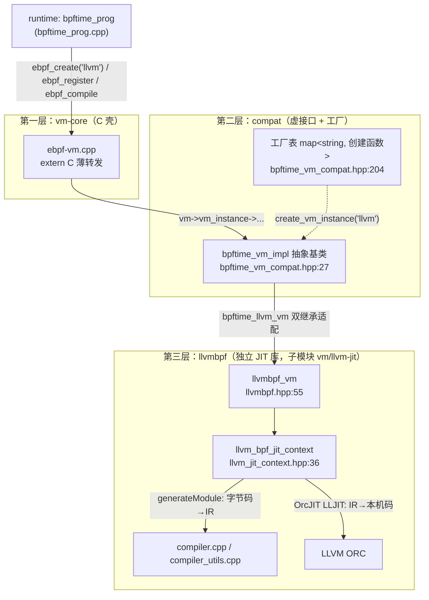
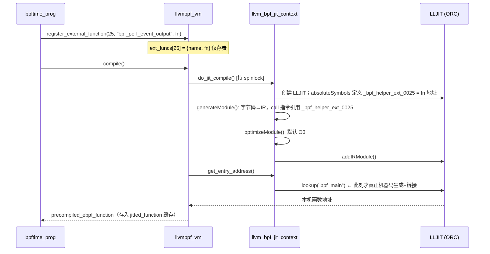
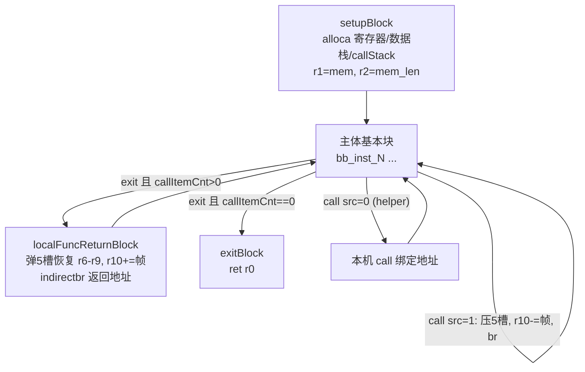

# 5. vm：执行引擎与 LLVM JIT

> 本章对照的代码版本：官方上游 bpftime `177a1dc465ff`，其中 `vm/llvm-jit` 子模块固定在
> llvmbpf `87bac39ad879`（`git submodule status vm/llvm-jit`）。下文所有路径、行号、
> 代码选段都以这两个提交为准。

上一章我们看到 runtime 层拿着一段 eBPF 字节码和一堆 helper 函数指针。这一章回答：
**这段字节码怎么变成一个能直接 `call` 的本机函数指针**。你在 benchmark 里测到的
"uprobe 触发 → helper 执行"热路径，中间的 vm 层开销之所以趋近于零，答案全在这里。

## 5.0 三层结构总览

vm/ 是三层洋葱：最外层是纯 C API（给 runtime 用），中间是 C++ 虚接口 + 按名注册的工厂
（内置 `"llvm"` / `"ubpf"` 两个后端，默认 `DEFAULT_VM_NAME "llvm"`，bpftime_config.hpp:17），
最里层是 llvmbpf——一个可独立发布的 LLVM JIT 库（bpftime 以 git 子模块形式引入）。



| 文件 | 行数 | 看什么 |
|---|---:|---|
| `vm/compat/include/bpftime_vm_compat.hpp` | 265 | **枢纽，先读**：`bpftime_vm_impl` 虚接口（:27）、工厂表（:204-257）、`struct ebpf_vm` 真实定义（:260-263） |
| `vm/compat/llvm-vm/compat_llvm.{hpp,cpp}` | 50+89 | 双继承适配器 + `__attribute__((constructor(0)))` 自动注册工厂（compat_llvm.cpp:82-86） |
| `vm/vm-core/src/ebpf-vm.cpp` | 99 | 确认 C API 只是转发；`ebpf_jit_fn(mem, mem_len)`（ebpf-vm.h:59）即 ctx 传递方式 |
| `vm/llvm-jit/include/llvmbpf.hpp` + `src/vm.cpp` | 170+359 | `ext_funcs` 表、`jitted_function` 缓存、"没编译先编译"语义（vm.cpp:145-172） |
| `vm/llvm-jit/src/compiler_utils.cpp` | 403 | `emitExtFuncCall`（:312-371）：helper 编号→符号 `_bpf_helper_ext_%04u` |
| `vm/llvm-jit/src/llvm_jit_context.cpp` | 1069 | `create_and_initialize_lljit_instance`（:684-860）：`absoluteSymbols` 把 helper 函数指针钉进 JIT dylib（:768-807） |
| `vm/llvm-jit/src/compiler.cpp` | 1758 | `generateModule`（:208）：block 划分、寄存器 alloca、512B 栈、lddw 伪指令、自建 callStack |

和 7 月版相比，llvmbpf 子模块这半年长了不少东西（`compiler.cpp` 从 1377 行涨到 1758 行）：
优化级别 / target CPU / pass 消融等调参 API、`register_array_map`（array map lookup 内联
POC）、`kernel_compatible_mode`（"内核兼容"提升模式）、BTF 行号→DWARF、SPIR-V 输出，以及
#693 带进来的"只初始化宿主后端 + NVPTX"（llvm_jit_context.cpp:492-502，CMake 侧见
`vm/llvm-jit/CMakeLists.txt:85-87`）。**但 bpftime 的 compat 层只转发了表里那几个老接口**
（compat_llvm.hpp:22-45），这些新 API 一个都没接上：bpftime 里优化级别恒为默认的 3、
`array_maps` 恒空、`kernel_compatible_mode_` 恒为 false。读 compiler.cpp 时遇到
`kernel_compatible_mode` / `is_gpu` 分支，按"bpftime 主路径不走"跳过即可。

## 5.1 第一层与第二层：C 壳和工厂

### C 壳有多薄

`vm-core/src/ebpf-vm.cpp` 每个函数都是一行转发。例如：

```c
// ebpf-vm.cpp:36-40
extern "C" int ebpf_register(struct ebpf_vm *vm, unsigned int index,
			     const char *name, void *fn)
{
	return vm->vm_instance->register_external_function(index, name, fn);
}
```

`struct ebpf_vm` 对 C 调用方是不透明指针，真身在 `bpftime_vm_compat.hpp:260-263`：
一个 `std::string vm_name` 加一个 `unique_ptr<bpftime_vm_impl>`。所以"C API"其实
是 C++ 对象上的一层 ABI 稳定壳。

值得注意的是 `precompiled_ebpf_function` 的签名（`bpftime_vm_compat.hpp:25`）：

```cpp
using precompiled_ebpf_function = uint64_t (*)(void *mem, size_t mem_len);
```

**整个 vm 层对外只有这一个执行入口形态**：两个参数，一个返回值（llvmbpf 里有一份同名
同形的定义，llvmbpf.hpp:53）。eBPF 程序拿到的"ctx"就是这里的 `mem`。是谁把 uprobe 的
寄存器现场包装成 `mem` 的？是 attach 层（前面章节的 frida uprobe impl）；vm 层不关心
`mem` 里是什么。

### 工厂注册的两个 C++ 技巧

**注释版代码选段 ①：工厂表怎么躲开静态初始化顺序问题**

```cpp
// bpftime_vm_compat.hpp:204-225（注释为笔者所加）
inline std::map<std::string, create_vm_instance_func> &get_vm_factory_map()
{
	union vm_map_holder {                    // ① union 包裹：既分配了存储，
		std::map<std::string, create_vm_instance_func> map;
		vm_map_holder()                  //    又让编译器不自动构造/析构 map
		{
		}
		~vm_map_holder()
		{
		}
	};
	static vm_map_holder factory_map;
	static int initialized = 0;
	int expected = 0;
	if (__atomic_compare_exchange_n(&initialized, &expected, 1, false,
					__ATOMIC_SEQ_CST, __ATOMIC_SEQ_CST)) {
		new (&factory_map.map)           // ② 第一个到达者 placement-new
			std::map<std::string, create_vm_instance_func>;
	}

	return factory_map.map;
}
```

为什么这么绕？因为注册动作发生在 `__attribute__((constructor(0)))` 里
（compat_llvm.cpp:82-86），也就是**动态库加载时、main 之前**。如果工厂表是普通的
全局 `std::map`，不同编译单元的静态构造顺序不确定，注册函数可能先于 map 构造运行
（static initialization order fiasco）。这里用 union 拿到"未构造的存储"，第一个调用者
负责构造，并且**永不析构**（析构顺序同样不可控，宁可泄漏一个 map）。这个模式
在大型 C++ 系统的插件注册里很常见，值得记住。

> 顺带一个链接层的细节：靠 constructor 自注册的目标文件如果被静态链接器当成"没人引用"
> 丢掉，工厂就凭空消失。官方的做法是把 `bpftime_llvm_vm_obj` 这个 OBJECT 库的目标文件
> 直接塞进最终产物（runtime/agent/CMakeLists.txt:36、runtime/syscall-server/CMakeLists.txt:24，
> 后者来自 #625）。另外第一个到达者判断用的 CAS 只保证"构造一次"，并不让后到者等待
> 构造完成——这里依赖的是注册都发生在单线程的加载期。

`create_vm_instance("llvm")`（bpftime_vm_compat.hpp:228-244）查表后调用
`create_llvm_vm_instance()`（compat_llvm.cpp:12-16），名字查不到直接抛
`std::runtime_error`（:238-242）。返回的 `bpftime_llvm_vm` 是一个**双继承**适配器
（compat_llvm.hpp:14-15）：既是 `bpftime::llvmbpf_vm`（拿实现），又是
`compat::bpftime_vm_impl`（满足接口）。每个 override 都是一行转发到
`bpftime::llvmbpf_vm::xxx`（compat_llvm.hpp:22-29 内联两个，其余在 compat_llvm.cpp:23-75）。

## 5.2 第三层：llvmbpf_vm 数据结构详解

`llvmbpf.hpp:55-166`，与本章主线相关的字段：

| 字段 | 类型 | 谁写 | 谁读 | 生命周期/备注 |
|---|---|---|---|---|
| `instructions`（:147） | `vector<ebpf_inst>` | `load_code()`（vm.cpp:129-138，长度必须是 8 的倍数） | `generateModule()`（compiler.cpp:221） | `unload_code()`（vm.cpp:140-143）只清空它；头文件注释（llvmbpf.hpp:76）说会"remove the JIT/AOT compiled results"，实现并没有动 `jitted_function` |
| `ext_funcs`（:149） | `vector<optional<external_function>>` 定长 `MAX_EXT_FUNCS`=8192 | `register_external_function()`（vm.cpp:85-99；越界 `-E2BIG`，重复注册 `-EEXIST`） | 编译期：符号绑定循环（llvm_jit_context.cpp:772） | 下标即 helper 编号。**编译后修改不再生效**（见 5.3） |
| `jit_ctx`（:152） | `unique_ptr<llvm_bpf_jit_context>` | 构造函数（vm.cpp:70-74） | `compile()/exec()` | 内部 `jit`（llvm_jit_context.hpp:59）持有 LLJIT 实例；`friend` 关系让它能直接读 `vm.ext_funcs`（llvmbpf.hpp:154） |
| `jitted_function`（:165） | `optional<precompiled_ebpf_function>` | `compile()` 成功后（vm.cpp:189-191） | `exec()` 快路径（vm.cpp:148） | **编译结果缓存**：再次 `compile()` 直接返回旧值并置 error "Already compiled"（vm.cpp:176-179） |
| `map_by_fd/map_val/...`（:141-145） | 5 个函数指针 | `set_lddw_helpers()`（vm.cpp:305-316） | lddw 伪指令翻译（compiler.cpp:1052-1340） | runtime 在 `bpftime_prog` 构造时就设好（bpftime_prog.cpp:128-129 / 155-162） |
| `array_maps`、`optimization_level` 等（:150、:157-163） | 新增调参状态 | `register_array_map()` / `set_*()`（vm.cpp:101-127、199-253） | `do_jit_compile` 等 | bpftime 不调用这些接口，保持默认值（见 5.0） |

`llvm_bpf_jit_context`（llvm_jit_context.hpp:36-74）里还有一把
`std::unique_ptr<pthread_spinlock_t> compiling`（:39，构造时在 llvm_jit_context.cpp:511-512
初始化），`do_jit_compile` 全程持锁（llvm_jit_context.cpp:517）——防止多线程同时跑
JIT 编译。注意它锁住的只是 `do_jit_compile` 本身，`exec()`/`compile()` 里对
`jitted_function` 的"检查—编译—写回"并不在锁内（**疑点，未构造用例验证**：两个线程
同时在首事件进入惰性编译时，后一个会再编一遍并替换 `jit`）。

## 5.3 主线：helper 编号如何固化为符号并绑定

这是本章最重要的一条链。完整链条（带参数语义）：

```
bpf_attach_ctx::instantiate_prog_handler_at            (attach/bpf_attach_ctx.cpp:294)
  └► load_prog_and_helpers(prog, config)               (attach/bpf_attach_ctx.cpp:43)
       ├► helper_group.add_helper_group_to_prog(prog)  (bpf_helper.cpp:1163)
       │    └► prog->bpftime_prog_register_raw_helper({index=25,
       │           name="bpf_perf_event_output", fn=bpf_perf_event_output})
       │                                               (bpf_helper.cpp:1345-1348)
       │         └► ebpf_register(vm, 25, name, fn)    (bpftime_prog.cpp:281)
       │              └► ext_funcs[25] = {name, fn}    (vm.cpp:97)  // 仅存表，无副作用
       └► prog->bpftime_prog_load(config.jit_enabled)  (bpftime_prog.cpp:171，调用点 bpf_attach_ctx.cpp:59)
            └► ebpf_compile(vm)                        (bpftime_prog.cpp:209)
                 └► llvmbpf_vm::compile()              (vm.cpp:174)
                      └► jit_ctx->do_jit_compile()     (llvm_jit_context.cpp:515)
                           ├► create_and_initialize_lljit_instance()   // 绑定端 (:518-519)
                           ├► generateModule(extFuncNames, ...)        // 引用端 (:526-527)
                           ├► optimizeModule(M, vm.optimization_level, ...)
                           │                     → 默认 O3   (:535-536，定义于 :206)
                           ├► inline_array_map_lookup_helpers(M)  (:537，bpftime 下恒返回 false)
                           └► jit->addIRModule(...)     (llvm_jit_context.cpp:543)
```

编号在**两端同时**变成同一个字符串符号，字符串由 `ext_func_sym` 生成
（compiler_utils.hpp:39-44）：`sprintf(buf, "_bpf_helper_ext_%04" PRIu32, idx)`，
即 helper 25 → `"_bpf_helper_ext_0025"`。

**绑定端**——把真实函数地址钉进 JIT 的符号表：

**注释版代码选段 ②：absoluteSymbols 绑定（llvm_jit_context.cpp:768-806，有删节）**

```cpp
auto &mainDylib = jit->getMainJITDylib();
std::vector<std::string> extFuncNames;
SymbolMap extSymbols;
for (uint32_t i = 0; i < std::size(vm.ext_funcs); i++) {    // 遍历 8192 个槽位
	if (vm.ext_funcs[i].has_value()) {
		auto sym = JITEvaluatedSymbol::fromPointer(  // ① 直接拿宿主进程内
			vm.ext_funcs[i]->fn);                //    的函数地址
		auto symName = jit->getExecutionSession().intern(
			ext_func_sym(i));                    // ② 编号→符号名，此刻固化
		sym.setFlags(JITSymbolFlags::Callable |
			     JITSymbolFlags::Exported);
#if LLVM_VERSION_MAJOR < 17
		extSymbols.try_emplace(symName, sym);
		extFuncNames.push_back(ext_func_sym(i));     // ③ 名字同时收集起来，
#else                                                        //    稍后传给 generateModule
		auto symbol = ::llvm::orc::ExecutorSymbolDef(
			::llvm::orc::ExecutorAddr(sym.getAddress()),
			sym.getFlags());
		extSymbols.try_emplace(symName, symbol);
		extFuncNames.emplace_back(ext_func_sym(i));
#endif
	}
}
// ...（arm32 的 __aeabi_unwind_cpp_pr1 特例、BPFTIME_ENABLE_LLVM_PRELOAD 分支）
	if (auto err = mainDylib.define(absoluteSymbols(extSymbols)); !err) {
		SPDLOG_DEBUG("LLVM-JIT: failed to define external symbols");
	}
```

`absoluteSymbols` 的含义：这些符号**没有对应的代码生成**，链接时直接解析为给定
的绝对地址。也就是说 helper 对 JIT 来说等价于"已知地址的外部 C 函数"。（同一函数里
还给 main dylib 挂了 `DynamicLibrarySearchGenerator::GetForCurrentProcess`
（:759-767，受编译宏控制），目的是让 ORC 运行时包装符号可解析；helper 不走这条路。）

> 顺带一个找茬点：最后那个 `!err`（llvm_jit_context.cpp:804，及 :855 的 lddw 同款）
> 对 `llvm::Error` 而言 `!err` 表示**成功**——所以这行在成功时打印 "failed"，真失败
> 反而不打。同文件 `BPFTIME_ENABLE_LLVM_PRELOAD` 分支（:800、:846）写的是 `err`，是对的。
> 影响仅限日志（DEBUG 级），但演示了 `llvm::Error` 的反直觉语义。官方至今未改。

**引用端**——生成 IR 时对同名符号发射 call：

**注释版代码选段 ③：emitExtFuncCall（compiler_utils.cpp:312-371，有删节）**

```cpp
llvm::Expected<int>
emitExtFuncCall(llvm::IRBuilder<> &builder, const ebpf_inst &inst,
		std::map<std::string, llvm::Function *> &extFunc,
		llvm::Value **regs, llvm::FunctionType *helperFuncTy,
		uint16_t pc, llvm::BasicBlock *exitBlk,
		bool allow_implicit_external, bool kernel_compatible_mode)
{
	auto funcNameToCall = ext_func_sym(inst.imm);   // ① imm 就是 helper 编号
	auto itr = extFunc.find(funcNameToCall);
	if (itr == extFunc.end() && allow_implicit_external) {
		// ... 现场补一个外部声明（bpftime 传的是 false，不走这里）
	}
	if (itr != extFunc.end()) {
		auto callInst = builder.CreateCall(
			helperFuncTy, itr->second,
			{ builder.CreateLoad(builder.getInt64Ty(), regs[1]),
			  builder.CreateLoad(builder.getInt64Ty(), regs[2]),
			  builder.CreateLoad(builder.getInt64Ty(), regs[3]),
			  builder.CreateLoad(builder.getInt64Ty(), regs[4]),
			  builder.CreateLoad(builder.getInt64Ty(), regs[5]) });
		if (!(kernel_compatible_mode && inst.imm == 12)) {
			builder.CreateStore(callInst, regs[0]); // ② 返回值写回 r0
		}
		if (inst.imm == 12 && !kernel_compatible_mode) {
			builder.CreateBr(exitBlk);              // ③ bpf_tail_call 硬编码特例：
		}                                               //    调完直接跳 exit
		return 0;
	} else {
		return llvm::make_error<llvm::StringError>(
			"Ext func not found: " + funcNameToCall,
			llvm::inconvertibleErrorCode()); // ④ 没注册→编译失败
	}
}
```

调用点（compiler.cpp:1471-1475）把最后两个参数都传成 `kernel_compatible_mode`，在
bpftime 里两者都是 false，所以实际行为就是：未注册→报错、返回值写 r0、helper 12 后跳 exit。

注意 ①：所有 helper 一律按 `helperFuncTy = i64(i64,i64,i64,i64,i64)` 发射
（原型定义在 compiler.cpp:263-268），不管真实 helper 用几个参数——r1..r5 全部传过去。
这依赖 C 调用约定（SysV x86-64 / AAPCS64）容忍多传整型参数：多余的参数只是占了
寄存器，被调方不看。runtime 侧配合地把 helper 都写成 5 个 64 位整型形参
（如 `bpf_perf_event_output`，bpf_helper.cpp:487-488 是 5×`uint64_t`；也有
`bpftime_probe_read` 这种带 `int64_t` 的，bpf_helper.cpp:121-122，同样是 64 位整型寄存器）。

注意 ③：用户态没有真正的"tail call 不返回"。#644 之后官方的配合方式是：
`bpftime_tail_call`（bpf_helper.cpp:555）在 helper 里**同步执行**目标程序，把目标返回值存进
thread_local `current_thread_tail_call_ret`（:629），自己返回 0；JIT 码随即跳 exit；
外层 `bpftime_prog_exec` 用 `current_thread_tail_call_ret.value_or(val)` 覆盖返回值
（bpftime_prog.cpp:271-272）。由于这条 `br exitBlk` 是无条件的，helper 失败
（返回 -1）时程序也直接以 -1 退出，而不是像内核那样落到下一条指令继续执行。

注意 ④：**这就是"helper 必须在 compile 前全部注册"的机械原因**——引用端只认
`extFunc` 这张编译期快照；程序字节码 call 了一个当时没注册的编号，编译直接报错。
反过来，编译成功后再 `register_external_function` 只会写 `ext_funcs` 向量，
LLJIT dylib 里的符号表早已封板，**不会生效**。

一个现实中的边界案例：`bpf_attach_ctx::instantiate_prog_handler_at`
（bpf_attach_ctx.cpp:294-315）先 `load_prog_and_helpers`（:304，内部已按
`config.jit_enabled` 编译），**之后**才注册 attach impl 私有 helper（:310-312，来源是
`register_custom_helpers` 回调，:276-284）。jit 开启时如果程序没引用这批 helper，
编译成功、相安无事；如果引用了，load 时编译报 "Ext func not found"，`bpftime_prog_load`
只打一条 WARN 就把 `jitted` 置 false 并返回 0（bpftime_prog.cpp:209-212），到首个事件
才经 `ebpf_exec` 走惰性编译（见 5.6）——那时 helper 已经补注册，于是"碰巧"成功。
jit 关闭时同理，首事件才编译，晚注册来得及。读代码时遇到这种"顺序敏感但没炸"的地方，
值得多问一句为什么。

编译全流程时序：



`get_entry_address`（llvm_jit_context.cpp:862-880）里的 `lookup("bpf_main")`（:869）是
ORC 的物化触发点：符号解析时 `_bpf_helper_ext_0025` 命中 absoluteSymbols，helper 地址被
直接写进（或经目标架构的取址序列送进）call 位点。

## 5.4 一条指令的旅程：`call 25` 从字节码到本机 call

以 ssl-nginx 热路径的核心指令为例。字节码 8 字节
（`ebpf_inst` 布局见 vm/llvm-jit/src/ebpf_inst.h:27-33——opcode/dst:4/src:4/offset/imm）：

```
85 00 00 00 19 00 00 00
│  │        └─ imm = 0x19 = 25 (BPF_FUNC_perf_event_output, bpf_helper.cpp:939)
│  └─ dst=0, src=0 (src=0 → helper 调用；src=1 → bpf-to-bpf 局部调用)
└─ opcode 0x85 = EBPF_OP_CALL (EBPF_CLS_JMP | EBPF_MODE_CALL, ebpf_inst.h:219)
```

1. **分发**：主循环 `switch (inst.opcode)`（compiler.cpp:631）命中 `EBPF_OP_CALL`
   （:1366；紧跟着的 `EBPF_OP_CALL | 0x8` 共用同一分支，:1369），
   `inst.src != 0x1` 走 `emitExtFuncCall`（compiler.cpp:1470-1479）。
2. **IR**：生成
   `%ret = call i64 @_bpf_helper_ext_0025(i64 %r1, i64 %r2, i64 %r3, i64 %r4, i64 %r5)`
   加一条 `store %ret, %r0`。此时 r1..r5、r0 都还是 `alloca` 出来的栈槽
   （compiler.cpp:376-380）。
3. **O3**：`optimizeModule`（llvm_jit_context.cpp:206-290；LLVM≥17 用新 PassManager 的
   `buildPerModuleDefaultPipeline`，:273-274）跑 mem2reg/SROA 等 pass，
   把寄存器 alloca 提升为 SSA 值——最终机器码里 r1..r5 就在真实物理寄存器里，
   按调用约定正好落在参数寄存器位置（x86-64: rdi..r8；aarch64: x0..x4），
   常常一条 mov 都不需要。
4. **机器码**：符号解析为 `bpf_perf_event_output` 的绝对地址，发射为一条对该地址的
   本机调用（具体形式依架构：可能是 `movabs+call` 或 `ldr+blr`）。

**结论：运行时零层软件间接**——没有查表、没有 dispatch、没有蹦床。JIT 后的 eBPF
程序调用 helper 与一个普通 C 函数调用另一个 C 函数没有区别。

📌 **案例（helper 体内的成本）**：正因为 vm 层把调用成本压到了零，你在 perf 里几乎
看不到"vm 开销"这一项——热点都落在 helper 函数体内部。以官方 `bpf_perf_event_output`
为例，每个事件都要 `sched_getaffinity` 一次、`sched_setaffinity` 两次（绑到当前 CPU，
bpf_helper.cpp:499-506；结束时恢复，:546-551），这些 syscall 全都发生在
`_bpf_helper_ext_0025` 绑定的那个函数体里。**想优化这类开销，该改的是 runtime/helper 层，
而不是编译器。**（我们开发分支上去掉这段绑核序列的改动不在官方代码中。）

📌 **案例（对齐）**：`call 25` 的 r4/r5 分别是事件数据指针和长度
（`bpf_perf_event_output(ctx, map, flags, data, size)`），vm 层原样透传；这个
`size` 一路传到 `software_perf_event_buffer::output_data` 才被向上对齐到 8 字节
（perf_event_handler.cpp:370-378，官方 #612）。分层看：
**vm 负责"把参数无损送到 helper"，语义修正发生在 handler 层**。

另外两类特殊指令的编译期处理值得知道：

- **lddw 伪指令**（compiler.cpp:1052-1340）：16 字节双 slot 指令，`src` 字段 0–6 区分
  7 种情形（0 是普通 64 位立即数）。JIT 路径 `patch_map_val_at_compile_time=true`
  （llvm_jit_context.cpp:527），`src==1/2` 的 map 地址**在编译期就调用
  `vm.map_by_fd`/`vm.map_val` 求值并烧成常量**（compiler.cpp:1114-1118、1148-1149 与
  1156-1171）——所以 map 查找的"取 map 指针"这步在运行时是零成本的立即数。AOT 路径
  （`do_aot_compile`，llvm_jit_context.cpp:560 传 false）则为 `map_val` 保留运行时调用
  `__lddw_helper_map_val`（只声明这一个符号，:645-648）。
- **exit**（compiler.cpp:1483-1496）：不是无条件 ret，而是看 callStack 深度决定
  返回宿主还是返回 bpf 调用者——引出下一节。

## 5.5 bpf-to-bpf：自建 callStack，整个程序是一个 `bpf_main`

llvmbpf（在 bpftime 使用的默认模式下）**不把 eBPF 子函数编译成独立的 LLVM 函数**。
整段字节码（含所有子函数）生成为单个 `bpf_main`，bpf-to-bpf 调用被降级为
"手工保存现场 + 无条件跳转"。（`kernel_compatible_mode` 下改为对每个子函数入口生成
外部伪调用符号，compiler.cpp:278-310、1372-1419；bpftime 不开启该模式。）

编译期准备（setupBlock，compiler.cpp:369-460）：

- `regs[0..10]`：11 个 `alloca i64`（:376-380）；
- 数据栈：`alloca i64 × (STACK_SIZE*MAX_LOCAL_FUNC_DEPTH + 10)`（:404-409），r10 初始指向
  `stackEnd`（:411-424）。`STACK_SIZE = (EBPF_STACK_SIZE + 7) / 8 = 64` 个 8 字节槽（:42），
  `CALL_STACK_SIZE = 64`（:43），`MAX_LOCAL_FUNC_DEPTH = 32`（:45）；
- `callStack`：`alloca ptr × (CALL_STACK_SIZE*5)`（:438-442）+ 计数器
  `callItemCnt`（:444-447），初值 0；
- 入参：`mem → r1`、`mem_len → r2`（:449-459）。

**注释版代码选段 ④：局部调用的压栈（compiler.cpp:1420-1468，有删节）**

```cpp
Value *nextPos = builder.CreateAdd(           // ① callItemCnt += 5：
	builder.CreateLoad(builder.getInt64Ty(),  //    每次调用压 5 个槽
			   callItemCnt),
	builder.getInt64(5));
builder.CreateStore(nextPos, callItemCnt);
assert(localFuncRetBlks.contains(pc + 1));
builder.CreateStore(                          // ② 槽顶存返回地址：BlockAddress
	localFuncRetBlks[pc + 1],                 //    指向 call 的下一条指令所在块
	/* callStack[nextPos-1] */ ...);          //    （:480-489 预建）
for (int i = 6; i <= 9; i++) {                // ③ 手工保存 callee-saved r6..r9
	builder.CreateStore(load(regs[i]),
		/* callStack[nextPos-(i-4)] */ ...);
}
builder.CreateStore(                          // ④ r10 -= STACK_SIZE：给被调方
	builder.CreateSub(load(regs[10]),         //    腾出新栈帧
			  builder.getInt64(STACK_SIZE)),
	regs[10]);
// ⑤ loadCallDstBlock(pc, inst, instBlocks) → CreateBr 无条件跳到目标块（pc+1+imm）
```

返回路径是共享的 `localFuncReturnBlock`（compiler.cpp:509-561）：弹出返回地址、
恢复 r6..r9、`callItemCnt -= 5`、`r10 += STACK_SIZE`，最后
`indirectbr`（:555）跳回——所有可能的返回点（`localFuncRetBlks` 收集于 :480-489）都注册为
indirectbr 的候选目的地（:556-559）。
而 `EBPF_OP_EXIT` 编译成条件分支（:1487-1493）：

```
callItemCnt == 0 ? → exitBlock（ret r0，宿主拿到返回值）
                 : → localFuncReturnBlock（弹栈回到 bpf 调用者）
```

状态流转：



为什么不用本机 call/ret？因为那样每个子函数就得是独立 LLVM 函数，跨函数传递
"11 个虚拟寄存器 + 共享数据栈"会非常别扭；单函数方案让 O3 可以跨"函数边界"做
常量传播和内联级优化，代价是自己管理保存/恢复。

三个疑点（读代码时验证过的算术与条件）：

- **返回块登记条件**：`localFuncRetBlks` 只在 `i > 1` 时登记（compiler.cpp:482）。
  如果程序**第一条指令（pc 0）就是局部调用**，pc 1 的返回块不会被登记，:1429 的
  `assert` 在 Debug 构建下中止；Release 构建下 `localFuncRetBlks[pc + 1]` 取到空指针交给
  `CreateStore`，JIT 编译崩溃。这是官方已知问题（条件应为 `i >= 1`）。
- **帧位移量疑点**：`r10 -= STACK_SIZE` 中 `STACK_SIZE = 64` 是**以 8 字节槽为单位**
  的常量，但 r10 里存的是字节粒度的指针值，这一减只移动 64 字节而非 512 字节
  （compiler.cpp:1455-1461，返回路径 :548-554 同款 +64）。若子函数栈帧使用超过
  64 字节，将与调用者栈帧重叠。**疑似 bug，未构造用例验证**；ssl-nginx 路径无
  bpf-to-bpf 调用，不受影响。
- **无深度检查**：`callItemCnt` 只增不查上限，`CALL_STACK_SIZE*5 = 320` 槽支持深度
  64，数据栈按 `MAX_LOCAL_FUNC_DEPTH=32` 预留；越界依赖 verifier 在加载前拒绝深
  调用链，vm 层自己不设防。

## 5.6 惰性 JIT：llvm 后端没有解释器

`exec()`（vm.cpp:145-172）的语义是"没编译先编译"：

```cpp
// vm.cpp:145-172（有删节，去掉了 TRACE 日志）
int llvmbpf_vm::exec(void *mem, size_t mem_len,
		     uint64_t &bpf_return_value) noexcept
{
	if (jitted_function) {                        // 快路径：直接调缓存的函数指针
		auto ret =
			(*jitted_function)(mem, static_cast<uint64_t>(mem_len));
		bpf_return_value = ret;
		return 0;
	}
	try {
		auto func = compile();                // 慢路径：首次触发完整 LLVM 编译
		if (!func) {
			SPDLOG_ERROR("Unable to compile eBPF program");
			return -1;
		}
		jitted_function = func;
		// after compile, run
		return exec(mem, mem_len, bpf_return_value); // 重入快路径
	} catch (const std::exception &e) {
		error_msg = e.what();
		return -1;
	}
}
```

所以配置里 `jit_enabled=false` 对 llvm 后端来说**不是解释执行**，只是把编译从
load 时（bpftime_prog.cpp:208-216，eager 路径）推迟到第一个事件（bpftime_prog.cpp:264-269
→ `ebpf_exec` → 上面这段）。首个事件会付出整个 O3 编译的延迟。真解释器只有
ubpf 后端有（compat_ubpf.cpp:217 调 `ubpf_exec`；#676 之后它的析构函数会
`ubpf_destroy` 自己持有的 VM，compat_ubpf.cpp:33-36）。做 benchmark 时务必确认走的是哪条路径、
以及首事件是否被计入。

编译失败时的官方行为也值得知道：`bpftime_prog_load` 打出
`"JIT compilation failed ({}), falling back to interpreter"`（bpftime_prog.cpp:211），
但 llvm 后端并没有解释器可退——之后每个事件都走 `ebpf_exec` → `exec()`，
而 `compile()` 失败时不写 `jitted_function`（vm.cpp:181-188），于是**每次调用都重新尝试
完整编译**并报错，程序体始终不执行。这是官方已知问题。

trap 后端（#665）是例外：信号处理上下文里不允许惰性编译，`bpftime_prog_exec` 在
`attach::current_signal_callback` 非空时要求 `jitted` 为真才直接调 `fn`（bpftime_prog.cpp:241-247），
`prepare_for_signal_execution` 会在 attach 时提前 `ebpf_compile`（:331-337）。

uprobe 场景下每次事件的运行时调用链（jit 模式）只有两跳：

```
attach 层回调 → bpftime_prog_exec(memory, size, &ret)   (bpftime_prog.cpp:238)
             → fn(memory, memory_size)                  (bpftime_prog.cpp:263, 直呼 JIT 码)
             → bpf_main 的 setupBlock: mem→r1, len→r2   (compiler.cpp:449-459)
```

（两跳之外，`bpftime_prog_exec` 还在前后各调一次 `bpftime_protect_disable/enable`，
:255、:274。）

## 5.7 坑与要点清单

- **helper 必须在 compile 前全部 register**：编号在 `create_and_initialize_lljit_instance`
  和 `generateModule` 两端固化为符号 `_bpf_helper_ext_%04u`；之后改 `ext_funcs` 不生效，
  且 `compile()` 有一次性缓存（vm.cpp:176-179）。
- llvm 后端**没有真解释器**：`exec()` 是惰性 JIT + 缓存；编译失败时日志说
  "falling back to interpreter"，实际是每次调用重试编译（5.6）。
- helper 统一按 5×i64 原型发射，依赖调用约定容忍多传参；`bpf_tail_call`（imm==12）
  是 `emitExtFuncCall` 里的硬编码特例，call 后无条件 br 到 exit，真正的返回值经
  `current_thread_tail_call_ret` 回传。
- bpf-to-bpf 不走本机栈：自建 callStack + indirectbr，整个程序是单个 `bpf_main`；
  首条指令即局部调用会让 JIT 崩溃（`i > 1`），帧位移量 64 字节 vs 512 字节的疑点见 5.5。
- JIT 路径 map 地址在编译期烧成常量（lddw `patch_map_val_at_compile_time=true`），
  所以**编译发生在 map 创建之后**是隐含前提。
- `bpf_attach_ctx` 里 attach impl 的私有 helper 在编译**之后**才注册
  （bpf_attach_ctx.cpp:304 vs :310-312），顺序敏感。
- llvmbpf 新增的调参 / array map 内联 / kernel-compatible 接口没有经 compat 层暴露，
  在 bpftime 里不生效（5.0）。
- `unload_code()` 只清字节码，不清 `jitted_function`（vm.cpp:140-143）。

## 5.8 自测题

**Q1. `call 25` 到 `bpf_perf_event_output` 中间有几层间接？**

<details><summary>答案</summary>

零层软件间接。编译期 `ext_func_sym(25)` 生成符号 `_bpf_helper_ext_0025`
（compiler_utils.hpp:39-44），`absoluteSymbols` 把它直接解析为
`bpf_helper.cpp:487` 那个函数的绝对地址（llvm_jit_context.cpp:772-792, 804），
机器码是对该地址的本机调用。没有 helper 表查找、没有 dispatch 函数、没有蹦床。
（架构层面的取址序列如 `movabs+call` 不算软件间接层。）
</details>

**Q2. compile 后再 register 新 helper 有效吗？**

<details><summary>答案</summary>

对已编译的程序无效。`register_external_function` 只写 `ext_funcs` 向量
（vm.cpp:97），而符号绑定发生在 `create_and_initialize_lljit_instance` 的快照循环里
（llvm_jit_context.cpp:772）；`compile()` 又有一次性缓存（vm.cpp:176-179），不会重编。
若字节码引用了未注册编号，编译期即报 "Ext func not found"（compiler_utils.cpp:367-369）。
现实注意：`bpf_attach_ctx.cpp:310-312` 恰好在编译后才注册 attach impl helper；
程序没引用它们就相安无事，引用了则 load 时编译失败、`jitted=false`，首事件惰性编译时
helper 已补齐，于是"碰巧"成功。
</details>

**Q3. JIT `bpf_main` 的两个参数在 uprobe 场景对应什么？**

<details><summary>答案</summary>

`bpf_main(void *mem, size_t mem_len)`：`mem` 是 attach 层（frida uprobe impl）
组装的上下文（模拟 `pt_regs` 的结构），`mem_len` 是其长度。setupBlock 把它们
存入 r1/r2（compiler.cpp:449-459），与内核 eBPF "r1 = ctx" 的约定一致。调用点在
`bpftime_prog_exec`（bpftime_prog.cpp:263；trap 信号路径在 :246）。
</details>

**Q4. `jit_enabled=false` 时 llvm 后端的第一个 uprobe 事件会发生什么？**

<details><summary>答案</summary>

`bpftime_prog_load(false)` 不编译（bpftime_prog.cpp:217-219），首个事件走
`ebpf_exec` → `llvmbpf_vm::exec`（vm.cpp:145），发现 `jitted_function` 为空，
就地触发完整的 generateModule + O3 + ORC 链接（毫秒级延迟），缓存后重入快路径。
后续事件与 jit 模式无差别。benchmark 里首事件延迟异常大、且"解释模式和 JIT 模式
吞吐几乎一样"，都是这个机制的信号。若编译失败，则每个事件都重试编译、程序体不执行。
</details>

**Q5. 为什么给只有 2 个参数的 helper 也传 5 个参数是安全的？什么时候会不安全？**

<details><summary>答案</summary>

所有 helper 调用统一用 `i64(i64,i64,i64,i64,i64)` 原型（compiler.cpp:263-268），
SysV x86-64 / AAPCS64 下前 5 个整型参数都走寄存器，被调方对多余寄存器不感知；
且 runtime 把 helper 都定义成 5 个 64 位整型形参（如 bpf_helper.cpp:487-488）。不安全的情形：
helper 用可变参数、浮点参数、或在栈传参的 ABI 上（超过寄存器数量的约定）——
以及任何"被调方会校验参数个数"的机制（如某些 CFI 方案对函数签名做哈希检查时，
调用点签名与定义签名不一致可能被拦截）。
</details>

**Q6. bpf-to-bpf 调用一次，callStack 上多了哪 5 项？r10 移动了多少字节？**

<details><summary>答案</summary>

槽顶到槽底依次是：返回地址（`BlockAddress`，指向 call 下一条指令的基本块）和
r6、r7、r8、r9 四个 callee-saved 寄存器的值（compiler.cpp:1424-1452）。r10 减去
`STACK_SIZE = 64`——按代码字面意义是 64 **字节**，而 512 字节栈的意图应是减 512
（64 是"8 字节槽数"）。这正是 4.5 标注的疑点：字面行为与 eBPF 栈帧语义不符，
读者可以自己写一个使用 >64B 栈的子函数验证。
</details>

**Q7.（新）一个 eBPF 程序的第 0 条指令就是 `call` 到本地子函数（src=1），官方 llvmbpf 会怎样？**

<details><summary>答案</summary>

JIT 编译崩溃。返回地址块只在 `i > 1` 时登记进 `localFuncRetBlks`（compiler.cpp:482），
pc 0 的调用需要 pc 1 的返回块却没有登记：Debug 构建在 `assert(localFuncRetBlks.contains(pc + 1))`
（:1429）处中止，Release 构建把 `operator[]` 返回的空指针交给 `CreateStore`。
同时 pc 1 也不在 `indirectbr` 的候选目的地列表里。
</details>

---
[← 返回目录](README.md)
