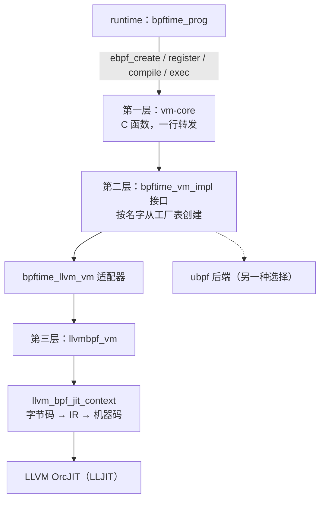
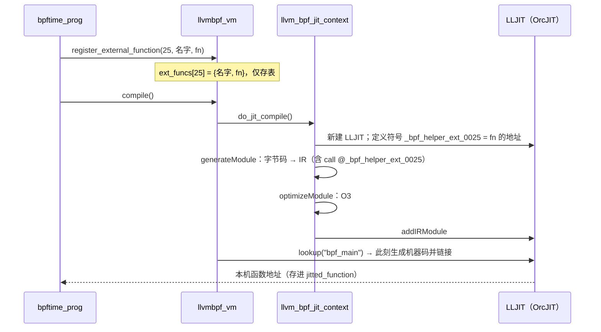
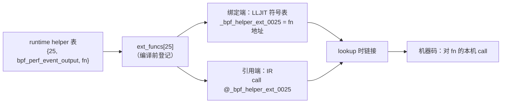

# 5. vm：执行引擎与 LLVM JIT

> 一句话：本章讲一段 eBPF 字节码怎么变成一个能直接 `call` 的本机函数。读完你能说清：
> 一条 eBPF 指令怎么被翻译成机器码；`call 25` 怎么在编译期就绑定到 C 函数
> `bpf_perf_event_output`，运行时为什么不用查表。
> 前置：建议先读[第 1 章](01-lifecycle.md)和[第 4 章](04-attach-frida.md)（ctx 是怎么来的）。
> 预计用时：2–3 小时。

## 本章要回答的问题

1. runtime 手里有一段 eBPF 字节码，它最后是怎么变成一个能直接调用的本机函数指针的？
2. eBPF 的 11 个寄存器和 512 字节栈，到了 x86_64 机器码里变成了什么？
3. 字节码里写的是 `call 25`，JIT 后的代码怎么知道去调哪个 C 函数？每次调用要查表吗？
4. 为什么 helper 必须在编译之前注册好？晚注册会怎样？
5. 设了 `BPFTIME_DISABLE_JIT` 之后，llvm 后端是在解释执行吗？

---

## 5.1 三层结构：C 接口壳 → 多后端抽象 → llvmbpf

**直觉**：vm/ 目录像一个三层洋葱。

- **最外层是一组 C 函数**（`ebpf_create` / `ebpf_register` / `ebpf_compile` / `ebpf_exec` …）。
  runtime 只用这组函数，不关心背后是哪个执行引擎。
- **中间层是一个 C++ 抽象接口** `bpftime_vm_impl`，加一张"名字 → 创建函数"的工厂表。
  bpftime 内置两个后端：`"llvm"`（默认）和 `"ubpf"`。想换后端，只要换个名字
  （环境变量 `BPFTIME_VM_NAME`）。
- **最里层是 llvmbpf**：一个可以独立发布的 LLVM JIT 库，以 git 子模块的形式放在 `vm/llvm-jit/`。
  中间层用一个适配器类 `bpftime_llvm_vm` 把它接到抽象接口上。

> **小知识**：LLVM 是一套编译器基础设施。它定义了一种与机器无关的中间表示（LLVM IR），
> 提供把 IR 优化、再翻译成各种 CPU 机器码的全套工具。OrcJIT 是 LLVM 里负责"即时编译"的组件：
> 你把 IR 交给它，它在**当前进程的内存里**生成机器码，并给你一个可以直接调用的函数地址。
> llvmbpf 用的是 OrcJIT 提供的现成 JIT 实例 `LLJIT`。

这张图看一次调用从 runtime 往下穿过了哪几层：



外层到底有多薄？每个 C 函数都只是一行转发：

`vm/vm-core/src/ebpf-vm.cpp` 的 `ebpf_register()`

```c
extern "C" int ebpf_register(struct ebpf_vm *vm, unsigned int index,
                             const char *name, void *fn)
{
        // ebpf_vm 里只有一个名字和一个 unique_ptr<bpftime_vm_impl>
        return vm->vm_instance->register_external_function(index, name, fn);
}
```

**整个 vm 层对外只有一种"可执行函数"的形态**：

```cpp
using precompiled_ebpf_function = uint64_t (*)(void *mem, size_t mem_len);
```

两个参数、一个返回值。`mem` 就是 eBPF 程序看到的 `ctx`（uprobe 时是第 4 章那份 `pt_regs`），
返回值就是程序的 `r0`。vm 层不关心 `mem` 里装的是什么。

**要点**
- runtime 只用 C 接口；后端按名字选，默认 `"llvm"`。
- llvmbpf 是独立的 JIT 库；bpftime 通过一个适配器类接入它。
- JIT 的产物是一个 `uint64_t f(void *mem, size_t mem_len)` 函数指针。

---

## 5.2 llvmbpf_vm 里装了什么

一个 `llvmbpf_vm` 对象对应一个 eBPF 程序。和本章主线有关的只有几样东西：

| 字段 | 是什么 | 谁写入 |
|---|---|---|
| `instructions` | 字节码，`ebpf_inst` 数组（每条 8 字节） | `load_code()` |
| `ext_funcs` | 长度 8192 的数组，**下标就是 helper 编号**，元素是 `{名字, 函数指针}` | `register_external_function()` |
| `map_by_fd` / `map_val` 等 | 编译 `lddw` 伪指令时要用的回调 | `set_lddw_helpers()`，runtime 在构造 `bpftime_prog` 时就设好 |
| `jit_ctx` | 编译器本体，内部持有 `LLJIT` 实例 | 构造函数 |
| `jitted_function` | 编译结果缓存（函数指针） | `compile()` 成功后 |

注意 `jitted_function` 是"一次性"缓存：编译成功后再调 `compile()`，直接返回旧结果。

**要点**
- `ext_funcs[25]` 就是 helper 25 的登记处；登记只是往数组里写一项，没有别的副作用。
- 编译结果被缓存，之后不会重编。

---

## 5.3 编译流水线全貌

**直觉**：`compile()` 内部做五件事。

1. 新建一个 `LLJIT` 实例，并把所有已登记 helper 的**地址**写进它的符号表（5.5 的"绑定端"）。
2. `generateModule`：把字节码逐条翻译成 LLVM IR，得到一个名为 `bpf_main` 的函数（5.4）。
3. `optimizeModule`：跑 LLVM 的 O3 优化流水线。
4. `addIRModule`：把优化后的 IR 交给 `LLJIT`。
5. `lookup("bpf_main")`：向 `LLJIT` 要函数地址。**直到这一步，机器码才真正生成并链接。**

这张图看谁调谁、helper 25 在哪一步被登记、在哪一步被用上：



`vm/llvm-jit/src/llvm_jit_context.cpp` 的 `llvm_bpf_jit_context::do_jit_compile()`

```cpp
llvm::Error llvm_bpf_jit_context::do_jit_compile()
{
        spin_lock_guard guard(compiling.get());     // 同一 VM 不能并发编译
        // ① 建 LLJIT + 绑定 helper 符号；顺便拿回所有 helper 的符号名
        auto [jit, extFuncNames, definedLddwHelpers] =
                create_and_initialize_lljit_instance();
        // ② 字节码 → IR。true = map 相关常量在编译期就求值（见 5.4）
        auto bpfModuleOrErr =
                generateModule(extFuncNames, definedLddwHelpers, true);
        if (!bpfModuleOrErr)
                return bpfModuleOrErr.takeError();  // 例如引用了未登记的 helper
        auto bpfModule = std::move(*bpfModuleOrErr);
        // ③ 优化，默认 O3
        bpfModule.withModuleDo([&](auto &M) {
                optimizeModule(M, vm.optimization_level, /* ... */);
                /* ... array map 内联：bpftime 下不触发 ... */
        });
        // ④ 交给 LLJIT；真正的机器码生成推迟到 lookup
        if (auto err = jit->addIRModule(std::move(bpfModule)))
                return err;
        this->jit = std::move(jit);
        return llvm::Error::success();
}
```

**要点**
- 编译 = 建 JIT 并绑定 helper → 生成 IR → O3 → 交给 JIT → `lookup` 时出机器码。
- 生成 IR 时只需要 helper 的**名字**；地址在第 ① 步已经交给 JIT 了。

---

## 5.4 一条 eBPF 指令怎么变成本机码（主线一）

**直觉**：eBPF 是一台很简单的"虚拟 CPU"：11 个 64 位寄存器（r0–r10）、一块 512 字节的栈。
llvmbpf 的翻译策略非常朴素：

1. 在 `bpf_main` 开头，为每个 eBPF 寄存器在栈上开一个 8 字节的格子（LLVM 里叫 `alloca`），
   再开一块数组当 eBPF 栈，让 r10 指向它的末尾。
2. 每条 eBPF 指令，都翻译成"从格子里读 → 做运算 → 写回格子"的几条 IR。
3. 最后交给 LLVM 优化器。优化器发现这些格子从不被取地址，就把它们**提升成真正的 CPU 寄存器**
   （这个优化叫 mem2reg / SROA），多余的读写全部消失。

所以 llvmbpf 不用自己做寄存器分配，也不用自己做窥孔优化——这些都交给了 LLVM。

### 第一步：切基本块，搭"骨架"

**基本块（basic block）** 是一段"只能从头进、从尾出"的直线代码。跳转的目标、跳转指令的下一条，
都是新基本块的开头。`generateModule` 先扫一遍字节码，把每个基本块的起点标出来，为每个起点建一个
LLVM 基本块（名字形如 `bb_inst_N`）。

然后建一个入口块 `setupBlock`：

`vm/llvm-jit/src/compiler.cpp` 的 `llvm_bpf_jit_context::generateModule()`（setupBlock 部分，有删节）

```cpp
for (int i = 0; i <= 10; i++)                     // r0..r10 各一个 8 字节格子
        regs.push_back(builder.CreateAlloca(builder.getInt64Ty(), nullptr,
                                            "r" + std::to_string(i)));
// eBPF 栈：STACK_SIZE 是 512 字节折成的 64 个 8 字节槽，再乘以最大调用深度 32
stackBegin = builder.CreateAlloca(builder.getInt64Ty(),
        builder.getInt32(STACK_SIZE * MAX_LOCAL_FUNC_DEPTH + 10), "stackBegin");
auto stackEnd = builder.CreateGEP(builder.getInt64Ty(), stackBegin,
        { builder.getInt32(STACK_SIZE * MAX_LOCAL_FUNC_DEPTH) }, "stackEnd");
builder.CreateStore(stackEnd, regs[10]);          // r10 = 栈顶（栈向低地址长）
/* ... bpf-to-bpf 调用用的 callStack 与计数器 callItemCnt = 0（见 5.6）... */
builder.CreateStore(bpf_func->getArg(0), regs[1]); // r1 = mem（ctx）
builder.CreateStore(bpf_func->getArg(1), regs[2]); // r2 = mem_len
```

`r1 = ctx` 正好对上内核 eBPF 的约定：程序入口时 r1 指向上下文。

### 第二步：逐条翻译

主循环是一个巨大的 `switch (inst.opcode)`。几类典型指令翻成什么：

| eBPF 指令 | 生成的 IR（概念上） |
|---|---|
| `r0 += r1`（ALU64） | 读 r0、读 r1 → `add` → 写回 r0 |
| `w0 += 1`（32 位 ALU） | 截成 32 位做 `add`，结果**零扩展**回 64 位再写回（符合 eBPF 语义） |
| `r0 = *(u64 *)(r6 + 0x70)` | 读 r6 当指针 → 加偏移 → `load i64` → 写 r0 |
| `if r1 == 0 goto +5` | `icmp eq` → 条件跳转到"目标块"或"下一块" |
| `exit` | 跳到 `exitBlock`，那里 `ret r0`（有 bpf-to-bpf 调用时先判断调用深度，见 5.6） |
| `call 25` | 调用名为 `_bpf_helper_ext_0025` 的外部函数（5.5） |

以 ALU 和内存读取为例，翻译代码本身也很短：

`vm/llvm-jit/src/compiler_utils.cpp` 的 `emitALUWithDstAndSrc()` 与 `emitLoadX()`（有删节和简化）

```cpp
void emitALUWithDstAndSrc(const ebpf_inst &inst, llvm::IRBuilder<> &builder,
                          llvm::Value **regs, /* 运算，如 CreateAdd */ auto func)
{
        Value *dst_val = emitLoadALUDest(inst, regs, builder, false); // 读 dst 格子
        Value *src_val = emitLoadALUSource(inst, regs, builder);      // 读 src 或取立即数
        Value *result = func(dst_val, src_val);                       // 生成 add/sub/...
        emitStoreALUResult(inst, regs, builder, result);  // 写回；32 位运算先零扩展
}

void emitLoadX(llvm::IRBuilder<> &builder, llvm::Value **regs,
               const ebpf_inst &inst, llvm::IntegerType *srcTy, bool sign_extend)
{
        // 地址 = (指针) regs[src] + offset
        Value *addr = builder.CreateGEP(builder.getInt8Ty(),
                builder.CreateLoad(builder.getPtrTy(), regs[inst.src]),
                { builder.getInt64(inst.offset) });
        Value *result = builder.CreateLoad(srcTy, addr);  // 直接读内存，没有边界检查
        emitLDXStoringResult(builder, regs, inst, result, sign_extend); // 扩展到 64 位写回
}
```

注意 `emitLoadX` 里**没有任何边界检查**：JIT 后的代码就是直接读写进程内存。程序安不安全，
靠的是加载前的 verifier（[第 7 章](07-periphery.md)），不是 JIT。

### 第三步：交给优化器，看看最后剩下什么

拿一个最小的程序走一遍（读 ctx 里 `di` 字段，加 1 后返回）：

```text
0: r6 = r1                     ; bf 16 00 00 00 00 00 00
1: r0 = *(u64 *)(r6 + 0x70)    ; 79 60 70 00 00 00 00 00
2: r0 += 1                     ; 07 00 00 00 01 00 00 00
3: exit                        ; 95 00 00 00 00 00 00 00
```

按上面的规则翻出来的 IR 有十几个 `alloca`、一大块没用到的栈、一堆 load/store。O3 之后只剩：

```llvm
define i64 @bpf_main(ptr %mem, i64 %mem_len) {
  %addr = getelementptr i8, ptr %mem, i64 112   ; mem + 0x70
  %v = load i64, ptr %addr
  %c = add i64 %v, 1
  ret i64 %c
}
```

再到 x86_64 机器码：

```asm
mov  rax, qword ptr [rdi + 112]   ; rdi 就是 mem（System V 第 1 个参数）
inc  rax
ret
```

（这里的 IR 是按 llvmbpf 的生成规则手写后，用 `opt-19 -O3` 和 `llc-19` 实际跑出来的结果；
真实程序的 IR 结构相同。）11 个寄存器格子、512 字节栈、调用栈计数器全都被优化掉了。
这就是"JIT 后的 eBPF 和手写 C 函数没什么区别"的含义。

### 一类特殊指令：lddw

`lddw` 是 eBPF 里唯一的 16 字节指令（占两个 8 字节槽），用来装一个 64 位常量。它的 `src` 字段
还被拿来区分几种"伪指令"，最常见的是"把某个 map 装进寄存器"。llvmbpf 在**编译期**就调用
runtime 提供的回调把它求值成常量：

- `src == 1`（map 引用）：常量是 runtime 的 `map_ptr_by_fd(fd)` 的返回值。在 bpftime 里它其实
  **就是 fd 本身**（先检查确实是个 map），之后 `bpf_map_lookup_elem` 之类的 helper 再按 fd 去
  共享内存里找 map。
- `src == 2`（map value，常用于全局变量）：常量是 `map_val(...)` 算出的**真实地址**，加上偏移。

所以有一个隐含前提：**编译必须发生在 map 创建之后**。

**要点**
- eBPF 寄存器先变成栈上格子，再被 LLVM 提升成真实寄存器。
- 每条指令翻成几条 IR；优化、寄存器分配、指令选择都交给 LLVM。
- 内存访问是裸读写，不插边界检查。
- map 引用在编译期就被换成常量。

---

## 5.5 helper 编号怎么绑定到 C 函数（主线二）

**直觉**：eBPF 字节码里只写着一个数字：`call 25`。要让它变成"调用 `bpf_perf_event_output`"，
llvmbpf 在**编译期**用一个约定好的**名字**把两边接上：

- 编号 25 → 名字 `_bpf_helper_ext_0025`（固定格式 `_bpf_helper_ext_%04u`）；
- **绑定端**：告诉 LLJIT"名字 `_bpf_helper_ext_0025` 的地址就是 `bpf_perf_event_output` 的地址"；
- **引用端**：生成 IR 时，`call 25` 被翻成"调用外部函数 `_bpf_helper_ext_0025`"；
- 链接时（`lookup` 那一刻），LLJIT 用绑定端的地址填上引用端的调用。

这张图看一个 helper 从登记到被调用的全路径：



### 登记：只是往数组里写一项

runtime 加载程序时，按配置把几组 helper 登记进 VM，然后编译：

```
load_prog_and_helpers(prog, config)                    runtime/src/attach/bpf_attach_ctx.cpp
  ├─ helper_group.add_helper_group_to_prog(prog)       runtime/src/bpf_helper.cpp
  │    └─ prog->bpftime_prog_register_raw_helper({25, "bpf_perf_event_output", fn})
  │         └─ ebpf_register(vm, 25, name, fn)
  │              └─ llvmbpf_vm::register_external_function → ext_funcs[25] = {name, fn}
  └─ prog->bpftime_prog_load(config.jit_enabled)       runtime/src/bpftime_prog.cpp
       └─ ebpf_compile(vm) → llvmbpf_vm::compile() → do_jit_compile()
```

### 绑定端：把函数地址"钉"进 JIT 的符号表

`vm/llvm-jit/src/llvm_jit_context.cpp` 的 `create_and_initialize_lljit_instance()`（有删节和简化，只留 LLVM ≥ 17 分支）

```cpp
auto &mainDylib = jit->getMainJITDylib();       // JIT 里的"主动态库"，相当于一张符号表
std::vector<std::string> extFuncNames;
SymbolMap extSymbols;
for (uint32_t i = 0; i < std::size(vm.ext_funcs); i++) {  // 扫 8192 个槽
        if (!vm.ext_funcs[i].has_value())
                continue;
        auto addr = ExecutorAddr::fromPtr(vm.ext_funcs[i]->fn); // 宿主进程里的函数地址
        auto symName = jit->getExecutionSession().intern(
                ext_func_sym(i));                   // 编号 → "_bpf_helper_ext_%04u"
        extSymbols.try_emplace(symName, ExecutorSymbolDef(
                addr, JITSymbolFlags::Callable | JITSymbolFlags::Exported));
        extFuncNames.emplace_back(ext_func_sym(i)); // 名字另存一份，交给 generateModule
}
// absoluteSymbols：这些符号不需要生成代码，直接解析成给定的绝对地址
mainDylib.define(absoluteSymbols(extSymbols));
```

`absoluteSymbols` 的意思是：这些符号在 JIT 里**没有对应的代码**，链接时直接解析为给定地址。
对 JIT 来说，helper 就是"地址已知的外部 C 函数"。

### 引用端：生成 IR 时发出同名调用

`vm/llvm-jit/src/compiler_utils.cpp` 的 `emitExtFuncCall()`（有删节和简化，`load(...)` 代表 `builder.CreateLoad`）

```cpp
auto funcNameToCall = ext_func_sym(inst.imm);   // imm 就是 helper 编号
auto itr = extFunc.find(funcNameToCall);        // extFunc：由 extFuncNames 建的声明表
if (itr != extFunc.end()) {
        // 不管真实 helper 有几个参数，一律按 i64(i64,i64,i64,i64,i64) 调，传 r1..r5
        auto callInst = builder.CreateCall(helperFuncTy, itr->second,
                { load(regs[1]), load(regs[2]), load(regs[3]),
                  load(regs[4]), load(regs[5]) });
        builder.CreateStore(callInst, regs[0]); // 返回值写回 r0
        if (inst.imm == 12)                     // bpf_tail_call：调完直接跳 exit
                builder.CreateBr(exitBlk);
        return 0;
}
return llvm::make_error<llvm::StringError>(     // 没登记 → 编译失败
        "Ext func not found: " + funcNameToCall, llvm::inconvertibleErrorCode());
```

### 拿 `call 25` 走一遍

字节码 8 字节：

```text
85 00 00 00 19 00 00 00
│  │        └─ imm = 0x19 = 25（BPF_FUNC_perf_event_output）
│  └─ dst = 0, src = 0（src = 0 表示调 helper；src = 1 表示调本程序内的子函数）
└─ opcode 0x85 = CALL
```

1. **翻译**：`switch` 命中 CALL，`src == 0`，走 `emitExtFuncCall`。生成
   `%ret = call i64 @_bpf_helper_ext_0025(i64 %r1, ..., i64 %r5)` 和一条 `store %ret → r0`。
2. **优化**：O3 把 r1..r5 提升成真实寄存器。按 x86_64 System V 调用约定，前 5 个整型参数就在
   `rdi rsi rdx rcx r8`，往往一条 `mov` 都不用多加。
3. **链接**：`lookup("bpf_main")` 时，`_bpf_helper_ext_0025` 命中绑定端，解析成
   `bpf_perf_event_output` 的地址，写进 call 指令（地址太远时链接器可能经一个跳转小桩，那只是一条
   `jmp`，不是按编号查表）。

**结论：运行时没有软件层面的间接**——没有 helper 表查找、没有分发函数。JIT 后的 eBPF 调 helper，
和一个 C 函数调另一个 C 函数一样。这也意味着：在 perf 里你几乎看不到"vm 开销"，热点都在 helper
函数体里（比如第 6 章讲的 `bpf_perf_event_output` 每事件 3 个绑核相关系统调用）。**想优化这类开销，
该改 helper，不是编译器。**

### 为什么"多传参数"是安全的

所有 helper 都按 5 个 `i64` 参数调用。在 x86_64 System V 和 aarch64 的调用约定下，前 6 个 / 8 个
整型参数都走寄存器，被调函数只看自己声明的那几个，多出来的寄存器它根本不读。所以 runtime 里的
helper 不必真的有 5 个参数：多数写成 5 个 `uint64_t`，但也有只有 3 个参数的 `bpftime_tail_call`、
没有参数的 `bpftime_get_smp_processor_id`、带 `int` 参数的 `bpftime_csum_diff`，甚至可变参数的
`bpftime_trace_printk`，它们在这两种架构上都能正常工作。

### 为什么 helper 必须在编译前注册

两端都只认编译那一刻 `ext_funcs` 的**快照**：

- 字节码 `call` 了一个当时没登记的编号 → 引用端找不到声明 → 编译报 `Ext func not found`。
- 编译成功之后再登记 → 只是往 `ext_funcs` 写了一项；JIT 的符号表早已定型，加上编译结果有缓存，
  **不会生效**。

一个真实的边界情况：runtime 实例化程序时，是**先**编译（`load_prog_and_helpers` 内部），**后**登记
attach 层私有的 helper（比如 Frida 后端的 `bpf_get_func_arg`）。程序没用到这些 helper 就相安无事；
用到了，加载时编译失败，runtime 只打一条警告并标记"未 JIT"。等到第一个事件触发时，llvm 后端会
再编译一次（5.7），那时私有 helper 已经补登记，于是"碰巧"成功。读代码遇到这种"顺序敏感但没炸"
的地方，值得多问一句为什么。

**要点**
- 编号 → `_bpf_helper_ext_%04u` → 地址，两端在编译期用同一个名字对接。
- 运行时是对 helper 地址的本机 call，零查表。
- 所有 helper 统一按 5 个 64 位整型参数调用，靠调用约定兼容。
- helper 必须在编译前登记；编译后再登记无效。

---

## 5.6 bpf-to-bpf 调用（简述）

eBPF 程序可以调用自己内部的子函数（`call` 且 `src == 1`）。llvmbpf 在 bpftime 使用的默认模式下，
**不**为每个子函数生成独立的 LLVM 函数，而是把整个程序（含所有子函数）编进同一个 `bpf_main`：

- 调用子函数 = 把"返回到哪个基本块"和 r6–r9（callee-saved 寄存器）压进一个自建的 `callStack`，
  r10 往下挪一帧，然后无条件跳到子函数的第一个基本块；
- `exit` = 先看 `callStack` 是否为空：空则真正返回宿主（`ret r0`），否则弹栈、恢复 r6–r9、
  用 `indirectbr` 跳回调用点之后。

好处是 LLVM 可以把整个程序当一个函数来优化。代价是自己管理保存/恢复，而且这部分有几处已知问题
（第 0 条指令就是子函数调用会让 JIT 崩溃；每帧只挪 64 字节的疑点等），见本章深入参考。sslsniff
这类程序不用 bpf-to-bpf 调用，不受影响。

---

## 5.7 惰性 JIT：llvm 后端没有解释器

**直觉**：llvm 后端只有一种执行方式——跑 JIT 出来的本机码。`exec()` 的语义是"没编译就先编译"：

`vm/llvm-jit/src/vm.cpp` 的 `llvmbpf_vm::exec()`（去掉了日志）

```cpp
int llvmbpf_vm::exec(void *mem, size_t mem_len, uint64_t &bpf_return_value) noexcept
{
        if (jitted_function) {                       // 快路径：直接调缓存的函数指针
                bpf_return_value = (*jitted_function)(mem, mem_len);
                return 0;
        }
        try {
                auto func = compile();               // 慢路径：首次触发完整编译
                if (!func)
                        return -1;                   // 失败不缓存，下次还会重试
                jitted_function = func;
                return exec(mem, mem_len, bpf_return_value); // 回到快路径
        } catch (const std::exception &e) {
                error_msg = e.what();
                return -1;
        }
}
```

由此得到三个结论：

1. **`jit_enabled = false`（环境变量 `BPFTIME_DISABLE_JIT`）对 llvm 后端不是"解释执行"**，只是把
   编译从加载时推迟到第一个事件。第一个事件要付出整个 O3 编译的延迟，之后与 JIT 模式没有区别。
   做 benchmark 时要确认走的是哪条路，以及第一个事件有没有被计入。真正的解释器只有 ubpf 后端有。
2. **编译失败时**，runtime 的日志写着 "falling back to interpreter"，但 llvm 后端没有解释器可退：
   之后每个事件都会重新尝试完整编译、再次失败，程序体始终不执行。
3. **trap 后端是例外**：信号处理函数里不允许编译。trap 后端在 attach 时就提前编译，命中时如果
   发现没有 JIT 好的代码，直接返回 `-ENOTSUP`（见第 4 章 4.8）。

正常 JIT 模式下，每个 uprobe 事件在 vm 层只有两跳：

```
attach 层回调 → bpftime_prog_exec(memory, size, &ret)    runtime/src/bpftime_prog.cpp
             → fn(memory, memory_size)                   直接调 JIT 出的 bpf_main
             → setupBlock：r1 = mem, r2 = mem_len
```

`bpftime_prog_exec` 在调用前后还各做一次共享内存保护切换（`bpftime_protect_disable/enable`）。

**要点**
- llvm 后端 = 惰性 JIT + 缓存；没有解释器。
- 关掉 JIT 只是推迟编译，首事件慢。
- 编译失败会每个事件重试，程序永远不执行。

---

## 小结

- vm 是三层：C 接口壳 → `bpftime_vm_impl` 抽象 + 按名字的工厂 → llvmbpf（独立 JIT 库，子模块）。
- JIT 的产物是 `uint64_t bpf_main(void *mem, size_t mem_len)`；`mem` 就是 ctx，进入后放进 r1。
- 翻译策略：eBPF 寄存器先变成栈上格子，每条指令翻成几条 IR，再由 LLVM O3 提升到真实寄存器；
  一个简单程序最终可以只剩几条机器指令。
- JIT 代码直接读写内存，不插边界检查；安全靠 verifier。
- helper 绑定：编号 → 名字 `_bpf_helper_ext_%04u` → 地址，在编译期两端对接；运行时零查表。
- helper 必须在编译前登记；所有 helper 按 5 个 64 位参数调用。
- llvm 后端没有解释器：关 JIT 只是推迟到首事件编译；编译失败会每个事件重试。

## 动手验证

以下 `$B` 是一份官方构建目录。

1. **在字节码里认出 helper 编号**
   ```bash
   llvm-objdump -d $B/runtime/unit-test/uprobe.bpf.o | head -30
   ```
   预期能看到 `85 00 00 00 06 00 00 00  call 0x6` 和 `85 00 00 00 ad 00 00 00  call 0xad`。
   它们分别是 helper 6（`bpf_trace_printk`）和 helper 173（`bpf_get_func_ip`），JIT 时会变成对
   `_bpf_helper_ext_0006`、`_bpf_helper_ext_0173` 的调用。在 `runtime/src/bpf_helper.cpp` 里搜
   `BPF_FUNC_trace_printk` 和 `BPF_FUNC_get_func_ip`，确认它们分别登记到了哪个 C 函数。

2. **亲手跑一遍"格子 → 寄存器"**：把 5.4 的最小程序按 llvmbpf 的规则写成 IR（每个寄存器一个
   `alloca`，入口把 `%mem` 存进 r1），然后：
   ```bash
   opt-19 -O3 -S t.ll -o t.opt.ll && llc-19 -O3 --x86-asm-syntax=intel t.opt.ll -o -
   ```
   预期优化后的 IR 里一个 `alloca` 都不剩，机器码只有 `mov` / `inc` / `ret` 三条。再试着加一条
   `call @_bpf_helper_ext_0025(...)`，观察 r1..r5 落在哪些物理寄存器上。

3. **看 helper 绑定的日志**（需要 DEBUG 日志被编译进去的构建，比如 `make build-unit-test` 的 Debug
   构建；Release / RelWithDebInfo 可能把 DEBUG 宏编译掉）：
   ```bash
   SPDLOG_LEVEL=debug BPFTIME_LOG_OUTPUT=console \
     LD_PRELOAD=$B/runtime/agent/libbpftime-agent.so <被追踪程序> 2>&1 \
     | grep -i "ext_0025\|Emitting ext func call"
   ```
   预期看到 `Emitting ext func call to 25 name _bpf_helper_ext_0025 at pc N`。再加上
   `BPFTIME_DISABLE_JIT=1` 跑一次，观察这行日志从"加载时"挪到了"第一个事件时"。

## 自测题

**Q1. `call 25` 到 `bpf_perf_event_output` 中间有几层软件间接？**

<details><summary>答案</summary>

零层。编译期 `ext_func_sym(25)` 生成符号 `_bpf_helper_ext_0025`，`absoluteSymbols` 把它直接解析成
`bpf_perf_event_output` 的绝对地址，机器码是对这个地址的本机调用。没有 helper 表查找、没有分发函数。
（链接器在地址太远时插入的跳转小桩只是一条 `jmp`，不算软件间接层。）
</details>

**Q2. 程序编译成功之后，再调用 `register_external_function` 登记一个新 helper，对这个程序有效吗？为什么？**

<details><summary>答案</summary>

无效。登记只是写 `ext_funcs` 数组；绑定（写进 LLJIT 符号表）和引用（IR 里的外部函数声明）都只在
编译那一刻读取 `ext_funcs` 的快照。而 `compile()` 有一次性缓存，不会重编。反过来，如果字节码引用了
一个编译时还没登记的编号，编译直接报 "Ext func not found"。
</details>

**Q3. 一个程序里写了 `r0 = *(u64 *)(r1 + 0x70)`。JIT 后这条读取会做边界检查吗？如果 `r1` 被算错了会怎样？**

<details><summary>答案</summary>

不会。`emitLoadX` 生成的就是一条普通的 LLVM `load`，最终是一条 `mov rax, [reg + 0x70]` 之类的机器指令。
指针算错就是直接读错地址，可能读到垃圾，也可能让宿主进程段错误。安全性依赖加载前的 verifier，JIT 不设防。
</details>

**Q4. 设了 `BPFTIME_DISABLE_JIT=1`，llvm 后端的第一个 uprobe 事件会发生什么？之后的事件呢？**

<details><summary>答案</summary>

加载时不编译。第一个事件走 `ebpf_exec` → `llvmbpf_vm::exec`，发现没有缓存的函数指针，就地做完整的
生成 IR + O3 + 链接（毫秒级），缓存后回到快路径执行。之后的事件与 JIT 模式没有差别。所以 benchmark 里
会看到首事件延迟异常大，而"解释模式"和 JIT 模式吞吐几乎一样。若编译失败，则每个事件都重试编译，
程序体始终不执行。
</details>

**Q5. 所有 helper 都按 5 个 64 位参数调用。为什么对只声明了 3 个参数的 `bpftime_tail_call` 也是安全的？什么情况下会不安全？**

<details><summary>答案</summary>

x86_64 System V 和 aarch64 都用寄存器传前 6 个 / 8 个整型参数，被调函数只读自己声明的那几个寄存器，
多传的值放在它不看的寄存器里，没有任何影响；返回值都在同一个寄存器。不安全的情形：helper 需要浮点参数
（JIT 只传整型寄存器）；需要超过寄存器数量、要从栈上传的参数；调用约定要求调用者额外设置状态（例如可变参数
函数在 x86_64 上要求 `al` 给出向量寄存器个数——`bpftime_trace_printk` 就是可变参数，它能工作依赖于实现细节）；
或者有对函数签名做校验的机制（如某些 CFI 方案）。
</details>

**Q6. 为什么 runtime 先编译、后登记 attach 层私有 helper，程序却照样能跑？这个顺序会留下什么可观察的痕迹？**

<details><summary>答案</summary>

程序不用这些私有 helper 时，编译根本不需要它们。用到时，加载阶段的编译会因 "Ext func not found" 失败，
runtime 只打警告并标记"未 JIT"；之后还有一次编译机会，而那时私有 helper 已经登记好了，于是成功：
Frida 后端是第一个事件里 llvm 后端 `exec()` 的惰性编译；trap 后端是 attach 时 `prepare_for_signal_execution`
里的提前编译。可观察的痕迹是：明明开着 JIT，加载日志里却有一条 "JIT compilation failed ... falling back to
interpreter" 警告；在 Frida 后端上，第一个事件还要多付一次完整编译的延迟。
</details>

---

## 深入参考

<details>
<summary>代码位置速查（按 177a1dc465ff 行号；vm/llvm-jit 子模块为 llvmbpf 87bac39ad879）</summary>

| 概念 / 函数 | 位置 |
|---|---|
| 默认 VM 名 `"llvm"` | `runtime/include/bpftime_config.hpp:17` |
| `jit_enabled` 默认 true / `BPFTIME_DISABLE_JIT` / `BPFTIME_VM_NAME` | `runtime/include/bpftime_config.hpp:55`；`runtime/src/bpftime_config.cpp:106-107`、`:130` |
| `precompiled_ebpf_function`（compat 版 / llvmbpf 版） | `vm/compat/include/bpftime_vm_compat.hpp:25`；`vm/llvm-jit/include/llvmbpf.hpp:53` |
| `bpftime_vm_impl` 抽象接口 | `vm/compat/include/bpftime_vm_compat.hpp:27` |
| 工厂表 `get_vm_factory_map` / `create_vm_instance` / `register_vm_factory` | `vm/compat/include/bpftime_vm_compat.hpp:204-225` / `:228-244` / `:246-257` |
| `struct ebpf_vm` 真身 | `vm/compat/include/bpftime_vm_compat.hpp:260-263` |
| `bpftime_llvm_vm` 双继承适配器 | `vm/compat/llvm-vm/compat_llvm.hpp:14-46`；`compat_llvm.cpp:23-75` |
| `constructor(0)` 自动注册 `"llvm"` | `vm/compat/llvm-vm/compat_llvm.cpp:82-86` |
| C 接口 `ebpf_register` / `ebpf_exec` / `ebpf_compile` | `vm/vm-core/src/ebpf-vm.cpp:36-40` / `:57-61` / `:63-69` |
| `llvmbpf_vm` 类 | `vm/llvm-jit/include/llvmbpf.hpp:55-166`（`instructions` :147，`ext_funcs` :149，`jit_ctx` :152，`optimization_level` :157，`jitted_function` :165） |
| `register_external_function`（`-E2BIG` / `-EEXIST`） | `vm/llvm-jit/src/vm.cpp:85-99` |
| `load_code` / `unload_code` | `vm/llvm-jit/src/vm.cpp:129-138` / `:140-143` |
| `exec` / `compile` | `vm/llvm-jit/src/vm.cpp:145-172` / `:174-197` |
| `llvm_bpf_jit_context` 类（`compiling` 自旋锁 :39，`jit` :59） | `vm/llvm-jit/src/llvm_jit_context.hpp:36-74` |
| LLVM 初始化（只注册宿主后端 + NVPTX） | `vm/llvm-jit/src/llvm_jit_context.cpp:485-513` |
| `optimizeModule`（LLVM ≥ 17 新 PassManager） | `vm/llvm-jit/src/llvm_jit_context.cpp:206-290` |
| `do_jit_compile` | `vm/llvm-jit/src/llvm_jit_context.cpp:515-547` |
| `create_and_initialize_lljit_instance` | `vm/llvm-jit/src/llvm_jit_context.cpp:686-860`（helper 绑定循环 :772-793，`absoluteSymbols` :800/:804，lddw :846/:855） |
| `get_entry_address`（`lookup("bpf_main")`） | `vm/llvm-jit/src/llvm_jit_context.cpp:862-880` |
| `ext_func_sym` | `vm/llvm-jit/src/compiler_utils.hpp:39-44` |
| `STACK_SIZE` / `CALL_STACK_SIZE` / `MAX_LOCAL_FUNC_DEPTH` | `vm/llvm-jit/src/compiler.cpp:42` / `:43` / `:45` |
| `generateModule` | `vm/llvm-jit/src/compiler.cpp:208` 起 |
| helper 统一原型 `helperFuncTy` | `vm/llvm-jit/src/compiler.cpp:263-268` |
| 基本块切分 `blockBegin` | `vm/llvm-jit/src/compiler.cpp:311-331` |
| setupBlock | `vm/llvm-jit/src/compiler.cpp:369-460` |
| `localFuncRetBlks` 登记（`i > 1`） | `vm/llvm-jit/src/compiler.cpp:466-491` |
| `localFuncReturnBlock` | `vm/llvm-jit/src/compiler.cpp:509-561` |
| 主 `switch` | `vm/llvm-jit/src/compiler.cpp:631` |
| lddw | `vm/llvm-jit/src/compiler.cpp:1052-1340` |
| CALL（局部调用 :1420-1468，helper :1470-1479） | `vm/llvm-jit/src/compiler.cpp:1366-1482` |
| EXIT | `vm/llvm-jit/src/compiler.cpp:1483-1496` |
| 补齐基本块之间的 br | `vm/llvm-jit/src/compiler.cpp:1739-1746` |
| `emitALUWithDstAndSrc` / `emitLoadX` / `emitCondJmpWithDstAndSrc` | `vm/llvm-jit/src/compiler_utils.cpp:125-134` / `:285-293` / `:295-310` |
| `emitExtFuncCall` | `vm/llvm-jit/src/compiler_utils.cpp:312-371` |
| `ebpf_inst` 布局 / `EBPF_OP_CALL` | `vm/llvm-jit/src/ebpf_inst.h:27-33` / `:219` |
| `load_prog_and_helpers` | `runtime/src/attach/bpf_attach_ctx.cpp:43-60` |
| `instantiate_prog_handler_at`（先 load :304，后登记私有 helper :310-312） | `runtime/src/attach/bpf_attach_ctx.cpp:294-315` |
| 私有 helper 收集（`register_custom_helpers` 回调） | `runtime/src/attach/bpf_attach_ctx.cpp:276-284` |
| `add_helper_group_to_prog` | `runtime/src/bpf_helper.cpp:1163` |
| helper 25 编号 / 登记 | `runtime/src/bpf_helper.cpp:939` / `:1345-1348` |
| `bpftime_prog` 构造时设 lddw 回调 | `runtime/src/bpftime_prog.cpp:128-129`、`:155-162` |
| `bpftime_prog_load`（"falling back to interpreter"） | `runtime/src/bpftime_prog.cpp:171-224`（编译 :208-219） |
| `bpftime_prog_exec`（信号路径 :241-248，JIT 直调 :263） | `runtime/src/bpftime_prog.cpp:238-276` |
| `bpftime_prog_register_raw_helper` | `runtime/src/bpftime_prog.cpp:278-287` |
| `map_ptr_by_fd`（返回 fd 本身） / `map_val` | `runtime/src/bpftime_shm.cpp:635-648` / `:650-671` |
| `bpftime_tail_call` / `current_thread_tail_call_ret` | `runtime/src/bpf_helper.cpp:555-631` |
| ubpf 后端 `exec` 调 `ubpf_exec` / 析构 `ubpf_destroy` | `vm/compat/ubpf-vm/compat_ubpf.cpp:217` / `:33-36` |

</details>

<details>
<summary>细节与坑</summary>

**工厂注册的两个 C++ 技巧**

`vm/compat/include/bpftime_vm_compat.hpp` 的 `detail::get_vm_factory_map()`：

```cpp
inline std::map<std::string, create_vm_instance_func> &get_vm_factory_map()
{
        union vm_map_holder {          // ① union：分配了存储，但编译器不自动构造/析构 map
                std::map<std::string, create_vm_instance_func> map;
                vm_map_holder() {}
                ~vm_map_holder() {}
        };
        static vm_map_holder factory_map;
        static int initialized = 0;
        int expected = 0;
        if (__atomic_compare_exchange_n(&initialized, &expected, 1, false,
                                        __ATOMIC_SEQ_CST, __ATOMIC_SEQ_CST))
                new (&factory_map.map) std::map<std::string, create_vm_instance_func>; // ② 首个到达者构造
        return factory_map.map;
}
```

- 为什么这么绕：注册发生在 `__attribute__((constructor(0)))` 里，即动态库加载时、`main` 之前。普通全局 `std::map`
  的构造顺序跨编译单元不确定，注册可能先于 map 构造（static initialization order fiasco）。union 拿到"未构造的存储"，
  第一个调用者负责构造，并且**永不析构**（析构顺序同样不可控，宁可泄漏一个 map）。
- CAS 只保证"构造一次"，不让后到者等待构造完成；这里依赖注册都发生在单线程的加载期。
- 链接层细节：靠 constructor 自注册的目标文件，如果被静态链接器当成"没人引用"丢掉，工厂就消失。官方做法是把
  `bpftime_llvm_vm_obj` 这个 OBJECT 库的目标文件直接塞进最终产物（`runtime/agent/CMakeLists.txt:36`、
  `runtime/syscall-server/CMakeLists.txt:24`）。
- `create_vm_instance` 名字查不到时抛 `std::runtime_error`；`register_vm_factory` 重复注册只告警并覆盖。
- `bpftime_llvm_vm` 双继承：既是 `bpftime::llvmbpf_vm`（拿实现），又是 `compat::bpftime_vm_impl`（满足接口），每个
  override 都是一行转发。

**LLVM 版本兼容**

- 绑定循环和 lddw 符号定义在 `LLVM_VERSION_MAJOR < 17` 时用 `JITEvaluatedSymbol` 直接放进 `SymbolMap`；≥ 17 时要包成
  `ExecutorSymbolDef(ExecutorAddr(...), flags)`。正文代码只保留了 ≥ 17 分支（写法略有简化）。
- `optimizeModule`：≥ 17 用新 PassManager 的 `buildPerModuleDefaultPipeline`；更老的版本用 legacy `PassManagerBuilder`。
- `create_and_initialize_lljit_instance` 开头先用 `DynamicLibrary::AddSymbol` 注册几个 ORC 运行时包装符号
  （`llvm_orc_registerEHFrameSectionWrapper` 等），并在 `BPFTIME_HAVE_ORC_DYNLIB_SEARCH_GEN || BPFTIME_HAVE_ORC_EXECUTIONUTILS`
  时给 main dylib 挂 `DynamicLibrarySearchGenerator::GetForCurrentProcess`，目的是让 ORC 运行时包装符号可解析；helper 不走这条路。
  `BPFTIME_ENABLE_LLVM_PRELOAD`（openEuler）分支还会尝试 `LoadLibraryPermanently("libLLVM-17.so")` 等。
- arm32 上额外定义 `__aeabi_unwind_cpp_pr1`。

**日志找茬：`!err` 写反**

`mainDylib.define(absoluteSymbols(...))` 返回 `llvm::Error`。对 `llvm::Error` 来说 `!err` 表示**成功**，所以非 PRELOAD 分支
`if (auto err = ...; !err) SPDLOG_DEBUG("failed to define external symbols")` 在成功时打印 "failed"，真失败反而不打
（lddw 那处同款）。`BPFTIME_ENABLE_LLVM_PRELOAD` 分支写的是 `err`，是对的。影响仅限 DEBUG 日志。

**`llvmbpf_vm` 字段补充**

- `load_code` 要求长度是 8 的倍数。`unload_code()` 只清空 `instructions`；头文件注释说会"remove the JIT/AOT compiled results"，
  实现并没有动 `jitted_function`。
- `ext_funcs` 定长 `MAX_EXT_FUNCS = 8192`；越界 `-E2BIG`，重复登记 `-EEXIST`。
- `jitted_function` 缓存：再次 `compile()` 直接返回旧值，并把 error_msg 置为 "Already compiled"。
- `llvm_bpf_jit_context` 持有一把 `pthread_spinlock_t`，`do_jit_compile` 全程持锁。但 `exec()` / `compile()` 里对
  `jitted_function` 的"检查—编译—写回"不在锁内。**疑点，未构造用例验证**：两个线程同时在首事件进入惰性编译时，后一个会
  再编一遍并替换 `jit`（旧 LLJIT 被析构，先拿到的函数指针可能悬空）。

**llvmbpf 新增但 bpftime 未接入的接口**

llvmbpf 子模块这半年新增了：优化级别 / target CPU / pass 消融等调参 API、`register_array_map`（array map lookup 内联 POC）、
`kernel_compatible_mode`（"内核兼容"提升模式）、BTF 行号 → DWARF、SPIR-V 输出，以及"只初始化宿主后端 + NVPTX"
（CMake 侧见 `vm/llvm-jit/CMakeLists.txt:85-87`）。bpftime 的 compat 层只转发了老接口，这些新 API 一个都没接上：
bpftime 里优化级别恒为默认的 3、`array_maps` 恒空（`inline_array_map_lookup_helpers` 恒返回 false）、
`kernel_compatible_mode_` 恒为 false。读 `compiler.cpp` 遇到 `kernel_compatible_mode` / `is_gpu` 分支，按"bpftime 主路径
不走"跳过即可。`emitExtFuncCall` 的调用点把 `allow_implicit_external` 和 `kernel_compatible_mode` 两个参数都传成
`kernel_compatible_mode`，所以 bpftime 下两者都是 false：未登记 → 报错、返回值写 r0、helper 12 后跳 exit。

**tail call 的用户态实现**

用户态没有真正的"tail call 不返回"。官方的配合方式：`bpftime_tail_call` 在 helper 里**同步执行**目标程序，把目标返回值存进
thread_local `current_thread_tail_call_ret`，自己返回 0；JIT 码随即无条件跳 exit；外层 `bpftime_prog_exec` 用
`current_thread_tail_call_ret.value_or(val)` 覆盖返回值。由于那条 `br exitBlk` 是无条件的，helper 失败（返回 -1）时程序也
直接以 -1 退出，而不是像内核那样落到下一条指令继续执行。

**基本块切分细节**

起点规则：pc 0；任何跳转类指令（JMP / JMP32 类，包括 CALL 和 EXIT）的下一条；条件跳转的目标 `pc + offset + 1`；
`JA` 立即数形式的目标 `pc + imm + 1`。最后统一给没有终结指令的块补一条 `br` 到下一块。生成完会跑 `verifyModule`，
IR 不合法则报 "Invalid module generated"。

**lddw 细节**

- 16 字节双槽指令，`src` 字段 0–6 区分 7 种情形（0 是普通 64 位立即数）。
- JIT 路径 `patch_map_val_at_compile_time = true`：`src == 1` 直接把 `map_by_fd(imm)` 烧成常量；`src == 2` 把
  `map_val(map_by_fd(imm)) + next.imm` 烧成常量。bpftime 的 `map_ptr_by_fd` 只校验后返回 fd 本身（注释："Use a convenient
  way to represent a pointer"），不是 fd 不是 map 时返回 `INVALID_MAP_PTR`；`map_val` 取 map 第一个 key 对应的 value 地址。
- AOT 路径（`do_aot_compile` 传 false）则为 `map_val` 保留运行时调用 `__lddw_helper_map_val`（只声明这一个符号）。

**bpf-to-bpf 调用细节**

编译期准备（setupBlock）：

- `regs[0..10]`：11 个 `alloca i64`；
- 数据栈：`alloca i64 × (STACK_SIZE × MAX_LOCAL_FUNC_DEPTH + 10)`，r10 初始指向 `stackEnd`。`STACK_SIZE = (512 + 7) / 8 = 64`
  个 8 字节槽，`CALL_STACK_SIZE = 64`，`MAX_LOCAL_FUNC_DEPTH = 32`；
- `callStack`：`alloca ptr × (CALL_STACK_SIZE × 5)` + 计数器 `callItemCnt`，初值 0。

局部调用的压栈（`compiler.cpp` 的 CALL 分支，`src == 1`）：

```cpp
Value *nextPos = /* callItemCnt + 5 */;           // ① 每次调用压 5 个槽
builder.CreateStore(nextPos, callItemCnt);
assert(localFuncRetBlks.contains(pc + 1));
builder.CreateStore(localFuncRetBlks[pc + 1],     // ② 槽顶存返回地址（BlockAddress，
        /* &callStack[nextPos-1] */ ...);         //    指向 call 下一条指令所在块）
for (int i = 6; i <= 9; i++)                      // ③ 保存 callee-saved r6..r9
        builder.CreateStore(load(regs[i]), /* &callStack[nextPos-(i-4)] */ ...);
builder.CreateStore(sub(load(regs[10]), STACK_SIZE), regs[10]); // ④ r10 -= 64
/* ⑤ CreateBr 到目标块 pc + 1 + imm */
```

返回路径是共享的 `localFuncReturnBlock`：弹出返回地址、恢复 r6–r9、`callItemCnt -= 5`、`r10 += STACK_SIZE`，最后
`indirectbr` 跳回；所有可能的返回点都登记为 `indirectbr` 的候选目的地。`EXIT` 编译成条件分支：
`callItemCnt == 0 ? exitBlock（ret r0） : localFuncReturnBlock`。

为什么不用本机 call/ret：那样每个子函数要是独立的 LLVM 函数，跨函数传递"11 个虚拟寄存器 + 共享数据栈"很别扭；单函数方案
让 O3 可以跨"函数边界"做常量传播和内联级优化。`kernel_compatible_mode` 下改为对每个子函数入口生成外部伪调用符号，bpftime 不开启。

已知问题与疑点：

- **返回块登记条件 `i > 1`**：程序第一条指令（pc 0）就是局部调用时，pc 1 的返回块不会登记。Debug 构建在
  `assert(localFuncRetBlks.contains(pc + 1))` 处中止；Release 构建把 `operator[]` 返回的空指针交给 `CreateStore`，JIT 崩溃；
  pc 1 也不在 `indirectbr` 的候选目的地里。条件应为 `i >= 1`。
- **帧位移量疑点**：`STACK_SIZE = 64` 以 8 字节槽为单位，但 r10 里存的是字节粒度的指针值，`r10 -= STACK_SIZE` 只移动 64 字节而非
  512 字节（返回路径 `+64` 同款）。子函数栈帧用超过 64 字节时会与调用者栈帧重叠。**疑似 bug，未构造用例验证**。
- **无深度检查**：`callItemCnt` 只增不查上限；`CALL_STACK_SIZE × 5 = 320` 槽支持深度 64，数据栈按深度 32 预留。越界依赖
  verifier 在加载前拒绝深调用链，vm 层自己不设防。

**"interpreter" 注释**

`vm/vm-core/include/ebpf-vm.h:151` 的注释说 `ebpf_exec` "Execute a BPF program in the VM using the interpreter"。对 llvm 后端而言
调用链是 `ebpf_exec` → `bpftime_llvm_vm::exec` → `llvmbpf_vm::exec`，实为惰性 JIT。`llvmbpf.hpp` 里 `exec` 的注释反而是对的
（"If not, it will be JIT compiled, cached and executed"）。

**编译失败的完整行为**

`bpftime_prog_load(true)` 里 `ebpf_compile` 返回 NULL 时打 WARN "JIT compilation failed (...), falling back to interpreter"，
`jitted = false` 并返回 0。之后每个事件走 `ebpf_exec` → `exec()`；`compile()` 失败时不写 `jitted_function`，于是每次调用都重新
尝试完整编译并报错，程序体始终不执行。

**trap 后端与编译**

`bpftime_prog_exec` 在 `attach::current_signal_callback` 非空时要求 `signal_ready && jitted` 才直接调 `fn`，否则 `-ENOTSUP`；
`prepare_for_signal_execution` 会在 attach 时提前 `ebpf_compile`。它允许 llvm 后端里 `src == 1` 的局部调用（只有 LLVM 兼容层
在加载字节码时能区分局部调用和 helper 调用），拒绝 `CALLX`。

</details>

<details>
<summary>上游变更与我们的工作</summary>

- 版本：官方 bpftime `177a1dc465ff`，`vm/llvm-jit` 子模块固定在 llvmbpf `87bac39ad879`
  （`git submodule status vm/llvm-jit`）。和七月版相比，llvmbpf 的 `compiler.cpp` 从 1377 行涨到 1758 行（新增内容见"细节与坑"）。
- #693：llvmbpf 只初始化宿主后端 + NVPTX（而非 `InitializeAll*`），减小最终二进制。
- #644：`bpf_tail_call` 改为"helper 内同步执行目标程序 + `current_thread_tail_call_ret` 回传返回值"的配合方式。
- #625：`bpftime_llvm_vm_obj` 目标文件也被塞进 syscall-server 产物。
- #676：ubpf 后端析构时 `ubpf_destroy` 自己持有的 VM。
- #665：trap 后端引入 `prepare_for_signal_execution` 与信号路径下的 `bpftime_prog_exec` 分支。
- #612：perf record 8 字节对齐。`call 25` 的 r4 / r5 是事件数据指针和长度，vm 层原样透传；`size` 一路传到
  `software_perf_event_buffer::output_data` 才被向上对齐到 8 字节（`runtime/src/handler/perf_event_handler.cpp:370-378`）。
  分层看：vm 负责"把参数无损送到 helper"，语义修正发生在 handler 层。
- `bpf_perf_event_output` 的每事件绑核序列在官方代码里仍存在；我们开发分支上去掉这段绑核的改动不在官方代码中（见[附录 A.4](09-appendix-research-notes.md#a4-pr-状态与辩护清单)）。

</details>

---
[← 返回目录](README.md)
