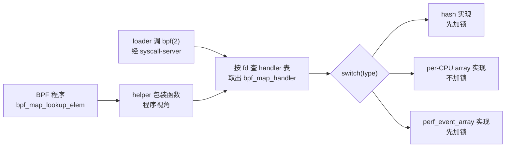
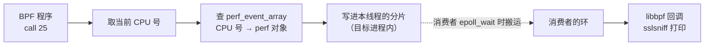
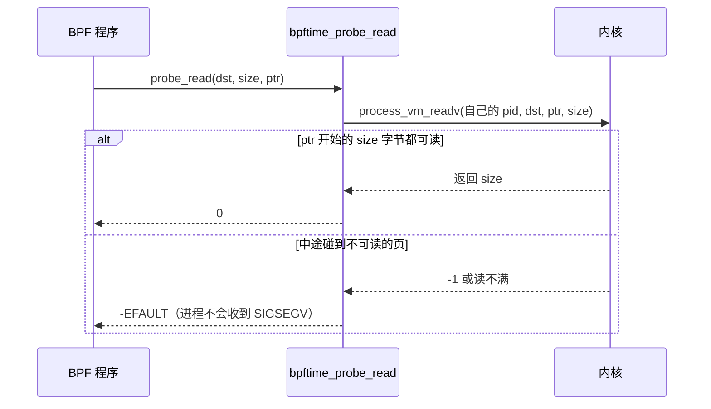

# 6. map 与 helper：BPF 程序调用的"内核功能"在用户态怎么实现

> 一句话：BPF 程序里写的 `bpf_map_lookup_elem`、`bpf_perf_event_output`、`bpf_probe_read_user`，
> 在 bpftime 里各是哪段 C++ 代码、为什么要那样写。读完你能说清一次 map 调用怎么分发、
> per-CPU map 怎么在用户态"假装"成 per-CPU、perf 输出把数据写到了哪、用户态读坏指针为什么不崩。
>
> 前置：建议先读[第 2 章](02-runtime-shm.md)（共享内存和 handler 表）和[第 5 章](05-vm-llvm-jit.md)
> （helper 怎么被 JIT 绑定成函数调用）。预计用时：60–90 分钟。

## 本章要回答的问题

1. BPF 程序调用 `bpf_map_lookup_elem(&bufs, &tid)`，最后是哪段代码在查表？map 实现为什么不用虚函数？
2. helper 是怎么"交给"一个程序的？少注册一个 helper 会怎样？
3. 用户态没法关抢占，per-CPU map 怎么模拟？为什么同一个 map，程序里看到的 value 和 loader 里看到的 value 大小不一样？
4. `bpf_perf_event_output` 把一条记录写到了哪里，消费者又是怎么读到的？
5. BPF 程序读一个坏指针，宿主进程（比如 nginx）为什么不会崩？

## 6.1 本章地图：sslsniff 用到的 map 和 helper

全书的例子 sslsniff（`example/tracing/sslsniff/sslsniff.bpf.c`）一共用了四个 map。
它们正好覆盖本章要讲的几类实现：

| sslsniff 里的 map | 类型 | 用途 | bpftime 里的实现（`runtime/src/bpf_map/`） |
|---|---|---|---|
| `perf_SSL_events` | `PERF_EVENT_ARRAY` | 把事件送给用户态 sslsniff | `userspace/perf_event_array_map.cpp` |
| `ssl_data` | `PERCPU_ARRAY` | 约 8KB 的事件暂存区（栈放不下） | `userspace/per_cpu_array_map.cpp` |
| `bufs`、`start_ns` | `HASH` | 在 SSL 函数入口和出口之间传 buf 指针、时间戳 | `userspace/fix_hash_map.cpp`（默认的 hash 实现） |

热路径上最重要的两个 helper 是 `bpf_perf_event_output`（编号 25）和 `bpf_probe_read_user`（编号 112），
都在 `runtime/src/bpf_helper.cpp` 里。

### 文件地图

路径相对 `runtime/src/`。行数只是让你估计文件大小。

| 文件 | 行数 | 看什么 |
|---|---:|---|
| `bpf_map/map_common_def.hpp` | 103 | 先读。`bytes_vec`（放在 shm 里的字节数组）、`ensure_on_current_cpu`（取当前 CPU 号） |
| `handler/map_handler.hpp/.cpp` | 303+1478 | map 的统一分发层：`switch(type)` + `static_cast`，不用虚函数 |
| `bpf_map/userspace/per_cpu_array_map.cpp`、`per_cpu_hash_map.cpp` | 147+216 | per-CPU 模拟的两种布局；`elem_*` 和 `elem_*_userspace` 两套接口 |
| `bpf_helper.cpp` | 1444 | 所有 helper 的实现和注册表。锚点：`bpf_perf_event_output`、`bpftime_probe_read`、`get_kernel_utils_helper_group` |
| `bpf_map/userspace/perf_event_array_map.cpp` | 83 | 一个"CPU 号 → perf 对象 fd"的 int 数组 |
| `handler/perf_event_handler.cpp` | — | perf 记录真正写入的地方：`software_perf_event_buffer::output_data` |
| `bpf_map/shared/perf_event_array_kernel_user.cpp` | 525 | 少见路径：把用户态事件送进**内核** perf buffer |

---

## 6.2 一次 map 调用怎么分发到具体实现

**直觉。** 在内核里，`bpf_map_lookup_elem` 拿到的是一个 `struct bpf_map *`，
内核通过它的 `ops` 函数表找到具体实现（hash 走 hash 的查找，array 走 array 的查找）。
bpftime 要做同样的事，但它有一个内核没有的约束：**map 对象放在共享内存（shm）里，
被 loader 和目标进程同时映射**（见[第 2 章](02-runtime-shm.md)）。

这个约束决定了分发方式。C++ 的虚函数靠对象里的 vtable 指针工作，而 vtable 在每个进程里的
地址都不一样。一个带 vtable 指针的对象放进 shm，换个进程读就是野指针。所以 bpftime 用了
C 风格的做法：对象本身不带任何函数指针，旁边存一个"类型标签"，每次操作先 `switch` 标签，
再把 `void*` 强转成具体类型。指向实现对象的指针也不能存绝对地址，要用 `offset_ptr`
（存"相对自己的偏移"，任何进程映射到哪都能算对）。

下面这张图看两件事：BPF 程序和 loader 走的是同一个分发层；不同 map 类型在 `switch` 处分开，
有的加锁、有的不加。



`bpf_map_handler` 本身很简单：一个 `type` 字段，加一个指向实现对象的 `offset_ptr<void>`。
每个操作都长得像下面这样。

`runtime/src/handler/map_handler.cpp` 的 `bpf_map_handler::map_lookup_elem()`（节选）：

```cpp
const void *bpf_map_handler::map_lookup_elem(const void *key,
                                             bool from_syscall) const
{
        // 泛型 lambda：传进来的 impl 是什么类型，就调哪个类型的 elem_lookup
        const auto do_lookup = [&](auto *impl) -> const void * {
                if (impl->should_lock) {       // 每种实现自己声明要不要加锁（编译期常量）
                        bpftime_lock_guard guard(map_lock);  // 每个 map 一把自旋锁
                        return impl->elem_lookup(key);
                } else {
                        return impl->elem_lookup(key);
                }
        };
        /* do_lookup_userspace 结构相同，改调 elem_lookup_userspace */

        switch (type) {                        // 类型标签
        case bpf_map_type::BPF_MAP_TYPE_HASH: {
                auto impl = static_cast<hash_map_impl *>(map_impl_ptr.get());
                return do_lookup(impl);
        }
        /* ... ARRAY、RINGBUF、PERF_EVENT_ARRAY 同理 ... */
        case bpf_map_type::BPF_MAP_TYPE_PERCPU_ARRAY: {
                auto impl = static_cast<per_cpu_array_map_impl *>(
                        map_impl_ptr.get());
                return from_syscall ? do_lookup_userspace(impl) : // loader 视角
                                      do_lookup(impl);            // 程序视角
        }
        /* ... 其余类型 ... */
```

三个要记住的点：

- **`from_syscall` 是"视角开关"。** helper 包装函数（`bpftime_map_lookup_elem_helper`）传 `false`；
  loader 经 syscall-server 进来的调用（`bpftime_map_lookup_elem`）传 `true`。
  目前只有两种 per-CPU map 真正区分这两个视角，原因在 [6.4](#64-per-cpu-map-在用户态怎么模拟) 讲。
- **锁是每个 map 一把自旋锁，要不要加由实现自己决定。** hash、queue、stack、perf_event_array 等加锁；
  array、per-CPU 两种、ringbuf 不加。
- **实现对象的创建和销毁都由 handler 管理器显式完成**（`map_init` / `map_free`），
  不靠 C++ 析构函数——因为分配器同样不能跨进程持有。

**要点**：map 分发 = "按 fd 找 handler → 按 type 标签 switch → 强转成具体实现"。
不用虚函数，是因为对象在共享内存里，vtable 指针跨进程无效。

---

## 6.3 helper 怎么"交给"一个程序

**直觉。** 对 BPF 程序来说，helper 只是一个编号：字节码里写的是 `call 25`，不是函数名。
所以"注册 helper"本质上就是填一张"编号 → 函数指针"的表。JIT 编译时，遇到 `call 25`
就去这张表里找 25 号对应的函数，把它的地址直接编进机器码（细节见[第 5 章](05-vm-llvm-jit.md)）。

这张表不在 shm 里。它在**每个目标进程自己的内存里**构造，函数指针是本进程的地址，天然正确。

bpftime 把 helper 分成三组，每组是一张静态表：

| 组 | 获取函数 | 内容 |
|---|---|---|
| 内核工具组 | `get_kernel_utils_helper_group()` | 31 个模拟内核语义的 helper：probe_read 家族、ktime、pid/tgid、uid/gid、perf_event_output、ringbuf、tail_call…… |
| shm map 组 | `get_shm_maps_helper_group()` | 6 个 map 操作：lookup / update / delete / push / pop / peek，都是对上一节分发层的薄包装 |
| ufunc 组 | `get_ufunc_helper_group()` | 扩展机制：让 BPF 程序调用宿主进程里的原生函数 |

程序加载时，三组按配置开关依次注册进去。

`runtime/src/attach/bpf_attach_ctx.cpp` 的 `load_prog_and_helpers()`：

```cpp
int load_prog_and_helpers(bpftime_prog *prog, const runtime_config &config)
{
#if defined(__linux__)
        if (config.enable_kernel_helper_group) {          // 开关 1
                bpftime_helper_group::get_kernel_utils_helper_group()
                        .add_helper_group_to_prog(prog);  // 逐个填进 VM 的编号表
        }
#endif
        if (config.enable_ufunc_helper_group) {           // 开关 2
                bpftime_helper_group::get_ufunc_helper_group()
                        .add_helper_group_to_prog(prog);
        }
        if (config.enable_shm_maps_helper_group) {        // 开关 3
                bpftime_helper_group::get_shm_maps_helper_group()
                        .add_helper_group_to_prog(prog);
        }
        return prog->bpftime_prog_load(config.jit_enabled);  // 然后才 JIT
}
```

`add_helper_group_to_prog` 遍历组里每个 helper，最终调到 VM 的 `register_external_function`，
把函数指针写进 VM 内部的 `ext_funcs[编号]`。

**少注册一个会怎样？** JIT 翻译 `call N` 时，要找名叫 `_bpf_helper_ext_000N` 的符号。
找不到就报 "Ext func not found"，**整个程序编译失败**。所以缺 helper 是加载时失败，不是运行时失败。

**和内核的关键差别。** 内核里哪些 helper 能用，由 verifier 按程序类型决定。
bpftime 里只看三个配置开关和三张静态表。比如关掉 `enable_shm_maps_helper_group`，
任何用到 `bpf_map_lookup_elem` 的程序都会在加载时失败。

**要点**：helper = 编号到函数指针的表，每个进程自己构造；JIT 时按编号绑定，缺了就加载失败。
具体注册的边界规则（编号上限、重复注册）见本章深入参考。

---

## 6.4 per-CPU map 在用户态怎么模拟

**直觉。** 内核的 per-CPU map 给每个 CPU 一份独立的 value。BPF 程序运行期间不会被抢占、
不会换 CPU，所以"当前 CPU 的那一份"在整个程序执行期间都归它独占，不用加锁。
sslsniff 的 `ssl_data` 就是这么用的：拿它当一块 8KB 的暂存区，因为 BPF 栈只有 512 字节。

用户态两个前提都没有：线程随时可能被抢占，也随时可能被迁移到别的 CPU。
bpftime 的模拟办法很直接：**调用时问一下"我现在在哪个 CPU"（`sched_getcpu`），
用这个号选中对应的那一份，然后不加锁直接读写。**

这个 CPU 号只是一个快照。下一瞬间线程就可能换了 CPU，另一个线程也可能拿到同一个号。
所以它是"大多数时候各用各的"，不是内核那种严格独占。

代码里的取号函数名字有点唬人，实现只有一行。

`runtime/src/bpf_map/map_common_def.hpp` 的 `ensure_on_current_cpu()`：

```cpp
template <class T>
static inline T ensure_on_current_cpu(std::function<T(int cpu)> func)
{
        return func(my_sched_getcpu());   // 只是取一次当前 CPU 号，不绑核、不迁移
}
```

### 布局一：per-CPU array —— 一整块连续内存

所有 entry、所有 CPU 的 value 排在一个大数组里，同一个 entry 的各 CPU 份挨在一起：

```
总长度 = max_entries × ncpu × value_size

          ┌──────── entry 0 ────────┬──────── entry 1 ────────┐
          │ cpu0 │ cpu1 │ … │ cpuN  │ cpu0 │ cpu1 │ … │ cpuN  │
          └──────┴──────┴───┴───────┴──────┴──────┴───┴───────┘
程序视角（elem_lookup）：           只返回其中一格（当前 CPU 那格）
loader 视角（elem_lookup_userspace）：返回这一行的起点，一次拷 ncpu 格
```

`runtime/src/bpf_map/userspace/per_cpu_array_map.cpp` 的 `elem_lookup()` 和头文件里的 `data_at()`：

```cpp
uint8_t *data_at(size_t idx, size_t cpu)   // 第 idx 个 entry、第 cpu 份的地址
{
        return data.data() + idx * value_size * ncpu + cpu * value_size;
}

void *per_cpu_array_map_impl::elem_lookup(const void *key)
{
        return ensure_on_current_cpu<void *>([&](int cpu) -> void * {
                /* ... key 为空或越界 → errno = ENOENT，返回 nullptr ... */
                uint32_t key_val = *(uint32_t *)key;
                return data_at(key_val, cpu);   // 程序拿到的是"本 CPU 那一格"的指针
        });
}
```

### 布局二：per-CPU hash —— key 只存一份，value 是 ncpu 份拼起来

底层是一张放在 shm 里的 `boost::unordered_map<字节数组, 字节数组>`。
每个 key 只有一个条目，条目的 value 是 ncpu 份 value 首尾相接的大数组：

```
key "tid=42" ──► [ cpu0 的 value | cpu1 的 value | … | cpuN 的 value ]
                                  ▲
                程序视角 lookup：返回 &value[value_size × cpu]
                程序视角 update：只覆写本 CPU 那一段；key 不存在时，以全零的大数组为底插入
```

### 为什么两个视角的 value 大小不同

这正对应内核的语义。在内核里，BPF 程序 lookup per-CPU map 只拿到当前 CPU 那一份；
而 loader 用 `bpf(BPF_MAP_LOOKUP_ELEM)` 读同一个 key，会一次拿到所有 CPU 的值，
所以 libbpf 要按 `value_size × CPU 数` 准备缓冲区。bpftime 用 `from_syscall` 开关复刻了这一点：
loader 视角的 value 大小会乘以 CPU 数（`get_userspace_value_size()`）。读代码时混淆这两个视角，
就会把 value 大小看错 ncpu 倍。

**要点**：

- per-CPU 模拟 = "取当前 CPU 号选一份 + 完全不加锁"。CPU 号只是快照，不是独占保证。
- array 是一整块连续内存；hash 是一个 key 对应一个"ncpu 份拼接"的 value。
- 程序视角看一份，loader 视角看全部。
- 官方实现里 per-CPU hash 的 delete 有一个已核实的 bug（清错了范围），见本章深入参考。

---

## 6.5 helper 代表：`bpf_perf_event_output`

**先回顾内核里的 perf buffer。** 内核给每个 CPU 准备一个环形缓冲区（ring）。
BPF 程序调用 `bpf_perf_event_output(ctx, &perf_map, BPF_F_CURRENT_CPU, data, size)`，
就是把 `data` 作为一条记录追加到"当前 CPU 的那个环"里。用户态的 libbpf `perf_buffer`
把所有 CPU 的环都 mmap 过来，用 epoll 等着，有数据就逐条回调 sslsniff 打印。
`PERF_EVENT_ARRAY` 这个 map 本身不存数据，只存"第 i 个 CPU 对应哪个 perf 环"。

**bpftime 里的三步。** helper 做的事可以概括成：

1. **找到当前 CPU 对应的 perf 对象。** 取当前 CPU 号，用它当 key 查 `perf_SSL_events`。
   查到的 value 是一个 perf 对象的假 fd（假 fd 见[第 2 章](02-runtime-shm.md)）。
2. **写一条记录。** 记录不是直接写进消费者看的那个环，而是写进"当前线程专属的分片（shard）"。
   每个线程一个分片，多个线程同时输出时互不抢锁。
3. **消费者之后读到。** sslsniff 调 `epoll_wait` 时（被 syscall-server 接管），bpftime 先把各分片里的
   记录搬（drain）进消费者的环，再告诉它"有数据"。libbpf 照常从 mmap 的环里读。

那 `perf_SSL_events` 里的 value 是谁填的？是消费者自己。sslsniff 调 `perf_buffer__new` 时，
libbpf 会为每个 CPU 调一次 `perf_event_open`，syscall-server 把它变成一个 shm 里的
"软件 perf 对象"；libbpf 再把它的 fd 写进 perf array 的第 i 格。

下面这张图看数据怎么流动：写入发生在目标进程里，搬运发生在消费者调用 `epoll_wait` 的时候。



### 精简代码

`runtime/src/bpf_helper.cpp` 的 `bpf_perf_event_output()`（节选）：

```cpp
uint64_t bpf_perf_event_output(uint64_t ctx, uint64_t map, uint64_t flags,
                               uint64_t data, uint64_t size)
{
        int32_t current_cpu = my_sched_getcpu();    // ① 记下当前 CPU 号
        /* ... 保存线程原来的 CPU 亲和性，把线程临时绑到 current_cpu ... */
        int fd = (int)map;
        bpftime::bpf_map_type map_ty;
        int ret = -1;
        if (bpftime_map_get_info(fd, nullptr, nullptr, &map_ty) < 0)
                goto restore_affinity;               // 查不到 map 类型：出错
        if (map_ty == bpftime::bpf_map_type::BPF_MAP_TYPE_PERF_EVENT_ARRAY) {
                const int32_t *val_ptr = (int32_t *)(uintptr_t)
                        bpftime::shm_holder.global_shared_memory
                                .bpf_map_lookup_elem(fd, &current_cpu, false); // ② key = CPU 号
                if (val_ptr == nullptr)
                        goto restore_affinity;       // 这个 CPU 没有对应的格子：出错
                ret = bpftime_perf_event_output(*val_ptr,   // ③ value = perf 对象的 fd
                                (const void *)(uintptr_t)data, (size_t)size);
        }
        /* else if 内核共享版 perf array → bpftime_shared_perf_event_output(...) */
restore_affinity:
        /* ... 恢复原来的 CPU 亲和性，并保住输出路径设置的 errno ... */
        return (uint64_t)ret;
}
```

**关于绑核。** 官方实现每次输出前会把线程临时绑到当前 CPU、输出后恢复，这会带来额外的系统调用。
源码没有写动机，读代码时知道有这么一层就行；它的代价和讨论放在本章深入参考里。

### 一条记录长什么样

`bpftime_perf_event_output` 最后走到 `software_perf_event_buffer::output_data`，按内核 perf 格式写一条
`PERF_RECORD_SAMPLE` 记录：先是头部，然后是数据。

`runtime/src/handler/perf_event_handler.cpp` 的 `software_perf_event_buffer::output_data()`（节选）：

```cpp
int software_perf_event_buffer::output_data(const void *buf, size_t size)
{
        constexpr size_t alignment = sizeof(uint64_t);
        /* ... size 太大（总长超过 u16 上限）→ errno = E2BIG，返回 -1 ... */
        const size_t record_size =                    // 总长向上取整到 8 的倍数
                (sizeof(perf_sample_raw) + size + alignment - 1) &
                ~(alignment - 1);
        perf_sample_raw header;
        header.header.type = PERF_RECORD_SAMPLE;
        header.header.size = record_size;
        header.size = record_size - sizeof(header);   // 数据段长度含尾部填充
        append_record_parts(&header, sizeof(header), buf, size,
                            header.size - size);      // 追加到环；注意返回值被丢掉了
        return 0;                                     // 恒返回 0
}
```

**为什么要 8 字节对齐。** 内核 perf 环里的记录永远 8 字节对齐，所以 8 字节的记录头永远不会被环尾劈成两半。
libbpf 读记录时就依赖这个假设。用户态模拟必须遵守同样的规则，否则 libbpf 会读到半个头。

**返回 0 不等于消费者一定收到。** 注意最后两行：环满了 `append_record_parts` 会失败，但返回值被丢掉，
helper 照样返回 0。bpftime 也不生成内核那种"丢了 N 条"的 `PERF_RECORD_LOST` 记录。
所以丢数据时，BPF 程序和消费者都看不到。

### 另一条分支：内核共享版 perf array

如果 map 类型是 `KERNEL_USER_PERF_EVENT_ARRAY`，说明消费者是**真正的内核 perf buffer**
（比如 [第 7 章](07-periphery.md) 的 daemon 场景）。这时 bpftime 把数据写进一个内核的 user ringbuf，
再由一段内核里的"搬运"BPF 程序定期取出，转投到真正的 perf array。这条路有单条 448 字节的上限、
搬运速率也受定时器限制，sslsniff 这种量级不走它。细节见本章深入参考。

**要点**：

- perf_event_array 在 bpftime 里只是"CPU 号 → perf 对象 fd"的路由表，由消费者在 `perf_buffer__new` 时填好。
- 写入走"本线程分片"，消费者 `epoll_wait` 时才搬进它的环。
- 记录按 8 字节对齐；环满时静默丢弃，helper 仍返回 0。
- 官方实现每次输出都临时绑核，有额外的系统调用开销。

---

## 6.6 probe_read：用户态读内存为什么也需要容错

**问题在哪。** BPF 程序经常要读被追踪函数的参数指向的内存。sslsniff 在 `SSL_write` 返回时，
用 `bpf_probe_read_user(&data->buf, len, buf指针)` 把明文拷出来。这个指针来自被追踪的程序，
BPF 程序没法保证它有效：可能已经被释放、可能是垃圾值、长度也可能越过映射边界。

在内核里，`bpf_probe_read_user` 用 `copy_from_user_nofault` 实现：碰到坏地址只返回错误，内核不会出事。

在 bpftime 里，BPF 程序跑在**目标进程自己的地址空间里**。如果直接 `memcpy` 一个坏指针，
CPU 触发缺页，进程收到 SIGSEGV——被追踪的 nginx 直接崩掉。观测工具把被观测者弄崩，这是不可接受的。

**bpftime 的办法：让内核替你"试读"。** Linux 有一个系统调用 `process_vm_readv(pid, 本地缓冲, 远端地址)`，
本来用来从**别的进程**拷内存（调试器常用）。bpftime 把 `pid` 填成**自己**。
这样拷贝动作由内核完成：源地址不可读时，内核只返回错误或"少读了几个字节"，
不会给进程发 SIGSEGV。代价是每次 probe_read 都要进一次内核。

`runtime/src/bpf_helper.cpp` 的 `probe_read_memory()`（Linux 分支）和 `bpftime_probe_read()`：

```cpp
static bool probe_read_memory(void *dst, const void *src, size_t size)
{
        if (size == 0)
                return true;                            // 0 字节不进内核
        struct iovec local = { dst, size };             // "本地" = 目的缓冲区
        struct iovec remote = { const_cast<void *>(src), size };  // "远端" = 不可信指针
        return syscall(SYS_process_vm_readv,
                       probe_access_pid,                // 目标进程 = 自己（缓存的 pid）
                       &local, 1, &remote, 1, 0) == (ssize_t)size;  // 必须一字不差读满
}

int64_t bpftime_probe_read(uint64_t dst, int64_t size, uint64_t ptr, uint64_t,
                           uint64_t)
{
        if (unlikely(size < 0))
                return -EFAULT;
#ifdef ENABLE_PROBE_READ_CHECK                          // 默认打开
        return probe_read_memory((void *)dst, (void *)ptr, (size_t)size) ?
                       0 : -EFAULT;                     // 读失败或读不满 → -EFAULT
#else
        memcpy((void *)dst, (void *)ptr, (size_t)size); // 关掉检查：裸拷，坏指针直接崩
        return 0;
#endif
}
```

（macOS 分支用 Mach 的 `mach_vm_read_overwrite` 做同样的事，这里省略。）

下面这张时序图看错误在哪里被发现：在内核里，而不是在用户态的信号处理里。



**为什么要缓存 pid，还要处理 fork。** `process_vm_readv` 的第一个参数是目标 pid。每次调 `getpid()` 是一次真
系统调用，所以 bpftime 在启动时把 pid 存进静态变量。问题是 fork：子进程会继承父进程的静态变量，
如果不刷新，子进程会拿父进程的 pid 去"读自己"，实际读到父进程的内存。
所以代码用 `pthread_atfork` 注册了一个回调，在子进程里重新取一次 pid。

`runtime/src/bpf_helper.cpp` 文件开头：

```cpp
static pid_t probe_access_pid = getpid();               // 程序启动时取一次
static const int probe_access_atfork_status = pthread_atfork(
        nullptr, nullptr, [] { probe_access_pid = getpid(); });  // fork 出的子进程里刷新
```

（如果 `pthread_atfork` 注册失败，代码会退回每次都调 `getpid()`。）

**和内核的一个差异**：读失败时，内核会把 `dst` 清零；bpftime 的 `bpf_probe_read_user` 直接返回 `-EFAULT`，
不清零。读了一半失败时，`dst` 前半段可能已经写进了数据。依赖"失败即全零"的程序要小心。

`bpf_probe_write_user` 是对称的，用 `process_vm_writev` 写自己。读字符串的 `bpf_probe_read_str`
则按"不跨页的小块"逐块读、逐块找结尾的 `'\0'`，失败时会把整个 `dst` 清零，语义和内核一致。

**要点**：

- 用户态直接解引用坏指针会让宿主进程崩溃，所以 probe_read 必须容错。
- 做法是对自己调 `process_vm_readv`，让内核代为拷贝；坏地址只得到错误码。
- 代价是每次调用一个系统调用；pid 被缓存并在 fork 后刷新。
- 编译开关 `ENABLE_PROBE_READ_CHECK` / `ENABLE_PROBE_WRITE_CHECK` 默认打开；关掉就退化成裸 `memcpy`。

---

## 6.7 顺带：tail call

`bpf_tail_call(ctx, &prog_array, idx)` 在内核里是"直接跳到另一个程序，不返回"。
bpftime 的 `bpftime_tail_call` 做法不同：它查出目标程序，优先复用这个进程里已经 JIT 好的实例，
然后**像普通函数一样调用它**，把返回值记下来当作本次的返回值。嵌套深度限制为 32 层。
如果目标还没实例化，就要现场 JIT 一次，这一次会很慢。做带 tail call 的 benchmark 时，先来这里看一眼。

---

## 小结

- map 分发是"按 fd 找 handler → `switch(type)` → `static_cast` 成具体实现"。不用虚函数，因为对象在共享内存里，vtable 指针跨进程无效。
- 同一个 map 有两种视角：BPF 程序（`from_syscall=false`）和 loader（`true`）。只有 per-CPU map 真正区分它们，loader 视角的 value 大 ncpu 倍。
- helper 是"编号 → 函数指针"的表，分三组按配置开关注册；JIT 时缺某个编号，整个程序加载失败。
- per-CPU map 靠"取当前 CPU 号选一份 + 不加锁"模拟，CPU 号只是快照，不是内核那种严格独占。
- `bpf_perf_event_output`：用 CPU 号查 perf array 拿到 perf 对象 → 写进本线程分片 → 消费者 `epoll_wait` 时搬进它的环。记录 8 字节对齐；环满静默丢弃。
- 官方实现每次 perf 输出都临时绑核，有额外系统调用。
- probe_read 用对自己的 `process_vm_readv` 实现容错：坏指针得到 `-EFAULT`，宿主进程不会收到 SIGSEGV。

## 动手验证

1. **跑本章相关的单测。** 在官方源码的副本里构建单测（Debug，两个 probe 检查都打开）：

   ```bash
   make build-unit-test
   T=./build/runtime/unit-test/bpftime_runtime_tests
   $T "[software_perf_event]"                 # perf 分片、8 字节对齐回绕、shm 耗尽
   $T "Test bpftime_probe_read" "Test bpf_probe_read_str"
   $T "Test probe access preserves application SIGSEGV handlers"
   $T "Test basic operations of array map"    # per-CPU array（文件 maps/test_per_cpu_array.cpp）
   ```

   预期：每条都输出 `All tests passed`。可以试着把 `output_data` 里的 `alignment` 改成 1 再跑第一条，看哪些断言失败。

2. **数一数每个事件的系统调用。** 跑起 sslsniff + nginx 之后，找一个 nginx worker 的 pid，然后：

   ```bash
   sudo strace -f -p <worker_pid> \
     -e trace=process_vm_readv,sched_getaffinity,sched_setaffinity
   ```

   另开一个终端发一次 HTTPS 请求。预期：每产生一个 sslsniff 事件，能看到 1 次 `process_vm_readv`
   （probe_read 拷明文）和 1 次 `sched_getaffinity` + 2 次 `sched_setaffinity`（perf 输出前后的绑核）。

3. **确认 probe 检查是否打开。**

   ```bash
   grep PROBE build/CMakeCache.txt
   ```

   预期默认是 `ENABLE_PROBE_READ_CHECK:BOOL=ON` 和 `ENABLE_PROBE_WRITE_CHECK:BOOL=ON`。
   如果是 OFF，probe_read 就是裸 `memcpy`，第 2 个实验里也不会看到 `process_vm_readv`。

## 自测题

1. **map 实现为什么用 `switch(type) + static_cast`，而不是虚函数？如果硬给实现类加上虚函数会怎样？**
   <details><summary>答案</summary>

   实现对象放在共享内存里，同时被 loader 和目标进程映射。虚函数依赖对象里的 vtable 指针，
   而 vtable 的地址在每个进程里不同。对象在 A 进程里构造，vtable 指针指向 A 的地址；
   B 进程读到同一个对象，调虚函数就会跳到 B 里一个无意义的地址，大概率崩溃。
   所以只能用"无函数指针的对象 + 外置类型标签 + switch"，指针也要用存相对偏移的 `offset_ptr`。
   注意外层"fd → handler"那一步用的是 `std::variant`，它按值存放、靠下标区分类型，同样不含 vtable 指针。
   </details>

2. **loader 想用 `bpf_map_lookup_elem` 读 `ssl_data`（per-CPU array，value 约 8KB）的第 0 项，它该准备多大的缓冲区？BPF 程序里 lookup 同一项拿到的又是什么？**
   <details><summary>答案</summary>

   loader 走 syscall 视角（`from_syscall=true`），一次拷出所有 CPU 的值，缓冲区要 `value_size × CPU 数`
   （CPU 数按在线 CPU 计）。BPF 程序走 helper 视角，只拿到"当前 CPU 号那一份"的指针，大小就是 `value_size`。
   这和内核的 per-CPU map 语义一致。
   </details>

3. **把 `enable_shm_maps_helper_group` 关掉，sslsniff 会在什么时候失败？`bpf_perf_event_output` 受影响吗？**
   <details><summary>答案</summary>

   在**加载时**失败，不是运行时。map 操作 helper（lookup / update / delete）不再注册，
   JIT 翻译第一个 `bpf_map_update_elem`（`call 2`）时找不到 `_bpf_helper_ext_0002` 这个符号，
   报 "Ext func not found"，整个程序编译失败。`bpf_perf_event_output`（25 号）属于内核工具组，本身不受影响，
   但程序已经整体加载失败了。
   </details>

4. **两个 nginx worker 线程碰巧在同一个 CPU 上交替运行，都把 `ssl_data` 当暂存区。会出什么问题？`bpf_perf_event_output` 里的临时绑核能防住吗？**
   <details><summary>答案</summary>

   两个线程取到同一个 CPU 号，就拿到同一块暂存区，而 per-CPU map 完全不加锁。线程 A 填到一半被抢占，
   线程 B 覆盖了同一块内存，A 回来输出的就是被改过的数据。绑核防不住：它只覆盖 perf 输出那一次调用，
   而 sslsniff 对 `ssl_data` 的 lookup 和填充早在那之前就完成了；绑核也不是锁，不阻止同一 CPU 上的线程交替执行。
   用户态的 per-CPU 模拟本来就只是"大多数时候各用各的"。
   </details>

5. **`bpf_perf_event_output` 返回 0，消费者一定能收到这条记录吗？**
   <details><summary>答案</summary>

   不一定。写入分片时如果环满了，`append_record_parts` 失败，但 `output_data` 丢掉了这个返回值，恒返回 0；
   也不会生成 `PERF_RECORD_LOST`。另外，消费者搬运时如果读到一条长度不合法的记录，会丢掉整个分片里积压的数据。
   这两处都是静默丢弃。
   </details>

6. **BPF 程序用 `bpf_probe_read_user` 读一个已经被释放的指针。谁发现了错误？nginx 会收到 SIGSEGV 吗？`dst` 里剩下什么？**
   <details><summary>答案</summary>

   内核发现。bpftime 对自己的 pid 调 `process_vm_readv`，让内核代为拷贝；源页不可读时，内核返回 -1 或"读不满"，
   bpftime 返回 `-EFAULT`。缺页在内核里处理，nginx 收不到 SIGSEGV，它自己的信号处理设置也不会被动过。
   `dst` 不会被清零：如果读了一半才失败，前半段可能已经写进去了。这一点和内核不同（内核失败时会清零）。
   </details>

## 深入参考

<details>
<summary>代码位置速查（按 177a1dc465ff 行号）</summary>

路径相对 `runtime/src/`，另有说明的除外。

| 概念 / 函数 | 位置 |
|---|---|
| sslsniff 的四个 map 定义 | `example/tracing/sslsniff/sslsniff.bpf.c:20-58` |
| sslsniff 的 probe_read / perf 输出调用 | `example/tracing/sslsniff/sslsniff.bpf.c:115`、`:125-126` |
| 默认 hash 实现选择（`BPFTIME_USE_VAR_HASH_MAP` 未定义 → `fix_size_hash_map_impl`） | `handler/map_handler.cpp:54-58` |
| `handler_variant` 定义 | `handler/handler_manager.hpp:87-90` |
| `bpf_map_handler`：`type`、`general_map_impl_ptr`（`offset_ptr<void>`） | `handler/map_handler.hpp:70,73` |
| `map_lock`、`map_impl_ptr` 成员 | `handler/map_handler.hpp:278,280` |
| `~bpf_map_handler` 只打 CRITICAL 日志 | `handler/map_handler.hpp:132-142` |
| `get_userspace_value_size`（per-CPU ×ncpu） | `handler/map_handler.cpp:69-84` |
| `map_lookup_elem` 分发 | `handler/map_handler.cpp:109-158`（per-CPU 分流 `:147-158`） |
| update / delete 的 per-CPU 分流 | `handler/map_handler.cpp:308-319`、`:623-634` |
| `map_init`（`anonymous_instance` 构造） | `handler/map_handler.cpp:762` 起；unsupported 分支 `:1127-1141` |
| helper 视角 / syscall 视角入口 | `bpf_helper.cpp:299-304`（`false`）；`bpftime_shm.cpp:115-119`（`true`） |
| `bpftime_shm::bpf_map_lookup_elem` | `bpftime_shm_internal.cpp:281-286` |
| `fix_size_hash_map_impl::elem_update` / `elem_delete` | `bpf_map/userspace/fix_hash_map.cpp:34-45` |
| `bpftime_helper_info` / `helper_map` | `runtime/include/bpftime_helper_group.hpp:15-19,56` |
| `register_helper`（id ≤ 999） | `bpf_helper.cpp:1129-1146` |
| `add_helper_group_to_prog` | `bpf_helper.cpp:1163-1169` |
| 三个 helper 组 | ufunc `bpf_helper.cpp:1181-1186`（→ `runtime/extension/extension_helper.cpp:133`）；kernel utils `:1189-1370`；shm maps `:1371-1413` |
| perf_event_output 注册项 | `bpf_helper.cpp:1345-1348` |
| probe_read_str 注册项（114 与 45） | `bpf_helper.cpp:1300-1311` |
| `load_prog_and_helpers` | `attach/bpf_attach_ctx.cpp:43-60` |
| `bpftime_prog_register_raw_helper` | `bpftime_prog.cpp:278-287` |
| `ebpf_register` | `vm/vm-core/src/ebpf-vm.cpp:36-40` |
| `llvmbpf_vm::register_external_function` | `vm/llvm-jit/src/vm.cpp:85-99`；`MAX_EXT_FUNCS 8192` 在 `vm/llvm-jit/include/llvmbpf.hpp:13` |
| `ext_func_sym` / "Ext func not found" | `vm/llvm-jit/src/compiler_utils.hpp:39-44`；`compiler_utils.cpp:319-321,368` |
| `ensure_on_current_cpu` / `ensure_on_certain_cpu` | `bpf_map/map_common_def.hpp:27-31` / `:33-62` |
| `my_sched_getcpu` / macOS `sched_setaffinity` 空桩 | `platform_utils.cpp:7-9` / `:32-34` |
| per-CPU array：`data_at`、`should_lock` | `bpf_map/userspace/per_cpu_array_map.hpp:25-28,31` |
| per-CPU array：构造、`elem_lookup`、`elem_update`、delete、userspace 接口 | `per_cpu_array_map.cpp:17-25`、`:34-48`、`:50-74`、`:76-81`、`:101-145` |
| per-CPU hash：结构、`should_lock` | `per_cpu_hash_map.hpp:20-49,52` |
| per-CPU hash：`elem_lookup`、`elem_update`、`elem_delete`、userspace 接口 | `per_cpu_hash_map.cpp:48-66`、`:68-94`、`:96-107`、`:142-200` |
| `bpf_perf_event_output` | `bpf_helper.cpp:487-553`（绑核 `:496-506`，恢复 `:546-552`） |
| `bpftime_map_get_info` | `bpftime_shm.cpp:287-306` |
| `bpftime_perf_event_output` / `bpftime_shared_perf_event_output` | `bpftime_shm.cpp:575-596` / `:599-624` |
| `bpftime_epoll_wait`（消费者轮询 `has_data`） | `bpftime_shm.cpp:418` 起，`has_data` 调用在 `:473` |
| perf_event_array 实现 | `bpf_map/userspace/perf_event_array_map.cpp:14-26`（构造）、`:28-36`（lookup）；`should_lock` 在 `.hpp:23` |
| `software_perf_event_buffer::output_data` | `handler/perf_event_handler.cpp:367-388` |
| `copy_next_record_to`（消费侧校验） | `handler/perf_event_handler.cpp:421-462` |
| `get_current_thread_shard` / `drain_producer_shards` / `has_data` | `handler/perf_event_handler.cpp:491`、`:550`、`:588-592` |
| `software_perf_event_data::output_data` | `handler/perf_event_handler.cpp:601-604` |
| `PERF_RECORD_LOST`（只作为枚举出现） | `runtime/include/bpftime_epoll.h:314` |
| syscall-server 创建软件 perf 对象 | `runtime/syscall-server/syscall_context.cpp:905-910` |
| probe pid 缓存 | `bpf_helper.cpp:68-73` |
| `probe_read_memory` / `bpftime_probe_read` | `bpf_helper.cpp:97-119` / `:121-136` |
| `probe_write_memory` / `bpftime_probe_write_user` | `bpf_helper.cpp:138-160` / `:162-177` |
| `probe_page_remaining` / `clear_probe_memory` / `bpf_probe_read_str` | `bpf_helper.cpp:344-351` / `:353-364` / `:367-418` |
| probe 检查开关 | `cmake/StandardSettings.cmake:110,112`；`CMakeLists.txt:189-195` |
| pid/tgid 缓存、uid/gid 实时查询 | `bpf_helper.cpp:208-259`、`:261-267` |
| `bpftime_trace_printk` | `bpf_helper.cpp:78-90` |
| 未注册的 helper 37 / 80 | `bpf_helper.cpp:951`、`:994`（只在枚举里） |
| `BPF_MAP_TYPE_CGROUP_ARRAY`（只在枚举里） | `runtime/include/bpftime_shm.hpp:79` |
| `bpftime_tail_call` | `bpf_helper.cpp:555-660`；返回值接收 `bpftime_prog.cpp:271` |
| 内核共享 perf array：`output_data_into_kernel`、ctor、`ensure_current_map_user_ringbuf` | `bpf_map/shared/perf_event_array_kernel_user.cpp:66-91`、`:95-155`、`:229-245` |
| 内核共享 perf array：定时 perf event、搬运程序 | 同文件 `:446-459`、`:461` 起（C 原型注释 `:286-320`，指令数组 `:334` 起） |
| 相关单测 | `runtime/unit-test/test_software_perf_event.cpp:23,157,266,323`；`test_probe.cpp:34-227`；`maps/test_per_cpu_array.cpp`、`maps/test_per_cpu_hash.cpp` |

</details>

<details>
<summary>细节与坑</summary>

**map 分发层**

- 各实现的 `should_lock`：`fix_hash_map`、`var_hash_map`、`lru_var_hash_map`、`queue`、`stack`、`stack_trace`、`bloom_filter`、`lpm_trie`、`perf_event_array` 为 `true`；`array`、`per_cpu_array`、`per_cpu_hash`、`ringbuf`、`prog_array` 及全部 kernel-shared map 为 `false`。per-CPU map 无锁是下面所有正确性讨论的前提。
- `map_init` 用 `memory.construct<xxx_impl>(boost::interprocess::anonymous_instance)(...)` 在 shm 里构造实现对象。析构必须由 handler_manager 显式调 `map_free`；`~bpf_map_handler` 里如果发现实现对象还在，只打一条 CRITICAL 日志。
- 外层 `handler_variant` 用 `std::variant`，内层 map 实现用"`offset_ptr<void>` + `type` + switch"。variant 里的 `bpf_map_handler` 本身没有虚函数，所以能按值放进 shm。
- **默认 hash map 的语义缺口**：`fix_size_hash_map_impl::elem_update` 不看 `flags`，`BPF_EXIST` / `BPF_NOEXIST` 不生效；它还忽略底层 `bpftime_hash_map::elem_update` 的 `bool` 返回值，**map 满时插入失败也返回 0**。`elem_delete` 同理，删不存在的 key 也返回 0。sslsniff 只用 `BPF_ANY` 且不检查返回值，不受影响。

**helper 注册**

- 组内 `register_helper` 限制 id ≤ 999。同一 id 重复注册，只要函数指针相同就静默忽略；不同则报错。
- 到了 VM 一层，`register_external_function` 对 index ≥ 8192 返回 `-E2BIG`，对已注册过的 index 一律返回 `-EEXIST`。而 `add_helper_group_to_prog` 不检查返回值。所以两组如果编号重叠，**先注册的生效，后注册的静默丢失**。
- `bpftime_prog_register_raw_helper` 注册成功后还会记录该 helper 是否 async-signal-safe（`helper_is_async_signal_safe`），供 trap 后端判断（见[第 4 章](04-attach-frida.md)）。
- 只有 `kernel_compatible_mode` 下，JIT 的 `emitExtFuncCall` 才会通过 `allow_implicit_external` 把缺失 helper 当外部声明放过；runtime 正常加载不走这条。
- **已知缺口**：`bpf_trace_printk` 直接 `vprintf` 到宿主进程的 stdout，忽略 `fmt_size`、恒返回 0，不进任何 trace_pipe。`BPF_FUNC_current_task_under_cgroup`（37）和 `BPF_FUNC_get_current_cgroup_id`（80）只在枚举里出现，没有注册实现。`BPF_MAP_TYPE_CGROUP_ARRAY` 只在 `bpftime_shm.hpp` 的枚举里，`map_init` 没有对应分支，走 default 报 "Unsupported map type"。

**per-CPU map**

- `ensure_on_current_cpu` 名字唬人，实现只是 `func(my_sched_getcpu())`，纯快照，不迁移不绑核。
- 真正"绑核再执行"的 `ensure_on_certain_cpu` **只有单测在用**（`unit-test/maps/test_per_cpu_*.cpp`），而且只用 `void` 特化版。泛型主模板里写的是 `func(currcpu)`，对零参 `std::function<T()>` 传了参数，一旦被实例化就编译失败，等于死代码；`currcpu` 初始化为 -1 后再无赋值，快路径永远不命中。读代码时别被它误导，以为 map 运行时有绑核路径。
- **CPU 号快照不提供独占**：helper 路径从头到尾只有一次 `my_sched_getcpu()`，没有任何机制阻止快照后线程迁移；两个线程可以同时写同一份。`bpf_perf_event_output` 的绑核只覆盖它自己那一次调用，与 per-CPU map 的正确性无关。
- per-CPU array 两个视角都不支持 delete（与内核一致）。syscall 视角一次拷 `ncpu × value_size` 字节。
- per-CPU hash 的 `key_templates` / `single_value_templates` 是按 CPU 预分配的临时缓冲区，避免每次操作在 shm 里做小分配。但两个线程若取到同一个 CPU 号，会并发写同一个临时缓冲区；无锁的 `boost::unordered_map` 并发插入还可能撞上 rehash。这些都是"低并发时碰不上"的已知妥协。
- **已核实的 bug（官方 177a1dc 仍在）**：`per_cpu_hash_map_impl::elem_delete` 不删条目，只执行 `std::fill(second.begin(), second.begin() + cpu*value_size, 0)`，清零的是 **[0, cpu) 这几份**，即"其他 CPU 的前几份"；本 CPU 那份和 key 都还在。正确做法应是 `impl.erase(itr)`——loader 视角的 `elem_delete_userspace` 反而是对的。
- per-CPU hash 的 helper 路径 `elem_update` 不检查 `_max_entries`（只有 userspace 路径检查），BPF 程序可以把 map 无限撑大。
- （读代码推断，未实测）`data_at` 和 per-CPU hash 的切片下标都不检查 `cpu < ncpu`。`ncpu` 取的是在线 CPU 数（`_SC_NPROCESSORS_ONLN`），若机器有 CPU 下线导致 CPU 编号不连续，`sched_getcpu()` 返回的编号可能 ≥ ncpu，会越界。

**perf 输出**

- `flags` 参数被完全忽略（`ctx` 也没用）。sslsniff 传 `BPF_F_CURRENT_CPU`，恰好和"永远用当前 CPU 号"一致；如果程序用 `BPF_F_INDEX_MASK` 显式指定下标，bpftime 会静默当成当前 CPU 处理。
- perf_event_array 的 key / value 强制 4 字节，初值 -1。`elem_lookup` 对 `k < 0 || k >= data.size()` 返回 `nullptr` 并置 `EINVAL`——perf array 的 `max_entries` 小于 CPU 号时就走错误路径。若某个 CPU 的格子还是 -1，`bpftime_perf_event_output` 会因为 fd 不是 perf handler 而报错。
- `perf_event_array_map_impl::should_lock = true`：每个事件都要拿一次这个 map 的自旋锁做 lookup。无竞争时开销小，但剖析时会看到。
- 记录总长向上取整到 8 的倍数，写进 `header.header.size`；数据段长度 `header.size` 包含尾部填充。`size` 大到取整后超过 u16 上限时 `errno = E2BIG` 拒绝。
- 消费侧 `copy_next_record_to` 只拒绝 `size < sizeof(header)` 或 `size > ring 大小` 的记录，一旦遇到就**清空整个分片**（`data_tail = data_head`）。
- 绑核的具体动作：`sched_getaffinity` 保存原 mask → `sched_setaffinity` 绑到快照 CPU → 输出 → `sched_setaffinity` 恢复。Linux 上每事件 3 个系统调用；绑核时如果线程已经迁走，还会触发一次迁移回去。macOS 上 `sched_setaffinity` 是直接返回 0 的空桩，等于没绑。
- 绑核**之前** CPU 号就已经快照，绑核不改变 lookup 的 key；写入走 per-(pid,tid) 分片，选哪个分片和 CPU 无关；绑核也不是锁。所以在当前的分片设计下，它对正确性几乎没有贡献，只剩开销。（这段是本书对代码的分析。）
- 恢复 mask 时如果失败，且输出本身成功，会把结果改判为失败；同时保存 / 还原 errno，不覆盖输出路径设置的错误。

**内核共享版 perf array**

- 单条数据上限 448 字节（`480 - 32`），超出返回 `E2BIG`。
- 每进程惰性创建一个 `user_ring_buffer` 包装，对应 server 在构造函数里创建的 1MB `BPF_MAP_TYPE_USER_RINGBUF`。写入：reserve(size + 8) → 头 8 字节写长度 → payload → submit。
- 内核侧：构造函数创建一个周期触发的软件 perf event，挂上一段手写字节码的"搬运"程序：`bpf_user_ringbuf_drain` 取一条 → `bpf_perf_event_output` 投进真正的 perf array。
- `create_intervally_triggered_perf_event(10)` 里 `sample_period = duration_ms * 1000`，而 `PERF_COUNT_SW_CPU_CLOCK` 的 period 单位是纳秒——名义 10ms，实际 10µs（**疑似单位 bug，未实测**）。
- `user_ringbuffer_wrapper` 的 `reserve_lock` 初始化了却从没人 lock，并发 reserve 的线程安全完全依赖 libbpf 内部实现。
- 搬运程序每次只取 1 条（回调恒返回 1），高事件率下搬运速度上限 = 触发频率，容易积压。这是 kernel-shared 路径不适合 sslsniff 这种量级的结构性原因。
- （读代码发现）`output_data_into_kernel` 在 reserve 失败时 `return errno`，是正数；调用方 `bpftime_shared_perf_event_output` 只把 `err < 0` 当失败，于是 **reserve 失败会被当成成功返回 0**。
- 这条分支同样在绑核期间执行。

**probe_read / probe_write**

- 只要 `size > 0`，每次 probe_read 就是一次 `process_vm_readv`。sslsniff 每个事件拷一次明文（最多 `MAX_BUF_SIZE = 8192` 字节），即每事件一次。好处是完全不碰进程级信号处置，宿主自己的 SIGSEGV handler 不被替换（`test_probe.cpp` 的两个用例专门验证）。
- 失败时不清零 `dst`；sslsniff 失败时把 `buf_copy_size` 置 0，不受影响。
- `probe_write_memory` 的编译条件是 `ENABLE_PROBE_WRITE_CHECK || ENABLE_PROBE_READ_CHECK`——读路径的 `clear_probe_memory` 和 `bpf_probe_read_str` 也用它往 `dst` 写。
- `bpf_probe_read_str`（打开检查时）：块大小取 `min(256, bufsz 剩余, 本页剩余)`；每块先读到栈上 `scratch`，用 `memchr` 找 `'\0'`，再写回；返回值是**含结尾 NUL 的长度**；满 `bufsz` 时截断并补 NUL；任一块读失败就把整个 `dst` 清零后返回 `-EFAULT`。按页切块的意义：字符串在页尾正常结束时，不会因为"顺手多读了下一页"误报失败。`probe_read_user_str`（114）和 `probe_read_str`（45）都映射到它。
- 两个开关只作为 `runtime` 目标的 PRIVATE 编译定义生效。

**tail call**

- `bpftime_tail_call` 每次调用：校验 prog_array → 查下标 → 深度保护 `MAX_TAIL_CALL_CNT = 32`（thread_local 计数 + RAII guard）→ 先用 `get_global_attach_ctx().find_instantiated_prog(to_call_fd)` 复用已实例化的程序；找不到才在 `std::optional` 里临时构造一个 `bpftime_prog` 并 `load_prog_and_helpers`（这一步会 JIT）→ 拷 64 字节 ctx → 执行，返回值写进 `current_thread_tail_call_ret`，由外层 `bpftime_prog_exec` 当作本次返回值。目标是内核 prog fd 时改走 `bpf_prog_test_run_opts`。

**每请求的系统调用估算**（按代码数，不是实测）

sslsniff 一次 SSL_write 命中（入口 + 出口）：入口 2 次 `bpf_map_update_elem`（hash，各拿一次 map 锁）；出口 2 次 lookup + 1 次 per-CPU lookup（无锁）+ 1 次 `bpf_probe_read_user`（1 个 `process_vm_readv`）+ 2 次 delete + 1 次 `bpf_perf_event_output`（3 个 affinity 系统调用，perf array lookup 带锁）。入口、出口各调一次 `bpf_get_current_uid_gid`，每次实时 `getgid()` + `getuid()`，共 4 个系统调用；`bpf_get_current_pid_tgid` 走缓存；`bpf_ktime_get_ns` 用 `steady_clock`。合计约 8 个系统调用（不计 `sched_getcpu`，它是否陷入内核取决于 glibc / rseq）。

</details>

<details>
<summary>上游变更与我们的工作</summary>

**本章范围内 7 月以来的上游变更（`git log 6bd5319d..177a1dc`）**

| PR | 改了什么 | 涉及位置 |
|---|---|---|
| #612 `417f7c61` | 软件 perf 记录 8 字节对齐 | `software_perf_event_buffer::output_data` |
| #642 `f311de23`（含 #643） | probe read / write 改为不触发缺页信号的 no-fault 拷贝（`process_vm_readv/writev`）；`bpf_probe_read_str` 实现内核语义 | `bpf_helper.cpp` probe 部分 |
| #644 `aa5be1f8` | tail call 优先复用已实例化的 prog | `bpftime_tail_call` |
| #678 `3a1d2ecf` | `bpf_perf_event_output` 出错路径恢复 CPU affinity | `bpf_perf_event_output` |
| #598 `5e16b08c` | map 实现用 `anonymous_instance` 构造，公开名字相同的 map 不再撞名（之前按 `"ebpf_map_fd_" + name` 命名实例，两个同名 map 会撞到同一个 shm 对象） | `map_init` |
| #650 / #658 / #659 | hash 删除冲突 key 后的查找、fixed-hash 按质数桶数遍历、array-of-maps 非法 lookup 空指针 | `bpftime_hash_map.hpp`、`fix_hash_map.cpp`、`map_in_maps.hpp` |
| #601 / #609 / #631 / #663 / #685 / #691 | `bpf_get_func_ip`、`ktime_get_boot_ns`、get_stack build-ID 标志与缓冲区语义、fork 后刷新 pid/tid 缓存、uid/gid 每次实时查询 | `bpf_helper.cpp` |
| #706 `177a1dc4` | ringbuf 记录头和 payload 在环尾保持连续 | `userspace/ringbuf_map.cpp` |

**#678：出错路径漏恢复 mask**

- #678 之前，map 类型查询失败、perf array 里查不到当前 CPU 对应格子（例如 CPU 号 ≥ `max_entries`）这两条错误路径直接 `return`，**跳过了尾部的 `sched_setaffinity(orig)`**——调用线程（比如 nginx worker）会被永久钉在单核上。`sched_getaffinity` 的返回值也没检查，失败时 `orig` 是未定义内容。
- #678 把两处改成 `goto restore_affinity`，检查 getaffinity 返回值，并保证恢复动作不覆盖原错误（保存 / 还原 errno）。
- 回归测试：`runtime/unit-test/test_software_perf_event.cpp:23` "Perf output preserves the calling thread's CPU affinity"，tag `[perf_event][affinity]`，有 "Unknown map"、"CPU index outside the perf array"、"Successful output" 三个 SECTION。
- #678 修的是"漏恢复"，**没有**去掉绑核本身。

**#612：8 字节对齐**

- 上面 `output_data` 的取整逻辑就是 #612 引入的。为什么必须对齐：内核 perf ring 的记录永远 8 字节对齐，8 字节的 `perf_event_header` 因此不会跨越环尾，libbpf 消费端直接按这个假设读头部；不对齐时头部可能被劈成两半。
- 7 月我们自己的对齐修复 `0fcdb0e` 还在消费侧额外检查 `size % 8`，官方 #612 没有这一项。
- 教训：helper 返回 0 不代表数据进了消费者眼睛——这条链上有两处静默丢弃点（环满、非法记录）。

**每事件绑核：来历、代价与我们的提案**

- 这段绑核在 2023 年 perf_event_array 支持首次加入时（`f072961c`，#20）就已存在，源码只留了一句 `// Bind to the current cpu`，没有说明动机。
- **本书推断**：它想模拟内核语义——内核里 BPF 程序运行期间禁止迁移，"当前 CPU"在整次输出期间不变；用户态线程随时可能迁移，于是用 `sched_setaffinity` 把线程钉在快照到的 CPU 上，保证"用哪个 CPU 的格子，就在哪个 CPU 上写"。
- 对照官方当前代码，它实际保证的东西很少（见"细节与坑"的 perf 输出部分）：CPU 号在绑核前已快照、写入走 per-(pid,tid) 分片、绑核不是锁。所以在官方现在的分片设计下，它几乎只剩成本：每事件 3 个系统调用，外加可能的一次迁移。
- 我们在 Jetson 上的 ssl-nginx 测量中，这段每事件绑核约吃掉 20% 吞吐。我们的开发分支删掉了它，但这**不是**官方行为，官方 177a1dc 仍然每事件绑核。删除绑核的提案目前没有进上游（PR 状态与论据见[附录 A.4](09-appendix-research-notes.md#a4-pr-状态与辩护清单)）。

**7 月快照的三个修复的去向**

- 本章旧版写于 7 月快照 `ead56c9`（上游 `6bd5319d` + 我们的三个修复）。
- "perf record 8 字节对齐"：以另一种实现被上游合入（#612）。
- "删除每事件绑核"：**没有**进官方。
- "sigaction 重装"：它所修的整套 SIGSEGV 机制已被官方 #642 整体替换。旧机制是"`memcpy` + SIGSEGV handler 改 PC 跳到 `jump_point_read` 标签"；#642 的子提交依次是 "scope probe SIGSEGV handling" → "avoid process-wide signal interception" → 最终的 no-fault 拷贝。官方代码里这套机制已不复存在。

**其他**

- pid/tgid 缓存（#685）和 probe 的 pid 缓存是同一思路：静态缓存 + `pthread_atfork` 在子进程里刷新；注册失败时退回每次实时查询。
- uid/gid（#691）改为每次实时 `getgid()` + `getuid()`，因为凭据在启动后可能变化。

</details>

---
[← 返回目录](README.md)
