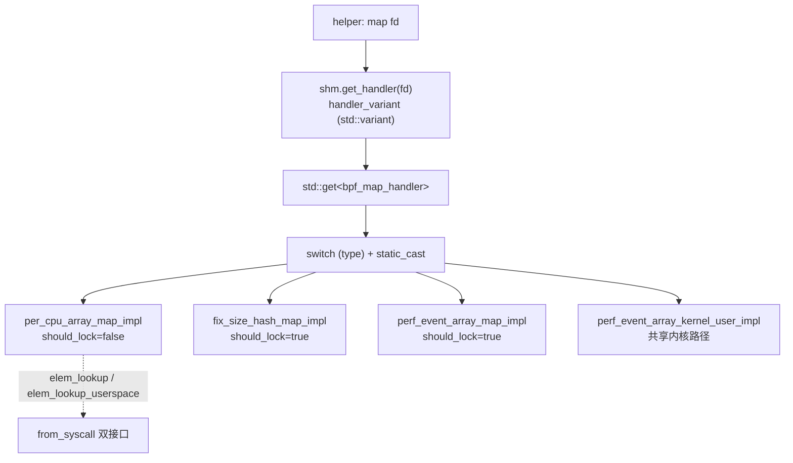
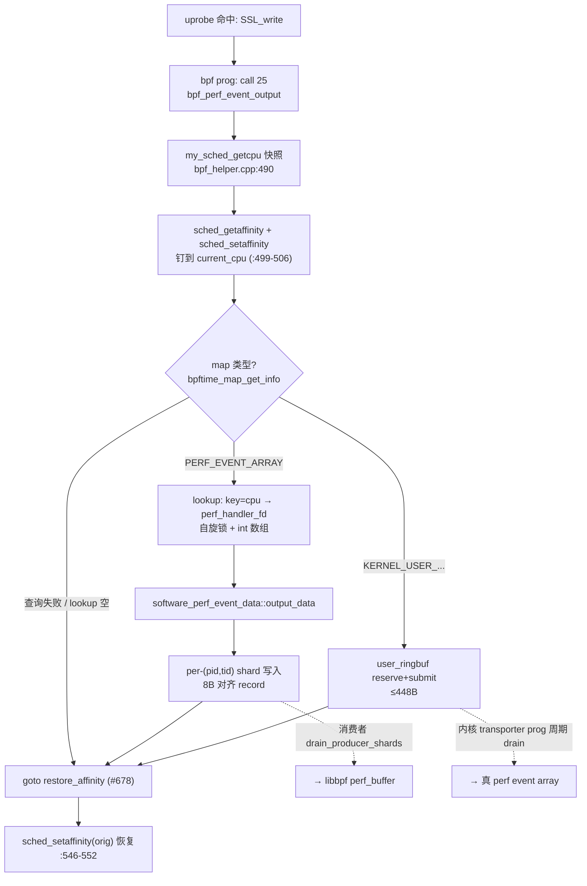
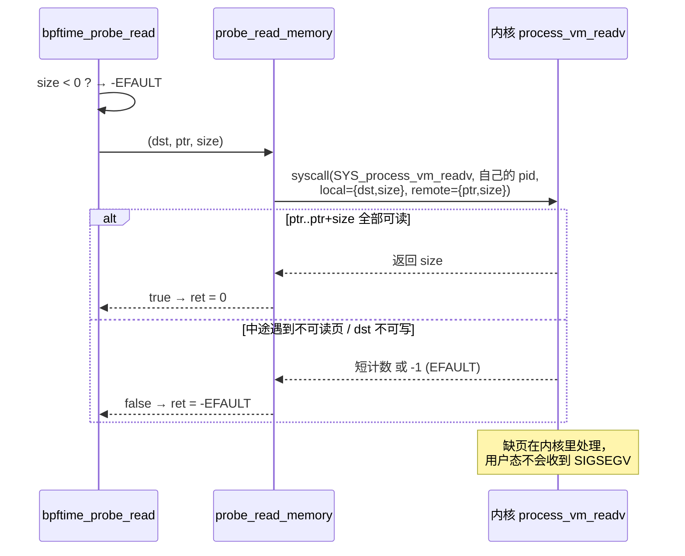

# 6. bpf_map 与 bpf_helper：map 实现与 helper 注册

> 行号基于**官方 upstream master `177a1dc465ff`**（最新提交 #706）。路径默认相对 `runtime/src/`。
> 选段中以 `// ←` 开头的中文注释为本书所加，`...` 表示省略；其余代码逐字引自官方源码（缩进统一为 8 空格）。
> 本章旧版写于 7 月快照 `ead56c9`（上游 `6bd5319d` + 我们的三个修复），那三个修复里只有"perf record 8 字节对齐"以另一种实现被上游合入（#612）；
> "删除每事件绑核"**没有**进官方，"sigaction 重装"所修的整套 SIGSEGV 机制已被官方 #642 整体替换。

这一章是你的**主场**。sslsniff 的四个 map 全部落在本章管辖范围内
（`example/tracing/sslsniff/sslsniff.bpf.c:20-58`）：

| sslsniff 里的 map | 类型 | 本章对应实现 |
|---|---|---|
| `perf_SSL_events` | `BPF_MAP_TYPE_PERF_EVENT_ARRAY` | `userspace/perf_event_array_map.cpp` |
| `ssl_data`（16KB 事件暂存） | `BPF_MAP_TYPE_PERCPU_ARRAY` | `userspace/per_cpu_array_map.cpp` |
| `bufs` / `start_ns` | `BPF_MAP_TYPE_HASH` | `userspace/fix_hash_map.cpp`（默认；`BPFTIME_USE_VAR_HASH_MAP` 未定义时 `hash_map_impl = fix_size_hash_map_impl`，`handler/map_handler.cpp:54-58`）|

热路径的两大 helper——`bpf_perf_event_output`（call 25）和 `bpf_probe_read_user`（call 112）——也都在 `bpf_helper.cpp` 里。

## 文件地图

| 文件 | 行数 | 看什么 |
|---|---:|---|
| `bpf_map/map_common_def.hpp` | 103 | 先读：`bytes_vec`、`ensure_on_current_cpu`（快照，便宜）vs `ensure_on_certain_cpu`（真迁移，昂贵且只有单测在用） |
| `handler/map_handler.hpp/.cpp` | 303+1478 | map 统一分发层：`switch(type) + static_cast`，**不是虚函数**（想想为什么） |
| `bpf_map/userspace/per_cpu_array_map.cpp` + `per_cpu_hash_map.cpp` | 147+216 | per-CPU 用户态模拟的两种范式；`elem_*` vs `elem_*_userspace` 双接口 |
| `bpf_helper.cpp` | 1444 | 注册骨架 L1129-1413（helper 三大组）；锚点 `bpf_perf_event_output` L487、`bpftime_probe_read` L121 |
| `bpf_map/userspace/perf_event_array_map.cpp` | 83 | key=cpu → value=perf handler fd 的 int 数组 |
| `bpf_map/shared/perf_event_array_kernel_user.cpp` | 525 | 内核共享路径：user_ringbuffer + 动态生成的内核"搬运"eBPF 程序 |

### 7 月以来上游在本章范围内的变更（`git log 6bd5319d..177a1dc`）

| PR | 改了什么 | 本章位置 |
|---|---|---|
| #612 `417f7c61` | software perf record 8 字节对齐 | §6.3 📌 |
| #642 `f311de23`（含 #643） | probe read/write 改为不触发缺页信号的"no-fault"拷贝；`bpf_probe_read_str` 实现内核语义 | §6.4 |
| #644 `aa5be1f8` | tail call 优先复用已实例化的 prog | §6.6 |
| #678 `3a1d2ecf` | `bpf_perf_event_output` 出错路径恢复 CPU affinity | §6.3 |
| #598 `5e16b08c` | map impl 用 `anonymous_instance` 构造，公开名字相同的 map 不再撞名 | §6.1 |
| #650 / #658 / #659 | hash 删除冲突 key 后的查找、fixed-hash 按质数桶数遍历、array-of-maps 非法 lookup 空指针 | `bpftime_hash_map.hpp`、`fix_hash_map.cpp`、`map_in_maps.hpp` |
| #601 / #609 / #631 / #663 / #685 / #691 | `bpf_get_func_ip`、`ktime_get_boot_ns`、get_stack build-ID 标志与缓冲区语义、fork 后刷新 pid/tid 缓存、uid/gid 每次实时查询 | `bpf_helper.cpp` |
| #706 `177a1dc4` | ringbuf record 头和 payload 在环尾保持连续 | `userspace/ringbuf_map.cpp` |

---

## 6.1 map 的分发结构：两层分发，零虚函数

从 helper 里的 `map fd` 到具体 map 实现，要过两层：

1. **外层（variant 分发）**：`shm.get_handler(fd)` 返回 `handler_variant`——
   `std::variant<unused_handler, bpf_map_handler, bpf_link_handler, bpf_prog_handler, bpf_perf_event_handler, epoll_handler, memfd_handler>`
   （`handler/handler_manager.hpp:87-90`），用 `std::get<bpf_map_handler>` 取出。
2. **内层（switch 分发）**：`bpf_map_handler` 里没有 variant 也没有虚基类，只有
   `bpf_map_type type`（`map_handler.hpp:73`）+ 一个类型擦除指针
   `general_map_impl_ptr map_impl_ptr`，实际是 `boost::interprocess::offset_ptr<void>`
   （`map_handler.hpp:70,280`）。每个操作都是 `switch(type)` + `static_cast` 到具体 impl。

**为什么不用虚函数？** map impl 对象本体放在共享内存里，会被 server / agent 多个进程
同时映射。虚函数依赖 vtable 指针，而 vtable 地址在每个进程里都不同——放进 shm 的对象
带上 vtable 指针就废了。所以只能用"POD 式对象 + 外置类型标签 + switch"这套 C 风格分发；
指针也必须用 `offset_ptr`（存相对偏移而非绝对地址）才能跨进程有效。这是全库 shm 设计
反复出现的约束，本章是最典型的样本。

### 注释版选段 A：`map_lookup_elem` 的分发一层（`map_handler.cpp:109-158` 节选）

```cpp
const void *bpf_map_handler::map_lookup_elem(const void *key,
                                             bool from_syscall) const
{
        // ← 泛型 lambda：impl 类型由每个 case 的 static_cast 决定。
        // ← should_lock 是各 impl 的 const static 成员 → if 可被常量折叠
        const auto do_lookup = [&](auto *impl) -> const void * {
                if (impl->should_lock) {
                        bpftime_lock_guard guard(map_lock);   // ← pthread 自旋锁
                        return impl->elem_lookup(key);
                } else {
                        return impl->elem_lookup(key);
                }
        };
        const auto do_lookup_userspace = ...;  // ← 同构，调 elem_lookup_userspace

        switch (type) {
        ...
        case bpf_map_type::BPF_MAP_TYPE_PERCPU_ARRAY: {
                auto impl = static_cast<per_cpu_array_map_impl *>(
                        map_impl_ptr.get());
                return from_syscall ? do_lookup_userspace(impl) :
                                      do_lookup(impl);        // ← 双接口分流点
        }
        ...
```

三个关键点：

- **`from_syscall` 是"视角开关"**：只有 per-CPU 两种 map 真正区分它（L147-158；update
  路径同构，L308-319）。helper 视角（`false`）只看"本 CPU 切片"，syscall 视角（`true`）
  一次读写全部 ncpu 份。上层入口决定视角：helper 包装函数传 `false`
  （`bpf_helper.cpp:299-304`），公开 C API `bpftime_map_lookup_elem` 传 `true`
  （`bpftime_shm.cpp:115-119`）。
- **锁是 per-map 一把自旋锁**（`map_handler.hpp:278`），且由 impl 的静态成员 `should_lock`
  决定是否加。谁有锁谁没锁值得记住：`fix_hash_map`/`queue`/`stack`/`bloom_filter`/
  `perf_event_array_map` 为 `true`；`array`/`per_cpu_array`/`per_cpu_hash`/`ringbuf` 及全部
  kernel-shared map 为 `false`。**per-CPU map 无锁**是下文正确性讨论的前提。
- impl 的构造统一在 `map_init`（`map_handler.cpp:762` 起）里
  `memory.construct<xxx_impl>(boost::interprocess::anonymous_instance)(...)` 到 shm——#598
  之前用的是按 `"ebpf_map_fd_" + name` 命名的实例，两个同名 map 会撞到同一个 shm 对象。
  析构也必须由 handler_manager 显式 `map_free`，`~bpf_map_handler` 里只留一句 CRITICAL
  日志（`map_handler.hpp:132-142`）。



**官方 hash map 的语义缺口（读 sslsniff 的 `bufs`/`start_ns` 时要知道）**：
`fix_size_hash_map_impl::elem_update`（`userspace/fix_hash_map.cpp:34-39`）完全不看 `flags`，
`BPF_EXIST` / `BPF_NOEXIST` 不生效，而且无视底层 `bpftime_hash_map::elem_update` 的 `bool`
返回值，**map 满时插入失败也返回 0**；`elem_delete`（:41-45）同理，删除不存在的 key 也返回 0。
sslsniff 只用 `BPF_ANY` 且不检查返回值，所以不受影响。

---

## 6.2 helper 三大组注册机制

数据结构极简（`runtime/include/bpftime_helper_group.hpp:15-19,56`）：

```cpp
struct bpftime_helper_info {
        unsigned int index;   // ← helper id，如 25 = perf_event_output
        std::string name;
        void *fn;             // ← 宿主进程内的真实函数指针
};
class bpftime_helper_group {
        ...
        std::map<unsigned int, bpftime_helper_info> helper_map;  // ← id → info
};
```

三个静态组（都是函数内 static 单例，普通堆内存，**不在 shm**——每个 agent 进程自己
构造一份，`fn` 是本进程地址，天然正确）：

| 组 | 定义处 | 内容 |
|---|---|---|
| `get_kernel_utils_helper_group` | `bpf_helper.cpp:1189-1370` | 31 个"内核语义模拟"helper：probe_read 家族、ktime、pid_tgid、uid_gid、**perf_event_output（L1345-1348）**、ringbuf、tail_call、get_func_ip… |
| `get_shm_maps_helper_group` | `bpf_helper.cpp:1371-1413` | 6 个 map 操作：lookup/update/delete/push/pop/peek，全部是 `shm_holder.global_shared_memory.bpf_map_*(..., false)` 的薄包装（L299-341） |
| `get_ufunc_helper_group` | `bpf_helper.cpp:1181-1186` → `runtime/extension/extension_helper.cpp:133` | 扩展/ufunc 分发器 |

注册链（带语义）：

```
bpf_attach_ctx.cpp:43-60  load_prog_and_helpers(prog, config)
  ├─ config.enable_{kernel_helper,ufunc,shm_maps}_group 三开关逐组
  │    （kernel 组外面还包着 #if defined(__linux__)，L45-50）
  ├─ add_helper_group_to_prog(prog)          bpf_helper.cpp:1163-1169  遍历 helper_map，忽略返回值
  │    └─ prog->bpftime_prog_register_raw_helper(info)   bpftime_prog.cpp:278-287
  │         │   // 成功后还记录该 helper 是否 async-signal-safe（helper_is_async_signal_safe）
  │         └─ ebpf_register(vm, index, name, fn)        vm/vm-core/src/ebpf-vm.cpp:36-40
  │              └─ llvmbpf_vm::register_external_function  vm/llvm-jit/src/vm.cpp:85-99
  │                   // 写入 ext_funcs[index]；index ≥ 8192 → -E2BIG，已注册过 → -EEXIST
  └─ prog->bpftime_prog_load(config.jit_enabled)
       └─ JIT 翻译 call imm 指令时按 ext_func_sym(imm)（"_bpf_helper_ext_%04u"）找符号，
          找不到 → "Ext func not found"（llvm-jit/src/compiler_utils.cpp:368）→ 整个 prog 编译失败
```

注意两个细节：组内 `register_helper` 限制 id ≤ 999（`bpf_helper.cpp:1131`）；同 id 重复
注册只要 `fn` 相同就静默容忍（L1135-1145）。但到了 VM 一层，同一 index 第二次注册一律
`-EEXIST`，而 `add_helper_group_to_prog` 不检查返回值——两组若有 id 重叠，**先注册的赢、
后者静默丢失**。

**⚠️ 与内核的关键差异**：内核里 helper 可用性由 verifier 按 prog type 决定；bpftime 里
完全由三个 config 开关 + 三张静态表决定。关掉 `enable_shm_maps_helper_group`，任何
含 `bpf_map_lookup_elem` 的程序在**加载期**（JIT 编译）就失败，不是运行期。
（只有 `kernel_compatible_mode` 下 `emitExtFuncCall` 才允许把缺失 helper 当外部声明放过，
`compiler.cpp:1471-1475`；runtime 正常加载不走这条。）

**已知缺口**：`bpf_trace_printk`（`bpftime_trace_printk`，L78-90）直接 `vprintf` 到宿主进程
的 stdout，忽略 `fmt_size`、恒返回 0，不进任何 trace_pipe；`BPF_FUNC_current_task_under_cgroup`（37）
和 `BPF_FUNC_get_current_cgroup_id`（80）只在枚举里出现（L951、L994），没有注册实现；
`BPF_MAP_TYPE_CGROUP_ARRAY` 只在 `bpftime_shm.hpp:79` 的枚举里，`map_init` 没有对应 case，
走 default 报 "Unsupported map type"（`map_handler.cpp:1127-1141`）。

---

## 6.3 `bpf_perf_event_output` 全文带读（你的主战场）

先看官方的完整调用链（带参数语义）：

```
VM: call 25 (ctx, map_fd, flags, data, size)
 └─ bpf_perf_event_output                      bpf_helper.cpp:487-553
     ├─ current_cpu = my_sched_getcpu()        :490   纯快照（Linux 上就是 ::sched_getcpu，
     │                                                platform_utils.cpp:7-9）
     ├─ sched_getaffinity(0, ·, &orig)         :499   syscall：保存原 mask
     ├─ sched_setaffinity(0, ·, &mask)         :502   syscall：钉到 current_cpu ← 每事件绑核
     ├─ bpftime_map_get_info(fd,·,·,&map_ty)   :512   bpftime_shm.cpp:287-306 查 handler.type
     ├─ [userspace 分支] map_ty == PERF_EVENT_ARRAY          :517-532
     │   ├─ shm.bpf_map_lookup_elem(fd, &current_cpu, false)  :518-521
     │   │    └─ perf_event_array_map_impl::elem_lookup       perf_event_array_map.cpp:28-36
     │   │         // key=cpu → &data[cpu]，value 是 perf handler 的 "fd"
     │   └─ bpftime_perf_event_output(perf_handler_fd, data, size)  :529
     │        └─ bpftime_shm.cpp:575-596
     │             std::get<bpf_perf_event_handler>(handler).data
     │             → software_perf_event_data::output_data     perf_event_handler.cpp:601-604
     │                → get_current_thread_shard()             :491 起，按 (pid,tid) 找/建 shard
     │                → shard.buffer.output_data(buf, size)    :367-388
     ├─ [kernel-shared 分支] map_ty == KERNEL_USER_PERF_EVENT_ARRAY   :533-539 → §6.6
     └─ restore_affinity: sched_setaffinity(0, ·, &orig)    :546-552  syscall：恢复原 mask
```

### 注释版选段 B：入口与每事件绑核（`bpf_helper.cpp:487-506`）

```cpp
uint64_t bpf_perf_event_output(uint64_t ctx, uint64_t map, uint64_t flags,
                               uint64_t data, uint64_t size)
{
        int32_t current_cpu = my_sched_getcpu();     // ← ① 先快照 CPU
        if (unlikely(current_cpu == -1)) {
                SPDLOG_ERROR(
                        "Unable to get current cpu when running perf event output");
                return (uint64_t)-1;
        }
        cpu_set_t mask, orig;
        CPU_ZERO(&mask);
        CPU_SET(current_cpu, &mask);
        if (sched_getaffinity(0, sizeof(orig), &orig) < 0)   // ← ② 保存原 mask（#678 起才检查返回值）
                return (uint64_t)-1;
        // Bind to the current cpu
        if (sched_setaffinity(0, sizeof(mask), &mask) < 0) { // ← ③ 钉到快照 CPU
                SPDLOG_ERROR("Failed to set cpu affinity: {}", errno);
                errno = EINVAL;
                return (uint64_t)(-1);   // ← 钉核失败时还没改 mask，无需恢复
        }
```

**它为什么存在？** 这段绑核在 2023 年 perf_event_array 支持首次加入时（`f072961c`，#20）
就已存在，源码只留了一句 `// Bind to the current cpu`，没有说明动机。**以下是本书推断**：
它想模拟内核语义——内核里 BPF 程序运行期间禁止迁移，"当前 CPU"在整次输出期间
不变；用户态线程随时可能迁移，于是用 `sched_setaffinity` 把线程钉在快照到的 CPU 上，
保证"用哪个 CPU 的槽位，就在哪个 CPU 上写"。

对照官方当前代码看它实际保证了什么：① CPU 号在绑核**之前**就已快照，绑核不改变
lookup key；② ring 写入走 per-(pid,tid) shard（`get_current_thread_shard`，
`perf_event_handler.cpp:491` 起），选哪个 shard 与 CPU 无关，后续链路也不再读 CPU；
③ 绑核不是锁，同一 CPU 上的两个线程照样可以交替执行，不提供互斥。所以在官方现在的
shard 设计下，它几乎只剩成本：Linux 上**每事件 3 个 syscall**（getaffinity + 两次
setaffinity），钉核时若线程已迁走还会触发一次迁移回去。（macOS 上 `sched_setaffinity`
是直接返回 0 的空桩，`platform_utils.cpp:32-34`，等于没绑。）

> 背景：我们在 Jetson 上的 ssl-nginx 测量中，这段每事件绑核约吃掉 20% 吞吐；我们的
> 开发分支删掉了它，但这**不是**官方行为，官方 177a1dc 仍然每事件绑核。

### 注释版选段 C：两条输出分支与恢复（`bpf_helper.cpp:507-553`）

```cpp
        int fd = (int)map;
        // Check map type. userspace perf event array, or shared perf event
        // array?
        bpftime::bpf_map_type map_ty;
        int ret = -1;
        if (int err = bpftime_map_get_info(fd, nullptr, nullptr, &map_ty);
            err < 0) {
                SPDLOG_ERROR("Unable to query map type of fd {}", fd);
                goto restore_affinity;               // ← #678 前这里是 return -1
        }
        if (map_ty == bpftime::bpf_map_type::BPF_MAP_TYPE_PERF_EVENT_ARRAY) {
                const int32_t *val_ptr =
                        (int32_t *)(uintptr_t)bpftime::shm_holder
                                .global_shared_memory.bpf_map_lookup_elem(
                                        fd, &current_cpu, false);  // ← key = cpu 快照
                if (val_ptr == nullptr) {
                        SPDLOG_ERROR("Invalid map fd for perf event output: {}",
                                     fd);
                        errno = EINVAL;
                        goto restore_affinity;       // ← #678 前这里也直接 return
                }
                int32_t perf_handler_fd = *val_ptr;  // ← consumer attach 时填进来的
                ret = bpftime_perf_event_output(perf_handler_fd,
                                                (const void *)(uintptr_t)data,
                                                (size_t)size);
        }
#if __linux__ && BPFTIME_BUILD_WITH_LIBBPF
        else if (map_ty == bpftime::bpf_map_type::
                                   BPF_MAP_TYPE_KERNEL_USER_PERF_EVENT_ARRAY) {
                ret = bpftime_shared_perf_event_output(   // ← → user_ringbuf 进内核
                        fd, (const void *)(uintptr_t)data, (size_t)size);
        }
#endif
        else {
                SPDLOG_ERROR(
                        "Attempting to run perf_output on a non-perf array map");
                ret = -1;
        }

restore_affinity:
        // Cleanup must not overwrite an error from the output operation.
        const int saved_errno = errno;
        if (sched_setaffinity(0, sizeof(orig), &orig) < 0 && ret >= 0)
                return (uint64_t)-1;                 // ← 恢复失败：把"成功"改判为失败
        errno = saved_errno;                         // ← 保住输出路径设置的 errno
        return (uint64_t)ret;
}
```

📌 **案例（#678 恢复 mask）**：#678 之前，map 类型查询失败和 lookup 返回空这两条错误路径
直接 `return`，**跳过了尾部的 `sched_setaffinity(orig)`**——调用线程（比如 nginx worker）
会被永久钉在单核上；`sched_getaffinity` 的返回值也没检查，失败时 `orig` 是未定义内容。
#678 把两处改成 `goto restore_affinity`、检查 getaffinity、并保证恢复动作不覆盖原错误
（errno 保存/还原）。回归测试见 `runtime/unit-test/test_software_perf_event.cpp:23`
（"Perf output preserves the calling thread's CPU affinity"，分 "Unknown map" 和
"CPU index outside the perf array" 两个 SECTION）。注意 #678 修的是"漏恢复"，**没有**去掉
绑核本身。

逐点拆：

- **`flags` 参数被完全忽略**（`ctx` 也没用）。sslsniff 传的是 `BPF_F_CURRENT_CPU`，恰好与
  "永远用 current_cpu 快照"语义重合所以无恙；但如果程序用 `BPF_F_INDEX_MASK` 显式指定
  index，bpftime 会静默当成 current-cpu 处理。
- perf_event_array 的 value 只是 int（`perf_event_array_map.cpp:14-26` 强制 key/value
  都是 4 字节，初值 -1）；`elem_lookup` 对 `k < 0 || k >= data.size()` 返回 `nullptr`
  并置 `EINVAL`（:28-36）——perf array 的 `max_entries` 小于 CPU 号时就走上面的错误路径。
  consumer 侧 `perf_buffer__new` 时 syscall-server 为每个 cpu 创建 software perf event
  handler 并 update 进对应 slot；若某 cpu 的 slot 还是 -1，`bpftime_perf_event_output`
  （`bpftime_shm.cpp:578-582`）因 fd 不是 perf handler 而报错。
- `perf_event_array_map_impl::should_lock = true`（`perf_event_array_map.hpp:23`）：
  **每个事件都要拿一次该 map 的自旋锁**做 lookup。无竞争时开销很小，但它是热路径上每事件
  必拿的锁，剖析时会看到。
- ring 满时 `append_record_parts` 返回 `false`，而 `output_data` 丢弃这个返回值、恒返回 0
  （`perf_event_handler.cpp:385-387`）；runtime 里 `PERF_RECORD_LOST` 只作为枚举出现在
  `runtime/include/bpftime_epoll.h:314`，从不生成——**丢弃对 BPF 程序和消费者都不可见**。

📌 **案例（8 字节对齐，#612）**：上面链条的最后一跳
`software_perf_event_buffer::output_data`（`perf_event_handler.cpp:367-388`）就是 #612
（`417f7c61`）的现场：record 总长 `(sizeof(perf_sample_raw) + size + alignment - 1) & ~(alignment - 1)`
向上取整到 8 的倍数（:370,376-378）写进 `header.header.size`，raw 段长度 `header.size`
相应包含尾部 padding（:383）；`size` 大到取整后超过 u16 上限则 `errno = E2BIG` 拒绝（:371-375）。
为什么必须对齐：内核 perf ring 的 record 永远 8 字节对齐，8 字节的 `perf_event_header`
因此不会跨越环尾，libbpf 消费端直接按这个假设读 header；不对齐时 header 可能被劈成两半。
消费侧 `copy_next_record_to`（:421-462）只拒绝 `size < sizeof(header)` 或 `size > ring 大小`
的 record，并且一旦遇到就**清空整个 shard**（`data_tail = data_head`，:442-448）。
（7 月我们自己的对齐修复 `0fcdb0e` 还在消费侧额外检查 `size % 8`，官方 #612 没有这一项。）
本章视角的教训：**helper 返回 0 不代表数据进了消费者眼睛**——这条链上有两处静默丢弃点
（ring 满、非法 record）。



---

## 6.4 `bpftime_probe_read` 全文带读：让内核替你"试读"

内核的 `bpf_probe_read_user` 靠 `copy_from_user_nofault` 兜底：坏指针只返回错误，不会 oops。
用户态没有这层。官方 177a1dc 的方案（#642）是：**不在本进程里直接解引用不可信指针，
而是用 `process_vm_readv` 对"自己这个 pid"做一次跨进程读**——拷贝由内核完成，
目标页不可读时内核返回错误或短计数，进程不会收到 SIGSEGV。
开关 `ENABLE_PROBE_READ_CHECK` / `ENABLE_PROBE_WRITE_CHECK` 默认 ON
（`cmake/StandardSettings.cmake:110,112`，`CMakeLists.txt:189-195`）；关掉后退化为裸 `memcpy`，
坏指针直接崩。

> 旧版本章讲的"`memcpy` + SIGSEGV handler 改 PC 跳到 `jump_point_read` 标签"整套机制，
> 以及我们针对它的 sigaction 重装修复 `ead56c9`，在官方已不复存在（#642 的子提交依次是
> "scope probe SIGSEGV handling"→"avoid process-wide signal interception"→最终 no-fault 拷贝）。

### 注释版选段 D：`probe_read_memory` + `bpftime_probe_read`（`bpf_helper.cpp:97-136`）

```cpp
#ifdef ENABLE_PROBE_READ_CHECK
static bool probe_read_memory(void *dst, const void *src, size_t size)
{
        if (size == 0)
                return true;                         // ← 0 字节不进内核
#if __APPLE__
        mach_vm_size_t copied = 0;
        return mach_vm_read_overwrite(mach_task_self(), (mach_vm_address_t)src,
                                      (mach_vm_size_t)size,
                                      (mach_vm_address_t)dst,
                                      &copied) == KERN_SUCCESS &&
               copied == size;                       // ← macOS：Mach 版"读自己"
#elif __linux__
        struct iovec local = { dst, size };          // ← 本地 = 目的缓冲区
        struct iovec remote = { const_cast<void *>(src), size };  // ← "远端" = 不可信指针
        return syscall(SYS_process_vm_readv,
                       probe_access_atfork_status == 0 ? probe_access_pid : getpid(),
                       &local, 1, &remote, 1, 0) == (ssize_t)size;  // ← 必须一字不差读满
#else
#error "Probe memory checks are unsupported on this platform"
#endif
}
#endif

int64_t bpftime_probe_read(uint64_t dst, int64_t size, uint64_t ptr, uint64_t,
                           uint64_t)
{
        if (unlikely(size < 0)) {
                SPDLOG_ERROR("Invalid size: {}", size);
                return -EFAULT;
        }
#ifdef ENABLE_PROBE_READ_CHECK
        return probe_read_memory((void *)dst, (void *)ptr, (size_t)size) ?
                       0 :
                       -EFAULT;                      // ← 短计数或 -1 一律 -EFAULT
#else
        memcpy((void *)dst, (void *)ptr, (size_t)size);
        return 0;
#endif
}
```

### 注释版选段 E：pid 缓存与 fork（`bpf_helper.cpp:68-73`）

```cpp
#if __linux__ && \
        (defined(ENABLE_PROBE_READ_CHECK) || defined(ENABLE_PROBE_WRITE_CHECK))
static pid_t probe_access_pid = getpid();            // ← 静态初始化时取一次
static const int probe_access_atfork_status = pthread_atfork(
        nullptr, nullptr, [] { probe_access_pid = getpid(); });  // ← 子进程里刷新
#endif
```

`process_vm_readv` 的第一个参数是**目标进程 pid**，这里永远是自己。glibc 的 `getpid()`
每次都是真 syscall，所以官方把 pid 缓存成静态变量，再用 `pthread_atfork` 的 child 回调在
fork 出的子进程里刷新——否则子进程会拿父进程的 pid 去"读自己"，实际读的是父进程内存。
若 `pthread_atfork` 注册失败（status ≠ 0），选段 D 里的三元表达式退回每次 `getpid()`。
（同一思路也用于 `bpf_get_current_pid_tgid` 的缓存，#685，`bpf_helper.cpp:208-259`。）

原理图：



要点与坑：

1. **代价换成了"每次调用 1 个 syscall"**：只要 `size > 0`，每次 probe_read 都进一次内核。
   sslsniff 每个事件 `bpf_probe_read_user` 拷最多 16KB payload（`sslsniff.bpf.c:115`），
   即每事件 1 个 `process_vm_readv`。好处是不再碰进程级信号处置——宿主自己的 SIGSEGV
   handler 不被替换（`runtime/unit-test/test_probe.cpp:125`、`:227` 两个用例专门验证）。
2. **失败时不清零 `dst`**：内核的 `bpf_probe_read_user` 失败时会 `memset(dst, 0, size)`；
   bpftime 直接返回 `-EFAULT`，`process_vm_readv` 短读时 `dst` 前半段可能已被写入。
   sslsniff 失败时置 `buf_copy_size = 0`（`sslsniff.bpf.c:120-123`），不受影响；依赖
   "失败即全零"的程序会看到残留数据。
3. **probe_write 对称**：`bpftime_probe_write_user`（L162-177）用 `process_vm_writev`
   （`probe_write_memory`，L138-160）。注意 `probe_write_memory` 的编译条件是
   `ENABLE_PROBE_WRITE_CHECK || ENABLE_PROBE_READ_CHECK`——读路径的 `clear_probe_memory`
   和 `bpf_probe_read_str` 也用它往 `dst` 写。

**`bpf_probe_read_str` 也补齐了**（#643 并入 #642，`bpf_helper.cpp:367-418`）：开启检查时
以 `min(256, bufsz 剩余, 本页剩余)` 为块（`probe_page_remaining`，L344-351），每块先
`probe_read_memory` 到栈上 `scratch`，用 `memchr` 找 `'\0'`，再 `probe_write_memory` 写回；
返回值是**含结尾 NUL 的长度**，满 `bufsz` 时截断并补 NUL；任一块读失败则
`clear_probe_memory` 把整个 `dst` 清零后返回 `-EFAULT`——与内核语义一致。按页切块的意义：
字符串在页尾正常结束时，不会因为"顺手多读了下一页"而误报失败（`test_probe.cpp:101-121`）。
注册表把 `probe_read_user_str`（114）和 `probe_read_str`（45）都映射到它（L1300-1311）。

---

## 6.5 per-CPU map：两种模拟范式与内存布局

内核 per-CPU map 靠 percpu 内存 + 关抢占保证"本 CPU 独占"。用户态两个前提都没有，
bpftime 的模拟 = **getcpu 快照选切片 + 完全无锁**（两个 impl 都 `should_lock = false`，
`per_cpu_array_map.hpp:31`、`per_cpu_hash_map.hpp:52`）。

### 范式一：per_cpu_array —— 一整块连续数组，entry-major

```
data = bytes_vec，长度 = max_entries * ncpu * value_size    (per_cpu_array_map.cpp:23)
data_at(idx, cpu) = base + idx*value_size*ncpu + cpu*value_size   (hpp:25-28)

           ┌───────────── entry 0 ─────────────┬───────────── entry 1 ─────────────┐
           │ cpu0 val │ cpu1 val │ … │ cpuN val │ cpu0 val │ cpu1 val │ … │ cpuN val │
           └──────────┴──────────┴───┴──────────┴──────────┴──────────┴───┴──────────┘
helper 视角(elem_lookup):       返回其中一格（cpu = getcpu 快照）
syscall 视角(elem_lookup_userspace): 返回 data_at(idx, 0)，即整行 ncpu 份的起点
```

- helper 路径 `elem_lookup/elem_update`（cpp:34-74）用
  `ensure_on_current_cpu<T>(func)`——名字唬人，实现只是
  `func(my_sched_getcpu())`（`map_common_def.hpp:27-31`），**纯快照，不迁移不绑核**。
- syscall 路径一次拷 `ncpu * value_size` 字节（cpp:134-135）；
  `get_userspace_value_size()` 相应 ×ncpu（`map_handler.cpp:69-84`）——libbpf 侧
  `bpf_map_lookup_elem` 的 value buffer 就按这个大小配。**混淆两个视角就会误读 value 大小**。
- `elem_delete` 两个视角都不支持（cpp:76-81,139-145），与内核一致。

### 范式二：per_cpu_hash —— hash 一份，value 拼接 ncpu 份

`boost::unordered_map<bytes_vec, bytes_vec>` 放 shm（`per_cpu_hash_map.hpp:20-49`），
**key 只有一份，value 是 ncpu 个切片拼成的大 vec**。helper 视角 lookup 返回
`&itr->second[value_size * cpu]`（cpp:60），update 只覆写本切片、条目不存在则以
`value_template`（全零大 vec）为底插入整行（cpp:82-91）。

辅助结构 `key_templates` / `single_value_templates`（hpp:49，ctor cpp:40-45）：按 CPU
预分配的 scratch buffer，避免每次操作在 shm 里做小分配——但这也意味着**两个线程若快照
到同一 cpu 值，会并发写同一个 scratch**，与"无锁 + boost::unordered_map 并发插入可能
rehash"一样，都是靠"低并发时碰不上"过日子的已知妥协。

📌 **案例（绑核与 per-CPU 正确性无关）**：有人会以为 §6.3 的每事件绑核是在保护
per-CPU map。看本节代码即知：helper 路径从头到尾只有 `my_sched_getcpu()` 快照，
**没有任何机制阻止快照后线程迁移**，两个线程完全可能同时写同一 cpu 切片；而
`bpf_perf_event_output` 里的绑核只覆盖它自己那一次调用，sslsniff 对 `ssl_data` 的
lookup 和写入早在它之前就完成了。也就是说 per-CPU 切片的独占从来没被保证过。
真正的"绑核序列"另一处活在 `ensure_on_certain_cpu`（`map_common_def.hpp:33-62`）里，
而它**只有单测在用**（`unit-test/maps/test_per_cpu_*.cpp`），且只用 void 特化版；泛型主模板
L38 写着 `func(currcpu)`——对零参 `std::function<T()>` 传参，**一旦被实例化直接编译错误**，
等于死代码。L36-37 的 `currcpu` 初始化为 -1 后再无赋值，fast-path 永不命中，也是同款
"没人真跑过"的证据。

**已核实的 bug**（官方 177a1dc 仍在）：
`per_cpu_hash_map_impl::elem_delete`（cpp:96-107）不删条目，只
`std::fill(second.begin(), second.begin() + cpu*value_size, 0)`——清零的是
**切片 [0, cpu)**，即"其他 CPU 的前几份"，既没清本 cpu 切片也没删除 key。行为与内核
（整条删除）完全背离。另：helper 路径 `elem_update` 不检查 `_max_entries`
（只有 userspace 路径检查，cpp:182-185），map 可被 BPF 程序无限撑大。

---

## 6.6 perf_event_array 的两个世界

### userspace 版（sslsniff 用的这个）

`perf_event_array_map.cpp` 全文 83 行：一个 `boost::interprocess::vector<int>`，
初值 -1，key/value 强制 4 字节（:14-26）。它不存数据，只存**cpu → perf handler fd**
的路由表；真正的环形缓冲在 `bpf_perf_event_handler`（第 1 章的 shard 世界）。

### kernel-user 共享版（`shared/perf_event_array_kernel_user.cpp`，525 行）

场景：消费者是**真内核** perf buffer（daemon 劫持内核 eBPF 时），用户态 BPF 程序的输出
要"逆向"送进内核。三级火箭：

```
output_data_into_kernel(buf, size)                      :66-91
  ├─ size > 448 直接拒绝（480-32，:69-75）
  ├─ ensure_current_map_user_ringbuf()                  :229-245
  │    // 每进程惰性 user_ring_buffer__new 一个 1MB 的 BPF_MAP_TYPE_USER_RINGBUF
  │    // （map 在 ctor 中由 server 创建，:107-111）
  ├─ reserve(size+8) → 头 8 字节写 size，payload 跟在后面（:80-87）→ submit
  └─ 内核侧：ctor 创建了一个周期触发的 software perf event（:132）
       + 一段手写字节码的"搬运" eBPF 程序 attach 上去（:136,145,151）：
       bpf_user_ringbuf_drain(user_rb, cb, &ctx, 0)     // 取一条
         → bpf_perf_event_output(ctx, kernel_perf_array, 0, buf, size)
       （C 原型写在 :286-320 注释里，指令数组 :334 起，godbolt 手工编译产物）
```

三个值得存疑/记录的点：

- `create_intervally_triggered_perf_event(10)`（:446-459）里
  `sample_period = duration_ms * 1000`，而 `PERF_COUNT_SW_CPU_CLOCK` 的 period 单位是
  **纳秒**——名义 10ms 实际 10µs（**疑似单位 bug，未实测验证**）。
- `user_ringbuffer_wrapper` 里 `reserve_lock` 初始化了却从没人 lock（:52,249,277-284），
  并发 reserve 的线程安全完全依赖 libbpf `user_ring_buffer__reserve` 内部实现。
- 搬运程序每次 drain 只取 1 条（callback 恒返回 1），高事件率下内核搬运速度上限
  = 触发频率，容易积压——这是 kernel-shared 路径不适合 sslsniff 这种量级的结构性原因。

注意 userspace 分支的绑核也包住了这条路径：`bpftime_shared_perf_event_output` 同样在
`sched_setaffinity` 钉核期间执行（`bpf_helper.cpp:533-539`）。

### tail_call 顺带一记（`bpf_helper.cpp:555-660`）

`bpftime_tail_call` 每次调用：校验 prog_array（:558）→ 查索引（:564）→ 深度保护
`MAX_TAIL_CALL_CNT=32`，thread_local 计数 + RAII guard（:574-591）→ **先用
`get_global_attach_ctx().find_instantiated_prog(to_call_fd)` 复用已实例化的 prog**
（:593-598，#644 引入）；只有找不到时才在 `std::optional` 里临时构造一个 `bpftime_prog`
并 `load_prog_and_helpers`（:599-611，这一步会 JIT 编译）→ 拷 64 字节 ctx（:613-619）→
执行，返回值写进 `current_thread_tail_call_ret`（:629），由外层 `bpftime_prog_exec`
当作本次返回值（`bpftime_prog.cpp:271`）。目标是内核 prog fd 时改走
`bpf_prog_test_run_opts`（:633-653）。与内核"O(1) 改指令指针"仍然不同：它是一次嵌套
调用而非跳转，未实例化的目标还要付一次 JIT 成本；benchmark 带 tail call 时先来这里看一眼。

---

## 坑清单（全部已在官方 `177a1dc465ff` 代码中核实）

- **`bpf_perf_event_output` 每事件绑核**：getaffinity + 两次 setaffinity = 每事件 3 个
  syscall（`bpf_helper.cpp:499-506,546-552`）；#678 只修了出错路径漏恢复，绑核本身仍在。
- **per-CPU map 不做真隔离**：getcpu 快照选切片 + 无锁，迁移后两线程可写同一切片；
  内核"关抢占"假设在用户态不成立。绑核救不了它（§6.5 📌）。
- `elem_*`（helper 视角，单切片）vs `elem_*_userspace`（syscall 视角，ncpu 份），value
  大小差 ncpu 倍（`map_handler.cpp:69-84`）。
- `per_cpu_hash_map::elem_delete` 清零范围是 `[begin, begin + cpu*value_size)`——错切片
  且不删条目（`per_cpu_hash_map.cpp:102-105`）；`per_cpu_array` 不支持 delete；
  per_cpu_hash 的 helper 路径 update 不检查 max_entries（:182 只管 userspace）。
- 默认 hash map 忽略 `BPF_EXIST`/`BPF_NOEXIST`，满表插入和删除不存在的 key 都返回 0
  （`fix_hash_map.cpp:34-45`）。
- `bpf_perf_event_output` 忽略 `flags`（`BPF_F_INDEX_MASK` 显式索引被当 current-cpu）；
  ring 满静默丢弃（`perf_event_handler.cpp:385` 丢返回值），无 `PERF_RECORD_LOST`。
- 消费侧遇到非法 record size 会丢掉**整个 shard** 的积压数据（`perf_event_handler.cpp:442-448`）。
- `ENABLE_PROBE_READ_CHECK` 默认 ON：每次 probe_read（size>0）= 1 个 `process_vm_readv`；
  失败返回 `-EFAULT` 但不清零 `dst`（`bpf_helper.cpp:97-136`）。
- `bpf_trace_printk` 直接 `vprintf` 到宿主 stdout（`bpf_helper.cpp:78-90`）；helper 37/80、
  `BPF_MAP_TYPE_CGROUP_ARRAY` 未实现。
- `ensure_on_certain_cpu` 泛型主模板是无法实例化的死代码（`map_common_def.hpp:38`），
  只有 void 特化被单测使用——读代码时别被它误导以为 map 运行时有绑核路径。

## 自测题

1. **`call 25` 从 VM 到 shard 写入经过哪几层？map 类型在哪一步分流 userspace / kernel-shared？**
   <details><summary>答案</summary>
   JIT 后的机器码直接 call 注册进 <code>ext_funcs[25]</code> 的
   <code>bpf_perf_event_output</code>（bpf_helper.cpp:487）→ <code>my_sched_getcpu</code> 快照（:490）→
   <code>sched_getaffinity</code> / <code>sched_setaffinity</code> 钉核（:499-506）→
   <code>bpftime_map_get_info</code> 查 <code>handler.type</code>（:512，bpftime_shm.cpp:287）——**这里分流**：
   <code>PERF_EVENT_ARRAY</code> 走 <code>shm.bpf_map_lookup_elem(fd,&cpu,false)</code> 拿 perf handler fd →
   <code>bpftime_perf_event_output</code>（bpftime_shm.cpp:575）→
   <code>software_perf_event_data::output_data</code>（perf_event_handler.cpp:601）→
   <code>get_current_thread_shard().buffer.output_data</code>（:367，8B 对齐写环）；
   <code>KERNEL_USER_PERF_EVENT_ARRAY</code> 走 <code>bpftime_shared_perf_event_output</code>（bpftime_shm.cpp:599）
   → user_ringbuf → 内核搬运 prog。两条路最后都经过 <code>restore_affinity</code>（:546-552）恢复原 mask。
   </details>

2. **关掉 `enable_shm_maps_helper_group`，sslsniff 会死在哪里、什么时候死？**
   <details><summary>答案</summary>
   不是运行时死，是**加载期**死：<code>load_prog_and_helpers</code>（bpf_attach_ctx.cpp:43-60）不再注册
   helper 1/2/3（lookup/update/delete），JIT 翻译 <code>probe_SSL_rw_enter</code> 里的第一个
   <code>bpf_map_update_elem(&bufs,...)</code>（sslsniff.bpf.c:69，call 2）时按
   <code>ext_func_sym(2)</code> = <code>_bpf_helper_ext_0002</code> 查不到符号，报 "Ext func not found"
   （vm/llvm-jit/src/compiler_utils.cpp:368），整个 prog load 失败。而 <code>bpf_perf_event_output</code>
   （call 25）在 kernel_utils 组里，不受影响。
   </details>

3. **官方 177a1dc 里 `bpf_probe_read_user` 碰到坏指针时，谁发现错误？进程会收到 SIGSEGV 吗？`dst` 里剩下什么？**
   <details><summary>答案</summary>
   由内核发现：<code>probe_read_memory</code> 用 <code>syscall(SYS_process_vm_readv, 自己的 pid, ...)</code>
   让内核代为拷贝（bpf_helper.cpp:109-114），不可读页导致返回 -1 或短计数，<code>== (ssize_t)size</code>
   不成立 → <code>bpftime_probe_read</code> 返回 <code>-EFAULT</code>（:129-131）。缺页在内核里处理，
   用户态**收不到 SIGSEGV**，宿主的信号处置也不被改动。<code>dst</code> 不会被清零：短读时前半段可能已写入，
   这点与内核（失败时 memset 0）不同。
   </details>

4. **为什么 map impl 用 `switch(type) + static_cast` 而不是虚函数或 `std::variant`？**
   <details><summary>答案</summary>
   impl 对象放在共享内存里被多进程映射。虚函数的 vtable 指针是进程内地址，跨进程失效；
   variant 直接内嵌对象倒是可以，但各 impl 大小差异巨大且部分含非平凡成员，历史实现选择了
   <code>offset_ptr&lt;void&gt;</code>（map_handler.hpp:70,280）+ 外置 <code>type</code> 标签 + 每操作 switch
   （map_handler.cpp:129 起）。注意外层 fd → handler 那一步用的才是 <code>std::variant</code>
   （handler_manager.hpp:87-90）——variant 里的 <code>bpf_map_handler</code> 本身无虚函数，可以按值放 shm。
   </details>

5. **sslsniff 一次 SSL_write 命中（entry+exit）会触发本章代码里的哪些 map/helper 操作？按官方代码数，有几个 syscall？**
   <details><summary>答案</summary>
   entry（<code>probe_SSL_rw_enter</code>）：<code>bpf_map_update_elem</code> ×2（bufs、start_ns → fix_hash_map，各拿一次 map 自旋锁）。
   exit：<code>bpf_map_lookup_elem</code> ×2（bufs、start_ns）+ lookup ssl_data（per_cpu_array，无锁，getcpu 快照选切片）
   + <code>bpf_probe_read_user</code> 拷 payload（1 个 <code>process_vm_readv</code>）
   + <code>bpf_map_delete_elem</code> ×2 + <code>bpf_perf_event_output</code>（getaffinity + 两次 setaffinity = 3 个 syscall，
   perf_event_array lookup 带自旋锁，shard 写入）。此外 entry 和 exit 各调一次 <code>bpf_get_current_uid_gid</code>，
   #691 后每次实时 <code>getgid()</code> + <code>getuid()</code>（bpf_helper.cpp:261-267），各 2 个 syscall；
   <code>bpf_get_current_pid_tgid</code> 走缓存（:249-258），<code>bpf_ktime_get_ns</code> 用 <code>steady_clock</code>。
   合计按代码数约 8 个 syscall（不计 <code>sched_getcpu</code> 本身，它是否陷入内核取决于 glibc/rseq）。这是代码推算，不是实测。
   </details>

6. **per_cpu_hash 的 `elem_delete` 执行后，map 处于什么状态？**
   <details><summary>答案</summary>
   条目仍在（key 可被 get_next_key 遍历到），value 的切片 [0, cpu) 被清零，**本 cpu 切片和
   [cpu+1, ncpu) 原封不动**（per_cpu_hash_map.cpp:102-105）。即：想删的没删掉，没想动的被清了。
   正确语义（对照内核）应是 <code>impl.erase(itr)</code>——userspace 路径的
   <code>elem_delete_userspace</code>（:189-200）反而是对的。
   </details>

7. **#678 之前，`bpf_perf_event_output` 在什么情况下会把调用线程永久钉在单核？#678 之后还剩什么代价？**
   <details><summary>答案</summary>
   钉核（:502）之后，map 类型查询失败、或 perf array 里查不到 <code>current_cpu</code> 对应槽位（例如 CPU 号 ≥ max_entries，
   perf_event_array_map.cpp:31-34）时，旧代码直接 <code>return</code>，跳过尾部恢复，线程的 affinity 从此只剩一个 CPU。
   #678 改为 <code>goto restore_affinity</code>，并检查 getaffinity 返回值、保存/还原 errno（bpf_helper.cpp:546-552）。
   之后剩下的是绑核本身：每事件 3 个 affinity syscall，外加每事件一次 perf_event_array 的 map 自旋锁
   （<code>should_lock = true</code>，perf_event_array_map.hpp:23；<code>do_lookup</code> 见 map_handler.cpp:112-119）。
   </details>

---
[← 返回目录](README.md)
