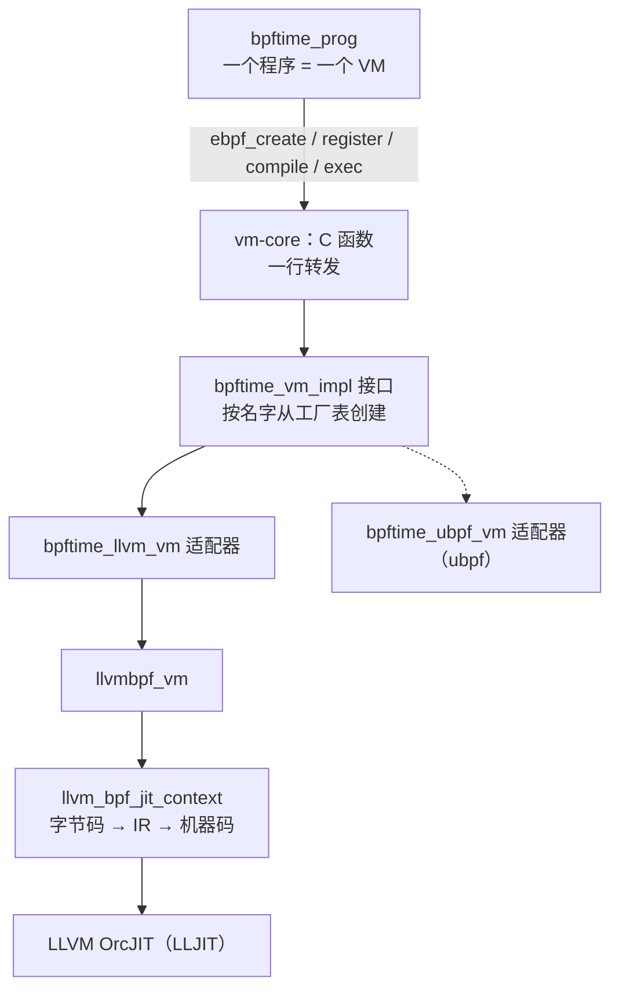
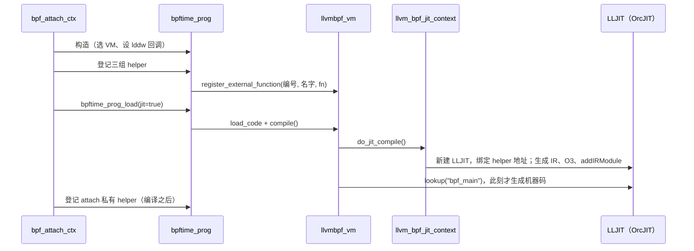
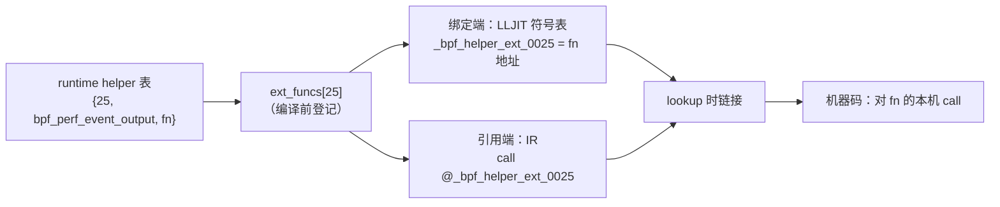

# 6. VM 与 JIT

> 一句话：本章讲一段 eBPF 字节码怎么变成一个能直接 `call` 的本机函数。读完你能说清：
> 一条 eBPF 指令被翻译成了什么；`r1 = map ll` 这条 lddw 在 JIT 代码里变成了什么常量；
> `call 25` 怎么在编译期就绑到 C 函数 `bpf_perf_event_output`；关掉 JIT、换成 ubpf、
> 改用 AOT 时各自发生什么。
> 前置：建议先读[第 1 章](01-lifecycle.md)；[第 4 章](04-attach-uprobe.md)（ctx 是怎么来的）可选，两章可以换序读。
> helper 本身的实现在[第 7 章](07-helpers.md)。预计用时：2–3 小时。

## 本章要回答的问题

1. runtime 手里有一段 eBPF 字节码，它最后是怎么变成一个能直接调用的本机函数指针的？中间隔了几层？
2. eBPF 的 11 个寄存器和栈（每帧 512 字节），到了 x86_64 机器码里变成了什么？
3. 程序里引用一个 map（`r1 = map ll`），JIT 后的代码里放的是 map 的地址吗？
4. 字节码里写的是 `call 25`，JIT 后的代码怎么知道去调哪个 C 函数？每次调用要查表吗？
5. 设了 `BPFTIME_DISABLE_JIT` 之后，llvm 后端是在解释执行吗？换成 ubpf 后端呢？
6. AOT 编译出来的是什么文件，谁会去加载它？

---

## 6.1 三层结构：bpftime_prog → VM 抽象 → llvmbpf / ubpf

**直觉**：runtime 里"一个 eBPF 程序"是一个 `bpftime_prog` 对象。它自己不会编译、不会执行，
而是持有一个 VM 实例，把活儿都交给 VM。VM 这一侧又分成三层，像一个洋葱：

- **最外层是一组 C 函数**（`ebpf_create` / `ebpf_register` / `ebpf_load` / `ebpf_compile` / `ebpf_exec` …），
  在 `vm/vm-core/` 里。`bpftime_prog` 只调这组函数，不关心背后是哪个执行引擎。
- **中间层是一个 C++ 抽象接口** `bpftime_vm_impl`（`vm/compat/`），加一张"名字 → 创建函数"的工厂表。
  bpftime 内置两个后端：`"llvm"`（默认）和 `"ubpf"`。换后端只要换名字（环境变量 `BPFTIME_VM_NAME`）。
- **最里层是真正的执行引擎**：
  - **llvmbpf**：一个可以独立发布的 LLVM JIT 库，以 git 子模块形式放在 `vm/llvm-jit/`，
    由适配器类 `bpftime_llvm_vm` 接到抽象接口上。
  - **ubpf**：第三方的 eBPF 解释器 + 小型 JIT（`third_party/ubpf`），由适配器类 `bpftime_ubpf_vm` 接入（见 6.8）。

> **小知识**：LLVM 是一套编译器基础设施。它定义了一种与机器无关的中间表示（LLVM IR），
> 提供把 IR 优化、再翻译成各种 CPU 机器码的全套工具。OrcJIT 是 LLVM 里负责"即时编译"的组件：
> 你把 IR 交给它，它在**当前进程的内存里**生成机器码，并给你一个可以直接调用的函数地址。
> llvmbpf 用的是 OrcJIT 提供的现成 JIT 实例 `LLJIT`。

这张图看一次调用从 runtime 往下穿过了哪几层：



外层到底有多薄？`struct ebpf_vm` 里只有一个名字和一个 `unique_ptr<bpftime_vm_impl>`，
每个 C 函数都是一行 `vm->vm_instance->xxx(...)` 转发。

**整个 vm 层对外只有一种"可执行函数"的形态**：

```cpp
using precompiled_ebpf_function = uint64_t (*)(void *mem, size_t mem_len);
```

两个参数、一个返回值。`mem` 就是 eBPF 程序看到的 `ctx`（uprobe 时是[第 4 章](04-attach-uprobe.md)那份 `pt_regs`），
返回值就是程序的 `r0`。vm 层不关心 `mem` 里装的是什么。

### bpftime_prog 做了什么

`bpftime_prog` 的构造函数做三件事：把指令拷一份留着；按全局配置里的 VM 名字 `ebpf_create`；
把两个 lddw 回调（6.4）交给 VM。

`runtime/src/bpftime_prog.cpp` 的 `bpftime_prog::bpftime_prog()`（第一个构造函数，去掉日志）

```cpp
bpftime_prog::bpftime_prog(const struct ebpf_inst *insn, size_t insn_cnt,
                           const char *name)
        : name(name)
{
        insns.assign(insn, insn + insn_cnt);                // 指令副本，进程堆上
        const char *vm_name =
                bpftime::bpftime_get_runtime_config().get_vm_name(); // 默认 "llvm"
        vm = ebpf_create(vm_name);                           // 按名字查工厂表
        ebpf_set_lddw_helpers(vm, map_ptr_by_fd, nullptr,    // 只给 map_by_fd 和
                              map_val, nullptr, nullptr);    // map_val 两个回调
}
```

`bpftime_prog` 还有第二个构造函数，多收一个 `runtime_config`。注意它会把这份配置**写进全局配置**
（`bpftime_set_runtime_config`），也就是说"构造一个程序对象"有改全局状态的副作用。目前只有
`runtime/object/` 里按 ELF 建程序的路径用它。

之后的生命周期是：注册 helper → `bpftime_prog_load(jit)` → 每个事件 `bpftime_prog_exec(mem, len, &ret)`。
下面几节依次展开。

**要点**
- runtime 只用 C 接口；后端按名字选，默认 `"llvm"`，另一个内置后端是 `"ubpf"`。
- llvmbpf 是独立的 JIT 库；bpftime 通过适配器类接入它。
- JIT 的产物是一个 `uint64_t f(void *mem, size_t mem_len)` 函数指针。
- 一个 `bpftime_prog` 一个 VM 实例，都在目标进程的堆上，不在共享内存里。

---

## 6.2 一次加载的全过程

**直觉**：agent 从 handler 表里读到一个 prog handler（[第 2 章](02-runtime-shm.md)），就要把它"实例化"
成一个能跑的 `bpftime_prog`。这一步按顺序做四件事：

1. 建 `bpftime_prog`（顺带建好 VM）；
2. 按配置把三组 helper 登记进 VM（每个 helper 只是往一个数组里写一项，[第 7 章](07-helpers.md)）；
3. `bpftime_prog_load(jit)`：把字节码交给 VM；开着 JIT 时立即编译；
4. 再登记 attach 后端私有的 helper（比如 Frida 后端的 `bpf_get_func_arg`）。

第 4 步排在编译**之后**，这一点很重要，6.5 会回来讲。

这张时序图看 llvm 后端里，谁调谁、helper 什么时候登记、机器码什么时候真正生成：



编译本体只有几步：

`vm/llvm-jit/src/llvm_jit_context.cpp` 的 `llvm_bpf_jit_context::do_jit_compile()`（有删节）

```cpp
llvm::Error llvm_bpf_jit_context::do_jit_compile()
{
        spin_lock_guard guard(compiling.get());     // 同一 VM 不能并发编译
        // ① 建 LLJIT + 绑定 helper 符号；顺便拿回所有 helper 的符号名
        auto [jit, extFuncNames, definedLddwHelpers] =
                create_and_initialize_lljit_instance();
        // ② 字节码 → IR。true = lddw 引用的 map 在编译期求值成常量（见 6.4）
        auto bpfModuleOrErr =
                generateModule(extFuncNames, definedLddwHelpers, true);
        if (!bpfModuleOrErr)
                return bpfModuleOrErr.takeError();  // 例如引用了未登记的 helper
        auto bpfModule = std::move(*bpfModuleOrErr);
        // ③ 优化，默认 O3
        bpfModule.withModuleDo([&](auto &M) {
                optimizeModule(M, vm.optimization_level, /* ... */);
                /* ... array map 内联：bpftime 下不触发 ... */
        });
        // ④ 交给 LLJIT；真正的机器码生成推迟到 lookup("bpf_main")
        if (auto err = jit->addIRModule(std::move(bpfModule)))
                return err;
        this->jit = std::move(jit);
        return llvm::Error::success();
}
```

`compile()` 成功后，函数指针被缓存进 `llvmbpf_vm::jitted_function`。这个缓存是"一次性"的：
再调 `compile()` 直接返回旧值。

**要点**
- 实例化顺序：建程序 → 登记三组 helper → load（开 JIT 则立即编译）→ 登记 attach 私有 helper。
- 编译 = 建 JIT 并绑定 helper → 生成 IR → O3 → 交给 JIT → `lookup` 时出机器码。
- 编译结果被缓存，之后不会重编。

---

## 6.3 一条 eBPF 指令怎么变成本机码（主线一）

**直觉**：eBPF 是一台很简单的"虚拟 CPU"：11 个 64 位寄存器（r0–r10）、每个函数帧 512 字节的栈。
llvmbpf 的翻译策略非常朴素：

1. 在 `bpf_main` 开头，为每个 eBPF 寄存器在栈上开一个 8 字节的格子（LLVM 里叫 `alloca`），
   再开一块数组当 eBPF 栈（每帧 512 字节，为子函数调用一共预留 32 帧，约 16 KB），让 r10 指向它的末尾。
2. 每条 eBPF 指令，都翻译成"从格子里读 → 做运算 → 写回格子"的几条 IR。
3. 最后交给 LLVM 优化器。优化器发现这些格子从不被取地址，就把它们**提升成真正的 CPU 寄存器**
   （这个优化叫 mem2reg / SROA），多余的读写全部消失。

所以 llvmbpf 不用自己做寄存器分配，也不用自己做窥孔优化——这些都交给了 LLVM。

### 第一步：切基本块，搭"骨架"

**基本块（basic block）** 是一段"只能从头进、从尾出"的直线代码。跳转的目标、跳转指令的下一条，
都是新基本块的开头。`generateModule` 先扫一遍字节码，把每个基本块的起点标出来，为每个起点建一个
LLVM 基本块（名字形如 `bb_inst_N`，N 是指令下标）。

然后建一个入口块 `setupBlock`：

`vm/llvm-jit/src/compiler.cpp` 的 `llvm_bpf_jit_context::generateModule()`（setupBlock 部分，有删节）

```cpp
for (int i = 0; i <= 10; i++)                     // r0..r10 各一个 8 字节格子
        regs.push_back(builder.CreateAlloca(builder.getInt64Ty(), nullptr,
                                            "r" + std::to_string(i)));
// eBPF 栈：STACK_SIZE 是 512 字节折成的 64 个 8 字节槽，再乘以最大调用深度 32
stackBegin = builder.CreateAlloca(builder.getInt64Ty(),
        builder.getInt32(STACK_SIZE * MAX_LOCAL_FUNC_DEPTH + 10), "stackBegin");
auto stackEnd = builder.CreateGEP(builder.getInt64Ty(), stackBegin,
        { builder.getInt32(STACK_SIZE * MAX_LOCAL_FUNC_DEPTH) }, "stackEnd");
builder.CreateStore(stackEnd, regs[10]);          // r10 = 栈顶（栈向低地址长）
/* ... bpf-to-bpf 调用用的 callStack 与计数器 callItemCnt = 0（见 6.6）... */
builder.CreateStore(bpf_func->getArg(0), regs[1]); // r1 = mem（ctx）
builder.CreateStore(bpf_func->getArg(1), regs[2]); // r2 = mem_len
```

`r1 = ctx` 正好对上内核 eBPF 的约定：程序入口时 r1 指向上下文。

### 第二步：逐条翻译

主循环是一个巨大的 `switch (inst.opcode)`。按指令类别看，翻成的 IR 如下：

| eBPF 指令类别 | 生成的 IR（概念上） | 备注 |
|---|---|---|
| ALU64：`add/sub/mul/or/and/xor/neg` | 读两个格子 → 对应 IR 运算 → 写回 | 立即数在 64 位运算里符号扩展 |
| ALU32（`w0 += 1` 这类） | 只读格子的低 4 字节做 32 位运算，结果**零扩展**回 64 位 | 符合 eBPF 语义 |
| 移位 `lsh/rsh/arsh` | `shl/lshr/ashr`，移位量先对 64 / 32 取模 | |
| 除法 / 取模 | `udiv/sdiv/urem/srem`，并试图用 `select` 处理除数为 0 | 但除法指令本身仍会执行，运行时除数为 0 时 x86 上进程收到 SIGFPE，见下文"注意" |
| `mov`、`movsx`（带符号扩展的 mov） | 直接存；`movsx` 先截断再符号扩展 | |
| 端序转换 `le/be/bswap` | 逐字节移位拼接 | |
| 内存读 `ldx`、带符号读 `ldxs` | 取 src 格子当指针 → 加偏移 → `load` → 零 / 符号扩展 | **无边界检查** |
| 内存写 `st/stx` | 取 dst 格子当指针 → 加偏移 → 截断 → `store` | **无边界检查** |
| 原子操作（add/and/or/xor、xchg、cmpxchg） | `atomicrmw` / `cmpxchg`，内存序 monotonic | |
| `lddw`（16 字节，装 64 位常量或 map） | 见 6.4 | |
| 条件跳转 `jeq/jgt/jsgt/jset…`（含 JMP32） | `icmp` + 条件 `br` 到目标块或下一块 | |
| `ja`、`gotol`（长跳转） | 无条件 `br` | |
| `call`（src=0，调 helper） | 调外部函数 `_bpf_helper_ext_NNNN(r1..r5)`，结果写 r0 | 见 6.5 |
| `call`（src=1，调程序内子函数） | 自建调用栈 + `br` | 见 6.6 |
| `exit` | 没有子函数调用在栈上时 `ret r0`；否则返回调用点 | 见 6.6 |
| `ld_abs/ld_ind`、`may_goto` 等 | 报 "Unsupported or illegal opcode"，编译失败 | |

翻译代码本身也很短。ALU 类都走 `emitALUWithDstAndSrc`（读 dst 格子、读 src 或立即数、生成运算、写回）；
内存读是这样的：

`vm/llvm-jit/src/compiler_utils.cpp` 的 `emitLoadX()`（有简化）

```cpp
void emitLoadX(llvm::IRBuilder<> &builder, llvm::Value **regs,
               const ebpf_inst &inst, llvm::IntegerType *srcTy, bool sign_extend)
{
        // 地址 = (指针) regs[src] + offset
        Value *addr = builder.CreateGEP(builder.getInt8Ty(),
                builder.CreateLoad(builder.getPtrTy(), regs[inst.src]),
                { builder.getInt64(inst.offset) });
        Value *result = builder.CreateLoad(srcTy, addr);  // 直接读内存，没有边界检查
        emitLDXStoringResult(builder, regs, inst, result, sign_extend); // 扩展到 64 位写回
}
```

注意 `emitLoadX` 里**没有任何边界检查**：JIT 后的代码就是直接读写进程内存。程序安不安全，
靠的是加载前的 verifier（[第 10 章](10-periphery.md)），不是 JIT。

> **注意**：表里有几类指令在 llvmbpf 里的行为和内核不完全一样，包括运行时除数为 0、64 位有符号
> 除法 / 取模、`cmpxchg` 的返回值、`callx`（0x8d）等。正文不展开，见
> [附录 B](B-known-issues.md#b-vm)。

### 第三步：交给优化器，看看最后剩下什么

拿一个最小的程序走一遍（读 ctx 偏移 0x70 处的字段，加 1 后返回）：

```text
0: r6 = r1                     ; bf 16 00 00 00 00 00 00
1: r0 = *(u64 *)(r6 + 0x70)    ; 79 60 70 00 00 00 00 00
2: r0 += 1                     ; 07 00 00 00 01 00 00 00
3: exit                        ; 95 00 00 00 00 00 00 00
```

按上面的规则翻出来的 IR 有十几个 `alloca`、一大块没用到的栈、一堆 load/store。O3 之后只剩：

```llvm
define i64 @bpf_main(ptr %mem, i64 %mem_len) {
  %addr = getelementptr i8, ptr %mem, i64 112   ; mem + 0x70
  %v = load i64, ptr %addr
  %c = add i64 %v, 1
  ret i64 %c
}
```

再到 x86_64 机器码：

```asm
mov  rax, qword ptr [rdi + 112]   ; rdi 就是 mem（System V 第 1 个参数）
inc  rax
ret
```

（这里的 IR 是按 llvmbpf 的生成规则手写后，用 `opt-19 -O3` 和 `llc-19` 实际跑出来的结果；
真实程序的 IR 结构相同，6.9 有一段 llvmbpf 自己打印的 IR。）11 个寄存器格子、约 16 KB 的预留栈、调用栈
计数器全都被优化掉了。这就是"JIT 后的 eBPF 和手写 C 函数没什么区别"的含义。

**要点**
- eBPF 寄存器先变成栈上格子，再被 LLVM 提升成真实寄存器。
- 每条指令翻成几条 IR；优化、寄存器分配、指令选择都交给 LLVM。
- 内存访问是裸读写，不插边界检查；安全靠 verifier。
- 少数指令的语义与内核有出入，读附录 B 再依赖它们。

---

## 6.4 lddw：JIT 代码里放的是 map fd，不是地址

**直觉**：`lddw` 是 eBPF 里唯一的 16 字节指令（占两个 8 字节槽），本意是装一个 64 位常量。
它的 `src` 字段被借来区分几种"伪指令"，最常见的是"把某个 map 装进寄存器"，也就是你在 objdump
里看到的 `r1 = 0x0 ll` 加一条重定位。loader（libbpf）加载程序时，会把重定位换成 map 的 fd，
并把 `src` 置成 1。

到了 bpftime，问题是：JIT 编译时，这个"map"应该变成什么值？内核里它是一个 `struct bpf_map *`。
bpftime 的选择很简单：**就用 fd 本身**。helper（比如 `bpf_map_lookup_elem`）拿到这个数，
再按 fd 去共享内存的 handler 表里找 map。

`src` 的各种取值和 llvmbpf 的处理：

| src | 含义 | llvmbpf（JIT 路径）怎么处理 | bpftime 提供的回调 |
|---|---|---|---|
| 0 | 普通 64 位立即数 | 拼成常量 | — |
| 1 | map fd | 编译期调 `map_by_fd(imm)`，结果烧成常量 | `map_ptr_by_fd`：校验是 map 后**原样返回 fd** |
| 2 | map value（常用于全局变量） | 编译期调 `map_val(map_by_fd(imm))`，加上第二槽的偏移，烧成常量 | `map_val`：取 map 第一个 key 对应 value 的**真实地址** |
| 3 | 变量地址 `var_addr` | 缺回调 → 编译失败 | 未提供 |
| 4 | 代码地址 `code_addr` | 缺回调 → 编译失败 | 未提供 |
| 5 | 按下标引用 map `map_by_idx` | 缺回调时直接用 imm 当句柄 | 未提供 |
| 6 | `map_by_idx` + value | 同 src=2 的做法 | 未提供 |

`runtime/src/bpftime_shm.cpp` 的 `map_ptr_by_fd()`（去掉日志）

```cpp
extern "C" uint64_t map_ptr_by_fd(uint32_t fd)
{
        if (!shm_holder.global_shared_memory.get_manager() ||
            !shm_holder.global_shared_memory.is_map_fd(fd)) {
                errno = ENOENT;
                return INVALID_MAP_PTR;   // 不是 map：烧进去的是 -1，不报编译错误
        }
        // Use a convenient way to represent a pointer
        return fd;                        // "map 指针"就是 fd 本身
}
```

由此得到几个结论：

1. **编译必须发生在 map 创建之后。** 回调在编译那一刻查 handler 表。
2. **src=1 的 map 引用在机器码里就是一个小整数常量**（fd），每次 helper 调用都要按 fd 再查一次表；
   src=2 才是真正的地址，程序可以直接读写全局变量所在的 value。
3. **三条路径求值时机不同**：JIT 在编译期求值；AOT 把 `map_val` 留成运行时调用（6.9），但 fd 仍在
   编译期烧死；ubpf 后端在 `load_code` 时就把 lddw 改写成普通立即数（6.8）。
4. src ≥ 7 时 llvmbpf 既不报错也不写目标寄存器，见[附录 B](B-known-issues.md#b-vm)。

**要点**
- lddw 引用 map 时，JIT 代码里放的是 **map fd**，helper 再按 fd 查共享内存里的 handler 表。
- 引用 map value（全局变量）时放的才是真实地址。
- 这些值在编译那一刻求出，所以编译要在 map 创建之后。

---

## 6.5 helper 编号怎么绑定到 C 函数（主线二）

**直觉**：eBPF 字节码里只写着一个数字：`call 25`。要让它变成"调用 `bpf_perf_event_output`"，
llvmbpf 在**编译期**用一个约定好的**名字**把两边接上：

- 编号 25 → 名字 `_bpf_helper_ext_0025`（固定格式 `_bpf_helper_ext_%04u`）；
- **绑定端**：告诉 LLJIT"名字 `_bpf_helper_ext_0025` 的地址就是 `bpf_perf_event_output` 的地址"；
- **引用端**：生成 IR 时，`call 25` 被翻成"调用外部函数 `_bpf_helper_ext_0025`"；
- 链接时（`lookup` 那一刻），LLJIT 用绑定端的地址填上引用端的调用。

这张图看一个 helper 从登记到被调用的全路径：



### 登记：只是往数组里写一项

`llvmbpf_vm` 里有一个长度 8192 的数组 `ext_funcs`，**下标就是 helper 编号**，元素是 `{名字, 函数指针}`。
登记就是写这个数组：`add_helper_group_to_prog` → `bpftime_prog_register_raw_helper` → `ebpf_register` →
`llvmbpf_vm::register_external_function` → `ext_funcs[25] = {name, fn}`，没有别的副作用。
同一编号
重复登记，llvmbpf 返回 `-EEXIST`（先登记的生效）；编号 ≥ 8192 返回 `-E2BIG`。
helper 分哪几组、各组有哪些，见[第 7 章](07-helpers.md)。

### 绑定端：把函数地址"钉"进 JIT 的符号表

`vm/llvm-jit/src/llvm_jit_context.cpp` 的 `create_and_initialize_lljit_instance()`（有删节和简化，只留 LLVM ≥ 17 分支）

```cpp
auto &mainDylib = jit->getMainJITDylib();       // JIT 里的"主动态库"，相当于一张符号表
std::vector<std::string> extFuncNames;
SymbolMap extSymbols;
for (uint32_t i = 0; i < std::size(vm.ext_funcs); i++) {  // 扫 8192 个槽
        if (!vm.ext_funcs[i].has_value())
                continue;
        auto addr = ExecutorAddr::fromPtr(vm.ext_funcs[i]->fn); // 宿主进程里的函数地址
        auto symName = jit->getExecutionSession().intern(
                ext_func_sym(i));                   // 编号 → "_bpf_helper_ext_%04u"
        extSymbols.try_emplace(symName, ExecutorSymbolDef(
                addr, JITSymbolFlags::Callable | JITSymbolFlags::Exported));
        extFuncNames.emplace_back(ext_func_sym(i)); // 名字另存一份，交给 generateModule
}
// absoluteSymbols：这些符号不需要生成代码，直接解析成给定的绝对地址
mainDylib.define(absoluteSymbols(extSymbols));
```

对 JIT 来说，helper 就是"地址已知的外部 C 函数"。

### 引用端：生成 IR 时发出同名调用

`vm/llvm-jit/src/compiler_utils.cpp` 的 `emitExtFuncCall()`（有删节和简化，`load(...)` 代表 `builder.CreateLoad`）

```cpp
auto funcNameToCall = ext_func_sym(inst.imm);   // imm 就是 helper 编号
auto itr = extFunc.find(funcNameToCall);        // extFunc：由 extFuncNames 建的声明表
if (itr != extFunc.end()) {
        // 不管真实 helper 有几个参数，一律按 i64(i64,i64,i64,i64,i64) 调，传 r1..r5
        auto callInst = builder.CreateCall(helperFuncTy, itr->second,
                { load(regs[1]), load(regs[2]), load(regs[3]),
                  load(regs[4]), load(regs[5]) });
        builder.CreateStore(callInst, regs[0]); // 返回值写回 r0
        if (inst.imm == 12)                     // bpf_tail_call：调完直接跳 exit（第 7 章）
                builder.CreateBr(exitBlk);
        return 0;
}
return llvm::make_error<llvm::StringError>(     // 没登记 → 编译失败
        "Ext func not found: " + funcNameToCall, llvm::inconvertibleErrorCode());
```

### 拿 `call 25` 走一遍

字节码 8 字节：

```text
85 00 00 00 19 00 00 00
│  │        └─ imm = 0x19 = 25（BPF_FUNC_perf_event_output）
│  └─ dst = 0, src = 0（src = 0 表示调 helper；src = 1 表示调本程序内的子函数）
└─ opcode 0x85 = CALL
```

1. **翻译**：`switch` 命中 CALL，`src == 0`，走 `emitExtFuncCall`。生成
   `%ret = call i64 @_bpf_helper_ext_0025(i64 %r1, ..., i64 %r5)` 和一条 `store %ret → r0`。
2. **优化**：O3 把 r1..r5 提升成真实寄存器。按 x86_64 System V 调用约定，前 5 个整型参数就在
   `rdi rsi rdx rcx r8`，往往一条 `mov` 都不用多加。
3. **链接**：`lookup("bpf_main")` 时，`_bpf_helper_ext_0025` 命中绑定端，解析成
   `bpf_perf_event_output` 的地址，写进 call 指令（地址太远时链接器可能经一个跳转小桩，那只是一条
   `jmp`，不是按编号查表）。

**结论：运行时没有软件层面的间接**——没有 helper 表查找、没有分发函数。JIT 后的 eBPF 调 helper，
和一个 C 函数调另一个 C 函数一样。这也意味着：在 perf 里你几乎看不到"vm 开销"，热点都在 helper
函数体里（比如[第 7 章](07-helpers.md)讲的 `bpf_perf_event_output` 每次调用 3 个 CPU 亲和性系统调用，成功写入时还有找分片的 `getpid`、`gettid`）。
**想优化这类开销，该改 helper，不是编译器。**

### 调用方统一，被调方并不统一

JIT 这一侧，所有 helper 一律按"5 个 `i64` 参数、返回 `i64`"调用。但 runtime 里的 helper C 函数
**签名五花八门**：有写满 5 个 `uint64_t` 的，也有 `bpftime_get_smp_processor_id()` 这样没有参数的、
`bpftime_tail_call` 这样只有 3 个参数的、`bpftime_csum_diff` 这样带 `int` 和指针参数的、
`bpftime_set_retval` 只有 1 个参数的，甚至 `bpftime_trace_printk` 是可变参数函数。

为什么大多数情况下没问题：在 x86_64 System V 和 aarch64 上，前 6 个 / 8 个整型参数都走寄存器，
被调函数只读自己声明的那几个，多出来的寄存器它根本不看；`int` 形参只取寄存器低 32 位；返回值也在
同一个寄存器里。可变参数的 `bpftime_trace_printk` 是例外：它能工作靠的是一处未定义行为恰好落对了地方，
换个 ABI 就可能读错参数（细节见[第 7 章](07-helpers.md)）。

### 为什么 helper 必须在编译前登记

两端都只认编译那一刻 `ext_funcs` 的**快照**：

- 字节码 `call` 了一个当时没登记的编号 → 引用端找不到声明 → 编译报 `Ext func not found`。
- 编译成功之后再登记 → 只是往 `ext_funcs` 写了一项；JIT 的符号表早已定型，加上编译结果有缓存，
  **不会生效**。

回到 6.2 的顺序：runtime 是**先**编译、**后**登记 attach 层私有的 helper（比如 Frida 后端的
`bpf_get_func_arg`）。程序没用到这些 helper 就相安无事；用到了，加载时的编译会失败，runtime 只打一条
警告并标记"未 JIT"。等到第一个事件触发时，llvm 后端会再编译一次（6.7），那时私有 helper 已经补登记，
于是"碰巧"成功。读代码遇到这种"顺序敏感但没炸"的地方，值得多问一句为什么（ubpf 后端就没这么幸运，见 6.8）。

**要点**
- 编号 → `_bpf_helper_ext_%04u` → 地址，两端在编译期用同一个名字对接。
- 运行时是对 helper 地址的本机 call，零查表。
- 调用方统一按 5 个 64 位整型参数调，被调方签名不统一，靠调用约定兼容（可变参数是例外）。
- helper 必须在编译前登记；编译后再登记无效。

---

## 6.6 bpf-to-bpf 调用

**直觉**：eBPF 程序可以调用自己内部的子函数（`call` 且 `src == 1`）。llvmbpf 在 bpftime 使用的模式下，
**不**为每个子函数生成独立的 LLVM 函数，而是把整个程序（含所有子函数）编进同一个 `bpf_main`，
自己维护一个调用栈：

- **调用子函数**：把"返回到哪个基本块"和 r6–r9（eBPF 规定由被调方保存的寄存器）压进一个自建的
  `callStack`，r10 往下挪一帧，然后无条件跳到子函数的第一个基本块；
- **`exit`**：先看 `callStack` 是否为空。空则真正返回宿主（`ret r0`）；否则弹栈、恢复 r6–r9、r10 挪回来，
  再用 `indirectbr`（按地址跳转到若干候选块之一）跳回调用点之后。

`vm/llvm-jit/src/compiler.cpp` 的 `generateModule()`（CALL 分支、`src == 1` 部分，有删节）

```cpp
Value *nextPos = /* callItemCnt + 5 */;           // ① 每次调用压 5 个槽
builder.CreateStore(nextPos, callItemCnt);
builder.CreateStore(localFuncRetBlks[pc + 1],     // ② 槽顶存返回地址：call 下一条指令
        /* &callStack[nextPos-1] */ ...);         //    所在基本块的地址
for (int i = 6; i <= 9; i++)                      // ③ 保存 r6..r9
        builder.CreateStore(load(regs[i]), /* &callStack[nextPos-(i-4)] */ ...);
builder.CreateStore(sub(load(regs[10]), STACK_SIZE), regs[10]); // ④ r10 往下挪一帧
/* ⑤ CreateBr 到目标块 pc + 1 + imm */
```

好处是 LLVM 可以把整个程序当一个函数来优化。代价是保存 / 恢复都要自己管。

> **注意**：这部分有已实跑确认的问题：第 ④ 步每帧实际只挪了 64 字节（而不是 512 字节），
> 子函数和调用方的栈帧会重叠；程序第一条指令就是子函数调用时 JIT 代码会崩溃。见
> [附录 B](B-known-issues.md#b-vm)。sslsniff 这类程序不用 bpf-to-bpf 调用，不受影响。

**要点**
- 子函数调用被编进同一个 `bpf_main`，用自建调用栈 + `indirectbr` 模拟 call/ret。
- 栈帧间距有问题，依赖子函数用栈的程序要先看附录 B。

---

## 6.7 惰性 JIT：llvm 后端没有解释器

**直觉**：llvm 后端只有一种执行方式——跑 JIT 出来的本机码。`exec()` 的语义是"没编译就先编译"：

`vm/llvm-jit/src/vm.cpp` 的 `llvmbpf_vm::exec()`（去掉了日志）

```cpp
int llvmbpf_vm::exec(void *mem, size_t mem_len, uint64_t &bpf_return_value) noexcept
{
        if (jitted_function) {                       // 快路径：直接调缓存的函数指针
                bpf_return_value = (*jitted_function)(mem, mem_len);
                return 0;
        }
        try {
                auto func = compile();               // 慢路径：首次触发完整编译
                if (!func)
                        return -1;                   // 失败不缓存，下次还会重试
                jitted_function = func;
                return exec(mem, mem_len, bpf_return_value); // 回到快路径
        } catch (const std::exception &e) {
                error_msg = e.what();
                return -1;
        }
}
```

由此得到三个结论：

1. **`jit_enabled = false`（环境变量 `BPFTIME_DISABLE_JIT`）对 llvm 后端不是"解释执行"**，只是把
   编译从加载时推迟到第一个事件。第一个事件要付出整个 O3 编译的延迟，之后不再编译，只比 JIT 模式多几次
   函数转发：编译结果缓存在 `llvmbpf_vm` 里，`bpftime_prog::jitted` 仍是 false，所以每个事件都走
   `ebpf_exec` → 适配器 → `llvmbpf_vm::exec` → `bpf_main`，差别是常数级的，吞吐几乎一样。
   做 benchmark 时要确认走的是哪条路，以及第一个事件有没有被计入。真正的解释器只有 ubpf 后端有（6.8）。
2. **编译失败时**，runtime 的日志写着 "falling back to interpreter"，但 llvm 后端没有解释器可退：
   之后每个事件都会重新尝试完整编译、再次失败，程序体始终不执行。
3. **trap 后端是例外**：信号处理函数里不允许编译。trap 后端在 attach 时就调
   `prepare_for_signal_execution` 提前编译，命中时如果发现没有 JIT 好的代码，直接返回 `-ENOTSUP`
   （见[第 4 章](04-attach-uprobe.md)）。

### 每个事件在 vm 层走几跳

`runtime/src/bpftime_prog.cpp` 的 `bpftime_prog::bpftime_prog_exec()`（去掉日志和信号路径）

```cpp
        bpftime_protect_disable();               // 共享内存切成可写（MPK，第 2 章）
        if (jitted)
                val = fn(memory, memory_size);   // 正常 JIT 模式：直接调 bpf_main
        else
                res = ebpf_exec(vm, memory, memory_size, &val); // 惰性编译 / ubpf 解释
        // tail call 的目标把返回值放在线程局部变量里，这里替换本程序的返回值（第 7 章）
        *return_val = current_thread_tail_call_ret.value_or(val);
        current_thread_tail_call_ret.reset();
        bpftime_protect_enable();                // 共享内存切回只读
```

正常 JIT 模式下，一个 uprobe 事件在 vm 层只有两跳：attach 回调 → `bpftime_prog_exec` → `fn(mem, len)`。

> **注意**：`unload_code()` 不会清掉 llvm 后端的编译缓存，"卸载后换一段代码再加载"会继续跑旧代码，
> 见[附录 B](B-known-issues.md#b-vm)。

**要点**
- llvm 后端 = 惰性 JIT + 缓存；没有解释器。
- 关掉 JIT 只是推迟编译，首事件慢；之后只多几次函数转发。

- 编译失败会每个事件重试，程序永远不执行。
- `bpftime_prog_exec` 前后各做一次共享内存保护切换，并在这里接住 tail call 的返回值。

---

## 6.8 另一个后端：ubpf

**直觉**：ubpf 是一个老牌的用户态 eBPF 虚拟机，自带**解释器**和一个**小型 JIT**（直接从字节码
吐 x86_64 / arm64 机器码，不经过 LLVM）。bpftime 把它当作第二个后端，用 `BPFTIME_VM_NAME=ubpf` 选中。
构建开关 `BPFTIME_UBPF_JIT` 默认打开。

适配器 `bpftime_ubpf_vm` 要解决两个"接口不对齐"的问题：

1. **helper 编号**：ubpf 只有 64 个 helper 槽，而 bpftime 的 helper 编号可以到 1000 以上。适配器的做法是
   每登记一个 helper 就分配一个新的小编号（从 1 递增），记下"bpftime 编号 → ubpf 编号"的映射；
   `load_code` 时把字节码里每条 `call` 的 imm 改写成小编号。
2. **lddw**：ubpf 自己不懂 bpftime 的 map 回调。适配器在 `load_code` 时就按 src 调对应回调求值，
   写回成普通立即数并把 src 清 0。bpftime 只提供了 src 1/2 需要的 `map_ptr_by_fd` / `map_val`，所以实际能求值的是
   src 0–2；src 3–6 缺回调，加载以 `-EINVAL` 失败（llvm 后端对 src 5/6 则是直接用 imm）。

`vm/compat/ubpf-vm/compat_ubpf.cpp` 的 `bpftime_ubpf_vm::register_external_function()`

```cpp
int bpftime_ubpf_vm::register_external_function(size_t index,
                                                const std::string &name, void *fn)
{
        size_t next_id = next_helper_id++;       // 每登记一个就占一个新槽（从 1 开始）
        helper_id_map[index] = next_id;          // bpftime 编号 → ubpf 编号
        int err = ubpf_register(ubpf_vm, next_id, name.c_str(),
                                (external_function_t)fn);
        if (!err && name == "bpf_tail_call")     // tail call 要告诉 ubpf：调完就退出
                err = ubpf_set_unwind_function_index(ubpf_vm, next_id);
        return err;
}
```

和 llvm 后端对照：

| | llvm 后端 | ubpf 后端 |
|---|---|---|
| 关掉 JIT（`BPFTIME_DISABLE_JIT`） | 推迟到首事件编译 | 真的解释执行（`ubpf_exec`） |
| 开着 JIT | LLVM O3 | ubpf 自带 JIT（`ubpf_compile`） |
| lddw 求值时机 | 编译时 | `load_code` 时 |
| helper 槽位 | 8192，编号即下标 | 64 个，按登记顺序分配；默认三组已占 39 个 |
| 加载后才登记的 attach 私有 helper | 首事件惰性编译时补上 | `load_code` 时 `call` 找不到映射，加载直接失败（按代码推断，本机未实测） |
| bpf-to-bpf 调用 | 支持（有 6.6 的问题） | 适配器把子函数调用也当 helper 改写，结果错误（已实跑） |
| tail call 失败时 | 无条件退出 | helper 返回 0 才退出 |

后三行的差异都属于已知问题，见[附录 B](B-known-issues.md#b-vm)。实际使用以 llvm 后端为主。

**要点**
- ubpf = 解释器 + 小 JIT，`BPFTIME_VM_NAME=ubpf` 选中。
- 适配器在加载时就改写 `call` 编号和 lddw，所以"加载之后再登记 helper"在 ubpf 上行不通。

---

## 6.9 AOT：先编成目标文件，以后再加载

**直觉**：JIT 是"每个进程、每次启动都重新编译一遍"。AOT（ahead-of-time）是反过来：先把程序编成一个
**本机目标文件**存起来，以后直接加载这个文件，省掉 LLVM 编译的时间。llvmbpf 的 AOT 和 JIT 共用同一个
`generateModule`，区别只在最后一步：JIT 把 IR 交给 LLJIT，AOT 把 IR 交给 LLVM 的目标机生成 `.o`。

### 产物长什么样

下面是用 llvmbpf 的 API 对一个小程序做 AOT 的实测结果（程序：`r1 = map fd 5`、`r2 = map value(5) + 8`、
`call 1`、`if r0 == 0 goto +1`、`r0 += 3`、`exit`）。先看 llvmbpf 打印的**优化前** IR，能看到 6.3 讲的格子
和 6.4 讲的 lddw 处理：

```llvm
define i64 @bpf_main(ptr %0, i64 %1) {
setupBlock:
  %r0 = alloca i64, align 8                       ; 11 个寄存器格子（略去 r1..r10）
  %stackBegin = alloca i64, i32 2058, align 8     ; 64 槽 × 32 帧 + 10
  %stackEnd = getelementptr i64, ptr %stackBegin, i32 2048
  /* ... */
bb_inst_0:
  store i64 5, ptr %r1, align 4                   ; lddw src=1：fd 5 直接烧成常量
  %3 = call i64 @__lddw_helper_map_val(i64 5)     ; lddw src=2：AOT 把 map_val 留到运行时调
  %4 = add i64 %3, 8
  /* ... */
  %10 = call i64 @_bpf_helper_ext_0001(i64 %5, i64 %6, i64 %7, i64 %8, i64 %9)
```

产物是一个宿主架构的**可重定位 ELF**（和 `gcc -c` 出来的 `.o` 同类）：

```text
$ readelf -h aot.o | grep -E "Type|Machine"
  Type:                              REL (Relocatable file)
  Machine:                           Advanced Micro Devices X86-64
$ nm aot.o
                 U _bpf_helper_ext_0001
0000000000000000 T bpf_main
                 U __lddw_helper_map_val
```

反汇编能看到 map fd 是写死在指令里的立即数，helper 和 `map_val` 是待重定位的外部符号：

```asm
movabs rax, 0          ; 重定位 __lddw_helper_map_val
mov    edi, 5          ; ← map fd 5，编译时就定了
call   rax
...
movabs rax, 0          ; 重定位 _bpf_helper_ext_0001
mov    edi, 5
call   rax
```

所以 AOT 产物有两个隐含前提：

- **helper 编号要对得上**：加载方必须在加载之前，按同样的编号登记 helper。
- **map fd 要对得上**：fd 在编译时被烧死，产物只对"同一份共享内存、同样的 fd 编号"有意义。

### 怎么加载

加载走 `llvmbpf_vm::load_aot_object`：新建一个 LLJIT，照常把**当时已登记**的 helper 和 `map_val` 定义成
绝对符号，再 `addObjectFile` 把目标文件链进去，最后取 `bpf_main` 的地址。runtime 侧的
`bpftime_prog::load_aot_object` 拿到函数指针后置 `jitted = true`、`loaded_from_aot = true`，之后 `exec`
直接调它，和 JIT 产物没有区别（trap 后端会拒绝 AOT 程序）。

### 谁在生产、谁在消费

- **生产**：`bpftime-aot` 工具（`tools/aot/`）。它先登记 0–999 号"空 helper"占位，让任何编号的 `call`
  都能通过编译，然后调 `do_aot_compile`；`compile` 子命令还会把产物写回共享内存里 prog handler 的
  `aot_insns` 字段。llvmbpf 子模块自带的 `bpftime-vm` 命令行也能做类似的事。
- **消费**：`bpftime-aot run` 和 `bpftimetool` 的 AOT 运行模式。**agent 实例化程序时不读 `aot_insns`**，
  走的始终是 JIT。

工具的用法见[第 10 章](10-periphery.md)。

**要点**
- AOT 产物 = 宿主架构的 ET_REL 目标文件：导出 `bpf_main`，helper 和 `map_val` 是未定义符号。
- map fd 在 AOT 编译时就烧进代码；helper 编号要在加载前按原样登记。
- 当前只有工具链会加载 AOT 产物，agent 不用。

---

## 6.10 顺带一眼：`is_gpu` 与 CUDA 路径

读 `compiler.cpp` 时会遇到两类"非主路径"分支，它们的处境不同：

- **`kernel_compatible_mode`**（"内核兼容"提升模式）：llvmbpf 新增的功能，bpftime 从不打开它，读代码时可以跳过。
- **`is_gpu`**：**会被用到**。CUDA attach（[第 9 章](09-gpu.md)）要把 eBPF 程序编成 PTX（NVIDIA GPU 的
  中间汇编）插进 GPU kernel。这条路不走 `bpftime_prog`：`nv_attach_impl` 的 PTX 改写 pass 直接构造一个
  `llvmbpf_vm`（登记的是一组占位 helper 函数，不复用 CPU 的 helper 表），调 `llvm_bpf_jit_context::generate_ptx`，后者以 `is_gpu = true` 调 `generateModule`。
  这时生成的 `bpf_main` 返回 `void`、参数放在 GPU 全局地址空间（addrspace 1），栈和调用栈用定长数组；
  那个 VM 没设 lddw 回调，所以 src=1 的 map 引用直接用 imm。CPU 上的 JIT / AOT 都传 `is_gpu = false`。

`bpftime_prog` 里也有 CUDA 相关的代码：名字以 `cuda__` 开头的程序被认作 CUDA 程序，加载时**不做** CPU JIT，
在 CPU 上执行会直接抛异常。

**要点**
- `kernel_compatible_mode` 在 bpftime 里恒关；`is_gpu` 在 CUDA attach 生成 PTX 时为真。
- CUDA 程序的 PTX 由 attach 层自己生成，不经过 `bpftime_prog` 的编译。

---

## 小结

- vm 是三层：`bpftime_prog` 调 C 接口壳 → `bpftime_vm_impl` 抽象 + 按名字的工厂 → llvmbpf（默认）或 ubpf。
- JIT 的产物是 `uint64_t bpf_main(void *mem, size_t mem_len)`；`mem` 就是 ctx，进入后放进 r1。
- 翻译策略：eBPF 寄存器先变成栈上格子，每条指令翻成几条 IR，再由 LLVM O3 提升到真实寄存器；
  一个简单程序最终可以只剩几条机器指令。JIT 代码直接读写内存，安全靠 verifier。
- lddw 引用 map 时，代码里放的是 **map fd**（编译期求值），引用 map value 时才是真实地址。
- helper 绑定：编号 → 名字 `_bpf_helper_ext_%04u` → 地址，在编译期两端对接；运行时零查表；
  调用方统一 5 个 64 位参数，被调方签名并不统一。
- llvm 后端没有解释器：关 JIT 只是推迟到首事件编译；编译失败会每个事件重试。ubpf 后端才有解释器。
- AOT 产物是 ET_REL 目标文件，map fd 编译时烧死，helper 编号要在加载前登记；目前只有工具会加载它。

## 动手验证

以下 `$R` 是官方源码目录 `/home/y/src/bpftime-wt-official-177a1dc`，`$B=$R/build-jit`。

1. **在字节码里认出 helper 编号**
   ```bash
   llvm-objdump-19 -d $B/runtime/unit-test/uprobe.bpf.o | grep call
   llvm-objdump-19 -d $B/runtime/unit-test/ufunc.bpf.o  | grep call
   ```
   预期（本机已跑）：第一条看到 `85 00 00 00 06 00 00 00  call 0x6` 和 `85 00 00 00 ad 00 00 00  call 0xad`，
   即 helper 6（`bpf_trace_printk`）和 173（`bpf_get_func_ip`）；第二条看到两次 `call 0x3e8`，即 helper 1000
   （ufunc 分发器，[第 7 章](07-helpers.md)）。JIT 时它们分别变成对 `_bpf_helper_ext_0006`、`_0173`、`_1000`
   的调用。在 `runtime/src/bpf_helper.cpp` 里搜 `BPF_FUNC_get_func_ip`，确认它登记到了哪个 C 函数。

2. **看 lddw 怎么引用 map**（需要先构建过 sslsniff 示例，本机官方树里有现成的 `.output/sslsniff.bpf.o`）
   ```bash
   llvm-objdump-19 -dr $R/example/tracing/sslsniff/.output/sslsniff.bpf.o | grep -A1 "ll$" | head
   ```
   预期（本机已跑）：形如 `18 01 00 00 00 00 00 00 ...  r1 = 0x0 ll`，下一行是 `R_BPF_64_64  bufs` 重定位。
   libbpf 加载时把它改成 src=1、imm=map fd；bpftime JIT 时再把这个 fd 原样烧成常量（6.4）。

3. **亲手跑一遍"格子 → 寄存器"**：把 6.3 的最小程序按 llvmbpf 的规则写成 IR，存成 `t.ll`
   （只保留用到的寄存器格子；真实生成的 IR 是 11 个格子，结构相同）：
   ```llvm
   ; 6.3 的最小程序：r6 = r1; r0 = *(u64 *)(r6 + 0x70); r0 += 1; exit
   define i64 @bpf_main(ptr %mem, i64 %mem_len) {
   setupBlock:
     %r0 = alloca i64                              ; 每个 eBPF 寄存器一个格子
     %r1 = alloca i64
     %r2 = alloca i64
     %r6 = alloca i64
     %r10 = alloca i64
     %stackBegin = alloca i64, i32 2058            ; 64 槽 × 32 帧 + 10
     %stackEnd = getelementptr i64, ptr %stackBegin, i32 2048
     store ptr %stackEnd, ptr %r10                 ; r10 = 栈顶
     store ptr %mem, ptr %r1                       ; r1 = ctx
     store i64 %mem_len, ptr %r2                   ; r2 = ctx 长度
     br label %bb_inst_0
   bb_inst_0:
     %a = load i64, ptr %r1                        ; 0: r6 = r1
     store i64 %a, ptr %r6
     %p = load ptr, ptr %r6                        ; 1: r0 = *(u64 *)(r6 + 0x70)
     %addr = getelementptr i8, ptr %p, i64 112
     %v = load i64, ptr %addr
     store i64 %v, ptr %r0
     %b = load i64, ptr %r0                        ; 2: r0 += 1
     %c = add i64 %b, 1
     store i64 %c, ptr %r0
     br label %exitBlock                           ; 3: exit
   exitBlock:
     %ret = load i64, ptr %r0
     ret i64 %ret
   }
   ```
   然后：
   ```bash
   opt-19 -O3 -S t.ll -o - && opt-19 -O3 t.ll -o t.bc && llc-19 -O3 --x86-asm-syntax=intel t.bc -o -
   ```
   预期（本机已跑）：优化后的 IR 里一个 `alloca` 都不剩，只剩 `getelementptr` / `load` / `add` / `ret`；
   机器码只有 `mov rax, qword ptr [rdi + 112]` / `inc rax` / `ret` 三条。

4. **进阶：直接调用 llvmbpf 的 API**。写一个 C++ 小程序：`llvmbpf_vm vm;` →
   `register_external_function(1, ...)` → `set_lddw_helpers(...)` → `load_code(...)` → `do_aot_compile(true)`，
   把返回的字节写成 `aot.o`。编译链接命令照抄[第 12 章实验 9](12-practice.md#exp-9) 那条
   （`g++-13` + `libllvmbpf_vm.a` + `libspdlog.a` + `llvm-config-19 --ldflags --libs all`）即可。预期（本机已跑）：打印 6.9 那段优化前 IR；
   `readelf -h aot.o` 显示 `REL`，`nm aot.o` 显示 `T bpf_main` 和两个 `U` 符号。在同一个程序里用 `exec()`
   跑附录 B 列出的几种指令序列，还能看到除零让进程收到 SIGFPE、bpf-to-bpf 栈帧重叠等现象。试除零时，除数要从内存读入
   （常量 0 会被折叠掉），被除数也别用 1：LLVM 会把"1 除以 x"改写成一次比较，不再执行除法指令，进程不崩，
   容易误以为问题不存在（被除数用 7 之类的值，本机 32/64 位、有无符号的 div/mod 都会收到 SIGFPE）。

## 自测题

**Q1. `call 25` 到 `bpf_perf_event_output` 中间有几层软件间接？**

<details><summary>答案</summary>

零层。编译期 `ext_func_sym(25)` 生成符号 `_bpf_helper_ext_0025`，`absoluteSymbols` 把它直接解析成
`bpf_perf_event_output` 的绝对地址，机器码是对这个地址的本机调用。没有 helper 表查找、没有分发函数。
（链接器在地址太远时插入的跳转小桩只是一条 `jmp`，不算软件间接层。）代价是绑定只在编译那一刻发生：
编译之后再登记的 helper 对这个程序无效。
</details>

**Q2. 程序里 `r1 = map ll` 引用了 fd 为 7 的 hash map。JIT 后的机器码里，r1 装的是什么？如果 map 在程序编译之后才创建会怎样？**

<details><summary>答案</summary>

装的是常量 7。bpftime 给 llvmbpf 的 `map_by_fd` 回调是 `map_ptr_by_fd`，它确认 7 是个 map 后原样返回 7；
之后 `bpf_map_lookup_elem` 之类的 helper 拿到 7，再去共享内存的 handler 表里按 fd 找 map。
如果编译时 7 还不是 map，`map_ptr_by_fd` 返回 `INVALID_MAP_PTR`（即 -1），这个值会被烧进代码，编译本身不报错，
之后 helper 拿着 -1 去查表必然失败。所以编译必须发生在 map 创建之后。
</details>

**Q3. 设了 `BPFTIME_DISABLE_JIT=1`，llvm 后端的第一个 uprobe 事件会发生什么？之后的事件呢？换成 ubpf 呢？**

<details><summary>答案</summary>

llvm：加载时不编译。第一个事件走 `ebpf_exec` → `llvmbpf_vm::exec`，发现没有缓存的函数指针，就地做完整的
生成 IR + O3 + 链接，缓存后执行。之后的事件不再编译，只比 JIT 模式多经过 `ebpf_exec` → 适配器 → `llvmbpf_vm::exec`
几次函数转发（`bpftime_prog::jitted` 仍是 false）。所以 benchmark 里会看到首事件延迟异常大，而"解释模式"和 JIT 模式
吞吐几乎一样。若编译失败，则每个事件都重试编译，程序体始终不执行。
ubpf：`ebpf_exec` 调 `ubpf_exec`，是真正的逐条解释执行，每个事件都慢。
</details>

**Q4. 所有 helper 都按 5 个 64 位参数调用。为什么对只声明了 3 个参数的 `bpftime_tail_call`、带 `int` 参数的 `bpftime_csum_diff` 也是安全的？什么情况下会不安全？**

<details><summary>答案</summary>

x86_64 System V 和 aarch64 都用寄存器传前 6 个 / 8 个整型参数，被调函数只读自己声明的那几个寄存器，
多传的值放在它不看的寄存器里；`int` 形参只用寄存器的低 32 位；返回值都在同一个寄存器。不安全的情形：
helper 需要浮点参数（JIT 只传整型寄存器）；参数多到要走栈；调用约定对可变参数有特殊要求（例如 Apple arm64
上可变参数走栈，`bpftime_trace_printk` 就会读错）；或者有对函数签名做校验的机制（如某些 CFI 方案）。
</details>

**Q5. 你用 `bpftime-aot` 把一个程序编成了 `.o`，第二天重启了 syscall-server 和目标进程，再用这个 `.o` 跑，可能出什么问题？**

<details><summary>答案</summary>

AOT 产物里 map fd 是编译时烧死的立即数。重启后共享内存重建，map 拿到的 fd 编号可能不同，程序就会拿旧 fd
去查表，查不到或查到别的对象。另外加载方必须按相同编号登记 helper，否则 `_bpf_helper_ext_NNNN` 解析失败。
`map_val`（src=2）在 AOT 里是运行时调用，倒是会按当时的 fd 重新求值，但它的参数 fd 本身也是烧死的。
</details>

---

## 深入参考

<details>
<summary>代码位置速查（按 177a1dc465ff 行号；vm/llvm-jit 子模块为 llvmbpf 87bac39ad879）</summary>

| 概念 / 函数 | 位置 |
|---|---|
| 默认 VM 名 `"llvm"` / `set_vm_name` | `runtime/include/bpftime_config.hpp:17` / `:110` |
| `jit_enabled` 默认 true / `BPFTIME_DISABLE_JIT` / `BPFTIME_VM_NAME` | `runtime/include/bpftime_config.hpp:55`；`runtime/src/bpftime_config.cpp:106-107`、`:130-135` |
| `bpftime_prog` 构造函数（一 / 二，后者改全局 config） | `runtime/src/bpftime_prog.cpp:108-130` / `:132-163`（`bpftime_set_runtime_config` 在 `:140`） |
| 第二个构造函数的调用者 | `runtime/object/bpf_object.cpp:109` |
| `bpftime_prog_load`（"falling back to interpreter"） | `runtime/src/bpftime_prog.cpp:171-224` |
| `bpftime_prog_exec`（信号路径 `:241-248`，JIT 直调 `:263`，tail call 返回值 `:271-272`） | `runtime/src/bpftime_prog.cpp:238-276` |
| `bpftime_prog_register_raw_helper` | `runtime/src/bpftime_prog.cpp:278-287` |
| `prepare_for_signal_execution` | `runtime/src/bpftime_prog.cpp:289-340` |
| `bpftime_prog::load_aot_object` | `runtime/src/bpftime_prog.cpp:342-354` |
| `is_cuda()`（`cuda__` 前缀） | `runtime/include/bpftime_prog.hpp:59-61` |
| `load_prog_and_helpers` | `runtime/src/attach/bpf_attach_ctx.cpp:43-60` |
| `instantiate_prog_handler_at`（先 load `:304`，后登记私有 helper `:310-312`） | `runtime/src/attach/bpf_attach_ctx.cpp:294-315` |
| 私有 helper 收集（`register_custom_helpers` 回调） | `runtime/src/attach/bpf_attach_ctx.cpp:276-284` |
| `map_ptr_by_fd`（返回 fd 本身） / `map_val` | `runtime/src/bpftime_shm.cpp:635-648` / `:650-671` |
| `precompiled_ebpf_function` | `vm/compat/include/bpftime_vm_compat.hpp:25` |
| `bpftime_vm_impl` 抽象接口 | `vm/compat/include/bpftime_vm_compat.hpp:27` |
| 工厂表 `get_vm_factory_map` / `create_vm_instance` / `register_vm_factory` | `vm/compat/include/bpftime_vm_compat.hpp:204-225` / `:228-244` / `:246-257` |
| `struct ebpf_vm` 真身 | `vm/compat/include/bpftime_vm_compat.hpp:260-263` |
| C 接口 `ebpf_create` / `ebpf_register` / `ebpf_exec` / `ebpf_compile` / `ebpf_load_aot_object` | `vm/vm-core/src/ebpf-vm.cpp:6` / `:36-40` / `:57-61` / `:63-69` / `:93-99` |
| `bpftime_llvm_vm` 适配器；`constructor(0)` 注册 `"llvm"` | `vm/compat/llvm-vm/compat_llvm.hpp:14-46`；`compat_llvm.cpp:82-86` |
| `bpftime_ubpf_vm`：`register_external_function` / `load_code`（call 与 lddw 改写） / `exec` / `compile` / 注册 `"ubpf"` | `vm/compat/ubpf-vm/compat_ubpf.cpp:55-67` / `:69-208` / `:215-218` / `:220-` / `:261-265` |
| `llvmbpf_vm` 类（`instructions` `:147`，`ext_funcs` `:149`，`jit_ctx` `:152`，`jitted_function` `:165`） | `vm/llvm-jit/include/llvmbpf.hpp:55-166`；`MAX_EXT_FUNCS` `:13` |
| `register_external_function`（`-E2BIG` / `-EEXIST`） | `vm/llvm-jit/src/vm.cpp:85-99` |
| `load_code` / `unload_code` / `exec` / `compile` | `vm/llvm-jit/src/vm.cpp:129-138` / `:140-143` / `:145-172` / `:174-197` |
| `set_lddw_helpers` / `do_aot_compile` / `load_aot_object` / `generate_ptx` | `vm/llvm-jit/src/vm.cpp:305-316` / `:318-327` / `:329-348` / `:350-353` |
| LLVM 初始化（只注册宿主后端 + NVPTX） | `vm/llvm-jit/src/llvm_jit_context.cpp:485-513` |
| `optimizeModule` | `vm/llvm-jit/src/llvm_jit_context.cpp:206-290` |
| `do_jit_compile` | `vm/llvm-jit/src/llvm_jit_context.cpp:515-549` |
| AOT：`do_aot_compile`（两个重载） / `load_aot_object` | `vm/llvm-jit/src/llvm_jit_context.cpp:555-621`、`:623-655` / `:657-683` |
| `create_and_initialize_lljit_instance`（helper 绑定循环 `:772-793`，`absoluteSymbols` `:800-806`） | `vm/llvm-jit/src/llvm_jit_context.cpp:686-860` |
| `get_entry_address`（`lookup("bpf_main")`） | `vm/llvm-jit/src/llvm_jit_context.cpp:862-880` |
| `generate_ptx`（`is_gpu = true`） | `vm/llvm-jit/src/llvm_jit_context.cpp:903-` （调 `generateModule` 在 `:935-936`） |
| CUDA pass 调 `generate_ptx` | `attach/nv_attach_impl/pass/ptxpass_core/src/core.cpp:196-240` |
| `ext_func_sym` | `vm/llvm-jit/src/compiler_utils.hpp:39-44` |
| `STACK_SIZE` / `CALL_STACK_SIZE` / `MAX_LOCAL_FUNC_DEPTH` | `vm/llvm-jit/src/compiler.cpp:42` / `:43` / `:45` |
| `generateModule`（`is_gpu` 参数） | `vm/llvm-jit/src/compiler.cpp:208-212` |
| helper 统一原型 `helperFuncTy` | `vm/llvm-jit/src/compiler.cpp:263` |
| 基本块切分 `blockBegin` | `vm/llvm-jit/src/compiler.cpp:311-331` |
| setupBlock | `vm/llvm-jit/src/compiler.cpp:369-460` |
| `localFuncRetBlks` 登记（`i > 1`） | `vm/llvm-jit/src/compiler.cpp:466-491` |
| `localFuncReturnBlock` | `vm/llvm-jit/src/compiler.cpp:509-561` |
| 主 `switch` | `vm/llvm-jit/src/compiler.cpp:631` |
| lddw | `vm/llvm-jit/src/compiler.cpp:1052-1340` |
| CALL（局部调用 `:1420-1468`，helper `:1470-1479`） / EXIT | `vm/llvm-jit/src/compiler.cpp:1366-1482` / `:1483-1496` |
| `emitALUWithDstAndSrc` / `emitLoadX` / `emitCondJmpWithDstAndSrc` / `emitExtFuncCall` | `vm/llvm-jit/src/compiler_utils.cpp:125-134` / `:285-293` / `:295-310` / `:312-371` |
| 两份 `ebpf_inst` | `vm/compat/include/ebpf_inst.h:22-28`；`vm/llvm-jit/src/ebpf_inst.h:27-33` |
| `bpftime-aot`：空 helper 占位 / build / compile（写回 `aot_insns`）/ run | `tools/aot/main.cpp:58-70` / `:72-104` / `:106-142` / `:217-229` |
| `bpftimetool` 的 JIT / AOT / INTERPRET 运行 | `tools/bpftimetool/main.cpp:99-118` |

</details>

<details>
<summary>细节与坑</summary>

**工厂注册的两个 C++ 技巧**

`detail::get_vm_factory_map()` 把 `std::map` 放进一个构造 / 析构函数都为空的 `union` 里（只分配存储，不自动构造），
再用一个静态标志加 `__atomic_compare_exchange_n`，让第一个调用者 placement-new 构造这个 map。

- 为什么这么绕：
注册发生在 `__attribute__((constructor))` 里，即库加载时、`main` 之前。普通全局 `std::map`
  的构造顺序跨编译单元不确定，注册可能先于 map 构造（static initialization order fiasco）。union 拿到"未构造的存储"，
  第一个调用者负责构造，并且**永不析构**（析构顺序同样不可控，宁可泄漏一个 map）。
- CAS 只保证"构造一次"，不让后到者等待构造完成；这里依赖注册都发生在单线程的加载期。
- 链接层细节：靠 constructor 自注册的目标文件，如果被静态链接器当成"没人引用"丢掉，工厂就消失。官方做法是把
  `bpftime_llvm_vm_obj` 这个 OBJECT 库的目标文件直接塞进 agent / syscall-server 产物，cli 用 `--whole-archive`。
  自己写程序链接 `libbpftime_ubpf_vm.a` / `libbpftime_llvm_vm.a` 时同样要 `--whole-archive`。
- `create_vm_instance` 名字为空或查不到时抛 `std::runtime_error`（`ebpf-vm.h` 注释说空串表示默认，与代码不符）；
  `register_vm_factory` 重复注册只告警并覆盖。
- `bpftime_llvm_vm` 双继承：既是 `bpftime::llvmbpf_vm`（拿实现），又是 `compat::bpftime_vm_impl`（满足接口），每个
  override 都是一行转发。它没有 override `toggle_bounds_check`、`set_unwind_function_index`、`set_pointer_secret`，
  这些走基类默认实现（打日志、返回失败）。

**两份 `ebpf_inst`**

runtime 用 `vm/compat/include/ebpf_inst.h`（字段名 `code/dst_reg/src_reg/off/imm`），llvmbpf 用自己的
`vm/llvm-jit/src/ebpf_inst.h`（字段名 `opcode/dst/src/offset/imm`，并带 MEMSX、MOVSX、JA_IMM、ATOMIC 等新定义）。
两者布局相同（8 字节），include guard 同名，所以读 runtime 代码看到 `inst.code`、读 llvmbpf 看到 `inst.opcode`
是同一个字段。LTO 链接时 g++ 会报 `-Wodr` 告警。

**`llvmbpf_vm` 字段与行为补充**

- `load_code` 要求长度是 8 的倍数。`unload_code()` 只清空 `instructions`，不清 `jitted_function`（头文件注释说会清）。
- `jitted_function` 缓存：再次 `compile()` 直接返回旧值，并把 error_msg 置为 "Already compiled"；已编译后再
  `load_aot_object` 同样报 "Already compiled"。
- `llvm_bpf_jit_context` 持有一把 `pthread_spinlock_t`，`do_jit_compile`、`generate_ptx` 全程持锁；`do_aot_compile`、
  `load_aot_object` 不持锁。`exec()` / `compile()` 里对 `jitted_function` 的"检查—编译—写回"不在锁内。
  **读码推断，未构造用例**：两个线程同时在首事件进入惰性编译时，后一个会再编一遍并替换 `jit`（旧 LLJIT 被析构，
  先拿到的函数指针可能悬空）。
- LLVM 全局初始化用静态标志 + CAS，只保证"一个线程初始化"，后到者不等待（推断）。
- llvmbpf 的 API 大多 `noexcept` 并把错误转成 `error_msg`，但 LLJIT 创建和 PTX 生成里用了 `static ExitOnError`，
  宿主目标探测失败或 PTX 生成失败会直接 `exit()` 整个进程。

**llvmbpf 新增但 bpftime 未接入的接口**

优化级别 / target CPU / pass 消融等调参 API、`register_array_map`（array map lookup 内联）、`kernel_compatible_mode`、
BTF 行号 → DWARF、SPIR-V 输出。bpftime 的 compat 层只转发了老接口：优化级别恒为默认的 3、`array_maps` 恒空
（`inline_array_map_lookup_helpers` 恒返回 false）、`kernel_compatible_mode_` 恒为 false。`emitExtFuncCall` 的调用点把
`allow_implicit_external` 和 `kernel_compatible_mode` 两个参数都传成 `kernel_compatible_mode`，所以 bpftime 下两者都是
false：未登记 → 报错、返回值写 r0、helper 12 后跳 exit。`is_gpu` 不在此列，见 6.10。

**基本块切分细节**

起点规则：pc 0；任何跳转类指令（JMP / JMP32 类，包括 CALL 和 EXIT）的下一条；条件跳转的目标 `pc + offset + 1`；
`gotol` 的目标 `pc + imm + 1`。子函数调用的目标不参与切块，靠"前一条通常是 exit"碰巧成为块首。最后统一给没有
终结指令的块补一条 `br` 到下一块。非 GPU 时生成完会跑 `verifyModule`，IR 不合法则报 "Invalid module generated"。
程序计数器在这几处是 `uint16_t`，`EBPF_MAX_INSTS` 没被检查；超大程序与恶意 `gotol` 的问题见附录 B。

**lddw 细节**

- JIT 路径 `patch_map_val_at_compile_time = true`；AOT 路径 false（`map_val` 走运行时符号 `__lddw_helper_map_val`，
  也只定义这一个符号）；PTX / SPIR-V 路径 true。
- 编译前会校验第二个槽除 imm 外的字段（opcode、dst、src、offset）全为 0。
- `map_val` 用 `get_next_key(nullptr)` 取第一个 key，再 `map_lookup_elem`，对 array map 就是 key 0 的 value 地址。
- ubpf 适配器在 `load_code` 里自己做同样的修补，src 0–6 都有分支，缺回调报 `-EINVAL`（bpftime 下即 src 3–6），src ≥ 7 报错。

**bpf-to-bpf 调用细节**

- setupBlock：`regs[0..10]` 11 个 `alloca i64`；数据栈 `alloca i64 × (64 × 32 + 10)`，r10 初始指向第 2048 个槽
  （16384 字节处）；`callStack` 为 `alloca ptr × (64 × 5)`，计数器 `callItemCnt` 初值 0。
- 返回路径是共享的 `localFuncReturnBlock`：弹出返回地址、恢复 r6–r9、`callItemCnt -= 5`、`r10 += STACK_SIZE`，最后
  `indirectbr` 跳回；所有可能的返回点都登记为 `indirectbr` 的候选目的地。`EXIT` 编译成条件分支：
  `callItemCnt == 0 ? exitBlock（ret r0） : localFuncReturnBlock`。
- 为什么不用本机 call/ret：那样每个子函数要是独立的 LLVM 函数，跨函数传递"11 个虚拟寄存器 + 共享数据栈"很别扭；
  单函数方案让 O3 可以跨"函数边界"做常量传播。
- 已知问题（详见附录 B）：`STACK_SIZE = 64` 以 8 字节槽为单位，但 r10 存的是字节地址，`r10 -= 64` 只挪 64 字节；
  返回块登记条件写成 `i > 1`，pc 0 处的子函数调用返回块不登记（Debug 构建 assert，Release 构建 JIT 代码跳到空地址）；
  无调用深度检查，`callStack` 320 槽对应深度 64，数据栈按深度 32 预留。

**tail call 在 JIT 一侧**

`emitExtFuncCall` 对 helper 12 调用后无条件 `br exitBlock`。用户态的 `bpftime_tail_call` 在 helper 里同步执行目标程序，
把目标返回值放进线程局部的 `current_thread_tail_call_ret`，外层 `bpftime_prog_exec` 用它替换返回值（第 7 章）。
helper 失败返回 -1 时程序也直接以 -1 退出，不会像内核那样落到下一条指令继续执行；ubpf 则是"helper 返回 0 才退出"。

**注释与代码不一致**

`bpftime_prog_load` 编译失败时的日志 "falling back to interpreter"、`ebpf-vm.h` 里 `ebpf_exec` 的注释 "using the interpreter"，
对 llvm 后端都不成立（6.7）；`llvmbpf.hpp` 里 `exec` 的注释（"If not, it will be JIT compiled, cached and executed"）是对的。


**trap 后端与编译**

`bpftime_prog_exec` 在 `attach::current_signal_callback` 非空时要求 `signal_ready && jitted` 才直接调 `fn`，否则 `-ENOTSUP`；
`prepare_for_signal_execution` 在 attach 时一次性审计并提前 `ebpf_compile`：拒绝 MPK 构建、CUDA 程序、AOT 程序、
llvm/ubpf 以外的后端、`callx`（0x8d）、ubpf 上的子函数调用，以及不在 async-signal-safe 白名单里的 helper
（白名单见第 7 章）。

**AOT 补充**

- `do_aot_compile(print_ir=true)` 打印的是**优化前**的 IR。
- 目标机按宿主架构创建，尊重 llvmbpf 的 target CPU / features 设置（bpftime 未设置）。
- `bpftime-aot build` 只 `bpf_object__open` 不加载，就从 ELF 取指令编译。按代码推断（本机未实跑，`bpftime-aot` 未在
  build-jit 里构建）：这时 libbpf 还没做 map 重定位，lddw 仍是 src=0、imm=0，map 引用会被当成常量 0 编进去；所以有 map 的
  程序更适合用 `compile` 子命令从共享内存里取已经由 syscall-server 加载、fd 已就位的程序。
- `get_compiled_code()` 为了拿代码大小会再 AOT 编译一次。
- llvmbpf 自带的 `bpftime-vm` cli：`build` 登记 1000 个函数指针为空的伪 helper 后 AOT；`run` 只登记 helper 6 后加载并执行。
  其 CMake 会把 libbpf 克隆进源码树 `vm/llvm-jit/cli/libbpf_project`。

**PTX 目标参数**

`llvmbpf_vm::generate_ptx(target_cpu)` 把参数传给了 `llvm_bpf_jit_context::generate_ptx` 的第一个 `bool` 形参，目标恒为
默认的 `sm_60`（已实跑，见附录 B）。CUDA attach 的 pass 直接调 `llvm_bpf_jit_context::generate_ptx` 并按位置传对了参数，
不受影响。

**LLVM 版本兼容与日志**

- 绑定循环和 lddw 符号定义在 `LLVM_VERSION_MAJOR < 17` 时用 `JITEvaluatedSymbol` 直接放进 `SymbolMap`；≥ 17 时包成
  `ExecutorSymbolDef`。`optimizeModule` 在 ≥ 17 用新 PassManager，更老版本用 legacy `PassManagerBuilder`。
- `create_and_initialize_lljit_instance` 开头注册几个 ORC 运行时包装符号，并可能给 main dylib 挂
  `DynamicLibrarySearchGenerator::GetForCurrentProcess`；helper 不走这条路。`BPFTIME_ENABLE_LLVM_PRELOAD`（openEuler）
  分支会尝试预加载 libLLVM。arm32 上额外定义 `__aeabi_unwind_cpp_pr1`。
- `mainDylib.define(...)` 返回 `llvm::Error`，非 PRELOAD 分支写成 `if (auto err = ...; !err) SPDLOG_DEBUG("failed ...")`，
  成功时打印 "failed"，真失败反而不检查（lddw 那处同款）。影响仅限 DEBUG 日志。

**vm/README.md**

`vm/README.md` 描述的文件、函数（如 `ebpf_unregister`、`ebpf_aot_compile`、`LLVM_JIT_DUMP_IR`）和签名有大量与代码不符，
读代码时以源码为准。`vm/example/main.c` 也有问题（覆盖返回值、调用未登记的 helper）。

</details>

<details>
<summary>上游变更与我们的工作</summary>

- 版本：官方 bpftime `177a1dc465ff`，`vm/llvm-jit` 子模块固定在 llvmbpf `87bac39ad879`
  （`git submodule status vm/llvm-jit`）。和七月版相比，llvmbpf 的 `compiler.cpp` 从 1377 行涨到 1758 行（新增内容见"细节与坑"）。
- #693：llvmbpf 只初始化宿主后端 + NVPTX（而非 `InitializeAll*`），减小最终二进制。
- #644：`bpf_tail_call` 改为"helper 内同步执行目标程序 + `current_thread_tail_call_ret` 回传返回值"的配合方式。
- #625：`bpftime_llvm_vm_obj` 目标文件也被塞进 syscall-server 产物。
- #676：ubpf 后端析构时 `ubpf_destroy` 自己持有的 VM。
- #665：trap 后端引入 `prepare_for_signal_execution` 与信号路径下的 `bpftime_prog_exec` 分支。
- #612：perf record 8 字节对齐。`call 25` 的 r4 / r5 是事件数据指针和长度，vm 层原样透传；对齐发生在 perf handler 层
  （第 8 章）。分层看：vm 负责"把参数无损送到 helper"，语义修正发生在更下层。
- 本章旧版的更正：旧版说 `is_gpu` 分支"bpftime 主路径不走，可以跳过"，实际 CUDA attach 生成 PTX 时会用到（6.10）；
  旧版把 bpf-to-bpf 帧间距标为"未验证"，阶段一已实跑确认栈帧重叠；旧版说 `bpftime_trace_printk`"在两种架构上都能正常工作"，
  实际它依赖 `va_start` 的未定义用法恰好落对位置。
- 本书阶段一的实验程序（除零、有符号除法、bpf-to-bpf、tail call 失败、`unload_code`、PTX 目标、ubpf 局部调用）在
  scratchpad 的 `R4/` 目录，阶段三复跑结果一致（ubpf 在 pc0 调用子函数时返回值每次不同）。

</details>

---
[← 返回目录](README.md)
