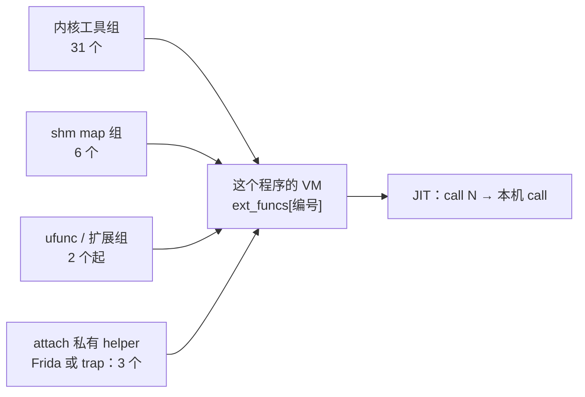
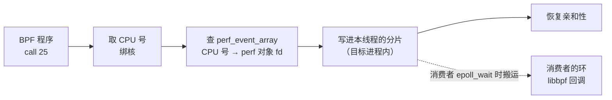
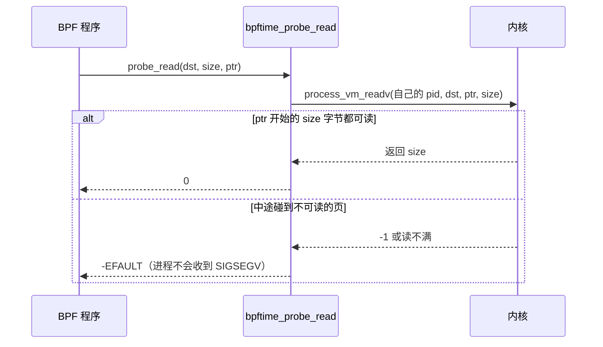

# 7. helper

> 一句话：BPF 程序里写的 `bpf_probe_read_user`、`bpf_perf_event_output`、`bpf_ringbuf_output`、
> `bpf_tail_call`……在 bpftime 里各是哪段 C++ 代码、和内核有什么不同。读完你能说清：一个程序能用哪些
> helper 由谁决定；两种输出路径每次调用付出什么代价；用户态读坏指针为什么不崩；ufunc 和 tail call 是怎么模拟的。
> map 操作类 helper 背后的 map 实现（分发、锁、per-CPU 模拟、ringbuf / perf 的消费协议）在[第 8 章](08-maps.md)。
> 前置：建议先读[第 6 章](06-vm-jit.md)（helper 怎么被 JIT 绑定成函数调用）。预计用时：60–90 分钟。

## 本章要回答的问题

1. bpftime 一共提供了哪些 helper？一个程序能用哪些，由谁决定？
2. 三组 helper 默认都开着吗？为什么头文件里的默认值和实际行为对不上？
3. `bpf_perf_event_output` 和 ringbuf 两种输出方式各走哪条路？每次调用付出什么代价？
4. BPF 程序读一个坏指针，宿主进程（比如 nginx）为什么不会崩？什么构建下会崩？
5. BPF 程序怎么调用宿主进程里的一个普通 C 函数？
6. 用户态没有"跳过去就不回来"，`bpf_tail_call` 是怎么模拟的？

---

## 7.1 helper 在 bpftime 里是什么

**直觉**：在内核里，helper 是内核提供给 BPF 程序的一组函数，程序用编号调用它们（`call 25`）。
bpftime 把程序搬到了用户态，于是每个 helper 都要在用户态重新实现一遍：

- 它就是 runtime 里的一个**普通 C 函数**，跑在**目标进程**里（和 JIT 出来的程序在同一个线程上）。
- 它和程序之间只靠**编号**对接：编译时编号被绑成函数地址（[第 6 章](06-vm-jit.md)），运行时零查表。
- 它做的事是"内核语义的用户态近似"：内核里一个 helper 能做的事（比如关抢占、读任意内核内存），
  用户态做不到，只能换个办法或者干脆不支持。

一个程序能调用的 helper，来自四个地方：



前三组是 `runtime/src/bpf_helper.cpp`（以及 `runtime/extension/`）里的三张静态表；
最后一类由 attach 后端（[第 4 章](04-attach-uprobe.md)）自己提供，因为只有它知道"当前被拦截的函数参数在哪"。

**要点**
- helper = 目标进程里的一个 C 函数 + 一个编号；JIT 时按编号绑定。
- 来源有四：三组静态表 + attach 后端私有的 helper。

---

## 7.2 三组 helper 与注册

### 三组各是什么

| 组 | 获取函数 | 内容 | 编号范围 |
|---|---|---|---|
| 内核工具组（kernel） | `get_kernel_utils_helper_group()` | 31 个模拟内核语义的 helper：probe_read 家族、时间、pid/uid、perf 输出、ringbuf、tail call、栈回溯…… | 4–187 |
| shm map 组（shm_map） | `get_shm_maps_helper_group()` | 6 个 map 操作：lookup / update / delete / push / pop / peek，都是对共享内存里 map 分发层的薄包装 | 1–3、87–89 |
| ufunc 组（ufunc） | `get_ufunc_helper_group()` | 让 BPF 程序调宿主进程里的原生函数（7.8）；按编译开关还可能多出文件路径、io_uring 两类扩展 | 1000 起 |

三张表都是函数内的 `static const` 对象：进程级、只读、**不在共享内存里**。函数指针是本进程的地址，天然正确。

### 程序加载时按配置开关注册

`runtime/src/attach/bpf_attach_ctx.cpp` 的 `load_prog_and_helpers()`：

```cpp
int load_prog_and_helpers(bpftime_prog *prog, const runtime_config &config)
{
#if defined(__linux__)
        if (config.enable_kernel_helper_group) {          // 开关 1（只在 Linux 上）
                bpftime_helper_group::get_kernel_utils_helper_group()
                        .add_helper_group_to_prog(prog);  // 逐个写进 VM 的 ext_funcs
        }
#endif
        if (config.enable_ufunc_helper_group) {           // 开关 2
                bpftime_helper_group::get_ufunc_helper_group()
                        .add_helper_group_to_prog(prog);
        }
        if (config.enable_shm_maps_helper_group) {        // 开关 3
                bpftime_helper_group::get_shm_maps_helper_group()
                        .add_helper_group_to_prog(prog);
        }
        return prog->bpftime_prog_load(config.jit_enabled);  // 然后才 JIT
}
```

### 默认开不开：两层默认值

读代码时容易在这里迷糊：`runtime/include/bpftime_config.hpp` 里 `runtime_config` 结构体的默认值是
kernel 开、shm_map 开、**ufunc 关**。但实际运行时配置不是用这个默认值，而是由
`construct_runtime_config_from_env()` 从环境变量构造的：

`runtime/src/bpftime_config.cpp` 的 `construct_runtime_config_from_env()`（节选）

```cpp
if (const char *custom_helpers = getenv("BPFTIME_HELPER_GROUPS");
    custom_helpers != nullptr) {
        // 设了环境变量：先全关，再按逗号分隔的 token（kernel / shm_map / ufunc）逐个打开
        runtime_config.enable_kernel_helper_group =
                runtime_config.enable_ufunc_helper_group =
                        runtime_config.enable_shm_maps_helper_group = false;
        process_helper_sv(std::string_view(custom_helpers), ',', runtime_config);
} else {
        // 没设：三组全开（包括 ufunc）
        runtime_config.enable_kernel_helper_group =
                runtime_config.enable_shm_maps_helper_group =
                        runtime_config.enable_ufunc_helper_group = true;
}
```

经 syscall-server 启动时（[第 3 章](03-entrypoints.md)），loader 进程走的就是这个函数，
配置随后写进共享内存，agent 用的是同一份。所以**正常使用时三组全开**，只有直接拿结构体默认值的代码路径
才会看到 ufunc 关着。另外两个工具不看开关：`bpftime-aot run` 和 `bpftimetool` 自己只注册 kernel 组和 shm_map 组。

### attach 私有 helper

uprobe 类后端会额外提供三个 helper：183 `bpf_get_func_arg`、184 `bpf_get_func_ret_id`、186 `bpf_get_retval`，
用来读"当前被拦截函数"的参数和返回值。Frida 后端和 trap 后端各有一套实现，agent 编译时二选一。
CUDA 后端不提供私有 helper。

这三个 helper 是在程序**编译之后**才登记的（[第 6 章](06-vm-jit.md) 6.2、6.5）：llvm 后端靠首事件的惰性编译补上，
ubpf 后端则会加载失败（按代码推断）。

### 注册的边界规则

- **少一个会怎样**：JIT 翻译 `call N` 时找不到 `_bpf_helper_ext_000N`，报 "Ext func not found"，整个程序编译失败。
  所以缺 helper 是加载阶段的问题，不是运行时某次调用失败。关掉 `shm_map` 组，任何用到 `bpf_map_lookup_elem` 的程序都编不过。
- **和内核的关键差别**：内核里哪些 helper 能用，由 verifier 按程序类型决定。bpftime 里只看这几个开关和静态表，
  不分程序类型：一个 uprobe 程序也能"调到" `bpf_xdp_adjust_head`。
- **编号重叠**：两组之间没有去重检查，VM 层对已登记的编号返回 `-EEXIST`（llvm 后端），而 `add_helper_group_to_prog`
  不看返回值，结果是先登记的生效。
- 组内的 `register_helper` 限制编号 ≤ 999，但三张静态表是直接用 map 初始化的，不经过这个检查，所以 ufunc 组能用 1000、1001。

> **注意**：开启 verifier 的构建里，syscall-server 交给 verifier 的"可用 helper 列表"在 ufunc 分支加错了组，
> 见[附录 B](B-known-issues.md#b-entry)。

**要点**
- 三组静态表 + 三个开关；`BPFTIME_HELPER_GROUPS` 没设时三组全开。
- 结构体默认值里 ufunc 是关的，但正常启动路径不用它。
- attach 私有 helper 在编译之后才登记，靠惰性 JIT 兜底。
- 缺 helper → 加载时编译失败。

---

## 7.3 helper 总表

下表是默认构建（三组全开、Frida 后端）里一个程序能用到的全部 helper。"组"一栏：K = 内核工具组，
S = shm map 组，U = ufunc 组，A = attach 私有。"系统调用"一栏指每次调用是否必然进内核（vDSO 不算）。

| 编号 | 名字 | 组 | bpftime 里做什么 | 系统调用 |
|---|---|---|---|---|
| 1 | `bpf_map_lookup_elem` | S | 按 fd 查共享内存里的 map，返回 value 指针（[第 8 章](08-maps.md)） | 否 |
| 2 | `bpf_map_update_elem` | S | 同上，更新 | 否 |
| 3 | `bpf_map_delete_elem` | S | 同上，删除 | 否 |
| 4 | `bpf_probe_read` | K | 用 `process_vm_readv` 读自己进程的内存（7.7） | 是 |
| 5 | `bpf_ktime_get_ns` | K | `std::chrono::steady_clock`，即单调时钟 | 否 |
| 6 | `bpf_trace_printk` | K | `vprintf` 到宿主进程的 stdout，恒返回 0 | 写 stdout |
| 7 | `bpf_get_prandom_u32` | K | `rand()` | 否 |
| 8 | `bpf_get_smp_processor_id` | K | `sched_getcpu()`，出错返回 0 | 视 glibc |
| 12 | `bpf_tail_call` | K | 在 helper 里同步执行目标程序（7.9） | 用户态目标否 |
| 14 | `bpf_get_current_pid_tgid` | K | 进程 / 线程 id，有缓存，fork 后刷新 | 每线程首次 |
| 15 | `bpf_get_current_uid_gid` | K | 每次实时 `getgid()` + `getuid()` | 是（2 个） |
| 16 | `bpf_get_current_comm` | K | 返回**可执行文件名**（读 `/proc/self/exe`），不是线程名 | 首次 |
| 25 | `bpf_perf_event_output` | K | 写软件 perf buffer（7.5） | 是（成功时 5 个：3 个亲和性 + `getpid` + `gettid`） |
| 27 | `bpf_get_stackid` | K | 让 Frida 后端回溯用户栈，存进 stack_trace map；只支持用户栈 | 视回溯实现 |
| 28 | `bpf_csum_diff` | K | 校验和差值，移植自 ebpf-for-windows | 否 |
| 36 | `bpf_probe_write_user` | K | 用 `process_vm_writev` 写自己进程的内存 | 是 |
| 44 | `bpf_xdp_adjust_head` | K | 调整用户态 XDP 上下文的包头 | 否 |
| 45 | `bpf_probe_read_str` | K | 按块读字符串（7.7），与 114 共用实现 | 是 |
| 58 | `bpf_override_return` | K | 调 attach 后端设置的回调，改被拦截函数的返回值 | 否 |
| 65 | `bpf_xdp_adjust_tail` | K | 调整用户态 XDP 上下文的包尾 | 否 |
| 67 | `bpf_get_stack` | K | 同 27 的回溯，把栈帧拷进缓冲区；不支持 build-id | 视回溯实现 |
| 87 / 88 / 89 | `bpf_map_push_elem` / `pop` / `peek` | S | queue / stack 类 map 的操作 | 否 |
| 112 | `bpf_probe_read_user` | K | 同 4 | 是 |
| 113 | `bpf_probe_read_kernel` | K | 同 4（用户态没有"内核内存"，按用户态地址读） | 是 |
| 114 | `bpf_probe_read_user_str` | K | 同 45 | 是 |
| 125 | `bpf_ktime_get_boot_ns` | K | `CLOCK_BOOTTIME`，失败退回 `CLOCK_MONOTONIC` | 否 |
| 130 | `bpf_ringbuf_output` | K | reserve + 拷贝 + submit（7.6） | 否 |
| 131 / 132 / 133 | `bpf_ringbuf_reserve` / `submit` / `discard` | K | 在共享内存里的环上预留、提交、丢弃一条记录 | 否 |
| 160 | `bpf_ktime_get_coarse_ns` | K | `CLOCK_MONOTONIC_COARSE` | 否 |
| 173 | `bpf_get_func_ip` | K | 当前被拦截函数的地址（attach 层放在线程局部变量里） | 否 |
| 174 | `bpf_get_attach_cookie` | K | 当前 link 的 cookie，没有则 0 | 否 |
| 182 | `bpf_strncmp` | K | `strncmp(s1, s2, s1_sz)` | 否 |
| 183 | `bpf_get_func_arg` | A | 从 Frida 的 CPU 上下文里取第 n 个参数 | 否 |
| 184 | `bpf_get_func_ret_id` | A | 取被拦截函数的返回值（uretprobe） | 否 |
| 186 | `bpf_get_retval` | A | 同上，直接作为返回值给出 | 否 |
| 187 | `bpf_set_retval` | K | 同 58，经 attach 回调设置返回值 | 否 |
| 1000 | `__ebpf_call_ufunc_dispatcher` | U | 按 id 调宿主进程里登记过的原生函数（7.8） | 否 |
| 1001 | `__ebpf_call_find_ufunc_id` | U | 按名字找 ufunc 的 id | 否 |
| 1003 / 1004 | `bpftime_get_abs_path` / `bpftime_path_join` | U | 文件路径扩展（编译开关 `BPFTIME_ENABLE_FS_HELPER`） | — |
| 1006–1010 | `io_uring_*` | U | io_uring 扩展（编译开关 `BPFTIME_ENABLE_IOURING_EXT`） | 是 |

几点补充：

- 编号就是内核 `enum bpf_func_id` 里的编号（`bpf_helper.cpp` 抄了一份），所以 clang 编出来的 `call N` 能直接对上。
  内核有而这张表没有的 helper（比如 `bpf_get_current_cgroup_id`、`bpf_ringbuf_query`），程序一用就编译失败。
- 默认三组共 31 + 6 + 2 = 39 个，加上 attach 私有的 3 个。
- 表里不少 helper 的细节和内核不同（返回值、是否补 NUL、是否清零……），逐条见本章深入参考和
  [附录 B](B-known-issues.md#b-helpers)。

**要点**
- 编号沿用内核编号；表外的 helper 一律不可用。
- 热路径上要注意"系统调用"一栏：probe_read 家族、perf 输出、uid/gid 每次都进内核；ringbuf、map 操作不进。

---

## 7.4 helper 的签名并不统一

**直觉**：JIT 一侧对所有 helper 一视同仁：一律按"5 个 `i64` 参数（r1..r5）、返回 `i64`（写回 r0）"调用
（[第 6 章](06-vm-jit.md) 6.5）。但被调的 C 函数并没有统一写成这个样子。读 `bpf_helper.cpp` 时会看到好几种写法：

| 写法 | 例子 |
|---|---|
| 5 个 `uint64_t`，用不到的不写名字 | `bpftime_ktime_get_ns(uint64_t, uint64_t, uint64_t, uint64_t, uint64_t)`、`bpf_perf_event_output` |
| 参数少于 5 个 | `bpftime_tail_call(ctx, prog_array, index)`（3 个）、`bpftime_override_return(ctx, value)`（2 个）、`bpftime_set_retval(value)`（1 个） |
| 没有参数 | `bpftime_get_smp_processor_id()`、`bpftime_get_prandom_u32()` |
| 带 `int`、指针或结构体指针 | `bpftime_csum_diff(const void *, int, const void *, int, int)`、`bpftime_strncmp(const char *, uint64_t, const char *)`、`bpftime_xdp_adjust_head(struct xdp_md_userspace *, int)`、Frida 的 `bpftime_get_func_arg(uint64_t, uint32_t, uint64_t *, ...)` |
| 返回类型不同 | `uint64_t`、`int64_t`、`long` 都有 |
| 可变参数 | `bpftime_trace_printk(uint64_t fmt, uint64_t fmt_size, ...)` |

**为什么大多数能工作**：在 x86_64 System V 和 aarch64 上，前 6 个 / 8 个整型或指针参数都走寄存器。
调用方把 r1..r5 放进前 5 个参数寄存器，被调函数只读自己声明的那几个，多出来的它根本不看；
`int` / `uint32_t` 形参只取寄存器低 32 位；各种 64 位以内的整型返回值都在同一个返回寄存器里。

**可变参数是例外**。`bpftime_trace_printk` 的写法是：

`runtime/src/bpf_helper.cpp` 的 `bpftime_trace_printk()`

```cpp
uint64_t bpftime_trace_printk(uint64_t fmt, uint64_t fmt_size, ...)
{
        const char *fmt_str = (const char *)fmt;
        va_list args;
        /* ... 关掉 -Wvarargs 等告警 ... */
        va_start(args, fmt_str);       // 第二个实参应当是最后一个具名形参，这里传的是局部变量
        long ret = vprintf(fmt_str, args);
        va_end(args);
        return 0;                      // 恒返回 0（内核返回写出的字节数）
}
```

`va_start` 的第二个实参不是最后一个具名形参，这是未定义行为。GCC 实际按最后一个具名形参 `fmt_size` 定位，
于是可变参数从第 3 个整型寄存器（r3）开始取，恰好对上 BPF 程序的 `bpf_trace_printk(fmt, size, a, b, c)`。
它能工作是因为未定义行为恰好落对了地方；在可变参数走栈的 ABI（如 Apple arm64）上会读错（按代码推断）。

**要点**
- 调用方统一，被调方不统一；靠"整型参数走寄存器、多余的不看"兼容。
- 浮点参数、走栈的参数、可变参数都不在这个兼容范围里。

---

## 7.5 输出路径一：`bpf_perf_event_output`

**先回顾内核里的 perf buffer。** 内核给每个 CPU 准备一个环形缓冲区（ring）。
BPF 程序调用 `bpf_perf_event_output(ctx, &perf_map, BPF_F_CURRENT_CPU, data, size)`，
就是把 `data` 作为一条记录追加到"当前 CPU 的那个环"里。用户态的 libbpf `perf_buffer`
把所有 CPU 的环都 mmap 过来，用 epoll 等着，有数据就逐条回调。
`PERF_EVENT_ARRAY` 这个 map 本身不存数据，只存"第 i 个 CPU 对应哪个 perf 环"。

**bpftime 里的做法**可以概括成四步：

1. **记下当前 CPU 号，并把线程临时绑到这个 CPU 上**（保存原来的 CPU 亲和性，输出完再恢复）。
2. **查 map 类型**，普通的 `PERF_EVENT_ARRAY` 就以 CPU 号为 key 查它，拿到一个 perf 对象的假 fd
   （这个 fd 是消费者调 `perf_buffer__new` 时由 libbpf 填进去的，假 fd 见[第 2 章](02-runtime-shm.md)）。
3. **写一条记录**：写进这个 perf 对象里"当前线程专属的分片（shard）"。每个线程一个分片，稳态下多个线程同时输出时互不抢锁（线程第一次输出、或缓存失效时要拿一次 perf 对象的分片锁）。
   消费者调 `epoll_wait` 时，bpftime 再把分片里的记录搬（drain）进消费者看的环（[第 8 章](08-maps.md)）。
4. **恢复 CPU 亲和性**。

这张图看一次调用的数据走向：写入发生在目标进程里，搬运发生在消费者调用 `epoll_wait` 的时候。



`runtime/src/bpf_helper.cpp` 的 `bpf_perf_event_output()`（节选，去掉日志）

```cpp
uint64_t bpf_perf_event_output(uint64_t ctx, uint64_t map, uint64_t flags,
                               uint64_t data, uint64_t size)
{
        int32_t current_cpu = my_sched_getcpu();         // ① 记下当前 CPU 号
        cpu_set_t mask, orig;
        CPU_ZERO(&mask);
        CPU_SET(current_cpu, &mask);
        if (sched_getaffinity(0, sizeof(orig), &orig) < 0)   // 系统调用 1：保存原亲和性
                return (uint64_t)-1;
        if (sched_setaffinity(0, sizeof(mask), &mask) < 0) { // 系统调用 2：绑到当前 CPU
                errno = EINVAL;
                return (uint64_t)(-1);
        }
        int fd = (int)map;                                // map 参数就是 fd（第 6 章 6.4）
        /* ... bpftime_map_get_info 查 map 类型，失败则 goto restore_affinity ... */
        if (map_ty == BPF_MAP_TYPE_PERF_EVENT_ARRAY) {
                const int32_t *val_ptr = (int32_t *)bpftime::shm_holder.global_shared_memory
                        .bpf_map_lookup_elem(fd, &current_cpu, false); // ② key = CPU 号
                /* ... 查不到 → errno = EINVAL，goto restore_affinity ... */
                ret = bpftime_perf_event_output(*val_ptr,   // ③ value = perf 对象的 fd
                                (const void *)data, (size_t)size);
        }
        /* else if KERNEL_USER_PERF_EVENT_ARRAY → bpftime_shared_perf_event_output(...) */
restore_affinity:
        const int saved_errno = errno;                    // 不让恢复动作覆盖输出路径的 errno
        if (sched_setaffinity(0, sizeof(orig), &orig) < 0 && ret >= 0) // 系统调用 3：恢复
                return (uint64_t)-1;
        errno = saved_errno;
        return (uint64_t)ret;
}
```

### 每次调用的代价

- **成功输出时 5 个系统调用**：`sched_getaffinity` 一次、`sched_setaffinity` 两次（绑上、恢复）；外加写分片前
  找"本线程分片"时的 `getpid()` 和 `gettid`（`get_current_thread_shard` 每次都先取这两个值，再查线程局部缓存；
  glibc 不缓存 `getpid`）。查表失败提前返回的路径只有 3 个亲和性系统调用。如果快照 CPU 号之后线程
  已经被迁走，绑核还会触发一次迁移回去。`sched_getcpu` 本身在较新的 glibc 上通常不进内核（走 rseq / vDSO）。
- **一次 map 锁**：perf_event_array 在分发层是要加锁的类型，每次 lookup 拿一次这个 map 的自旋锁。
- 这些开销都在 helper 函数体里，JIT 层没有额外开销。对 sslsniff + nginx 这类每请求输出一次的场景，绑核是
  热路径上最显眼的一笔。

**这段绑核换来了什么**：源码只有一句注释 `// Bind to the current cpu`。按代码看，CPU 号在绑核**之前**已经快照，
写入走的是按线程划分的分片（与 CPU 无关），绑核也不是锁——在当前设计下它对正确性几乎没有贡献（这是本书对代码的分析）。

### 与内核语义的差别

- **`flags` 和 `ctx` 被完全忽略**。程序传 `BPF_F_CURRENT_CPU` 恰好和"永远用当前 CPU 号"一致；
  如果用 `BPF_F_INDEX_MASK` 显式指定下标，bpftime 会静默当成当前 CPU 处理。
- **返回 0 不等于消费者一定收到**：分片满了时写入失败，但这个失败被吞掉，helper 照样返回 0，
  也不会生成内核那种 `PERF_RECORD_LOST` 记录（[第 8 章](08-maps.md)）。
- CPU 号 ≥ perf array 的 `max_entries`、或者这个 CPU 的格子还没被消费者填上时，查表或写入失败，返回 -1。

### 另一条分支：内核共享版 perf array

如果 map 类型是 `KERNEL_USER_PERF_EVENT_ARRAY`，说明消费者是**真正的内核 perf buffer**（比如 daemon 场景，
[第 10 章](10-periphery.md)）。这时 helper 把数据写进一个内核的 user ringbuf，再由一段内核里的"搬运"BPF 程序定期取出，
转投到真正的 perf array。这条路有单条 448 字节的上限、搬运速率受定时器限制，细节在[第 8 章](08-maps.md)。
这条分支同样在绑核期间执行。

**要点**
- perf 输出 = 取 CPU 号 → 绑核 → 按 CPU 号查 perf array 得到 perf 对象 → 写本线程分片 → 恢复亲和性。
- 成功输出一次 5 个系统调用（3 个亲和性 + `getpid` + `gettid`）+ 一次 map 锁。
- `flags`、`ctx` 被忽略；分片满时静默丢弃，仍返回 0。

---

## 7.6 输出路径二：ringbuf

**直觉**：BPF ringbuf 是内核 5.8 引入的另一种输出方式：所有 CPU 共用一个环，程序先 `reserve` 一块空间、
填好、再 `submit`（或 `discard`）。用户态 libbpf 把环 mmap 过来直接读。

bpftime 里，ringbuf map 本身就放在共享内存里，消费者（经 syscall-server 拦截的 mmap）映射到的就是这块内存
（布局与协议见[第 8 章](08-maps.md)）。所以 helper 一侧只是在共享内存里写字节：

- `bpf_ringbuf_reserve(rb, size, flags)`：按 fd 找到 ringbuf，持环内的进程共享自旋锁预留一段，写一个 8 字节记录头
  `{len | BUSY 位, fd}`，返回头后面的数据指针；失败返回 NULL。
- `bpf_ringbuf_submit(data, flags)` / `bpf_ringbuf_discard(data, flags)`：BPF 程序只交回一个数据指针，
  helper 从 **`data` 前面 4 字节（记录头的第二个字段）读出 map fd**，再按 fd 找到 ringbuf，清掉 BUSY 位（discard 再置 DISCARD 位）。
- `bpf_ringbuf_output(rb, data, size, flags)`：reserve + `memcpy` + submit。

`runtime/src/bpf_helper.cpp` 的 `bpf_ringbuf_submit()`

```cpp
uint64_t bpf_ringbuf_submit(uint64_t data, uint64_t flags, uint64_t, uint64_t,
                            uint64_t)
{
        int32_t *ptr = (int32_t *)(uintptr_t)data;
        int fd = ptr[-1];                 // 记录头 {u32 len; i32 fd}，fd 紧挨着数据
        if (flags != 0) {
                SPDLOG_WARN("Currently only supports ringbuf_submit with flags=0");
        }
        bpftime_ringbuf_submit(fd, (void *)(uintptr_t)data, false);
        return 0;                         // 恒返回 0
}
```

内核的记录头第二个字段存的是"页偏移"，用来从数据指针反推 ringbuf；bpftime 改成直接存 fd，省掉了反推，
代价是和内核记录格式在这个字段上不同（libbpf 消费时不读这个字段，所以不影响消费）。

两种输出方式对比：

| | `bpf_perf_event_output` | ringbuf |
|---|---|---|
| 环的个数 | 每个 perf 对象一个消费者环 + 每线程一个生产分片 | 全局一个环 |
| 每次调用的系统调用 | 成功时 5 个（3 个绑核 + 找分片的 `getpid`/`gettid`） | 0 个 |
| 锁 | perf_event_array 的 map 锁 | 环内的 reserve 自旋锁（submit 不加锁） |
| 数据什么时候对消费者可见 | 消费者 `epoll_wait` 时从分片搬运 | submit 时 |
| `flags` | 忽略 | 非 0 只打 WARN，`BPF_RB_NO_WAKEUP` 等不生效 |
| 失败时返回 | -1；分片满时仍返回 0 | reserve 返回 NULL；output 返回 -1（不是 `-errno`） |

**要点**
- ringbuf helper 只在共享内存里写字节，没有系统调用。
- submit / discard 靠记录头里存的 fd 找回 ringbuf。
- 写 bpftime 上的高频输出程序，ringbuf 比 perf 输出便宜得多。

---

## 7.7 probe_read / probe_write：用户态读写内存也需要容错

**问题在哪。** BPF 程序经常要读被追踪函数的参数指向的内存。sslsniff 在 `SSL_write` 返回时，
用 `bpf_probe_read_user(&data->buf, len, buf指针)` 把明文拷出来。这个指针来自被追踪的程序，
BPF 程序没法保证它有效：可能已经被释放、可能是垃圾值、长度也可能越过映射边界。

在内核里，`bpf_probe_read_user` 用 `copy_from_user_nofault` 实现：碰到坏地址只返回错误，内核不会出事。

在 bpftime 里，BPF 程序跑在**目标进程自己的地址空间里**。如果直接 `memcpy` 一个坏指针，
CPU 触发缺页，进程收到 SIGSEGV——被追踪的 nginx 直接崩掉。观测工具把被观测者弄崩，这是不可接受的。

**bpftime 的办法：让内核替你"试读"。** Linux 有一个系统调用 `process_vm_readv(pid, 本地缓冲, 远端地址)`，
本来用来从**别的进程**拷内存（调试器常用）。bpftime 把 `pid` 填成**自己**。
这样拷贝动作由内核完成：源地址不可读时，内核只返回错误或"少读了几个字节"，
不会给进程发 SIGSEGV。代价是每次 probe_read 都要进一次内核。

`runtime/src/bpf_helper.cpp` 的 `probe_read_memory()`（Linux 分支）和 `bpftime_probe_read()`：

```cpp
static bool probe_read_memory(void *dst, const void *src, size_t size)
{
        if (size == 0)
                return true;                            // 0 字节不进内核
        struct iovec local = { dst, size };             // "本地" = 目的缓冲区
        struct iovec remote = { const_cast<void *>(src), size };  // "远端" = 不可信指针
        return syscall(SYS_process_vm_readv,
                       probe_access_atfork_status == 0 ? probe_access_pid : getpid(), // 目标 = 自己
                       &local, 1, &remote, 1, 0) == (ssize_t)size;  // 必须一字不差读满
}

int64_t bpftime_probe_read(uint64_t dst, int64_t size, uint64_t ptr, uint64_t,
                           uint64_t)
{
        if (unlikely(size < 0))
                return -EFAULT;
#ifdef ENABLE_PROBE_READ_CHECK                          // CMake 选项，默认 ON
        return probe_read_memory((void *)dst, (void *)ptr, (size_t)size) ?
                       0 : -EFAULT;                     // 读失败或读不满 → -EFAULT
#else
        memcpy((void *)dst, (void *)ptr, (size_t)size); // 关掉检查：裸拷，坏指针直接崩
        return 0;
#endif
}
```

（macOS 分支用 Mach 的 `mach_vm_read_overwrite` 做同样的事，这里省略。）

下面这张时序图看错误在哪里被发现：在内核里，而不是在用户态的信号处理里。



**为什么要缓存 pid，还要处理 fork。** 每次调 `getpid()` 也是开销，所以 bpftime 在启动时把 pid 存进静态变量。
问题是 fork：子进程会继承父进程的静态变量，如果不刷新，子进程会拿父进程的 pid 去"读自己"，实际读到父进程的内存。
所以代码用 `pthread_atfork` 注册了一个回调，在子进程里重新取一次 pid；注册失败时退回每次都调 `getpid()`。

`runtime/src/bpf_helper.cpp` 文件开头：

```cpp
static pid_t probe_access_pid = getpid();               // 程序启动时取一次
static const int probe_access_atfork_status = pthread_atfork(
        nullptr, nullptr, [] { probe_access_pid = getpid(); });  // fork 出的子进程里刷新
```

### 同一家族的其他 helper

- **`bpf_probe_write_user`（36）**：对称地用 `process_vm_writev` 写自己。受 `ENABLE_PROBE_WRITE_CHECK` 控制。
- **`bpf_probe_read_str` / `bpf_probe_read_user_str`（45 / 114）**：按"不跨页、最多 256 字节"的小块逐块读到栈上的临时缓冲，
  用 `memchr` 找结尾的 `'\0'`，再写进 `dst`；返回值是**含结尾 NUL 的长度**；读满 `bufsz` 时截断并补 NUL。
  按页切块的意义：字符串在页尾正常结束时，不会因为"顺手多读了下一页"误报失败。
- **`bpf_probe_read_kernel`（113）**：用户态没有"内核内存"，和 `bpf_probe_read` 是同一个函数。

### 与内核的差异

- **`bpf_probe_read` / `_user` 读失败时不清零 `dst`**（内核会清零）；读了一半失败时，`dst` 前半段可能已经写进了数据。
- **`bpf_probe_read_str` 只有"读"失败时才把整个 `dst` 清零**；往 `dst` 写失败时直接返回 `-EFAULT`，不清零。
- **两个检查开关都关掉时没有任何容错**：probe_read 是裸 `memcpy`，probe_read_str 是逐字节直接读，坏指针就会让宿主进程崩溃。
  CMake 默认两个开关都是 ON，但**本书实验用的 build-jit 构建两个都是 OFF**，在它上面做实验看到的是裸拷贝行为。

**要点**
- 用户态直接解引用坏指针会让宿主进程崩溃，所以 probe_read 必须容错。
- 做法是对自己调 `process_vm_readv` / `process_vm_writev`，让内核代为拷贝；坏地址只得到错误码。
- 代价是每次调用一个系统调用；pid 被缓存并在 fork 后刷新。
- 检查开关关掉就退化成裸拷贝；读失败不清零 `dst` 这一点与内核不同。

---

## 7.8 ufunc：让 BPF 程序调宿主进程里的函数

**直觉**：helper 是 bpftime 预先写好的一组函数。ufunc（user function）更进一步：让 BPF 程序在运行时调用
**宿主进程里任意一个已登记的原生 C 函数**——比如被 hook 的程序自己的某个内部函数。这可以用来做热补丁：
在 uprobe 里改参数、再调原函数的另一个版本（例子见 `example/hotpatch/`）。

它不是给每个原生函数分配一个 helper 编号，而是**二级分发**：只占两个 helper 编号，函数表另外维护。

- **宿主一侧登记函数**：进程里有一张全局表 `global_ufunc_ctx`（最多 32768 项，每项是名字、函数指针、
  参数类型、返回类型）。两种登记方式：
  - `bpftime_ufunc_resolve_from_info(info, resolver)`：用一个"按名字找地址"的回调（比如 attach 层的符号查找）
    解析出地址，追加到表尾；
  - `bpftime_ufunc_register_ufunc(id, info)`：直接写进指定下标。
- **BPF 一侧调用**：参数先装进 BPF 栈上的一个 `struct arg_list { u64 args[6]; }`，然后
  `call 1000(id, &arg_list)`；不知道 id 时先 `call 1001(name)` 按名字查。单测的辅助头文件
  `runtime/unit-test/assets/ufunc.bpf.h` 提供了 `UFUNC_CALL_n` 之类的宏。

`runtime/src/ufunc.cpp` 的 `__ebpf_call_ufunc_dispatcher()`（helper 1000，去掉日志）

```cpp
extern "C" uint64_t __ebpf_call_ufunc_dispatcher(uint64_t id, uint64_t arg_list)
{
        if (id >= MAX_UFUNC_FUNCS)
                return -1;
        struct ebpf_ufunc_func_info *func_info =
                ebpf_resovle_ufunc_func(&global_ufunc_ctx, id);  // 按下标取表项
        if (!func_info || !func_info->func || func_info->is_attached)
                return 0;                                       // 没有这个函数：对程序静默返回 0（只打日志）

        if ((size_t)func_info->num_args > MAX_ARGS_COUNT)
                return (uint64_t)-1;
        struct arg_list *raw_args = (struct arg_list *)arg_list; // 指向 BPF 栈上的参数包
        union arg_val args[MAX_ARGS_COUNT] = { { 0 } };
        for (int i = 0; i < func_info->num_args; i++)           // 按登记的类型转换每个参数
                args[i] = to_arg_val(func_info->arg_types[i], raw_args->args[i]);
        union arg_val ret;
        ret.ptr = func_info->func(args[0].ptr, args[1].ptr,     // 当作 5 个指针参数的函数调用
                                  args[2].ptr, args[3].ptr, args[4].ptr);
        return from_arg_val(func_info->ret_type, ret);          // 按登记的返回类型转换
}
```

> **注意**：表项允许 6 个参数，但实际只传了前 5 个；浮点参数和返回值按整型寄存器传，原生函数真用 `double`
> 时会拿错；用 `register_ufunc` 按下标登记的函数，按名字（1001）查不到。见[附录 B](B-known-issues.md#b-helpers)。
> 函数表没有锁，登记一般发生在启动阶段。

**要点**
- ufunc = 两个 helper（1000 调用、1001 查 id）+ 进程内一张函数表。
- 参数打包在 BPF 栈上的 `arg_list` 里，由分发器按登记的类型转换后调用原生函数。
- 正常启动路径下 ufunc 组是开着的（7.2）。

---

## 7.9 tail call：在 helper 里同步执行目标程序

**直觉**：内核里 `bpf_tail_call(ctx, &prog_array, idx)` 的意思是"直接跳到另一个程序，不再返回"，
目标程序的返回值就是整个调用的返回值；如果目标不存在，tail call 失败，**继续执行下一条指令**。
用户态没法让一个 C 函数"跳走不回来"，bpftime 用三方配合来模拟：

1. **helper 一侧**：`bpftime_tail_call` 查出目标程序，像普通函数一样**同步执行它**，把目标的返回值存进
   线程局部变量 `current_thread_tail_call_ret`，自己返回 0。
2. **JIT 一侧**：llvmbpf 在每个 `call 12` 之后无条件跳到程序出口（[第 6 章](06-vm-jit.md)），调用方后面的指令不再执行。
3. **执行入口一侧**：外层 `bpftime_prog_exec` 结束时，如果 `current_thread_tail_call_ret` 有值，就用它替换本程序的返回值。

`runtime/src/bpf_helper.cpp` 的 `bpftime_tail_call()`（用户态目标分支，有删节）

```cpp
uint64_t bpftime_tail_call(uint64_t ctx, uint64_t prog_array, uint64_t index)
{
        int fd = (int)prog_array;
        /* ... 校验是 prog_array；以 index 查表得到目标 fd，查不到 return -1 ... */
        if (bpftime_is_prog_fd(to_call_fd)) {
                /* ... 线程局部深度计数，超过 32 层 return -1 ... */
                bpftime::bpftime_prog *prog = nullptr;
                try {   // 优先复用本进程已经实例化（已 JIT）的程序
                        prog = get_global_attach_ctx().find_instantiated_prog(to_call_fd);
                } catch (const std::exception &) {}
                std::optional<bpftime::bpftime_prog> fallback;
                if (prog == nullptr) {  // 没有：从 handler 现场建一个，并 JIT（慢）
                        /* ... fallback.emplace(...); load_prog_and_helpers(...) ... */
                }
                char context[64];       // 把 ctx 的前 64 字节拷到栈上，交给目标程序
                if (ctx) memcpy(context, (const void *)ctx, sizeof(context));
                else     memset(context, 0, sizeof(context));
                uint64_t retval = 0;
                if (prog->bpftime_prog_exec(context, sizeof(context), &retval) < 0)
                        return -1;
                bpftime::current_thread_tail_call_ret = retval;  // 交给外层 exec
                return 0;
        }
        /* ... 目标是内核程序：同样拷 64 字节，bpf_prog_test_run_opts 跑一次，再 close ... */
}
```

几个值得知道的行为：

- **目标是用户态程序时，没有系统调用**；如果目标还没在本进程实例化，要现场 JIT 一次，这一次会很慢。
  做带 tail call 的 benchmark 时先确认目标已经被 attach 过。
- **目标看到的是 ctx 的副本**：固定拷 64 字节，`mem_len` 也恒为 64；目标对 ctx 的修改不会回到调用方。
- **prog_array 里也可以放内核程序**：这时用 `bpf_prog_test_run_opts` 让内核跑一次（需要 libbpf 支持），
  每次调用都有 bpf 系统调用。
- **嵌套**：每一层都在 helper 里递归调用 `bpftime_prog_exec`，线程局部计数器限制最多 32 层。

> **注意**：tail call 失败（helper 返回 -1）时，llvm 后端也会直接退出，而不是像内核那样继续执行下一条；
> ubpf 后端的行为又不同；ctx 不足 64 字节时会越界读。见[附录 B](B-known-issues.md#b-helpers)。

**要点**
- 用户态 tail call = helper 里同步执行目标 + JIT 无条件跳出口 + 外层用线程局部变量替换返回值。
- 目标拿到的是 ctx 前 64 字节的副本。
- 目标未实例化时要现场 JIT，第一次很慢。

---

## 7.10 其他 helper 的用户态做法速览

总表里一句话说不清、但读代码时会遇到的几类：

- **身份信息**：`bpf_get_current_pid_tgid` 把进程 id 存成静态变量、线程 id 存成线程局部变量，第一次用时 `gettid`，
  之后不再进内核；`pthread_atfork` 在子进程里刷新这两个缓存。`bpf_get_current_uid_gid` 则每次都实时 `getgid()` +
  `getuid()`，因为进程的身份可能在启动后变化。`bpf_get_current_comm` 返回的是 `/proc/self/exe` 的文件名部分，
  不是内核意义上的线程名 comm。
- **"当前被拦截的函数"**：`bpf_get_func_ip`、`bpf_get_attach_cookie` 读的是 attach 层在调用程序前放进线程局部变量的值
  （trap 后端在信号上下文里另有一份），见[第 4 章](04-attach-uprobe.md)。
- **改返回值**：`bpf_override_return`、`bpf_set_retval` 调 attach 层为本次调用设置的回调；如果当前不在支持改返回值的
  attach 类型里（没有回调），会抛 C++ 异常。
- **栈回溯**：`bpf_get_stack`、`bpf_get_stackid` 向 attach 类型 6（uprobe）的后端要一份用户栈（Frida 后端的
  `generate_stack`），只支持 `BPF_F_USER_STACK`。trap 后端上，用了这两个 helper 的程序在 attach 时就被拒绝（见下一条）。
- **map 操作**：返回值大多是实现里的 `-1`，不是内核那种 `-EEXIST` / `-ENOENT`；细节在[第 8 章](08-maps.md)。
- **trap 后端能用哪些**：trap 后端在信号处理函数里执行程序，只允许调用一张"async-signal-safe 白名单"里的 helper：
  173、174、58、187，再加 trap 自己的 183、184、186。attach 时 `prepare_for_signal_execution` 逐条检查程序里的 `call`，
  用到白名单外的 helper 就返回 `-ENOTSUP`、拒绝 attach（[第 4 章](04-attach-uprobe.md)）。这是有意的设计：
  栈回溯、map 操作（1、2、3……）、`trace_printk`、tail call 都不在白名单里，所以在 trap 后端上，**任何用了 map 或栈 helper
  的程序都 attach 不上**，而不是运行时静默失败。

**要点**
- 能缓存的（pid/tid、comm）缓存并处理 fork；可能变化的（uid/gid）每次实时查。
- 与"当前事件"相关的信息都经 attach 层的线程局部变量传递。

---

## 小结

- helper 是目标进程里的普通 C 函数，按编号在 JIT 时绑定；来源是三组静态表（kernel / shm_map / ufunc）加 attach 私有 helper。
- `BPFTIME_HELPER_GROUPS` 没设时三组全开；结构体里 ufunc 默认关，但正常启动路径不用这个默认值。
- 缺 helper 是加载时编译失败；bpftime 不按程序类型限制 helper。
- 调用方统一按 5 个 64 位参数调，被调方签名五花八门，靠调用约定兼容；可变参数的 `trace_printk` 是例外。
- `bpf_perf_event_output`：取 CPU 号 → 绑核 → 查 perf array → 写本线程分片 → 恢复，成功时每次 5 个系统调用（3 个亲和性 + `getpid` + `gettid`）；`flags` 被忽略，分片满时静默丢弃。
- ringbuf helper 只在共享内存里写字节，没有系统调用；submit 靠记录头里的 fd 找回 ringbuf。
- probe_read 用对自己的 `process_vm_readv` 容错，坏指针得到 `-EFAULT`；检查开关关掉（如 build-jit）就是裸拷贝。
- ufunc 是经 helper 1000/1001 的二级分发；tail call 是 helper 里同步执行目标、JIT 无条件跳出口、外层替换返回值。

## 动手验证

以下 `$B` 是官方构建目录 `/home/y/src/bpftime-wt-official-177a1dc/build-jit`。跑会创建共享内存的程序时，
用 `BPFTIME_GLOBAL_SHM_NAME` 起一个独立名字，跑完删掉 `/dev/shm/` 下的同名文件。

1. **跑本章相关的单测。**
   ```bash
   cd $B/runtime/unit-test
   N=helper_test_$RANDOM
   BPFTIME_GLOBAL_SHM_NAME=$N SPDLOG_LEVEL=off ./bpftime_runtime_tests \
     "Test bpftime_probe_read,Test bpf_probe_read_str,Test probe access preserves application SIGSEGV handlers,Test bpftime_probe_write_user,Test helpers,Test ufunc register,Test tail calling from userspace to userspace"
   rm -f /dev/shm/$N
   ```
   预期（本机已跑）：`All tests passed (45 assertions in 7 test cases)`。注意 build-jit 关了两个 probe 检查，
   单测里依赖检查的那部分断言被 `#ifdef` 掉了，所以这里通过不代表"坏指针不崩"。

2. **数一数 perf 输出的系统调用。**
   ```bash
   cd $B/runtime/unit-test
   strace -f -e trace=getpid,gettid,sched_getaffinity,sched_setaffinity \
     ./bpftime_runtime_tests "[affinity][perf_event]" 2>&1 | grep -E "getpid|gettid|sched_"
   ```
   预期（本机已跑）：这个测试有 3 个分支，每个分支调一次 `bpf_perf_event_output`。成功写入的那个分支能看到连续的
   `sched_getaffinity` → `sched_setaffinity([某个 CPU])` → `getpid()` → `gettid()` → `sched_setaffinity(恢复)`，共 5 个；
   另外两个分支查表失败，没走到分片，只有 3 个亲和性调用。其余的 `sched_*affinity`、`getpid` 是测试自己在比对、
   恢复亲和性和建共享内存。这个测试自己会建、删名为 `PerfOutputAffinityTestShm-<pid>` 的共享内存。

3. **确认 probe 检查是否打开。**
   ```bash
   grep PROBE $B/CMakeCache.txt
   ```
   预期（本机已跑）：`ENABLE_PROBE_READ_CHECK:BOOL=OFF`、`ENABLE_PROBE_WRITE_CHECK:BOOL=OFF`。
   也就是说这个构建里 probe_read 是裸 `memcpy`。CMake 的默认值是 ON，自己重新配置构建时会看到 ON。

4. **在字节码里认出 ufunc 调用。**
   ```bash
   llvm-objdump-19 -d $B/runtime/unit-test/ufunc.bpf.o | grep -B3 "call 0x3e8"
   ```
   预期（本机已跑）：两处 `call 0x3e8`（helper 1000），前面是 `r1 = 0x2` / `r1 = 0x1`（ufunc id）和
   `r2 = r10; r2 += -0x30`（指向栈上的 `arg_list`）。

## 自测题

1. **把 `BPFTIME_HELPER_GROUPS` 设成 `kernel,ufunc`，sslsniff 会在什么时候失败？`bpf_perf_event_output` 受影响吗？**
   <details><summary>答案</summary>

   在**加载时**失败，不是运行时。shm_map 组没注册，map 操作 helper（lookup / update / delete）都不在 VM 里，
   JIT 翻译第一个 `call 1` / `call 2` 时找不到 `_bpf_helper_ext_0001` 之类的符号，报 "Ext func not found"，
   整个程序编译失败（llvm 后端之后每个事件还会重试编译，一样失败）。`bpf_perf_event_output`（25 号）属于 kernel 组，
   本身不受影响，但程序已经整体跑不起来了。
   </details>

2. **一个 helper 的 C 实现只声明了 2 个 `uint64_t` 参数，JIT 却按 5 个参数调它。在 x86_64 上会出什么问题？什么样的 helper 签名会出问题？**
   <details><summary>答案</summary>

   不会出问题。前 6 个整型参数都在寄存器里，被调函数只读 `rdi`、`rsi`，其余寄存器里的值它不看；返回值在 `rax`。
   会出问题的是：浮点参数（JIT 只放整型寄存器）、参数多到要走栈、以及可变参数函数——`bpftime_trace_printk` 能工作
   只是因为 `va_start` 的未定义用法恰好让 GCC 从第 3 个整型寄存器开始取变参，换一个变参走栈的 ABI 就会读错。
   </details>

3. **nginx worker 每处理一个请求调一次 `bpf_perf_event_output`。改成 `bpf_ringbuf_output` 后，每请求少了哪些开销？消费者看到数据的时机有什么不同？**
   <details><summary>答案</summary>

   少了 5 个系统调用（`sched_getaffinity` 一次、`sched_setaffinity` 两次，加上找分片时的 `getpid`、`gettid`）和可能的一次线程迁移，也少了 perf array
   lookup 的那次 map 锁（ringbuf reserve 仍有一把环内的自旋锁）。可见时机：perf 输出写进的是本线程的分片，要等消费者
   `epoll_wait` 时才被搬进消费者的环；ringbuf 的 submit 一完成，记录在共享内存的环里就可见了。
   </details>

4. **BPF 程序用 `bpf_probe_read_user` 读一个已经被释放的指针。在 CMake 默认配置下，谁发现了错误？nginx 会收到 SIGSEGV 吗？`dst` 里剩下什么？换成本书的 build-jit 构建呢？**
   <details><summary>答案</summary>

   默认配置（检查开关 ON）：内核发现。bpftime 对自己的 pid 调 `process_vm_readv`，源页不可读时内核返回 -1 或"读不满"，
   bpftime 返回 `-EFAULT`。缺页在内核里处理，nginx 收不到 SIGSEGV。`dst` 不会被清零：读了一半才失败时前半段可能已经写进去了，
   这一点和内核不同。build-jit 构建两个开关都是 OFF，probe_read 就是裸 `memcpy`，坏指针会让 nginx 直接收到 SIGSEGV。
   </details>

5. **程序 A 里 `bpf_tail_call(ctx, &progs, 0)` 跳到程序 B，B 返回 7，B 还把 `ctx` 的第一个字节改成了 0。tail call 之后 A 的返回值是多少？A 的调用方看到的 ctx 被改了吗？**
   <details><summary>答案</summary>

   返回值是 7：helper 同步执行 B，把 7 存进 `current_thread_tail_call_ret` 后返回 0；JIT 代码在 `call 12` 之后无条件跳出口；
   外层 `bpftime_prog_exec` 发现线程局部变量有值，用 7 替换 A 的返回值。ctx 没被改：B 拿到的是 ctx 前 64 字节在 helper 栈上的副本，
   修改不会回传。
   </details>

6. **ufunc 为什么只占两个 helper 编号，而不是给每个原生函数一个编号？这样做的代价是什么？**
   <details><summary>答案</summary>

   helper 编号要在 JIT 编译前登记，而且编号空间是全局约定（和内核编号对齐）；原生函数是运行时才知道的、数量不定。
   二级分发只需要两个固定编号：1000 负责"按 id 调用"，1001 负责"按名字查 id"，函数表可以随时往里加。代价是每次调用多一层
   间接（查表、按类型逐个转换参数），参数要先打包进 BPF 栈上的 `arg_list`，而且分发器把所有函数都当作"5 个指针参数"的函数调用，
   类型和个数上有限制。
   </details>

## 深入参考

<details>
<summary>代码位置速查（按 177a1dc465ff 行号）</summary>

路径相对 `runtime/src/`，另有说明的除外。

| 概念 / 函数 | 位置 |
|---|---|
| `bpftime_helper_info` / `bpftime_helper_group` | `runtime/include/bpftime_helper_group.hpp:15-19` / `:24-57` |
| `runtime_config` 结构体默认值（ufunc=false） | `runtime/include/bpftime_config.hpp:52-60` |
| `construct_runtime_config_from_env`（`BPFTIME_HELPER_GROUPS`，未设时全开） | `bpftime_config.cpp:89-104`；token 解析 `:55-87` |
| `load_prog_and_helpers` | `attach/bpf_attach_ctx.cpp:43-60` |
| attach 私有 helper 收集 / 编译后登记 | `attach/bpf_attach_ctx.cpp:276-284` / `:310-312` |
| `register_helper`（id ≤ 999） / `add_helper_group_to_prog` | `bpf_helper.cpp:1129-1146` / `:1163-1169` |
| 三个 helper 组 | ufunc `bpf_helper.cpp:1181-1186`（→ `runtime/extension/extension_helper.cpp:133-196`）；kernel `:1189-1370`；shm maps `:1371-1413` |
| `enum bpf_func_id`（25、12 等编号） | `bpf_helper.cpp:913`（`tail_call` `:926`，`perf_event_output` `:939`） |
| ufunc helper 的 verifier 原型 | `bpf_helper.cpp:1415-1442` |
| async-signal-safe 白名单 `helper_is_async_signal_safe` | `bpf_helper.cpp:895-910` |
| Frida 私有 helper 注册 / 实现 | `attach/frida_uprobe_attach_impl/src/frida_uprobe_attach_impl.cpp:280-292`；`frida_attach_utils.cpp:176-213` |
| trap 私有 helper 注册 | `attach/trap_uprobe_attach_impl/src/trap_uprobe_attach_impl.cpp:1286-1298` |
| `bpftime_override_return` / `bpftime_set_retval` | `attach/base_attach_impl/base_attach_impl.hpp:118-138` / `:97-115` |
| `bpftime_trace_printk` / `bpftime_strncmp` | `bpf_helper.cpp:78-90` / `:92-95` |
| probe pid 缓存 | `bpf_helper.cpp:68-73` |
| `probe_read_memory` / `bpftime_probe_read` | `bpf_helper.cpp:97-119` / `:121-136` |
| `probe_write_memory` / `bpftime_probe_write_user` | `bpf_helper.cpp:138-160` / `:162-177` |
| `probe_page_remaining` / `clear_probe_memory` / `bpf_probe_read_str` | `bpf_helper.cpp:344-351` / `:353-364` / `:367-418` |
| probe 检查开关 | `cmake/StandardSettings.cmake:110,112`；`CMakeLists.txt:189-195`；`build-jit/CMakeCache.txt:614,617`（OFF） |
| `bpftime_get_prandom_u32` / 未注册的 `bpftime_ktime_get_coarse_ns` / `bpftime_ktime_get_boot_ns` | `bpf_helper.cpp:179-182` / `:184-194` / `:196-206` |
| pid/tgid 缓存与 atfork / uid/gid / ktime / comm | `bpf_helper.cpp:208-259` / `:261-267` / `:269-274` / `:276-297` |
| map 操作 helper（from_syscall=false） | `bpf_helper.cpp:299-341` |
| `bpf_ktime_get_coarse_ns` / ringbuf output / reserve / submit / discard | `bpf_helper.cpp:420-430` / `:432-448` / `:450-459` / `:461-472` / `:474-485` |
| `bpf_perf_event_output`（绑核 `:496-506`，恢复 `:546-552`） | `bpf_helper.cpp:487-553` |
| `bpftime_tail_call`（用户态分支 `:573-630`，内核分支 `:633-659`） | `bpf_helper.cpp:555-660` |
| `bpftime_get_attach_cookie` / `bpftime_get_func_ip` / `bpftime_get_smp_processor_id` | `bpf_helper.cpp:662-675` / `:677-682` / `:684-692` |
| `bpftime_csum_diff` / xdp adjust head / tail / 未注册的 `bpftime_xdp_load_bytes` | `bpf_helper.cpp:695-726` / `:730-746` / `:748-758` / `:760-770` |
| `bpftime_get_stackid` / `bpftime_get_stack` | `bpf_helper.cpp:773-826` / `:828-888` |
| `bpftime_map_get_info` / `bpftime_ringbuf_reserve` / `bpftime_ringbuf_submit` | `bpftime_shm.cpp:287-306` / `:388-399` / `:401-411` |
| `bpftime_perf_event_output` / `bpftime_shared_perf_event_output` | `bpftime_shm.cpp:575-596` / `:599-625` |
| `bpftime_get_current_thread_cookie` | `bpftime_shm.cpp:262-269` |
| `ringbuf_hdr` / `ringbuf::reserve` / `ringbuf::submit` | `bpf_map/userspace/ringbuf_map.cpp:258-261` / `:280-329` / `:331-342` |
| `software_perf_event_buffer::output_data`（环满时仍返回 0） / 找分片（每次 `getpid` + `gettid`） | `handler/perf_event_handler.cpp:367-388` / `:491-494`、`:97-101`、`:601-604` |
| `my_sched_getcpu` | `platform_utils.cpp:7-9` |
| `current_thread_tail_call_ret` 定义 / 被读取 | `bpftime_prog.cpp:106` / `:271-272` |
| ufunc：全局表 / 按名查 id / 按下标登记 / 按名解析登记 / 分发器 / 类型转换 | `ufunc.cpp:15` / `:30-45` / `:47-50` / `:52-72` / `:74-113` / `:115-182` |
| ufunc 结构与常量（`MAX_UFUNC_FUNCS`、`arg_list`、扩展编号 1003–1010） | `runtime/include/bpftime_ufunc.hpp:8-58` |
| ufunc 编号 1000 / 1001 | `bpftime_internal.h:34-35`；BPF 侧宏 `runtime/unit-test/assets/ufunc.bpf.h:27-33` |
| syscall-server 给 verifier 的 helper 列表 | `runtime/syscall-server/syscall_server_utils.cpp:181-213` |
| 相关单测 | `runtime/unit-test/test_probe.cpp`；`test_software_perf_event.cpp:23-127`；`attach_with_ebpf/test_helpers.cpp`、`test_ufunc_register.cpp`；`tailcall/test_user_to_user_tailcall.cpp` |

</details>

<details>
<summary>细节与坑</summary>

**注册**

- 组内 `register_helper` 限制 id ≤ 999；同一 id 重复注册，只要函数指针相同就静默忽略，不同则报错。`append` 合并两组时遇到重复 id 直接失败。
- VM 层：llvm 后端 `register_external_function` 对 index ≥ 8192 返回 `-E2BIG`、对已注册的 index 返回 `-EEXIST`；
  ubpf 后端每次注册都占一个新槽并覆盖映射（后注册的生效），共 63 个可用槽。`add_helper_group_to_prog` 不看返回值、恒返回 0。
- `bpftime_prog_register_raw_helper` 注册成功后记录该 helper 是否 async-signal-safe（白名单要求编号**和**函数指针都对得上），供 trap 后端审计。
- Frida 与 trap 两套私有 helper 用同样的编号 183/184/186；agent 编译时二选一（`BPFTIME_HAVE_TRAP_UPROBE_ATTACH` 优先，否则 Frida）。
- 注册名笔误：45 号注册名写成 `"bpf_probe_str"`，114 号写成 `"bpf_probe_read_str"`。名字只对 ubpf 判断 `"bpf_tail_call"` 有意义，无功能影响。
- `BPF_FUNC_current_task_under_cgroup`（37）、`BPF_FUNC_get_current_cgroup_id`（80）等只在枚举里出现，没有实现。
  `bpftime_ktime_get_coarse_ns`、`bpftime_xdp_load_bytes` 定义了但没注册。
- 开启 verifier 的构建：syscall-server 把 helper 编号列表交给 verifier 时，ufunc 分支加的是 shm_map 组的编号（应为 ufunc 组），
  ufunc 的原型另经 `set_non_kernel_helpers` 交出。

**perf 输出**

- 绑核的具体动作：`sched_getaffinity` 保存原 mask → `sched_setaffinity` 绑到快照 CPU → 输出 → `sched_setaffinity` 恢复。
  获取 CPU 号失败或第一次 `sched_setaffinity` 失败时直接返回 -1（此时尚未改动亲和性）。macOS 上 `sched_setaffinity` 是直接返回 0 的空桩。
- 恢复 mask 失败且输出本身成功时，结果改判为失败；保存 / 还原 errno，不覆盖输出路径设置的错误。
- perf_event_array 的 key / value 强制 4 字节，初值 -1；CPU 号越界时 lookup 返回 NULL 并置 `EINVAL`。
  某个 CPU 的格子仍是 -1 时，`bpftime_perf_event_output` 因"不是 perf handler"报错。
- `bpftime_perf_event_output` 只接受软件 perf 对象；写入最终到 `software_perf_event_buffer::output_data`：
  记录按 8 字节对齐、超过 u16 上限返回 `E2BIG`、环满时被吞掉并返回 0（[第 8 章](08-maps.md)）。
- 内核共享版：单条上限 448 字节；reserve 失败时底层返回**正**的 errno，被调用方当成成功（[第 8 章](08-maps.md)、附录 B）。

**ringbuf**

- 记录头 `ringbuf_hdr{u32 len; i32 fd}`，bpftime 在第二个字段存 map fd（内核存页偏移）。
- reserve：大小带 BUSY / DISCARD 位、总长超过环大小（`E2BIG`）、空间不足（`ENOSPC`）时返回 NULL；跨环尾时插一条 DISCARD 填充记录再从头开始。
- submit / discard 不加锁，用原子交换清 BUSY 位；`bpftime_ringbuf_submit` 找不到 ringbuf 时只置 errno，helper 仍返回 0。
- `bpf_ringbuf_discard` 的 WARN 文案误写成 "submit"。
- 没有 `bpf_ringbuf_query`、`bpf_ringbuf_reserve_dynptr` 等 helper。
- helper 入口没有 try/catch：环内自旋锁等抛出的 C++ 异常会穿过 JIT 代码（按代码推断）。

**probe_read / probe_write**

- 只要 `size > 0`，每次 probe_read 就是一次 `process_vm_readv`。好处是完全不碰进程级信号处置，宿主自己的 SIGSEGV
  handler 不被替换（`test_probe.cpp` 专门有用例验证）。
- `probe_write_memory` 的编译条件是两个开关任一打开——读路径的 `clear_probe_memory` 和 `bpf_probe_read_str` 也用它往 `dst` 写。
  pid 缓存和 atfork 注册也只在任一开关打开时存在。
- `bpf_probe_read_str`：`bufsz == 0` 直接返回 0；块大小取 `min(256, 剩余缓冲, 本页剩余)`；任一块读失败就把整个 `dst`
  清零后返回 `-EFAULT`；写 `dst` 失败直接返回 `-EFAULT`。关检查时逐字节直接读源地址。
- 两个开关只作为 `runtime` 目标的 PRIVATE 编译定义生效。

**ufunc**

- 表项结构 `ebpf_ufunc_func_info{name[64], func, ret_type, arg_types[6], num_args, id, is_attached}`；全局表 32768 项，进程 BSS，无锁。
- 分发器只把前 5 个参数传给原生函数，却允许 `num_args` 到 6；`DOUBLE` 按位放进整型寄存器、返回值只取整型返回寄存器（推断：
  原生函数真声明 `double` 时会拿错）；`INT8/16/32` 不做截断 / 符号扩展；`is_attached` 为真或表项为空时静默返回 0。
- `bpftime_ufunc_register_ufunc` 不查 id 上界、不增加 `ufunc_func_cnt`，所以 1001 按名字查不到这样登记的函数；
  `resolve_from_info` 的容量检查差一（最多 32767 项）。
- 编译开关 `BPFTIME_ENABLE_FS_HELPER`、`BPFTIME_ENABLE_IOURING_EXT` 打开时，ufunc 组多出 1003/1004、1006–1010。
- `runtime/test/src/test_ufunc.cpp` 是死代码（用的 API 已不存在，CMake 里也被注释掉）；有效的测试是 `runtime/unit-test/attach_with_ebpf/test_ufunc_register.cpp`。

**tail call**

- 流程：校验 prog_array → `bpftime_map_lookup_elem` 查下标（这是 syscall 视角的入口，`from_syscall=true`）→ 深度保护
  `MAX_TAIL_CALL_CNT = 32`（线程局部计数 + RAII guard）→ 先 `find_instantiated_prog` 复用，异常被吞掉；找不到才在
  `std::optional` 里临时构造 `bpftime_prog` 并 `load_prog_and_helpers`（会 JIT）→ 拷 64 字节 ctx → 执行。
- prog_array 里，用户态程序存的是 bpftime 的 fd；内核程序存的是 prog id，lookup 时 `BPF_PROG_GET_FD_BY_ID` 现开一个 fd，
  tail call 用完 `close` 掉。没有 libbpf 支持时内核分支返回 `-ENOTSUP`。
- 疑点（按代码推断）：内核程序新开的 fd 若恰好与某个 bpftime 假 fd 数值相同，会被误判为用户态程序；嵌套时内层
  `bpftime_prog_exec` 结束就调 `bpftime_protect_enable()`，外层程序还在跑（只在开启 MPK 时有影响）。

**其他 helper**

- `bpf_get_current_comm`：首次 `readlink("/proc/self/exe")` 后缓存在函数内静态 `std::string`（并发首次调用有数据竞争）；
  `strncpy` 名字长于 `size` 时不补 NUL；readlink 失败返回 1（内核返回负 errno）。
- `bpf_get_prandom_u32`：`rand()`，未播种、只有 31 位。
- `bpf_get_smp_processor_id`：`sched_getcpu` 出错时返回 0。
- `bpf_get_stackid`：持 stack_trace map 的锁直接调 `fill_stack_trace`（绕过分发层）；`bpf_get_stack` 要求缓冲区大小是 8 的倍数，
  返回拷贝的字节数，剩余部分清零；拒绝 `BPF_F_USER_BUILD_ID`。
- `bpf_xdp_adjust_head` 在头部空间不足时的搬移逻辑可疑（附录 B）。
- `bpf_override_return` / `bpf_set_retval`：信号上下文里没有回调时返回 `-EINVAL`；普通上下文没有回调时抛 `std::invalid_argument`。

**每请求的系统调用估算**（sslsniff 一次 `SSL_write` 命中入口 + 出口，按代码数，不是实测）

入口、出口各调一次 `bpf_get_current_uid_gid`（每次 2 个系统调用，共 4 个）；出口 1 次 `bpf_probe_read_user`
（1 个 `process_vm_readv`，需检查开关打开）+ 1 次 `bpf_perf_event_output`（3 个亲和性系统调用 + 找分片的 `getpid`、`gettid`）。
`bpf_get_current_pid_tgid` 走缓存，`bpf_ktime_get_ns` 用 `steady_clock`，map 操作不进内核。合计约 10 个（不计 `sched_getcpu`）。

</details>

<details>
<summary>上游变更与我们的工作</summary>

**本章范围内 7 月以来的上游变更（`git log 6bd5319d..177a1dc`）**

| PR | 改了什么 |
|---|---|
| #612 | 软件 perf 记录 8 字节对齐（`software_perf_event_buffer::output_data`） |
| #642（含 #643） | probe read / write 改为不触发缺页信号的 no-fault 拷贝（`process_vm_readv/writev`）；`bpf_probe_read_str` 按页分块 |
| #644 | tail call 优先复用已实例化的 prog；返回值经 `current_thread_tail_call_ret` 回传 |
| #678 | `bpf_perf_event_output` 出错路径恢复 CPU 亲和性 |
| #601 / #609 / #631 / #663 / #685 / #691 | `bpf_get_func_ip`、`ktime_get_boot_ns`、get_stack build-ID 标志与缓冲区语义、fork 后刷新 pid/tid 缓存、uid/gid 每次实时查询 |

**#678：出错路径漏恢复 mask**

- #678 之前，map 类型查询失败、perf array 里查不到当前 CPU 对应格子这两条错误路径直接 `return`，**跳过了尾部的恢复**——
  调用线程（比如 nginx worker）会被永久钉在单核上。`sched_getaffinity` 的返回值也没检查。
- #678 把两处改成 `goto restore_affinity`，检查 getaffinity 返回值，并保证恢复动作不覆盖原错误。回归测试就是"动手验证"
  第 2 个实验用的 `Perf output preserves the calling thread's CPU affinity`。
- #678 修的是"漏恢复"，**没有**去掉绑核本身。

**每事件绑核：来历、代价与我们的提案**

- 这段绑核在 2023 年 perf_event_array 支持首次加入时就已存在，源码只留了一句 `// Bind to the current cpu`。
- **本书推断**：它想模拟内核语义——内核里 BPF 程序运行期间禁止迁移，"当前 CPU"在整次输出期间不变。对照官方当前代码，
  它实际保证的东西很少（7.5）。
- 我们在 Jetson 上的 ssl-nginx 测量中，这段每事件绑核约吃掉 20% 吞吐。我们的开发分支删掉了它，但这**不是**官方行为，
  官方 177a1dc 仍然每事件绑核（PR 状态与论据见[附录 A](A-research-notes.md#a4)）。

**7 月快照修复的去向**

- "perf record 8 字节对齐"：以另一种实现被上游合入（#612）。
- "删除每事件绑核"：**没有**进官方。
- "sigaction 重装"：它所修的整套"`memcpy` + SIGSEGV handler 改 PC"机制已被官方 #642 整体替换为 no-fault 拷贝。

**本章旧版的更正**

- 旧版第 6 章是"map 与 helper"合在一章，map 部分已移到[第 8 章](08-maps.md)。
- 旧版说 helper 签名"在两种架构上都能正常工作"，可变参数的 `bpftime_trace_printk` 不在此列（7.4）。
- 旧版说 `bpf_probe_read_str`"失败时会把整个 `dst` 清零"，实际只有读失败时清零（7.7）。
- 旧版说"编译开关默认打开"没错，但本书实验用的 build-jit 构建两个开关都是 OFF。
- 旧版说"helper 一律传 `from_syscall=false`"，tail call 查 prog_array 用的是 syscall 视角的入口。
- 旧版只说 ufunc 是"扩展机制"，没讲默认是否开启；实际正常启动路径下三组全开（7.2）。

</details>

---
[← 返回目录](README.md)
