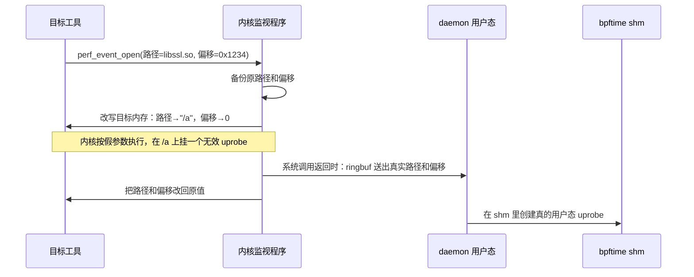

# 7. 外围组件：daemon、verifier、命令行工具、单测

> 一句话：围绕 bpftime 主干的四个部件各是干什么的、什么时候会碰到、读代码从哪下手。
> 读完你能回答：不加 LD_PRELOAD 的内核 eBPF 工具怎么被 bpftime 接管；bpftime 加载程序时验证了什么；
> `bpftime` 和 `bpftimetool` 有什么区别；怎么只跑一个相关的单测。
>
> 前置：建议先读[第 0 章](00-architecture.md)和[第 1 章](01-lifecycle.md)，daemon 部分最好也读过
> [第 3 章](03-agent-syscall-server.md)。预计用时：40–60 分钟。本章选读，按需查阅即可。

## 本章要回答的问题

1. 一个已经在用**内核** eBPF 的追踪工具，不改它的启动方式，能被 bpftime 接管吗？怎么做到的？
2. bpftime 加载程序时有没有验证器？它管什么、不管什么？被它挡住了怎么办？
3. `bpftime` 和 `bpftimetool` 两个命令有什么区别？环境卡死时该用哪个？
4. 改了一处代码，怎么只跑和它相关的那几个单测？

前五章讲的是 bpftime 的**主干**：syscall-server 拦截 `bpf()`、把程序和 map 放进共享内存、agent 进入目标进程、
attach 层挂 uprobe、VM 跑字节码。本章的四个部件不在事件热路径上，但决定了 bpftime 能不能接进现有的
内核 eBPF 生态、好不好调试。每个部件都回答三个问题：**它解决什么问题、什么时候会用到它、读代码从哪个文件开始**。

| 部件 | 解决什么问题 | 什么时候会用到 | 从哪个文件开始读 |
|---|---|---|---|
| daemon | 让不加 LD_PRELOAD 的内核 eBPF 工具也能跑在 bpftime 上 | 想接管一个现成的、你不方便改启动方式的 eBPF 工具 | `daemon/kernel/bpf_tracer.bpf.c` |
| verifier | 加载前在用户态检查程序是否安全 | 自己写的程序被拒绝加载，或想知道 bpftime 验证了什么 | `bpftime-verifier/src/bpftime-verifier.cpp` |
| 命令行工具 | `bpftime`：把 .so 装进进程；`bpftimetool`：直接查看 / 清理共享内存 | 每天都用：启动 benchmark、清理残留 | `tools/cli/main.cpp`、`tools/bpftimetool/main.cpp` |
| 单测 | 快速验证某个模块的行为 | 改代码之后、想确认某个边界行为时 | `runtime/unit-test/CMakeLists.txt` |

---

## 7.1 daemon：把内核 eBPF 透明地搬到用户态

> **它解决什么问题**：正常用 bpftime，loader 要用 `bpftime load` 启动（LD_PRELOAD syscall-server），
> 这样它的 `bpf()` 调用才会被截下来。daemon 让一个**不经 `bpftime load` 启动**、照常调内核 `bpf()` 的工具，
> 也能把它的 uprobe 程序放到 bpftime 里跑。
>
> **什么时候会用到**：想接管一个现成的 eBPF 工具，又不方便改它的启动方式。
> 本书主线的 ssl-nginx 例子用的是 `bpftime load` + `bpftime start`，不走 daemon。
>
> **从哪开始读**：`daemon/kernel/bpf_tracer.bpf.c`（内核侧监视程序），
> 然后是 `daemon/user/handle_bpf_event.cpp`（事件分派）和 `daemon/user/bpftime_driver.cpp`（往 shm 里建对象）。

### 先分清"两层 eBPF"

读 daemon 最容易混的地方是：这里有两层 eBPF 程序，角色完全不同。

1. **监视者**：daemon 自己加载进内核的追踪程序（`bpf_tracer.bpf.c`）。它**真的跑在内核里**，挂在
   `bpf()`、`perf_event_open()`、`ioctl()` 等系统调用的 tracepoint 上，盯着目标工具。
2. **被接管者**：目标工具本来想加载进内核的那些 eBPF 程序。daemon 把它们"抢"过来，放进用户态 shm，
   交给 bpftime 运行。

本节说"劫持"时，主角是第 1 层在监视、改写第 2 层的请求。

还要注意 daemon 替代的是 **loader 一侧**（相当于 syscall-server 的角色）。被追踪的目标进程那一侧照旧需要 agent：
官方 README 的例子里，被追踪的 `victim` 仍然是用 `bpftime start` 启动的。

### 那条"魔法链"：改写 uprobe 请求

**直觉。** 目标工具调 `perf_event_open()`，想在 `/lib/libssl.so` 的某个偏移挂 uprobe。
daemon 的内核监视程序在**系统调用真正执行之前**截住它，用内核 helper `bpf_probe_write_user`
直接改写目标工具内存里的参数：把路径改成一个占位文件 `/a`，偏移改成 0。
于是内核在 `/a` 上挂了一个永远不会触发的 uprobe，目标工具以为成功了。
真实的（路径，偏移）则通过 ringbuf 事件送给 daemon 的用户态部分，由它在 bpftime 的 shm 里建一个**真的**用户态 uprobe。
系统调用返回时，监视程序再把参数改回原值，目标工具读回自己的内存，看不出任何异常。这就是"透明"的来源。

下面这张图看两件事：参数在进内核前被改、返回前被改回；真实意图走 ringbuf 交给 daemon。



之后目标工具再用 `ioctl(SET_BPF)` 或 `BPF_LINK_CREATE` 把程序挂到这个 perf event 上时，
daemon 同样收到事件，把对应的程序搬进 shm 并连起来。

`daemon/kernel/bpf_tracer.bpf.c` 的 `process_perf_event_open_enter()`（节选，删去了调试输出）：

```c
if (new_attr_pointer->type == uprobe_perf_type) {      // 是 uprobe 类型的 perf event
        if (enable_replace_uprobe) {                    // 默认打开
                if (can_hook_uprobe_at(new_attr_pointer->probe_offset)) {
                        new_attr_pointer->probe_offset = 0;     // ① 偏移清零
                        long size = bpf_probe_read_user_str(    // 读出原路径的长度
                                old_uprobe_path, sizeof(old_uprobe_path),
                                (void *)new_attr_pointer->uprobe_path);
                        if (size <= 0)
                                return 0;
                        if (size > PATH_LENTH)
                                size = PATH_LENTH;
                        bpf_probe_write_user(                   // ② 路径改写成 "/a"
                                (void *)new_attr_pointer->uprobe_path,
                                &new_uprobe_path, (size_t)size);
                        bpf_probe_write_user(attr, new_attr_pointer,  // ③ 整个 attr 写回
                                             sizeof(*new_attr_pointer));
                        return 1;   // 1 = 这个请求归 bpftime 管
                }
                /* ... */
```

`daemon/kernel/bpf_tracer.bpf.c` 的 `tracepoint__syscalls__sys_exit_perf_event_open()`（节选）：

```c
        bpf_ringbuf_submit(event, 0);                   // 先把真实路径、偏移送给 daemon
        // Revert changes
        bpf_probe_write_user(ap->path_buf_user, ap->name_or_path,  // 路径写回原值
                             sizeof(ap->name_or_path));
        bpf_probe_write_user(&ap->attr_user->probe_offset,         // 偏移写回原值
                             &ap->orig_offset, sizeof(ap->orig_offset));
```

原值是在 enter 时、改写**之前**存进一个按线程索引的 map 的，exit 时从那里取出。

**为什么偏偏是 `/a`？** 源码注释直说：替换路径不能比原路径长，太长的字符串会写坏目标工具的用户态内存，
所以选了最短的 `/a`。daemon 启动时如果 `/a` 不存在，会现场写出一个占位文件（一个内嵌的小 ELF 可执行文件）。
这是个"能用但不优雅"的权衡。

**同名不同物。** 这里的 `bpf_probe_write_user` 是**内核** helper，在内核态执行，由内核负责安全访问用户内存。
它和[第 6 章](06-maps-helpers.md)里 bpftime 在用户态实现的同名 helper（`process_vm_writev` 写自己）是两份完全不同的实现。
记住这一点，两层 eBPF 的边界就清楚了。

### daemon 用户态：把程序搬进 shm 时要"重定位"

内核监视程序只负责"抓意图、送事件"。真正把程序搬进 shm 的是用户态的 `bpftime_driver`。
其中最需要想一下的一步是 **map 引用的重定位**。

**直觉。** 内核 eBPF 程序里，引用 map 的指令（`LDDW`）的立即数里存的是**目标工具进程里的 map fd**——
一个只在那个进程里有意义的小整数。搬到 bpftime 之后，这个数字毫无意义，必须换成全局唯一的内核 map id。
`relocate_bpf_prog_insns` 遍历每条指令，遇到引用 map 的 `LDDW`，就用（目标 pid，fd）查出内核 map id，改写立即数。
随后 `check_and_create_prog_related_maps` 用同一个 id 在 shm 里建好对应的 map。

`daemon/user/bpftime_driver.cpp` 的 `relocate_bpf_prog_insns()`（节选）：

```cpp
for (size_t i = 0; i < insn_data.code_len; i++) {
        const struct ebpf_inst inst = insns[i];
        switch (inst.code) {
        case EBPF_OP_LDDW:
                // src_reg 1 = 按 fd 引用 map，2 = 按 fd 引用 map 里的值
                if (inst.src_reg == 1 || inst.src_reg == 2) {
                        int map_id = get_bpf_obj_id_from_pid_fd(  // (pid, fd) → 内核 map id
                                obj, pid, inst.imm);
                        if (map_id < 0)
                                return -1;
                        insns[i].imm = map_id;                    // 改写立即数
                }
                break;
        /* ... */
        }
}
```

为了能查到这些对应关系，内核监视程序在内核里维护了几张辅助 map：哪个（pid，fd）对应哪个内核对象 id、
哪段指令属于哪个程序。程序的指令是在 `bpf(BPF_PROG_LOAD)` 进入时抓的快照，
等内核给程序分配好 id 后（一个挂在内核函数 `bpf_prog_kallsyms_add` 上的 kprobe），再改为按程序 id 存放。

**要点**：

- daemon 有两层 eBPF：内核里的监视者，和被搬到用户态的被接管者。
- 核心手法：系统调用进内核前用 `bpf_probe_write_user` 改写参数，返回前改回去，真实意图走 ringbuf 交给 daemon。
- daemon 替代的是 loader 一侧；目标进程一侧仍需要 agent。
- 搬程序时要把指令里的进程私有 map fd 重定位成全局 map id。
- daemon 的单测只覆盖用户态 driver 的几个函数，内核监视程序的劫持链没有单测（见 7.4）。

---

## 7.2 verifier：用户态的程序检查器

> **它解决什么问题**：内核加载 eBPF 程序前，verifier 会证明程序不会越界访问、不会死循环。
> bpftime 在用户态加载程序时没有内核 verifier，于是可选地接入了学术界的 PREVAIL 验证器，在 `BPF_PROG_LOAD` 时做同类检查。
>
> **什么时候会用到**：你自己写的程序在 bpftime 里加载失败或打出验证警告；或者你想知道 bpftime 到底检查了什么。
> 注意默认构建**根本不包含** verifier（编译开关 `ENABLE_EBPF_VERIFIER` 默认 OFF）。
>
> **从哪开始读**：`bpftime-verifier/src/bpftime-verifier.cpp`（入口 `verify_ebpf_program`），
> 然后是 `bpftime-verifier/src/platform-impl.cpp`（告诉 PREVAIL 哪些程序类型、map 类型、helper 可用）。

### 它做什么

`bpftime-verifier/` 是对 PREVAIL（子模块 `bpftime-verifier/ebpf-verifier`）的一层薄封装。对外就两类接口：

- `verify_ebpf_program(指令, 条数, section 名)`：返回 `optional<string>`，空表示通过，有值就是错误信息。
- `set_available_helpers` / `set_non_kernel_helpers` / `set_map_descriptors`：验证**之前**必须先喂进去的上下文——
  有哪些 helper 可用、有哪些 map。

它只认三类程序（section 以 `uprobe`、`uretprobe`、`tracepoint` 开头）和三类 map（`HASH`、`ARRAY`、`RINGBUF`），
其它一律抛异常，这时不是"验证失败"而是"不支持"。

在 syscall-server 里，只有 `prog_type` 为 `TRACEPOINT` 或 `SOCKET_FILTER`（被当作 uprobe）的程序会被送去验证。

`bpftime-verifier/src/bpftime-verifier.cpp` 的 `verify_ebpf_program()`（节选）：

```cpp
        prog.info = {
                .platform = &bpftime_platform_spec,            // ① bpftime 定制的平台描述
                .map_descriptors = get_all_map_descriptors(),  // ② 取出之前喂进来的 map 信息
                .type = bpftime_platform_spec.get_program_type(section_name, ""),
        };
        global_program_info = prog.info;                   // ③ 交给 PREVAIL 的全局状态
        std::vector<std::vector<std::string> > notes;
        auto unmarshal_result = unmarshal(prog, notes);    // ④ 字节码 → 内部表示，结构不合法就直接报错
        if (std::holds_alternative<std::string>(unmarshal_result))
                return std::get<std::string>(unmarshal_result);
        auto inst_seq = std::get<InstructionSeq>(unmarshal_result);
        /* ... */
        std::string verifier_message;
        string_capture_streambuf capture_buffer(verifier_message);  // PREVAIL 只往流里打印，
        std::ostream message_stream(&capture_buffer);               // 所以把流接到一个字符串上
        auto result = ebpf_verify_program(message_stream, inst_seq, prog.info,
                                          &verifier_options, &stats);  // ⑤ 抽象解释，证明安全性
        if (result)
                return {};
        else
                return verifier_message;
```

### 一个容易踩的坑：配置是"每线程"的

那三个 `set_*` 函数写入的全局状态都是 `thread_local` 的。也就是说，在线程 A 里配好可用 helper，
再到线程 B 里验证，线程 B 看到的是**空配置**，任何 helper 调用都会被判为 "Unusable helper"。

为什么这样设计？因为底层 PREVAIL 本身就用了很多 `thread_local` 全局状态，假设"配置和验证在同一个线程里完成"。
bpftime 的封装只能跟着用 `thread_local`，否则会和底层状态错位。

syscall-server 里三件事分别在哪个线程做：helper 配置在启动时、由**第一个**被拦截的系统调用所在线程做（只做一次）；
map 信息在建 map 的线程里写；验证在调 `bpf(BPF_PROG_LOAD)` 的线程里做。常见的单线程 loader 三者是同一线程，所以没事。
如果你想在后台线程池里做批量验证，这里就是第一个要处理的问题。

### 三档模式：怎么关掉它

打开 verifier 编译之后，用环境变量 `BPFTIME_VERIFIER_LEVEL` 控制行为：

| 值 | 行为 |
|---|---|
| `STRICT` | 验证失败就拒绝加载（`errno = EINVAL`） |
| `WARNING`（默认） | 打一条警告，附上程序反汇编，但仍然加载 |
| `NO_VERIFY` | 完全跳过验证 |

调试自己的程序被验证器挡住时，`BPFTIME_VERIFIER_LEVEL=NO_VERIFY` 是最快的确认手段：这样能跑，说明只是没过静态验证。

### 它管不到什么

verifier 检查的是程序**逻辑**是否安全：越界访问、未初始化寄存器、死循环。它在加载时检查，程序一行都还没跑。
所以它管不到运行时的问题，比如 perf 记录在环形缓冲区里的对齐、多线程并发、对象生命周期。
"verifier 通过"不等于"运行正确"，这一大类问题只能靠读代码和针对性的回归测试来抓。

**要点**：

- verifier 是 PREVAIL 的薄封装，默认构建不包含，打开后默认只告警不拒绝。
- 只支持 uprobe / uretprobe / tracepoint 程序和 hash / array / ringbuf map。
- 配置是 `thread_local` 的，配置和验证必须在同一线程。
- 它只检查程序逻辑，不检查运行时行为。

---

## 7.3 命令行工具：`bpftime`（注入器）与 `bpftimetool`（shm 检修工具）

两个工具的源码都叫 `main.cpp`，但职责完全不同，别搞混。

> **`bpftime`（`tools/cli/main.cpp`）**
>
> - **解决什么问题**：把 bpftime 的 .so 装进进程——新启动的进程用 LD_PRELOAD，已经在跑的进程用 Frida 注入。
> - **什么时候会用到**：每次跑 bpftime。`bpftime load` 启动 loader，`bpftime start` 启动目标进程，`bpftime attach` 挂到已运行的进程上。
> - **从哪开始读**：`main()` 里的子命令分派，然后看 `run_command` 和 `inject_by_frida` 两个函数。
>
> **`bpftimetool`（`tools/bpftimetool/main.cpp`）**
>
> - **解决什么问题**：不碰任何进程，直接读写全局共享内存——导出成 JSON 看、从 JSON 导入、整块删除、取出一个程序单独跑。
> - **什么时候会用到**：调试时想看 shm 里有什么；环境卡死、残留没清干净时 `bpftimetool remove`。
> - **从哪开始读**：`main()`，一个子命令一个 `if` 分支，很直白。

| | `bpftime` | `bpftimetool` |
|---|---|---|
| 本质 | 注入器：把 .so 装进目标进程 | shm 检修工具：直接操作共享内存 |
| 子命令 | `load` / `start` / `attach` / `detach` / `trace` | `load` / `export` / `import` / `remove` / `run` |
| 需要目标进程吗 | 需要（它就是用来启动或挂靠进程的） | 不需要 |

### `bpftime` 的两种注入方式

- **新进程：`load` / `start`。** `run_command` 先 `fork`，在子进程 `execve` 之前把 `LD_PRELOAD` 设成对应的 .so，
  让动态链接器在程序的 `main` 之前就把 bpftime 库加载进去。`load` 预载 syscall-server（拦截 `bpf()`），
  `start` 预载 agent（在目标进程里跑程序）。本书主线的 ssl-nginx 例子就是这条路。
- **已运行的进程：`attach` / `trace`。** `inject_by_frida` 用 Frida 把 agent 注入到一个已经在跑的 pid，不用重启目标。
  `trace` 在此基础上还编排了退出流程：按 Ctrl+C 时先通知 agent 卸载，再停掉 loader。

### `detach` 和 `remove`：一个温柔，一个粗暴

`bpftime detach` 给每个存活的 agent 进程发 `SIGUSR1`，请它自己优雅地卸载——前提是 agent 还活着、能响应信号。
`bpftimetool remove` 直接把 `/dev/shm` 里那块共享内存删掉，不管任何进程。注意 `bpftime` 本身没有 `remove` 子命令。
目标进程已经崩溃或卡死时，`detach` 无效，要用 `remove` 清干净再重来。

**要点**：`bpftime` 管"怎么把 .so 装进进程"，`bpftimetool` 管"共享内存里有什么"。清理残留用 `bpftimetool remove`。

---

## 7.4 单测：组织方式与怎么跑单个测试

> **它解决什么问题**：改了 runtime 的某处代码，不用跑完整的 nginx benchmark 就能确认行为对不对。
>
> **什么时候会用到**：改代码之后；或者读代码时想确认某个边界行为（比如 perf 记录跨环尾时怎么写）。
>
> **从哪开始读**：`runtime/unit-test/CMakeLists.txt`（列出了所有测试源文件和编译条件），
> 然后直接打开你关心的那个 `test_*.cpp`。

### 测试二进制

全部用 **Catch2 v3.4.0**。

| 二进制 | 源码目录 | 覆盖 |
|---|---|---|
| `bpftime_runtime_tests` | `runtime/unit-test/` | maps、perf event、ringbuf、epoll、probe、get_stack、shm 分配失败、attach + eBPF（Frida / trap 两种后端）、tail call |
| `bpftime_daemon_tests` | `daemon/test/` | daemon driver（cookie 保留、指令快照容量）、临时 fd 释放 |
| `bpftime_verifier_tests` | `bpftime-verifier/test/` | verifier 封装（只在打开 `ENABLE_EBPF_VERIFIER` 时构建） |

构建（Debug，两个 probe 检查都打开）：

```bash
make build-unit-test
# 等价于：
# cmake -Bbuild -DBPFTIME_ENABLE_UNIT_TESTING=1 -DCMAKE_BUILD_TYPE:STRING=Debug \
#       -DENABLE_PROBE_WRITE_CHECK=1 -DENABLE_PROBE_READ_CHECK=1
# cmake --build build --config Debug --target bpftime_runtime_tests bpftime_daemon_tests
```

`make unit-test` 会把 daemon 和 runtime 的测试都跑一遍。

### 怎么跑单个测试 / 按 tag 过滤

Catch2 的命令行参数可以是测试名，也可以是 `[tag]`：

```bash
T=./build/runtime/unit-test/bpftime_runtime_tests

# 列出所有测试名和 tag
$T --list-tests
$T --list-tags

# 按 tag 跑：软件 perf event 相关的三个测试
$T "[software_perf_event]"

# 按名字精确跑一个
$T "Software perf event records wrap on aligned boundaries after resize"

# perf 输出后 CPU 亲和性是否被恢复
$T "[affinity]"

# daemon 的 fd 释放测试
./build/daemon/test/bpftime_daemon_tests "[daemon-fd]"
```

改一处代码只跑相关的 tag，反馈能压到几秒钟。比较好的习惯是：先写一个能复现问题的 `TEST_CASE`，看它失败，
再改代码让它通过。

### 两个必知的坑

1. **attach 类测试要先编好 eBPF 程序，而且依赖后端。** 这类测试通过编译期宏（如 `EBPF_PROGRAM_PATH_UPROBE`）
   拿到 `.bpf.o` 的路径，这些 `.o` 由 CMake 从 `runtime/unit-test/assets/*.bpf.c` 现编。没编出来，测试就会因为找不到文件而失败。
   另外，4 个 Frida attach 测试文件只在 Frida 后端可用时才编译（riscv64 上没有 Frida）；trap 后端的测试总会编译，
   但内容只在 trap 后端存在时生效，而 trap 后端只在 riscv64 上默认打开。
2. **daemon 的测试不覆盖劫持链。** `bpftime_daemon_tests` 只测了 driver 的几个用户态函数（cookie 保留、快照容量、fd 释放），
   `test_daemon.cpp` 里的 `TEST_CASE("Test daemon")` 是空的。7.1 讲的内核监视程序那条劫持链**没有任何单测**。
   别指望它绿灯就能说明劫持逻辑正确，改那部分只能手工验证。

---

## 小结

- daemon 有两层 eBPF：内核里的监视程序，和被搬进用户态的目标程序。它在系统调用进内核前用 `bpf_probe_write_user` 改参数、返回前改回去，真实意图走 ringbuf 交给用户态，再在 shm 里重建。
- daemon 替代的是 loader 一侧，目标进程仍需要 agent；搬程序时要把进程私有的 map fd 重定位成全局 map id。
- verifier 是 PREVAIL 的薄封装：默认不编译，打开后默认只告警；只支持 uprobe / uretprobe / tracepoint 和 hash / array / ringbuf；配置是 `thread_local` 的。
- verifier 只管程序逻辑，管不到对齐、并发这类运行时问题。
- `bpftime` 是注入器（LD_PRELOAD 或 Frida），`bpftimetool` 是 shm 检修工具；清理残留用 `bpftimetool remove`。
- 单测用 Catch2，按名字或 `[tag]` 只跑相关的几个；attach 测试依赖现编的 eBPF 程序和后端；daemon 劫持链没有单测。

## 动手验证

1. **看一眼共享内存里有什么，再把它清掉。** 跑一次 bpftime 之后先别清理：

   ```bash
   sudo bpftimetool export /tmp/shm.json
   python3 -m json.tool /tmp/shm.json | less
   sudo bpftimetool remove
   ls /dev/shm | grep bpftime
   ```

   预期：JSON 按 fd 槽位组织，每个槽位有一个 `"type"`（如 `bpf_prog_handler`、`bpf_map_handler`）；
   `remove` 之后 `/dev/shm` 里不再有 `bpftime_maps_shm`。如果 shm 不存在或没权限，`export` 会给出提示。

2. **列出并按 tag 跑单测。**

   ```bash
   T=./build/runtime/unit-test/bpftime_runtime_tests
   $T --list-tags
   $T "[software_perf_event]"
   ```

   预期：`--list-tags` 能看到 `[perf_event]`、`[software_perf_event]`、`[affinity]` 等；第二条输出 `All tests passed`。

3. **（可选，需要 root）亲眼看 daemon 改写 uprobe。** 按 `daemon/README.md` 的 malloc 例子：一个终端
   `sudo SPDLOG_LEVEL=Debug build/daemon/bpftime_daemon`，另一个终端 `sudo example/malloc/malloc`，
   第三个终端 `sudo ~/.bpftime/bpftime start example/malloc/victim`。
   预期：只开 daemon 和 `malloc` 工具时，`malloc` 工具什么都不打印——它的内核 uprobe 被挂到了 `/a` 上，永远不触发；
   用 `bpftime start` 启动 `victim` 之后，`malloc` 工具的终端开始打印 victim 的 malloc 次数，
   这些计数是 victim 进程里的 bpftime 运行时产生的。`cat /sys/kernel/debug/tracing/trace_pipe`
   能看到监视程序打出的 "bpftime: new uprobe path" 之类的调试输出。
   注意：daemon 会在根目录写一个 `/a` 占位文件。

## 自测题

1. **daemon 里的"两层 eBPF"分别指什么？`bpf_probe_write_user` 属于哪一层？**
   <details><summary>答案</summary>

   第一层是 daemon 自己的内核监视程序（`bpf_tracer.bpf.c`），真跑在内核里，挂在 `bpf`、`perf_event_open`、`ioctl` 等
   系统调用的 tracepoint 上，按目标进程过滤。第二层是目标工具本来想加载进内核的 eBPF 程序，被 daemon 搬进了用户态 shm。
   两者都是"eBPF 程序"，但一个是监视者（内核态、daemon 主动加载），一个是被接管者。
   这里的 `bpf_probe_write_user` 是内核 helper，属于第一层；它和 bpftime 用户态实现的同名 helper 是两份不同的代码。
   </details>

2. **uprobe 劫持时，为什么 enter 时改参数、exit 时又要改回去？如果省掉 exit 的还原会怎样？**
   <details><summary>答案</summary>

   enter 时把偏移清零、路径改成 `/a`，是为了让内核挂一个"合法但永远不触发"的 uprobe。exit 时用备份还原，
   因为系统调用返回后，目标工具（或 libbpf）可能会读回自己的 `perf_event_attr`。如果不还原，它会看到路径变成 `/a`、
   偏移变成 0，和自己设置的不一致，轻则报错，重则行为异常——"透明"就破功了。
   </details>

3. **为什么 daemon 搬程序时必须改写 `LDDW` 指令的立即数？不改会怎样？**
   <details><summary>答案</summary>

   内核 eBPF 程序里，引用 map 的 `LDDW` 指令的立即数存的是目标工具进程里的 map fd，只在那个进程里有意义。
   搬进 bpftime 之后，这个小整数既不是 shm 里的 handler 编号，也不是全局 id，程序会引用到错误的 map 或根本找不到。
   所以要用（目标 pid，fd）查出内核 map id，改写立即数，并在 shm 里用同一个 id 建好 map。
   </details>

4. **为什么 verifier 的配置跨线程会失效？什么样的 loader 可能踩到？**
   <details><summary>答案</summary>

   可用 helper、map 描述、非内核 helper 三份配置都是 `thread_local` 的，因为底层 PREVAIL 本身也大量使用 `thread_local`，
   假设配置和验证在同一线程。在线程 A 配置、线程 B 验证，B 看到的是空配置，helper 会被判为不可用。
   syscall-server 的 helper 配置只在第一个被拦截的系统调用所在线程做一次，验证则在调 `BPF_PROG_LOAD` 的线程做。
   单线程 loader 两者相同，没事；多线程 loader 如果这两件事落在不同线程，就可能出问题（这是读代码的推断，未实测）。
   </details>

5. **自己写的 uprobe 程序在 bpftime 里一直加载失败，怀疑是 verifier，怎么快速确认？**
   <details><summary>答案</summary>

   先确认构建时打开了 `ENABLE_EBPF_VERIFIER`，没打开就根本不是 verifier 的问题。打开了的话：默认档位是 `WARNING`，
   只有设成 `STRICT` 才会真的拒绝；设 `BPFTIME_VERIFIER_LEVEL=NO_VERIFY` 再试，能跑就说明只是没过静态验证。
   然后看日志里的验证报告（syscall-server 会附上程序反汇编）。还要注意 bpftime 只支持 uprobe / uretprobe / tracepoint
   和 hash / array / ringbuf，用了别的类型会直接抛"不支持"的异常，那不是验证失败，换类型或关掉验证即可。
   </details>

6. **`bpftime detach` 和 `bpftimetool remove` 有什么本质区别？目标进程卡死时该用哪个？**
   <details><summary>答案</summary>

   `detach` 属于 `bpftime`，给每个存活的 agent 进程发 `SIGUSR1`，请它自己优雅卸载，依赖 agent 还能响应信号。
   `remove` 属于 `bpftimetool`，直接删除 `/dev/shm` 里的共享内存，不理会任何进程。
   目标进程已经崩溃或卡死时 `detach` 没用，要用 `remove` 清干净再重来。
   </details>

## 深入参考

<details>
<summary>代码位置速查（按 177a1dc465ff 行号）</summary>

| 概念 / 函数 | 位置 |
|---|---|
| 内核监视程序全文（735 行） | `daemon/kernel/bpf_tracer.bpf.c` |
| 目标过滤 `filter_target`（按 tgid） | `daemon/kernel/bpf_kernel_config.h:28-40`（tgid 在 `:30`） |
| `process_bpf_prog_load_events`（指令快照、可选的程序替换） | `daemon/kernel/bpf_tracer.bpf.c:151` 起；`should_modify_program` 在其上方 |
| uprobe 改写 `process_perf_event_open_enter` | `daemon/kernel/bpf_tracer.bpf.c:407-437` |
| `sys_enter_perf_event_open`（备份原值） | `daemon/kernel/bpf_tracer.bpf.c:471-501`（备份 `:488-490`，写入 map `:498`） |
| `sys_exit_perf_event_open`（submit + 还原） | `daemon/kernel/bpf_tracer.bpf.c:503-553`（submit `:537`，还原 `:541-545`） |
| 辅助 map | `bpf_fd_map`：`daemon/kernel/bpf_pid_fd_map.h:22`；`bpf_prog_insns_map`：`bpf_obj_id_fd_map.h:38`；`bpf_progs_new_fd_args_map`：`:48` |
| `kprobe/bpf_prog_kallsyms_add`（指令快照改按 prog id 存） | `daemon/kernel/bpf_obj_id_fd_map.h:50-73` |
| `kprobe/security_bpf_map` | `daemon/kernel/bpf_obj_id_fd_map.h:22-30` |
| `/a` 占位与 TODO 注释 | `daemon/user/bpf_tracer.cpp:198-216`（硬编码 `:202`） |
| 占位文件嵌入 | `daemon/CMakeLists.txt:11-16`；`daemon/assets/placeholder`（x86-64 ELF 可执行文件） |
| daemon 配置默认值 | `daemon/user/daemon_config.hpp`（`enable_replace_prog = false`，`enable_replace_uprobe = true`） |
| 事件分派 | `daemon/user/handle_bpf_event.cpp:408` 起；uprobe 创建 `:338` |
| `relocate_bpf_prog_insns` | `daemon/user/bpftime_driver.cpp:73-125`（LDDW 改写 `:101-112`） |
| `check_and_create_prog_related_maps` | `daemon/user/bpftime_driver.cpp:127-161` |
| `bpftime_progs_create_server` | `daemon/user/bpftime_driver.cpp:163` 起 |
| `bpftime_uprobe_create_server` | `daemon/user/bpftime_driver.cpp:314` |
| 指令快照容量检查 | `daemon/user/bpf_prog_insns.hpp:20-36` |
| verifier 入口 `verify_ebpf_program` | `bpftime-verifier/src/bpftime-verifier.cpp:77-104` |
| `verifier_options` | `bpftime-verifier/src/bpftime-verifier.cpp:19-30` |
| `string_capture_streambuf` | `bpftime-verifier/src/bpftime-verifier.cpp:37-61`，使用在 `:93-101` |
| 支持的程序类型 / map 类型 | `bpftime-verifier/src/platform-impl.cpp:21-22` / `:70-72` |
| "Unusable helper" | `bpftime-verifier/src/platform-impl.cpp:42-43` |
| `thread_local` 配置 | `bpftime-verifier/src/platform-impl.cpp:100-103` |
| PREVAIL 自身的 `thread_local` | `bpftime-verifier/ebpf-verifier/src/crab_verifier.cpp:29-30` |
| `ENABLE_EBPF_VERIFIER` 开关 | `cmake/StandardSettings.cmake:95`；`runtime/CMakeLists.txt:205-209` |
| syscall-server 的 helper 配置 | `runtime/syscall-server/syscall_server_utils.cpp:212-214`；`start_up` 的 `call_once` 在 `:147-149` |
| `try_startup` | `runtime/syscall-server/syscall_context.cpp:237-252` |
| map 描述写入 | `runtime/src/bpftime_shm_internal.cpp:1058-1069` |
| `BPF_PROG_LOAD` 里的验证 | `runtime/syscall-server/syscall_context.cpp:643-649`（prog_type 过滤）、`:654-655`（NO_VERIFY）、`:658`（调用）、`:663-669`（附反汇编）、`:670-680`（STRICT）、`:681-691`（WARNING） |
| `BPFTIME_VERIFIER_LEVEL` 解析 / 默认值 | `runtime/src/bpftime_config.cpp:137-155` / `runtime/include/bpftime_config.hpp:64` |
| cli 子命令注册 | `tools/cli/main.cpp:977-981` |
| `run_command` / `inject_by_frida` | `tools/cli/main.cpp:107` / `:276` |
| `load` / `start` / `attach` 分派 | `tools/cli/main.cpp:1002`、`:1020`/`:1025`、`:1043`/`:1046` |
| `trace` 退出编排 | `tools/cli/main.cpp:1139-1255`（sigaction 保存 `:1146-1153`，还原 `:1254-1255`） |
| `detach` | `tools/cli/main.cpp:1260` 起，`SIGUSR1` 在 `:1277` |
| `--fuzzy-backtracer` | `tools/cli/main.cpp:852-854` |
| cli 设置 logger | `tools/cli/main.cpp:879-885` |
| bpftimetool 设置 logger | `tools/bpftimetool/main.cpp:151-157` |
| bpftimetool `load` | `tools/bpftimetool/main.cpp:179-202` |
| bpftimetool `export` | `tools/bpftimetool/main.cpp:203-241`（拒绝写到 shm 设备 `:213-222`，错误提示 `:224-240`） |
| bpftimetool `remove` | `tools/bpftimetool/main.cpp:255-263`（`bpftime_remove_global_shm` 在 `:262`） |
| Catch2 来源 | `runtime/unit-test/CMakeLists.txt:1-9`（打开 verifier 时 FetchContent）；否则根 `CMakeLists.txt:149-152` 用子模块 `third_party/Catch2`（v3.4.0） |
| Frida attach 测试条件 | `runtime/unit-test/CMakeLists.txt:52-61` |
| trap 测试宏 | `runtime/unit-test/CMakeLists.txt:118-121` |
| 测试用 eBPF 程序现编 | `runtime/unit-test/CMakeLists.txt:142-158`；`add_ebpf_program_target` 在 `cmake/libbpf.cmake:110` |
| trap / Frida 后端默认值 | `cmake/StandardSettings.cmake:76-82` |
| Makefile 目标 | `build-unit-test` `Makefile:35-37`；`unit-test-daemon` `:43`；`unit-test-runtime` `:46-50`（`make -C runtime/test/bpf` 在 `:47`）；`unit-test` `:52` |
| perf / affinity / 对齐测试 | `runtime/unit-test/test_software_perf_event.cpp:23`（`[affinity]`）、`:157`、`:266`、`:323`（`[software_perf_event]`） |
| ringbuf 跨环尾测试 | `runtime/unit-test/test_ringbuf_tail_wrap.cpp:21` |
| daemon 测试 | `daemon/test/test_daemon.cpp:8-10,13`；`test_daemon_driver.cpp:18,51,63`；`test_daemon_fd.cpp:123`；`--wrap` 链接选项 `daemon/test/CMakeLists.txt:31-37` |
| verifier 测试 | `bpftime-verifier/test/{simple,map,non_kernel_helper}.cpp`；目标 `bpftime_verifier_tests`（`bpftime-verifier/CMakeLists.txt:38`） |

</details>

<details>
<summary>细节与坑</summary>

**daemon**

- `filter_target` 同时排除 daemon 自己（`current_pid`），避免监视自己造成递归。
- 改写路径时，写入长度取的是**原路径**的长度（不超过 `PATH_LENTH`），源缓冲是 `"/a"` 加填充的零。
- 备份在改写**之前**完成：`sys_enter_perf_event_open` 先把原 attr、路径、偏移存进 `perf_event_open_param_start`（按 pid_tgid 索引），再调 `process_perf_event_open_enter` 改写。只有被判为"归 bpftime 管"的请求，exit 时才会 submit 和还原。
- 顺序以代码为准：exit 里先 `bpf_ringbuf_submit`，再还原参数。
- 指令快照：`bpf(BPF_PROG_LOAD)` 进入时，`process_bpf_prog_load_events` 用 `bpf_probe_read_user` 读 attr 和指令，存进 `bpf_prog_insns_map`（按 pid_tgid）；内核随后调 `bpf_prog_kallsyms_add` 时，kprobe 拿到 prog id，把快照改为按 id 存放。快照缓冲有容量上限，超出时用户态返回 `-E2BIG`。
- **可选的程序替换**：`enable_replace_prog`（默认 false）打开时，对 KPROBE / TRACEPOINT 类型的程序，监视程序会把目标工具要加载的指令改写成两条指令的空程序（`r0 = 0; exit`），清掉 func_info / line_info，以此绕过内核 verifier。默认关闭时内核照常加载原程序，只是它挂到的 uprobe 在 `/a` 上，不会触发。
- `relocate_bpf_prog_insns` 里 `src_reg == 1` 是 `BPF_PSEUDO_MAP_FD`（按 fd 引用 map），`src_reg == 2` 是 `BPF_PSEUDO_MAP_VALUE`（按 fd 引用 map 内的值）。按下标引用的 `BPF_PSEUDO_MAP_IDX`（5）不在处理范围内。
- `daemon/user/main.cpp` 里会把 `argv[0]` 拷进 `env.new_uprobe_path`，但 `bpf_tracer.cpp` 用 `/a` 硬编码覆盖了它（原来的 `strncpy` 被注释掉）。
- `/a` 不存在时用 `std::ofstream` 写出嵌入的 `placeholder`；它不是空文件，而是一个 x86-64 ELF 可执行文件。

**verifier**

- `verifier_options` 里 `no_simplify = true`、`check_termination = true` 等都是硬编码的。
- PREVAIL 只往 `ostream` 打印，不返回结构化错误，所以用自定义的 `string_capture_streambuf` 把输出捞成字符串。
- 只有 `prog_type` 为 `BPF_PROG_TYPE_TRACEPOINT`（section 名映射为 `"tracepoint"`）或 `BPF_PROG_TYPE_SOCKET_FILTER`（映射为 `"uprobe"`）的程序会被验证。（读代码推断，未实测）按标准 libbpf 加载的 `SEC("uprobe")` 程序 prog_type 是 `KPROBE`，不会进入这个分支，也就是说不会被验证。
- `set_map_descriptors` 在建 map 时调用，跑在建 map 的线程上；`verify_ebpf_program` 跑在调 `bpf()` 加载程序的线程上；helper 配置在 `start_up()` 里，由 `std::call_once` 保证只做一次，由第一个经 `try_startup()` 进入的被拦截系统调用触发。
- 打开 verifier 时，`runtime/unit-test` 改用 FetchContent 拉 Catch2 v3.4.0；verifier 自己也会在没有 Catch2 目标时 FetchContent。

**tools**

- `bpftime` 的 `trace` 用 `sigaction` 存下旧的 SIGINT / SIGTERM 处理器，退出时严格还原，保证信号处理不残留副作用——"改了全局 / 线程状态必须配对还原"的正面例子。`trace` 还叠加了 IPC refresh、CUDA late-PTX 参数等编排。
- `bpftimetool load <fd> <JSON>`：第二个参数是一段 **JSON 文本**，不是文件名（尽管用法提示写的是 "Load a JSON file"）；fd 用 `strtol` 严格解析，拒绝 `typo`、`-1`、`7x` 之类。
- `bpftimetool export` 拒绝把输出写到 `/dev/shm/<shm 名>` 本身；打开 shm 失败时捕获 `interprocess_exception`，按"权限不足"和"可能损坏"给出不同建议。
- `bpftimetool run`：从 shm 取出程序直接 JIT / AOT / 解释执行并计时；CUDA 构建下还有 `run-on-cuda`。
- `bpftime start -s`（`enable-syscall-trace`）时，LD_PRELOAD 的是 text segment transformer，再通过 `AGENT_SO` 环境变量加载真正的 agent；`attach -s` 同理，用 Frida 注入 transformer。

**单测**

- `make unit-test-runtime` 除了跑 `bpftime_runtime_tests`，还会 `make -C runtime/test/bpf` 产出另一批测试用 `.o`，并在 `build/runtime/test` 下跑 `ctest`。
- `BPFTIME_ENABLE_TRAP_UPROBE` / `BPFTIME_ENABLE_FRIDA` 在 `StandardSettings.cmake` 里按架构 `FORCE` 设置：riscv 上 trap 开、Frida 关；其它架构相反。trap 测试文件 `test_attach_uprobe_with_ebpf_trap.cpp` 总会编译，但内容被 `#if BPFTIME_HAVE_TRAP_UPROBE_ATTACH` 包住。
- `test_daemon_fd.cpp` 靠 `-Wl,--wrap=` 链接选项替换 `bpf_prog_get_fd_by_id`、`bpf_map_get_fd_by_id`、`bpf_obj_get_info_by_fd`、`bpf_map__lookup_elem`、`close`，检查每条返回路径都关了 fd。
- `test_daemon.cpp` 顶部的 `#if !defined(__x86_64__) && defined(_M_X64)` / `#error Only supports x86_64` 要求"不是 x86_64 且定义了 MSVC 的 `_M_X64`"，在 GCC / Clang 下永远不成立，所以它**不会**阻止在 aarch64 上编译这些测试。
- 官方对齐回归测试 "Software perf event records wrap on aligned boundaries after resize"，tag `[perf_event][software_perf_event]`。同文件还测了 `E2BIG` 上限（在多线程分片那个测试里）、shm 耗尽时的错误。

</details>

<details>
<summary>上游变更与我们的工作</summary>

**daemon（6bd5319d → 177a1dc）**——7 月以来外围部件里改动最多的：

| PR | 改了什么 | 位置 |
|---|---|---|
| #651 | pid 过滤改用 tgid。7 月版本取的是 `bpf_get_current_pid_tgid()` 的低 32 位（线程 id），多线程目标的非主线程会被漏掉 | `bpf_kernel_config.h:30-38` |
| #662 | 拒绝被截断的程序快照：用户态先检查 `code_len` 是否超过快照缓冲容量，超了返回 `-E2BIG` 而不是越界拷贝；内核侧 `process_bpf_prog_load_events` 改用 `bpf_probe_read_user` 读 attr，读失败就不替换程序 | `bpf_prog_insns.hpp:20-36`、`bpftime_driver.cpp:89-95`、`bpf_tracer.bpf.c:157-158,192-193` |
| #687 | 临时内核对象 fd 在每条返回路径上关闭（`BOOST_SCOPE_EXIT_ALL`，并保存 / 恢复 errno） | `bpftime_driver.cpp:171-176,221-226` |
| #586 | `BPF_LINK_CREATE` 镜像到 bpftime 时保留 perf-link 的 `bpf_cookie` | `handle_bpf_event.cpp:250-265`、`bpftime_driver.cpp:263-312` |

**verifier**：7 月以来上游没有改动。

**tools**

- #682 让 `bpftimetool load` 真正可用：7 月版本检查的是 `argc != 3`，却读 `argv[3]`，于是合法调用总是打印用法后退出；官方改为 `argc != 4`，并用 `strtol` 严格解析 fd。配套 `tools/bpftimetool/test_load.py`，CI 在 `.github/workflows/test-tools.yml:60-62` 跑它。
- #694 两个工具都尊重 `BPFTIME_LOG_OUTPUT`：在 `main` 一开头就调 `bpftime_set_logger`，否则在这之前的 `SPDLOG_*` 会打到 spdlog 默认 logger 的 stdout。
- #594 shm 访问错误的友好提示：已在 7 月基线 `6bd5319d` 里（就是那个提交本身）。
- cli 新增 `--fuzzy-backtracer` 选项（对应 `BPFTIME_FRIDA_FUZZY_BACKTRACER`）。

**单测**

- daemon 测试比 7 月多了：7 月时 `test_daemon_driver.cpp` 的断言全被注释掉；现在有三个真用例（cookie 保留 #586；快照容量上下界 #662），外加 `test_daemon_fd.cpp`（tag `[daemon-fd]`，#687）。`test_daemon.cpp` 仍是空壳。
- #612 合入时带了对齐回归测试（上面的 "...wrap on aligned boundaries after resize"）。我们 7 月写的 "...remain aligned at the ring boundary" 没有进上游，#612 带的是这个更短的版本。
- #678 加了 `[perf_event][affinity]` 用例。
- #706 加了 `test_ringbuf_tail_wrap.cpp`（ringbuf 记录跨环尾仍连续）。
- #665 加了 trap 后端测试；#674 让 CI 在 `.github/workflows/test-riscv64.yml` 用 qemu-user 跑 riscv64。
- 7 月底稿曾说 `test_daemon.cpp` 的 `#error` 会阻止非 x86_64 编译，这个说法是错的（见"细节与坑"）。

**和我们 7 月修复的联系**

- **probe_read / probe_write 的 SIGSEGV 处理**：我们 7 月修的第三个 bug 是用户态 `probe_read` / `probe_write_user` 每次调用重装 SIGSEGV handler。那个修复没有进上游，而是被上游 #642（`f311de23`，"use no-fault probe memory copies"）整体取代：官方现在的 `bpftime_probe_write_user` 在 `ENABLE_PROBE_WRITE_CHECK` 下走 `probe_write_memory`，Linux 上就是对自己 pid 调 `process_vm_writev`，根本不再装信号 handler（`runtime/src/bpf_helper.cpp:139-177`）。daemon 里的同名 helper 则是内核 helper，两者无关。
- **perf 记录 8 字节对齐**：已由上游以 #612 合入（见[附录 A.4](09-appendix-research-notes.md#a4-pr-状态与辩护清单)）。这是记录落在环形缓冲区边界的物理布局问题，PREVAIL 对此完全无感——"verifier 通过 ≠ 运行正确"的典型例子。我们 7 月的做法是先加一个"记录落在环边界"的回归 `TEST_CASE` 再改代码，正是 Catch2 框架的正确用法。
- **每事件绑核**：我们 7 月提出删掉 `bpf_perf_event_output` 的每事件绑核，论据之一是"错误路径漏恢复 mask → 线程被永久钉死单核"。这一半已被上游 #678（`3a1d2ecf`）独立修掉（两条错误路径改成 `goto restore_affinity`，`runtime/src/bpf_helper.cpp:515,526,546-552`），但**绑核本身仍在**，删除绑核的提案仍未进上游（见[附录 A.4](09-appendix-research-notes.md#a4-pr-状态与辩护清单)）。cli 的 `trace` 退出编排严格还原 `sigaction`，是同一类"改了全局状态必须配对还原"问题的正面教材。

</details>

---
[← 返回目录](README.md)
