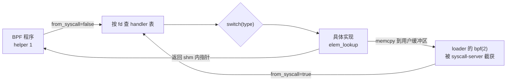
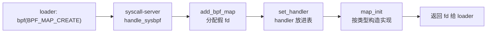
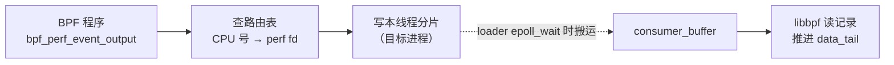

# 8. map

> 一句话：bpftime 的 map 都是放在共享内存里的 C++ 对象，BPF 程序和 loader 通过同一个分发层访问它们。
> 读完你能说清：一次 map 操作怎么从 fd 走到具体实现、锁加在哪里、per-CPU map 怎么在用户态"假装"成 per-CPU、
> ringbuf 和 perf_event_array 的生产者和消费者各自动哪些指针，以及"内核-用户共享 map"是怎么回事。
>
> 前置：建议先读[第 2 章](02-runtime-shm.md)（共享内存、handler 表、假 fd）和[第 7 章](07-helpers.md)（helper 怎么被调用）。
> 预计用时：90–120 分钟。

## 本章要回答的问题

1. BPF 程序调 `bpf_map_lookup_elem(&m, &k)`，loader 调 `bpf(BPF_MAP_LOOKUP_ELEM)`，两条路在哪里汇合？为什么 map 实现不用虚函数？
2. map 的锁加在哪里？同一个 map 通过两个 fd 访问时，它们互斥吗？
3. 用户态线程随时会换 CPU，per-CPU map 怎么模拟？为什么程序和 loader 看到的 value 大小不一样？
4. ringbuf 和 perf buffer 里那几个"头指针""尾指针"，各由谁来推进？数据是在什么时候从目标进程"流"到 loader 的？
5. 建一个参数不合法的 map，会得到什么？为什么不同类型的结局不一样？

---

## 8.1 本章地图：map 住在哪里

**直觉。** 在内核里，map 是内核内存里的一个对象，BPF 程序和用户态程序都通过内核访问它。
bpftime 没有内核可依靠，于是把 map 对象放进一段**共享内存**（shm，见[第 2 章](02-runtime-shm.md)）。
loader（加载 BPF 程序的一方，例如 sslsniff）和目标进程（被追踪的一方，例如 nginx）都映射这段 shm，
于是双方看到的是**同一份** map 数据，不需要任何拷贝或消息传递。

每个 map 在 shm 里由两层组成：

- 外层是 handler 表里的一格 `bpf_map_handler`，下标就是 map 的假 fd（bpftime 自己分配的 fd 号，见第 2 章）。
  它记录 map 类型、创建参数、一把自旋锁，以及一个指向实现对象的指针。
- 内层是具体实现对象，例如 `fix_size_hash_map_impl`、`ringbuf_map_impl`。它的数据（桶数组、环形缓冲区……）
  也全部用 shm 分配器分配。

源码按"数据放在哪里"分成几个目录（路径相对 `runtime/src/bpf_map/`）：

| 目录 | 放什么 | 本书在哪讲 |
|---|---|---|
| `userspace/` | 纯用户态 map：数据全在 shm 里，最常用 | 本章 |
| `shared/` | 内核-用户共享 map：数据在**真内核 map** 里，bpftime 只做转发 | [8.9](#89-内核-用户共享-map) |
| `gpu/`、`gpu_kernel_shared/` | GPU map：数据在显存或映射给 GPU 的内存里 | [第 9 章](09-gpu.md) |
| `map_common_def.hpp`、`bpftime_hash_map.hpp` | 公共类型（shm 里的字节数组 `bytes_vec`）、默认 HASH 的底层哈希表 | 本章 |

分发层在 `runtime/src/handler/map_handler.hpp/.cpp`。它是本章最重要的文件：读懂其中一个函数（`map_lookup_elem`），
其余操作都是同一个套路。

---

## 8.2 一次 map 操作怎么分发到实现

**直觉。** 访问 map 有两个入口，它们在"按 fd 找 handler"这一步汇合：

- **程序侧**：目标进程里，JIT 好的 BPF 程序调 helper `bpf_map_lookup_elem`（helper 编号 1）。
- **syscall 侧**：loader 调 `bpf(BPF_MAP_LOOKUP_ELEM, ...)`。这个系统调用被 syscall-server 截下来（见[第 3 章](03-entrypoints.md)），
  并不进内核。

汇合之后，handler 根据 `type` 字段 `switch`，把 `void*` 强转成具体实现类型，再调用它的 `elem_lookup`。

下面这张图看两件事：两个入口在哪里汇合；`from_syscall` 这个布尔值从哪里来。



### map 句柄就是 fd

BPF 字节码里引用 map 的方式是 `lddw r1, <map fd>`（一条特殊的 64 位立即数加载，`src=1` 表示"这是 map fd"）。
内核会把它换成真正的 `struct bpf_map *`。bpftime 加载程序时也提供了一个换算函数 `map_ptr_by_fd`，
但它只检查"这确实是个 map"，然后**原样返回 fd**（源码注释："Use a convenient way to represent a pointer"）。
所以 JIT 后的程序拿着的"map 指针"就是一个小整数，helper 收到后直接把它当 fd 去查 handler 表。

### 分发：`switch(type)` + `static_cast`

`runtime/src/handler/map_handler.cpp` 的 `bpf_map_handler::map_lookup_elem()`（节选）：

```cpp
const void *bpf_map_handler::map_lookup_elem(const void *key,
                                             bool from_syscall) const
{
        // 泛型 lambda：impl 是什么类型，就调哪个类型的 elem_lookup
        const auto do_lookup = [&](auto *impl) -> const void * {
                if (impl->should_lock) {          // 实现类自己声明的编译期常量
                        bpftime_lock_guard guard(map_lock); // 本 handler 的自旋锁
                        return impl->elem_lookup(key);
                } else {
                        return impl->elem_lookup(key);
                }
        };
        /* do_lookup_userspace 结构相同，改调 elem_lookup_userspace */
        switch (type) {
        case bpf_map_type::BPF_MAP_TYPE_HASH: {
                auto impl = static_cast<hash_map_impl *>(map_impl_ptr.get());
                return do_lookup(impl);
        }
        case bpf_map_type::BPF_MAP_TYPE_PERCPU_ARRAY: {
                auto impl = static_cast<per_cpu_array_map_impl *>(
                        map_impl_ptr.get());
                return from_syscall ? do_lookup_userspace(impl) // loader 视角
                                    : do_lookup(impl);          // 程序视角
        }
        /* ... 其余内建类型 ... */
        default:   /* 查进程私有的外部 map 函数表，见 8.5 */
        }
}
```

**为什么不用虚函数。** C++ 虚函数靠对象里的 vtable 指针工作，而 vtable 在每个进程里的地址不同。
一个带 vtable 指针的对象放进 shm，在 A 进程里构造，到 B 进程里调用虚函数就会跳到无意义的地址。
所以 bpftime 让实现对象本身不含任何函数指针，在旁边放一个类型标签，每次操作先 `switch` 再强转。
指向实现的指针也不能存绝对地址，要用 `offset_ptr`（存"相对自己的偏移"，不管 shm 映射到哪个地址都能算对）。

### 两个视角：`from_syscall`

同一个 map，程序和 loader 看到的东西可以不同，这和内核一致：

- **程序侧**拿到的是一个**指向 shm 内部的指针**。程序通过它写，就是直接改 map。
- **syscall 侧**要把 value **拷进**用户给的缓冲区。syscall-server 拿到指针后做一次 `memcpy`，
  拷贝长度由 `get_userspace_value_size()` 决定：普通 map 就是 `value_size`；per-CPU map 要乘以在线 CPU 数
  （见 [8.6](#86-per-cpu-map-的模拟)）；GPU 的 per-thread map 要乘以线程数。

`runtime/syscall-server/syscall_context.cpp` 的 `syscall_context::handle_sysbpf()` 中 `BPF_MAP_LOOKUP_ELEM` 分支（节选）：

```cpp
        auto value_ptr = bpftime_map_lookup_elem(      // 走 from_syscall=true
                attr->map_fd, (const void *)(uintptr_t)attr->key);
        if (value_ptr == nullptr) {
                errno = ENOENT;
                return -1;
        }
        memcpy((void *)(uintptr_t)attr->value, value_ptr,
               bpftime_map_value_size_from_syscall(attr->map_fd)); // 视角差异在这里落地
        return 0;
```

真正区分两个视角的类型不多：

| 类型 | 程序侧（`false`） | syscall 侧（`true`） |
|---|---|---|
| PERCPU_ARRAY、PERCPU_HASH | 只看当前 CPU 那一份 | 一次看全部 CPU |
| ARRAY_OF_MAPS | update / delete 直接返回 `-EINVAL`（程序不许改外层表） | 允许 |
| 外部注册的 map 类型 | 原样把 `from_syscall` 传给注册方 | 同左 |

另外两个容易误解的点：

- `bpf_tail_call` helper 查 PROG_ARRAY 时调用的是 syscall 侧的入口函数（`from_syscall=true`），
  所以"helper 一律走程序视角"并不严格成立。
- loader 的 `BPF_MAP_LOOKUP_AND_DELETE_ELEM` 在 bpftime 里只映射成 **pop**，所以只对 QUEUE / STACK 有效。
  对 HASH 这类 map，pop 的 default 分支直接返回 `-ENOTSUP`（-95），syscall-server 把它原样当系统调用返回值，且不设 `errno`
  （`errno` 仍是 0）。经 libbpf 的 `bpf_map_lookup_and_delete_elem()` 调用时，libbpf 用 `-errno` 作返回值，于是得到 **0**——
  看起来成功，其实既没删 key 也没写 value（静默假成功，见[附录 B](B-known-issues.md#b-maps)）。

**要点**：

- map 分发 = "按 fd 找 handler → `switch(type)` → `static_cast` 成具体实现"。不用虚函数，因为对象在 shm 里。
- map 句柄就是 fd：`map_ptr_by_fd` 原样返回 fd。
- `from_syscall` 是视角开关；"loader 看到 ncpu 倍大小"真正落地在 syscall-server 的那次 `memcpy`。

---

## 8.3 锁：每个 fd 一把，由实现声明要不要

**直觉。** 内核里每种 map 自己决定用什么并发控制（RCU、per-bucket 锁……）。bpftime 简化成两档：
要么由分发层在调用前后加一把自旋锁，要么完全不加。选哪一档由实现类里一个编译期常量 `should_lock` 声明，
分发层在每个操作（lookup、update、delete、get_next_key、push、pop、peek）里都照这个常量办事。

锁本身是 `bpf_map_handler` 里的一个 `pthread_spinlock_t map_lock`。handler 住在 shm 里，所以这把锁也在 shm 里，
loader 和目标进程用的是同一把。

`runtime/src/handler/map_handler.hpp` 的 `class bpf_map_handler`（节选）：

```cpp
class bpf_map_handler {
    public:
        bpf_map_attr attr;             // 原始创建参数
        bpf_map_type type;             // 分发用的类型标签
        /* ... */
        void share_map_impl_from(const bpf_map_handler &other)
        {
                map_impl_ptr = other.map_impl_ptr;     // dup 时只共享实现和引用计数
                map_refcnt_ptr = other.map_refcnt_ptr; // 锁不共享
        }
    private:
        mutable pthread_spinlock_t map_lock;           // 每个 handler（每个 fd）一把
        mutable general_map_impl_ptr map_impl_ptr;     // offset_ptr<void>，指向实现对象
        mutable map_refcount_ptr map_refcnt_ptr;       // 几个 fd 共享这份实现
        /* ... */
};
```

### 哪些加锁、哪些不加

| `should_lock` | 实现类型 |
|---|---|
| `true`（分发层加锁） | HASH（默认实现和备选实现）、LRU_HASH、LPM_TRIE、BLOOM_FILTER、QUEUE、STACK、STACK_TRACE、PERF_EVENT_ARRAY |
| `false`（分发层不加锁） | ARRAY、ARRAY_OF_MAPS、PERCPU_ARRAY、PERCPU_HASH、RINGBUF、PROG_ARRAY、4 种内核-用户共享 map |

几个值得注意的地方：

- **锁在 handler 上，不在 map 上。** loader 经 syscall-server 复制 map fd 时（见 8.4 的 dup 一节），bpftime 会新建一个 handler，
  让它和原 handler 共享同一个实现对象（引用计数加一），但新 handler 有自己的 `map_lock`。
  于是经两个 fd 操作同一份数据时，两把锁互不排斥。这是读代码得出的推断，未构造并发复现，
  见[附录 B](B-known-issues.md#b-maps)。
- **QUEUE / STACK 自己没有任何锁**，完全依赖分发层（头文件注释写的就是"Map handler should lock externally"）。
  它们的单测直接调实现对象，并在测试代码里自己加锁，所以测不到分发层的并发路径。
- **不加锁的类型各有理由**：ARRAY 的元素位置固定，读写不改结构；per-CPU 两种靠"各 CPU 各用一份"（见 8.6），
  但这只是近似；RINGBUF 在 reserve 内部有自己的锁（见 8.7）；内核-用户共享 map 的数据在内核里。
- **LPM_TRIE 加了两次锁**：分发层一把，实现内部又一把进程共享自旋锁。多余但无害。
- **`bpf_get_stackid` 绕过分发层**：它直接拿 STACK_TRACE handler 的 `map_lock`，再调实现的 `fill_stack_trace`。
- GPU 侧的 hash map 声明 `should_lock=false`，所以它在分发层完全无锁（见[第 9 章](09-gpu.md)）。

**要点**：

- 加不加锁由实现的 `should_lock` 决定，锁由分发层加。
- 锁是每个 handler（每个 fd）一把；dup 出的 fd 共享数据但不共享锁。
- per-CPU、ARRAY、RINGBUF 在分发层不加锁。

---

## 8.4 map 的创建、共享与释放

**直觉。** 创建 map 时，bpftime 先在 handler 表里占一格、放进一个"空壳" handler，再按类型在 shm 里构造实现对象。
释放时反过来：引用计数减到零，才真正销毁实现对象。

下面这张图看创建的顺序：handler 先进表，实现对象后构造。这个顺序决定了 8.4 末尾"创建失败"的两种结局。



`map_init` 的每个分支都差不多：在 shm 里用匿名实例（`anonymous_instance`，不登记名字的对象）构造实现，再建一个引用计数。

`runtime/src/handler/map_handler.cpp` 的 `bpf_map_handler::map_init()`（节选）：

```cpp
        switch (type) {
        case bpf_map_type::BPF_MAP_TYPE_ARRAY: {
                map_impl_ptr = memory.construct<array_map_impl>(
                        boost::interprocess::anonymous_instance)(  // 匿名：同名 map 不会撞
                        memory, value_size, max_entries);
                init_refcnt();                                    // 引用计数 = 1
                return 0;
        }
        case bpf_map_type::BPF_MAP_TYPE_RINGBUF: {
                /* ... 数 max_entries 里 1 的个数 ... */
                if (pop_cnt != 1) {                               // 不是 2 的幂
                        SPDLOG_ERROR("Failed to create ringbuf map, ...");
                        return -1;                                // 不构造实现，直接返回
                }
                /* ... construct<ringbuf_map_impl> ... */
        }
        /* ... 其余类型；default：未开外部 map 时报 Unsupported 并 return -1 ... */
        }
```

### dup：两个 fd 共享一份实现

syscall-server 只截获经 `syscall(__NR_dup3, ...)` 发出的复制（libbpf 内部的 `sys_dup3` 就是这样调的）；libc 的 `dup` / `dup2` /
`fcntl(F_DUPFD)` 不经 bpftime（例如 libbpf 的 `bpf_map__reuse_fd` 用的是 `fcntl`）。截获后走 `dup_bpf_map`：新建一个 handler，
`share_map_impl_from` 只拷贝实现指针和引用计数指针，然后引用计数加一。新 handler 已经有实现，`set_handler` 不会再调 `map_init`。

### 释放：最后一个 fd 才销毁实现

关闭 map fd 时，`map_free` 先把引用计数减一。还有别的 fd 在用，就只清空本 handler 的指针；
自己是最后一个，才调 `destroy_ptr` 销毁实现对象。`destroy_ptr` 会**运行实现类的析构函数**
（例如 LPM 的 `pthread_spin_destroy`、内核-用户共享 map 的 `close(map_fd)`）。
不参与清理的只是外层 `~bpf_map_handler`：它发现实现还没释放时只打一条 CRITICAL 日志。

### 创建失败的两种结局

`set_handler` 先把 handler 放进表，再调 `map_init`，而且**不看 `map_init` 的返回值**。于是参数不合法时，
结局取决于实现是"返回 -1"还是"抛异常"：

| 失败方式 | 例子 | loader 看到的结果 |
|---|---|---|
| `map_init` 返回 -1 | RINGBUF 的 `max_entries` 不是 2 的幂；BLOOM_FILTER 的 `key_size` 不为 0；不支持的类型（如 CGROUP_ARRAY） | **创建成功**，拿到一个假 fd，但它背后没有实现对象。不支持的类型做普通 map 操作只会在分发层 default 分支返回错误；但凡要访问实现对象成员的操作（如 ringbuf 的 mmap / reserve、bloom 的 update / push）会解引用空指针（已实跑：对这样的 bloom 做 update 会段错误） |
| 实现的构造函数抛异常 | PERF_EVENT_ARRAY 的 key / value 不是 4 字节；LPM、QUEUE、STACK、BLOOM、STACK_TRACE 等的参数校验；shm 空间不够（`bad_alloc`） | 异常一路穿出 `set_handler`，被 syscall-server 最外层的 `handle_exceptions` 接住，**转去调真内核的 `bpf(2)`**。成败由内核决定；那个假 fd 的格子也已被占掉 |

第二种是 syscall-server 的通用策略：bpftime 处理不了的 syscall 就交还内核（fail-open，见[第 3 章](03-entrypoints.md)）。
所以"同样是参数非法"，有的 map 得到一个坏的假 fd，有的被悄悄送去内核创建。本章"动手验证"第 2 个实验在本机复现了这两种结局。
这两种行为都记在[附录 B](B-known-issues.md#b-maps)。

**要点**：

- 创建顺序是"先占 fd、放 handler，再构造实现"；实现用匿名实例构造，带引用计数。
- dup 共享实现、不共享锁；最后一个 fd 关闭时才运行实现的析构函数。
- 参数非法时：返回 -1 的得到"有 fd 无实现"的坏 map；抛异常的被转去真内核。

---

## 8.5 全部 map 类型总表

**直觉。** bpftime 支持的 map 类型分三组：和内核同名同号的用户态实现（编号就是内核的 `BPF_MAP_TYPE_*`），
"内核号 + 1000"的内核-用户共享 map，"内核号 + 1500"附近的 GPU map。下表列出前两组；GPU map 见[第 9 章](09-gpu.md)。

路径相对 `runtime/src/bpf_map/`。"锁"列指分发层的 `should_lock`。

| 类型（编号） | 实现文件 | 锁 | 一句话特点 |
|---|---|---|---|
| HASH (1) | `userspace/fix_hash_map.cpp` + `bpftime_hash_map.hpp` | 加 | 默认实现：一整块 shm 上的定长开放寻址表，桶数取不小于 `max_entries` 的质数，线性探测，删除留墓碑。不认 update flags |
| ARRAY (2) | `userspace/array_map.cpp` | 不加 | 一块 `value_size × max_entries` 的连续内存；loader 可以 mmap 它（用于全局变量） |
| PROG_ARRAY (3) | `userspace/prog_array.cpp` | 不加 | 存程序 fd，供 `bpf_tail_call` 用；bpftime 程序的 fd 编码成负数存，内核程序存 prog id |
| PERF_EVENT_ARRAY (4) | `userspace/perf_event_array_map.cpp` | 加 | "CPU 号 → perf 对象 fd"的 int 数组，初值 -1，key/value 必须 4 字节（见 8.8） |
| PERCPU_HASH (5) | `userspace/per_cpu_hash_map.cpp` | 不加 | 一个 key 对应 ncpu 份 value 首尾相接（见 8.6） |
| PERCPU_ARRAY (6) | `userspace/per_cpu_array_map.cpp` | 不加 | `[entry][cpu]` 连续布局（见 8.6） |
| STACK_TRACE (7) | `userspace/stack_trace_map.cpp` | 加 | "栈 id → 地址数组"，由 `bpf_get_stackid` 填 |
| LRU_HASH (9) | `userspace/lru_var_hash_map.cpp` | 加 | 哈希表 + shm 里的双向链表；lookup 也会改链表，所以读也要锁；全局 LRU，没有内核的 per-CPU 本地列表 |
| LPM_TRIE (11) | `userspace/lpm_trie_map.cpp` | 加（内部再加一次） | shm 里的二叉前缀树，删除只做标记不回收节点 |
| ARRAY_OF_MAPS (12) | `userspace/map_in_maps.hpp` | 不加 | 继承 ARRAY，value 存内层 map 的 fd；lookup 把这个 fd 当"指针"返回 |
| QUEUE (22) | `userspace/queue.cpp` | 加 | 预分配的环形数组，push / pop / peek |
| STACK (23) | `userspace/stack.cpp` | 加 | shm vector 尾部增删 |
| RINGBUF (27) | `userspace/ringbuf_map.cpp` | 不加（reserve 内部有锁） | 内存布局刻意兼容 libbpf 消费者；`max_entries` 必须是 2 的幂（见 8.7） |
| BLOOM_FILTER (30) | `userspace/bloom_filter.cpp` | 加 | 位数组 + 随机种子，哈希函数个数取 `map_extra` 低 4 位（0 时用 5） |
| KERNEL_USER_HASH (1001) | `shared/hash_map_kernel_user.cpp` | 不加 | 每次操作都转成对内核 map 的 libbpf 调用（见 8.9） |
| KERNEL_USER_ARRAY (1002) | `shared/array_map_kernel_user.cpp` | 不加 | mmap 内核 array map 直接读写，mmap 失败时退回逐次 syscall |
| KERNEL_USER_PERF_EVENT_ARRAY (1004) | `shared/perf_event_array_kernel_user.cpp` | 不加 | 把用户态事件经 USER_RINGBUF 和一段内核搬运程序送进真 perf buffer |
| KERNEL_USER_PERCPU_ARRAY (1006) | `shared/percpu_array_map_kernel_user.cpp` | 不加 | 设计同 KERNEL_USER_HASH，但目前不可用（见附录 B） |
| 其他编号 | `global_map_ops_table`（每进程一份） | 不加 | 需设 `BPFTIME_ALLOW_EXTERNAL_MAPS`，并在**每个**进程里用 `bpftime_register_map_ops` 注册函数表 |

不在表里的内核类型（CGROUP_ARRAY、LRU_PERCPU_HASH、HASH_OF_MAPS、各种 STORAGE、SOCKMAP 类、USER_RINGBUF……）
`map_init` 没有对应分支，走 default：报 "Unsupported map type" 并返回 -1，于是落进 8.4 的第一种结局。

### 默认 HASH 是哪个实现

`BPF_MAP_TYPE_HASH` 在分发层被别名成 `hash_map_impl`：定义了宏 `BPFTIME_USE_VAR_HASH_MAP` 时用
`var_size_hash_map_impl`（shm 里的 `boost::unordered_map`，支持 flags），否则用 `fix_size_hash_map_impl`。
这个宏在仓库的任何 CMake 文件里都没有定义，所以**实际用的总是 `fix_size_hash_map_impl`**。
而移植自内核 `test_maps.c` 的单测（`maps/kernel_unit_tests.cpp`）测的恰恰是没启用的 `var_size_hash_map_impl`，
"通过内核兼容测试"并不代表默认 HASH 有内核语义。

默认 HASH 的语义缺口（不认 `BPF_NOEXIST` / `BPF_EXIST`、满了插入失败也返回 0、删除不存在的 key 也返回 0）
已在本机复现，详见[附录 B](B-known-issues.md#b-maps)。LPM_TRIE 的几处行为差异（lookup 返回的是线程局部副本、
`get_next_key` 基本未实现、删除后 `BPF_NOEXIST` 重插报 EEXIST）、STACK_TRACE 的栈比较问题也都在附录 B。

### 返回值约定

大多数实现失败时返回 `-1` 并设 `errno`，而 helper 把这个值原样交给 BPF 程序。所以 BPF 程序看到的 map helper 错误
多半是 `-1`，而不是内核那种 `-ENOENT`、`-EEXIST`（读代码推断）。syscall 侧的入口函数有 `try/catch`，
实现里抛出的 C++ 异常会被转成 `-1`；程序侧的 helper 入口没有 `try/catch`。

**要点**：

- 内核同号的用户态实现 14 种，内核-用户共享 4 种（+1000），GPU 若干（+1500 附近），外加外部注册。
- 默认 HASH 是 `fix_size_hash_map_impl`，内核兼容单测测的是另一个没启用的实现。
- 没实现的类型创建时不报错，得到一个"有 fd 无实现"的 map。

---

## 8.6 per-CPU map 的模拟

**直觉。** 内核的 per-CPU map 给每个 CPU 一份独立的 value。BPF 程序运行期间不会被抢占、不会换 CPU，
所以"当前 CPU 那一份"在整个程序执行期间归它独占，不用加锁。sslsniff 的 `ssl_data`（PERCPU_ARRAY）就是这么用的：
拿它当一块 8KB 的暂存区，因为 BPF 栈只有 512 字节。

用户态两个前提都没有：线程随时可能被抢占，也随时可能被迁移到别的 CPU。bpftime 的办法很直接：
**调用时问一下"我现在在哪个 CPU"（`sched_getcpu`），用这个号选中对应的那一份，然后不加锁直接读写。**

这个 CPU 号只是一个快照。下一瞬间线程就可能换了 CPU，另一个线程也可能拿到同一个号。
所以它是"大多数时候各用各的"，不是内核那种严格独占。

取号函数的名字有点唬人，实现只有一行。

`runtime/src/bpf_map/map_common_def.hpp` 的 `ensure_on_current_cpu()`：

```cpp
template <class T>
static inline T ensure_on_current_cpu(std::function<T(int cpu)> func)
{
        return func(my_sched_getcpu());   // 只取一次当前 CPU 号，不绑核、不迁移
}
```

### 布局一：per-CPU array，一整块连续内存

所有 entry、所有 CPU 的 value 排在一个大数组里，同一个 entry 的各 CPU 份挨在一起：

```
总长度 = max_entries × ncpu × value_size

          ┌──────── entry 0 ────────┬──────── entry 1 ────────┐
          │ cpu0 │ cpu1 │ … │ cpuN  │ cpu0 │ cpu1 │ … │ cpuN  │
          └──────┴──────┴───┴───────┴──────┴──────┴───┴───────┘
程序视角（elem_lookup）：             只返回当前 CPU 那一格
loader 视角（elem_lookup_userspace）：返回这一行的起点，一次拷 ncpu 格
```

`runtime/src/bpf_map/userspace/per_cpu_array_map.cpp` 的 `elem_lookup()` 和头文件里的 `data_at()`：

```cpp
uint8_t *data_at(size_t idx, size_t cpu)   // 第 idx 个 entry、第 cpu 份的地址
{
        return data.data() + idx * value_size * ncpu + cpu * value_size;
}

void *per_cpu_array_map_impl::elem_lookup(const void *key)
{
        return ensure_on_current_cpu<void *>([&](int cpu) -> void * {
                /* ... key 为空或越界 → errno = ENOENT，返回 nullptr ... */
                uint32_t key_val = *(uint32_t *)key;
                return data_at(key_val, cpu);   // 程序拿到"本 CPU 那一格"的指针
        });
}
```

这里的 `ncpu` 是创建时的在线 CPU 数（`sysconf(_SC_NPROCESSORS_ONLN)`）。

### 布局二：per-CPU hash，key 只存一份

底层是 shm 里的一张 `boost::unordered_map<字节数组, 字节数组>`。每个 key 只有一个条目，
条目的 value 是 ncpu 份 value 首尾相接：

```
key "tid=42" ──► [ cpu0 的 value | cpu1 的 value | … | cpuN 的 value ]
                                  ▲
                程序视角 lookup：返回 &value[value_size × cpu]
                程序视角 update：只覆写本 CPU 那一段；key 不存在时以全零的大数组为底插入
```

为了避免每次操作都在 shm 里做小分配，实现为每个 CPU 预留了一个临时 key 缓冲区和 value 缓冲区，按当前 CPU 号取用。
两个线程拿到同一个 CPU 号时，会同时写同一个临时缓冲区；新 key 的插入也在无锁状态下改 `unordered_map`。
这些都是"低并发时碰不上"的妥协。另外，程序侧的 delete 清错了范围、也不删 key（已在本机复现），
见[附录 B](B-known-issues.md#b-maps)。

### 为什么两个视角的 value 大小不同

这对应内核语义：BPF 程序 lookup per-CPU map 只拿到当前 CPU 那一份；loader 用 `bpf(BPF_MAP_LOOKUP_ELEM)` 读同一个 key，
一次拿到所有 CPU 的值，所以 libbpf 要按 `value_size × CPU 数` 准备缓冲区。bpftime 用 `from_syscall` 复刻这一点：
`get_userspace_value_size()` 对两种 per-CPU 类型乘以在线 CPU 数，syscall-server 按这个长度 `memcpy`（见 8.2）。

**要点**：

- per-CPU 模拟 = "取当前 CPU 号选一份 + 完全不加锁"。CPU 号只是快照，不是独占。
- array 是一整块连续内存；hash 是一个 key 对应 ncpu 份拼接的 value。
- 程序视角看一份，loader 视角看全部。

---

## 8.7 ringbuf：生产者与消费者协议

**直觉。** 内核的 BPF ringbuf 是一块所有 CPU 共用的环形缓冲区，多个生产者（BPF 程序）往里写，
一个消费者（用户态 libbpf 的 `ring_buffer__poll`）往外读。libbpf 消费它时，会把 ringbuf 的 fd mmap 两次：
一次可读写，拿到"消费者页"（里面是消费者位置 `consumer_pos`）；一次只读，拿到"生产者页 + 数据区"
（`producer_pos` 后面跟着数据）。然后 libbpf 直接在这块内存上按协议读记录，写回 `consumer_pos`。

bpftime 的思路是：**在 shm 里摆出一块和内核布局一样的内存，让 libbpf 一行代码不改就能读。**
loader 的两次 mmap 被 syscall-server 截下，直接返回 shm 里对应位置的地址。

### 内存布局

`ringbuf` 的构造函数在 shm 里分配一块 `2 × 页大小 + 2 × max_entries` 字节的缓冲区：

```
┌──────────── 第 0 页 ────────────┬──────────── 第 1 页 ────────────┬─────── 数据区 2 × max_entries ───────┐
│ consumer_pos（libbpf 写）        │ producer_pos（BPF 程序写）        │ [hdr|data] [hdr|data] …               │
└──────────────────────────────────┴──────────────────────────────────┴───────────────────────────────────────┘
  loader mmap(PROT_READ|PROT_WRITE)    loader mmap(PROT_READ) 从这里开始，长度 = 页 + 2 × max_entries
```

内核用"同一段物理页映射两次"让跨越环尾的记录在虚拟地址上连续；bpftime 没法这样做，于是数据区分配成两倍长，
保证 libbpf 按内核的长度映射时不越界（按代码推断：bpftime 实际只写前 `max_entries` 字节，因为它用下面的"填充记录"避免记录跨环尾）。

### 生产者：reserve 和 submit

每条记录前有 8 字节的头：前 4 字节是长度，最高两位是 BUSY（还在写）和 DISCARD（作废）标志；后 4 字节内核存的是页偏移，
bpftime 存的是**这个 ringbuf 的 fd**——这样 `bpf_ringbuf_submit(data)` 只拿到数据指针，也能从 `data` 前面的头里找回是哪个 map。

`runtime/src/bpf_map/userspace/ringbuf_map.cpp` 的 `ringbuf::reserve()`（节选）：

```cpp
        spin_lock_guard guard(reserve_spin_lock);           // 多个生产者互斥
        auto cons_pos = smp_load_acquire_ul(consumer_pos.get());
        auto prod_pos = smp_load_acquire_ul(producer_pos.get());
        auto avail_size = max_ent - (prod_pos - cons_pos);
        auto total_size = (size + BPF_RINGBUF_HDR_SZ + 7) / 8 * 8; // 头 + 数据，8 字节对齐
        /* ... total_size > max_ent → E2BIG；avail_size 不够 → ENOSPC ... */
        auto off = prod_pos & mask();
        if (off + total_size > max_ent) {   // 这条记录会跨环尾
                prod_pos = prod_pos - off + max_ent;         // 跳到下一圈起点
                /* ... 重新检查空间 ... */
                auto pad = (ringbuf_hdr *)(uintptr_t)(data.get() + off);
                pad->len = (uint32_t)(max_ent - off - BPF_RINGBUF_HDR_SZ)
                           | BPF_RINGBUF_DISCARD_BIT;        // 剩下的尾巴写成一条"作废"记录
                pad->fd = self_fd;
                off = 0;
        }
        auto header = (ringbuf_hdr *)(uintptr_t)(data.get() + off);
        header->len = size | BPF_RINGBUF_BUSY_BIT;           // 先标"还在写"
        header->fd = self_fd;                                // 内核这里存页偏移
        smp_store_release_ul(producer_pos.get(), prod_pos + total_size); // 发布新位置
        return data.get() + off + BPF_RINGBUF_HDR_SZ;        // 返回给程序填数据
```

`submit` 由数据指针倒推出头，清掉 BUSY 位（discard 时再置 DISCARD 位），用一次原子交换写回，**不加锁**。
`bpf_ringbuf_output` 就是 reserve + `memcpy` + submit。helper 侧的代码见[第 7 章](07-helpers.md)。

### 消费者：libbpf 自己读，bpftime 只负责"叫醒"

libbpf 在映射好的内存上做的事和对内核 ringbuf 完全一样：从 `consumer_pos` 开始，读头；BUSY 就停；
DISCARD 就跳过；否则回调；最后把 `consumer_pos` 推进。bpftime 自己不搬任何数据。

bpftime 唯一要做的是让 `epoll_wait` 能醒来。loader 把 ringbuf fd 加进 epoll 时，syscall-server 截下 `epoll_ctl`，
在 bpftime 自己的 epoll 对象里记一个指向 ringbuf 的弱引用；loader 调 `epoll_wait` 时，`bpftime_epoll_wait`
大约每 1ms 轮一遍所有登记的 ringbuf，看 `has_data()`（`consumer_pos < producer_pos` 且第一条记录不是 BUSY）。

### 谁动哪个指针

| 位置 | 谁写 | 在哪个进程 |
|---|---|---|
| `producer_pos` | 生产者，在 `reserve_spin_lock` 保护下 | 目标进程（BPF 程序） |
| 记录头的 BUSY / DISCARD 位 | 生产者（reserve 置位，submit 原子清除） | 目标进程 |
| `consumer_pos` | 消费者 libbpf | loader |

这和内核 ringbuf 的分工一样：生产者之间用锁互斥，生产者与消费者之间只靠这两个位置和 BUSY 位，用 acquire / release 内存序同步。
（x86 上 acquire / release 只是编译器屏障；arm64 用 `stlr` / `ldar`；不支持的架构直接编译报错。）

### 和内核的差异

- 头的后 4 字节存 map fd，不存页偏移。
- 跨环尾用"作废的填充记录"，不用双重映射。
- `max_entries` 只要求 2 的幂，不要求页对齐；不是 2 的幂时创建"成功"但没有实现（见 8.4）。
- reserve / output 的 `flags`（如 `BPF_RB_NO_WAKEUP`）被忽略。
- 唤醒靠 1ms 轮询，不是内核的中断式通知。

**要点**：

- bpftime 的 ringbuf 是 shm 里一块"长得像内核 ringbuf"的内存，libbpf 直接读，bpftime 不搬数据。
- 生产者拿锁 reserve、无锁 submit；`producer_pos` 归生产者，`consumer_pos` 归 libbpf。
- 跨环尾时写一条作废记录、跳到下一圈起点，保证每条记录连续。

---

## 8.8 perf_event_array：路由表、分片与搬运

**先回顾内核里的 perf buffer。** 内核给每个 CPU 准备一个环（ring）。BPF 程序调用
`bpf_perf_event_output(ctx, &perf_map, BPF_F_CURRENT_CPU, data, size)`，就是把 `data` 追加到"当前 CPU 的那个环"里。
每个环的头部是一个 `perf_event_mmap_page`，其中 `data_head` 由内核（生产者）推进，`data_tail` 由用户态（消费者）推进。
libbpf 的 `perf_buffer` 把所有 CPU 的环 mmap 过来，用 epoll 等着，有数据就逐条回调。
`PERF_EVENT_ARRAY` 这个 map 本身不存数据，只存"第 i 个 CPU 对应哪个 perf 环"。

### 三个角色

bpftime 里，这件事由三样东西配合完成：

1. **路由表**：PERF_EVENT_ARRAY map，一个 int 数组，第 i 格放 CPU i 对应的 perf 对象的假 fd，初值 -1。
   谁来填？消费者自己。loader 调 `perf_buffer__new` 时，libbpf 为每个 CPU 调一次 `perf_event_open`，
   syscall-server 把它变成 shm 里的一个"软件 perf 对象"；libbpf 再用 `bpf_map_update_elem` 把这个 fd 写进第 i 格。
2. **消费者缓冲区**（`consumer_buffer`）：每个软件 perf 对象有一块和内核格式一样的环（头一页是 `perf_event_mmap_page`，后面是 2 的幂大小的数据区）。
   loader 对 perf fd 做 mmap 时，syscall-server 返回的就是这块 shm 的地址。libbpf 从这里读。
3. **生产者分片**（shard）：每个 perf 对象下面挂一串分片，**每个 (进程, 线程) 一个**，结构和消费者缓冲区一样。
   BPF 程序输出时不写消费者缓冲区，而是写本线程的分片。这样多个线程同时输出时互不抢锁。

下面这张图看数据怎么流动：写入发生在目标进程里，搬运（drain）发生在 loader 调 `epoll_wait` 的时候。



### 生产：写本线程的分片

helper 先用当前 CPU 号当 key 查路由表，取出 perf fd，再调 `bpftime_perf_event_output`（helper 本身的代码和它每次输出前后的临时绑核，
见[第 7 章](07-helpers.md)）。之后：

`runtime/src/handler/perf_event_handler.cpp` 的 `software_perf_event_data::output_data()`：

```cpp
int software_perf_event_data::output_data(const void *buf, size_t size)
{
        // 先查线程局部缓存；未命中再持 shard_lock 扫链表，没有就新建一个分片
        return get_current_thread_shard().buffer.output_data(buf, size);
}
```

分片的 `output_data` 把数据包装成一条 `PERF_RECORD_SAMPLE` 记录，总长按 8 字节对齐（内核 perf 环里的记录永远 8 字节对齐，
libbpf 读记录头时依赖这一点），写到分片的 `data_head` 处，再推进 `data_head`。环满或还没 mmap 时这条记录被**静默丢弃**，
函数仍返回 0，也不生成内核那种 `PERF_RECORD_LOST`。

新分片的数据区大小取当时消费者缓冲区的大小。loader 改变缓冲区大小（重新 mmap）时，perf 对象的"缓冲区代号"加一，
旧分片不再被新的写入选中。

### 搬运：在 loader 的 `epoll_wait` 里进行

loader 的 `epoll_wait` 被截获后走 `bpftime_epoll_wait`，它大约每 1ms 对每个登记的 perf 对象调一次 `has_data()`。
`has_data()` 不是只看一眼：它先把所有分片里的记录**逐条搬进**消费者缓冲区，再看消费者缓冲区是否非空。

`runtime/src/handler/perf_event_handler.cpp` 的 `drain_producer_shards()` 和 `has_data()`：

```cpp
void software_perf_event_data::drain_producer_shards()
{
        spin_lock_guard guard(shard_lock);              // 与新建分片互斥
        for (auto &shard : producer_shards) {
                // 每次搬一条：读分片 data_tail 处的记录 → 追加到 consumer_buffer
                //            → 推进分片的 data_tail
                while (shard.buffer.copy_next_record_to(consumer_buffer)) {
                }
        }
        maybe_reclaim_inactive_producer_shards_locked(); // 定期回收"已空且线程已死"的分片
}

bool software_perf_event_data::has_data()
{
        drain_producer_shards();                        // 先搬运
        return consumer_buffer.has_data();              // 再看 data_tail != data_head
}
```

搬运时如果读到一条长度不合法的记录，会丢掉该分片里积压的全部数据。消费者缓冲区满时，搬运停下，记录留在分片里等下次。

### 谁动哪个指针

| 缓冲区 | `data_head`（写入位置）由谁推进 | `data_tail`（读取位置）由谁推进 |
|---|---|---|
| 生产者分片 | 该分片对应的线程（目标进程里的 BPF 程序） | 搬运代码（loader，在 `epoll_wait` 里） |
| `consumer_buffer` | 搬运代码（loader，在 `epoll_wait` 里） | libbpf（loader） |

也就是说：**`consumer_buffer` 的 head 和 tail 都归 loader**，目标进程从不碰它；目标进程只写自己线程的分片。
每个分片恰好是"一个生产者线程 + 一个搬运者"，每个消费者缓冲区恰好是"一个搬运者 + 一个读者"，
两边都是单生产者单消费者，用 acquire / release 就够，不需要锁。锁（`shard_lock`，进程共享的自旋锁）只保护分片链表本身。

按代码推断：既然搬运只发生在 `has_data()` 里，而 `has_data()` 只由 bpftime 的 `epoll_wait` 调用，
那么如果 loader 不经 `epoll_wait`、直接读 mmap 的环（例如只调 libbpf 的 `perf_buffer__consume`），它将读不到新数据（未实测）。

### 内核共享版 perf array

如果 map 类型是 KERNEL_USER_PERF_EVENT_ARRAY，消费者是**真正的内核 perf buffer**。helper 走另一条分支，
把数据写进一个内核 USER_RINGBUF，再由一段内核里的"搬运"BPF 程序定期取出、转投到真正的 perf array。
这条路有单条 448 字节的上限，搬运速率受定时器限制。详见 8.9。

**要点**：

- PERF_EVENT_ARRAY 只是"CPU 号 → perf 对象 fd"的路由表，由消费者在 `perf_buffer__new` 时填好。
- 生产者写本线程分片；loader 的 `epoll_wait` 把分片搬进消费者缓冲区；libbpf 从消费者缓冲区读。
- 消费者缓冲区的 head / tail 都由 loader 推进；目标进程只碰分片。
- 环满时静默丢弃，helper 仍返回 0。

---

## 8.9 内核-用户共享 map

**直觉。** 有时 bpftime 要和真内核里的 eBPF 共存：例如内核里有一个 kprobe 程序和用户态 uprobe 程序共用一张统计表，
或者用户态程序要把事件送进内核 perf buffer，让现成的内核工具消费。这时 map 的数据必须真的在**内核**里，
bpftime 一侧只放一个"代理"对象，每次操作都转给内核 map。

### 怎么进入这种模式

有两条路，都会把内核 map 的类型加 1000 后登记进 bpftime 的 handler 表：

- **syscall-server 的内核共存模式**：设 `BPFTIME_RUN_WITH_KERNEL=1`。loader 的 `BPF_MAP_CREATE` 先真的在内核里建 map，
  再用内核 map 的 **id** 作为 bpftime 侧的 fd 号、类型加 1000、记下 `kernel_bpf_map_id`，调 `bpftime_maps_create` 登记。
  loader 自己拿到的是内核返回的真 fd；这个模式下 loader 后续的 map 操作也直接走内核。
- **daemon**：daemon 为它接管的程序所用到的内核 map 在 bpftime 侧登记代理，同样是"id 作 fd、类型加 1000"（daemon 见[第 10 章](10-periphery.md)）。

目标进程里的 BPF 程序之后照常调 map helper，分发层看到 1001 / 1002 / 1004 / 1006 这些类型，就走到 `shared/` 下的实现。

注意，"类型加 1000"对**任意**内核 map 类型都会做，但只有上述 4 种有实现。按代码推断，其他类型（例如内核 RINGBUF 会变成 1027）
在 `map_init` 里走 default，落进 8.4 的"有 fd 无实现"结局；本机没有 root，未实测。

### 四种实现各怎么转发

| 类型 | 做法 |
|---|---|
| KERNEL_USER_ARRAY | 第一次被访问时，按 id 拿到内核 map 的 fd，再把它 mmap 进当前进程（仿 libbpf 的两步 mmap）；之后读写直接落在映射区，零系统调用。mmap 失败则退回每次 libbpf `bpf_map_*_elem` |
| KERNEL_USER_HASH | 每次操作都调一次 libbpf 的 `bpf_map_*_elem`；lookup 把结果拷进 shm 里的一个缓冲区再返回它的地址 |
| KERNEL_USER_PERCPU_ARRAY | 设计同 HASH，但初始化内核 fd 的函数从未被调用，目前不可用 |
| KERNEL_USER_PERF_EVENT_ARRAY | 创建方在构造函数里：建一个 1MB 的内核 USER_RINGBUF；建一个周期触发的软件 perf event；手工拼出一段内核 BPF 程序挂上去，它每次触发就从 USER_RINGBUF 取一条、用 `bpf_perf_event_output` 投进真正的 perf array。目标进程里的 helper 只负责往 USER_RINGBUF 里写 |

这一组实现有一个共同的结构问题：它们把**进程私有**的东西（内核 map 的 fd 号、mmap 出来的地址）存进了 shm 里的对象。
第一个访问它的进程写进去之后，别的进程看到"已经初始化"就直接用，而那个 fd 号 / 地址在别的进程里无效。
只有"始终只有一个目标进程访问"时才正确。这一点和 PERF_EVENT_ARRAY 共享版的若干细节问题（周期单位、reserve 失败被当成功……）
都在[附录 B](B-known-issues.md#b-maps)。

GPU 也有一种和内核共享的 array map（GPU_KERNEL_SHARED_ARRAY_MAP），思路相同，只是把映射区再注册给 GPU，见[第 9 章](09-gpu.md)。

**要点**：

- 内核-用户共享 map 的数据在内核 map 里，bpftime 侧是类型 +1000 的代理，fd 号就是内核 map 的 id。
- ARRAY 走 mmap，HASH 走逐次 syscall，PERF_EVENT_ARRAY 走"USER_RINGBUF + 内核搬运程序"。
- 实现里把进程私有的 fd / 地址存进 shm，多进程访问时不可靠。

---

## 小结

- 每个 map 是 shm 里的"handler + 实现对象"两层；map 句柄就是假 fd。
- 分发 = 按 fd 找 handler → `switch(type)` → `static_cast`；不用虚函数，因为 vtable 指针跨进程无效。
- `from_syscall` 区分程序视角和 loader 视角；per-CPU map 的 loader 视角大 ncpu 倍，落地在 syscall-server 的 `memcpy`。
- 锁由实现的 `should_lock` 决定、由分发层加，每个 fd 一把；dup 出的 fd 共享数据不共享锁。
- 创建是"先占 fd 再构造实现"；参数非法时，返回 -1 的得到坏 fd，抛异常的被转去真内核。
- per-CPU 模拟 = 当前 CPU 号快照 + 不加锁，不是严格独占。
- ringbuf：shm 里一块兼容 libbpf 的内存；`producer_pos` 归生产者，`consumer_pos` 归 libbpf，bpftime 只负责轮询唤醒。
- perf_event_array：路由表 + 每线程分片；loader 的 `epoll_wait` 把分片搬进 `consumer_buffer`，后者的 head / tail 都归 loader。

## 动手验证

以下命令都在官方源码树 `/home/y/src/bpftime-wt-official-177a1dc` 下运行，使用已有的 `build-jit/`
（Release + LTO，日志级别 INFO，probe 检查关闭）。会建共享内存的命令都设了独立的 `BPFTIME_GLOBAL_SHM_NAME`，跑完记得删 `/dev/shm/` 下对应文件。

1. **跑 map 相关的单测**（本机已跑）。

   ```bash
   cd /home/y/src/bpftime-wt-official-177a1dc
   export BPFTIME_GLOBAL_SHM_NAME=ch8_$RANDOM
   T=build-jit/runtime/unit-test/bpftime_runtime_tests
   $T "[ringbuf]"                              # 跨环尾的记录保持连续（填充记录）
   $T "[software_perf_event]"                  # perf 分片、8 字节对齐与回绕、shm 耗尽
   $T "Test basic operations of array map"     # per-CPU array 两个视角
   $T "Test shm hash maps with sub process"    # 分发层 + fork 子进程读
   $T "Hash maps with colliding public names remain independent"  # 同名 map 独立 + dup 共享实现与引用计数
   find /dev/shm -name "$BPFTIME_GLOBAL_SHM_NAME*" -delete   # zsh 下通配符无匹配会报错，用 find 更稳
   ```

   预期：每条都以 `All tests passed` 结尾（本机：`[ringbuf]` 1002 个断言、`[software_perf_event]` 3 个用例）。
   想看全部 map 单测，可以用 `$T --list-tests` 找名字，或者跑 `"[maps],[kernel],[lru_hash],[lpm_trie],[bloom_filter],[queue_map],[stack_map]"`。

2. **复现"创建失败的两种结局"**（本机已跑）。写一个直接调 `bpf(BPF_MAP_CREATE)` 的小程序，在 syscall-server 下运行：

   ```c
   // mapcreate.c：gcc -O1 -o mapcreate mapcreate.c
   #include <linux/bpf.h>
   #include <stdio.h>
   #include <string.h>
   #include <errno.h>
   #include <unistd.h>
   #include <sys/syscall.h>
   static void mk(int type, int ks, int vs, int max, const char *what) {
           union bpf_attr a; memset(&a, 0, sizeof(a));
           a.map_type = type; a.key_size = ks; a.value_size = vs; a.max_entries = max;
           errno = 0;
           int fd = syscall(__NR_bpf, BPF_MAP_CREATE, &a, sizeof(a));
           printf("%-40s -> fd=%d errno=%d\n", what, fd, errno);
   }
   int main(void) {
           mk(BPF_MAP_TYPE_HASH, 4, 8, 16, "HASH ok");
           mk(BPF_MAP_TYPE_RINGBUF, 0, 0, 4096, "RINGBUF max=4096");
           mk(BPF_MAP_TYPE_RINGBUF, 0, 0, 3000, "RINGBUF max=3000 (map_init -1)");
           mk(BPF_MAP_TYPE_PERF_EVENT_ARRAY, 8, 4, 4, "PERF_EVENT_ARRAY key=8 (ctor throws)");
           mk(BPF_MAP_TYPE_CGROUP_ARRAY, 4, 4, 4, "CGROUP_ARRAY (unsupported)");
           return 0;
   }
   ```

   ```bash
   N=ch8_$RANDOM
   strace -f -e trace=bpf -E BPFTIME_LOG_OUTPUT=console -E BPFTIME_GLOBAL_SHM_NAME=$N \
     -E LD_PRELOAD=$PWD/build-jit/runtime/syscall-server/libbpftime-syscall-server.so ./mapcreate
   rm -f /dev/shm/$N
   ```

   本机输出（去掉 info 日志）：

   ```
   [error] Failed to create ringbuf map, max_entries must be a power of 2, current: 3000
   [error] Key size and value size of perf_event_array must be 4
   [error] bpftime syscall interposer failed: Key size and value size of perf_event_array must be 4
   bpf(BPF_MAP_CREATE, {map_type=BPF_MAP_TYPE_PERF_EVENT_ARRAY, key_size=8, ...}, 152) = -1 EINVAL (Invalid argument)
   [error] [map_init] Unsupported map type: 8
   HASH ok                                  -> fd=3 errno=0
   RINGBUF max=4096                         -> fd=4 errno=0
   RINGBUF max=3000 (map_init -1)           -> fd=5 errno=0
   PERF_EVENT_ARRAY key=8 (ctor throws)     -> fd=-1 errno=22
   CGROUP_ARRAY (unsupported)               -> fd=7 errno=0
   ```

   看三件事：`max=3000` 的 ringbuf 和不支持的 CGROUP_ARRAY 都"创建成功"；strace 只抓到**一次**真正进入内核的 `bpf`，
   就是抛异常的那个 PERF_EVENT_ARRAY（内核的错误码原样返回给程序）；fd 6 被跳过了——它已被那次失败的创建占掉。
   注意 `strace` 要用 `-E` 把环境变量只传给子进程，否则 syscall-server 会被预加载进 strace 自己。

3. **读码练习：ringbuf 的填充记录。** 打开 `runtime/unit-test/test_ringbuf_tail_wrap.cpp`，按测试里的记录大小和
   `max_entries` 手算第几条记录会触发 `ringbuf::reserve` 的跨环尾分支、填充记录的 `len` 是多少，
   再对照 `ringbuf::fetch_data` 里的 `roundup_len` 验证消费者会恰好跳过这段填充。（不需要运行；用 gdb 在该分支下断点也可以，未在本机做。）

更多 map 相关实验见[第 12 章](12-practice.md#exp-8)。

## 自测题

1. **loader 读 `ssl_data`（PERCPU_ARRAY，value 约 8KB）第 0 项要准备多大的缓冲区？这个"乘以 CPU 数"具体是在哪一步发生的？**
   <details><summary>答案</summary>

   `value_size × 在线 CPU 数`。syscall-server 处理 `BPF_MAP_LOOKUP_ELEM` 时，先用 `from_syscall=true` 拿到这一行
   （所有 CPU 份）的起点，再按 `get_userspace_value_size()` 的长度 `memcpy` 到用户缓冲区；对 per-CPU 类型，这个长度就是
   `value_size` 乘以在线 CPU 数。BPF 程序 lookup 同一项只拿到当前 CPU 那一格的指针。
   </details>

2. **loader 经 `syscall(__NR_dup3, ...)` 把一个 HASH map 的 fd 复制了一份，然后两个线程分别通过两个 fd 并发 update。它们会被同一把锁串行化吗？**
   <details><summary>答案</summary>

   不会（读代码推断）。dup 时新建了一个 handler，只共享了实现对象和引用计数；`map_lock` 是每个 handler 自己的成员。
   HASH 的 `should_lock=true`，所以两条路径各拿各的锁，然后同时改同一份哈希表。
   </details>

3. **一个 loader 创建了 `max_entries = 3000` 的 ringbuf，另一个创建了 `key_size = 8` 的 PERF_EVENT_ARRAY。两者各得到什么？为什么不一样？**
   <details><summary>答案</summary>

   ringbuf：`map_init` 发现不是 2 的幂，`return -1`，但 `set_handler` 不看返回值，loader 拿到一个有效的假 fd，背后没有实现对象。
   普通 lookup / update 碰巧不访问成员、只返回错误；但 loader 一 mmap 它、或程序一 reserve，就会解引用空指针。PERF_EVENT_ARRAY：实现的构造函数抛异常，穿出 `set_handler`，被 syscall-server 的
   `handle_exceptions` 接住，转去调真内核的 `bpf(2)`，结果由内核决定。差别来自实现是"返回错误码"还是"抛异常"。
   </details>

4. **为什么 perf 的生产者写"本线程分片"，而不是直接写 libbpf 读的那个环？这样设计后，`consumer_buffer` 的 `data_head` 由谁推进？**
   <details><summary>答案</summary>

   直接写共享的环需要多个线程（甚至多个目标进程）互斥，热路径上要拿锁。每线程一个分片后，每个分片只有一个写者
   （该线程）和一个读者（搬运代码），用 acquire / release 即可，无需锁。`consumer_buffer` 的 `data_head` 由搬运代码推进，
   而搬运发生在 loader 的 `epoll_wait` 里（`has_data()` 先 drain）；`data_tail` 由 libbpf 推进。所以 `consumer_buffer`
   的 head 和 tail 都归 loader。
   </details>

5. **bpftime 的 ringbuf 记录头里为什么存 map 的 fd？跨环尾时它怎么保证一条记录在内存里连续？**
   <details><summary>答案</summary>

   `bpf_ringbuf_submit(data, flags)` 只收到数据指针，不知道属于哪个 map。bpftime 把 fd 放在头的后 4 字节，
   submit 时从 `data` 前面 8 字节的头里读回 fd，再找到对应的 ringbuf。跨环尾时，reserve 把剩下的尾巴写成一条带 DISCARD 位的
   填充记录，把生产位置推到下一圈起点，新记录从偏移 0 开始写。libbpf 读到 DISCARD 记录会按长度跳过，所以无需内核那种双重映射。
   </details>

6. **在 `BPFTIME_RUN_WITH_KERNEL=1` 下，目标进程里的 BPF 程序 lookup 一个共享的 ARRAY map，数据从哪里来？如果有两个目标进程都在访问，可能出什么问题？**
   <details><summary>答案</summary>

   来自内核 array map：第一次访问时 bpftime 按 map id 拿到内核 fd，把 map mmap 进来，之后直接读映射区。
   问题在于 fd 号和 mmap 地址被存进了 shm 里的实现对象。第一个进程初始化后，第二个进程看到"已初始化"就直接用这些值，
   而它们在第二个进程里无效（推断，未实测）。
   </details>

## 深入参考

<details>
<summary>代码位置速查（按 177a1dc465ff 行号）</summary>

路径相对 `runtime/src/`，另有说明的除外。

| 概念 / 函数 | 位置 |
|---|---|
| map 类型枚举、`KERNEL_USER_MAP_OFFSET`、`GPU_MAP_OFFSET` | `runtime/include/bpftime_shm.hpp:66-134` |
| 外部 map ops 注册接口 | `runtime/include/bpftime_shm.hpp:217`；实现 `handler/map_handler.cpp:1375` |
| `bpftime_lock_guard` | `handler/map_handler.hpp:45-62` |
| `bpf_map_handler`：`share_map_impl_from`、`map_lock`、`map_impl_ptr`、`map_refcnt_ptr` | `handler/map_handler.hpp:251-255`、`:278`、`:280`、`:281` |
| 默认 HASH 别名（`BPFTIME_USE_VAR_HASH_MAP`） | `handler/map_handler.cpp:54-58` |
| `global_map_ops_table` | `handler/map_handler.cpp:60-62` |
| `get_userspace_value_size` | `handler/map_handler.cpp:69` |
| `map_lookup_elem` / `map_update_elem` / `bpf_map_get_next_key` / `map_delete_elem` | `handler/map_handler.cpp:109` / `:270` / `:435` / `:586` |
| ARRAY_OF_MAPS 程序侧拒绝 update / delete | `handler/map_handler.cpp:365-369`、`:680-684` |
| `map_init`（RINGBUF 2 的幂检查、BLOOM 检查、default 分支） | `handler/map_handler.cpp:762`（`:806-818`、`:860-884`、`:1127-1141`） |
| `map_free`（引用计数、`destroy_ptr`） | `handler/map_handler.cpp:1146` |
| `map_push_elem` / `map_pop_elem` / `map_peek_elem` | `handler/map_handler.cpp:1386` / `:1419` / `:1446` |
| `set_handler`（先放 handler、再 `map_init`，不看返回值） | `handler/handler_manager.cpp:63`（`:80`、`:84`） |
| `add_bpf_map` / `dup_bpf_map` | `bpftime_shm_internal.cpp:1048` / `:1079` |
| `try_get_map_handler` / `bpf_map_value_size` / `bpf_map_lookup_elem` | `bpftime_shm_internal.cpp:266` / `:275` / `:281` |
| syscall 侧入口 `bpftime_map_lookup_elem` 等（带 try/catch） | `bpftime_shm.cpp:115`、`:128` |
| `bpftime_map_lookup_and_delete_elem`（映射成 pop） | `bpftime_shm.cpp:155-166` |
| `map_ptr_by_fd` | `bpftime_shm.cpp:635` |
| helper 侧入口 `bpftime_map_lookup_elem_helper` | `bpf_helper.cpp:299-304` |
| `bpf_tail_call` 用 syscall 侧入口查 PROG_ARRAY | `bpf_helper.cpp:564` |
| `bpf_get_stackid` 手工拿 map 锁 | `bpf_helper.cpp:818` |
| syscall-server：`BPF_MAP_CREATE`、内核共存模式 +1000、`BPF_MAP_LOOKUP_ELEM` 的 memcpy | `runtime/syscall-server/syscall_context.cpp:493`、`:519`、`:575` |
| syscall-server：`create_kernel_bpf_map`（id 作 fd） | `runtime/syscall-server/syscall_context.cpp:363` |
| syscall-server：mmap 截获（ringbuf / array / 软件 perf） | `runtime/syscall-server/syscall_context.cpp:958`、`:980`、`:987` |
| syscall-server：`handle_exceptions`、bpf 分支回退 | `runtime/syscall-server/syscall_server_main.cpp:239`、`:494` |
| `should_lock` 声明 | `bpf_map/userspace/*.hpp`，例如 `fix_hash_map.hpp:30`、`array_map.hpp:20`、`per_cpu_array_map.hpp:31`、`per_cpu_hash_map.hpp:52`、`ringbuf_map.hpp:78`、`queue.hpp:59`、`stack.hpp:60`、`perf_event_array_map.hpp:23`、`lpm_trie_map.hpp:118` |
| `ensure_on_current_cpu` / `check_update_flags` | `bpf_map/map_common_def.hpp:28` / `:83` |
| per-CPU array `data_at` | `bpf_map/userspace/per_cpu_array_map.hpp:25` |
| per-CPU hash `elem_lookup` / `elem_update` / `elem_delete` | `bpf_map/userspace/per_cpu_hash_map.cpp:48` / `:68` / `:96` |
| 默认 HASH `elem_update` / `elem_delete` | `bpf_map/userspace/fix_hash_map.cpp:34` / `:41` |
| ARRAY_OF_MAPS lookup | `bpf_map/userspace/map_in_maps.hpp:24-31` |
| `ringbuf` 构造（布局） / `fetch_data` / `has_data` / `reserve` / `submit` | `bpf_map/userspace/ringbuf_map.cpp:175` / `:198` / `:243` / `:280` / `:331` |
| ringbuf helper | `bpf_helper.cpp:432`（output）、`:450`（reserve）、`:461`（submit） |
| ringbuf consumer / producer 页 | `bpftime_shm.cpp:360` / `:374` |
| `bpftime_epoll_wait`（1ms 轮询 `has_data`） | `bpftime_shm.cpp:418` |
| `bpf_perf_event_output` | `bpf_helper.cpp:487` |
| `bpftime_perf_event_output` / `bpftime_shared_perf_event_output` | `bpftime_shm.cpp:575` / `:599` |
| perf_event_array 实现 | `bpf_map/userspace/perf_event_array_map.cpp:14-50` |
| 软件 perf 结构（buffer / shard / data） | `handler/perf_event_handler.hpp:71-152` |
| `software_perf_event_buffer::output_data` / `copy_next_record_to` | `handler/perf_event_handler.cpp:367` / `:421` |
| `get_current_thread_shard` / `drain_producer_shards` / `has_data` / `output_data` / `ensure_mmap_buffer` | `handler/perf_event_handler.cpp:491` / `:550` / `:589` / `:601` / `:611` |
| KERNEL_USER_ARRAY `init_map_fd` / `elem_lookup` | `bpf_map/shared/array_map_kernel_user.cpp:38` / `:119` |
| KERNEL_USER_HASH `init_map_fd` / `elem_lookup` | `bpf_map/shared/hash_map_kernel_user.cpp:16` / `:46` |
| KERNEL_USER_PERCPU_ARRAY `init_map_fd`（无人调用） | `bpf_map/shared/percpu_array_map_kernel_user.cpp:12` |
| KERNEL_USER_PERF_EVENT_ARRAY：`output_data_into_kernel` / 构造 / 定时 perf event / 搬运程序 | `bpf_map/shared/perf_event_array_kernel_user.cpp:66` / `:95` / `:446` / `:325` |
| daemon 侧登记（类型 +1000） | `daemon/user/bpftime_driver.cpp:236` |
| map 单测 | `runtime/unit-test/maps/`；`runtime/unit-test/test_ringbuf_tail_wrap.cpp`、`test_software_perf_event.cpp`、`test_epoll.cpp` |

</details>

<details>
<summary>细节与坑</summary>

**分发层**

- `should_lock` 是每个实现类的 `static const bool`，分发层的 lambda 在编译期就决定走哪条分支。
- `map_lock` 用 `pthread_spin_init(&map_lock, 0)` 初始化，第二个参数 0 是 `PTHREAD_PROCESS_PRIVATE`，但锁放在 shm 里跨进程用。
  按代码推断，glibc 的自旋锁实现不看这个参数，实践中能跨进程用，但不符合 POSIX 约定。ringbuf 和 perf 分片的锁则显式用了进程共享。
- 未知类型在分发层的 default：总是先查本进程的 `global_map_ops_table`，有函数指针就调；查不到才只打 ERROR 日志，
  lookup 返回 nullptr，update / delete / get_next_key 返回 -1。`BPFTIME_ALLOW_EXTERNAL_MAPS` 只影响 `map_init`。
  这张表在每个进程的堆上，需要在 loader 和目标进程里**分别**注册。
- syscall 侧入口（`bpftime_map_*`）有 `try/catch(std::exception)`，异常转成 -1 / nullptr；helper 侧入口没有，
  实现里抛出的异常会穿过 JIT 代码（读代码推断，例如 ringbuf 的自旋锁加锁失败会抛 `runtime_error`）。
- 错误返回不统一：多数实现 `-1 + errno`；STACK_TRACE 的 update 返回 `-ENOTSUP`；ARRAY_OF_MAPS 程序侧 update / delete 返回 `-EINVAL`；
  push / pop / peek 对不支持的类型返回 `-ENOTSUP`；内核-用户共享 map 返回 libbpf 的返回值。
- `check_update_flags` 只校验低 32 位是 0 / 1 / 2，高 32 位注释说"留给 bpftime 自定义操作"，目前没有使用者。

**创建与释放**

- `map_init` 开头若实现已存在直接返回 0，所以 dup 出的 handler 不会重复构造。
- 外部 map 的 `alloc_map` 返回值会作为 `map_init` 的返回值，但同样被 `set_handler` 忽略。
- dup 时如果源 handler 没有引用计数（旧格式 shm 对象），退化为新建一个**独立**的 map。
- `BPFTIME_BUILD_WITH_LIBBPF` 关闭时，4 种内核-用户共享 map 以及 PROG_ARRAY、STACK_TRACE 的 `map_init` / `map_free` 都不编译；
  但 STACK_TRACE 的 lookup / update 等分支不在这个条件里，关掉 libbpf 后创建 STACK_TRACE 会走 default 失败。
- `map_free` 在**调用关闭的那个进程**里运行实现的析构函数。对内核-用户共享 map，析构会 `close` 存在 shm 里的 fd 号，
  关的可能是别的进程的 fd（推断）。

**默认 HASH 的内存布局**

- `bpftime_hash_map`：一块 `bytes_vec`，桶数为不小于 `max_entries` 的质数，每槽 `[u32 状态][key][value]`，
  状态是空 / 占用 / 已删除。哈希是逐字节 `h = h*31 + byte`，线性探测。
- 删除留墓碑，插入优先复用第一个墓碑；没有 rehash。长期增删后空槽只减不增，未命中查找会退化成整表扫描（推断，性能问题）。
- 容量上限用的是原始 `max_entries`（不是质数）。

**per-CPU**

- 真正"绑核再执行"的 `ensure_on_certain_cpu` 只有单测在用；它的泛型主模板对零参函数传了参数，一旦实例化就编译失败，等于死代码。
  读代码时别以为 map 运行时有绑核路径。
- `data_at` 和 per-CPU hash 的切片下标都不检查 `cpu < ncpu`。`ncpu` 是在线 CPU 数，若有 CPU 下线导致编号不连续，
  `sched_getcpu()` 可能返回 ≥ ncpu 的编号（推断）。
- per-CPU hash 程序侧 update 只检查 flags 取值是否合法，不执行 `BPF_NOEXIST` / `BPF_EXIST` 语义，也不检查 `max_entries`；
  这两项只有 loader 侧的 update 检查。
- per-CPU array 两个视角都不支持 delete，与内核一致。

**ringbuf**

- `ringbuf_map_impl` 只持有一个指向 `ringbuf` 的 shm 共享指针，这样 epoll 可以持弱引用：map 被删后 epoll 不会悬空。
- `has_data()` 不消费数据，同一 ringbuf 下次轮询还会报就绪。
- bpftime 自带一个消费函数 `ringbuf::fetch_data`（几乎逐行照搬 libbpf 的 `ringbuf_process_ring`），只被 `bpftime_poll_from_ringbuf` 使用，主要给单测和工具。
- 内存序：x86 只有编译器屏障；arm64 用 `stlr` / `ldar`；riscv 用 fence；其他架构 `#error`。
- ringbuf 的 lookup / update / delete 都返回 `ENOTSUP`；没有 `bpf_ringbuf_query`、`bpf_ringbuf_reserve_dynptr`（helper 表里未见）。

**perf_event_array 与软件 perf**

- 路由表 key / value 强制 4 字节，初值 -1。`elem_lookup` 对越界的 CPU 号返回 nullptr 并置 `EINVAL`：perf array 的 `max_entries` 小于 CPU 号时，输出走错误路径。
  某格还是 -1 时，后续 `bpftime_perf_event_output` 会因为 fd 不是 perf handler 而失败。
- `should_lock = true`：每个事件都要拿一次路由表的锁做 lookup。
- helper 的 `flags`（`BPF_F_CURRENT_CPU`、`BPF_F_INDEX_MASK`）被忽略，永远用当前 CPU 号。
- 写入环时保留 1 字节空隙，使 `head == tail` 只表示"空"。单条记录上限约 64KB（`u16` 长度减去头和对齐），超出返回 `E2BIG`。
- 分片的查找先走线程局部缓存（最多 64 项），未命中才拿 `shard_lock`。分片数达到阈值、或每隔若干次 drain，回收"已空且线程已不存在"的分片（用 `tgkill(pid, tid, 0)` 判断）。
- fork 后线程 id 变了，子进程会建自己的分片。
- `PERF_EVENT_IOC_ENABLE / DISABLE` 只改一个没人读的标志，对输出没有影响（见第 2 章和附录 B）。

**内核-用户共享 map 与其他类型**

- ARRAY_OF_MAPS 的 value 是内层 map 的 fd。按代码推断，syscall 层不对它做翻译，存的就是 loader 看到的 fd 号；
  因为 bpftime 的假 fd 号就是 handler 表下标，程序侧把 lookup 结果当 map 句柄继续用是对得上的（未实跑）。
- KERNEL_USER_PERF_EVENT_ARRAY 的搬运程序每次触发只取 1 条，单条上限 448 字节；USER_RINGBUF 包装对象是每进程懒创建的。
- 以下是读码发现的疑似问题，各一句，细节见[附录 B](B-known-issues.md#b-maps)：
  - KERNEL_USER_ARRAY 的元素步长没有按 8 字节对齐，与内核 array 不一致（推断）；
  - KERNEL_USER_HASH 的 lookup 结果放在 shm 里的单份缓冲区，又不加锁；
  - KERNEL_USER_PERF_EVENT_ARRAY 的定时周期疑似单位错误、reserve 失败被当成功；
  - ARRAY_OF_MAPS 经 syscall 的 lookup 会把"fd 当指针"的返回值交给 `memcpy`（推断）；
  - PROG_ARRAY 经 syscall 的 lookup 每次新开一个内核 prog fd 且不关（推断）；
  - STACK_TRACE 经 syscall 的 lookup 按 `value_size` 拷贝，可能读过实际帧数（推断）；
  - BLOOM_FILTER、QUEUE、STACK 经 syscall 的若干行为与内核或头文件注释不一致。

</details>

<details>
<summary>上游变更与我们的工作</summary>

**本章范围内 7 月以来的上游变更（`git log 6bd5319d..177a1dc`，来自旧版第 6 章的整理）**

| PR | 改了什么 | 涉及位置 |
|---|---|---|
| #598 `5e16b08c` | map 实现改用 `anonymous_instance` 构造。之前按 `"ebpf_map_fd_" + name` 命名实例，两个同名 map 会撞到同一个 shm 对象 | `map_init` |
| #612 `417f7c61` | 软件 perf 记录 8 字节对齐 | `software_perf_event_buffer::output_data` |
| #650 / #658 / #659 | hash 删除冲突 key 后的查找；fixed-hash 按质数桶数遍历；array-of-maps 非法 lookup 空指针 | `bpftime_hash_map.hpp`、`fix_hash_map.cpp`、`map_in_maps.hpp` |
| #706 `177a1dc4` | ringbuf 记录头和 payload 在环尾保持连续（填充记录） | `userspace/ringbuf_map.cpp`；回归测试 `test_ringbuf_tail_wrap.cpp` |

**#612 与我们的 7 月修复**

- 7 月我们自己的对齐修复 `0fcdb0e` 还在消费侧额外检查 `size % 8`，官方 #612 没有这一项。
- 教训：helper 返回 0 不代表数据进了消费者——这条链上有两处静默丢弃点（分片环满、搬运时遇到非法记录）。

**与旧版第 6 章相比的更正**

- 旧版说"实现对象的创建和销毁不靠 C++ 析构函数"。实际 `map_free` 用 `destroy_ptr` 销毁具体类型，**会**运行实现的析构函数；不参与的只是 `~bpf_map_handler`。
- 旧版说"锁是每个 map 一把"。实际是每个 handler（每个 fd）一把，dup 出的 fd 不共享锁。
- 旧版说"只有两种 per-CPU map 真正区分两个视角"。还有 ARRAY_OF_MAPS（程序侧不许改）和外部 map ops（透传 `from_syscall`）；
  且 tail call helper 查 PROG_ARRAY 用的是 syscall 侧入口。

每事件绑核的来历、代价和我们的提案属于 helper 的内容，见[第 7 章](07-helpers.md)和[附录 A](A-research-notes.md#a4)。

</details>

---
[← 返回目录](README.md)
