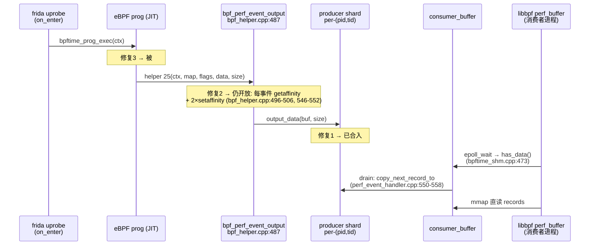
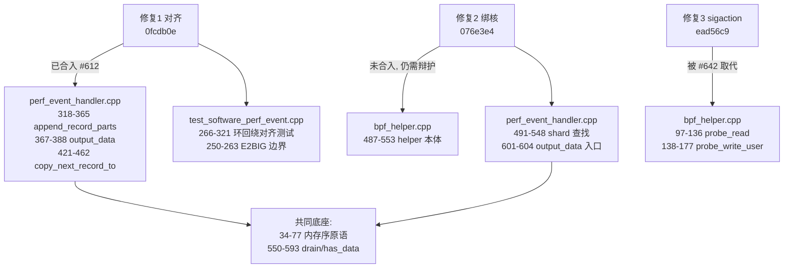

# 8. 实践：阅读节奏、验证实验与 PR 状态清单

本章是全指南的"落地"部分：先给出阅读节奏，然后是本章核心——**三个 7 月修复的上游状态与
辩护清单**。7 月我们在 `6bd5319d` 上做了三个修复（perf record 8 字节对齐 `0fcdb0e`、
删除每事件绑核 `076e3e4`、SIGSEGV handler 每线程只装一次 `ead56c9`），准备向上游提
PR/issue。到官方 `177a1dc`（2026-10 的 upstream master）为止，三者的结局各不相同：

| 7 月修复 | 上游状态 | 官方代码现在怎么做 |
|---|---|---|
| 对齐 `0fcdb0e` | **已合入**：#612（`417f7c61`，"fix: align software perf event records"） | `output_data` 内联做 8 字节向上取整，超 u16 返回 `E2BIG`；细节与我们的版本有差异（见 3.1） |
| 删绑核 `076e3e4` | **未合入**；#678（`3a1d2ecf`）只修了错误路径漏恢复 mask | 每事件仍 getcpu + getaffinity + 2×setaffinity；提案仍开放（见 3.2） |
| sigaction `ead56c9` | **被取代**：#642（`f311de23`，"use no-fault probe memory copies"） | 不再装 SIGSEGV handler，probe 读写改走 `process_vm_readv`/`process_vm_writev`（见 3.3） |

所以本章不再为已不在官方代码里的实现做逐行辩护：3.1 讲读懂已合入版本、3.3 讲读懂取代
方案，只有 3.2 保留完整的辩护清单——它是唯一还需要说服审稿人的提案。

行号基于官方 `177a1dc`（不含我们的任何修改）。

> 之后的 dev 分支工作（2026-10）又用 7 个真实 uprobe 工具审计 bpftime，找到并修了 18 个
> 问题，记录在 `summry/jetson` 分支的 `realprog/bpftime-realprog-compatibility-20261026.md`。
> 那些是我们 dev 分支的修改，不是官方代码，本章不展开。

---

## 8.1 阅读节奏（按依赖序）

第 1 天主线 13 步 → 子系统 1（shm，半天）→ 子系统 2（入口层，半天）→
子系统 3（attach，1 天）→ 子系统 4（vm，1 天）→ 子系统 5（maps/helpers，半天）→
子系统 6（按需）。

顺序的理由：shm 是所有跨进程状态的地基，不先懂 `handler_manager` 就看不懂
agent/syscall-server 在"注册什么"；attach 与 vm 相互独立，可换序；maps/helpers
放后，是因为你在 benchmark 工作里已经把 `bpf_helper.cpp` 的热路径段读得很熟。
但要注意：**你熟的是 7 月的版本**。官方 `177a1dc` 里这几处已经变了，读 maps/helpers
时专门重读：

- `runtime/src/bpf_helper.cpp:97-177`：probe 读写（#642 后改为 `process_vm_readv`/`writev`）；
- `runtime/src/bpf_helper.cpp:487-553`：`bpf_perf_event_output`（#678 加了 `goto restore_affinity`）；
- `runtime/src/handler/perf_event_handler.cpp:318-388`：`append_record_parts` / `output_data`（#612 的对齐）。

---

## 8.2 全景：三个修复在热路径上的位置

先把一张图刻进脑子——每个修复各钉在链路的哪一环，以及官方现在那一环长什么样。
能一句话说清"这行处于数据流的什么位置"，是和审稿人讨论的开场白。



三个修复分属两类：修复 1 是**生产者-消费者契约**问题（跨进程、跨代码库），
修复 2/3 是**热路径冗余 syscall** 问题（单进程、纯浪费）。上游对两类的处理也不同：
契约问题直接合入了；修复 3 上游选择了换一套机制（把"冗余 syscall"变成"每次一个
syscall、但不碰信号"）；修复 2 仍在等论证——"删掉的东西保护不了任何东西"。

---

## 8.3 PR 状态与辩护清单 ⭐

总原则不变：一个修复的论证 = **(a) 改了什么**（diff 本身）+ **(b) 周边代码为什么
允许这么改**（不变量论证）+ **(c) 诚实的边界**（行为差异主动声明）。对已合入/已取代
的两个，现在要做的是读懂官方版本、知道它和我们 7 月版本的差别；对仍开放的绑核删除，
(b)(c) 都要按官方 `177a1dc` 的代码重新准备。



### 8.3.1 修复 1：software perf record 8 字节对齐（`0fcdb0e` → 上游 #612）

**状态**：已合入（`417f7c61`）。官方的实现比我们的短：没有单独的
`perf_event_record_alignment` 常量和 `align_perf_event_record_size` 函数，取整直接写在
`output_data` 里。和我们 7 月版本相比有四处差别，读代码时要分清：

| 方面 | 我们的 `0fcdb0e` | 官方 #612（`177a1dc`） |
|---|---|---|
| 对齐计算 | 独立函数，带溢出检查 | `output_data` 内联（`perf_event_handler.cpp:370-378`），先用 u16 上限挡掉超大 size |
| `perf_sample_raw.size` | 裸 payload 长度 | **含 padding**：`header.size = record_size - sizeof(header)`（`:383`）；#612 的提交记录里"保持未填充"与"填充"来回改过几次，最终版提交说明是 "match perf raw padding semantics" |
| padding 字节 | 显式写零 | **不写**："runtime: skip perf record padding writes"——`append_record_parts` 只写两段数据，head 却按含 padding 的 `record_size` 推进（`:352-357`） |
| 消费侧 | `copy_next_record_to` 拒绝非 8 倍数的 record 并丢弃 shard | 只检查 `size` 的上下界（`:442-448`），**不检查对齐** |

**必读清单**（约 150 行 + 测试）：

| 代码段 | 位置 | 为什么必读 |
|---|---|---|
| `append_record_parts` | `runtime/src/handler/perf_event_handler.cpp:318-365` | 新增 `padding_size` 参与溢出检查、容量判断和 head 推进 |
| `output_data` | 同文件 `367-388` | 对齐与 `E2BIG`；`header.size` 与 `sample->size` 的分工 |
| `write_wrapped` / `read_wrapped` | 同文件 `390-419` | 环回绕拷贝——理解"header 跨界"故障的几何 |
| `copy_next_record_to` | 同文件 `421-462` | 消费侧只做大小检查 |
| 环回绕对齐测试 | `runtime/unit-test/test_software_perf_event.cpp:266-321` | 64 字节小环 + 4 条 24B record |
| `E2BIG` 边界 | 同文件 `250-263` | 最大合法 payload 成功、再大 1 字节失败 |

**注释版代码 ①**：官方 `output_data`（`perf_event_handler.cpp:367-388`，行尾注释为本指南所加）：

```cpp
int software_perf_event_buffer::output_data(const void *buf, size_t size)
{
	SPDLOG_DEBUG("Handling perf event output data with size {}", size);
	constexpr size_t alignment = sizeof(uint64_t);
	if (size > std::numeric_limits<uint16_t>::max() -
			   sizeof(perf_sample_raw) - (alignment - 1)) {
		errno = E2BIG;               // header.size 是 u16，对齐后也必须装得下
		return -1;
	}
	const size_t record_size =
		(sizeof(perf_sample_raw) + size + alignment - 1) &
		~(alignment - 1);            // 向上取整到 8B
	perf_sample_raw header;
	header.header.type = PERF_RECORD_SAMPLE;
	header.header.size = record_size;            // 消费者用它推进 tail
	header.header.misc = 0;
	header.size = record_size - sizeof(header);  // raw size 也含 padding

	append_record_parts(&header, sizeof(header), buf, size,
			    header.size - size);         // padding 只占位，不写
	return 0;                        // append 失败（环满）照样返回 0，见8.5 节
}
```

要点：`data_head` 初值为 0（`:254`），每次按 8 的倍数推进（`:356-357`），归纳可得
**每条 record 的起点恒 8B 对齐**——这仍是整个修复的不变量，官方版本同样成立。

**为什么这个契约重要**（讨论时仍用得上）：libbpf 的 `perf_event_read_simple` 在
wrap-copy 之前直接读环尾的 `ehdr->size`（`third_party/bpftool/libbpf/src/libbpf.c:13601-13602`）。
header 若跨环尾，读到的就是半截/残留数据。7 月的实测后果：header 落在环最后字节 →
读到 `size=0` → tail 不推进 → 消费者空转（修复后消费者 task-clock −95.5%、指令 −96.1%）。

**官方版本值得留意的两点**（观察，不是已确认的 bug）：

- 由于 raw size 含 padding，libbpf 把 `s->size` 交给用户回调（`libbpf.c:13999`），回调看到的
  数据长度会比真实 payload 多 0～7 字节，而这些 padding 字节没有被写过，内容是环上的残留。
  像 sslsniff 这样在事件结构里自带长度字段的工具不受影响；直接用回调 size 的工具可能受影响（未验证）。
- 官方消费侧没有对齐检查。7 月我们加这道检查是为了防"旧版本 producer 留在持久 shm 里的非对齐
  record"；官方没加，意味着升级前后若复用同一块 shm，仍要先 `bpftimetool remove`。

### 8.3.2 修复 2：删除每事件 affinity 绑核（`076e3e4`，仍开放）

**状态**：未进上游。官方 `bpf_perf_event_output` 仍在每个事件上绑核再恢复；外部贡献者的
#678（`3a1d2ecf`，"restore CPU affinity on perf output errors"）修掉了我们 7 月指出的第一个
子 bug（错误路径直接 return、不恢复 mask），并加了测试 `test_software_perf_event.cpp:23-124`
（tag `[perf_event][affinity]`）。绑核本身、以及第二个子 bug（恢复时用的是进入时保存的
旧 mask）都还在。

**必读清单**（约 130 行）：

| 代码段 | 位置 | 为什么必读 |
|---|---|---|
| `bpf_perf_event_output` helper 本体 | `runtime/src/bpf_helper.cpp:487-553` | 提案要删的就是 `:496-506` 的绑核和 `:546-552` 的恢复；`current_cpu` 的唯一用途在 `:518-521` |
| `my_sched_getcpu` | `runtime/src/platform_utils.cpp:7-9` | Linux 上就是 `sched_getcpu()` |
| shm 转发层 | `runtime/src/bpftime_shm.cpp:575-597` | fd → `software_perf_event_data::output_data` |
| `output_data` → `get_current_thread_shard` | `runtime/src/handler/perf_event_handler.cpp:601-604, 491-548` | 论证核心：写入按 (pid,tid) 分 shard，与 CPU 无关 |
| shard cache 与三级 generation | 同文件 `110-116, 132-145, 495-511` | 无锁快路径为什么安全 |
| drain 与自旋锁 | 同文件 `550-558, 83-95` | 慢路径的互斥靠锁，不靠绑核 |
| 内存序原语 | 同文件 `34-77` | head/tail 的 acquire/release，绑核提供不了这个 |
| #678 的测试 | `runtime/unit-test/test_software_perf_event.cpp:23-124` | 它断言的不变量（调用前后 affinity 相同），删掉绑核后天然成立 |

**注释版代码 ②**：官方 `bpf_perf_event_output` 的绑核与恢复（`bpf_helper.cpp:490-552` 节选）：

```cpp
	int32_t current_cpu = my_sched_getcpu();   // 快照：后面只当 map key 用
	...
	cpu_set_t mask, orig;
	CPU_ZERO(&mask);
	CPU_SET(current_cpu, &mask);
	if (sched_getaffinity(0, sizeof(orig), &orig) < 0)   // syscall 1：存旧 mask
		return (uint64_t)-1;
	// Bind to the current cpu
	if (sched_setaffinity(0, sizeof(mask), &mask) < 0) { // syscall 2：钉到当前核
		...
	}
	...
	if (map_ty == bpftime::bpf_map_type::BPF_MAP_TYPE_PERF_EVENT_ARRAY) {
		const int32_t *val_ptr =
			(int32_t *)(uintptr_t)bpftime::shm_holder
				.global_shared_memory.bpf_map_lookup_elem(
					fd, &current_cpu, false);   // ← cpu 的唯一用途：map key
	...
restore_affinity:
	// Cleanup must not overwrite an error from the output operation.
	const int saved_errno = errno;
	if (sched_setaffinity(0, sizeof(orig), &orig) < 0 && ret >= 0) // syscall 3：恢复
		return (uint64_t)-1;
	errno = saved_errno;
	return (uint64_t)ret;
```

要点：`current_cpu` 在绑核**之前**就快照好了（`:490`）；绑核既不影响它的取值，也不被
后续任何代码依赖。提案的 diff 就是删掉 `:496-506` 和 `:546-552`，并把两处
`goto restore_affinity` 改回直接返回。

**审稿人可能问什么**：

- **Q：绑核难道不是为了保证"写到当前 CPU 的 buffer"？** 答：写入根本不进 per-CPU
  结构。`output_data`（`perf_event_handler.cpp:601-604`）转给
  `get_current_thread_shard()`，按 `(getpid(), gettid())` 选 shard（`:493-494,
  :520-521`）——**per-thread，不是 per-CPU**。`current_cpu` 的唯一用途是
  PERF_EVENT_ARRAY 的 lookup key（`bpf_helper.cpp:518-521`），而它在绑核前已快照，
  原实现从未消除"快照后迁移"窗口，只是略微缩短。
- **Q：那并发安全靠什么？** 答：shard 查找/创建/drain 全走 `shard_lock` 自旋锁
  （`:513, :552`），无锁快路径靠 thread_local cache + 三级 generation 校验
  （`:497-511`），环指针用 acquire/release 原语（`:34-77`）。绑核本来就不提供
  互斥——同核照样可被抢占。
- **Q：#678 已经修了错误路径，为什么还要删？** 答：#678 修的是"出错时漏恢复"，没回答
  "为什么要绑"。剩下的问题有两个：(1) 成本——每事件 getaffinity + 2×setaffinity，7 月在
  Jetson Orin 上实测这一序列无竞争约 3.1 µs/事件（单次 setaffinity 约 1.4 µs，是普通
  syscall 的 5 倍）；(2) 第二个子 bug——恢复用的是进入时保存的 `orig`（`:499, :549`），
  若应用在这期间自己改了 affinity，会被旧 mask 覆盖。删除绑核同时消除这两点。
- **Q：删除后事件的 cpu 归属会不会错？** 答（诚实边界，主动写进 PR）：存在
  快照-写入间迁移窗口，但与删除前**同类同源**；7 月实测 16B 审计 10 秒约 20 万事件，
  nginx worker `nr_migrations = 0`；cpu 值只影响 perf_buffer 回调的 cpu 参数，
  无正确性影响。
- **Q：`BPF_MAP_TYPE_KERNEL_USER_PERF_EVENT_ARRAY` 共享路径（`:533-539`）呢？**
  答：用户态绑核影响不了内核侧的 per-CPU buffer 选择（内核用自己的
  `smp_processor_id()`），对该路径同样零保护。
- **Q：#678 的测试会不会因此失败？** 答：按代码推断不会（未实测）：它的三个 SECTION
  断言的是返回值、errno（`ENOENT`/`EINVAL` 来自 map 查询失败）和"调用前后 affinity 相同"
  （`test_software_perf_event.cpp:113-123`）；去掉绑核后 affinity 根本不被改动。
- **Q：性能数字可信吗？** 答：要先声明测量顺序——对齐 bug 不修，吞吐数据被隐藏
  丢事件污染（这是修复 1 必须先合入的原因，现在它已在官方里）。7 月数据（基线
  `6bd5319d` + 我们的修复）：Jetson 上 bpftime 原本比 kernel eBPF 慢 3.8%～12.6%，删除绑核后
  反超（fair 口径 3 轮 × 2 payload 六腿全同向，16B +7.58% / 256KB +9.81%），事件守恒
  2.001/请求零丢失；x64 同 VM A/B 吞吐 +37%～41%，kernel 腿 Δ≤0.7% 证明控制干净。
  10 月在官方 `177a1dc` 上只加这一处改动复测（`benchmark-results/jetson` 分支
  `uprobe/ssl-nginx-2x2-20261023/README.md`）：16B 下官方 −12.0% vs kernel，去绑核后 +7.0%，
  即比官方 +21.6%；256KB 的对比不等价（所有 bpftime 构建都只交付约一半事件，见8.5 节），
  PR 里只引 16B。

### 8.3.3 修复 3：SIGSEGV handler 每线程装一次（`ead56c9` → 被上游 #642 取代）

**状态**：我们的修复没有进上游。上游 #642（`f311de23`，同时并入 #643 的 `probe_read_str`
语义修复）把整套"装 SIGSEGV handler + 改 PC 跳回"的机制**删掉了**，所以 7 月准备的
UB 论证、状态机分析、"read/write 两个 handler 互相覆盖"等既有问题清单，都随旧代码一起
失去对象，不再需要辩护。

**官方现在怎么做**：

| 代码段 | 位置 | 要点 |
|---|---|---|
| 编译开关 | `cmake/StandardSettings.cmake:110, 112`；根 `CMakeLists.txt:189-195` | `ENABLE_PROBE_READ_CHECK` / `ENABLE_PROBE_WRITE_CHECK` 默认 ON |
| pid 缓存 | `runtime/src/bpf_helper.cpp:68-73` | 缓存 `getpid()`，`pthread_atfork` 在子进程里刷新 |
| `probe_read_memory` | 同文件 `97-119` | Linux：对自己 pid 调 `process_vm_readv`；macOS：`mach_vm_read_overwrite` |
| `bpftime_probe_read` | 同文件 `121-136` | 开检查 → 失败返回 `-EFAULT`；关检查 → 直接 `memcpy` |
| `probe_write_memory` / `bpftime_probe_write_user` | 同文件 `138-177` | 写方向的镜像：`process_vm_writev` |
| `bpf_probe_read_str` | 同文件 `343-418` | 开检查时按页（且每块 ≤256 字节）分块读，读失败把目标清零并返回 `-EFAULT` |
| 测试 | `runtime/unit-test/test_probe.cpp:57, 125, 227` | 重复读、保留应用 SIGSEGV handler、保留默认 handler |

**读懂取代方案要抓住的三点**：

1. **没有信号，就没有 7 月那一串问题**：不再碰进程级的 SIGSEGV 处置，应用自己的 handler
   不会被覆盖（`test_probe.cpp:125` 专门测这个），也不存在"第二个线程把我们自己的 handler
   当成 origin 存下来"的自我转发递归。
2. **成本模型变了**：开检查时每次 `bpf_probe_read` 恰好一个 `process_vm_readv` syscall。
   对比：7 月原始代码每次 2 个 `rt_sigaction` + memcpy，我们的修复在首次之后 0 个 syscall。
   官方方案在 Jetson ssl-nginx 热路径上的成本我们没有单独测过（TODO：如需引用，按8.4 节
   实验 4 测）。
3. **错误语义更接近内核**：读失败返回 `-EFAULT`（`:129-131`），而不是靠 fault 恢复。

**如果有人问"你们当时的方案为什么没进"**：如实说——上游选择了不依赖信号的方案，它同时
解决了我们 PR 里打算声明为 out of scope 的三个既有问题；我们的修复只解决了"每次重装"，
不再有提交价值。

---

## 8.4 边读边做的验证实验（利用现有环境）

源码以官方树为准：`/home/jetson/src/bpftime-daily-state/worktrees/177a1dc465ff/official`
（只读）。本机已有一份干净的官方 `177a1dc` 构建：
`/home/jetson/src/bpftime-official-177a1dc-llvm16-20261021/build-jit`（RelWithDebInfo、
LLVM JIT；注意它的 CMakeCache 里 `ENABLE_PROBE_READ_CHECK`/`WRITE_CHECK` 是 **OFF**，与默认
值相反，且没有编出 `bpftime_runtime_tests`）。需要单测或 probe check 时，在官方树的副本里
`make build-unit-test`（`Makefile:35-37`，Debug，两个 check 都开）。7 月用的
`bpftime-offical-no-btf/build-alignment-test` 已不存在，且它是 `ead56c9`，不是官方代码。

1. **读 shm 章时——dump handler 表认类型。** 跑一次 benchmark 后不执行
   `bpftimetool remove`，直接：
   ```bash
   B=/home/jetson/src/bpftime-official-177a1dc-llvm16-20261021/build-jit
   sudo $B/tools/bpftimetool/bpftimetool export /tmp/shm.json
   python3 -m json.tool /tmp/shm.json | less
   ```
   JSON 按 fd 槽位键入，每槽带 `"type"` 字符串（`bpf_prog_handler` /
   `bpf_map_handler` / `bpf_perf_event_handler` / `epoll_handler` / `bpf_link_handler` /
   `memfd_handler`，见 `runtime/src/bpftime_shm_json.cpp:276-368`），对照 `handler_variant`
   的 7 个成员（`runtime/src/handler/handler_manager.hpp:87-90`，第 7 个是 `unused_handler`，
   不导出）逐槽认。shm 不存在或无权限时，#594 的提示会告诉你原因（`tools/bpftimetool/main.cpp:224-240`）。

2. **读 JIT 章时——确认 helper 25 的绑定。** helper 编号在
   `runtime/src/bpf_helper.cpp:939`（`BPF_FUNC_perf_event_output = 25`），注册在
   `:1345-1348`；JIT 侧符号名由 `ext_func_sym` 生成
   （`vm/llvm-jit/src/compiler_utils.hpp:39-44`，格式 `_bpf_helper_ext_%04u` →
   `_bpf_helper_ext_0025`）。验证方式：
   ```bash
   SPDLOG_LEVEL=debug BPFTIME_LOG_OUTPUT=console \
     LD_PRELOAD=$B/runtime/agent/libbpftime-agent.so <victim> \
     2>&1 | grep -i "ext_0025\|perf_event_output"
   ```
   （运行时日志级别在 `bpftime_set_logger` 里经 `spdlog::cfg::load_env_levels()` 读取，
   `runtime/include/bpftime_logger.hpp:89`；#694 之后 `bpftime`/`bpftimetool` 两个工具本身也
   尊重 `BPFTIME_LOG_OUTPUT`。注意 Release 构建可能把 DEBUG 宏编译掉，此时改用 AOT 产物
   `llvm-objdump -t` 看符号表。）

3. **读 attach 章时——核对 enter 侧事件计数。** 在
   `attach/frida_uprobe_attach_impl/src/frida_internal_attach_entry.cpp:293`
   （`uprobe_listener_on_enter`）与 `:310`（`uprobe_listener_on_leave`）各加一个原子计数器，
   重编 agent，然后跑短测和事件守恒审计，核对 2.001 事件/请求的另一半：enter 计数应 ≈
   消费者收到的 SSL_read+SSL_write 事件数之和。
   TODO：7 月用的 `v4-ablation/short-test.sh`、`event-audit.sh` 在当前机器和
   `benchmark-results/jetson` 分支里都没找到（`/home/jetson/src/results/v4-ablation/` 下只剩
   日志）；10 月的等价脚本是 `uprobe/ssl-nginx-2x2-20261023/bench/run_fair.py`，审计方式见同目录
   README，用前需确认参数。

4. **读 probe_read 时——关掉检查做消融。** 官方代码里开关的含义已变：ON = 每次
   `process_vm_readv`，OFF = 纯 `memcpy`（`bpf_helper.cpp:128-135`）。
   ```bash
   grep PROBE <build>/CMakeCache.txt
   # 默认 ENABLE_PROBE_READ_CHECK:BOOL=ON / ENABLE_PROBE_WRITE_CHECK:BOOL=ON
   ```
   做 ON/OFF 两个构建跑短测，差值就是官方"no-fault 拷贝"在热路径上的成本。7 月消融报告
   ③段的 +3.7pp 是旧的信号机制下测的，不能直接套到官方代码上。

5. **读 perf buffer 时——跑相关单测。**
   ```bash
   ./build/runtime/unit-test/bpftime_runtime_tests "[software_perf_event]"
   ./build/runtime/unit-test/bpftime_runtime_tests "[affinity]"
   ```
   `[software_perf_event]` 的三个 TEST_CASE（`test_software_perf_event.cpp:157/266/323`）分别验证
   多线程 shard 隔离（含 `E2BIG` 边界）、mmap resize 后的对齐回绕、shm 耗尽时 `ENOMEM`；
   `[affinity]`（`:23`）是 #678 的绑核恢复测试。两个练习：改一处 `output_data` 的
   `alignment` 观察哪些断言炸；把 3.2 的去绑核改动打上去，确认 `[affinity]` 仍然通过（3.2 里
   "按代码推断不会失败"的实测版）。

---

## 8.5 已知代码-注释不一致清单（已在 `177a1dc` 重新核实）

阅读时以代码为准。7 月清单里的 7 条逐条在官方 `177a1dc` 上重新核对：**没有一条被上游
修掉**，全部保留（行号已更新）；另补两条新发现。

- **`attach/frida_uprobe_attach_impl/include/frida_uprobe_attach_impl.hpp:20-25`：
  UPROBE/URETPROBE 注释写反**（仍存在）。`ATTACH_UPROBE = 6` 顶着"invoked when
  the attached function **return**"的注释，`ATTACH_URETPROBE = 7` 顶着"invoked
  when the attached function was **invoked**"。实现侧语义正常：`ensure_listener`
  （`frida_internal_attach_entry.cpp:117-127`）给 uprobe 挂 `on_enter`、给 uretprobe 挂
  `on_leave`；`on_enter`（`:293-308`）调 `iterate_uprobe_callbacks`，`on_leave`（`:310-318`）
  调 `iterate_uretprobe_callbacks`。
- **"interpreter" 注释**（仍存在）：自称 interpreter 的是 VM 抽象层的
  `vm/vm-core/include/ebpf-vm.h:151`（"Execute a BPF program in the VM using
  **the interpreter**"）。LLVM 后端下调用链是 `ebpf_exec`（`vm/vm-core/src/ebpf-vm.cpp:57-61`）
  → `bpftime_llvm_vm::exec`（`vm/compat/llvm-vm/compat_llvm.cpp:35-37`）→
  `llvmbpf_vm::exec`（`vm/llvm-jit/src/vm.cpp:145-172`），实为**惰性 JIT**：首调用
  compile 后缓存函数指针再执行。`vm/llvm-jit/include/llvmbpf.hpp:79-82` 的注释反而是对的。
  调用侧 `bpftime_prog_exec`（`runtime/src/bpftime_prog.cpp:238-276`）的 `jitted` 分支
  （`:260-270`）区分的是"预先显式 compile 过"与"没 compile 过"，后者对 LLVM 后端同样落到 JIT。
- **`runtime/src/bpf_map/userspace/per_cpu_hash_map.cpp:122-124`：一条注释两处
  失实**（仍存在）。注释称"Allocate as a **local variable** to make it thread
  safe, since we use **sharable lock**"——实际 (a) 用的是共享成员
  `this->key_templates[0]`（`:124`），不是局部变量；(b)
  `per_cpu_hash_map.hpp:52` 明确 `should_lock = false`，全类无锁。
- **`per_cpu_hash_map.cpp:96-107`：`elem_delete` 清零范围与意图相反**（仍存在）。
  `std::fill(itr->second.begin(), itr->second.begin() + cpu * value_size, 0)`（`:103-104`）
  清的是 CPU `0..cpu-1` 的切片，不是当前 CPU 的 `[cpu*value_size, (cpu+1)*value_size)`；
  在 CPU 0 上调用则什么都不清。对照 `elem_update` 的写法（`:83-84`，
  `begin() + cpu * value_size` 作为**起点**）即可确认这是笔误。
- **`perf_event_handler.cpp:385-387`：`output_data` 把丢弃当成功**（仍存在）。
  `append_record_parts` 的返回值被忽略，函数返回 0；#612 之后唯一会报错的是 payload 过大
  （`:371-374`，`E2BIG`）。全 runtime 不生成 `PERF_RECORD_LOST`（只在
  `runtime/include/bpftime_epoll.h:314` 有枚举定义）。环满丢弃对 BPF 程序和消费者双向不可见。
  10 月在 `177a1dc` 上实测到了后果：256KB 响应时 kernel 每请求 17.0 个 SSL_write 事件，
  官方 bpftime 只有约 8.6 个（`benchmark-results/jetson` 分支
  `uprobe/ssl-nginx-2x2-20261023/README.md` Finding 3）。
- **`bpf_helper.cpp:487`：`flags` 参数整个被忽略**（仍存在，`:487-553` 内没有任何对
  `flags` 的使用）。`BPF_F_INDEX_MASK` 显式索引会被当 current-cpu 处理（对照 kernel 语义应取
  `flags & BPF_F_INDEX_MASK` 作 map index）。上游可单独立项。
- **（不确定是否有意）`runtime/syscall-server/syscall_context.cpp:1005-1007`：
  mocked mmap 兜底路径连调两次 `orig_mmap64_fn`**（仍存在），第一次的匿名映射返回值
  `ptr` 直接丢弃（泄漏一块映射）。看不出第一次调用的意图，标记待查。
- **（新发现）`tools/bpftimetool/main.cpp:183` vs `:200-202`：`load` 的用法说明写
  "Load a JSON file"，代码却把 `argv[3]` 当 JSON 文本直接解析**
  （`bpftime_import_shm_handler_from_json` → `json::parse(json_string)`，
  `runtime/src/bpftime_shm_json.cpp:223-228`）；#682 的测试 `test_load.py` 传的也是 JSON 文本。
  导入文件用的是 `import` 子命令。
- **（新发现）`daemon/test/test_daemon.cpp:8-10` 等：`#error Only supports x86_64` 的条件
  永远不成立**。条件是 `!defined(__x86_64__) && defined(_M_X64)`，而 `_M_X64` 是 MSVC 的宏，
  GCC/Clang 下不会定义，所以这条"只支持 x86_64"的守卫实际不起作用（7 月底稿第 7 章把它
  当成了有效限制）。`test_daemon_driver.cpp:14-16` 是同一写法。

---

## 8.6 自测题

读完本章（以及跑完实验）后自测。前三道对应三个修复在官方代码里的现状，答不上来说明
还没读透官方版本。

**1. 官方 #612 之后，一条 payload 为 5 字节的 record 在环上占几个字节？
`header.size` 和 `sample->size` 各是多少？padding 字节是什么内容？**

<details><summary>答案</summary>

`perf_sample_raw` = `perf_event_header`(8) + `uint32_t size`(4) = 12 字节，
加 payload 5 = 17，向上对齐到 **24 字节**（`perf_event_handler.cpp:376-378`）。
`header.size = 24`（消费者用它推进 tail），`sample->size = 24 - 12 = 12`（`:383`，**含** 7 字节
padding——这点和我们 7 月的版本不同，我们写的是裸 payload 5）。第 17～23 字节是 padding，
官方**不写**它们（`append_record_parts` 只写 header 和 payload，`:352-355`），内容是环上残留。
单测 `:226-229` 断言了 `sample.size == header.size - sizeof(perf_sample_raw)`。
</details>

**2. 为什么删除绑核后不需要任何替代同步措施？写入路径上每一层的安全靠什么？**

<details><summary>答案</summary>

因为绑核从未承担同步职责：(a) `current_cpu` 只是 map lookup key 的快照
（`bpf_helper.cpp:490, :518-521`）；(b) ring 写入按 `(pid, tid)` 选 producer shard
（`perf_event_handler.cpp:493-494, :520-521`），单写者；(c) shard 表的增删查受
`shard_lock` 自旋锁（`:513, :552`）；(d) shard cache 快路径靠三级 generation
校验（`:497-511`）；(e) head/tail 跨进程可见性靠 acquire/release 原语
（`:34-77`）。每层各有其锁或其单写者性质，无一依赖"线程停在某个 CPU 上"。
#678 只让恢复更可靠，没有改变这个结论。
</details>

**3. 官方 #642 之后，开着 `ENABLE_PROBE_READ_CHECK` 时，一次 `bpf_probe_read` 读到坏指针
会发生什么？每次调用有几个 syscall？和 7 月的两个版本比呢？**

<details><summary>答案</summary>

`bpftime_probe_read` 调 `probe_read_memory`，Linux 上对自己的 pid 发一次
`process_vm_readv`（`bpf_helper.cpp:110-114`）；坏指针时内核返回错误、拷贝长度不符，helper
返回 `-EFAULT`（`:129-131`），进程里不产生 SIGSEGV，也不碰任何信号处置。每次调用 1 个
syscall。7 月原始代码：每次 2 个 `rt_sigaction`（因读未初始化的 `original_sa` 导致每次重装）
+ memcpy；我们的 `ead56c9`：首次之后 0 个 syscall，坏指针靠 SIGSEGV handler 改 PC 恢复。
关掉检查时官方就是裸 `memcpy`（`:133-134`），坏指针直接崩。
</details>

**4. `get_current_thread_shard` 的三个 generation 各防什么？**

<details><summary>答案</summary>

- `event_generation`（`perf_event_handler.cpp:110-116`，`pid<<32 ^ 计数器`）：
  防 shm 中同地址析构重建的另一个 event 被旧 cache 命中（`:500`）；
- `buffer_generation`：消费者 `ensure_mmap_buffer` 扩容后递增
  （`:619-622`），迫使所有 producer 换新 shard（新 shard 以新容量创建，
  `:535-538`），防止新旧容量混写；
- `shard.generation`：防 list 节点被 erase（包括 `reclaim_inactive_producer_shards_locked`
  回收已退出线程的空 shard，`:575-587`）后内存重用——cache 里存的裸指针必须与记录的
  `shard_generation` 一致才可信（`:503-506`）。
</details>

**5. producer 环满时，BPF 程序和消费者分别观察到什么？这是 bug 吗？**

<details><summary>答案</summary>

BPF 程序看到 helper 返回 0（成功）——`output_data` 忽略 `append_record_parts` 的
false 返回值（`perf_event_handler.cpp:385-387`）；消费者什么也看不到——全
runtime 不产生 `PERF_RECORD_LOST`。是 bug（静默丢弃），官方 `177a1dc` 仍未修。
kernel 语义是 helper 返回 `-ENOSPC` 且可统计丢失。10 月在官方代码上实测：256KB 响应时
bpftime 只交付约一半事件，吞吐对比因此不等价。这也是对齐 bug 期间"高吞吐假象"能长期
隐身的原因：丢事件无任何可见信号。
</details>

**6. 若应用在 agent attach 之后自己调用 `sigaction(SIGSEGV, ...)`，官方 `177a1dc` 的行为是
什么？和 7 月两个版本比呢？**

<details><summary>答案</summary>

官方：probe 读写不再安装任何 SIGSEGV handler，应用的 handler 原样生效，probe 的坏指针也
不经过信号（返回 `-EFAULT`）。`test_probe.cpp:125`（"preserves application SIGSEGV handlers"）
和 `:227`（"default SIGSEGV handler is preserved"）测的就是这个。7 月原始代码：下一次
`probe_read` 会重装我们的 handler，把应用的顶掉；我们的修复：不再重装，应用 handler 生效，
但此后 probe 踩坏指针时 fault 会落到应用 handler 上。两种都不理想，官方的不依赖信号的方案
同时避开了这两种情况。
</details>

---
[← 返回目录](README.md)
