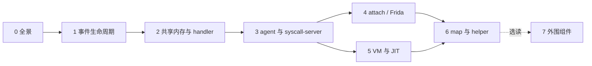
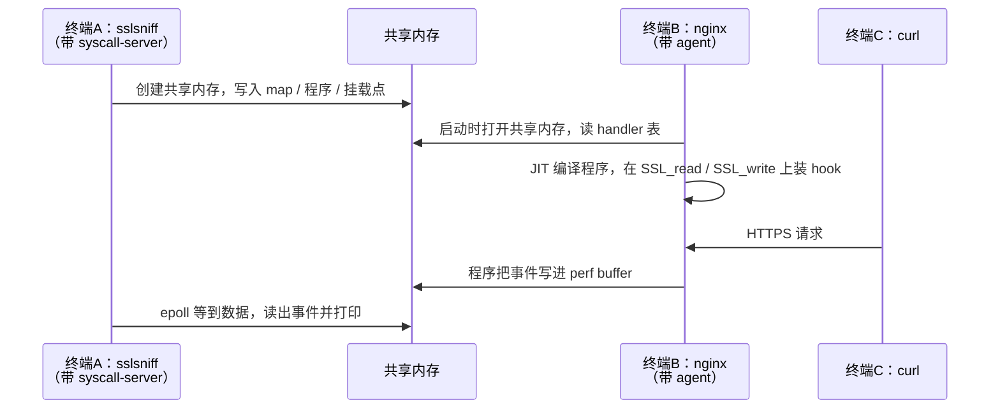

# 8. 动手实践：边读边验证

> 一句话：这一章告诉你按什么顺序读这本指南、怎么在自己的机器上把 bpftime 和
> "sslsniff 追踪 nginx"这个场景跑起来，以及每读完一章可以做哪个小实验，确认自己真的懂了。
> 前置：先读完 [第 0 章](00-architecture.md) 再做环境准备；实验部分跟着各章边读边做。
> 预计用时：环境准备半天（大部分时间在编译），每个实验 10–60 分钟。

本章只服务于**学习 bpftime**。性能研究、PR 状态、代码与注释不一致的清单，都放在
[附录：研究笔记](09-appendix-research-notes.md)，学习时可以跳过。

## 本章要回答的问题

- 一共八章，哪些必须读？按什么顺序读？一周怎么安排？
- 在一台普通的 x86_64 Linux 上，怎么从源码编出 bpftime，并跑起全书的锚点场景？
- 读完某一章以后，用什么命令能亲眼看到这一章讲的机制？
- 实验结果和预期不一样时，先怀疑什么？

---

## 8.1 推荐阅读路线

全书围绕一个场景展开：nginx 处理 HTTPS 请求，sslsniff 用 uprobe 抓 `SSL_read` / `SSL_write`
的明文。第 1 章顺着一个事件从头走到尾，是全书的主干。第 2–6 章各自放大第 1 章里的一段。
所以顺序很简单：先读 0、1，然后按"读之前最好先懂什么"往下走。

下面这张图里，箭头表示"读后一章之前，最好先读前一章"。第 4、5 章互不依赖，可以换序。



| 章 | 定位 | 预计用时 | 读完能回答 |
|---|---|---|---|
| [0 全景架构](00-architecture.md) | 必读 | 2–3 小时 | bpftime 由哪些部件组成，各自跑在哪个进程里 |
| [1 一个事件的完整生命周期](01-lifecycle.md) | 必读（主线） | 半天到 1 天 | 一次 `SSL_read` 从触发到被 sslsniff 打印，经过哪 13 步 |
| [2 共享内存与 handler 注册表](02-runtime-shm.md) | 必读 | 半天 | 两个进程靠什么共享 map 和程序；"假 fd"是什么 |
| [3 agent 与 syscall-server](03-agent-syscall-server.md) | 必读 | 半天 | loader 调 `bpf(2)` 为什么没进内核；agent 何时、怎么装配 hook |
| [4 attach：Frida uprobe](04-attach-frida.md) | 推荐 | 1 天 | 函数入口怎么被改写；寄存器怎么变成 `pt_regs` |
| [5 VM 与 LLVM JIT](05-vm-llvm-jit.md) | 推荐 | 1 天 | 字节码怎么变成本机码；helper 调用怎么绑定到 C 函数 |
| [6 map 与 helper](06-maps-helpers.md) | 必读（至少读 perf 输出和 probe_read 两节） | 半天到 1 天 | per-CPU map 怎么在用户态模拟；事件怎么写进 perf buffer |
| [7 外围组件](07-periphery.md) | 选读 | 2–3 小时 | daemon、verifier、bpftimetool、单测各管什么 |
| 8 本章 | 边读边做 | — | — |
| [附录：研究笔记](09-appendix-research-notes.md) | 学习可跳过 | — | — |

**为什么是这个顺序**：

- 共享内存是所有跨进程状态的地基。不先懂 handler 表，就看不懂 agent 和 syscall-server
  到底在"注册什么"。所以第 2 章在第 3 章前面。
- attach（第 4 章）和 VM（第 5 章）各管一段，互相不引用，可以换序。
- 第 6 章放在后面，是因为 helper 同时用到第 4 章的 `ctx`（寄存器上下文）和第 5 章的 helper 绑定。

### 一周学习计划

每天 3–4 小时的节奏。前一天的实验没跑通，先别往下读，回头查"细节与坑"。

| 天 | 读 | 做 | 当天的目标 |
|---|---|---|---|
| 第 1 天 | 第 0 章；本章 8.2 | 编译 bpftime 和 sslsniff，跑通 [实验 1.1](#实验-11跑通锚点场景数一数事件) | 亲眼看到 sslsniff 打出 nginx 收发的明文 |
| 第 2 天 | 第 1 章 | 重跑一遍实验 1.1，对着第 1 章的 13 步，说出每一步发生在哪个进程 | 能画出 loader、共享内存、nginx 三者的关系 |
| 第 3 天 | 第 2 章 | [实验 2.1](#实验-21导出-handler-表逐行认类型) | 能逐行读懂导出的 handler 表 |
| 第 4 天 | 第 3 章 | [实验 3.1](#实验-31确认-loader-的-bpf-调用没进内核)、[3.2](#实验-32看-agent-的启动日志去了哪里) | 能解释"拦截"具体拦了哪些函数 |
| 第 5 天 | 第 4 章 | [实验 4.1](#实验-41给-frida-回调加计数器)（要改代码重编） | 能解释 enter / leave 回调和事件数的关系 |
| 第 6 天 | 第 5 章 | [实验 5.1](#实验-51看-helper-25-被绑定成哪个符号) | 能说出 `call 25` 最后调到了哪个 C 函数 |
| 第 7 天 | 第 6 章；浏览第 7 章 | [实验 6.1–6.3](#实验-61跑-perf-buffer-的单测)、[7.1](#实验-71按标签跑单测)；做本章自测题 | 能解释 perf buffer 的分片和 8 字节对齐 |

时间不够时，按目的挑一条短路线：

- **只想懂原理**（1–2 天）：0 → 1 → 2，做实验 1.1、2.1。
- **想改 runtime 的热路径或做性能**：0 → 1 → 2 → 3 → 6 → 5，做实验 2.1、5.1、6.1–6.3，然后读附录。
- **想加一种新的 attach 方式**：0 → 1 → 3 → 4 → 7。

**读代码的两个习惯**：

1. 用函数名 grep 定位。正文只写"文件 + 函数名"，精确行号在各章末尾的"深入参考"里，
   按基线 `177a1dc465ff` 标注，会随上游演进漂移。
2. 同一个模块，先读 `.hpp` 再读 `.cpp`。头文件里的数据结构定了，实现就好懂了。

---

## 8.2 环境准备

要跑起锚点场景，需要四样东西：

1. **bpftime 本身**：两个 `.so`（给 loader 用的 syscall-server、给目标进程用的 agent）和
   一个小工具 `bpftimetool`。
2. **一个 eBPF 工具**：sslsniff。它是普通的 libbpf 程序，同一个二进制既能把程序加载进内核，
   也能在 bpftime 下跑。
3. **一个被追踪的程序**：nginx，开 HTTPS。
4. **一个客户端**：curl 发几个请求，或者 wrk 压测。

下文命令以 **Debian 13 / x86_64** 为例，在 bpftime 仓库根目录执行。Ubuntu 基本一样。
aarch64 机器上命令也相同，只是库路径里的 `x86_64-linux-gnu` 换成 `aarch64-linux-gnu`。

### 8.2.1 安装依赖、取源码

```bash
sudo apt-get update
# 前三行是官方 installation.md 列的依赖
sudo apt-get install -y \
  libelf1 libelf-dev libssl-dev zlib1g-dev make cmake git libboost-all-dev \
  binutils-dev libyaml-cpp-dev ca-certificates clang llvm pkg-config llvm-dev \
  ninja-build nginx wrk curl strace          # 本章实验额外要用的
git clone https://github.com/eunomia-bpf/bpftime.git
cd bpftime
git submodule update --init --recursive      # libbpf、bpftool、frida 等都在子模块里
```

- 官方在 Ubuntu 23.04 上测试，建议 gcc ≥ 12、clang ≥ 16。Debian 13 自带 gcc 14 和 LLVM 19，满足要求。
- Debian 的 nginx 包装完会自动起一个系统服务，监听 80 端口。本章用自己的配置另起一个实例，
  监听 4043，两者不冲突。不想留着它，可以 `sudo systemctl disable --now nginx`。

### 8.2.2 编译 bpftime

仓库根目录的 `Makefile` 只是几组 cmake 命令的包装。学习时建议直接写 cmake 命令，
这样每个开关是干什么的都清楚：

```bash
cmake -B build -G Ninja \
  -DCMAKE_BUILD_TYPE=RelWithDebInfo \
  -DBPFTIME_LLVM_JIT=ON \
  -DBPFTIME_ENABLE_UNIT_TESTING=ON \
  -DBUILD_BPFTIME_DAEMON=OFF
cmake --build build -j"$(nproc)"
```

| 开关 | 含义 |
|---|---|
| `CMAKE_BUILD_TYPE=RelWithDebInfo` | 有优化，也保留调试符号，方便 gdb / perf 看函数名 |
| `BPFTIME_LLVM_JIT=ON` | 用 LLVM JIT 执行 eBPF（默认就是 ON，写出来是为了明确） |
| `BPFTIME_ENABLE_UNIT_TESTING=ON` | 编出 `bpftime_runtime_tests`，实验 6.x 要用 |
| `BUILD_BPFTIME_DAEMON=OFF` | 不编 daemon（第 7 章的内核劫持模式），省编译时间 |

如果 cmake 报找不到 LLVM，加上 `-DLLVM_DIR=/usr/lib/llvm-19/lib/cmake/llvm`（版本号按你装的改）。

编完后，本章会用到这些产物：

| 文件 | 是什么 | 谁用 |
|---|---|---|
| `build/runtime/syscall-server/libbpftime-syscall-server.so` | 控制面库 | `LD_PRELOAD` 给 loader（sslsniff） |
| `build/runtime/agent/libbpftime-agent.so` | 数据面库 | `LD_PRELOAD` 给目标进程（nginx） |
| `build/tools/bpftimetool/bpftimetool` | 直接读写共享内存的命令行工具 | 实验 2.1 |
| `build/runtime/unit-test/bpftime_runtime_tests` | runtime 的单测程序 | 实验 6.x、7.1 |

**两个会影响实验结果的编译开关**，第一次编译时就要心里有数：

- **`ENABLE_PROBE_READ_CHECK` / `ENABLE_PROBE_WRITE_CHECK`**，默认 ON。
  开着时，`bpf_probe_read` 不直接 `memcpy`，而是请内核用 `process_vm_readv` 代读，
  读到坏地址只返回错误、不崩溃（第 6 章细讲）。`make benchmark` 会显式关掉它们。实验 6.3 对比两种行为。
- **`SPDLOG_ACTIVE_LEVEL`**，控制哪些日志在**编译期**保留。不传时保留全部级别。
  一旦传了 `-DSPDLOG_ACTIVE_LEVEL=SPDLOG_LEVEL_INFO`（官方 installation.md 的示例和
  `make benchmark` 都这么做），DEBUG 日志在编译时就被删掉了，运行时设 `SPDLOG_LEVEL=debug`
  也看不到。实验 5.1 需要 DEBUG 日志，所以上面的命令没有传它。

想用 Makefile 也可以，各目标的区别如下（默认 `JOBS=1` 串行编译，记得加 `JOBS=$(nproc)`）：

| make 目标 | 构建类型和主要开关 | 适合 |
|---|---|---|
| `make build` | Debug，带单测和 daemon | 调试 bpftime 本身 |
| `make release` | RelWithDebInfo，带 daemon，并安装到 `~/.bpftime` | 想用 `bpftime` 命令行 |
| `make build-unit-test` | Debug，显式打开两个 probe check，只编两个单测程序 | 只跑单测 |
| `make benchmark` | RelWithDebInfo + LLVM JIT + LTO，日志只留 INFO，关掉 probe check，另编一份 MPK 版本 | 复现官方性能测试 |

### 8.2.3 编译 sslsniff，准备 nginx 场景

官方在 `benchmark/ssl-nginx/` 下准备好了场景：nginx 配置、自签名证书、一个小 Makefile。

```bash
make -C benchmark/ssl-nginx            # 编 example/tracing/sslsniff，并生成 index.html
ls example/tracing/sslsniff/sslsniff   # eBPF 工具本体
cat benchmark/ssl-nginx/index.html     # Hello, World!
```

- 如果系统里只有带版本号的 `clang-19`、没有 `clang`，加上 `CLANG=clang-19`。
- 这份 `nginx.conf` 的要点：HTTPS 监听 4043 端口，证书 `test.cer` / `test.key` 就在同目录；
  `worker_processes 1`（一个 worker 进程）；`daemon off`（前台运行，Ctrl-C 就能停）；
  所有相对路径都相对 `-p` 指定的目录。

### 8.2.4 跑起最小场景

这张图要看的是**启动顺序**：loader 先建好共享内存，nginx 后启动，才能从共享内存里读到要装的 hook。



**终端 A：启动 loader**

```bash
PATH=$PATH:/usr/sbin \
LD_PRELOAD=build/runtime/syscall-server/libbpftime-syscall-server.so \
  example/tracing/sslsniff/sslsniff | tee /tmp/sslsniff.out
```

预期输出（GnuTLS / NSS 两行取决于系统里装了哪些库）：

```
OpenSSL path: /lib/x86_64-linux-gnu/libssl.so.3
GnuTLS path: /lib/x86_64-linux-gnu/libgnutls.so.30
NSS path: /lib/x86_64-linux-gnu/libnspr4.so
FUNC         TIME(s)            COMM             PID     LEN
```

为什么要补 `PATH`：sslsniff 靠 `ldconfig -p` 查找 libssl 的路径。Debian 上普通用户的 `PATH`
里没有 `/usr/sbin`，找不到 `ldconfig`，就会打印 `OpenSSL path: (null)` 和
`no program attached for probe_SSL_rw_enter: Invalid argument`，一个 hook 都装不上，
后面的实验全都看不到事件。

**终端 B：用 agent 启动 nginx**

```bash
LD_PRELOAD=build/runtime/agent/libbpftime-agent.so \
  nginx -e stderr -c nginx.conf -p benchmark/ssl-nginx
```

`-e stderr` 让 nginx 把错误日志打到终端。不加的话，普通用户启动时会因为没权限写
`/var/log/nginx/error.log` 而报一条 alert。

**终端 C：发请求**

```bash
for i in $(seq 10); do curl -sk https://127.0.0.1:4043/index.html >/dev/null; done
```

终端 A 应该出现大约 20 个事件：10 个 `READ/RECV`（nginx 读到的 HTTP 请求）和 10 个
`WRITE/SEND`（nginx 写出的响应）。每个事件后面跟着 `BEGIN DATA` / `END DATA` 之间的明文。
`COMM` 列是 `nginx`，`PID` 是 nginx worker 的进程号。想压测就换成：

```bash
wrk https://127.0.0.1:4043/index.html -c 100 -d 10
```

**收尾**：先 Ctrl-C 停 nginx，再 Ctrl-C 停 sslsniff。loader 正常退出时，如果已经没有活着的
agent，它会自己删掉共享内存。如果某个进程是被 `kill -9` 或崩溃退出的，`/dev/shm/bpftime_maps_shm`
可能残留，下次启动前用 `build/tools/bpftimetool/bpftimetool remove` 清掉。

> **启动顺序不能反**。agent 只"打开"共享内存，从不创建它。找不到时会重试约 3 秒，然后放弃初始化。
> 这时 nginx 照常提供服务，只是没有被追踪，终端 A 一个事件也收不到。

### 8.2.5（可选）和内核 eBPF 对照

同一个 sslsniff 二进制，不带 `LD_PRELOAD`、用 root 运行，程序就加载进内核：

```bash
sudo example/tracing/sslsniff/sslsniff                       # 终端 A：程序进内核
nginx -e stderr -c nginx.conf -p benchmark/ssl-nginx         # 终端 B：不带 agent
```

用同样的 curl 命令，看到的输出格式一模一样。这就是 bpftime 的出发点：eBPF 工具不用改，
换个运行位置而已。

如果执行过 `make release`（会安装到 `~/.bpftime`），也可以用官方命令行代替手写 `LD_PRELOAD`：
`~/.bpftime/bpftime load example/tracing/sslsniff/sslsniff` 和
`~/.bpftime/bpftime start nginx -- -c nginx.conf -p benchmark/ssl-nginx`。
它们本质上就是帮你设好 `LD_PRELOAD`。

---

## 8.3 验证实验

实验按章节编号排列，例如"实验 2.1"对应第 2 章。每个实验都写了五件事：目的、对应章节、
步骤、预期现象、看到了说明什么。除非特别说明，都假设 8.2.4 的终端 A（sslsniff）和
终端 B（nginx）正在运行。

### 实验 1.1：跑通锚点场景，数一数事件

- **目的**：把第 1 章的 13 步和真实进程对上号。
- **对应章节**：第 0、1 章。
- **步骤**：
  1. 按 8.2.4 启动 A、B，用 curl 发 10 个请求。
  2. 数事件，并确认 agent 真的在 nginx 进程里：
     ```bash
     grep -cE '^(READ/RECV|WRITE/SEND)' /tmp/sslsniff.out     # 事件数
     ls -l /dev/shm/bpftime_maps_shm                           # 共享内存文件
     grep bpftime-agent /proc/$(pgrep -n nginx)/maps | head -3 # worker 里映射了 agent
     ```
- **预期现象**：事件数约等于请求数 × 2；`/dev/shm` 下有一个几十 MB 的共享内存文件；
  nginx worker 的内存映射里能看到 `libbpftime-agent.so`。
- **说明什么**：事件在 **nginx 进程里**产生（第 1 章第 11–12 步），由**另一个进程** sslsniff
  打印（第 13 步）。两个进程之间唯一的通道就是 `/dev/shm` 里那段共享内存。
  每个请求两个事件，是因为 sslsniff 只在 `SSL_read` 和 `SSL_write` 返回时各发一个事件。

### 实验 2.1：导出 handler 表，逐行认类型

- **目的**：亲眼看到第 2 章讲的"用户态内核对象表"。
- **对应章节**：第 2 章（也串起第 1 章第 2–6 步）。
- **步骤**：终端 A 运行期间（**必须在运行期间**，loader 正常退出时共享内存会被删掉），执行：
  ```bash
  build/tools/bpftimetool/bpftimetool export /tmp/shm.json
  python3 - <<'EOF'
  import json
  d = json.load(open('/tmp/shm.json'))
  for fd in sorted(d, key=int):
      v = d[fd]
      extra = v.get('name', '') if v['type'] != 'bpf_perf_event_handler' else json.dumps(v['attr'])[:90]
      print(fd, v['type'], extra)
  EOF
  ```
- **预期现象**：一张以 fd 为键的表。在一台 16 核 x86_64 机器上大致是（节选）：
  ```
  4  bpf_map_handler   perf_SSL_events
  5  bpf_map_handler   ssl_data
  8  bpf_prog_handler  probe_SSL_rw_en
  11 bpf_prog_handler  probe_SSL_write
  13 bpf_perf_event_handler {"_module_name": "/lib/x86_64-linux-gnu/libssl.so.3", "data_type": "uprobe_perf_event_data", "offset": 257424, ... "type": 6}
  14 bpf_link_handler  {"prog_fd": 8, "target_fd": 13}
  15 bpf_perf_event_handler {... "offset": 257424, ... "type": 7}
  16 bpf_link_handler  {"prog_fd": 11, "target_fd": 15}
  ...
  45 epoll_handler
  46 bpf_perf_event_handler {"config": 10, "cpu": 0, "data_type": "software_perf_event_shared_ptr", ... "type": 1}
  ...（每个 CPU 一个，一直到 cpu 15）
  ```
- **说明什么**：
  - 每个"假 fd"就是 handler 数组的下标。map、程序、挂载点、perf 事件、epoll 都只是这张表里的一行。
  - `bpf_link_handler` 把一个程序（`prog_fd`）连到一个挂载点（`target_fd`），对应第 1 章第 5 步"连线"。
  - 同一个 `offset` 出现两次：`type: 6` 是函数入口的 uprobe，`type: 7` 是函数返回的 uretprobe。
    6 和 7 是 bpftime 自己定义的挂载类型号，不是内核的编号。
  - 最后那一串 `type: 1, config: 10` 是软件 perf 事件（`PERF_COUNT_SW_BPF_OUTPUT`），每个 CPU 一个。
    这是 libbpf 的 `perf_buffer__new` 按 CPU 数开的，对应第 1 章第 4 步。
  - JSON 里只有六种类型。第七种 `unused_handler` 是空槽位，不导出。表里的程序名被截断到 15 个字符，
    和内核 `BPF_OBJ_NAME_LEN` 的限制一致。

### 实验 3.1：确认 loader 的 bpf 调用没进内核

- **目的**：验证第 3 章的核心说法：syscall-server 在用户态"接住"了 libbpf 的系统调用。
- **对应章节**：第 3 章。
- **步骤**：
  1. 先看两个 `.so` 各自覆盖了哪些 libc 函数：
     ```bash
     nm -D --defined-only build/runtime/syscall-server/libbpftime-syscall-server.so \
       | awk '$2 ~ /[TW]/ {print $3}' | grep -vE '^(_|bpftime|ebpf|gum|frida)' | sort
     nm -D --defined-only build/runtime/agent/libbpftime-agent.so | grep -w __libc_start_main
     ```
  2. 停掉终端 A，换成用 strace 启动它（strace 自己不带 `LD_PRELOAD`，`-E` 只设给被追踪的进程）：
     ```bash
     PATH=$PATH:/usr/sbin strace -f -o /tmp/strace.txt -e trace=bpf,perf_event_open \
       -E LD_PRELOAD=build/runtime/syscall-server/libbpftime-syscall-server.so \
       example/tracing/sslsniff/sslsniff
     # 几秒后 Ctrl-C，然后：
     grep -oE 'bpf\(BPF_[A-Z_]+|perf_event_open' /tmp/strace.txt | sort | uniq -c
     ```
- **预期现象**：
  - syscall-server 导出了 `syscall`、`mmap` / `mmap64`、`munmap`、`ioctl`、`open` / `openat`、`read`、
    `close`、`fopen`、`epoll_create1` / `epoll_ctl` / `epoll_wait` 等 libc 同名函数；
    agent 导出了 `__libc_start_main`。
  - strace 里**没有** `BPF_MAP_CREATE`、`BPF_PROG_LOAD`、`BPF_LINK_CREATE`，也没有 `perf_event_open`。
    只剩几次 `bpf(BPF_BTF_LOAD, ...) = -1 EPERM`。
- **说明什么**：
  - 动态链接时，`LD_PRELOAD` 库里的同名函数排在 libc 前面。libbpf 调 `syscall(__NR_bpf, ...)`，
    实际进的是 syscall-server 的 `syscall()`，在用户态就把 map、程序、挂载点建在了共享内存里。
  - syscall-server 只模拟它认识的 bpf 命令。不认识的（这里是加载 BTF 类型信息的 `BPF_BTF_LOAD`）
    原样转给内核；普通用户没权限，内核返回 `EPERM`，libbpf 会自动降级，不影响运行。
  - agent 只覆盖 `__libc_start_main`，是为了抢在 nginx 的 `main` 之前完成初始化（第 3 章）。

### 实验 3.2：看 agent 的启动日志去了哪里

- **目的**：观察 agent 的初始化过程，顺便认识一个容易误会的设计：**日志去向由 loader 决定**。
- **对应章节**：第 3 章（agent 启动主线），第 2 章（运行时配置也放在共享内存里）。
- **步骤**：
  1. 终端 A 重新启动 loader，这次指定日志文件：
     ```bash
     PATH=$PATH:/usr/sbin BPFTIME_LOG_OUTPUT=/tmp/bpftime-run.log \
     LD_PRELOAD=build/runtime/syscall-server/libbpftime-syscall-server.so \
       example/tracing/sslsniff/sslsniff
     ```
  2. 终端 B 启动 nginx 时，给 agent 设 `BPFTIME_LOG_OUTPUT=console`：
     ```bash
     BPFTIME_LOG_OUTPUT=console LD_PRELOAD=build/runtime/agent/libbpftime-agent.so \
       nginx -e stderr -c nginx.conf -p benchmark/ssl-nginx
     ```
  3. 查看日志文件：`grep -E 'Initializing agent|Attach successfully|Executable path' /tmp/bpftime-run.log`
- **预期现象**：
  - 终端 B 只打出两行：`Global shm constructed. shm_open_type 1 for bpftime_maps_shm` 和
    `Global shm initialized`（`shm_open_type 1` 是"只打开、不创建"）。
  - `Initializing agent..`、每个挂载点一行的 `Executable path: ...`、`Attach successfully`
    这些后续日志，出现在 **loader 指定的** `/tmp/bpftime-run.log` 里，而不是终端 B。
- **说明什么**：agent 启动分两段。打开共享内存之前，它用自己进程的环境变量配置日志；
  打开之后，改用共享内存里的运行时配置，而这份配置是 loader 写进去的。所以想看 agent 的日志，
  要在 **loader 一侧**设 `BPFTIME_LOG_OUTPUT`（设成 `console` 时，agent 会写到它自己的 stderr）。
  不设时默认写到 `~/.bpftime/runtime.log`。日志**级别**（`SPDLOG_LEVEL`）则读的是各进程自己的环境变量。

### 实验 4.1：给 Frida 回调加计数器

- **目的**：确认"每次函数调用都会进一次 bpftime 的回调"，并理解事件数为什么比调用数少。
- **对应章节**：第 4 章（uprobe 触发时序）。
- **步骤**：
  1. 在 `attach/frida_uprobe_attach_impl/src/frida_internal_attach_entry.cpp` 里加两个计数器
     （这是临时实验，做完用 `git checkout` 还原）：
     ```cpp
     #include <atomic>
     #include <cstdio>
     static std::atomic<unsigned long> g_enter{0}, g_leave{0};
     // 进程正常退出时打印一次
     __attribute__((destructor)) static void dump_uprobe_counters()
     {
         fprintf(stderr, "[counter] enter=%lu leave=%lu\n",
                 g_enter.load(), g_leave.load());
     }

     static void uprobe_listener_on_enter(GumInvocationContext *ctx,
                                          gpointer user_data)
     {
         g_enter.fetch_add(1, std::memory_order_relaxed); // 新增
         /* ... 原有代码 ... */
     }

     static void uprobe_listener_on_leave(GumInvocationContext *ctx,
                                          gpointer user_data)
     {
         g_leave.fetch_add(1, std::memory_order_relaxed); // 新增
         /* ... 原有代码 ... */
     }
     ```
  2. 只重编 agent：`cmake --build build --target bpftime-agent`。
  3. 重启终端 B 的 nginx，用 curl 发 10 个请求，然后 Ctrl-C 停 nginx。
- **预期现象**：nginx worker 退出时打印一行 `[counter] enter=... leave=...`（master 进程也会打一行，
  数字为 0）。enter 和 leave 大致相等，并且**大于等于** sslsniff 收到的事件数。
  如果没有打印，可以改成每 100 次调用打印一次。
- **说明什么**：
  - Frida 把每个被 hook 的函数入口改写成跳板。每次调用先进 `on_enter`，函数返回时再进 `on_leave`。
    计数器统计的是所有被 hook 函数（`SSL_read`、`SSL_write`）的调用总数。
  - 事件比调用少，不是丢了：sslsniff 的程序在返回值 `len <= 0` 时直接 return，不发事件。
    nginx 用非阻塞 socket，`SSL_read` 经常返回"暂时没数据"。
  - 计数器写在 agent 里而不是 nginx 里，说明 hook 回调**在目标进程内**执行（第 0 章的数据面）。
- **x86_64 读者注意**：第 4 章逐行讲的是 aarch64 的寄存器转换。x86_64 走的是同一个文件
  `frida_register_conversion.cpp` 里的另一个分支，把 `rdi`、`rsi`、`rax` 等抄进 `pt_regs`，
  并先把整个 `pt_regs` 清零。可以对照着读一遍。第 4 章附带的 trap（断点）后端只在 riscv64 上编译，
  x86_64 上用不到。

### 实验 5.1：看 helper 25 被绑定成哪个符号

- **目的**：验证第 5 章的主线：eBPF 指令 `call 25` 怎么变成对一个具名符号的调用，再绑定到 C 函数。
- **对应章节**：第 5 章；第 6 章 helper 注册一节。
- **步骤**：
  1. 确认构建保留了 DEBUG 日志：`grep SPDLOG_ACTIVE_LEVEL build/CMakeCache.txt`。
     没有输出（没传过）或者是 TRACE / DEBUG 都可以；如果是 INFO，需要重新配置。
  2. 终端 A 让日志打到各自的 stderr：
     ```bash
     PATH=$PATH:/usr/sbin BPFTIME_LOG_OUTPUT=console \
     LD_PRELOAD=build/runtime/syscall-server/libbpftime-syscall-server.so \
       example/tracing/sslsniff/sslsniff
     ```
  3. 终端 B 打开 DEBUG 级别，过滤出 helper 相关的行：
     ```bash
     SPDLOG_LEVEL=debug LD_PRELOAD=build/runtime/agent/libbpftime-agent.so \
       nginx -e stderr -c nginx.conf -p benchmark/ssl-nginx 2>&1 \
       | grep -E 'ext_0025|ext_0112'
     ```
- **预期现象**：nginx 一启动（还没发请求）就出现类似
  `Emitting ext func call to 25 name _bpf_helper_ext_0025 at pc ...` 的行；
  112 号（`bpf_probe_read_user`）同理。
- **说明什么**：
  - JIT 把 `call N` 编成对外部符号 `_bpf_helper_ext_%04u` 的调用，25 号就是
    `_bpf_helper_ext_0025`。之后再把这个符号解析到 C 函数 `bpf_perf_event_output`。
  - 日志在**启动时**出现，说明默认配置下 agent 装配阶段就把程序编好了，而不是等第一次触发。
  - 25 号是 `BPF_FUNC_perf_event_output`，和内核编号一致。这正是同一个 eBPF 程序能在两边跑的前提。

### 实验 6.1：跑 perf buffer 的单测

- **目的**：不起 nginx，用单测直接验证第 6 章讲的 perf buffer 性质。
- **对应章节**：第 6 章（perf event output）。
- **步骤**：
  ```bash
  ./build/runtime/unit-test/bpftime_runtime_tests "[software_perf_event]"
  ./build/runtime/unit-test/bpftime_runtime_tests "[affinity]"
  ```
- **预期现象**：两条都输出 `All tests passed`。`[software_perf_event]` 有 3 个用例，`[affinity]` 有 1 个。
  只有一个可用 CPU 的机器上，`[affinity]` 会被跳过（SKIP）。
- **说明什么**：三个 `[software_perf_event]` 用例分别验证：
  - 多线程并发写入时，每个线程写自己的分片（shard），互不干扰；以及单条 record 的最大长度，
    再大 1 字节就返回 `E2BIG`。
  - 环形缓冲区扩容后，record 回绕时仍然 8 字节对齐，header 不会被劈成两半。
  - 共享内存耗尽时，创建 perf buffer 返回 `ENOMEM`。

  `[affinity]` 验证 `bpf_perf_event_output` 调用前后，线程的 CPU 亲和性（affinity）不变。
  第 6 章讲了 helper 为什么会临时改 affinity。

### 实验 6.2：故意破坏 8 字节对齐

- **目的**：通过"改坏代码看哪个断言失败"，体会 perf record 为什么必须 8 字节对齐。
- **对应章节**：第 6 章（perf record 布局）。
- **步骤**：
  1. 在 `runtime/src/handler/perf_event_handler.cpp` 的 `software_perf_event_buffer::output_data` 里，
     把 `constexpr size_t alignment = sizeof(uint64_t);` 改成 `= 1;`。
  2. `cmake --build build --target bpftime_runtime_tests`，再跑 `"[software_perf_event]"`。
  3. 做完 `git checkout runtime/src/handler/perf_event_handler.cpp` 还原。
- **预期现象**（按代码推断）：多线程分片和扩容回绕两个用例在
  `header.size == aligned_perf_record_size(...)` 这类断言处失败。测试里一条 record 是
  12 字节头 + 8 字节数据 = 20 字节，不对齐时就不再是 24。
- **说明什么**：消费者（libbpf）先读每条 record 开头的 8 字节 header，靠 `header.size` 跳到下一条。
  record 起点不对齐时，header 可能正好横跨环的末尾，读出来的长度是半截数据。
  测试里那个 64 字节的小环，就是专门构造出"第四条 record 的 header 跨界"的场景。

### 实验 6.3：probe_read 的两种实现

- **目的**：看清 `ENABLE_PROBE_READ_CHECK` 开和关时，`bpf_probe_read` 的行为差别。
- **对应章节**：第 6 章（probe_read）。
- **步骤**：
  1. 看当前构建的开关：`grep PROBE build/CMakeCache.txt`。默认两个都是 `ON`。
  2. 跑功能单测：`./build/runtime/unit-test/bpftime_runtime_tests "Test bpftime_probe_read"`。
  3. 数系统调用（8.2.4 的场景运行中）：
     ```bash
     sudo strace -f -c -e trace=process_vm_readv -p "$(pgrep -n nginx)" &
     for i in $(seq 10); do curl -sk https://127.0.0.1:4043/index.html >/dev/null; done
     sudo pkill -INT strace     # strace 打印调用次数统计
     ```
  4. （进阶）另建一个构建目录，加 `-DENABLE_PROBE_READ_CHECK=OFF -DENABLE_PROBE_WRITE_CHECK=OFF`，
     重复第 3 步；再用 wrk 对比两个构建的吞吐。
- **预期现象**：
  - 开检查时，单测里"读空指针返回 `-EFAULT`"的断言会执行并通过；关检查时这些断言在编译期被去掉。
  - 开检查时，`process_vm_readv` 的调用次数约等于事件数（每个事件一次）；关检查时是 0。
- **说明什么**：开检查时，`bpf_probe_read` 不自己读内存，而是请内核替它读自己进程的内存。
  地址坏了只是返回错误，进程不会收到 SIGSEGV。代价是每次一个系统调用。
  关检查时就是裸 `memcpy`，地址坏了进程直接崩溃。所以 `make benchmark` 为了性能关掉它，
  而默认构建为了安全打开它。

### 实验 7.1：按标签跑单测

- **目的**：熟悉第 7 章介绍的单测组织方式，以后改代码时会用。
- **对应章节**：第 7 章（单测）。
- **步骤**：
  ```bash
  T=./build/runtime/unit-test/bpftime_runtime_tests
  $T --list-tags                     # 所有标签及每个标签下的用例数
  $T --list-tests "[perf_event]"     # 某个标签下有哪些用例
  $T "Test probe access preserves application SIGSEGV handlers"   # 按名字跑一个
  ```
- **预期现象**：标签列表里能看到 `[affinity]`、`[software_perf_event]`、`[maps]`、`[logging]` 等；
  按名字跑单个用例输出 `All tests passed`。
- **说明什么**：runtime 的单测都编进同一个 Catch2 程序。用标签或用例名过滤，几秒钟就能验证一处改动，
  不需要每次都起 nginx。注意：完整跑全部用例（`make unit-test`）还需要先编出
  `runtime/test/bpf` 下的 `.bpf.o` 文件；按标签跑上面这些不需要。

---

## 小结

- 先读第 0、1 章建立全局图，再按 2 → 3 → (4、5) → 6 的依赖顺序深入，第 7 章按需。
- 锚点场景需要四样东西：两个 `LD_PRELOAD` 库、sslsniff、nginx、一个 HTTPS 客户端。
- **先启动 loader，再启动目标进程**。agent 只打开共享内存，不创建。
- Debian 上普通用户跑 sslsniff 要补 `PATH=$PATH:/usr/sbin`，否则找不到 libssl，hook 一个都装不上。
- 共享内存是两个进程间唯一的通道。`bpftimetool export` 能把里面的 handler 表原样导出来看。
- loader 的 `bpf(2)` 绝大多数在用户态被接住，只有不认识的命令才转给内核。
- agent 的日志去向、JIT 开关等运行时配置，由 loader 写进共享内存。日志级别则读各进程自己的环境变量。
- `ENABLE_PROBE_READ_CHECK` 和 `SPDLOG_ACTIVE_LEVEL` 是两个编译期开关，会直接改变实验能看到什么。

## 动手验证

本章整章都是动手验证，见 [8.3](#83-验证实验)。

## 自测题

**1. 如果先启动 nginx（带 agent），再启动 sslsniff（带 syscall-server），会发生什么？**

<details><summary>答案</summary>

agent 在 nginx 的 `main` 之前初始化。它只会"打开"共享内存，不会创建。共享内存还不存在时，
它重试约 3 秒（60 次、每次 50 毫秒），仍然打不开就放弃初始化。nginx 继续正常提供服务，
但没有装任何 hook。之后 sslsniff 再启动、建好共享内存也没用，因为 agent 不会回头再读。
结果是终端 A 一个事件也收不到。要么重启 nginx，要么用 `bpftime attach` 把 agent 注入到运行中的进程。
</details>

**2. 实验 3.1 里，strace 看不到 `BPF_PROG_LOAD`，却能看到 `BPF_BTF_LOAD`。为什么两者待遇不同？**

<details><summary>答案</summary>

syscall-server 的 `syscall()` 拦下所有 `bpf` 系统调用，按命令号分流。map 的增删改查、
程序加载、挂载、取对象信息这些它会模拟的命令，在用户态处理，结果写进共享内存，
所以 strace 看不到。它不认识的命令（`BPF_BTF_LOAD` 属于这一类）走默认分支，原样转给内核。
普通用户没有加载 BTF 的权限，内核返回 `EPERM`。libbpf 把这当成"内核不支持 BTF"，自动降级继续运行。
</details>

**3. 实验 2.1 导出的表里，libssl 的同一个 `offset` 为什么出现两次？末尾那一串 `type: 1` 的 perf 事件有多少个，由什么决定？**

<details><summary>答案</summary>

sslsniff 对同一个函数（比如 `SSL_write`）挂了两个程序：入口挂 uprobe，记下缓冲区指针和时间戳；
返回时挂 uretprobe，读返回值、拷数据、发事件。所以同一个偏移有两个挂载点，`type` 分别是 6（uprobe）
和 7（uretprobe），各配一个 link 指向不同的程序。
末尾的 `type: 1, config: 10` 是软件 perf 事件，数量等于 CPU 数。libbpf 的 `perf_buffer__new`
按 CPU 各开一个，bpftime 照着内核的接口模拟了它们。
</details>

**4. 你在启动 nginx 时设了 `BPFTIME_LOG_OUTPUT=console`，终端里却只看到两行日志，看不到 `Attach successfully`。日志去哪了？**

<details><summary>答案</summary>

agent 打开共享内存后，会按共享内存里的运行时配置重新设置日志，而这份配置是 loader 写进去的。
所以后续日志去了 loader 指定的地方。loader 没设 `BPFTIME_LOG_OUTPUT` 时，默认是
`~/.bpftime/runtime.log`。想在 nginx 的终端里看到，要在 **loader 一侧**设 `BPFTIME_LOG_OUTPUT=console`。
</details>

**5. 关掉 `ENABLE_PROBE_READ_CHECK` 后，如果 eBPF 程序用 `bpf_probe_read_user` 读到一个坏指针，会怎样？为什么官方的性能测试仍然选择关掉它？**

<details><summary>答案</summary>

关掉后，`bpf_probe_read_user` 就是一次裸 `memcpy`。坏指针会让**被追踪的进程**（比如 nginx）
直接收到 SIGSEGV 崩溃。开着时，它改用 `process_vm_readv` 请内核代读，坏地址只返回 `-EFAULT`。
性能测试关掉它，是因为开着时每次读都多一个系统调用，而 uprobe 程序每个事件都要读一次缓冲区，
这个开销会直接算进吞吐。这是安全和速度之间的取舍。
</details>

**6. 实验 4.1 里，enter 计数明显大于 sslsniff 收到的事件数。是不是丢事件了？怎么判断？**

<details><summary>答案</summary>

不一定。sslsniff 的程序在 `SSL_read` / `SSL_write` 返回值 `len <= 0` 时直接 return，不发事件。
nginx 用非阻塞 socket，`SSL_read` 经常返回"暂时没有数据"，这些调用会让计数器加一，但不产生事件。
要判断是否真的丢事件，应该比较"返回值大于 0 的调用次数"和事件数。比如在计数器里只统计
返回值大于 0 的情况，或者用很小的请求量对照 curl 的请求数。
</details>

---

## 深入参考

<details>
<summary>代码位置速查（按 177a1dc465ff 行号）</summary>

| 概念 / 函数 | 位置 |
|---|---|
| Makefile 各构建目标 | `Makefile:35`（build-unit-test）、`:54`（build）、`:66`（release）、`:82`（benchmark） |
| 构建选项默认值 | `cmake/StandardSettings.cmake`（probe check `:110, :112`；trap 后端只在 riscv 上开 `:76-82`） |
| `SPDLOG_ACTIVE_LEVEL` 默认 TRACE | `CMakeLists.txt:159-164` |
| ssl-nginx 场景 | `benchmark/ssl-nginx/{Makefile,nginx.conf,benchmark.py,README.md}` |
| sslsniff 用 `ldconfig -p` 找库 | `example/tracing/sslsniff/sslsniff.c` 的 `find_library_path`（`:283-289`） |
| sslsniff 只 hook `SSL_read` / `SSL_write` | 同文件 `attach_openssl`（`:242-246`） |
| `len <= 0` 不发事件；`bpf_perf_event_output` 调用点 | `example/tracing/sslsniff/sslsniff.bpf.c` 的 `SSL_exit`（`:94, :125`） |
| 共享内存默认名、`BPFTIME_GLOBAL_SHM_NAME` | `runtime/src/handler/handler_manager.hpp:51-62` |
| `handler_variant` 七个成员 | `runtime/src/handler/handler_manager.hpp:87-90` |
| JSON 导出各类型字符串 | `runtime/src/bpftime_shm_json.cpp` 的 `bpftime_export_shm_to_json`（`:276-368`） |
| `bpftimetool export` 及出错提示 | `tools/bpftimetool/main.cpp:203-240` |
| `ATTACH_UPROBE = 6` / `ATTACH_URETPROBE = 7` | `attach/frida_uprobe_attach_impl/include/frida_uprobe_attach_impl.hpp:20-25` |
| syscall-server 不认识的 bpf 命令转内核 | `runtime/syscall-server/syscall_context.cpp` 的 `handle_sysbpf`（`default:` 分支 `:800-802`） |
| loader 退出时按条件删共享内存 | `runtime/syscall-server/syscall_server_utils.cpp` 的 `remove_syscall_server_global_shm`（`:56-121`，`atexit` 注册在 `:161`） |
| agent 引导日志用自己的环境变量 | `runtime/agent/agent.cpp` 的 `install_agent_bootstrap_logger`（`:128-136`） |
| agent 重试打开共享内存（60 × 50 ms） | 同文件 `bpftime_agent_main`（重试循环 `:931-947`，失败退出 `:948-954`） |
| agent 改用共享内存里的日志配置 | 同文件 `:956-958` |
| 日志默认路径 `~/.bpftime/runtime.log` | `runtime/include/bpftime_config.hpp:13` |
| 日志级别读环境变量 | `runtime/include/bpftime_logger.hpp:89`（`spdlog::cfg::load_env_levels()`） |
| Frida enter / leave 回调 | `attach/frida_uprobe_attach_impl/src/frida_internal_attach_entry.cpp`（`:293-308`、`:310-318`） |
| x86_64 寄存器转换 | `attach/frida_uprobe_attach_impl/src/frida_register_conversion.cpp:5-30` |
| helper 符号名格式 | `vm/llvm-jit/src/compiler_utils.hpp:39-44`（`ext_func_sym`） |
| "Emitting ext func call" 日志 | `vm/llvm-jit/src/compiler_utils.cpp:333` |
| helper 25 / 112 的编号与注册 | `runtime/src/bpf_helper.cpp:939, :1026`；注册 `:1229-1234, :1345-1348` |
| `output_data` 里的 `alignment` | `runtime/src/handler/perf_event_handler.cpp:367-388` |
| `bpftime_probe_read` 两种实现 | `runtime/src/bpf_helper.cpp:97-136` |
| perf 单测 | `runtime/unit-test/test_software_perf_event.cpp`（`[affinity]` `:23`；三个 `[software_perf_event]` `:157, :266, :323`） |
| probe 单测 | `runtime/unit-test/test_probe.cpp`（`:34` 起） |
</details>

<details>
<summary>细节与坑</summary>

**环境**

- Debian 普通用户的 `PATH` 不含 `/usr/sbin`，sslsniff 找不到 `ldconfig`，结果是
  `OpenSSL path: (null)` 和 `no program attached ...: Invalid argument`。用 `sudo` 跑时没这个问题，
  因为 sudo 的 `secure_path` 含 `/usr/sbin`。另一个办法是用 `--extra-lib openssl:/path/libssl.so.3` 手动指定。
- Debian 13 的 `clang` / `llvm` / `llvm-dev` 元包对应 LLVM 19。只装了 `clang-19` 时，编 sslsniff 要传 `CLANG=clang-19`。
- `make benchmark` 把 `LLVM_DIR` 写死成 `/usr/lib/llvm-15/cmake`，在 Debian 13 上要自己改。
- Makefile 默认 `JOBS := 1`，`make build` 等目标默认串行编译。
- Makefile 的 `unit-test-runtime` 目标里 `export BPFTIME_VM_NAME=llvm` 单独占一行。make 每行起一个新 shell，
  这个 export 对下一行不生效。

**官方文档与代码不一致的地方**

- sslsniff 现在在 `example/tracing/sslsniff/`。`benchmark/ssl-nginx/README.md` 和 `benchmark.py`
  里写的 `example/sslsniff/sslsniff` 是旧路径，直接跑 `benchmark.py` 会因为找不到文件而跳过两组测试。
  `benchmark/ssl-nginx/Makefile` 用的是新路径。
- `benchmark/ssl-nginx/README.md` 说 sslsniff "改成了不打印数据内容"，示例输出里还有 `Total events`。
  官方当前的 sslsniff 会打印每个事件的明文，也不输出 `Total events`。

**共享内存**

- 默认名 `bpftime_maps_shm`，位于 `/dev/shm`。设环境变量 `BPFTIME_GLOBAL_SHM_NAME` 可以换名字，
  loader、agent、bpftimetool 三方要设成一样。多人共用一台机器时，可以用它互相隔离。
- loader 正常退出（例如 sslsniff 收到 Ctrl-C 后从 `main` 返回）时会注册的 `atexit` 回调删除共享内存，
  前提是它是创建者，且共享内存里登记的 agent 进程都已退出。所以 `bpftimetool export` 要在 loader 运行期间执行。
  被 `kill -9` 或崩溃时不会清理，需要 `bpftimetool remove`。
- `bpftimetool export` 的目标文件不能是 `/dev/shm/<共享内存名>` 本身，工具会拒绝。
  共享内存不存在或权限不对时，它会打印原因和三条建议（删除残留文件、重启 loader、`bpftimetool remove`）。
- 共享内存默认 50 MB（实验里看到的文件大小 52428800 字节），可以用 `BPFTIME_SHM_MEMORY_MB` 调大。

**日志**

- 日志**去向**分两段：agent 打开共享内存前用自己进程的 `BPFTIME_LOG_OUTPUT`，之后用共享内存里
  loader 写入的配置。日志**级别**（`SPDLOG_LEVEL`）始终读各进程自己的环境变量。
- `console` 表示写到该进程自己的 stderr，需要显式指定。默认写文件，是为了不污染目标进程的输出。
- DEBUG 日志能不能看到，取决于编译时的 `SPDLOG_ACTIVE_LEVEL`，与 Debug / Release 构建类型无关。
  看不到时也可以换个办法：用 AOT 产物，`llvm-objdump -t` 查符号表里的 `_bpf_helper_ext_0025`。

**实验细节**

- 实验 2.1 中 sslsniff 加载了 5 个程序，其中两个 `probe_SSL_do_ha...`（握手相关）在 OpenSSL 上没有挂载，
  所以表里没有指向它们（fd 9、12）的 link。
- 实验 2.1 的 fd 编号从 4 开始、具体数值随机器而变：GnuTLS / NSS 没装就少几组挂载点，CPU 数决定软件 perf 事件个数。
- 实验 3.2 中每个挂载点会打一行 `Executable path: ...`，16 个挂载点就是 16 行。
- 实验 4.1 的 destructor 在 nginx worker 正常退出（Ctrl-C 或 `nginx -s quit`）时执行。
  nginx master 也加载了 agent，但 hook 只在处理请求的 worker 里被触发。
- 实验 6.3 的 strace 需要 root（或 ptrace 权限）才能附加到 nginx worker。
- 单测 `[affinity]` 在只有一个可用 CPU 时会 SKIP。
- 完整跑 `make unit-test` 前要先 `make -C runtime/test/bpf` 并把 `.bpf.o` 拷到 `build/runtime/test/`，
  Makefile 的 `unit-test-runtime` 目标就是这么做的。
</details>

<details>
<summary>上游变更与我们的工作</summary>

- `bpftimetool` 在共享内存不存在 / 无权限时的提示来自上游 #594。
- 上游 #694 之后，`bpftime` 和 `bpftimetool` 两个命令行工具本身也遵守 `BPFTIME_LOG_OUTPUT`。
- `[affinity]` 单测由上游 #678 加入；8 字节对齐由 #612 合入；`process_vm_readv` 版 probe_read 由 #642 引入。
  这些修改的来龙去脉见 [附录：研究笔记](09-appendix-research-notes.md)。
- 原第 8 章里的研究用内容已移到附录：七月三个修复的上游状态与 PR 辩护清单、代码与注释不一致清单、
  偏研究的自测题，以及 Jetson 上的构建路径、benchmark 脚本、性能消融数据和"把去绑核改动打上去再跑
  `[affinity]`"的实验。
- 实验室 x86 NUC 上已有一份官方 `177a1dc` 的现成构建：
  `/home/y/src/bpftime-wt-official-177a1dc/build-jit`（Ninja、RelWithDebInfo、LLVM JIT、带单测、不带 daemon）。
  注意：它的 `ENABLE_PROBE_READ_CHECK` / `WRITE_CHECK` 是 **OFF**，`SPDLOG_ACTIVE_LEVEL` 是 **INFO**，
  所以实验 5.1 和 6.3 的"开检查"部分不能直接用它；那个源码树按约定只读，需要时另建构建目录。
  本章的实验 2.1、3.1、3.2、6.1、7.1 都在这份构建上实际跑过（2026-10-31，Debian 13，16 核）。
  这台机器上没有 nginx 和 wrk（只在 Docker 镜像里有），涉及 nginx 的步骤按官方脚本和源码核对，没有实跑。
</details>

---
[← 返回目录](README.md)
