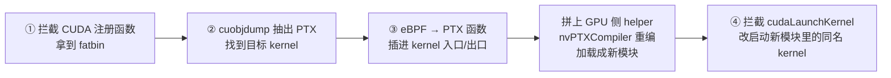

# 9. GPU / CUDA 概览

> 一句话：bpftime 能把 eBPF 程序编译成 GPU 代码，"缝"进 CUDA 程序的 kernel 里，让探针在每个 GPU 线程上执行。
> 本章是概览：读完你能说清这条路分几步、bpftime 里的"kprobe"为什么指的是 CUDA kernel、
> GPU 上的 eBPF 怎么和 CPU 交换数据，以及它有哪些局限。
>
> 前置：建议先读[第 4 章](04-attach-uprobe.md)（attach 与 Frida）、[第 6 章](06-vm-jit.md)（LLVM JIT）和[第 8 章](08-maps.md)（map）。
> 预计用时：60 分钟。
>
> **说明**：编写本书的机器没有 NVIDIA GPU，`build-jit/` 也是关闭 CUDA 的构建。本章对 GPU 运行时行为的描述全部来自读代码；
> 凡是"推断"的地方都已注明。需要 GPU 的实验写成"需要 NVIDIA GPU，本机未跑"。

## 本章要回答的问题

1. CUDA 程序的 kernel 跑在 GPU 上，bpftime 运行在 CPU 上的进程里，它是怎么把探针"放进"GPU kernel 的？
2. 用户写 `SEC("kprobe/_Z9vectorAddPKfS0_Pf")`，这里的 kprobe 和内核 kprobe 有什么关系？
3. GPU 上的 eBPF 程序调用 `bpf_map_lookup_elem`，数据从哪里来？谁来回答？
4. 为什么有些 map 访问几乎零开销，有些却要等到亚毫秒到毫秒级？
5. 这套机制对目标程序有什么要求、有什么已知局限？

---

## 9.1 最少的 CUDA 背景

只懂 eBPF、没写过 CUDA 也能读本章。下面是需要的全部词汇，按"从源码到 GPU 执行"的顺序：

| 词 | 一句话解释 |
|---|---|
| host / device | CPU 一侧叫 host，GPU 一侧叫 device。GPU 有自己的显存，CPU 不能直接解引用显存指针，反之亦然 |
| kernel | 在 GPU 上并行执行的函数（CUDA C 里的 `__global__` 函数）。一次启动（launch）会跑成千上万个线程。**注意：这和操作系统内核无关** |
| grid / block / thread / warp | 一次 launch 的全部线程叫 grid，分成若干 block，每个 block 有若干 thread；硬件上 32 个线程组成一个 warp 齐步执行 |
| PTX | NVIDIA 的**文本形式的虚拟汇编**，和具体 GPU 型号无关。函数分 `.entry`（kernel 入口）和 `.func`（只能被调用的设备函数）。bpftime 的插桩全部在 PTX 文本上做 |
| SASS / cubin | 某一代 GPU 真正执行的机器码，装在 cubin 文件里。PTX → cubin 由 `ptxas` 或它的库形态 nvPTXCompiler 完成 |
| fatbin | nvcc 编出的可执行文件里嵌的"胖二进制"，可同时装多份 cubin 和 PTX。bpftime 要求里面**带 PTX**，否则无从插桩 |
| 模块（module） | 一份加载进 GPU 的 cubin。driver API 用 `cuModuleLoadData` 加载、`cuModuleGetFunction` 按名字取 kernel、`cuLaunchKernel` 启动 |
| runtime API / driver API | `cudaXxx`（libcudart，高层）和 `cuXxx`（libcuda，底层）。应用写的 `kernel<<<g, b>>>(args)` 会被编译成对 `cudaLaunchKernel(主机侧桩函数地址, ...)` 的调用 |
| `__cudaRegisterFatBinary` / `__cudaRegisterFunction` | nvcc 生成的程序在启动（静态构造）时自动调用的注册函数：登记 fatbin，并把"主机侧桩函数地址"和 kernel 名字对应起来 |
| 映射内存 | `cudaHostRegister(..., Mapped)` 把一段普通 CPU 内存锁页并映射给 GPU，GPU 读写它会经 PCIe 直达 CPU 内存（零拷贝，但慢） |
| CUDA IPC | 一个进程把自己的显存分配导出成句柄，另一个进程打开后得到同一块显存的指针 |

记住两点就够了：**PTX 是文本，可以用字符串处理改写**；**kernel 必须先加载成模块、再按名字取出来才能启动**。

---

## 9.2 整体架构：四步

**直觉。** bpftime 不碰 GPU 驱动，也不改 GPU 硬件上已加载的代码。它在被追踪的 CUDA 进程里（也就是 agent 所在的目标进程）
做了一件"偷梁换柱"的事：拿到程序里的 PTX，把 eBPF 编成 PTX 函数插进去，重新编译成一个**新模块**加载，
然后每当应用启动某个 kernel，就改为启动新模块里的同名 kernel。

下面这张图看这四步发生在哪里：前三步在 CUDA 程序启动、注册 kernel 的时候做一次，最后一步在每次 launch 时做。



每一步的具体做法：

1. **拦截 CUDA 运行时。** agent 注册 CUDA attach 实现（`nv_attach_impl`）时，用 Frida（见[第 4 章](04-attach-uprobe.md)）
   在 `__cudaRegisterFatBinary`、`__cudaRegisterFunction` 等注册函数上挂"只观察"的钩子，
   在 `cudaLaunchKernel`、`cuLaunchKernel`、CUDA Graph 节点相关 API 上挂"替换实现"的钩子。
2. **找到 kernel。** fatbin 注册时，bpftime 把它写到临时文件，用 CUDA 工具包里的 `cuobjdump --extract-ptx` 抽出所有 PTX 文本。
   之后每个 `__cudaRegisterFunction` 告诉它"主机侧桩函数地址 X 对应 kernel 名 Y"。
3. **插桩并重编模块。** 对每份 PTX 跑插桩 pass（下一节），把预先写好的"GPU 侧 helper"PTX 拼在前面，
   用 nvPTXCompiler 库在进程内编成 cubin（不调用 nvcc），`cuModuleLoadDataEx` 加载成新模块，
   再把两个全局常量写进去：通信区的设备地址 `constData` 和 map 信息表 `map_info`（9.5 讲）。
4. **重定向 launch。** 应用调 `cudaLaunchKernel(X, grid, block, args, ...)` 时，替换钩子用 X 查到新模块里同名 kernel 的句柄，
   改调 `cuLaunchKernel(新句柄, 同样的 grid/block/args)`。新 kernel 启动失败时退回原来的 launch（fail-open）。

`attach/nv_attach_impl/nv_attach_impl_frida_setup.cpp` 的 `cuda_launch_kernel_common()`（节选）：

```cpp
        if (impl == nullptr || !impl->is_enabled() ||
            cuda_graph_stream_is_capturing(stream))
                return original(func, grid_dim, block_dim, args, shared_mem, stream);
        /* ... 确保当前线程有 CUDA context ... */
        if (auto itr1 = impl->symbol_address_to_fatbin.find((void *)func);
            itr1 != impl->symbol_address_to_fatbin.end()) {
                const auto &handle =     // 主机侧桩函数地址 → 新模块里的 kernel
                        itr1->second->function_addr_to_symbol.at((void *)func);
                if (auto err = cuLaunchKernel(handle.func,       // 启动打过补丁的 kernel
                            grid_dim.x, grid_dim.y, grid_dim.z,
                            block_dim.x, block_dim.y, block_dim.z,
                            shared_mem, stream, args, nullptr);
                    err != CUDA_SUCCESS) {
                        /* ... 打日志 ... */
                        return original(func, grid_dim, block_dim, // 失败：退回原 launch
                                        args, shared_mem, stream);
                }
                impl->record_patched_launch(stream);  // 记一个 event，detach 时等它跑完
                return cudaSuccess;
        }
        /* ... late attach：按 kernel 名字查找 ... */
```

还有两条旁路，这里只点名：对**已经在运行**的 CUDA 进程，`bpftime trace` 会先在外面用 `cuobjdump` 把 PTX 抽到临时目录，
注入 agent 时告诉它目录位置（late attach，按 kernel 名字重定向）；`bpftimetool run-on-cuda` 则不挂任何 kernel，
直接把一个 eBPF 程序当成独立 kernel 在 GPU 上跑（见[第 10 章](10-periphery.md)）。

**要点**：

- 插桩在**目标进程里**、在 **PTX 文本层面**完成，产物是一个新模块；原模块不动。
- launch 被重定向到新模块；失败时退回原 launch。
- 需要的外部条件：目标程序 fatbin 里带 PTX；运行时能找到 `cuobjdump`（或提前给出 PTX 目录）。

---

## 9.3 bpftime 里的 "kprobe" 其实是 CUDA kernel 探针

**直觉。** bpftime 没有在 CPU 侧实现内核 kprobe（它本来就不进内核）。它把 kprobe / kretprobe 这两个**名字和编号**借给了 GPU：
用户写 `SEC("kprobe/<kernel 名>")`，意思是"在这个 CUDA kernel 的入口执行"；`kretprobe` 是"在 kernel 返回前执行"。

这条链是靠两个编号恰好相等接起来的：

| 位置 | 名字 | 编号 |
|---|---|---|
| bpftime 的 perf 事件类型（`runtime/include/bpftime_shm.hpp`） | `BPF_TYPE_KPROBE` / `BPF_TYPE_KRETPROBE` | 8 / 9 |
| CUDA attach 实现的 attach 类型（`attach/nv_attach_impl/nv_attach_impl.hpp`） | `ATTACH_CUDA_PROBE` / `ATTACH_CUDA_RETPROBE` | 8 / 9 |

流程是：libbpf 看到 `SEC("kprobe/...")`，照常调 `perf_event_open`（kprobe 类型）；syscall-server 把它变成一个类型为 8 的 perf handler，
记下函数名。agent 装配时，类型 8 / 9 的 perf handler 被交给注册在 8 / 9 上的 attach 实现——CUDA 构建里就是 `nv_attach_impl`。
非 CUDA 构建里没有任何实现认领 8 / 9，也就是说 CPU 侧不存在 kprobe 支持。这种复用是有意的，但读代码时很容易被名字误导。

用户侧的写法，以 `example/gpu/cuda-counter/cuda_probe.bpf.c` 为例（节选）：

```c
static const u64 (*bpf_get_globaltimer)(void) = (void *)502;       // GPU 专用 helper
static const u64 (*bpf_get_block_idx)(u64 *x, u64 *y, u64 *z) = (void *)503;

SEC("kprobe/_Z9vectorAddPKfS0_Pf")     // 目标是 C++ 改编（mangle）后的 kernel 名
int cuda__probe()                       // 程序名必须以 cuda__ 开头
{
        u64 ts = bpf_get_globaltimer();
        u64 x, y, z;
        bpf_get_block_idx(&x, &y, &z);  // 我在哪个 block
        bpf_map_update_elem(&start_ts, &x, &ts, BPF_ANY);  // 普通 HASH map
        /* ... */
        return 0;
}
```

几条规则：

- **程序名以 `cuda__` 开头**，bpftime 才把它当 GPU 程序：加载时只做字节码检查、**不做 CPU JIT**；
  建 link 时走 CUDA 分支（它需要所有 map 的信息，所以 agent 扫 handler 表时把 CUDA link 留到第二遍才处理）。
- 目标名是改编后的 kernel 名；可以用逗号分隔写多个 kernel。
- 实际做插桩的是"pass"：三个以动态库形式加载的插桩器，各自声明匹配哪些 attach 点——
  `kprobe/<名字>` 由入口 pass 处理，`kretprobe/<名字>` 由出口 pass 处理，特殊名字 `kprobe/__memcapture` 由访存 pass 处理
  （在每条 load / store 指令**之后**调用 eBPF）。找不到匹配的 pass 时 attach 失败。
- 在内核共存模式（`BPFTIME_RUN_WITH_KERNEL=1`）下，名字以 `cuda_` 开头的 kprobe 会被拆成两半：
  向真内核注册一个 `do_exit` 上的 kprobe，再去掉前缀作为 CUDA 探针。

**要点**：

- bpftime 的 kprobe / kretprobe（类型 8 / 9）= CUDA kernel 入口 / 出口探针，与内核 kprobe 无关。
- GPU 程序靠 `cuda__` 名字前缀识别，不在 CPU 上 JIT。

---

## 9.4 eBPF 怎么变成 GPU 代码

**直觉。** eBPF → PTX 和 eBPF → x86 用的是同一个 LLVM JIT（llvmbpf，见[第 6 章](06-vm-jit.md)），只是后端换成 LLVM 的 NVPTX，
生成模块时打开 `is_gpu` 开关。插桩 pass 拿到这段 PTX 函数后，用字符串 / 正则把一条 `call` 插进目标 kernel。

### `is_gpu` 改了什么

第 6 章讲过，bpftime 的 CPU 主路径不走 `is_gpu`；GPU 路径走。打开后生成的函数有几处不同：

- 函数**没有参数**、返回 `void`。GPU 探针拿不到 ctx，也就看不到 kernel 的实参（r1 不会被赋值）。
- eBPF 栈和调用栈用定长数组放在每个线程的 local memory 里（本机实测生成的 PTX 里约 16KB / 线程，见"动手验证"）。
- `lddw` 的 map 引用不做重定位：生成 GPU 代码时没有提供 `map_by_fd`，立即数（也就是 map 的 fd）原样进寄存器。
  所以 GPU 上 helper 收到的"map"就是 fd，正好用来索引 `map_info[fd]`（9.5）。
- 每个 helper 调用被编成对外部函数 `_bpf_helper_ext_NNNN` 的调用，由下面的 trampoline 提供实现。

### 插桩

以入口 pass 为例，它对每个目标 kernel：

1. 调 `compile_ebpf_to_ptx_from_words` 把 eBPF 编成名为 `__probe_func__<kernel 名>` 的 `.func`。
   这一步只注册了 GPU 支持的 16 个 helper（见 9.5）。程序用了别的 helper 时，llvmbpf 报 `Ext func not found`，
   而 `generate_ptx` 用 LLVM 的 `ExitOnError` 处理这个错误——它调用 `exit()`。pass 是被装进**目标 CUDA 进程**里运行的，
   所以结果不是"attach 失败"，而是**被追踪的程序直接以退出码 1 退出**（核查时已实跑确认；`bpftimetool run-on-cuda` 同理）。
   syscall-server 的用户态 verifier 不检查 kprobe 类程序，拦不住这种情况，见[附录 B](B-known-issues.md#b-gpu)。
2. 在 PTX 里找到 `.entry <kernel 名>(` 的函数体，在第一个 `{` 后插入 `call __probe_func__<kernel 名>;`。
   （例外：如果这份 PTX 里有**任何**函数调用了名为 `__bpftime_cuda__kernel_trace` 的空函数，pass 就把所有这样的调用点
   都换成对当前探针函数的调用，此时不再往 kernel 入口插 `call`。这让用户自己决定插在哪，但替换不区分调用点在哪个 kernel 里。）
3. 把编出的函数 PTX 拼到整份 PTX 前面。

出口 pass 则在 kernel 体内每个 `ret;` / `exit;`（可带谓词或标号）前插 `call`。

### trampoline：GPU 侧的 helper 实现

只要有 pass 改动过某份 PTX，bpftime 就把一段预编译好的 PTX（`attach/nv_attach_impl/trampoline_ptx.h`）拼在最前面。
它是 `trampoline/default_trampoline.cu` 用 clang 编出来的 PTX，提供：

- 全部 `_bpf_helper_ext_NNNN` 的 GPU 实现；
- 三个全局对象：`constData`（通信区的设备地址）、`map_info[1024]`（map 信息表）、`__bpftime_comm_lock`（GPU→CPU 调用的设备级锁）。

`trampoline_ptx.h` 是手工生成后提交进仓库的文件，CMake 不会重新生成它。

### 重编译的副作用

bpftime 会把 fatbin 里的**所有** PTX（包括没被插桩的）都重编、加载，并把找得到同名 kernel 的 launch 全部重定向。
所以一旦有 CUDA link，这个 fatbin 里的所有 kernel 都改由"从 PTX 现场编译的副本"运行，而不是 nvcc 预编的 SASS。
另外，新模块里的 `__device__` / `__constant__` 全局变量是另一份副本，bpftime 为此额外拦截了 `cudaMemcpyToSymbol` /
`cudaMemcpyFromSymbol`，把读写镜像到新模块。

**要点**：

- eBPF → PTX 用 llvmbpf 的 NVPTX 后端，`is_gpu=true`；探针函数无参数、无 ctx；用了未注册的 helper 会让目标进程 `exit(1)`。
- pass 在 PTX 文本里插 `call`；trampoline 提供 GPU 侧 helper 与全局通信对象。
- 有 CUDA link 时，fatbin 里所有 kernel 都从重编译的副本运行。

---

## 9.5 GPU 和 CPU 怎么交换数据

**直觉。** GPU 上的 eBPF 线程不能调用 CPU 上的函数。bpftime 准备了三条通道，从快到慢：

| 通道 | 怎么做 | 适合 |
|---|---|---|
| GPU map 快速路径 | helper 直接算出数据的设备地址返回，**完全不经 CPU** | GPU array 类 map（9.6） |
| 整段 shm 映射 | agent 把整个 bpftime shm 段 `cudaHostRegister` 成映射内存，GPU 能直接读写 shm 里的普通 map 值 | 拿到指针后的读写 |
| GPU→CPU 同步调用 | GPU 把请求写进 shm 里的一块通信区，CPU 侧一个线程处理后回填结果 | 普通 HASH / ARRAY 的 lookup / update / delete、`bpf_printk`、pid 等 |

### map 信息表：用 fd 当下标

建 CUDA link 时，agent 遍历 handler 表，凡是 map 就按 **fd 作下标**填一项 `MapBasicInfo`（类型、key / value 大小、
GPU 可用的数据地址、线程数……），共 1024 项，然后写进新模块的常量 `map_info`。GPU 上 helper 收到的 map 参数是 fd（9.4），
直接 `map_info[fd]` 取出信息，决定走哪条通道。

### GPU→CPU 同步调用

`attach/nv_attach_impl/trampoline/default_trampoline.cu` 的 `make_helper_call()`（节选）：

```cpp
        CommSharedMem *g_data = (CommSharedMem *)constData;  // shm 里通信区的设备地址
        for (int active_lane = 0; active_lane < 32; active_lane++) {
                /* ... 同一 warp 里的活跃线程按 lane 号轮流来 ... */
                if (lane_is_active && lane_id == active_lane) {
                        spin_lock(&__bpftime_comm_lock);   // 设备级自旋锁
                        g_data->request_id = req_id;      // 哪种操作
                        g_data->map_id = map_id;          // 实际是 map fd
                        // membar.sys; flag1 = 1;          通知 CPU
                        // 自旋直到 flag2 != 0; flag2 = 0;  等 CPU 处理完
                        my_resp = g_data->resp;           // 取结果
                        spin_unlock(&__bpftime_comm_lock);
                }
                __syncwarp(active_mask);
        }
```

CPU 侧，agent 的 `bpf_attach_ctx` 在 CUDA 构建里会起一个 watcher 线程，**每 1ms** 看一次 `flag1`。
看到请求就按 `request_id` 调 `bpftime_map_lookup_elem` / `update` / `delete`、`bpftime_trace_printk` 等，写回结果，再置 `flag2 = 1`。
lookup 的结果是 shm 里的 CPU 地址，watcher 按"相对通信区的偏移"换算成 GPU 地址返回——这依赖整段 shm 一次性映射给 GPU、偏移不变。
于是 GPU 拿到的是**指向 shm 中 map 值**的指针，之后可以直接读写（`cuda-counter` 就是对它做原子加）。

两个直接后果（按代码推断，本机未跑）：watcher 处理完一轮才睡 1ms，所以每次需要 CPU 的 helper 调用要等 0 到约 1ms
（平均约半个轮询周期），再加 PCIe 往返和处理时间，是亚毫秒到毫秒级；同一个补丁模块里的所有 GPU 线程通过一把设备级锁排队，
相当于串行（trampoline 拼进每个被改动的 PTX，所以每个补丁模块各有一把这样的锁）。

通信区 `CommSharedMem` 由 syscall-server 在 shm 里创建；agent 打开 shm 时最多等 1 秒找到它，然后整段注册给 GPU。
它的布局在 CPU 头文件和 GPU 的 trampoline 里各写了一份，必须逐字节一致。

注意：这条路径里，GPU 线程在拿锁**之前**就把 key / value 写进了共享的请求区，并发调用时可能互相覆盖，见[附录 B](B-known-issues.md#b-gpu)。

### GPU 上能用的 helper

只有 16 个 helper 在编译 GPU 程序时注册：

| 编号 | 用途 | 走哪条通道 |
|---|---|---|
| 1 / 2 | map lookup / update | GPU array 类 map 走快速路径；其他 map 走 CPU 同步调用 |
| 3 | map delete | 一律走 CPU 同步调用（GPU array 类 map 本来也不支持删除） |
| 6 | `bpf_trace_printk` | CPU 同步调用 |
| 14 | `bpf_get_current_pid_tgid` | CPU 同步调用 |
| 25 | `bpf_perf_event_output` | 只支持 GPU ringbuf（9.6），GPU 上直接写 |
| 501 | puts | CPU 同步调用 |
| 502 | 读 GPU 全局计时器 | GPU 本地 |
| 503 / 504 / 505 / 508 | block 下标、block 维度、thread 下标、grid 维度 | GPU 本地 |
| 507 | 让当前线程提前退出（`exit;`） | GPU 本地 |
| 509 / 510 / 511 | SM 编号、warp 编号、lane 编号 | GPU 本地 |

trampoline 里还定义了 506（内存栅栏），但没有注册。用了 506 或其他未注册的 helper（例如 `bpf_ktime_get_ns`、tail call），
都会像 9.4 所说那样让目标进程 `exit(1)`。

**要点**：

- GPU 侧 helper 用 `map_info[fd]` 判断 map 类型：GPU array 类直接返回设备地址；其他走 CPU。
- CPU 同步调用 = shm 里的通信区 + 设备级锁 + flag 握手 + CPU 侧 1ms 轮询线程。
- 整段 shm 映射给 GPU，所以 CPU 返回的 map 值指针 GPU 能直接用。

---

## 9.6 GPU map

**直觉。** 普通 map 的数据在 CPU 内存里，GPU 访问要么经 CPU 中转、要么经 PCIe 映射，都慢。
GPU map 让数据就待在 GPU 能高效访问的地方，并让"每个 GPU 线程一份"成为可能（类比 CPU 的 per-CPU map）。
它们的类型编号在内核号上加 1500 附近（见[第 8 章](08-maps.md)的类型枚举）。

| 类型（编号） | 数据放在哪 | 布局 | GPU 侧访问 |
|---|---|---|---|
| GPU_HASH_MAP (1501) | key 表在 shm；value 在显存 | 开放寻址 key 表 + 一个 GPU array | 没有快速路径，全部走 CPU 同步调用 |
| PERGPUTD_ARRAY_MAP (1502) | 显存（loader 进程分配，CUDA IPC 共享给 agent） | `[key][线程][value]`，每线程一份 | 直接算地址，零拷贝 |
| GPU_ARRAY_MAP (1503) | 显存（同上） | `[key][value]`，全局一份 | 直接算地址 |
| GPU_KERNEL_SHARED_ARRAY_MAP (1504) | 内核 array map 的 mmap 区，再注册给 GPU | `[key][value]` | 直接算地址；与内核 eBPF 共享 |
| GPU_RINGBUF_MAP (1527) | **shm（CPU 内存）**，映射给 GPU | 每线程一个小环 | `bpf_perf_event_output` 直接写本线程的环 |
| PERGPUTD_ARRAY_HOST_MAP (1512) | shm，映射给 GPU | 同 1502 | 直接算地址，加内存栅栏 |
| GPU_ARRAY_HOST_MAP (1513) | shm，映射给 GPU | 同 1503 | 同上 |

几点说明：

- **显存属于 loader。** 1501 / 1502 / 1503 / 1527 的创建发生在 syscall-server 所在的 loader 进程里（创建期间临时关掉 syscall 拦截，
  见[第 3 章](03-entrypoints.md)）。显存版本由 loader 分配并经 CUDA IPC 导出，agent 打开。所以 loader 先退出会让目标进程里的补丁 kernel
  访问已释放的显存；`bpftime trace` 结束时先让 agent detach、再停 loader，detach 时还会等已入队的补丁 kernel 跑完。
- **HOST 版**（1512 / 1513）给 Jetson 这类不支持 CUDA IPC 的平台用：数据就放 shm，靠映射内存访问。
- **loader 怎么读。** 对 per-thread map，loader 的一次 lookup 拿到"这个 key 下所有线程的值"，
  value 大小是 `value_size × 线程数`（和 per-CPU map 的 loader 视角同一个道理，见[第 8 章](08-maps.md)）。
  显存版 lookup 时用 `cuMemcpyDtoH` 拷出（可选 GDRCopy 加速）。GPU ringbuf 要靠 loader 主动调用 syscall-server 导出的
  `bpftime_syscall_server__poll_gpu_ringbuf_map` 拉取，每次每线程最多取一条。
- **线程数上限。** per-thread map 默认按 1024 个线程分配（可用 `BPFTIME_MAP_GPU_THREAD_COUNT` 改，但只对部分类型生效）。
  超过上限的线程只打警告、仍按越界地址访问，见[附录 B](B-known-issues.md#b-gpu)。
- GPU hash map 声明 `should_lock=false`，所以分发层对它不加锁（见[第 8 章](08-maps.md)）。

**要点**：

- GPU array 类 map 在 GPU 上零拷贝访问；GPU hash 和普通 map 走 CPU。
- 显存由 loader 分配并经 IPC 共享，退出顺序要"先 detach agent，后停 loader"。
- GPU ringbuf 在 CPU 内存里，靠 loader 主动拉取。

---

## 9.7 局限

下面是读代码得到的主要限制，每条都只点到为止；疑似 bug 的细节见[附录 B](B-known-issues.md#b-gpu)。

- **对目标程序的要求**：fatbin 里要带 PTX；需要 `cuobjdump`（或提前抽好的 PTX 目录）；示例都用 `-cudart shared` 构建，
  静态链接 cudart 时钩子可能找不到符号（推断，未验证）。
- **只拦了一部分 launch API**：`cudaLaunchKernel`（含 per-thread stream 版本）、`cuLaunchKernel` 和 CUDA Graph 节点 API。
  `cudaLaunchKernelExC`、`cuLaunchKernelEx`、cooperative launch 等不会被插桩（推断）；stream 正在录制 graph 时也走原路径。
- **探针看不到 kernel 实参**：GPU 程序没有 ctx。
- **helper 很少**：只有 9.5 表里的 16 个，用错一个会让目标进程直接退出；普通 map 操作要回 CPU，亚毫秒到毫秒级、同一模块内串行。
- **所有 kernel 都换成重编译的副本**：可能有性能和行为差异；pass 把 eBPF 固定编成 sm_61、合并后 PTX 版本号沿用 trampoline 的，
  应用 PTX 用了更新的 ISA 特性时可能编译失败（推断）。
- **只支持 NVIDIA**：仓库里有一个 ROCm 示例，但没有对应的 attach 实现。llvmbpf 能生成 SPIR-V，主线没有使用。
- **多处代码与文档 / 注释不一致**：`attach/nv_attach_impl/README.md`、`README-passes.md`、`example/gpu/README.md` 的部分描述已过时
  （例如"用 nvcc 重编译"、"在 ld/st 之前注入"、"ringbuf 在显存"），读源码时以代码为准。

---

## 小结

- GPU 支持 = 在目标进程里拦 CUDA 注册函数拿到 PTX → 用 llvmbpf（`is_gpu=true`）把 eBPF 编成 PTX 函数并插进 kernel →
  拼上 trampoline 用 nvPTXCompiler 重编成新模块 → 拦 launch 改启动新模块里的同名 kernel。
- bpftime 的 kprobe / kretprobe（类型 8 / 9）就是 CUDA kernel 入口 / 出口探针；程序名必须以 `cuda__` 开头，不在 CPU 上 JIT。
- GPU 上 map 参数就是 fd，用来索引常量表 `map_info`。
- 数据交换三通道：GPU map 快速路径（零拷贝）、整段 shm 映射、GPU→CPU 同步调用（1ms 轮询、同一模块内串行）。
- GPU array 类 map 的显存属于 loader；GPU ringbuf 在 CPU 内存里。
- 局限：要 PTX、只拦部分 launch API、无 ctx、helper 少、所有 kernel 都换成重编译副本。

## 动手验证

真正的 GPU 实验**需要 NVIDIA GPU 和打开 `BPFTIME_ENABLE_CUDA_ATTACH` 的构建，本机未跑**。下面先给不需要 GPU 的练习。

1. **读码练习：从用户代码追到 GPU helper**（不需要运行）。按顺序打开：
   `example/gpu/cuda-counter/cuda_probe.bpf.c`（`cuda__` 程序名、`kprobe/` 段名、501–505 号 helper）→
   `attach/nv_attach_impl/pass/ptxpass_kprobe_entry/main.cpp`（入口 pass 的匹配规则 `^kprobe/.*$`、插 `call` 的位置）→
   `attach/nv_attach_impl/trampoline/default_trampoline.cu` 的 `_bpf_helper_ext_0001`（看它怎么用 `map_info[map]` 分流）和 `make_helper_call` →
   `runtime/src/attach/bpf_attach_ctx_cuda.cpp` 的 `start_cuda_watcher_thread`（CPU 侧 1ms 轮询）。
   读完试着回答：`cuda-counter` 里对普通 HASH map 的 `bpf_map_lookup_elem` 一共经过几次 GPU↔CPU 握手？

2. **读码练习：通信区布局为什么"牵一发动全身"**（不需要运行）。在 `runtime/include/bpf_attach_ctx.hpp` 里找到 `CommSharedMem`
   和 `GPU_HELPER_MAX_BUF`，自己算出 `resp` 字段的偏移；再在 `attach/nv_attach_impl/trampoline_ptx.h` 的 `make_helper_call` 里
   找到读取 `resp` 的那条 `ld.u64`，看偏移是否一致。然后对比 `default_trampoline.cu` 开头的 `GPU_HELPER_MAX_BUF` 定义，
   想一想按 `trampoline/Makefile` 重新生成 `trampoline_ptx.h` 会发生什么（答案见附录 B 的 GPU 一节）。

3. **不需要 GPU 的实验：看 eBPF 编出来的 PTX**（本机已跑，但构建步骤较繁琐）。llvmbpf 的 NVPTX 后端本身不需要 GPU。
   写一个小程序，加载一段"`lddw r1, map fd 3` → 在栈上放一个 key → `call 1` → `exit`"的 eBPF，注册 1 号 helper 后调用
   `llvm_bpf_jit_context::generate_ptx(false, "__probe_func__vecadd", "sm_61")`，打印结果。编译要包含 `vm/llvm-jit/src` 下的私有头、
   用和 `build-jit` 静态库相同的编译器（本机是 g++-13，因为库是它的 LTO 产物），链接 `build-jit/vm/compat/llvm-vm/libllvmbpf_vm.a`、
   spdlog 和 `llvm-config --libs all`。本机输出的关键几行：

   ```
   .version 5.0
   .target sm_61
   .extern .func  (.param .b64 func_retval0) _bpf_helper_ext_0001
   .visible .func __probe_func__vecadd()
   	.local .align 8 .b8 	__local_depot0[16464];
   	st.param.b64 	[param0+0], 3;
   	call.uni (retval0),
   	_bpf_helper_ext_0001,
   ```

   对照 9.4 看：函数没有参数（无 ctx）；每线程约 16KB 的 local 栈；helper 变成对外部函数 `_bpf_helper_ext_0001` 的调用；
   map 参数就是立即数 3（fd）。（`.version` 是 LLVM 输出的；真实插桩时这些头会被过滤掉，换成 trampoline 的版本。）

4. **有 GPU 时可以做（需要 NVIDIA GPU，本机未跑）**：按 `example/gpu/cuda-counter/README.md` 的流程，用打开 CUDA 的构建跑 loader 和
   带 agent 的 `vec_add`。设 `SPDLOG_LEVEL=debug` 时，`hack_fatbin` 会把补丁后的 PTX 写到 `/tmp/bpftime-fatbin-work.*`，
   可以看到 trampoline、`__probe_func__…` 函数和 kernel 体内插入的 `call`。

## 自测题

1. **bpftime 里的 `SEC("kprobe/xxx")` 和内核 kprobe 有什么关系？在一个没打开 CUDA 的 bpftime 构建里用它，会发生什么？**
   <details><summary>答案</summary>

   只是借用了名字和编号。libbpf 照常 `perf_event_open` 出一个 kprobe 类型（8）的 perf 事件，syscall-server 记成类型 8 的 perf handler；
   agent 把类型 8 / 9 交给注册在这两个编号上的 attach 实现，CUDA 构建里就是 `nv_attach_impl`，`xxx` 被当成 CUDA kernel 名。
   非 CUDA 构建里没有任何实现认领 8 / 9，CPU 侧不存在 kprobe 支持，这个 link 挂不上。
   </details>

2. **bpftime 插桩后，GPU 上实际运行的 kernel 和应用原来的 kernel 是同一份代码吗？这会带来什么副作用？**
   <details><summary>答案</summary>

   不是。bpftime 从 PTX 重新编译了一个新模块，launch 被重定向到新模块里的同名 kernel，原模块不动。
   副作用：fatbin 里所有 kernel（包括没插桩的）都改由现场编译的副本运行，可能有性能和行为差异；
   `__device__` / `__constant__` 全局变量有两份，bpftime 必须镜像 `cudaMemcpyToSymbol` / `FromSymbol`，其他取符号地址的方式不受保护。
   </details>

3. **同样是 `bpf_map_lookup_elem`，对 PERGPUTD_ARRAY_MAP 和对普通 HASH map，在 GPU 上的代价为什么差很多？**
   <details><summary>答案</summary>

   GPU 侧 helper 先查 `map_info[fd]`。PERGPUTD_ARRAY_MAP 的数据就在显存里，helper 按 `key`、全局线程号和 value 大小算出地址直接返回，
   不经 CPU。普通 HASH 的数据在 CPU 内存里且需要哈希查找，GPU 只能把 key 写进通信区、拿设备级锁、置 flag 等 CPU 的 watcher 线程处理；
   watcher 处理完一轮睡 1ms，每次调用平均要等约半个轮询周期再加 PCIe 往返；同一模块内所有线程排队串行。
   所以是亚毫秒到毫秒级（按代码推断）。
   </details>

4. **GPU 上 eBPF 程序里的 map"指针"是什么？为什么不需要像 CPU JIT 那样做重定位？**
   <details><summary>答案</summary>

   就是 map 的 fd。生成 GPU 代码时没有提供 `map_by_fd`，`lddw` 的立即数原样进寄存器。bpftime 在建 CUDA link 时按 fd 作下标
   填好常量表 `map_info[1024]` 并写进新模块，GPU 侧 helper 直接用 fd 索引它。（CPU 侧的 `map_ptr_by_fd` 其实也原样返回 fd，见第 8 章。）
   </details>

5. **为什么 `bpftime trace` 结束时要先让目标进程里的 agent detach，再停 loader？**
   <details><summary>答案</summary>

   GPU array 类 map 的显存是 loader（syscall-server 所在进程）分配、经 CUDA IPC 导出给 agent 的。loader 先退出，显存被释放，
   目标进程里还在跑或已入队的补丁 kernel 就会访问失效内存。先 detach 时，agent 会停用补丁、等已入队的补丁 kernel 跑完、卸载新模块，然后再停 loader 才安全。
   </details>

## 深入参考

<details>
<summary>代码位置速查（按 177a1dc465ff 行号）</summary>

| 概念 / 函数 | 位置 |
|---|---|
| `ATTACH_CUDA_PROBE / RETPROBE = 8 / 9`、`MapBasicInfo` | `attach/nv_attach_impl/nv_attach_impl.hpp:43-44`、`:45` |
| `BPF_TYPE_KPROBE / KRETPROBE = 8 / 9` | `runtime/include/bpftime_shm.hpp:59-60` |
| GPU map 类型枚举（`GPU_MAP_OFFSET`） | `runtime/include/bpftime_shm.hpp:68`、`:122-132` |
| agent 注册 `nv_attach_impl` | `runtime/agent/agent.cpp:1037-1056` |
| `nv_attach_impl` 构造（装钩子、dlmopen 加载 pass） | `attach/nv_attach_impl/nv_attach_impl.cpp:279`（`dlmopen` 在 `:522`） |
| `create_attach_with_ebpf_callback`（匹配 pass） | `attach/nv_attach_impl/nv_attach_impl.cpp:160` |
| `extract_ptxs`（cuobjdump） / `hack_fatbin`（跑 pass） | `attach/nv_attach_impl/nv_attach_impl.cpp:646` / `:890` |
| `run_attach_entry_on_gpu`（`bpftimetool run-on-cuda`） | `attach/nv_attach_impl/nv_attach_impl.cpp:1101` |
| `start_late_bootstrap_async` | `attach/nv_attach_impl/nv_attach_impl.cpp:1953` |
| 注册钩子 `example_listener_on_enter` | `attach/nv_attach_impl/nv_attach_impl_frida_setup.cpp:248` |
| launch 重定向 `cuda_launch_kernel_common` | `attach/nv_attach_impl/nv_attach_impl_frida_setup.cpp:93` |
| `compile_ptxs` / `try_loading_ptxs`（写 `constData`、`map_info`） | `attach/nv_attach_impl/nv_attach_fatbin_record.cpp:103` / `:190` |
| `compile_ebpf_to_ptx_from_words`（注册 16 个 helper） | `attach/nv_attach_impl/pass/ptxpass_core/src/core.cpp:196` |
| 入口 / 出口 / 访存 pass 的匹配规则 | `pass/ptxpass_kprobe_entry/main.cpp:29-41`、`pass/ptxpass_kretprobe/main.cpp:28-32`、`pass/ptxpass_kprobe_memcapture/main.cpp:33-37`（相对 `attach/nv_attach_impl/`） |
| trampoline：`make_helper_call` / `_bpf_helper_ext_0001` / `_bpf_helper_ext_0025` | `attach/nv_attach_impl/trampoline/default_trampoline.cu:131` / `:201` / `:360` |
| `generateModule(..., is_gpu)` | `vm/llvm-jit/src/compiler.cpp:212`（栈 `:396`，返回 void `:501`，lddw 不重定位 `:1114-1127`） |
| `llvm_bpf_jit_context::generate_ptx` | `vm/llvm-jit/src/llvm_jit_context.cpp:903` |
| `is_cuda()`（`cuda__` 前缀） / 加载时跳过 JIT | `runtime/include/bpftime_prog.hpp:58-62` / `runtime/src/bpftime_prog.cpp:185` |
| CUDA link 实例化分支 | `runtime/src/attach/bpf_attach_ctx.cpp:340` |
| watcher 线程 / `create_map_basic_info` | `runtime/src/attach/bpf_attach_ctx_cuda.cpp:111` / `:323` |
| `CommSharedMem`、`GPU_HELPER_MAX_BUF` | `runtime/include/bpf_attach_ctx.hpp:93`、`:43` |
| 整段 shm `cudaHostRegister` | `runtime/src/bpftime_shm_internal.cpp:1209`（调用 `:1244`） |
| GPU map 创建（关掉 syscall 拦截） | `runtime/src/handler/map_handler.cpp:951-1117`（`set_enable_mock` 在 `:952`） |
| 内核共存模式下 `cuda_` 前缀 kprobe | `runtime/syscall-server/syscall_context.cpp:855-876` |
| GPU ringbuf 拉取 `drain_data` | `runtime/src/bpf_map/gpu/nv_gpu_ringbuf_map.cpp:56` |
| per-thread array 显存分配与 IPC 导出 | `runtime/src/bpf_map/gpu/nv_gpu_per_thread_array_map.cpp:61`、`:74` |
| CMake 开关 `BPFTIME_ENABLE_CUDA_ATTACH`、`BPFTIME_CUDA_ROOT` | `cmake/StandardSettings.cmake:24-25`；`cmake/cuda.cmake` |

</details>

<details>
<summary>细节与坑</summary>

**构建与依赖**

- 打开 `BPFTIME_ENABLE_CUDA_ATTACH` 需要设 `BPFTIME_CUDA_ROOT`（它被声明成了 `option()`，缓存里显示为 BOOL，但实际当路径用）。
  依赖 CUDA 的 `cuda`、`cudart`、`nvptxcompiler_static`（另链了 `cupti`、`nvrtc`，代码里没用到）、Frida、带 NVPTX 后端的 LLVM、OpenSSL、Boost。
- 三个 pass 和 PTX 编译器包装都编成共享库，它们的**绝对构建路径**被写进生成的 `ptx_pass_config.h`。安装后若构建目录不在了，
  pass 路径可以用 `BPFTIME_PTXPASS_LIBRARIES` 覆盖，PTX 编译器路径没有环境变量可改（推断）。
- 每个 pass 用 `dlmopen(LM_ID_NEWLM)` 装进独立的链接命名空间，各自带一份 llvmbpf；pass 和主程序之间用 JSON 字符串往返（`print_config` / `process_input`）。
- pass 结果、PTX → cubin、cubin → 模块三层都按 sha256 缓存。

**环境变量**

| 变量 | 作用 |
|---|---|
| `BPFTIME_PTXPASS_LIBRARIES` | 冒号分隔的 pass 库列表 |
| `BPFTIME_CUDA_LATE_PTX_DIR` | 直接读该目录下的 `.ptx`，不跑 cuobjdump（late attach 用） |
| `BPFTIME_CUDA_DISABLE_CUOBJDUMP` | `=1` 时不抽 PTX（等于不插桩） |
| `BPFTIME_CUOBJDUMP` | cuobjdump 的路径 |
| `BPFTIME_CUDA_DEVICE` | 选哪块 GPU 建 / 取 context（默认 0） |
| `BPFTIME_SM_ARCH` | 重编译的目标架构；不设时自动探测，探测失败回落 `sm_61`，探测结果会 `setenv` 写回进程环境 |
| `BPFTIME_MAP_GPU_THREAD_COUNT` | per-thread map / GPU ringbuf 的线程容量（默认 1024；HOST 版 1512 不读它） |
| `BPFTIME_GPU_ARRAY_GDRCOPY` / `..._MAX_PER_KEY_BYTES` | loader 读 GPU array 时启用 GDRCopy 及单 key 阈值 |

`BPFTIME_CUDA_ROOT`、`CUDA_HOME` 等运行时只用于找 `cuobjdump`，不影响重编译。

**生命周期**

- `nv_attach_impl` 每个 agent 进程一个。Frida 的替换钩子全局只装一次，通过一个进程级单例找到"当前活动的 impl"，所以 impl 可以析构重建而不重装钩子；
  detach 后替换钩子并不卸载，只是走原函数。
- detach 最后一个 CUDA link 时：停用、最多等 2 秒让已入队的补丁 kernel 完成、清空所有补丁状态和模块，以便下一个会话重新绑定。
- 名为 `start_late_bootstrap_async` 的函数其实是同步执行的；LD_PRELOAD 场景下 attach 时会先扫描主程序 ELF 抽一遍 PTX，之后注册路径再处理一遍（依赖缓存避免重复编译，推断）。
- `bpftimetool run-on-cuda` 也会建一个 `bpf_attach_ctx`，从而在 bpftimetool 进程里也起一个 watcher 线程。

**疑似问题（各一句，细节见[附录 B](B-known-issues.md#b-gpu)）**

- GPU→CPU 同步调用在拿锁之前写请求参数，并发时可能互相覆盖；`example/gpu/README.md` 的描述与实现相反。
- `default_trampoline.cu` 里的 `GPU_HELPER_MAX_BUF` 与 CPU 侧和已提交的 `trampoline_ptx.h` 不一致，重新生成会让两侧布局错开。
- per-thread map 线程数越界时只打警告不拦截。
- GPU ringbuf 写入不检查数据长度；拉取时遇到任一线程"正在写"就整体返回。
- GPU_HASH_MAP 的桶数可能大于 value 数组容量；`BPF_NOEXIST` 插新键会失败。
- llvmbpf 公共 API `generate_ptx(target_cpu)` 的目标参数被吞掉、永远生成 sm_60（bpftime 主线绕过了这个 API，不受影响；本机已复现）。
- `create_map_basic_info` 对 fd ≥ 1024 的 map 先越界写再检查。
- PTX 编译器库加载失败时仍被解引用；补丁模块加载失败时在 Frida 回调里抛异常。
- 每个被改动的 PTX 文件各有一把 `__bpftime_comm_lock`，多个模块共用一块通信区却不互斥（推断）。
- GPU array map 等实现把进程私有的句柄（CUDA context、stream、fd）存进了 shm 里的对象，多进程时会互相覆盖。

</details>

<details>
<summary>上游变更与我们的工作</summary>

- 旧版指南没有 GPU 章，只在十余处一笔带过；本章是新写的，素材来自对官方 `177a1dc` 的通读。
- 旧版第 5 章说"读 `compiler.cpp` 遇到 `is_gpu` 分支按'bpftime 主路径不走'跳过"。更准确的说法是：CPU 主路径不走，CUDA attach 路径**走**（见[第 6 章](06-vm-jit.md)）。
- 仓库自带文档中已过时的说法（不要照抄）：`attach/nv_attach_impl/README.md` 的"用 NVCC 重编译"（实为 nvPTXCompiler 库）、"在 ld/st 之前注入"（实为之后）、
  `BPFTIME_CUDA_ROOT` 影响重编译（只影响找 cuobjdump）、`BPFTIME_MAP_GPU_THREAD_COUNT` 覆盖所有 GPU map（1512 不读）；
  `README-passes.md` 整篇描述的是已不存在的"stdin/stdout 可执行文件"形态；`example/gpu/README.md` 说 ringbuf 在显存（实为 shm）、
  提到不存在的 `nv_gpu_array_map.cpp`；`vm/README.md` 提到的 `ptx_code_gen.cpp`、`do_get_ptx()` 不存在。
- 所有 GPU 运行时行为本书都未在 GPU 上验证，可在 Jetson 上复核（Jetson 不支持 CUDA IPC，应走 HOST 版 map）。

</details>

---
[← 返回目录](README.md)
