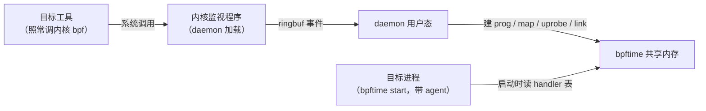
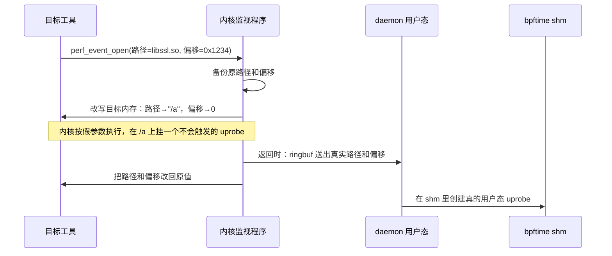

# 10. 外围工具

> 一句话：主干之外的四个工具——daemon、verifier、bpftimetool、bpftime-aot——各自解决什么问题、
> 怎么工作、有哪些用之前必须知道的限制。读完你能回答：不经 `bpftime load` 启动的内核 eBPF 工具
> 怎么被 bpftime 接管；哪些程序会被用户态验证器检查、哪些根本不会；怎么不起任何进程就查看、
> 运行共享内存里的程序；AOT 编译出来的 `.o` 是什么。
>
> 前置：建议先读[第 0 章](00-architecture.md)、[第 2 章](02-runtime-shm.md)和[第 3 章](03-entrypoints.md)；
> bpftime-aot 一节最好读过[第 6 章](06-vm-jit.md)。预计用时：1–1.5 小时。本章选读，按需查阅。
> `bpftime` 命令行（load / start / attach / trace / detach）归[第 3 章](03-entrypoints.md)；
> 构建与单测归[第 11 章](11-build-test.md)。

## 本章要回答的问题

1. 一个已经在用**内核** eBPF 的追踪工具，不改它的启动方式，能被 bpftime 接管吗？代价是什么？
2. 用了 daemon，是不是就不需要 agent 了？daemon 启动时会对已有的共享内存做什么？
3. bpftime 有用户态验证器吗？一个普通的 `SEC("uprobe")` 程序会被它检查吗？
4. 想看共享内存里有什么、单独跑一个程序测耗时，用哪个工具？它导出的 JSON 能当备份用吗？
5. `bpftime-aot` 编出来的 `.o` 长什么样？怎么把它塞回共享内存给 agent 用？

前面九章讲的是 bpftime 的**主干**：syscall-server 拦截 `bpf()`、对象放进共享内存、agent 进入目标进程、
attach 层挂钩子、VM 跑字节码。本章四个工具都不在事件热路径上，但决定了 bpftime 能不能接进现有的
内核 eBPF 生态、好不好调试。

| 工具 | 一句话 | 什么时候会用到 | 默认构建里有吗 | 从哪个文件开始读 |
|---|---|---|---|---|
| daemon | 在内核里监视别的进程的 `bpf()` / `perf_event_open()`，把 uprobe 程序转到 bpftime 共享内存 | 想接管一个不方便改启动方式的现成 eBPF 工具 | 默认会编（`BUILD_BPFTIME_DAEMON` 默认 ON），但需要 libbpf | `daemon/kernel/bpf_tracer.bpf.c` |
| verifier | PREVAIL 用户态验证器的薄封装，在 syscall-server 处理 `BPF_PROG_LOAD` 时检查程序 | 想知道 bpftime 到底检查了什么；程序被拒绝或打出验证警告 | **不编**（`ENABLE_EBPF_VERIFIER` 默认 OFF） | `bpftime-verifier/src/bpftime-verifier.cpp` |
| bpftimetool | 不碰任何进程，直接读写共享内存：导入、导出、删除、取出程序单独跑 | 调试时看 shm 里有什么；清理残留；测程序本身的执行耗时 | 总会编 | `tools/bpftimetool/main.cpp` |
| bpftime-aot | 把 eBPF 字节码提前编译成本机 `.o`，可单独运行，也可回填进 shm | 不想在目标进程里做 JIT；想看程序编出来的机器码 | 需要 LLVM JIT + libbpf 才编 | `tools/aot/main.cpp` |

---

## 10.1 daemon：把内核 eBPF 透明地搬到用户态

> **它解决什么问题**：正常用 bpftime，loader 要 `LD_PRELOAD` syscall-server（或用 `bpftime load` 启动），
> 它的 `bpf()` 调用才会被截下来。daemon 让一个**照常调内核 `bpf()`** 的工具也能把它的 uprobe 程序放到
> bpftime 里跑，不用改它的启动方式。
>
> **从哪开始读**：`daemon/kernel/bpf_tracer.bpf.c`（内核侧监视程序），然后是
> `daemon/user/handle_bpf_event.cpp`（事件分派）和 `daemon/user/bpftime_driver.cpp`（往 shm 里建对象）。

### 先分清"两层 eBPF"

读 daemon 最容易混的地方是：这里有两层 eBPF 程序，角色完全不同。

1. **监视者**：daemon 自己加载进内核的追踪程序（`bpf_tracer.bpf.c`）。它**真的跑在内核里**，
   挂在 `bpf()`、`perf_event_open()`、`ioctl()`、`close()` 等系统调用的 tracepoint 上，盯着目标工具。
2. **被接管者**：目标工具本来想加载进内核的 eBPF 程序。daemon 把它们"抄"一份放进 bpftime 的共享内存，
   交给 bpftime 运行。

还要分清 daemon 替代的是哪一侧：它替代的是 **loader 一侧**（相当于 syscall-server 的角色）。
被追踪的目标进程照旧需要 agent——官方 `daemon/README.md` 的例子里，被追踪的 `victim` 仍然要用
`bpftime start` 启动。下面这张图看三个进程各自的位置：daemon 和目标工具在左边，目标进程在右边，
它们之间仍然只靠共享内存连接。



### 核心手法：改写 uprobe 请求

**直觉。** 目标工具调 `perf_event_open()`，想在 `/lib/libssl.so` 的某个偏移挂 uprobe。
daemon 的内核监视程序在**系统调用真正执行之前**截住它，用内核 helper `bpf_probe_write_user`
直接改写目标工具内存里的参数：把路径改成一个占位文件 `/a`，偏移改成 0。
于是内核在 `/a` 上挂了一个永远不会触发的 uprobe（没人执行 `/a`），目标工具拿到一个合法的内核 perf fd，
以为成功了。真实的（路径，偏移）则通过 ringbuf 事件送给 daemon 的用户态部分，由它在 bpftime 的 shm
里建一个**真的**用户态 uprobe。系统调用返回时，监视程序再把参数改回原值，目标工具读回自己的内存，
看不出异常。这就是"透明"的来源。（一个读码发现的隐患：还原路径时固定写回 255 字节，目标工具的路径缓冲区
比这短时，紧挨着的内存会被清零，按代码推断，见[附录 B](B-known-issues.md#b-periphery)。）

下面这张图看两件事：参数在进内核前被改、返回前被改回；真实意图走 ringbuf 交给 daemon。



之后目标工具再用 `ioctl(PERF_EVENT_IOC_SET_BPF)` 或 `BPF_LINK_CREATE` 把程序挂到这个 perf event 上时，
内核监视程序同样发出事件，daemon 把对应的程序和它用到的 map 搬进 shm，再建一条 link 连起来。

`daemon/kernel/bpf_tracer.bpf.c` 的 `process_perf_event_open_enter()`（节选，删去了调试输出）：

```c
if (new_attr_pointer->type == uprobe_perf_type) {      // 只管 uprobe 类型的 perf event
        if (enable_replace_uprobe) {                    // 默认打开
                if (can_hook_uprobe_at(new_attr_pointer->probe_offset)) {  // -w 白名单
                        new_attr_pointer->probe_offset = 0;     // ① 偏移清零
                        long size = bpf_probe_read_user_str(    // 量出原路径长度
                                old_uprobe_path, sizeof(old_uprobe_path),
                                (void *)new_attr_pointer->uprobe_path);
                        if (size <= 0)
                                return 0;
                        if (size > PATH_LENTH)
                                size = PATH_LENTH;
                        bpf_probe_write_user(                   // ② 路径改写成 "/a"（补零到原长度）
                                (void *)new_attr_pointer->uprobe_path,
                                &new_uprobe_path, (size_t)size);
                        bpf_probe_write_user(attr, new_attr_pointer,  // ③ 整个 attr 写回
                                             sizeof(*new_attr_pointer));
                        return 1;   // 1 = 这个请求归 bpftime 管
                }
                /* ... 白名单不命中返回 0，交给内核正常处理 ... */
```

**为什么偏偏是 `/a`？** 替换路径不能比原路径长，否则会写坏目标工具的内存；写入长度取的是原路径的长度，
`"/a"` 后面补零。所以选了最短的 `/a`。daemon 启动时如果 `/a` 不存在，会现场写出一个内嵌的小 ELF 文件。

**同名不同物。** 这里的 `bpf_probe_write_user` 是**内核** helper，在内核态执行。它和[第 7 章](07-helpers.md)
里 bpftime 在用户态实现的同名 helper 是两份完全不同的代码。记住这一点，两层 eBPF 的边界就清楚了。

### daemon 用户态：搬程序时要"重定位"

内核监视程序只负责"抓意图、送事件"。真正把程序搬进 shm 的是用户态的 `bpftime_driver`。
它拿到的指令是 `bpf(BPF_PROG_LOAD)` 进入时抓的**原始指令快照**（libbpf 已经做完 CO-RE，
但 map 引用还是目标工具进程里的 fd），不是内核改写后的指令。

**直觉。** 引用 map 的指令（`LDDW`）的立即数里存的是**目标工具进程里的 map fd**——一个只在那个进程里
有意义的小整数。`relocate_bpf_prog_insns` 遍历每条指令，遇到引用 map 的 `LDDW`，用（目标 pid，fd）
查出内核 map id，改写立即数。随后 driver 用**同一个数字**当 shm 里的槽位号建 map，
于是程序在用户态执行时"按 fd 查 map"正好查到这个 map。

`daemon/user/bpftime_driver.cpp` 的 `relocate_bpf_prog_insns()`（节选）：

```cpp
for (size_t i = 0; i < insn_data.code_len; i++) {
        const struct ebpf_inst inst = insns[i];
        switch (inst.code) {
        case EBPF_OP_LDDW:
                // src_reg 1 = 按 fd 引用 map，2 = 按 fd 引用 map 里的值
                if (inst.src_reg == 1 || inst.src_reg == 2) {
                        int map_id = get_bpf_obj_id_from_pid_fd(  // (pid, fd) → 内核 map id
                                obj, pid, inst.imm);
                        if (map_id < 0)
                                return -1;
                        insns[i].imm = map_id;                    // 改写立即数
                }
                break;
        /* ... CALL 指令只打日志，原样保留 ... */
        }
}
```

搬过来的 map 并不是普通的用户态 map，而是 **kernel-user map**：类型号 = 内核类型 + 1000，
第一次访问时用 `bpf_map_get_fd_by_id` 按 id 拿到**内核里那个真 map** 的 fd，之后就经这个 fd（或 mmap）
读写内核 map（[第 8 章](08-maps.md)）。这个 fd 存在共享内存里、被别的进程复用，是个已知问题，
见[附录 B](B-known-issues.md#b-maps)。
这样目标工具在用户空间读 map（比如打印计数）时，读到的就是 agent 写进去的数据。

**要点**：

- 两层 eBPF：内核里的监视者，和被抄进用户态的被接管者。
- 核心手法：系统调用进内核前用内核 helper 改写参数，返回前改回去，真实意图走 ringbuf 交给 daemon。
- daemon 只替代 loader 一侧；目标进程一侧仍要 agent。
- 搬程序时把进程私有的 map fd 重定位成内核 map id，并用这个 id 当 shm 槽位；map 是"代理到内核 map"的 kernel-user map。

---

## 10.2 daemon 的适用范围与限制

daemon 的机制很巧妙，但适用面比"把内核 eBPF 搬到用户态"这句话窄得多。用之前要知道下面几条。

**它需要什么。**

- **root**：要加载内核监视程序（含 kprobe 和 `bpf_probe_write_user`）、在根目录写 `/a`。
  目标进程里的 kernel-user map 要按 id 打开内核 map，大概率也需要特权（本机普通用户调
  `BPF_MAP_GET_FD_BY_ID` 得到 `EPERM`）。
- **agent**：目标进程仍要 `bpftime start` 启动（或用别的方式注入 agent）。agent 默认只在启动时扫一次
  handler 表（[第 3 章](03-entrypoints.md)），所以顺序是：先起 daemon，再起目标工具，等它挂好，最后起目标进程。
- **一个单独的构建**：本书用来做实验的 `build-jit` 没有编 daemon（`BUILD_BPFTIME_DAEMON=OFF`）。

**它启动时做什么。** `bpftime_driver` 的构造函数以 `SHM_REMOVE_AND_CREATE` 打开共享内存：
**先删掉同名的旧 shm，再新建**。也就是说 daemon 是 shm 的创建者和拥有者；同一个 shm 名下正在跑的
bpftime 会话（比如一组 `bpftime load` + `bpftime start`）会被它清掉。daemon 退出时 driver 析构，
但只是解除本进程的映射，`/dev/shm/<名>` 段**还留着**，要手动 `bpftimetool remove`。想和别的会话共存，给 daemon 设一个不同的 `BPFTIME_GLOBAL_SHM_NAME`，目标进程那边设成同一个。

`daemon/user/bpftime_driver.cpp` 的 `bpftime_driver` 构造函数：

```cpp
bpftime_driver::bpftime_driver(daemon_config cfg, struct bpf_tracer_bpf *obj)
{
        config = cfg;
        object = obj;
        bpftime_initialize_global_shm(shm_open_type::SHM_REMOVE_AND_CREATE); // 删旧建新
        auto config = construct_runtime_config_from_env();                    // 运行时配置读 daemon 的环境变量
        bpftime_set_runtime_config(std::move(config));
}
```

**它管什么、不管什么。**

| 方面 | 实际情况 |
|---|---|
| 程序类型 | 只接管 **uprobe 类** perf event（内核侧只比较 `attr.type == uprobe_perf_type`）。kprobe、tracepoint、通过 tracefs 建的旧式 uprobe 都不接管，照常进内核 |
| 范围 | 不加 `-p <pid>` 时**全系统**生效：这期间任何进程（bpftrace、perf、别的 libbpf 工具）建的 uprobe 都会被改到 `/a` 上，在内核里失效 |
| map 类型 | 只有 4 种内核 map 有 kernel-user 版本：HASH、ARRAY、PERCPU_ARRAY、PERF_EVENT_ARRAY。用 RINGBUF 等其它类型时，map 的 fd 照样建得出来，但没有实现，之后访问才出错（读码确认，本机未实跑） |
| 原程序 | 内核里的原程序**仍然加载着**，只是挂在 `/a` 上不触发（"把程序换成空程序"的开关默认关，且没有命令行入口） |
| 清理 | prog / map / link 的 close 默认不上报，它们在 shm 里只增不减（推断） |
| 白名单 `-w` | 帮助文字说是"函数地址"，内核实际比较的是 `probe_offset`，即**文件偏移** |

**疑似 bug 一句话。** `-u <uid>` 选项永远解析失败；prog id 和 map id 共用 shm 槽位号可能撞号；
`BPF_LINK_CREATE` 依赖"同一线程先加载过程序"；内核侧几个全局缓冲有数据竞争。细节、位置和确定程度见
[附录 B](B-known-issues.md#b-periphery)。`daemon/README.md` 里也有几处和代码不符（例如不存在的
`BPFTIME_DAEMON_CONFIG`、宣传可用的 UID 过滤），同样记在附录 B。

**要点**：

- daemon 需要 root、需要单独构建、目标进程仍需 agent。
- 它以"删旧建新"打开 shm，会清掉同名的现有会话；用 `BPFTIME_GLOBAL_SHM_NAME` 隔离。
- 只接管 uprobe；不带 `-p` 会影响全系统；map 只支持 4 种。
- daemon 的单测（`bpftime_daemon_tests`）只覆盖用户态 driver 的几个函数，内核劫持链没有任何自动化测试。

---

## 10.3 verifier：哪些程序会被检查

> **它解决什么问题**：内核加载 eBPF 程序前，verifier 会证明程序不会越界访问、不会死循环。
> bpftime 在用户态加载程序时没有内核 verifier，于是可选地接入了 PREVAIL 验证器（子模块
> `bpftime-verifier/ebpf-verifier`），在 `BPF_PROG_LOAD` 时做同类检查。
>
> **从哪开始读**：`bpftime-verifier/src/bpftime-verifier.cpp`（入口 `verify_ebpf_program`），
> 然后 `bpftime-verifier/src/platform-impl.cpp`（告诉 PREVAIL 哪些程序类型、map 类型、helper 可用），
> 最后回到 `runtime/syscall-server/syscall_context.cpp` 看它在哪里被调用。

### 先回答最关键的问题：谁会被验证

**全仓库只有一个调用点**：syscall-server 处理 `BPF_PROG_LOAD` 的地方。而且那里还要过三道门。

| 条件 | 不满足时 |
|---|---|
| 构建时打开了 `ENABLE_EBPF_VERIFIER` | 默认 OFF，整段验证代码都不编译 |
| 没有设 `BPFTIME_RUN_WITH_KERNEL` | 设了的话程序直接交给真内核加载，用的是内核 verifier |
| `prog_type` 是 `TRACEPOINT` 或 `SOCKET_FILTER` | **其它类型一律跳过** |
| `BPFTIME_VERIFIER_LEVEL` 不是 `NO_VERIFY` | 跳过 |

第三条是最容易误会的。libbpf 给 `SEC("uprobe")` / `SEC("uretprobe")` 设的 `prog_type` 是 **KPROBE**
（见 libbpf 的 section 定义表），所以**按标准 libbpf 加载的 uprobe 程序根本不会被验证**。真正会进验证器的，
是 tracepoint 程序（系统调用追踪，[第 5 章](05-syscall-trace.md)），以及 libbpf 做特性探测时加载的
SOCKET_FILTER 小程序。源码里那句注释 `// uprobe/uretprobe -> BPF_PROG_TYPE_SOCKET_FILTER` 和 libbpf 的实际行为不一致。

`runtime/syscall-server/syscall_context.cpp` 的 `handle_sysbpf()`，`BPF_PROG_LOAD` 分支（节选）：

```cpp
if (run_with_kernel)                                   // 交给真内核，走内核 verifier
        return create_kernel_bpf_prog_in_userspace(cmd, attr, size);
std::optional<std::string> simple_section_name;
if (attr->prog_type == BPF_PROG_TYPE_TRACEPOINT)
        simple_section_name = "tracepoint";
else if (attr->prog_type == BPF_PROG_TYPE_SOCKET_FILTER)
        simple_section_name = "uprobe";                // KPROBE（libbpf 的 uprobe）不在这里
#ifdef ENABLE_BPFTIME_VERIFIER
if (simple_section_name.has_value() && verifier_mode != BPFTIME_NO_VERIFY) {
        auto result = verifier::verify_ebpf_program(insns, insn_cnt,
                                                    simple_section_name.value());
        if (result.has_value()) {
                if (verifier_mode == BPFTIME_VERIFIER_STRICT) {
                        errno = EINVAL;                // STRICT：拒绝加载
                        return -1;
                }
                /* WARNING：打警告（附程序反汇编），继续加载 */
        }
}
#endif
int id = bpftime_progs_create(-1, insns, insn_cnt, attr->prog_name, attr->prog_type);
```

不经过这个分支进入 shm 的程序也**都不验证**：daemon 搬进来的程序、`bpftimetool load` / `import`
导入的、`bpftime-aot load` 塞进去的、宿主程序直接调 runtime API 建的。

### 它做什么

`verify_ebpf_program(指令, 条数, section 名)` 返回 `optional<string>`：空表示通过，有值就是 PREVAIL 打出的报告。
验证**之前**必须先通过三个 `set_*` 函数喂进上下文：可用 helper 列表、非内核 helper 的原型、map 描述。
syscall-server 在启动时设 helper，在每次建 map 时追加 map 描述。

`bpftime-verifier/src/bpftime-verifier.cpp` 的 `verify_ebpf_program()`（节选）：

```cpp
prog.info = {
        .platform = &bpftime_platform_spec,            // ① bpftime 定制的平台描述
        .map_descriptors = get_all_map_descriptors(),  // ② 之前喂进来的 map 信息
        .type = bpftime_platform_spec.get_program_type(section_name, ""),
};
global_program_info = prog.info;                       // ③ 交给 PREVAIL 的（线程局部）全局状态
auto unmarshal_result = unmarshal(prog, notes);        // ④ 字节码 → 内部表示；结构不合法直接返回错误
if (std::holds_alternative<std::string>(unmarshal_result))
        return std::get<std::string>(unmarshal_result);
/* ... */
string_capture_streambuf capture_buffer(verifier_message);  // PREVAIL 只往流里打印，接到字符串上
auto result = ebpf_verify_program(message_stream, inst_seq, prog.info,
                                  &verifier_options, &stats);  // ⑤ 抽象解释，证明安全性
return result ? std::optional<std::string>{} : verifier_message;
```

bpftime 的平台描述只认三类 section（`uprobe*`、`uretprobe*`、`tracepoint*`）和三类 map（HASH、ARRAY、RINGBUF）。
注意"不支持"的两种表现不同：

- **不支持的 helper**：unmarshal 阶段就报错，用户看到的信息是 **`invalid helper function id`**。
- **不支持的 map 类型**、找不到的 map fd：在抽象解释阶段抛出，被 PREVAIL 捕获后变成一条**验证警告**。
  所以 WARNING 档下照常加载，STRICT 档下按验证失败处理。

另外一句：syscall-server 准备 helper 列表时，ufunc 那一组加错了 id（加的是 shm map 组），开启验证器时
ufunc helper 会被判成不可用，见[附录 B](B-known-issues.md#b-periphery)。

### 三档模式

打开 verifier 编译之后，用环境变量 `BPFTIME_VERIFIER_LEVEL`（loader 一侧设）控制行为：

| 值 | 行为 |
|---|---|
| `STRICT` | 验证失败就拒绝加载（`errno = EINVAL`） |
| `WARNING`（默认；拼错也回落到它） | 打一条警告，附上程序反汇编，但仍然加载 |
| `NO_VERIFY` | 完全跳过验证 |

### 一个坑：配置是"每线程"的

三个 `set_*` 写入的状态都是 `thread_local`，因为底层 PREVAIL 自己就大量使用线程局部的全局状态，
假设"配置和验证在同一线程"。在 syscall-server 里：helper 列表在启动时、由**第一个**被拦截调用所在的线程设一次；
map 描述在建 map 的线程里写；验证在调 `bpf(BPF_PROG_LOAD)` 的线程里做。单线程 loader 三者相同，没事；
三者落在不同线程时，验证线程看到的是空配置，会出现假的验证失败（WARNING 档下只是告警）。这一点是读代码的推断。

### 它管不到什么

verifier 在加载时检查程序**逻辑**是否安全，程序一行都还没跑。它管不到运行时的问题：perf 记录在环形缓冲区里
的对齐、多线程并发、对象生命周期，也管不到 JIT 和内核语义不一致的地方（[第 6 章](06-vm-jit.md)）。
"verifier 通过"不等于"运行正确"。

**要点**：

- 默认构建没有 verifier；打开后默认只告警。
- 只有 syscall-server 的 `BPF_PROG_LOAD` 会调用它，而且只验证 TRACEPOINT 和 SOCKET_FILTER——**libbpf 的 uprobe 程序（KPROBE 类型）不验证**。
- 不支持的 helper 报 `invalid helper function id`；不支持的 map 类型只是验证警告。
- 配置是 `thread_local` 的。

---

## 10.4 bpftimetool：共享内存检修工具

> **它解决什么问题**：不碰任何进程，直接读写全局共享内存——导出成 JSON 看、从 JSON 导入、整块删除、
> 取出一个程序单独跑。
>
> **从哪开始读**：`tools/bpftimetool/main.cpp` 的 `main()`，一个子命令一个 `if` 分支，很直白。

| 子命令 | 做什么 | 打开 shm 的方式 |
|---|---|---|
| `load <fd> <JSON 文本>` | 把**一段 JSON 文本**（不是文件名）导入成第 `fd` 号 handler；fd 严格解析，拒绝 `7x`、`-1` | 不存在就建 |
| `export <文件>` | 把整张 handler 表导出成 JSON；拒绝把输出写到 `/dev/shm/<shm 名>` 本身 | 只打开，打不开时给出建议 |
| `import <文件>` | 从 JSON 导入整张表（先导入非 link，再导入 link） | 不存在就建 |
| `remove` | 删除整块共享内存 | — |
| `run <id> <数据文件> [repeat N] [type JIT/AOT/INTERPRET]` | 把第 `id` 号程序复制一份到本进程，把数据文件整个当 `ctx`，跑 N 次，打印**平均**耗时和最后一次返回值 | 只打开 |
| `run-on-cuda` | 只在 CUDA 构建里有：在 GPU 上运行程序 | 只打开 |

和 `bpftime` 命令行的区别：`bpftime`（[第 3 章](03-entrypoints.md)）是**注入器**，管"怎么把 .so 装进进程"；
`bpftimetool` 是**检修工具**，管"共享内存里有什么"。目标进程崩溃或卡死、残留没清干净时，
`bpftime detach` 无效（它要靠 agent 响应），要用 `bpftimetool remove`。
别忘了它也读 `BPFTIME_GLOBAL_SHM_NAME`：和 loader、agent 设成同一个名字，才是在看同一块 shm。

**JSON 长什么样。** 顶层是一个对象，key 是 fd 槽位号的字符串（例如 `"3"`），value 里有 `type`
（`bpf_prog_handler`、`bpf_map_handler` 等）和各自的 `attr`。官方 `tools/bpftimetool/README.md`
写的 `{"handlers":[...]}` 格式与代码不符，README 也没介绍 `load` 子命令。

**导出的 JSON 不能当备份。** 它不含 map 的内容；`epoll_handler` 和 `memfd_handler` 会被导出但不能导回
（import 遇到它们中途返回 -1，前面已导入的部分**不回滚**）；prog 的 `type` 字段导出的是未初始化的垃圾值。
它适合拿来"看"，不适合拿来"存"。细节见[附录 B](B-known-issues.md#b-shm)。

**`run` 的两点注意。**

1. 跑的是程序的**副本**，挂上 kernel_utils 和 shm_maps 两组 helper，不影响任何 agent；
   map 操作读写的是 shm 里的真 map。
2. 默认 VM 是 llvm 时，`type INTERPRET` 其实也是 JIT：llvm 后端没有解释器，第一次执行时现场编译
   （[第 6 章](06-vm-jit.md)）。所以 INTERPRET 跑 1 次的耗时基本就是 JIT 编译时间，不能拿来当解释器性能。
   `type AOT` 需要先用 bpftime-aot 把产物写进这个程序的 `aot_insns`，否则报 `AOT instructions not found`。
3. 用哪个 VM 不看 `run` 时的环境变量：`run` 只是打开已有的 shm，运行时配置用的是**建段时**存进 shm 的那份
   （建段进程当时的 `BPFTIME_VM_NAME` 等）。只在 `run` 前面加 `BPFTIME_VM_NAME=ubpf` 不起作用，跑的仍是 llvm。
   本机若在 `load`（建段）时设 `BPFTIME_VM_NAME=ubpf`，`run` 会因为这个 bpftimetool 没注册 ubpf 而直接
   `terminate`（`Unknown VM type requested: ubpf`）。

参数解析有个小坑：`run 3 in.bin repeat`（少一个值）不会报错，多出来的参数被悄悄忽略，按默认值执行；
`repeat` 必须写在 `type` 前面。

**要点**：`bpftimetool` 直接读写 shm；导出的 JSON 以 fd 为 key、不能完整导回；`run` 跑副本，
INTERPRET 在 llvm VM 下其实是 JIT。

---

## 10.5 bpftime-aot：提前编译

> **它解决什么问题**：JIT 在目标进程里现场编译，要带上整个 LLVM，第一次触发前还有编译开销。
> AOT（ahead-of-time）把编译提前做完，产出一个本机 ELF `.o`，加载时只需要链接、不需要 LLVM 优化流水线。
>
> **从哪开始读**：`tools/aot/main.cpp`（四个子命令），AOT 产物的格式见[第 6 章](06-vm-jit.md)。
> 它只在 `BPFTIME_LLVM_JIT` 和 `BPFTIME_BUILD_WITH_LIBBPF` 都打开时编译，可执行文件叫 `bpftime-aot`。

| 子命令 | 做什么 |
|---|---|
| `build <eBPF ELF> [-o 目录] [-e]` | 用 libbpf **打开**（不加载）一个 `.bpf.o`，把每个程序编成 `<目录>/<程序名>.o` |
| `compile [-o 目录] [-e]` | 打开 shm，把找到的**第一个**程序编成 `.o`，并把结果写回这个程序的 `aot_insns` |
| `load <PATH> <ID>` | 把任意 ELF 文件的字节原样塞进第 `ID` 号程序的 `aot_insns` |
| `run <PATH> [内存文件]` | 不建 shm，把 `.o` 当一个名为 `bpf_main` 的程序加载并执行一次，打印 `Output: <返回值>` |

**AOT 产物是什么。** 用当前的 llvmbpf 把一个小程序（一条按 fd 引用 map 的 LDDW、一条引用 map value 的 LDDW、
`call 1`）AOT 编译，再用 `nm` 看产物（做法见[第 12 章实验 6](12-practice.md#exp-6)）：

```
                 U _bpf_helper_ext_0001     ← helper 1（map_lookup）变成外部符号
0000000000000000 T bpf_main                 ← 入口函数
                 U __lddw_helper_map_val    ← 引用 map value 的 LDDW 变成外部调用
```

这就是当前 AOT 的 ABI：

| eBPF 里的东西 | AOT 产物里变成 |
|---|---|
| 程序入口 | 函数 `bpf_main` |
| `call N`（helper） | 对外部符号 `_bpf_helper_ext_NNNN` 的调用，和 JIT 的 helper 绑定同一套名字（[第 6 章](06-vm-jit.md)） |
| 按 fd 引用 map（LDDW `src=1`） | **编译期常量**：直接把 fd 号烧进代码（IR 里是 `store i64 5, ptr %r1`），没有外部符号 |
| 引用 map value（LDDW `src=2`） | 对外部函数 `__lddw_helper_map_val` 的调用，运行时才求地址 |

加载 AOT 产物时，runtime 把这些未定义符号解析到真正的 C 函数上。注意 map fd 在**编译时**就固定了：
产物只在 fd 编号相同的 shm 里才能正确引用 map。

仓库自带的示例产物 `tools/aot/example/do_count.o` 是**旧 ABI** 的产物：`nm` 能看到 `_bpf_helper_ext_0001/0002/0006/0014`
和一个 `__lddw_helper_map_by_fd`。现在的代码已经不再生成、也不再在加载时定义 `__lddw_helper_map_by_fd`，
用当前 runtime 加载它，这个符号按代码推断会解析不到（本机没编 `bpftime-aot`，未实跑）。

**几个和直觉不符的地方**（详见[附录 B](B-known-issues.md#b-periphery)）：

- `compile` 只编 shm 里**第一个**程序（`return 0` 写在了循环里面），README 说的是"编译 shm 里的程序"。
- `build` 只打开不加载，libbpf 没做 map 重定位，所以带 map 的程序 build 出来的 map 引用没有意义；
  要正确的 map 引用，走"先在 bpftime 下加载、再 `compile`"这条路（按 libbpf 语义推断）。
- `-e` 只是把 LLVM IR **额外打印**出来，输出文件仍是 `<名字>.o` 目标码，不会生成 `.ll`。
- `compile` / `load` 直接改写 shm 里的 `aot_insns`，没有加锁；最好在目标进程启动前做。
- `tools/aot/example/main.c`（演示怎么自己链接 AOT `.o`）原样编不过，修好头文件后还有一个自赋值 bug 会段错误。

**要点**：AOT 产物是一个可重定位 ELF，入口 `bpf_main`，helper 和 map value 引用是外部符号，按 fd 引用的 map 在编译期就成了常量；仓库自带的 `do_count.o` 是旧 ABI；
`compile` 只编第一个程序；`-e` 不生成 `.ll`。

---

## 小结

- daemon 有两层 eBPF：内核里的监视程序，和被抄进用户态的目标程序。它在系统调用进内核前改参数、返回前改回去，真实意图走 ringbuf 交给用户态，再在 shm 里重建。
- daemon 替代的是 loader 一侧；目标进程仍需要 agent。它需要 root，以"删旧建新"打开 shm，只接管 uprobe，不带 `-p` 时影响全系统，map 只支持 4 种。
- verifier 默认不编译；打开后只在 syscall-server 的 `BPF_PROG_LOAD` 里、只对 TRACEPOINT / SOCKET_FILTER 类型调用。libbpf 的 uprobe 程序是 KPROBE 类型，不会被验证。
- verifier 只检查程序逻辑，配置是 `thread_local` 的；默认档位只告警。
- bpftimetool 直接操作 shm：`export` 用来看、不能当备份；`run` 跑程序副本测耗时；清理残留用 `remove`。
- bpftime-aot 产出入口为 `bpf_main`、helper 为外部符号、map fd 已在编译期固定的 `.o`，可以 `run` 单独执行，也可以 `load` / `compile` 回填 shm 供 `type AOT` 使用。

## 动手验证

下面两个实验都不需要 root，可以在 `build-jit` 上直接做。更多实验（import 不对称、`test_load.py`、
daemon 的手工步骤）见[第 12 章实验 10](12-practice.md#exp-10)。

1. **bpftimetool 往返**（先换一个独立的 shm 名，免得碰到别的会话）：

   ```bash
   export BPFTIME_GLOBAL_SHM_NAME=lab_$RANDOM BPFTIME_LOG_OUTPUT=console
   T=build-jit/tools/bpftimetool/bpftimetool
   # 两条指令：r0 = 42; exit
   $T load 3 '{"type":"bpf_prog_handler","name":"ret42","attr":{"type":2,"cnt":2,"insns":"b70000002a0000009500000000000000"}}'
   printf abcd > in.bin
   $T run 3 in.bin repeat 1000 type JIT
   $T export out.json && cat out.json
   $T remove
   ```

   预期：`run` 打印 `Return value: 42` 和个位数纳秒的平均耗时；`out.json` 的顶层 key 是 `"3"`，
   而 `attr.type` 是一个和你传入的 `2` 无关的值（未初始化的垃圾值，可能是任何数，正负都有可能）。

2. **看 AOT 产物的 ABI**：按[第 12 章实验 6b](12-practice.md#exp-6) 编一个小程序做 AOT，`nm` 产物。
   预期看到 `T bpf_main`、`U _bpf_helper_ext_0001`、`U __lddw_helper_map_val`，没有 map_by_fd 一类的符号。

## 自测题

1. **daemon 里的"两层 eBPF"分别指什么？`bpf_probe_write_user` 属于哪一层？**
   <details><summary>答案</summary>

   第一层是 daemon 自己的内核监视程序（`bpf_tracer.bpf.c`），真跑在内核里，挂在 `bpf`、`perf_event_open`、
   `ioctl`、`close` 等系统调用的 tracepoint 上。第二层是目标工具本来想加载进内核的 eBPF 程序，被 daemon
   抄进了用户态 shm 由 bpftime 运行。这里的 `bpf_probe_write_user` 是内核 helper，属于第一层；
   它和 bpftime 在用户态实现的同名 helper 是两份不同的代码。
   </details>

2. **uprobe 劫持时，为什么 enter 时改参数、exit 时又要改回去？如果省掉 exit 的还原会怎样？**
   <details><summary>答案</summary>

   enter 时把偏移清零、路径改成 `/a`，是为了让内核挂一个"合法但永远不会触发"的 uprobe，目标工具拿到
   一个真的 perf fd，后续 ioctl / link 都能在内核里成功。exit 时用备份还原，因为系统调用返回后，目标工具
   （或 libbpf）可能读回自己的 `perf_event_attr`。如果不还原，它会看到路径变成 `/a`、偏移变成 0，
   和自己设置的不一致——"透明"就破功了。注意还原本身也有代价：路径是按固定 255 字节写回的，
   目标工具的路径缓冲区更短时会清零相邻内存（按代码推断）。
   </details>

3. **你在机器上开着一组 `bpftime load` + `bpftime start` 的实验，另一个同学用 root 起了 daemon。你的实验会怎样？怎么避免？**
   <details><summary>答案</summary>

   daemon 启动时以 `SHM_REMOVE_AND_CREATE` 打开共享内存：如果两边用的是同一个 shm 名（默认都是
   `bpftime_maps_shm`），你的 shm 名字会被删掉、换成 daemon 新建的空表。你已经运行的进程还映射着旧段，
   但之后新启动的 agent / bpftimetool 看到的是 daemon 的表。另外，daemon 不带 `-p` 时会改写全系统的 uprobe
   请求。避免办法：两边设不同的 `BPFTIME_GLOBAL_SHM_NAME`，并让 daemon 带 `-p` 只盯目标工具。
   </details>

4. **一台打开了 `ENABLE_EBPF_VERIFIER` 的构建上，你用 libbpf 写了一个 `SEC("uprobe/...")` 程序，里面有明显的越界访问，`BPFTIME_VERIFIER_LEVEL=STRICT`。它会被拒绝加载吗？为什么？**
   <details><summary>答案</summary>

   不会被 bpftime 的验证器拒绝。libbpf 给 `SEC("uprobe")` 设的 `prog_type` 是 KPROBE，而 syscall-server
   只把 TRACEPOINT 和 SOCKET_FILTER 两种类型送去验证，KPROBE 直接跳过。想让它被检查，可以设
   `BPFTIME_RUN_WITH_KERNEL` 让真内核加载（用内核 verifier），或者在别处自行调用验证器。
   </details>

5. **`bpftimetool export` 导出一份 JSON，过几天 `bpftimetool import` 回去，能恢复原来的会话吗？**
   <details><summary>答案</summary>

   不能完整恢复。JSON 不含 map 内容；export 会写出 `epoll_handler`、`memfd_handler`，import 不认识它们，
   遇到就中途返回 -1，前面已导入的部分保留、后面的丢失；prog 的类型字段是垃圾值。它适合拿来看 handler 表
   的结构，不适合备份或迁移。
   </details>

6. **`bpftimetool run 3 in.bin type INTERPRET` 跑 1 次报了 3 毫秒，跑 1000 次平均 3 微秒。这说明解释器很慢吗？**
   <details><summary>答案</summary>

   不说明。默认 VM 是 llvm，它没有解释器：`bpftime_prog_load(false)` 只是不提前编译，第一次执行时现场 JIT。
   跑 1 次的 3 毫秒基本是 JIT 编译时间；跑 1000 次的平均值摊薄了编译开销。想测真正的解释执行，要用 ubpf VM：
   而 `run` 用哪个 VM 取决于**建 shm 时**存下的运行时配置，不看 `run` 自己的环境变量；本机这份 bpftimetool
   还根本没注册 ubpf，建段时选 ubpf 会让 `run` 直接 terminate。
   </details>

## 深入参考

<details>
<summary>代码位置速查（按 177a1dc465ff 行号）</summary>

| 概念 / 函数 | 位置 |
|---|---|
| 内核监视程序全文 | `daemon/kernel/bpf_tracer.bpf.c`（735 行） |
| 事件结构 `struct event`、`bpf_fd_data` | `daemon/bpf_tracer_event.h:27-104` |
| 目标过滤 `filter_target`（按 tgid，排除 daemon 自己） | `daemon/kernel/bpf_kernel_config.h:28-40` |
| 指令快照与可选的程序替换 `process_bpf_prog_load_events` | `daemon/kernel/bpf_tracer.bpf.c:151-218` |
| uprobe 改写 `process_perf_event_open_enter` | `daemon/kernel/bpf_tracer.bpf.c:397-447`（只看 uprobe 类型 `:407`） |
| `sys_enter_perf_event_open`（备份原值） | `daemon/kernel/bpf_tracer.bpf.c:471-501` |
| `sys_exit_perf_event_open`（submit + 还原） | `daemon/kernel/bpf_tracer.bpf.c:503-553`（还原 `:541-545`） |
| `kprobe/bpf_prog_kallsyms_add`、`kprobe/security_bpf_map` | `daemon/kernel/bpf_obj_id_fd_map.h:50-76`、`:22-31` |
| `start_daemon`（打开 skeleton、写 rodata、`/a`、主循环） | `daemon/user/bpf_tracer.cpp:168-300`（`/a` 硬编码 `:202`，建 driver `:241`） |
| `-u` 解析 | `daemon/user/main.cpp:55-60` |
| daemon 配置默认值 | `daemon/user/daemon_config.hpp:18-55` |
| 事件分派、uprobe 事件 | `daemon/user/handle_bpf_event.cpp:408` 起；`handle_perf_event_open` `:300-353` |
| `relocate_bpf_prog_insns` | `daemon/user/bpftime_driver.cpp:73-125` |
| `bpftime_progs_create_server` / `bpftime_maps_create_server`（类型 +1000 在 `:236`） | `daemon/user/bpftime_driver.cpp:163`、`:214` |
| `bpftime_attach_perf_to_bpf_server` / `bpftime_uprobe_create_server` | `daemon/user/bpftime_driver.cpp:279`、`:314` |
| driver 构造（`SHM_REMOVE_AND_CREATE`）/ 析构 | `daemon/user/bpftime_driver.cpp:398-405` / `:407-410` |
| kernel-user map 类型 | `runtime/include/bpftime_shm.hpp:113-120` |
| verifier 唯一调用点 | `runtime/syscall-server/syscall_context.cpp:636-700`（类型过滤 `:641-649`，调用 `:658`） |
| libbpf：uprobe 的 prog_type 是 KPROBE | `third_party/libbpf/src/libbpf.c:9832-9836` |
| syscall-server 设 helper 列表（ufunc 组 `:200-206`） | `runtime/syscall-server/syscall_server_utils.cpp:181-215` |
| map 描述写入 | `runtime/src/bpftime_shm_internal.cpp:1058-1069` |
| `verify_ebpf_program` | `bpftime-verifier/src/bpftime-verifier.cpp:64-103` |
| `verifier_options` | `bpftime-verifier/src/bpftime-verifier.cpp:19-30` |
| 平台回调：section / helper / map 类型 | `bpftime-verifier/src/platform-impl.cpp:18-31`、`:33-46`、`:70-81` |
| `thread_local` 配置 | `bpftime-verifier/src/platform-impl.cpp:101-103` |
| "invalid helper function id" | `bpftime-verifier/ebpf-verifier/src/asm_unmarshal.cpp:357-358` |
| `BPFTIME_VERIFIER_LEVEL` 解析 / 默认值 | `runtime/src/bpftime_config.cpp:137-155` / `runtime/include/bpftime_config.hpp:64` |
| bpftimetool `main` 及子命令 | `tools/bpftimetool/main.cpp:149`；load `:179`、export `:203`、import `:241`、remove `:255`、run `:264`、run-on-cuda `:303` |
| `bpftime_run_ebpf_program` | `tools/bpftimetool/main.cpp:66-137` |
| bpftime-aot 子命令 | `tools/aot/main.cpp`：build `:73`、compile `:106`（循环内 return）、load `:144`、run `:185`（`SHM_NO_CREATE` `:218`）、`main` `:241` |
| 工具目录的编译条件 | `tools/CMakeLists.txt` |
| LDDW `src=1` 编译期写成常量 / `src=2` 调 `__lddw_helper_map_val` | `vm/llvm-jit/src/compiler.cpp:1098-1127` / `:1172-1190` |
| AOT 编译与加载只定义 `LDDW_HELPER_MAP_VAL` | `vm/llvm-jit/src/llvm_jit_context.cpp:644-654`、`:836-842` |
| 退出时还原路径写回 255 字节 | `daemon/kernel/bpf_tracer.bpf.c:542-543`（`NAME_MAX` 在 `daemon/bpf_tracer_event.h:10`） |
| `bpftime_destroy_global_shm` 只析构对象、不删段 | `runtime/src/bpftime_shm_internal.cpp:59-71` |

</details>

<details>
<summary>细节与坑</summary>

**daemon**

- 内核侧的 enter / exit 配对都按 `pid_tgid`（线程）做 key；备份在改写之前完成，exit 里先 `bpf_ringbuf_submit` 再还原参数。
- `enable_replace_uprobe` 关闭时 `process_perf_event_open_enter` 也返回 1：只上报不改写，内核 uprobe 和用户态 uprobe 同时生效。这个开关没有命令行入口。
- 指令快照最多 4096 条；超出时用户态返回 `-E2BIG`。快照按 prog id 存进内核 map 后从不删除。
- `relocate_bpf_prog_insns` 只处理 `src_reg` 为 1（`BPF_PSEUDO_MAP_FD`）和 2（`BPF_PSEUDO_MAP_VALUE`）的 LDDW；按下标引用的 `BPF_PSEUDO_MAP_IDX`、fd_array、kfunc 等新特性都不处理。
- 程序用**内核 prog id** 当 shm 槽位号，map 用**内核 map id** 当槽位号，uprobe 用"最小空槽"；两套内核 id 来自不同的 IDR，可能撞号。内核 id 超过 `max_fd_count`（默认 6144）时也会失败（推断）。
- kernel-user map 要在运行 agent 的进程里 `bpf_map_get_fd_by_id`，所以目标进程大概率也需要特权（推断；本机普通用户直接调 `BPF_MAP_GET_FD_BY_ID` 得到 `EPERM`）。
- 退出时还原路径写回的是 `sizeof(name_or_path)` = 255 字节（原路径之后补零），原路径缓冲区不足 255 字节时会清零目标工具的相邻内存（推断）。
- 指令快照以 `pid_tgid` 为 key、`BPF_NOEXIST` 写入：某次 PROG_LOAD 在内核分配 id 之前失败时，旧快照不会被清掉，下一个成功加载的程序可能挂上旧指令（推断）。
- `/a` 占位文件只有 x86-64 版本，aarch64 上也会写它；daemon 从不删除 `/a`。
- `daemon_config` 里 `enable_replace_prog`、`submit_bpf_events`、`enable_auto_attach`、`duration_ms`、`is_driving_bpftime` 都没有命令行参数；`bpftime_cli_path`、`bpftime_tool_path` 没人读；`main.cpp` 把 `argv[0]` 拷进 `env.new_uprobe_path` 后再没人读——写 rodata 的那行被注释掉了，改成直接写 `/a`。
- `bpf_prog_insns_map` 的 value 约 32KB、max_entries 10240，按 htab 预分配估算约占 320MB 内核内存（推断）。
- 回调返回负数时 libbpf 会中止本轮 ringbuf 消费，剩下的事件要等下一次 poll（推断）。
- `bpftime_daemon_tests` 用 `-Wl,--wrap=` 替换 libbpf 函数和 `close`，检查每条返回路径都关了 fd；`test_daemon.cpp` 是空用例，顶部的 `#error` 条件在 GCC / Clang 下永远不成立。
- CI 只有一个 job（`build-gcc13.yml`，`LLVM_JIT=OFF`）**跑** `bpftime_daemon_tests`；docker 镜像和 benchmark 的 job 也会编到 daemon，但只编不测。内核劫持链没有端到端测试。

**verifier**

- `verifier_options` 全部硬编码：`check_termination=true`、`no_simplify=true`、`allow_division_by_zero=false`、`strict=false` 等。
- PREVAIL 只往 `ostream` 打印，所以用自定义的 `string_capture_streambuf` 把输出捞成字符串。
- "Unusable helper" 这条信息只在 `get_helper_prototype` 被直接调用时出现；正常路径上 unmarshal 先调 `is_helper_usable`，用户看到的是 "invalid helper function id"。
- `get_program_type` 对不支持的 section 抛出的异常不会被封装捕获，但 syscall-server 只传 "tracepoint" / "uprobe"，实际触发不到（推断）。
- 打开 verifier 时，几个测试目录改用 FetchContent 拉 Catch2。
- `bpftime-verifier/README.md` 的示例代码有语法错误、变量名写错；`test/simple.cpp` 把字节数当指令条数传入，越界读（测试本身期望失败，所以能过）。
- CI 只编 `bpftime_verifier_tests`，没有任何 job 在 `ENABLE_EBPF_VERIFIER=ON` 下编 syscall-server，集成路径没被 CI 编译过。

**bpftimetool / aot**

- 两个工具都在 `main` 一开头按 `BPFTIME_LOG_OUTPUT` 设日志（默认 `~/.bpftime/runtime.log`，可设 `console`），然后读 `SPDLOG_LEVEL`。
- `export` 打开 shm 失败时捕获 `interprocess_exception`，按"权限不足"和"可能损坏"给出不同建议。
- prog 导出时没有 `attach_fds`，import 却会读它（缺失的 key 返回 null，遍历 null 是空循环，不报错）。
- `run` 的 `argc==5` 和 `argc==7` 时多余参数被忽略；`repeat 0` 会除零崩溃（SIGFPE）。
- `run` 以只打开方式打开 shm，VM 由建段时存进 shm 的运行时配置决定，不读 `run` 时的 `BPFTIME_VM_NAME`；本机 build-jit 的 bpftimetool 没注册 ubpf，建段时选 ubpf 会让 `run` 抛 `Unknown VM type requested: ubpf` 后 terminate（已实跑）。
- aot `run` 用一个 0 条指令的空 `bpftime_prog("bpf_main")` 加载 `.o`，挂 kernel_utils + shm_maps 两组 helper；以 `SHM_NO_CREATE` 初始化 shm，不建段。
- aot `build` 给每个程序挂 1000 个空 helper 再编译，所以 helper 绑定在 build 阶段无意义，真正的绑定发生在加载 `.o` 时。
- aot 用 `--whole-archive` 链接 `bpftime_llvm_vm`，否则 VM 工厂的构造函数注册会被链接器丢掉。
- `tools/aot/README.md` 说 `-e` 输出 `.ll`；`installation.md` 把工具名写成 "bpftime-vm"。

</details>

<details>
<summary>上游变更与我们的工作</summary>

**daemon（6bd5319d → 177a1dc）**

| PR | 改了什么 | 位置 |
|---|---|---|
| #651 | pid 过滤改用 tgid（7 月版本取低 32 位线程 id，多线程目标的非主线程被漏掉） | `bpf_kernel_config.h:30-38` |
| #662 | 拒绝被截断的指令快照：超出容量返回 `-E2BIG`；内核侧改用 `bpf_probe_read_user` 读 attr | `bpf_prog_insns.hpp:20-36`、`bpftime_driver.cpp:89-95`、`bpf_tracer.bpf.c:157-158,192-193` |
| #687 | 临时内核对象 fd 在每条返回路径上关闭，并保存 / 恢复 errno | `bpftime_driver.cpp:171-176,221-226` |
| #586 | `BPF_LINK_CREATE` 镜像时保留 perf-link 的 `bpf_cookie` | `handle_bpf_event.cpp:250-265`、`bpftime_driver.cpp:263-312` |

**verifier**：7 月以来上游没有改动。

**tools**

- #682 让 `bpftimetool load` 真正可用（7 月版本检查 `argc != 3` 却读 `argv[3]`）；配套 `tools/bpftimetool/test_load.py`，CI 在 `test-tools.yml` 跑它。
- #694 两个工具都尊重 `BPFTIME_LOG_OUTPUT`。
- #594（shm 访问错误的友好提示）就是 7 月基线提交 `6bd5319d` 本身，不在 `6bd5319d → 177a1dc` 的新增范围里（已用 `git log` 核对）。

**对照旧版第 7 章修正的说法**

- 旧版说 verifier 跨线程时报 "Unusable helper"，实际看到的是 "invalid helper function id"。
- 旧版说"其它 map 类型一律抛异常，是'不支持'而不是'验证失败'"，实际在抽象解释阶段被捕获、变成验证警告。
- 旧版把"KPROBE 类型的 uprobe 不验证"标为推断，已用 libbpf 源码确认，并提到了正文。
- 旧版没讲 bpftime-aot、bpftimetool 的 JSON 格式与不对称、daemon 的适用范围；`bpftime` 命令行移到第 3 章，单测移到第 11 章。

</details>

---
[← 返回目录](README.md)
