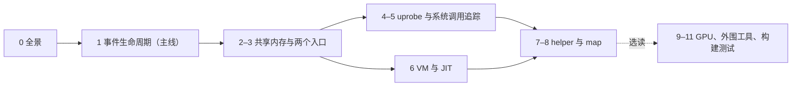
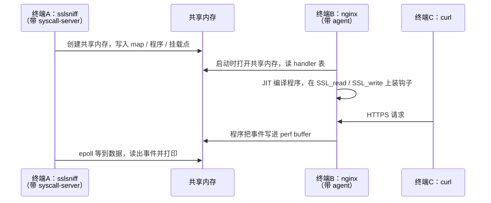

# 12. 动手实践

> 一句话：按什么顺序读这本指南、怎么在自己的机器上把 bpftime 和"sslsniff 追踪 nginx"跑起来，
> 以及每读完一章可以做哪个小实验，确认自己真的懂了。
> 前置：先读完[第 0 章](00-architecture.md)再做环境准备；实验部分跟着各章边读边做。
> 预计用时：环境准备半天（大部分时间在编译），每个实验 10–60 分钟。

本章只服务于**学习 bpftime**。性能研究、PR 状态等放在[附录 A](A-research-notes.md)；
通读中发现的疑似 bug 放在[附录 B](B-known-issues.md)，学习时可以跳过。

## 本章要回答的问题

- 一共十三章，哪些必须读？按什么顺序读？一周怎么安排？
- 在一台普通的 x86_64 Linux 上，怎么编出 bpftime，并跑起全书的主线场景？
- 读完某一章以后，用什么命令能亲眼看到这一章讲的机制？
- 实验结果和预期不一样时，先怀疑什么？

---

## 12.1 推荐阅读路线

全书围绕一个场景展开：nginx 处理 HTTPS 请求，sslsniff 用 uprobe 抓 `SSL_read` / `SSL_write`
的明文。第 1 章顺着一个事件从头走到尾，是全书的主干；第 2–8 章各自放大第 1 章里的一段；
第 9–11 章是选读的专题和工具。

下面这张图和 [README](README.md) 里的阅读顺序一样：实线表示"读后一章之前，最好先读前一章"。



"阅读用时"取各章开头写的时间，**不含**做实验；每个实验另算 10–60 分钟。

| 章 | 定位 | 阅读用时 | 读完能回答 | 实验 |
|---|---|---|---|---|
| [0 全景架构](00-architecture.md) | 必读 | 60–90 分钟 | bpftime 由哪些部件组成，各自跑在哪个进程里 | [实验 0](#exp-0) |
| [1 一个事件的完整生命周期](01-lifecycle.md) | 必读（主线） | 2 小时 | 一次 `SSL_read` 从触发到被 sslsniff 打印经过哪些步骤 | [实验 1](#exp-1) |
| [2 共享内存与 handler 表](02-runtime-shm.md) | 推荐（按需） | 60–90 分钟 | 两个进程靠什么共享 map 和程序；"假 fd"是什么 | [实验 2](#exp-2) |
| [3 两个入口：syscall-server、agent 与 cli](03-entrypoints.md) | 推荐（按需） | 90 分钟 | loader 调 `bpf(2)` 为什么没进内核；agent 何时、怎么装钩子 | [实验 3](#exp-3) |
| [4 uprobe 类 attach](04-attach-uprobe.md) | 按需 | 2–3 小时 | 函数入口怎么被改写；寄存器怎么变成 `pt_regs` | [实验 4](#exp-4) |
| [5 系统调用追踪](05-syscall-trace.md) | 按需 | 1.5–2 小时 | `syscall` 指令怎么被改写；为什么需要 root | [实验 5](#exp-5) |
| [6 VM 与 JIT](06-vm-jit.md) | 按需 | 2–3 小时 | 字节码怎么变成本机码；helper 调用怎么绑定到 C 函数 | [实验 6](#exp-6) |
| [7 helper](07-helpers.md) | 按需（想动热路径时至少读 perf 输出和 probe_read） | 60–90 分钟 | 事件怎么写进 perf buffer；probe_read 怎么防崩溃 | [实验 7](#exp-7) |
| [8 map](08-maps.md) | 按需 | 90–120 分钟 | per-CPU map 怎么在用户态模拟；ringbuf 怎么和 libbpf 消费者对接 | [实验 8](#exp-8) |
| [9 GPU / CUDA 概览](09-gpu.md) | 选读 | 60 分钟 | eBPF 程序怎么跑到 GPU 线程里 | [实验 9](#exp-9) |
| [10 外围工具](10-periphery.md) | 选读 | 1–1.5 小时 | daemon、verifier、bpftimetool、bpftime-aot 各管什么 | [实验 10](#exp-10) |
| [11 构建、测试与示例地图](11-build-test.md) | 选读（查阅） | 1 小时 | 开关、产物、单测怎么安全地跑 | [实验 11](#exp-11) |
| 12 本章 | 边读边做 | — | — | — |

**为什么是这个顺序**：

- 共享内存是所有跨进程状态的地基。不先懂 handler 表，就看不懂 agent 和 syscall-server 到底在"注册什么"。
- attach（第 4、5 章）和 VM（第 6 章）各管一段，可以任选先后；第 6 章讲 `ctx` 从哪来时会提到第 4 章，但不读也不影响主线。
- helper 和 map（第 7、8 章）放在后面，因为 helper 同时用到第 4 章的 `ctx`（寄存器上下文）和第 6 章的 helper 绑定。

### 一周学习计划

每天 3–4 小时。前一天的实验没跑通，先别往下读，回头看 [12.4](#124-结果和预期不一样时先查什么)。

| 天 | 读 | 做 | 当天的目标 |
|---|---|---|---|
| 第 1 天 | 第 0 章；本章 12.2 | 编译 bpftime，跑通[实验 0](#exp-0)和[实验 1](#exp-1) | 亲眼看到 sslsniff 打出 nginx 收发的明文 |
| 第 2 天 | 第 1 章 | 重跑实验 1，对着第 1 章的步骤说出每一步发生在哪个进程 | 能画出 loader、共享内存、nginx 三者的关系 |
| 第 3 天 | 第 2、3 章 | [实验 2](#exp-2)、[实验 3](#exp-3) | 能逐行读懂导出的 handler 表；能解释"拦截"拦了哪些函数 |
| 第 4 天 | 第 4 章；浏览第 5 章 | [实验 4](#exp-4)、[实验 5](#exp-5) | 能说出一次 uprobe 大约花多少纳秒、花在哪 |
| 第 5 天 | 第 6 章 | [实验 6](#exp-6) | 能说出 `call 25` 最后调到了哪个 C 函数 |
| 第 6 天 | 第 7、8 章 | [实验 7](#exp-7)、[实验 8](#exp-8) | 能解释 perf buffer 的分片和 8 字节对齐 |
| 第 7 天 | 第 10、11 章；第 9 章选读 | [实验 10](#exp-10)、[实验 11](#exp-11)，[实验 9](#exp-9) 选做；做各章自测题 | 会用 bpftimetool 看 shm；会安全地跑单测 |

时间不够时，按目的挑一条短路线：

- **只想懂原理**（1–2 天）：0 → 1 → 2，做实验 0、1、2。
- **想改 runtime 的热路径或做性能**：0 → 1 → 2 → 3 → 7 → 8 → 6，做实验 2、4、6、7，然后读附录。
- **想加一种新的 attach 方式**：0 → 1 → 3 → 4 → 5 → 10。

**读代码的两个习惯**：

1. 用函数名 grep 定位。正文只写"文件 + 函数名"，精确行号在各章末尾的"深入参考"里，
   按基线 `177a1dc465ff` 标注，会随上游演进漂移。
2. 同一个模块，先读 `.hpp` 再读 `.cpp`。数据结构定了，实现就好懂了。

---

## 12.2 环境准备

要跑起主线场景，需要四样东西：

1. **bpftime 本身**：两个 `.so`（给 loader 用的 syscall-server、给目标进程用的 agent）和小工具 `bpftimetool`。
2. **一个 eBPF 工具**：sslsniff。它是普通的 libbpf 程序，同一个二进制既能把程序加载进内核，也能在 bpftime 下跑。
3. **一个被追踪的程序**：nginx，开 HTTPS。
4. **一个客户端**：curl 发几个请求，或者 wrk 压测。

下文命令以 **Debian 13 / x86_64** 为例，在 bpftime 仓库根目录执行。Ubuntu 基本一样。
aarch64 机器上命令也相同，只是库路径里的 `x86_64-linux-gnu` 换成 `aarch64-linux-gnu`。

### 12.2.1 安装依赖、取源码

```bash
sudo apt-get update
# 前三行是官方 installation.md 列的依赖
sudo apt-get install -y \
  libelf1 libelf-dev libssl-dev zlib1g-dev make cmake git libboost-all-dev \
  binutils-dev libyaml-cpp-dev ca-certificates clang llvm pkg-config llvm-dev \
  ninja-build nginx wrk curl strace          # 本章实验额外要用的
git clone https://github.com/eunomia-bpf/bpftime.git
cd bpftime
git submodule update --init --recursive      # libbpf、bpftool、Catch2 等都在子模块里
```

- Debian 13 自带 gcc 14 和 LLVM 19，满足要求。
- **只装了带版本号的 `clang-19`、没有 `clang` 命令时**，本章所有 `make -C example/…`、`make -C benchmark/…`
  都要加 `CLANG=clang-19`（示例的 Makefile 默认调 `clang`，否则报 `make: clang: No such file or directory`）；
  配置 bpftime 时则加 `-DBPFTIME_BPF_CLANG=/usr/bin/clang-19`。
- Debian 的 nginx 包装完会起一个系统服务，监听 80 端口。本章另起一个实例监听 4043，两者不冲突。

### 12.2.2 编译 bpftime

按[第 11 章](11-build-test.md#113-最小构建命令)推荐的学习用配置：

```bash
cmake -B build -G Ninja \
  -DCMAKE_BUILD_TYPE=RelWithDebInfo \
  -DBPFTIME_ENABLE_UNIT_TESTING=ON \
  -DBUILD_BPFTIME_DAEMON=OFF
cmake --build build -j"$(nproc)"
```

找不到 LLVM 时加 `-DLLVM_DIR=/usr/lib/llvm-19/lib/cmake/llvm`；只装了 `clang-19` 时加
`-DBPFTIME_BPF_CLANG=/usr/bin/clang-19`。本章用到的产物：

| 文件 | 是什么 | 谁用 |
|---|---|---|
| `build/runtime/syscall-server/libbpftime-syscall-server.so` | 控制面库 | `LD_PRELOAD` 给 loader（sslsniff） |
| `build/runtime/agent/libbpftime-agent.so` | 数据面库 | `LD_PRELOAD` 给目标进程（nginx） |
| `build/tools/bpftimetool/bpftimetool` | 直接读写共享内存的工具 | 实验 2、6、10 |
| `build/runtime/unit-test/bpftime_runtime_tests` | runtime 单测 | 实验 4、6、7、8、11 |
| `build/attach/frida_uprobe_attach_impl/bpftime_frida_uprobe_attach_tests` | Frida 后端单测 | 实验 4 |
| `build/attach/text_segment_transformer/libbpftime-agent-transformer.so` | 系统调用改写器 | 实验 5 |
| `build/benchmark/simple-benchmark-with-embed-ebpf-calling` | 进程内直接调用 JIT 程序的基准 | 实验 6 |

> **关于本章的复核环境。** 本章所有标"本机"的输出，都是在实验室一台 Debian 13 / 16 核 x86_64 机器上，
> 用一份现成的构建目录 `build-jit` 跑出来的。它和上面的推荐命令有三处不同，会直接改变部分实验能看到什么：
>
> | `build-jit` 的配置 | 影响 |
> |---|---|
> | `ENABLE_PROBE_READ_CHECK` / `WRITE_CHECK` = **OFF** | `bpf_probe_read*` 是裸 `memcpy`；单测里越界断言没编进来（实验 7） |
> | `BPFTIME_ENABLE_LTO` = **ON** | LTO（链接期优化）：静态库里存的不是机器码，而是编译器私有格式的中间代码，链接时才生成机器码。所以自己写的小程序链接它的静态库时，必须用同一个编译器（g++-13）（实验 6b、9） |
> | `SPDLOG_ACTIVE_LEVEL` = **INFO** | DEBUG 日志在编译期被删掉，运行时设 `SPDLOG_LEVEL=debug` 也看不到（实验 6） |
>
> 它也没有构建 `bpftime` 命令行、`bpftime-aot`、daemon 和 verifier。所以下面的实验一律直接写
> `LD_PRELOAD`，不依赖 `bpftime load/start`。用实验室这份构建时，把命令里的 `build/` 换成 `build-jit/`。

### 12.2.3 每个实验都换一个 shm 名

bpftime 的共享内存默认叫 `bpftime_maps_shm`（在 `/dev/shm` 下）。做实验时**先换一个独立的名字**：

```bash
export BPFTIME_GLOBAL_SHM_NAME=lab_$RANDOM
```

loader、agent、bpftimetool、单测都读这个变量，同一个终端里设好，后面启动的进程就都用它。好处有两个：
不会和别人（或你自己另一组实验）的会话撞在一起；单测会删除、重建全局 shm 名（[第 11 章](11-build-test.md)），
换了名字就伤不到真会话。实验结束后：

```bash
rm -f /dev/shm/$BPFTIME_GLOBAL_SHM_NAME /tmp/bpftime-shm-$BPFTIME_GLOBAL_SHM_NAME.lock
```

（`/tmp/bpftime-shm-<名>.lock` 是 syscall-server 和 agent 用的锁文件，从来不会被自动删除。只跑 bpftimetool 或单测时不会产生它。）

### 12.2.4 编译 sslsniff，准备 nginx 场景

官方在 `benchmark/ssl-nginx/` 下准备好了场景：nginx 配置、自签名证书、一个小 Makefile。

```bash
make -C benchmark/ssl-nginx            # 编 example/tracing/sslsniff，并生成 index.html
ls example/tracing/sslsniff/sslsniff   # eBPF 工具本体
```

- 只有 `clang-19` 时记得加 `CLANG=clang-19`（见 12.2.1）。
- `nginx.conf` 的要点：HTTPS 监听 4043，证书 `test.cer` / `test.key` 在同目录；`worker_processes 1`；
  `daemon off`（前台运行）；pid 文件、访问日志等相对路径都相对 `-p` 指定的目录，所以这个目录要可写。

### 12.2.5 跑起最小场景

这张图要看的是**启动顺序**：loader 先建好共享内存，nginx 后启动，才能从共享内存里读到要装的钩子。



三个终端都先 `export BPFTIME_GLOBAL_SHM_NAME=lab_xxx`（同一个值）。

**终端 A：启动 loader**

```bash
PATH=$PATH:/usr/sbin \
LD_PRELOAD=build/runtime/syscall-server/libbpftime-syscall-server.so \
  example/tracing/sslsniff/sslsniff | tee /tmp/sslsniff.out
```

本机输出开头：

```
OpenSSL path: /lib/x86_64-linux-gnu/libssl.so.3
GnuTLS path: /lib/x86_64-linux-gnu/libgnutls.so.30
NSS path: (null)
FUNC         TIME(s)            COMM             PID     LEN
```

为什么要补 `PATH`：sslsniff 靠 `ldconfig -p` 查库的路径。Debian 上普通用户的 `PATH` 里没有 `/usr/sbin`，
找不到 `ldconfig`，就会打印 `OpenSSL path: (null)` 和 `no program attached for probe_SSL_rw_enter: Invalid argument`，
一个钩子都装不上。反过来，如果只是某一个库没装（比如上面 NSS 是 `(null)`），stderr 里也会有一行同样的报错，
那只影响那个库，不影响 OpenSSL。

**终端 B：用 agent 启动 nginx**

```bash
LD_PRELOAD=build/runtime/agent/libbpftime-agent.so \
  nginx -e stderr -c nginx.conf -p benchmark/ssl-nginx
```

`-e stderr` 让 nginx 把错误日志打到终端；不加的话，普通用户启动时会因为写不了 `/var/log/nginx/error.log` 报一条 alert。

**终端 C：发请求**

```bash
for i in $(seq 10); do curl -sk https://127.0.0.1:4043/index.html >/dev/null; done
```

终端 A 应该出现 20 个事件：10 个 `READ/RECV`（nginx 读到的 HTTP 请求）和 10 个 `WRITE/SEND`（nginx 写出的响应），
每个事件后面跟着 `----- DATA -----` 和 `----- END DATA -----` 之间的明文，`COMM` 列是 `nginx`。本机实测：

```
READ/RECV    0.000000000        nginx            29      88
----- DATA -----
GET /index.html HTTP/1.1
Host: 127.0.0.1:4043
User-Agent: curl/8.14.1
Accept: */*

----- END DATA -----

WRITE/SEND   0.000151194        nginx            29      249
----- DATA -----
HTTP/1.1 200 OK
Server: nginx/1.26.3
...
Hello, World!
----- END DATA -----
```

想压测就换成 `wrk https://127.0.0.1:4043/index.html -c 100 -d 10`。

**收尾**：先 Ctrl-C 停 nginx，再 Ctrl-C 停 sslsniff。loader 正常退出时，如果它是共享内存的创建者、
并且没有其他活着的 loader 或 agent，它会删掉共享内存（本机实测：`/dev/shm` 下的段没了，`/tmp` 下的锁文件还在）。
进程被 `kill -9` 或崩溃时不会清理，用 `build/tools/bpftimetool/bpftimetool remove` 清掉。

> **启动顺序不能反**。agent 只"打开"共享内存，从不创建。找不到时会重试约 3 秒，然后放弃初始化，
> nginx 照常提供服务但没被追踪。默认的 `LD_PRELOAD` 注入方式下 agent 只扫一次 handler 表，
> loader 之后再建好也没用（[实验 3](#exp-3) 会亲手验证）。

**没有在宿主机装 nginx？** 可以用任何装了 nginx 和 curl 的容器：把 bpftime 源码目录挂进容器（只读即可），
把 `benchmark/ssl-nginx` 拷一份到可写目录，然后**在同一个容器里**同时起 loader 和 nginx。
要点是 loader 和 nginx 必须在同一个 IPC 命名空间（共享内存在各自容器的 `/dev/shm` 里），
并给容器足够大的 `/dev/shm`（例如 `--shm-size=256m`，bpftime 默认段是 50MB）。
**在容器里要以 root 运行**：Debian 的 nginx 启动时要建 `/var/lib/nginx/body` 等临时目录，普通用户会报
`mkdir() "/var/lib/nginx/body" failed (13: Permission denied)` 并退出（或者在 `nginx.conf` 里用
`client_body_temp_path` 等指令把临时目录改到可写的地方）。容器默认没有 BPF 权限，root 运行不影响实验结论。
本章的 nginx 实验就是这样（容器内 root）复核的。

### 12.2.6（可选）和内核 eBPF 对照

同一个 sslsniff 二进制，不带 `LD_PRELOAD`、用 root 运行，程序就加载进内核：

```bash
sudo example/tracing/sslsniff/sslsniff                       # 终端 A：程序进内核
nginx -e stderr -c nginx.conf -p benchmark/ssl-nginx         # 终端 B：不带 agent
```

用同样的 curl 命令，看到的输出格式一模一样（需要 root，本机未跑）。这就是 bpftime 的出发点：
eBPF 工具不用改，换个运行位置而已。装了 `bpftime` 命令行（`make release`）时，`bpftime load <工具>` 和
`bpftime start <程序>` 本质上就是帮你设好上面两个 `LD_PRELOAD`（[第 3 章](03-entrypoints.md)）。

---

## 12.3 验证实验

实验按章节编号分组，"实验 N"对应第 N 章。每个实验写五件事：目的、步骤、预期（标"本机"的是实际跑出来的输出）、
说明什么、跑不了时为什么。除非特别说明，都假设已经按 12.2.3 设好了 `BPFTIME_GLOBAL_SHM_NAME`。

<a id="exp-0"></a>
### 实验 0：最小的两进程模型（malloc 示例）

- **目的**：不用 nginx，先亲眼看到"loader 进程 + 目标进程 + 共享内存"三件套跑起来（第 0 章的组件图）。
- **步骤**：
  1. 编译：`make -C example/malloc`（会在示例目录下生成 `.output/` 并现编一份 libbpf / bpftool）。
  2. 终端 A：
     ```bash
     BPFTIME_LOG_OUTPUT=/tmp/server.log \
     LD_PRELOAD=build/runtime/syscall-server/libbpftime-syscall-server.so example/malloc/malloc
     ```
  3. 终端 B（同一个 shm 名）：
     ```bash
     LD_PRELOAD=build/runtime/agent/libbpftime-agent.so example/malloc/victim
     ```
  4. 看 `grep -E 'Executable path|Attach successfully' /tmp/server.log`。
- **预期（本机）**：终端 A 先打一串 `libbpf:` 调试输出，然后每秒一行：
  ```
  03:43:28
  	pid=459137 	malloc calls: 14
  03:43:29
  	pid=459137 	malloc calls: 10
  ```
  `server.log` 里有 `Executable path: …/victim` 和 `Attach successfully`。终端 B 除了 victim 自己的
  `continue malloc...`，还会有 eBPF 程序 `bpf_printk` 打出的行。
- **说明什么**：计数是在 **victim 进程里**、由 agent 加载的 eBPF 程序产生的，写进共享内存里的 hash map；
  打印它的是**另一个进程**（loader）。两者之间没有任何直接通信。victim 大约每 100ms 调一次 `malloc`，
  所以每秒约 10 次。另外注意：日志写进了 loader 指定的 `/tmp/server.log`，包括 agent 的 `Attach successfully`——
  [实验 3](#exp-3) 会解释为什么。
- **附带观察**：如果用 `timeout 10 ./victim` 之类的包装命令启动，`LD_PRELOAD` 会被包装进程本身继承，
  agent 也注入了它，loader 会多打出一个 pid。`LD_PRELOAD` 会"传染"给子进程。

<a id="exp-1"></a>
### 实验 1：跑通主线场景，数一数事件

- **目的**：把第 1 章的步骤和真实进程对上号。
- **步骤**：
  1. 按 12.2.5 启动 A、B，用 curl 发 10 个请求。
  2. 数事件，并确认共享内存和 agent 都在：
     ```bash
     grep -cE '^(READ/RECV|WRITE/SEND)' /tmp/sslsniff.out          # 事件数
     ls -l /dev/shm/$BPFTIME_GLOBAL_SHM_NAME                         # 共享内存段
     grep -c bpftime-agent /proc/$(pgrep -o nginx)/maps              # master 里映射了 agent
     ```
- **预期（本机）**：事件数 `20`；共享内存段大小 `52428800`（50MB）；nginx 进程的内存映射里有 5 段
  `libbpftime-agent.so`。（worker 进程如果以别的用户运行，你可能没权限读它的 `maps`，看 master 即可。）
- **说明什么**：事件在 **nginx 进程里**产生，由**另一个进程** sslsniff 打印。两个进程之间唯一的通道就是
  `/dev/shm` 里那段共享内存。每个请求两个事件，是因为 sslsniff 的程序只在 `SSL_read` 和 `SSL_write` **返回**时
  各发一个事件；入口探针只记下缓冲区指针。

<a id="exp-2"></a>
### 实验 2：导出 handler 表，逐行认类型

- **目的**：亲眼看到第 2 章讲的"用户态内核对象表"和"假 fd"。
- **步骤**：终端 A 运行期间（**必须在运行期间**，loader 正常退出时共享内存会被删掉）：
  ```bash
  build/tools/bpftimetool/bpftimetool export /tmp/shm.json
  python3 - <<'EOF'
  import json
  d = json.load(open('/tmp/shm.json'))
  for fd in sorted(d, key=int):
      v = d[fd]
      extra = json.dumps(v['attr'])[:90] if v['type'] in ('bpf_perf_event_handler', 'bpf_link_handler') else v.get('name', '')
      print(fd, v['type'], extra)
  EOF
  ls -lv /proc/$(pgrep -n sslsniff)/fd | head -12     # -v 按数字排序
  ```
- **预期（本机，16 核，节选）**：
  ```
  4  bpf_map_handler   perf_SSL_events
  5  bpf_map_handler   ssl_data
  8  bpf_prog_handler  probe_SSL_rw_en
  11 bpf_prog_handler  probe_SSL_write
  13 bpf_perf_event_handler {"_module_name": "/lib/x86_64-linux-gnu/libssl.so.3", "data_type": "uprobe_perf_event_data", "offset": 257424, ... "type": 6}
  14 bpf_link_handler  {"prog_fd": 8, "target_fd": 13}
  15 bpf_perf_event_handler {... "offset": 257424, ... "type": 7}
  16 bpf_link_handler  {"prog_fd": 11, "target_fd": 15}
  ...（libgnutls 上另有 4 对）
  29 epoll_handler
  30 bpf_perf_event_handler {"config": 10, "cpu": 0, "data_type": "software_perf_event_shared_ptr", ... "type": 1}
  ...（每个 CPU 一个，一直到 cpu 15）
  ```
  统计：24 个 perf event、8 个 link、5 个 prog、4 个 map、1 个 epoll。这台机器（容器）里没装 NSS（`libnspr4`），
  装了的机器上会多出 NSS 的 8 个挂载点和 8 个 link，变成 32 个 perf event、16 个 link（第 0 章的实验就是这种情况）。
  `/proc/<sslsniff>/fd` 里：fd 3 是日志文件，**从 4 开始一长串**都指向 `/dev/null`，和 handler 表的编号一一对应。
  （fd 0–2 是终端或你重定向的文件；在没有终端的环境里 fd 0 也会显示成 `/dev/null`，那和 bpftime 无关。
  如果 `$HOME` 不可写、默认日志文件打不开，fd 3 就空出来给对象用，编号整体少 1。）
- **说明什么**：
  - 每个"假 fd"就是 handler 表的下标；在 syscall-server 里，这个号码同时被一个真实打开的 `/dev/null` 占住，
    所以 loader 进程里不会有别的文件拿到同一个号（第 2 章）。
  - `bpf_link_handler` 把一个程序连到一个挂载点，对应第 1 章的"连线"一步。
  - 同一个 `offset` 出现两次：`type: 6` 是函数入口的 uprobe，`type: 7` 是返回的 uretprobe。这是 bpftime 自己的编号，不是内核的。
  - 末尾 `type: 1, config: 10` 是软件 perf 事件（`PERF_COUNT_SW_BPF_OUTPUT`），每个 CPU 一个，由 libbpf 的
    `perf_buffer__new` 按 CPU 数开出来。
  - 程序名被截断到 15 个字符，和内核 `BPF_OBJ_NAME_LEN` 一致。
  - 再看 `/tmp/shm.json` 里某个 `bpf_prog_handler` 的 `attr.type`：本机是 `286980400`，和程序类型无关——
    导出的 prog 类型是未初始化的垃圾值，可能是任何数（也可能碰巧很小，看起来像"对的"），这份 JSON 只适合"看"
    （[第 10 章](10-periphery.md)）。

<a id="exp-3"></a>
### 实验 3：拦截了什么、日志去哪、顺序反了会怎样

**3a. loader 的 bpf 调用没进内核**

- **步骤**：
  1. 看两个 `.so` 各自覆盖了哪些 libc 函数：
     ```bash
     nm -D --defined-only build/runtime/syscall-server/libbpftime-syscall-server.so \
       | awk '$2 ~ /[TW]/ {print $3}' | grep -vE '^(_|bpftime|ebpf|gum|frida)' | sort | tr '\n' ' '
     nm -D --defined-only build/runtime/agent/libbpftime-agent.so | awk '$2 ~ /[TW]/ {print $3}'
     ```
  2. 用 strace 启动 loader（strace 自己不带 `LD_PRELOAD`，`-E` 只设给被追踪的进程），几秒后 Ctrl-C：
     ```bash
     PATH=$PATH:/usr/sbin strace -f -o /tmp/strace.txt -e trace=bpf,perf_event_open \
       -E LD_PRELOAD=build/runtime/syscall-server/libbpftime-syscall-server.so \
       example/tracing/sslsniff/sslsniff
     grep -oE 'bpf\(BPF_[A-Z_]+|perf_event_open' /tmp/strace.txt | sort | uniq -c
     ```
- **预期（本机）**：
  - syscall-server 导出：`close epoll_create1 epoll_ctl epoll_wait fopen fopen64 ioctl mmap mmap64 munmap open openat read syscall`；
    agent 导出 `__libc_start_main`、`bpftime_agent_main` 等 6 个函数符号。
  - strace 只剩 `3 bpf(BPF_BTF_LOAD`，每次都是 `= -1 EPERM`；**没有** `BPF_MAP_CREATE`、`BPF_PROG_LOAD`、
    `BPF_LINK_CREATE`，也没有 `perf_event_open`。
- **说明什么**：`LD_PRELOAD` 库里的同名函数排在 libc 前面。libbpf 调 `syscall(__NR_bpf, ...)`，实际进的是
  syscall-server 的 `syscall()`，在用户态就把 map、程序、挂载点建在了共享内存里。它不认识的命令（这里是
  加载 BTF 的 `BPF_BTF_LOAD`）原样转给内核；普通用户没权限，内核返回 `EPERM`，libbpf 自动降级，不影响运行。
  agent 覆盖 `__libc_start_main`，是为了抢在 nginx 的 `main` 之前完成初始化。

**3b. agent 的日志去了哪里**

- **步骤**：终端 A 用 `BPFTIME_LOG_OUTPUT=/tmp/bpftime-run.log` 启动 loader；终端 B 给 agent 设
  `BPFTIME_LOG_OUTPUT=console` 启动 nginx；发几个请求后：
  ```bash
  grep -E 'Initializing agent|Attach successfully|Executable path' /tmp/bpftime-run.log
  ```
- **预期（本机）**：终端 B 只打出两行：
  ```
  [info] Global shm constructed. shm_open_type 1 for <shm 名>
  [info] Global shm initialized
  ```
  `Initializing agent..`、每个挂载点一行的 `Executable path: /usr/sbin/nginx`（本机 8 行）、`Attach successfully`
  都在 **loader 指定的** `/tmp/bpftime-run.log` 里。
- **说明什么**：agent 启动分两段。打开共享内存之前，它用自己进程的环境变量配置日志（`shm_open_type 1`
  就是"只打开、不创建"）；打开之后，改用共享内存里的运行时配置，而这份配置是 loader 写进去的。所以想看 agent
  的日志，要在 **loader 一侧**设 `BPFTIME_LOG_OUTPUT`。不设时默认写到 `~/.bpftime/runtime.log`。
  日志**级别**（`SPDLOG_LEVEL`）则读各进程自己的环境变量。

**3c. 启动顺序反了**

- **步骤**：先用 agent 启动 nginx（`BPFTIME_LOG_OUTPUT=console`），等 5 秒，再启动 sslsniff，再发 10 个请求。
- **预期（本机）**：nginx 终端出现 `[error] Unable to initialize shared memory: No such file or directory`；
  curl 全部成功；sslsniff 收到 **0** 个事件。
- **说明什么**：agent 找不到共享内存时重试约 3 秒后放弃初始化，宿主照常运行（"注入代码是宿主的客人"）。
  之后 loader 建好 shm 也没用：`LD_PRELOAD` 注入的 agent 只在启动时扫一次表（第 3 章）。

<a id="exp-4"></a>
### 实验 4：uprobe 的单测与开销

**4a. 跑 attach 相关单测**

- **步骤**：
  ```bash
  build/attach/frida_uprobe_attach_impl/bpftime_frida_uprobe_attach_tests
  cd build/runtime/unit-test
  ./bpftime_runtime_tests "Test probing internal functions"
  ./bpftime_runtime_tests "Test attaching filter*"
  ```
- **预期（本机）**：`All tests passed (1072 assertions in 17 test cases)`；`35 assertions in 1 test case`；
  `34 assertions in 1 test case`。
- **说明什么**：第一个二进制测的是 Frida 后端本身；后两个用例分别演示 uprobe / uretprobe（同一地址可以挂多个，
  回调里读到的 `bpf_get_func_ip` 就是被探测函数的地址）和 override（eBPF 程序决定跳过原函数并改返回值）。
  读这两个测试的源码（`runtime/unit-test/attach_with_ebpf/`），是理解第 4 章 attach 接口最快的路。

**4b. 一次用户态 uprobe 花多少时间**

- **步骤**：用官方 `benchmark/` 的现成程序。`benchmark/uprobe/uprobe.bpf.c` 的 SEC 里写的是相对路径
  `benchmark/test`，所以要**在仓库根目录**运行：
  ```bash
  make -C benchmark/uprobe            # loader：benchmark/uprobe/uprobe
  gcc benchmark/test.c -g -O3 -lpthread -o benchmark/test
  ./benchmark/test                    # 先跑基线：不 hook
  # 终端 A：
  LD_PRELOAD=build/runtime/syscall-server/libbpftime-syscall-server.so benchmark/uprobe/uprobe
  # 终端 B（同一个 shm 名）：
  LD_PRELOAD=build/runtime/agent/libbpftime-agent.so ./benchmark/test
  ```
- **预期（本机，每个函数调 10 万次的平均）**：

  | 被测函数 | 不 hook | 带 agent |
  |---|---|---|
  | `__bench_uprobe`（入口 uprobe，程序只做一次加法） | 约 1.6 ns | 约 122 ns |
  | `__bench_uretprobe`（返回 uretprobe） | 约 1.6 ns | 约 184 ns |
  | `__bench_uprobe_uretprobe`（两者都挂） | 约 2.8 ns | 约 212 ns |

- **说明什么**：一个几乎不做事的函数（`return a[b] + c`）被挂上用户态 uprobe 后，每次调用多出约 120 ns：Frida 跳板保存寄存器、
  转成 `pt_regs`、调用 JIT 好的程序、再回来。uretprobe 更贵，因为要在函数返回时再进一次跳板。
  这个量级比内核 uprobe（每次要陷入内核）小得多，正是 bpftime 的卖点。数字随机器变化，看量级即可。
- **旧版里"给 Frida 回调加计数器"的实验**为什么换掉了：那个实验要改 `attach/` 的源码并重编 agent，
  本书复核环境不允许改动和重编官方树；上面的基准用现成程序就能量化"每次调用都进一次回调"，而且不用改代码。
  有自己的构建目录的读者，仍可以照第 4 章读到的 `uprobe_listener_on_enter` / `on_leave` 自己加计数器试试。

<a id="exp-5"></a>
### 实验 5：系统调用追踪为什么需要 root

- **目的**：验证第 5 章的说法——text segment transformer 要把代码映射到地址 0 附近，普通配置下做不到。
- **步骤**：
  ```bash
  T=build/attach/text_segment_transformer/libbpftime-agent-transformer.so
  LD_PRELOAD=$T /bin/echo hello; echo rc=$?
  AGENT_SO=/nonexistent.so LD_PRELOAD=$T /bin/echo hello; echo rc=$?
  cat /proc/sys/vm/mmap_min_addr
  nm -D --defined-only build/runtime/agent/libbpftime-agent.so | grep syscall
  ```
- **预期（本机，普通用户）**：
  - 第一条：先打印 `Please set AGENT_SO to the bpftime-agent when use this tranformer`，然后照常输出 `hello`，`rc=0`。
  - 第二条：`[error] … Failed to perform mmap: errno=1, message=Operation not permitted`，`hello` **没有**打印，`rc=1`。
  - `mmap_min_addr` 是 `65536`。
  - agent 导出 `_bpftime__setup_syscall_trace_callback` 和 `syscall_callback`。
- **说明什么**：没设 `AGENT_SO` 时 transformer 什么都不做，宿主照常运行；设了之后它要在第 0 页附近建跳板，
  被内核的 `vm.mmap_min_addr` 挡住，而且这时它直接让进程以 1 退出——这违反了"不要结束宿主"的约定，
  见[附录 B](B-known-issues.md#b-syscall-trace)。agent 导出的那个回调设置函数只被 transformer 调用：
  只用 `LD_PRELOAD` agent、不经 transformer 启动时，系统调用 tracepoint 的 link 能建出来但永远不会触发。
- **跑不了的部分**：完整跑通 `example/minimal` 的 syscall 示例（或 `bpftime start -s`）需要 root 执行
  `sysctl vm.mmap_min_addr=0`。这会改系统安全设置，**本机是远程实验服务器，未做**。

<a id="exp-6"></a>
### 实验 6：JIT、"解释执行"与 AOT 产物

**6a. 用 bpftimetool 测一个程序**

- **步骤**：
  ```bash
  export BPFTIME_LOG_OUTPUT=console
  T=build/tools/bpftimetool/bpftimetool
  # 两条指令：r0 = 42; exit
  $T load 3 '{"type":"bpf_prog_handler","name":"ret42","attr":{"type":2,"cnt":2,"insns":"b70000002a0000009500000000000000"}}'
  printf abcd > in.bin
  $T run 3 in.bin repeat 1000 type JIT
  $T run 3 in.bin type INTERPRET
  $T run 3 in.bin repeat 1000 type INTERPRET
  $T run 3 in.bin type AOT; echo rc=$?
  $T remove
  ```
- **预期（本机）**：
  | 命令 | `Time taken`（平均） | 返回值 |
  |---|---|---|
  | JIT × 1000 | 4 ns | 42 |
  | INTERPRET × 1 | 约 3.5 ms | 42 |
  | INTERPRET × 1000 | 约 3.5 µs | 42 |
  | AOT | 打印 `AOT instructions not found`，`rc=1` | — |
- **说明什么**：JIT 模式在计时前就编好了，所以平均只有几纳秒。默认 VM 是 llvm，它**没有解释器**：
  INTERPRET 只是"不提前编译"，第一次执行时现场 JIT，跑 1 次的 3.5 ms 基本就是编译时间，跑 1000 次被摊薄到微秒级。
  AOT 需要先用 `bpftime-aot` 把产物写进这个程序（第 10 章）。

**6b. helper 调用和 map 引用编成了什么**

- **步骤**：写一个小程序，用 llvmbpf 把一段手写字节码 AOT 编译成 `.o`，打印 IR，再用 `nm` 看产物。
  字节码里有一条按 fd 引用 map 的 LDDW（`src=1`，fd 5）、一条引用 map value 的 LDDW（`src=2`）和 `call 1`：
  ```cpp
  // aot.cpp
  #include "llvmbpf.hpp"
  #include <cstdio>
  #include <cstdint>
  static uint64_t f(uint64_t, uint64_t, uint64_t, uint64_t, uint64_t) { return 0; }
  static uint64_t by_fd(uint32_t fd) { return fd; }     // 和 runtime 一样：map "指针"就是 fd 本身
  static uint64_t mval(uint64_t m) { return 0x1000; }
  int main() {
    uint64_t prog[] = {
      0x0000000000001118ULL | (5ULL << 32), 0,            // lddw r1, map fd 5（src=1）
      0x0000000000002218ULL | (5ULL << 32), (8ULL << 32), // lddw r2, map 5 的 value + 8（src=2）
      0x0000000100000085ULL,                              // call 1
      0x0000000000010015ULL,                              // if r0 == 0 goto +1
      0x0000000300000007ULL,                              // r0 += 3
      0x0000000000000095ULL };                            // exit
    bpftime::llvmbpf_vm vm;
    vm.register_external_function(1, "map_lookup", (void *)f);
    vm.set_lddw_helpers(by_fd, nullptr, mval, nullptr, nullptr);
    if (vm.load_code(prog, sizeof(prog))) { puts(vm.get_error_message().c_str()); return 1; }
    auto o = vm.do_aot_compile(true);                     // true：顺便打印 LLVM IR
    if (!o) { puts(vm.get_error_message().c_str()); return 1; }
    FILE *fp = fopen("aot.o", "wb"); fwrite(o->data(), 1, o->size(), fp); fclose(fp);
    printf("wrote %zu bytes\n", o->size());
  }
  ```
  编译命令和实验 9 一样（把 `ptx_probe.cpp` 换成 `aot.cpp`，必须用 g++-13），然后：
  ```bash
  ./aot > out.txt 2>&1; grep 'store i64 5' out.txt; nm aot.o
  ```
- **预期（本机）**：
  ```
    store i64 5, ptr %r1, align 4
                   U _bpf_helper_ext_0001
  0000000000000000 T bpf_main
                   U __lddw_helper_map_val
  ```
- **说明什么**：eBPF 指令 `call N` 被编成对外部符号 `_bpf_helper_ext_%04u` 的调用，加载时再把这个符号解析到
  C 函数——JIT 用的也是同一套名字（第 6 章）。按 fd 引用 map 的 LDDW 在**编译期**就变成了常量 5（fd 本身），
  没有外部符号；只有引用 map value 的 LDDW 才变成运行时调用 `__lddw_helper_map_val`。
- **对照**：`nm tools/aot/example/do_count.o`（仓库自带的示例产物）能看到 `_bpf_helper_ext_0001/0002/0006/0014`
  和一个 `__lddw_helper_map_by_fd`。这是**旧 ABI** 的产物，现在的代码已经不再生成这个符号（第 10 章 10.5）。
- **旧版"看 DEBUG 日志里的 `Emitting ext func call to 25`"为什么换掉了**：那条日志是 DEBUG 级别，
  `build-jit` 编译时 `SPDLOG_ACTIVE_LEVEL=INFO`，日志在编译期就被删了，运行时怎么设都看不到。
  按 12.2.2 不传 `SPDLOG_ACTIVE_LEVEL` 自己构建的读者，可以在 loader 设 `BPFTIME_LOG_OUTPUT=console`、
  nginx 设 `SPDLOG_LEVEL=debug`，grep `ext_0025` 试试（本机无法复核）。

**6c. 不经过 hook 的纯执行开销**

- **步骤**：用实验 4b 编出的 `benchmark/uprobe/.output/uprobe.bpf.o`（或你自己编的同名文件）：
  ```bash
  build/benchmark/simple-benchmark-with-embed-ebpf-calling \
    benchmark/uprobe/.output/uprobe.bpf.o benchmark/uprobe/.output/uprobe.bpf.o
  ```
- **预期（本机）**：最后一行 `avg function elapse time: 79.012750 ns`（几十纳秒量级，每次略有不同）。
- **它跑的是什么**（`benchmark/test_embed.c`）：从两个文件里各取出名为 `__bench_uprobe` 的程序（两个参数给的是同一个文件，
  所以是同一个程序）JIT 好；然后循环 10 万次：每次先填一个 `pt_regs`、经 `ebpf_exec` 跑一次程序（当"入口"），
  调用被测函数 `return a[b] + c`，再填一次 `pt_regs`、经 `ebpf_exec` 再跑一次（当"出口"）。所以 79 ns 是
  **两次** `ebpf_exec` 调用加两次 `memset` 和一次函数调用的总和，不是"程序本身"的耗时。
- **说明什么**：这个程序在**自己进程里**加载、JIT 并调用 eBPF 程序，没有 Frida 跳板。它最适合和实验 4b 的
  `__bench_uprobe_uretprobe`（同样是入口、出口各跑一次程序，约 212 ns）对照：两者之差大致就是两次跳板与
  寄存器转换的开销。两边的程序和调用方式不完全相同，只看量级。

<a id="exp-7"></a>
### 实验 7：perf 输出与 probe_read

**7a. 跑 perf buffer 和 helper 的单测**

- **步骤**：
  ```bash
  cd build/runtime/unit-test
  ./bpftime_runtime_tests "[software_perf_event]"
  ./bpftime_runtime_tests "[affinity]"
  ./bpftime_runtime_tests "Test helpers"
  ./bpftime_runtime_tests "get_stack*"
  ./bpftime_runtime_tests "Test bpftime_probe*,Test Probe*,Test repeated*,Test bpf_probe_read_str,Test probe access*,Test default SIGSEGV*"
  ```
- **预期（本机）**：依次是 `8307 assertions in 3 test cases`、`38 assertions in 1 test case`、
  `5 assertions in 1 test case`、`18 assertions in 6 test cases`、`53 assertions in 7 test cases`，全部 `All tests passed`。
  只有一个可用 CPU 的机器上，`[affinity]` 会被跳过。
- **说明什么**：三个 `[software_perf_event]` 用例分别验证：多线程并发写入时每个线程写自己的分片（shard），
  以及单条记录的长度上限（再大就 `E2BIG`）；环形缓冲区扩容后记录回绕时仍然 8 字节对齐；共享内存耗尽时返回 `ENOMEM`。
  `[affinity]` 验证 `bpf_perf_event_output` 前后调用线程的 CPU 亲和性不变（第 7 章讲了它为什么会临时改亲和性）。
  probe 那组还验证了 probe 访问不替换、不吞掉应用自己的 SIGSEGV 处理器。

**7b. probe_read 有没有进内核**

- **步骤**：沿用实验 4b 的 loader（终端 A 照样起），把目标换成 strace 包着、只跑 100 次：
  ```bash
  strace -f -c -e trace=process_vm_readv,process_vm_writev \
    -E LD_PRELOAD=build/runtime/agent/libbpftime-agent.so ./benchmark/test 1 100
  ```
  `__bench_read` 的程序每次被调用时执行 1000 次 `bpf_probe_read_user`，`__bench_write` 执行 1000 次 `bpf_probe_write_user`。
- **预期**：
  - **本机（probe check 关）**：strace 除了 `Process … attached` 之外**什么都没打印**（一次都没捕获到时，`-c` 连表头都不输出）——一次 `process_vm_readv/writev` 都没有；
    `__bench_read` 每次调用约 1.7 µs，也就是每次 probe_read 不到 2 ns，就是一次 `memcpy`。
  - **probe check 开的构建**（按 12.2.2 自己构建的默认情况）：按代码推断，每次 `bpf_probe_read_user` 都是一次
    `process_vm_readv`，每次 `__bench_read` 会多出约 1000 次系统调用，耗时会高出几个数量级（本机无法复核）。
- **说明什么**：开检查时，`bpf_probe_read` 不自己读内存，而是请内核替它读本进程的内存；地址坏了只返回错误，
  宿主不会收到 SIGSEGV，代价是每次一个系统调用。关检查时就是裸 `memcpy`，坏地址会让宿主直接崩溃。
  `make benchmark` 为了性能关掉它，默认构建为了安全打开它。
- **旧版"故意把对齐改成 1、看哪个断言失败"的实验为什么删了**：它要改 `runtime/src/handler/perf_event_handler.cpp`
  并重编单测，复核环境不允许改动和重编官方树。可以当思考题：读 `test_software_perf_event.cpp` 里那个 64 字节的小环，
  想一想对齐改成 1 后哪条断言会先失败。

<a id="exp-8"></a>
### 实验 8：map 的单测与开销

- **步骤**：
  ```bash
  cd build/runtime/unit-test
  ./bpftime_runtime_tests "[kernel]~[large_memory]"
  ./bpftime_runtime_tests "Test shm hash maps*,Hash maps with colliding*"
  ./bpftime_runtime_tests "Test basic operations of array map"     # per-CPU array
  ./bpftime_runtime_tests "[ringbuf]"
  ./bpftime_runtime_tests "[epoll]"
  ```
  再回看实验 4b 带 agent 那次输出里的 map 部分（每个函数的程序里做 1000 次 map 操作）。
- **预期（本机）**：
  - 单测依次 `10 test cases`、`247 assertions in 2 test cases`、`385 assertions in 1 test case`、
    `1002 assertions in 1 test case`、`6558 assertions in 1 test case`，全部通过。
  - 实验 4b 里每次调用（= 1000 次操作）的平均耗时：`array_map_lookup` 约 5.9 µs、`hash_map_lookup` 约 20 µs、
    `hash_map_delete` 约 101 µs、`per_cpu_hash_map_lookup` 约 45 µs、`per_cpu_array_map_lookup` 约 10 µs。
- **说明什么**：
  - `[kernel]` 一组移植自内核 `test_maps`，是"bpftime map 和内核 map 在 flags、errno 上是否一致"的对照表；
    读它比读 map 实现更快知道行为边界（第 8 章列了几处不一致）。
  - `Test shm hash maps…` 里，fork 出的子进程直接读到父进程写进共享内存的 map，这就是跨进程共享的核心证据。
  - ringbuf 那个用例专门构造"记录头落在环最后 8 字节"的场景；epoll 那个用例验证 loader 侧等待的语义。
  - 开销上，array 按下标直接算地址最快；hash 要哈希、比较，还要加 handler 层的锁；per-CPU map 每次要先问一次
    "我现在在哪个 CPU"。
- 跑完记得对比 `/dev/shm`：`Test shm hash maps…` 会留下 `my_shm_maps_test`（[第 11 章](11-build-test.md)）。

<a id="exp-9"></a>
### 实验 9：没有 GPU 也能看到 eBPF 变成 PTX

- **目的**：验证第 9 章的两个说法：eBPF 探针被编译成 PTX 函数，helper 调用变成外部函数 `_bpf_helper_ext_NNNN`
  （由 GPU 侧的 trampoline 提供），map 参数在 GPU 上就是 fd 本身。
- **步骤**：写一个小程序，直接调用 llvmbpf 的 PTX 生成接口（不需要 CUDA，只需要 LLVM 的 NVPTX 后端）：
  ```cpp
  // ptx_probe.cpp
  #include "llvmbpf.hpp"
  #include "llvm_jit_context.hpp"
  #include <cstdio>
  #include <cstdint>
  static uint64_t f(uint64_t, uint64_t, uint64_t, uint64_t, uint64_t) { return 0; }
  int main() {
    uint64_t prog[] = {
      0x0000000000001118ULL | (3ULL << 32), 0,   // lddw r1, map_fd=3（src=1）
      0x00000000fff80a62ULL,                     // *(u32 *)(r10 - 8) = 0
      0x00000000000002bfULL | (0xaULL << 12),    // r2 = r10
      0xfffffff800000207ULL,                     // r2 += -8
      0x0000000100000085ULL,                     // call 1（map_lookup）
      0x00000000000000b7ULL, 0x0000000000000095ULL };  // r0 = 0; exit
    bpftime::llvmbpf_vm vm;
    vm.register_external_function(1, "map_lookup", (void *)f);
    if (vm.load_code(prog, sizeof(prog))) { puts(vm.get_error_message().c_str()); return 1; }
    bpftime::llvm_bpf_jit_context ctx(vm);
    auto p = ctx.generate_ptx(false, "__probe_func__vecadd", "sm_61");
    if (!p) return 1;
    puts(p->c_str());
  }
  ```
  编译（`R` 是源码根，`B` 是构建目录；`build-jit` 是 gcc-13 的 LTO 产物，必须用 g++-13）：
  ```bash
  g++-13 -std=c++20 ptx_probe.cpp \
    -I$R/vm/llvm-jit/include -I$R/vm/llvm-jit/src -I$R/third_party/spdlog/include \
    -I$(llvm-config-19 --includedir) -DSPDLOG_COMPILED_LIB \
    $B/vm/compat/llvm-vm/libllvmbpf_vm.a $B/third_party/spdlog/libspdlog.a \
    $(llvm-config-19 --ldflags --libs all) -Wl,--allow-shlib-undefined -o ptx_probe
  ./ptx_probe | grep -E 'visible|depot0\[|_bpf_helper_ext_0001$|param0\+0\], 3'
  ```
- **预期（本机）**：
  ```
  .extern .func  (.param .b64 func_retval0) _bpf_helper_ext_0001
  .visible .func __probe_func__vecadd()
  	.local .align 8 .b8 	__local_depot0[16464];
  	st.param.b64 	[param0+0], 3;
  ```
- **说明什么**：探针体变成一个无参数的 PTX 函数，将来被插进 CUDA kernel 里调用；每个 GPU 线程在 local memory 里
  有一份 16464 字节的 eBPF 栈；`call 1` 变成对外部函数 `_bpf_helper_ext_0001` 的调用，第一个参数直接就是常量 3——
  map 在 GPU 上不做重定位，fd 本身就是下标。
- **附带观察**：把 `generate_ptx` 换成 `vm.generate_ptx("sm_80")`（公共接口），输出里的 `.target` 仍是 `sm_60`——
  公共接口吞掉了目标架构参数，见[附录 B](B-known-issues.md#b-vm)。
- **跑不了的部分**：真正在 GPU 上跑 `example/gpu/cuda-counter` 需要 NVIDIA GPU 和 CUDA 构建，本机没有，未跑。

<a id="exp-10"></a>
### 实验 10：外围工具

**10a. bpftimetool 往返与 JSON 的局限**

- **步骤**：先做[第 10 章"动手验证"第 1 条](10-periphery.md#动手验证)（load → run → export → remove）。然后试导入：
  ```bash
  cat > imp.json <<'EOF'
  {"3":{"type":"bpf_prog_handler","name":"ret42","attr":{"type":2,"cnt":2,"insns":"b70000002a0000009500000000000000"}},
   "4":{"type":"memfd_handler","name":"m"},
   "5":{"type":"bpf_map_handler","name":"arr","attr":{"map_type":2,"key_size":4,"value_size":8,"max_entries":4,"flags":0,"ifindex":0,"value_type_btf_id":0,"btf_id":0,"btf_key_type_id":0,"btf_value_type_id":0,"btf_vmlinux_value_type_id":0,"kernel_bpf_map_id":0,"map_extra":0}}}
  EOF
  $T import imp.json; echo rc=$?
  $T export out2.json; python3 -c "import json; print(list(json.load(open('out2.json'))))"
  $T remove
  python3 tools/bpftimetool/test_load.py $T
  ```
- **预期（本机）**：
  - export：顶层 key 是 `"3"`，`attr.type` 是一个和传入的 `2` 无关的垃圾值（本机 `-1835675944`）。
  - import：日志 `Unsupported handler type memfd_handler`、`Failed to import handler from json`，`rc=255`；
    再 export 只剩 `['3']`——fd 5 的 map 没导进去，fd 3 也没回滚。
  - `test_load.py`：`PASS: bpftimetool load argument handling`。
- **说明什么**：`memfd_handler` 会被 export 写出来，import 却不认识，于是中途失败、前面导入的保留。
  这份 JSON 适合"看"，不适合备份。

**10b. daemon（需要 root，本机未跑）**

- **为什么没跑**：需要 root、需要单独构建 daemon（`-DBUILD_BPFTIME_DAEMON=ON`，`build-jit` 没编）；
  它会以"删旧建新"打开共享内存、在根目录写 `/a`，不带 `-p` 时还会改写全系统的 uprobe 请求。
  在共享的远程实验服务器上不适合做。
- **自己的机器上怎么做**（按 `daemon/README.md` 的 malloc 例子，三个终端都设同一个 shm 名）：
  1. `sudo -E SPDLOG_LEVEL=Debug build/daemon/bpftime_daemon`（尽量带 `-p <工具的 pid>`）。
  2. `sudo -E example/malloc/malloc`（不带任何 `LD_PRELOAD`，照常进内核）。
  3. `sudo -E LD_PRELOAD=build/runtime/agent/libbpftime-agent.so example/malloc/victim`。
- **按代码推断的预期**：只开前两个时，`malloc` 工具什么计数都打不出来——它的内核 uprobe 被挂到了 `/a` 上；
  第三步之后，`malloc` 工具开始打印 victim 的 malloc 次数，这些计数是 victim 进程里的 bpftime 产生的，
  经 kernel-user map 写进了真内核 map。`sudo cat /sys/kernel/debug/tracing/trace_pipe` 能看到监视程序的调试输出。
  做完删掉 `/a`。

<a id="exp-11"></a>
### 实验 11：安全地跑整套单测

- **步骤**（一定先换 shm 名，见 12.2.3）：
  ```bash
  cd build/runtime/unit-test
  ls /dev/shm > /tmp/shm_before.txt
  T=./bpftime_runtime_tests
  $T --list-tests | grep 'test cases'       # 用例总数（stdout 最后一行是 Destructor 日志，别用 tail -1）
  $T --list-tags  | grep -E 'tags$'         # tag 总数
  $T "~Test attach replace with ebpf" "~Test tail calling from userspace to kernel"
  $T; echo rc=$?                            # 不加过滤，看它崩在哪
  $T "Test probing internal functions,Test attach replace with ebpf" --order rand --rng-seed 3
  diff /tmp/shm_before.txt <(ls /dev/shm)   # 看多出了哪些段
  ```
- **预期（本机）**：
  - `106 test cases`、`50 tags`。
  - 排除两个用例：`All tests passed (8333769 assertions in 104 test cases)`，约 15 秒（断言数每次略有不同，
    因为有的用例用随机 key）。
  - 不加过滤：在 `test_attach_replace.cpp` 处 `SIGSEGV - Segmentation violation signal`，
    `test cases: 2 | 1 passed | 1 failed`，`rc=139`。
  - 配对跑：`All tests passed (44 assertions in 2 test cases)`。
  - `/dev/shm` 多出 `BPFTIME_TEST_SHM_JSON_IMPORT_EXPORT`、`my_shm_attach_test` 等固定名的段，要手动删；
    `/tmp` 下还会多出 `bpftime_test_shm_json.json`。你自己的 shm 名整套跑完一般已被后面的用例删掉
    （单独跑 user→user tail call 用例时则会留下一个 50MB 的段），跑完照样 `diff` 一下。
- **说明什么**：所有用例跑在同一个进程里，共享全局状态。替换用例在 Frida 初始化之前就调用了 Frida 的符号查找，
  排在第一个 Frida 用例之前就崩；配对跑时让另一个用例先初始化 Frida，就能过。被排除的另一个用例需要真内核
  BPF 权限（需要 root，本机未跑）。这些都在[第 11 章](11-build-test.md)细讲。
- **旧版"实验 7.1"的更正**：旧版说完整跑单测前要先 `make -C runtime/test/bpf` 并拷 `.bpf.o`。实际
  `runtime/test/` 已废弃，单测用的 `.bpf.o` 由 CMake 现编，那一步不需要。

---

## 12.4 结果和预期不一样时，先查什么

按出现频率排序：

1. **shm 名不一致**。loader、agent、bpftimetool 三方的 `BPFTIME_GLOBAL_SHM_NAME` 必须一样。
   症状：agent 报 `Unable to initialize shared memory`，或 bpftimetool export 说找不到。
2. **启动顺序反了**。先 loader 后目标进程。症状：一切正常运行，但一个事件都没有。
3. **sslsniff 找不到 libssl**。普通用户补 `PATH=$PATH:/usr/sbin`。症状：`OpenSSL path: (null)`。
4. **上次的残留**。进程崩溃或 `kill -9` 后 `/dev/shm` 里留着旧段；新 loader 会清空它重开会话，
   但别的工具可能读到旧内容。`bpftimetool remove` 或手动删。
5. **编译开关和你以为的不一样**。`grep -E '^(ENABLE_PROBE|SPDLOG_ACTIVE|BPFTIME_)' build/CMakeCache.txt`。
   症状：看不到 DEBUG 日志；坏指针让宿主崩溃而不是返回错误。
6. **日志去哪了**。agent 初始化后的日志按 **loader** 的 `BPFTIME_LOG_OUTPUT` 走，默认 `~/.bpftime/runtime.log`。
7. **相对路径**。`SEC("uprobe/./victim:…")`、`SEC("uprobe/benchmark/test:…")` 这类程序要在对应目录运行。
8. **示例 README 过时**。以本章和[第 11 章](11-build-test.md#116-示例总表)的命令为准。

---

## 小结

- 先读第 0、1 章建立全局图，再按 2 → 3 →（4、5、6）→ 7、8 的顺序深入，第 9–11 章按需。
- 主线场景需要四样东西：两个 `LD_PRELOAD` 库、sslsniff、nginx、一个 HTTPS 客户端。**先启动 loader，再启动目标进程**。
- 每个实验先换一个 `BPFTIME_GLOBAL_SHM_NAME`，做完删 `/dev/shm` 和 `/tmp` 下的残留。
- 共享内存是两个进程间唯一的通道；`bpftimetool export` 能把 handler 表原样导出来看，但 JSON 不能当备份。
- loader 的 `bpf(2)` 绝大多数在用户态被接住，只有不认识的命令才转给内核。
- agent 的日志去向、JIT 等运行时配置由 loader 写进共享内存；日志级别读各进程自己的环境变量。
- 一次用户态 uprobe 约 100 多纳秒；`ENABLE_PROBE_READ_CHECK` 和 `SPDLOG_ACTIVE_LEVEL` 两个编译期开关会直接改变实验能看到什么。

## 动手验证

本章整章都是动手验证，见 [12.3](#123-验证实验)。

## 自测题

**1. 如果先启动 nginx（带 agent），再启动 sslsniff（带 syscall-server），会发生什么？怎么补救？**

<details><summary>答案</summary>

agent 在 nginx 的 `main` 之前初始化，只会"打开"共享内存，不会创建。共享内存还不存在时，它重试约 3 秒仍打不开，
就放弃初始化（日志 `Unable to initialize shared memory`）。nginx 继续正常提供服务，但没有装任何钩子。
之后 sslsniff 建好共享内存也没用，因为 `LD_PRELOAD` 注入的 agent 不会回头再扫表。结果是一个事件也收不到。
补救：重启 nginx；或者用 `bpftime attach` / `bpftime trace` 把 agent 注入运行中的进程（第 3 章）。
</details>

**2. 实验 3a 里，strace 看不到 `BPF_PROG_LOAD`，却能看到 `BPF_BTF_LOAD`。为什么两者待遇不同？**

<details><summary>答案</summary>

syscall-server 的 `syscall()` 拦下所有 `bpf` 系统调用，按命令号分流。map 增删改查、程序加载、挂载这些它会模拟的命令，
在用户态处理、结果写进共享内存，所以 strace 看不到。它不认识的命令（`BPF_BTF_LOAD` 属于这一类）原样转给内核。
普通用户没有加载 BTF 的权限，内核返回 `EPERM`，libbpf 把这当成"内核不支持 BTF"，自动降级继续运行。
</details>

**3. 实验 2 导出的表里，libssl 的同一个 `offset` 为什么出现两次？末尾那一串 `type: 1` 的 perf 事件有多少个，由什么决定？**

<details><summary>答案</summary>

sslsniff 对同一个函数（比如 `SSL_write`）挂了两个程序：入口挂 uprobe，记下缓冲区指针和时间戳；返回时挂 uretprobe，
读返回值、拷数据、发事件。所以同一个偏移有两个挂载点，`type` 分别是 6（uprobe）和 7（uretprobe），各配一个 link。
末尾的 `type: 1, config: 10` 是软件 perf 事件，数量等于 CPU 数：libbpf 的 `perf_buffer__new` 按 CPU 各开一个，
bpftime 照着内核接口模拟了它们。
</details>

**4. 你在启动 nginx 时设了 `BPFTIME_LOG_OUTPUT=console`，终端里却只看到两行日志，看不到 `Attach successfully`。日志去哪了？**

<details><summary>答案</summary>

agent 打开共享内存后，按共享内存里的运行时配置重新设置日志，而这份配置是 loader 写进去的。所以后续日志去了 loader
指定的地方；loader 没设时默认是 `~/.bpftime/runtime.log`。想在 nginx 的终端里看到，要在 **loader 一侧**设
`BPFTIME_LOG_OUTPUT=console`。
</details>

**5. 实验 7b 里，本机 strace 一次 `process_vm_readv` 都没看到。这说明 bpftime 的 probe_read 从不进内核吗？**

<details><summary>答案</summary>

不说明。这只说明这份构建关掉了 `ENABLE_PROBE_READ_CHECK`。关掉时 `bpf_probe_read*` 是裸 `memcpy`，不进内核，
每次不到 2 ns，但坏指针会让宿主崩溃。CMake 的默认值是打开：那时每次 probe_read 是一次 `process_vm_readv`，
坏地址只返回错误。实验结果要和自己 `CMakeCache.txt` 里的实际开关对照着看。
</details>

**6. 实验 6a 里 INTERPRET 跑 1 次要 3.5 ms，JIT 跑 1000 次平均只要 4 ns。能不能说"JIT 比解释器快 100 万倍"？**

<details><summary>答案</summary>

不能。默认的 llvm VM 没有解释器，INTERPRET 只是推迟到第一次执行时才 JIT，那 3.5 ms 基本是编译时间；
而 JIT 模式的计时不含编译。两者测的根本不是同一件事。跑 1000 次的 INTERPRET 平均 3.5 µs，也只是把编译时间摊薄了。
想比较执行速度，要比较"都编译好之后"的单次执行时间，或者换成真正会解释执行的 ubpf VM 并确认它确实在解释。
</details>

---

## 深入参考

<details>
<summary>代码位置速查（按 177a1dc465ff 行号）</summary>

| 概念 / 函数 | 位置 |
|---|---|
| ssl-nginx 场景 | `benchmark/ssl-nginx/{Makefile,nginx.conf,benchmark.py,README.md}` |
| sslsniff 用 `ldconfig -p` 找库 | `example/tracing/sslsniff/sslsniff.c` 的 `find_library_path`（`:283-299`） |
| sslsniff 挂哪些函数 | 同文件 `attach_openssl` / `attach_gnutls` / `attach_nss`（`:242-278`），调用点 `:448-461` |
| `len <= 0` 不发事件 | `example/tracing/sslsniff/sslsniff.bpf.c` 的返回探针（`:93-95`） |
| 共享内存默认名、`BPFTIME_GLOBAL_SHM_NAME` | `runtime/src/handler/handler_manager.hpp:51-67` |
| JSON 导出各类型字符串 | `runtime/src/bpftime_shm_json.cpp` 的 `bpftime_export_shm_to_json`（`:276-368`） |
| `ATTACH_UPROBE = 6` / `ATTACH_URETPROBE = 7` | `attach/frida_uprobe_attach_impl/include/frida_uprobe_attach_impl.hpp:20-25` |
| syscall-server 不认识的 bpf 命令转内核 | `runtime/syscall-server/syscall_context.cpp` 的 `handle_sysbpf`（`default:` 分支 `:800-802`） |
| loader 退出时按条件删共享内存 | `runtime/syscall-server/syscall_server_utils.cpp` 的 `remove_syscall_server_global_shm`（`:56-121`） |
| agent 引导日志 / 重试打开 shm / 改用 shm 里的日志配置 | `runtime/agent/agent.cpp:128-136` / `:931-954` / `:956-958` |
| 日志默认路径 | `runtime/include/bpftime_config.hpp:13` |
| transformer 的 `AGENT_SO` 检查、mmap 失败 | `attach/text_segment_transformer/agent-transformer.cpp:56-62`、`text_segment_transformer.cpp:241` |
| helper 符号名格式 | `vm/llvm-jit/src/compiler_utils.hpp:39-44`（`ext_func_sym`） |
| `bpftime_probe_read` 两种实现 | `runtime/src/bpf_helper.cpp:97-136` |
| perf 单测 | `runtime/unit-test/test_software_perf_event.cpp`（`[affinity]` `:23`；三个 `[software_perf_event]` `:157`、`:266`、`:323`） |
| uprobe benchmark | `benchmark/test.c`、`benchmark/uprobe/uprobe.bpf.c`；embed 基准 `benchmark/test_embed.c`（取 `__bench_uprobe` `:150`，每次循环两次 `ebpf_exec` `:85-102`） |
| AOT 的 LDDW 处理 | `vm/llvm-jit/src/compiler.cpp:1098-1127`（`src=1` 编译期常量）、`:1172-1190`（`src=2` 调 `__lddw_helper_map_val`） |
| PTX 生成 | `vm/llvm-jit/src/llvm_jit_context.cpp` 的 `generate_ptx`（`:882-972`） |
| bpftimetool | `tools/bpftimetool/main.cpp`（[第 10 章](10-periphery.md)速查表） |

</details>

<details>
<summary>细节与坑</summary>

**环境**

- Debian 普通用户的 `PATH` 不含 `/usr/sbin`；用 `sudo` 跑时没这个问题（sudo 的 `secure_path` 含 `/usr/sbin`）。
  也可以用 `--extra-lib openssl:/path/libssl.so.3` 手动指定。
- Debian 13 的 `clang` / `llvm` / `llvm-dev` 元包对应 LLVM 19；只装了 `clang-19` 时编示例要传 `CLANG=clang-19`。
- `make benchmark` 把 `LLVM_DIR` 写死成 `/usr/lib/llvm-15/cmake`，在 Debian 13 上要自己改。
- Makefile 默认 `JOBS := 1`，串行编译。
- 普通用户读不了以别的用户身份运行的 nginx worker 的 `/proc/<pid>/maps`；容器里的 root 没有 `CAP_SYS_PTRACE` 时也读不了。

**官方文档与代码不一致的地方**

- `benchmark/ssl-nginx/README.md` 和 `benchmark.py` 里的 `example/sslsniff/sslsniff` 是旧路径，直接跑 `benchmark.py`
  会因为找不到文件跳过两组测试；`benchmark/ssl-nginx/Makefile` 用的是新路径。
- 那份 README 说 sslsniff "改成了不打印数据内容"、示例输出里有 `Total events`；当前的 sslsniff 会打印每个事件的明文，
  也不输出 `Total events`。
- `example/tracing/sslsniff/README.md` 的命令断行、路径过时。

**共享内存**

- loader 正常退出时注册的 `atexit` 回调会删除共享内存，前提是它是创建者、且登记的 agent 都已退出。
  所以 `bpftimetool export` 要在 loader 运行期间执行。
- 共享内存默认 50MB（`52428800` 字节），可以用 `BPFTIME_SHM_MEMORY_MB` 调大；只在建段时生效。
- 新启动的 loader（哪怕不是创建者）会开一个新会话、清空整张表：两个 loader 不能共用一个 shm 名。

**实验细节**

- 实验 2：sslsniff 加载了 5 个程序，其中两个 `probe_SSL_do_ha…`（握手相关）默认不挂，所以表里没有指向它们的 link。
  fd 编号从 4 开始，具体数值随机器变：装没装 GnuTLS / NSS 决定挂载点组数，CPU 数决定软件 perf 事件个数。
- 实验 3b：每个挂载点打一行 `Executable path: …`；本机 OpenSSL 和 GnuTLS 共 8 个挂载点，就是 8 行。
- 实验 4b：`__bench_read` / `__bench_write` / map 系列的程序每次调用做 1000 次操作，读数字时要除以 1000。
- 实验 6c 每次循环经 `ebpf_exec` 跑两次 `__bench_uprobe`；和 4b 的程序与调用方式不完全相同，两者相减只能粗略看量级。
- 实验 7a：`[affinity]` 在只有一个可用 CPU 时会 SKIP。

**本章的复核记录**

- 2026-11-01，实验室 x86 NUC（Debian 13，16 核），官方 `177a1dc` 的 `build-jit`。
- 实际跑过：实验 0、1、2、3a、3b、3c、4a、4b、5（非 root 部分）、6a、6b、6c、7a、7b（probe check 关的部分）、
  8、9（无 GPU 部分）、10a、11。示例和 benchmark 在 scratch 目录手工构建，没有写官方树。
- nginx 相关的实验（1、2、3b、3c）在一个装有 nginx 1.26 / curl 的 Debian trixie 容器（本地镜像 `x86-nginx-wrk:20261029`）
  里跑：源码目录只读挂载，loader 和 nginx 在同一个容器里，容器内以 root 运行（所以 sslsniff 不需要补 `PATH`），
  但容器没有 BPF 权限，`BPF_BTF_LOAD` 同样被拒。
- 没跑：12.2.6（需要 root）、实验 5 的完整链路（需要 root 改 `vm.mmap_min_addr`）、实验 7b 的 probe check 开启部分
  和 6b 的 DEBUG 日志（需要另建构建目录）、实验 9 的 GPU 部分（需要 GPU）、实验 10b（需要 root 和 daemon 构建）、
  `Test tail calling from userspace to kernel`（需要 root）。

</details>

<details>
<summary>上游变更与我们的工作</summary>

**旧版第 8 章实验的去向**

| 旧实验 | 新位置 | 处理 |
|---|---|---|
| 1.1 跑通锚点场景 | [实验 1](#exp-1) | 保留；更正事件分隔符为 `----- DATA -----` / `----- END DATA -----` |
| 2.1 导出 handler 表 | [实验 2](#exp-2) | 保留；补 `/dev/null` 假 fd 和垃圾 prog type 的观察 |
| 3.1 loader 的 bpf 调用没进内核 | [实验 3a](#exp-3) | 保留 |
| 3.2 agent 日志去了哪里 | [实验 3b](#exp-3) | 保留；新增 3c（启动顺序） |
| 4.1 给 Frida 回调加计数器 | [实验 4](#exp-4) | **删除**：要改官方树并重编；换成 attach 单测和 uprobe 开销基准 |
| 5.1 看 helper 25 的绑定日志 | [实验 6b](#exp-6) | **改写**：DEBUG 日志在 `build-jit` 上被编译期删除；换成自己 AOT 编译一个小程序、`nm` 看 helper 与 map 引用变成了什么（仓库自带的 `do_count.o` 是旧 ABI，只作对照） |
| 6.1 跑 perf buffer 单测 | [实验 7a](#exp-7) | 保留 |
| 6.2 故意破坏 8 字节对齐 | — | **删除**：要改官方树并重编；改为实验 7b 末尾的思考题 |
| 6.3 probe_read 的两种实现 | [实验 7b](#exp-7) | **改写**：不再 strace nginx（需要 root），改为 strace 基准程序；明确 `build-jit` 关了检查 |
| 7.1 按标签跑单测 | [实验 11](#exp-11) | 保留并扩充；删掉"先 `make -C runtime/test/bpf`"的错误说法 |

新增：实验 0（malloc）、5（transformer）、6a/6c（bpftimetool 计时、embed 基准）、8（map）、9（PTX）、10（外围工具）。

**其它**

- `bpftimetool` 在共享内存不存在 / 无权限时的提示来自上游 #594；#694 之后命令行工具也遵守 `BPFTIME_LOG_OUTPUT`。
- `[affinity]` 单测由上游 #678 加入；8 字节对齐由 #612 合入；`process_vm_readv` 版 probe_read 由 #642 引入。
  来龙去脉见[附录 A](A-research-notes.md)。
- 原第 8 章里的研究用内容（七月三个修复的上游状态、PR 辩护清单、Jetson 上的构建与性能消融）在附录 A。

</details>

---
[← 返回目录](README.md)
