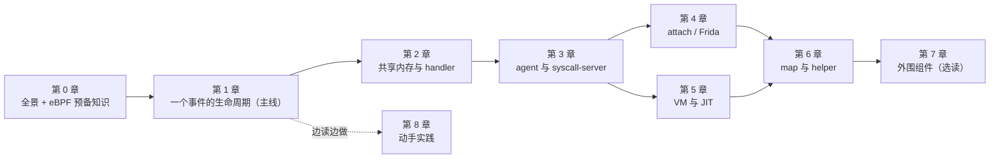

# bpftime 源码阅读指南（学习版）

这是一份带你读懂 [bpftime](https://github.com/eunomia-bpf/bpftime) 源码的指南。
读者设定：**略懂 eBPF**（听说过 map、prog、helper、uprobe），但没读过 bpftime，
也不一定熟 libbpf 和 C++ 的 boost::interprocess。

全书只讲官方上游代码，基线是 master 的 `177a1dc465ff`（2026-10-18）。代码路径和函数名
都按这个提交核对过；上游往后演进时，用函数名 grep 定位就行。

## bpftime 一句话

bpftime 把内核里那套 eBPF 对象（prog、map、link、perf buffer）搬到**用户态共享内存**里
重新实现了一遍。两个 LD_PRELOAD 的动态库各管一侧：

- `syscall-server.so` 装进 **loader**（比如 sslsniff）。它冒充内核，把 `bpf(2)` 这类调用
  变成"往共享内存里写一条对象记录"。
- `agent.so` 装进**目标进程**（比如 nginx）。它从共享内存读出程序，JIT 成本机码，
  再用 inline hook 挂到目标函数上。

事件发生时，程序直接在目标进程里跑，不进内核。这就是 bpftime 快的原因。

## 怎么读

1. **必读：第 0 章和第 1 章。** 第 0 章给地图，第 1 章跟着一个真实事件
   （nginx 里一次 `SSL_read` 被 sslsniff 抓到）从头走到尾。读完这两章，你就知道每个部件
   在整条链路的什么位置。
2. **第 2–6 章按需深入。** 每章放大第 1 章里的一段。箭头是推荐顺序，第 4、5 章可以互换。
3. **第 7 章选读。** daemon、verifier、命令行工具、单测都在这里。
4. **第 8 章边读边做。** 里面有按章节编排的小实验。动手验证比干读快得多。

每章的结构都一样：

- **本章要回答的问题**：先知道要找什么。
- **正文**：先讲直觉和设计理由，再看精简过的关键代码。
- **小结**、**动手验证**、**自测题**（答案折叠起来）。
- **深入参考**（折叠）：精确行号、实现细节和坑、上游变更史。第一遍可以完全跳过。

## 目录

| 章节 | 内容 | |
|---|---|---|
| [0. 全景架构](00-architecture.md) | eBPF 预备知识；bpftime 是什么、由哪些部件组成；术语表 | 必读 |
| [1. 一个事件的完整生命周期](01-lifecycle.md) | 13 步：从 loader 加载程序，到 nginx 里触发，再到 sslsniff 打印 | 必读 |
| [2. 共享内存与 handler 注册表](02-runtime-shm.md) | 用户态的"内核对象表"：共享内存布局、假 fd、会话与清理 | |
| [3. agent 与 syscall-server](03-agent-syscall-server.md) | 两个 LD_PRELOAD 库：怎么拦截调用、怎么装配 attach | |
| [4. attach：Frida uprobe](04-attach-frida.md) | inline hook、寄存器转换、override / replace；附 trap 后端 | |
| [5. VM 与 LLVM JIT](05-vm-llvm-jit.md) | 字节码怎么变成本机码，helper 怎么绑定 | |
| [6. map 与 helper](06-maps-helpers.md) | map 分发、per-CPU 模拟、perf 输出、probe_read | |
| [7. 外围组件](07-periphery.md) | daemon、verifier、bpftimetool / cli、单测 | 选读 |
| [8. 动手实践](08-practice.md) | 学习路线、环境准备、按章节的验证实验 | 边读边做 |
| [附录：研究笔记](09-appendix-research-notes.md) | 性能研究与 PR 状态记录，代码与注释不一致清单 | 学习可跳过 |

## 相关文档

- 我们的优化分支相对官方的改动和实测：分支 [`summry/jetson`](../../tree/summry/jetson)
  的 [`realprog/`](../../tree/summry/jetson/realprog)。本指南不重复这些内容。
- 性能调查的结论和方法论：同在 [`summry/jetson`](../../tree/summry/jetson)。
- benchmark 怎么跑：分支 [`main`](../../tree/main) 的 README。
