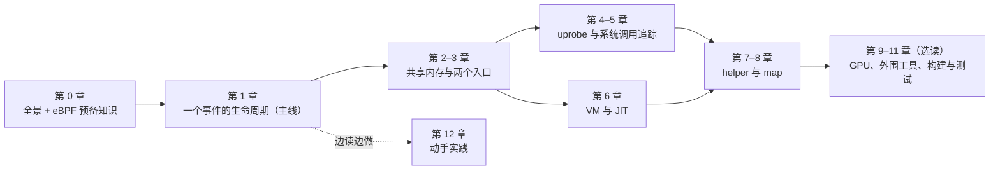

# bpftime 源码阅读指南（学习版）

这是一份带你读懂 [bpftime](https://github.com/eunomia-bpf/bpftime) 源码的指南。
读者设定：**略懂 eBPF**（听说过 map、prog、helper、uprobe），但没读过 bpftime，
也不一定熟 libbpf 和 C++ 的 boost::interprocess。

全书只讲官方上游代码，基线是 master 的 `177a1dc465ff`（2026-10-18）。代码路径和函数名
都按这个提交核对过；上游往后演进时，用函数名 grep 定位就行。

## bpftime 一句话

bpftime 把内核里那套 eBPF 对象（prog、map、link、perf buffer）搬到**用户态共享内存**里
重新实现了一遍。两个 LD_PRELOAD 的动态库各管一侧：

- `syscall-server.so` 装进 **loader**（比如 sslsniff）。它冒充内核，把 `bpf(2)` 这类调用
  变成"往共享内存里写一条对象记录"。
- `agent.so` 装进**目标进程**（比如 nginx）。它从共享内存读出程序，JIT 成本机码，
  再用 inline hook 挂到目标函数上。

事件发生时，程序直接在目标进程里跑，不进内核。这就是 bpftime 快的原因。

## 怎么读

这张图是推荐的阅读顺序：实线是先后关系，虚线表示可以从那一章开始边读边动手。

1. **必读：第 0 章和第 1 章。** 第 0 章给地图，第 1 章跟着一个真实事件
   （nginx 里一次 `SSL_read` 被 sslsniff 抓到）从头走到尾。读完这两章，你就知道每个部件
   在整条链路的什么位置。
2. **第 2–8 章按需深入。** 每章放大第 1 章里的一段。先读第 2、3 章（共享内存和两个入口），
   之后 attach（第 4、5 章）和 VM（第 6 章）两条线可以任选先后，最后读 helper 与 map（第 7、8 章）。
3. **第 9–11 章选读。** GPU 支持、daemon / verifier 等外围工具、构建系统与单测地图，用到再看。
4. **第 12 章边读边做。** 里面有按章编号的小实验。动手验证比干读快得多。

每章的结构都一样：

- **本章要回答的问题**：先知道要找什么。
- **正文**：先讲直觉和设计理由，再看精简过的关键代码。
- **小结**、**动手验证**、**自测题**（答案折叠起来）。
- **深入参考**（折叠）：精确行号、实现细节和坑、上游变更史。第一遍可以完全跳过。

## 目录

| 章节 | 内容 | |
|---|---|---|
| [0. 全景架构](00-architecture.md) | eBPF 预备知识；bpftime 是什么、由哪些部件组成；仓库地图；术语表 | 必读 |
| [1. 一个事件的完整生命周期](01-lifecycle.md) | 13 步：从 loader 加载程序，到 nginx 里触发，再到 sslsniff 打印 | 必读 |
| [2. 共享内存与 handler 表](02-runtime-shm.md) | 用户态的"内核对象表"：共享内存布局、7 种 handler、假 fd、会话与清理、json 导出导入 | 按需 |
| [3. 两个入口：syscall-server、agent 与 cli](03-entrypoints.md) | 两个 LD_PRELOAD 库怎么拦截调用、怎么装配 attach；agent 的启动与刷新；`bpftime` 命令行 | 按需 |
| [4. uprobe 类 attach](04-attach-uprobe.md) | inline hook、寄存器转换、override / replace；trap 后端；自定义 attach | 按需 |
| [5. 系统调用追踪](05-syscall-trace.md) | syscall_trace attach；把 `syscall` 指令改写成跳转的 text_segment_transformer | 按需 |
| [6. VM 与 JIT](06-vm-jit.md) | 字节码怎么变成本机码；lddw 与 helper 绑定；惰性 JIT；ubpf 后端；AOT 产物 | 按需 |
| [7. helper](07-helpers.md) | helper 的三组与注册；helper 总表；perf / ringbuf 输出；probe_read；ufunc；tail call | 按需 |
| [8. map](08-maps.md) | map 分发与加锁；全部 map 类型；per-CPU 模拟；ringbuf 与 perf 的生产消费协议；内核共享 map | 按需 |
| [9. GPU / CUDA 概览](09-gpu.md) | 拦截 CUDA 运行时 → 把 eBPF 编成 PTX 插桩 → 重编模块；GPU map 与 GPU→CPU 通信 | 选读 |
| [10. 外围工具](10-periphery.md) | daemon、verifier、bpftimetool、bpftime-aot | 选读 |
| [11. 构建、测试与示例地图](11-build-test.md) | CMake 选项与构建产物；单测怎么跑；示例与 benchmark 总表 | 选读 |
| [12. 动手实践](12-practice.md) | 学习路线、环境准备、按章编号的验证实验 | 边读边做 |
| [附录 A 研究笔记](A-research-notes.md) | 性能研究记录：七月的三个修复与上游 PR 状态、研究用实验 | 学习可跳过 |
| [附录 B 已知问题清单](B-known-issues.md) | 通读源码时发现的疑似 bug、和内核语义不同的行为、文档与代码不符之处 | 遇到坑时查 |

## 关于附录 B

正文讲机制，不罗列 bug。读正文时碰到"这里有个坑"，正文只写一句话，链到
[附录 B](B-known-issues.md) 对应的分节；位置、确定程度（已实跑 / 读码确认 / 推断）和影响都在那里。
做第 12 章的实验前，建议先扫一眼附录 B 开头的"最可能踩到的几条"——比如跑单测前要设
`BPFTIME_GLOBAL_SHM_NAME`，否则会动到默认的共享内存段。

附录 B 只是记录，没有向上游报告，也没有修。

## 关于 `labs/` 目录

[`labs/`](labs/) 里是第 2、3 章「动手验证」要用的小程序：一个不依赖 libbpf、直接调 `bpf(2)` 的最小 loader（`loader.c`），被追踪的 `victim.c`（必须 `-O0` 编译），
只调一次 `close(-1)` 的 `poke.c`，以及 `build.sh` 和两章各自的脚本 `ch02-shm.sh`、`ch03-refresh.sh`。用法见目录里的 README。

## 关于 `notes/` 目录

[`notes/`](notes/) 是写这份指南之前逐文件通读源码时记的笔记（R1–R8 各管一块，`X-crosscheck.md`
是跨模块问题的裁定，`00-outline.md` 是本书大纲）。它们比正文细得多，每个事实都带 `路径:行号`，
可以当源码索引用；但没有按教学顺序整理，第一次读不建议从这里开始。

## 相关文档

- 我们的优化分支相对官方的改动和实测：分支 [`summry/jetson`](../../tree/summry/jetson)
  的 [`realprog/`](../../tree/summry/jetson/realprog)。本指南不重复这些内容。
- 性能调查的结论和方法论：同在 [`summry/jetson`](../../tree/summry/jetson)。
- benchmark 怎么跑：分支 [`main`](../../tree/main) 的 README。
